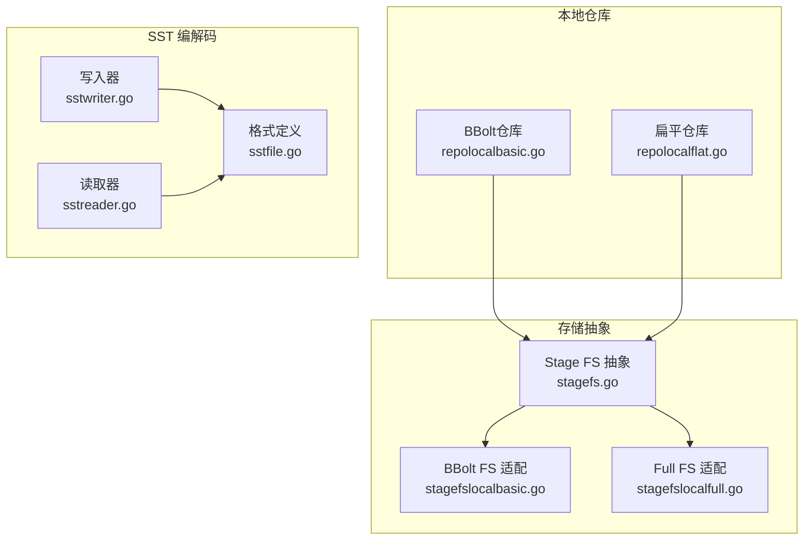
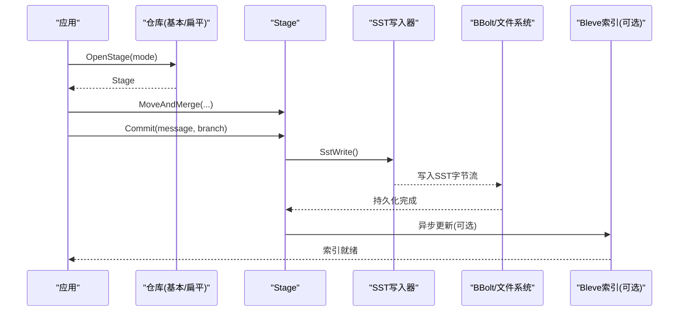
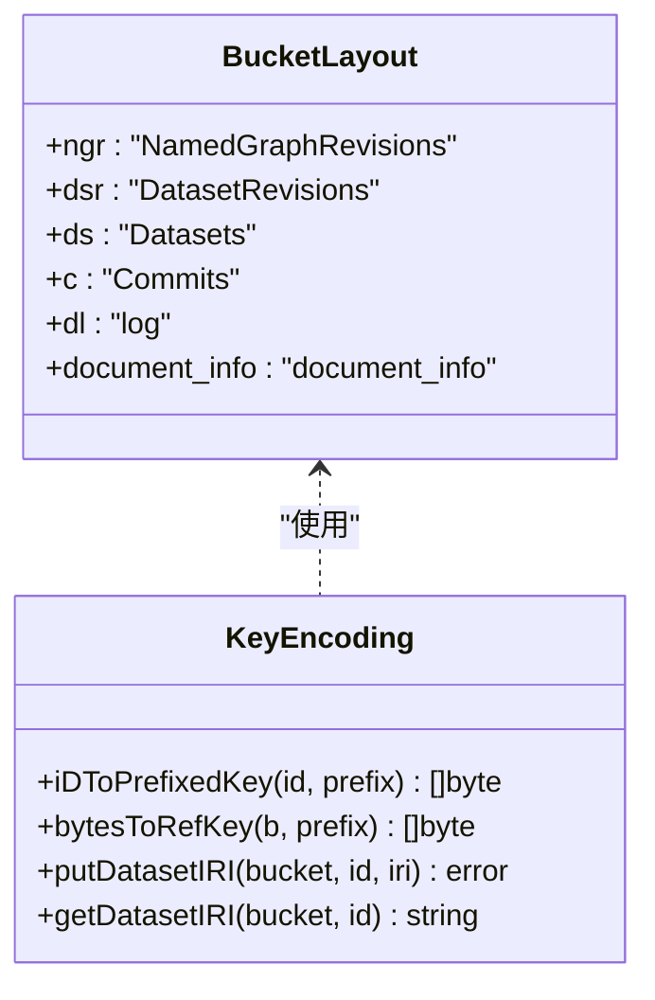
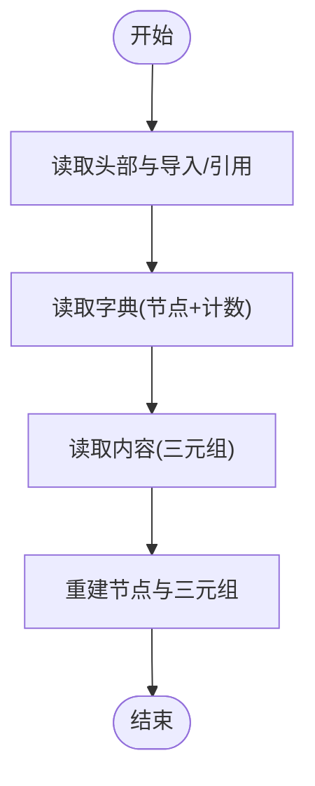
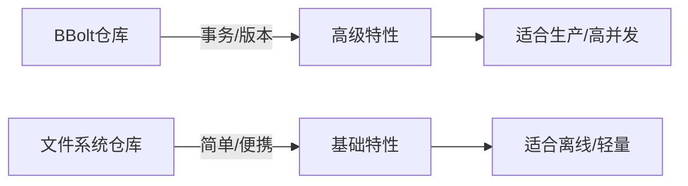
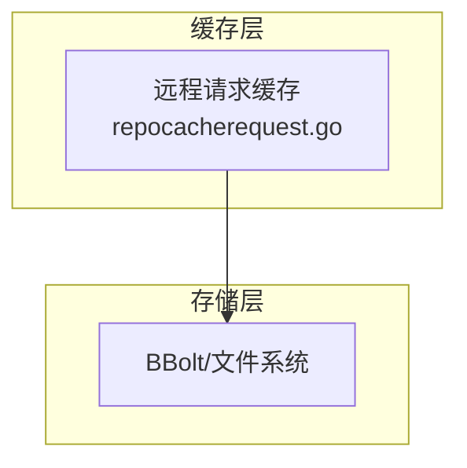
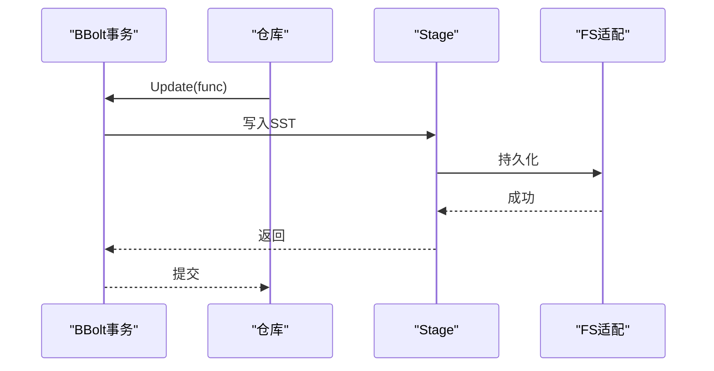
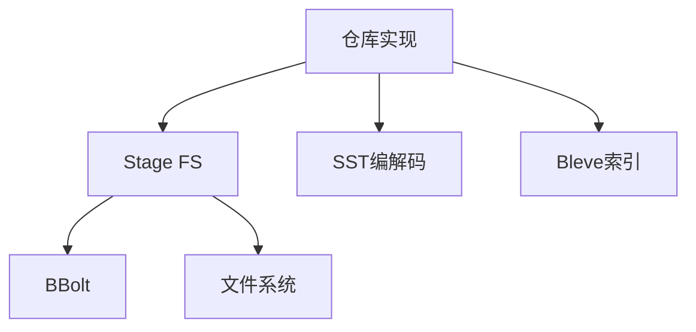

# 存储优化

<cite>
**本文引用的文件**
- [bbolt_structure.go](file://sst/bbolt_structure.go)
- [repolocalbasic.go](file://sst/repolocalbasic.go)
- [repolocalflat.go](file://sst/repolocalflat.go)
- [stagefs.go](file://sst/stagefs.go)
- [stagefslocalbasic.go](file://sst/stagefslocalbasic.go)
- [stagefslocalfull.go](file://sst/stagefslocalfull.go)
- [sstwriter.go](file://sst/sstwriter.go)
- [sstreader.go](file://sst/sstreader.go)
- [sstfile.go](file://sst/sstfile.go)
- [repocacherequest.go](file://sst/repocacherequest.go)
</cite>

## 目录
1. [简介](#简介)
2. [项目结构](#项目结构)
3. [核心组件](#核心组件)
4. [架构总览](#架构总览)
5. [详细组件分析](#详细组件分析)
6. [依赖关系分析](#依赖关系分析)
7. [性能考量](#性能考量)
8. [故障排查指南](#故障排查指南)
9. [结论](#结论)
10. [附录](#附录)

## 简介
本指南聚焦于SST存储优化，围绕BBolt数据库的存储结构设计、键值编码策略与索引优化展开，并对比不同存储后端（BBolt与文件系统）的性能特点与适用场景。文档还涵盖数据分片、压缩与缓存策略、批量写入优化、事务处理与并发访问控制、配置调优建议、容量规划、备份恢复与故障转移最佳实践，以及生产环境的监控与维护策略。

## 项目结构
SST在本地仓库中提供两种主要实现：
- BBolt-backed 基本仓库：以BBolt作为持久化存储，使用命名空间桶组织数据集、提交、日志等元数据，并通过虚拟FS将桶内容暴露为文件接口。
- 扁平文件系统仓库：以目录中的独立SST文件作为数据集载体，无版本历史与提交图。

此外，SST定义了紧凑的二进制文件格式（SST），用于序列化三元组、字典与引用信息，支持高效读写与去重。

图表来源
- [repolocalbasic.go:34-42](file://sst/repolocalbasic.go#L34-L42)
- [repolocalflat.go:28-32](file://sst/repolocalflat.go#L28-L32)
- [stagefs.go:23-46](file://sst/stagefs.go#L23-L46)
- [stagefslocalbasic.go:21-34](file://sst/stagefslocalbasic.go#L21-L34)
- [stagefslocalfull.go:16-27](file://sst/stagefslocalfull.go#L16-L27)
- [sstwriter.go:67-82](file://sst/sstwriter.go#L67-L82)
- [sstreader.go:44-80](file://sst/sstreader.go#L44-L80)
- [sstfile.go:12-54](file://sst/sstfile.go#L12-L54)

章节来源
- [repolocalbasic.go:34-42](file://sst/repolocalbasic.go#L34-L42)
- [repolocalflat.go:28-32](file://sst/repolocalflat.go#L28-L32)
- [stagefs.go:23-46](file://sst/stagefs.go#L23-L46)
- [sstfile.go:12-54](file://sst/sstfile.go#L12-L54)

## 核心组件
- BBolt仓库（Basic）：通过BBolt桶组织数据集、提交、日志等；提供视图/更新封装，结合bleve全文索引。
- 扁平仓库（Flat）：直接基于文件系统目录管理SST文件，简单直观，适合静态或轻量场景。
- Stage FS：统一的文件接口抽象，屏蔽底层存储差异，便于上层操作一致。
- SST编解码：紧凑二进制格式，包含头、导入/引用、字典、内容四段，支持多种字面量类型与集合。

章节来源
- [repolocalbasic.go:44-65](file://sst/repolocalbasic.go#L44-L65)
- [repolocalflat.go:54-61](file://sst/repolocalflat.go#L54-L61)
- [stagefs.go:23-46](file://sst/stagefs.go#L23-L46)
- [sstwriter.go:67-82](file://sst/sstwriter.go#L67-L82)
- [sstreader.go:44-80](file://sst/sstreader.go#L44-L80)

## 架构总览
下图展示了从应用层到存储层的调用链：仓库打开阶段→创建Stage→写入SST→持久化到BBolt或文件系统→可选索引更新。

图表来源
- [repolocalbasic.go:616-653](file://sst/repolocalbasic.go#L616-L653)
- [repolocalflat.go:301-322](file://sst/repolocalflat.go#L301-L322)
- [sstwriter.go:67-82](file://sst/sstwriter.go#L67-L82)
- [stagefs.go:98-121](file://sst/stagefs.go#L98-L121)

## 详细组件分析

### BBolt存储结构与布局
- 顶层桶与键前缀：
  - NamedGraphRevisions（ngr）：按哈希键存储命名图SST内容。
  - DatasetRevisions（dsr）：子桶描述数据集版本树，含默认NG哈希、直接导入UUID、所有NG的扁平列表、创建commit哈希。
  - Datasets（ds）：数据集ID到分支/标签/叶子提交/IRI映射。
  - Commits（c）：提交对象，含变更的数据集版本、作者、消息等。
  - log：有序仓库级操作日志，键为递增序列号，值为事件字段映射。
  - document_info：上传文档元数据（文件名、MIME、作者、时间）。
- 键编码策略：
  - iDToPrefixedKey：将UUID与单字节前缀组合，形成稳定排序键。
  - bytesToRefKey：为引用键添加前缀，区分分支/叶子等。
  - Version 5 UUID支持原始IRI存取，便于可追溯性。

图表来源
- [bbolt_structure.go:81-191](file://sst/bbolt_structure.go#L81-L191)
- [bbolt_structure.go:192-254](file://sst/bbolt_structure.go#L192-L254)

章节来源
- [bbolt_structure.go:81-191](file://sst/bbolt_structure.go#L81-L191)
- [bbolt_structure.go:192-254](file://sst/bbolt_structure.go#L192-L254)

### 键值编码与SST格式
- SST文件结构：
  - 头部：魔数“SST-1.0”、图URI。
  - 导入/引用：分别列出导入图与外部引用图的IRI。
  - 字典：节点（IRI/空白节点）及其引用计数，按序排列。
  - 内容：每个节点的三元组（非字面量与字面量），字面量采用类型化编码（字符串、语言标签、整数、浮点、布尔、日期时间、集合等）。
- 写入流程：
  - 收集图上下文、统计节点与三元组数量、排序节点、分配索引、写出字典与内容。
- 读取流程：
  - 解析头、导入/引用、字典、内容；重建节点与三元组，空白节点使用确定性UUID以保证多次读取一致性。

图表来源
- [sstfile.go:12-54](file://sst/sstfile.go#L12-L54)
- [sstwriter.go:67-82](file://sst/sstwriter.go#L67-L82)
- [sstreader.go:44-80](file://sst/sstreader.go#L44-L80)

章节来源
- [sstfile.go:12-54](file://sst/sstfile.go#L12-L54)
- [sstwriter.go:67-82](file://sst/sstwriter.go#L67-L82)
- [sstreader.go:44-80](file://sst/sstreader.go#L44-L80)

### 存储后端对比：BBolt vs 文件系统
- BBolt仓库（Basic）：
  - 优点：事务性、原子提交、强一致、支持版本历史与分支；适合高并发读、复杂查询与索引维护。
  - 缺点：大对象写入需考虑页大小与写放大；需要定期维护（如收缩）。
- 扁平仓库（Flat）：
  - 优点：结构简单、易迁移、天然支持跨进程共享；适合静态数据或离线批处理。
  - 缺点：无版本历史、无集中元数据、扩展性受限。

章节来源
- [repolocalbasic.go:44-65](file://sst/repolocalbasic.go#L44-L65)
- [repolocalflat.go:54-61](file://sst/repolocalflat.go#L54-L61)

### 数据分片、压缩与缓存策略
- 数据分片：
  - 通过数据集ID与命名图哈希进行逻辑分片；BBolt桶与SST文件天然隔离不同数据集与版本。
- 压缩：
  - SST格式本身紧凑，字面量类型化编码减少冗余；未引入通用压缩算法，可在上层按需压缩传输或归档。
- 缓存：
  - 远程请求缓存：对常用查询构建预编译消息缓存，降低网络开销。
  - 索引健康感知：Bleve索引更新采用健康感知包装，避免崩溃影响。

图表来源
- [repocacherequest.go:30-42](file://sst/repocacherequest.go#L30-L42)

章节来源
- [repocacherequest.go:30-42](file://sst/repocacherequest.go#L30-L42)

### 批量写入优化、事务处理与并发控制
- 批量写入：
  - SST写入器在内存中构建字典与内容，一次性写出，减少IO次数。
  - 通过varint与类型化编码提升序列化效率。
- 事务处理：
  - BBolt事务保证原子性；视图/更新封装确保并发安全。
- 并发控制：
  - 仓库级别状态机（enter/leave）限制并发进入；关闭时等待所有操作退出。
  - Bleve索引更新异步执行，避免阻塞主路径。

图表来源
- [repolocalbasic.go:459-472](file://sst/repolocalbasic.go#L459-L472)
- [stagefs.go:98-121](file://sst/stagefs.go#L98-L121)

章节来源
- [repolocalbasic.go:459-472](file://sst/repolocalbasic.go#L459-L472)
- [stagefs.go:98-121](file://sst/stagefs.go#L98-L121)

### 存储配置调优参数与基准测试
- 配置要点：
  - BBolt页大小、写缓冲、只读模式等可通过DB选项调整（具体参数由BBolt库提供）。
  - 索引目录与清理策略：扁平仓库扫描目录计算大小与数量；BBolt仓库统计桶键数与索引大小。
- 基准测试：
  - 仓库Info方法提供尺寸统计（BBolt文件大小、SST文件总数与总大小、索引大小）。
  - 建议在典型负载下测量吞吐与延迟，关注写放大与索引重建耗时。

章节来源
- [repolocalbasic.go:660-723](file://sst/repolocalbasic.go#L660-L723)
- [repolocalflat.go:381-430](file://sst/repolocalflat.go#L381-L430)

### 容量规划、备份恢复与故障转移
- 容量规划：
  - 依据数据集规模与版本增长趋势估算BBolt文件大小与SST文件总量；预留索引空间。
- 备份恢复：
  - BBolt：拷贝数据库文件或使用工具导出；注意一致性快照。
  - 文件系统：复制目录与SST文件；校验完整性。
- 故障转移：
  - 多副本部署时，优先选择一致性强的BBolt方案；文件系统方案需配合分布式锁或协调服务。

章节来源
- [repolocalbasic.go:660-723](file://sst/repolocalbasic.go#L660-L723)
- [repolocalflat.go:381-430](file://sst/repolocalflat.go#L381-L430)

### 生产环境监控与维护策略
- 监控指标：
  - BBolt文件大小、桶键数量、索引大小、写入延迟、事务时长。
  - 文件系统仓库的SST文件数量与总大小。
- 维护策略：
  - 定期重建索引（当配置变化或损坏时）。
  - 监控异常错误（如桶不存在、文件未找到）并及时告警。

章节来源
- [repolocalbasic.go:67-145](file://sst/repolocalbasic.go#L67-L145)
- [repolocalbasic.go:234-253](file://sst/repolocalbasic.go#L234-L253)

## 依赖关系分析
- 组件耦合：
  - 仓库实现依赖Stage FS抽象，屏蔽底层存储差异。
  - SST编解码与FS适配解耦，便于替换存储后端。
- 外部依赖：
  - BBolt用于事务与KV存储。
  - Bleve用于全文索引。
  - Protobuf/gRPC用于远程仓库协议（不在本仓库核心逻辑内）。

图表来源
- [repolocalbasic.go:34-42](file://sst/repolocalbasic.go#L34-L42)
- [stagefs.go:23-46](file://sst/stagefs.go#L23-L46)
- [sstwriter.go:67-82](file://sst/sstwriter.go#L67-L82)

章节来源
- [repolocalbasic.go:34-42](file://sst/repolocalbasic.go#L34-L42)
- [stagefs.go:23-46](file://sst/stagefs.go#L23-L46)

## 性能考量
- 写入路径：
  - 内存中构建字典与内容，减少随机IO；类型化编码提升序列化效率。
- 读取路径：
  - 顺序读取SST文件，利用二分查找定位节点范围；空白节点确定性重建保证一致性。
- 索引更新：
  - 异步更新避免阻塞提交；健康感知包装提高鲁棒性。
- 存储选择：
  - 高并发读与版本历史需求选BBolt；简单场景选文件系统。

[本节为通用性能讨论，不直接分析具体文件]

## 故障排查指南
- 常见错误：
  - 桶不存在、文件未找到、命名图未找到等。
  - 索引重建失败、配置文件不一致导致重建。
- 排查步骤：
  - 检查BBolt桶是否存在与键是否正确。
  - 验证SST文件头部与字典完整性。
  - 查看日志与错误码，定位问题阶段。

章节来源
- [stagefs.go:17-21](file://sst/stagefs.go#L17-L21)
- [stagefslocalbasic.go:16-19](file://sst/stagefslocalbasic.go#L16-L19)
- [repolocalbasic.go:67-145](file://sst/repolocalbasic.go#L67-L145)

## 结论
SST通过紧凑的二进制格式与灵活的存储抽象，实现了高效的三元组存储与检索。BBolt仓库提供事务与版本能力，适合生产环境；文件系统仓库则更简单便携。结合合理的配置、监控与维护策略，可在不同场景下获得良好的性能与可靠性。

[本节为总结，不直接分析具体文件]

## 附录
- SST格式参考：
  - 头、导入/引用、字典、内容的详细结构见SST文件定义。
- 键编码示例：
  - 使用UUID与前缀生成稳定排序键，支持Version 5 UUID的IRI映射。

章节来源
- [sstfile.go:12-54](file://sst/sstfile.go#L12-L54)
- [bbolt_structure.go:192-254](file://sst/bbolt_structure.go#L192-L254)