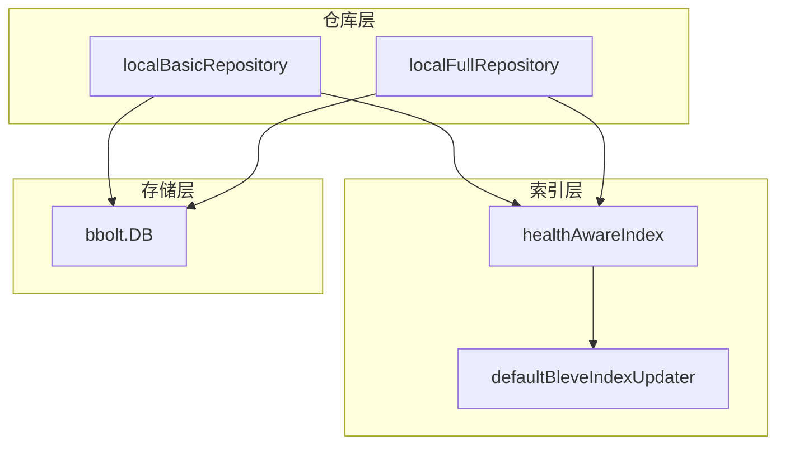
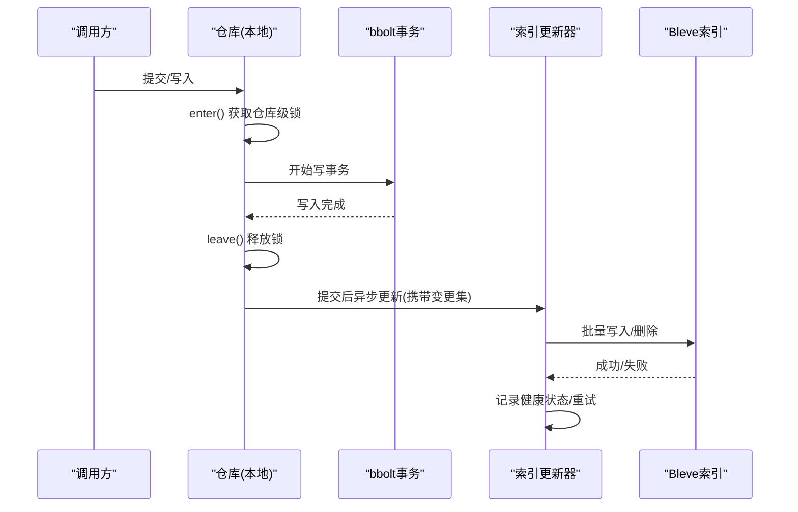
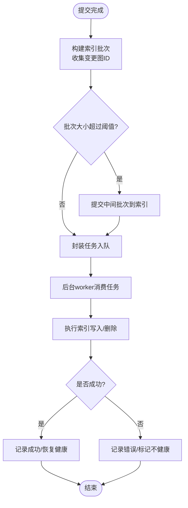
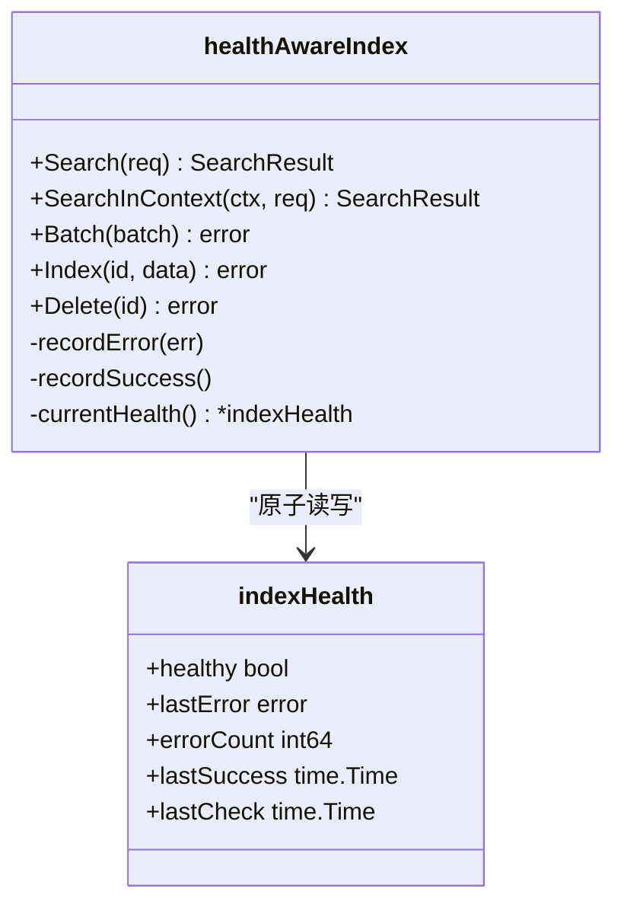
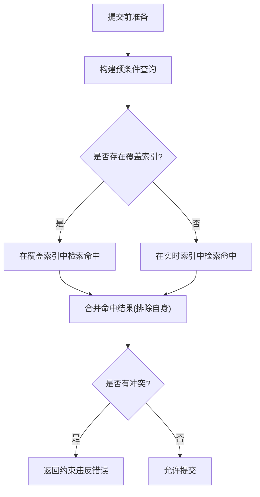
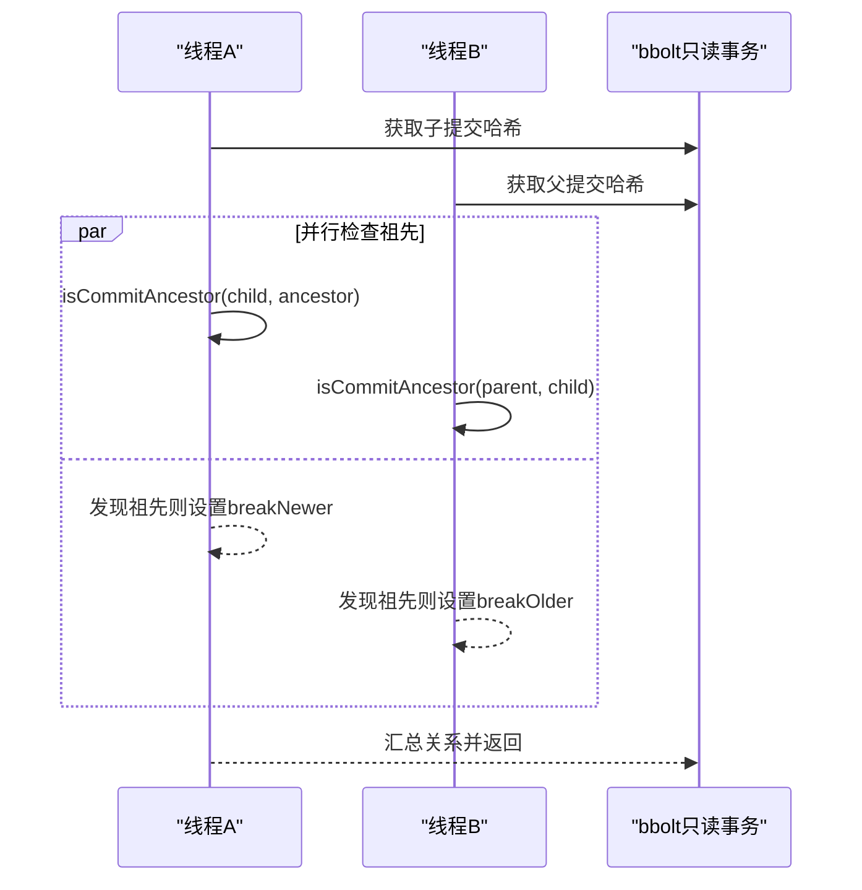
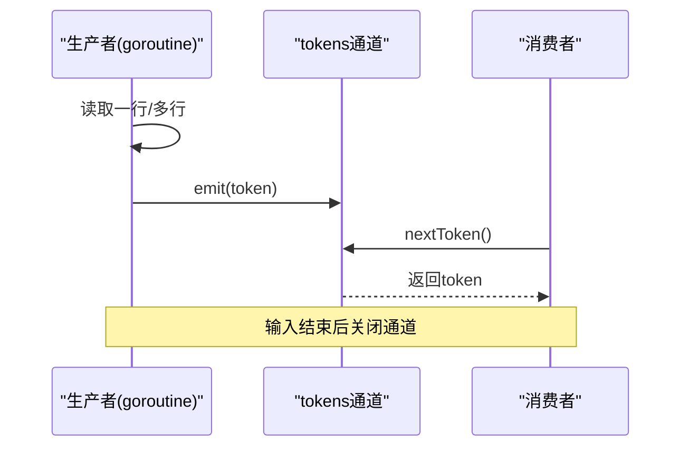

# 并发性能

<cite>
**本文引用的文件**
- [indexupdate.go](file://sst/indexupdate.go)
- [repolocalbasic.go](file://sst/repolocalbasic.go)
- [repolocalfull.go](file://sst/repolocalfull.go)
- [repointernalcommit.go](file://sst/repointernalcommit.go)
- [rdflex.go](file://sst/rdflex.go)
- [errrecovery.go](file://sst/errrecovery.go)
</cite>

## 目录
1. [简介](#简介)
2. [项目结构](#项目结构)
3. [核心组件](#核心组件)
4. [架构总览](#架构总览)
5. [详细组件分析](#详细组件分析)
6. [依赖关系分析](#依赖关系分析)
7. [性能考量](#性能考量)
8. [故障排查指南](#故障排查指南)
9. [结论](#结论)
10. [附录](#附录)

## 简介
本指南聚焦 SST 在高并发场景下的性能优化与稳定性保障，围绕以下主题展开：
- 多客户端并发访问的锁策略与事务隔离级别
- 读写操作的并发控制与冲突解决机制
- goroutine 池、工作队列与异步处理模式
- 分布式环境下的数据一致性与同步策略
- 并发性能测试、瓶颈识别与调优方法
- 连接池管理、请求限流与超时处理的最佳实践
- 高并发场景下的系统稳定性与性能保障方案

SST 的核心存储为 bbolt（单写者、多读者），搜索索引为 Bleve。通过“提交后异步更新索引”的模式，将写路径上的 I/O 阻塞降到最低；同时以健康感知索引包装器提供重试与降级能力，确保读路径在高负载下仍具备韧性。

## 项目结构
与并发性能密切相关的代码主要分布在 sst 包中：
- 仓库实现：localBasicRepository、localFullRepository
- 索引更新：bleveIndexUpdater 接口与默认异步实现
- 提交与版本比较：commit 关系计算与祖先检查
- 解析器：RDF/TriG 词法分析器使用协程与通道流水线
- 错误恢复：panic 捕获与堆栈收集



图表来源
- [repolocalbasic.go:224-232](file://sst/repolocalbasic.go#L224-L232)
- [repolocalfull.go:428-436](file://sst/repolocalfull.go#L428-L436)
- [indexupdate.go:662-795](file://sst/indexupdate.go#L662-L795)
- [indexupdate.go:77-158](file://sst/indexupdate.go#L77-L158)

章节来源
- [repolocalbasic.go:224-232](file://sst/repolocalbasic.go#L224-L232)
- [repolocalfull.go:428-436](file://sst/repolocalfull.go#L428-L436)
- [indexupdate.go:77-158](file://sst/indexupdate.go#L77-L158)
- [indexupdate.go:662-795](file://sst/indexupdate.go#L662-L795)

## 核心组件
- 异步索引更新器：将 Bleve 写入从提交主流程中剥离，降低写放大与阻塞时间
- 健康感知索引包装器：对搜索/批量操作进行错误记录、重试与健康状态切换
- 预提交约束与批处理：在提交前校验唯一性约束，避免无效写入
- 并发祖先检查：在比较提交关系时使用 goroutine + atomic 提前终止
- 词法分析流水线：基于 channel 的并行分词，提升大文档解析吞吐
- 错误恢复：统一捕获 panic 并附带堆栈，便于定位问题

章节来源
- [indexupdate.go:77-158](file://sst/indexupdate.go#L77-L158)
- [indexupdate.go:662-795](file://sst/indexupdate.go#L662-L795)
- [repointernalcommit.go:107-136](file://sst/repointernalcommit.go#L107-L136)
- [rdflex.go:94-110](file://sst/rdflex.go#L94-L110)
- [errrecovery.go:81-93](file://sst/errrecovery.go#L81-L93)

## 架构总览
SST 的并发架构围绕“写路径短、读路径健”的原则设计：
- 写路径：进入仓库级互斥（enter/leave）→ 构建阶段 → 写入 bbolt 事务 → 触发异步索引更新
- 读路径：通过 bbolt 只读事务读取数据；搜索走 healthAwareIndex，具备重试与降级
- 索引更新：后台 worker 串行消费任务队列，保证索引一致性；支持 flush/close 优雅关闭



图表来源
- [repolocalbasic.go:616-653](file://sst/repolocalbasic.go#L616-L653)
- [repolocalfull.go:734-761](file://sst/repolocalfull.go#L734-L761)
- [indexupdate.go:160-249](file://sst/indexupdate.go#L160-L249)
- [indexupdate.go:703-735](file://sst/indexupdate.go#L703-L735)

## 详细组件分析

### 异步索引更新器与工作队列
- 设计要点
  - 使用带缓冲的任务队列，将 Bleve 写入转移到后台 goroutine，避免阻塞提交主流程
  - 提供 flush/close 语义，确保关闭时能清空队列并等待 worker 退出
  - 通过 captured 变量捕获上下文，避免跨 goroutine 共享可变状态
- 复杂度与性能
  - 入队 O(1)，出队与执行均摊 O(1)
  - 批量大小阈值控制，防止单次 batch 过大导致内存抖动
- 错误处理
  - 记录错误并影响健康状态；必要时触发重试或告警



图表来源
- [indexupdate.go:77-158](file://sst/indexupdate.go#L77-L158)
- [indexupdate.go:160-249](file://sst/indexupdate.go#L160-L249)
- [indexupdate.go:424-434](file://sst/indexupdate.go#L424-L434)

章节来源
- [indexupdate.go:77-158](file://sst/indexupdate.go#L77-L158)
- [indexupdate.go:160-249](file://sst/indexupdate.go#L160-L249)
- [indexupdate.go:424-434](file://sst/indexupdate.go#L424-L434)

### 健康感知索引包装器与重试
- 功能
  - 对 Search/Batch/Index/Delete 等关键操作进行错误统计与健康状态维护
  - 对可重试错误进行短暂休眠后重试，提高可用性
  - 若之前已不健康，即使本次成功也返回警告，便于上层监控
- 并发安全
  - 使用原子值保存健康状态，避免额外锁开销



图表来源
- [indexupdate.go:662-795](file://sst/indexupdate.go#L662-L795)

章节来源
- [indexupdate.go:662-795](file://sst/indexupdate.go#L662-L795)

### 预提交约束与冲突解决
- 唯一性约束
  - 在提交前根据 deriveInfo 生成查询，检查“根节点唯一性”约束，避免重复写入
  - 支持覆盖索引（overrideIndex）用于暂存区与真实索引的差异判断
- 冲突检测
  - 若检测到冲突，返回明确错误信息，包含冲突 ID 列表与查询详情
- 性能
  - 使用批量构建与阈值刷新，减少频繁 I/O



图表来源
- [indexupdate.go:486-573](file://sst/indexupdate.go#L486-L573)

章节来源
- [indexupdate.go:486-573](file://sst/indexupdate.go#L486-L573)

### 提交关系比较与并发祖先检查
- 目标
  - 快速判断两个提交之间的相对关系（旧/新/相同/无关）
- 并发优化
  - 使用 goroutine 并行检查“是否为祖先”，并通过 atomic 标志位提前中断另一侧检查
- 鲁棒性
  - 当桶不可用时回退到“最新提交”判定逻辑



图表来源
- [repointernalcommit.go:107-136](file://sst/repointernalcommit.go#L107-L136)
- [repointernalcommit.go:234-266](file://sst/repointernalcommit.go#L234-L266)

章节来源
- [repointernalcommit.go:107-136](file://sst/repointernalcommit.go#L107-L136)
- [repointernalcommit.go:234-266](file://sst/repointernalcommit.go#L234-L266)

### RDF/TriG 词法分析器与通道流水线
- 设计
  - 启动独立 goroutine 持续扫描输入，将 token 推送到 channel
  - 支持行模式与非行模式，自动跳过空白与注释
- 并发优势
  - 上游消费者可并行拉取 token，适合流式解析与增量处理
- 资源管理
  - 结束时关闭 tokens 通道，通知消费者退出



图表来源
- [rdflex.go:94-110](file://sst/rdflex.go#L94-L110)
- [rdflex.go:220-235](file://sst/rdflex.go#L220-L235)
- [rdflex.go:328-343](file://sst/rdflex.go#L328-L343)

章节来源
- [rdflex.go:94-110](file://sst/rdflex.go#L94-L110)
- [rdflex.go:220-235](file://sst/rdflex.go#L220-L235)
- [rdflex.go:328-343](file://sst/rdflex.go#L328-L343)

### 错误恢复与可观测性
- 统一捕获 panic，封装为 recoveredError，可选择包含堆栈
- 通过 handleWithRecovery 将 panic 转为错误通道输出，便于上层处理
- 结合环境变量控制堆栈深度，平衡诊断信息与性能

章节来源
- [errrecovery.go:15-56](file://sst/errrecovery.go#L15-L56)
- [errrecovery.go:81-93](file://sst/errrecovery.go#L81-L93)

## 依赖关系分析
- 仓库与索引
  - localBasicRepository/localFullRepository 通过 healthAwareIndex 访问 Bleve，解耦了底层索引实现
  - 提交完成后调用 bleveIndexUpdater 异步更新，避免阻塞写路径
- 存储与事务
  - 所有写操作均在 bbolt Update 事务中进行，读操作在 View 事务中进行，天然提供 MVCC 读一致性
- 并发原语
  - 仓库级 enter/leave 提供互斥访问
  - 原子变量与 WaitGroup 用于健康状态与优雅关闭
  - goroutine + atomic 标志用于祖先检查的早期终止

```mermaid
graph LR
LBR["localBasicRepository"] --> |enter/leave| M["互斥访问"]
LFR["localFullRepository"] --> |enter/leave| M
LBR --> |view/update| BB["bbolt事务"]
LFR --> |view/update| BB
LBR --> |Bleve()| HAI["healthAwareIndex"]
LFR --> |Bleve()| HAI
HAI --> |异步| BIU["defaultBleveIndexUpdater"]
```

图表来源
- [repolocalbasic.go:224-232](file://sst/repolocalbasic.go#L224-L232)
- [repolocalfull.go:428-436](file://sst/repolocalfull.go#L428-L436)
- [indexupdate.go:77-158](file://sst/indexupdate.go#L77-L158)

章节来源
- [repolocalbasic.go:224-232](file://sst/repolocalbasic.go#L224-L232)
- [repolocalfull.go:428-436](file://sst/repolocalfull.go#L428-L436)
- [indexupdate.go:77-158](file://sst/indexupdate.go#L77-L158)

## 性能考量
- 锁策略与事务隔离
  - 仓库级互斥：OpenStage/Close/Bleve 等方法通过 enter/leave 保护共享状态，避免并发竞争
  - 事务隔离：bbolt 的 View/Update 提供快照读与串行写，满足大多数业务的一致性需求
- 读写并发控制
  - 写路径：提交后立即触发异步索引更新，缩短临界区
  - 读路径：search 走健康感知包装器，具备重试与降级，避免雪崩
- 冲突解决
  - 预提交约束检查在提交前完成，避免无效写入与后续回滚
  - 覆盖索引用于暂存区与真实索引差异判断，减少误报
- 异步与批处理
  - 任务队列缓冲 + 阈值刷新，降低 I/O 抖动
  - 后台 worker 串行化索引写入，保证顺序性与一致性
- 分布式一致性
  - 通过 commit 关系比较与祖先检查，支持分支合并与历史对齐
  - 同步过程中保留 divergent tips 作为 leaf commits，确保可达性
- 连接池、限流与超时
  - 当前仓库层未内置 HTTP/gRPC 连接池；建议在外部网关或服务层实现
  - 可在调用方对远程 RPC 增加令牌桶/漏桶限流与超时控制
- 高并发稳定性
  - 优雅关闭：close 先停止索引更新器，再关闭索引与数据库，避免竞态
  - 健康状态：记录错误次数与最近成功时间，辅助监控与自愈

[本节为通用指导，不直接分析具体文件]

## 故障排查指南
- 常见问题定位
  - 索引写入失败：查看 healthAwareIndex 的错误计数与 lastError，确认是否可重试
  - 预提交约束冲突：根据错误信息中的冲突 ID 列表与查询详情定位数据问题
  - 祖先检查耗时：检查是否出现长链回溯，必要时调整并发度或引入缓存
- 日志与堆栈
  - 启用 GOTRACEBACK=all 获取完整堆栈，配合 recoveredError 快速定位 panic 点
- 性能回归
  - 关注批量大小阈值与队列长度，避免背压导致延迟上升
  - 监控 Bleve 索引大小与重建频率，评估是否需要分片或冷热分离

章节来源
- [indexupdate.go:662-795](file://sst/indexupdate.go#L662-L795)
- [indexupdate.go:486-573](file://sst/indexupdate.go#L486-L573)
- [errrecovery.go:15-56](file://sst/errrecovery.go#L15-L56)

## 结论
SST 通过“仓库级互斥 + bbolt 事务 + 异步索引更新 + 健康感知包装”的组合，实现了高并发下的稳定与高性能。写路径短、读路径韧性的设计，使系统在大规模并发场景中仍能保持低延迟与高可用。对于分布式部署，建议在上层服务补充连接池、限流与超时控制，并结合监控指标持续优化。

[本节为总结，不直接分析具体文件]

## 附录
- 推荐实践清单
  - 使用仓库级 enter/leave 保护所有共享状态访问
  - 提交后务必调用异步更新器的 updateAfterCommit，并在关闭时调用 close
  - 合理设置批量阈值与队列容量，避免内存与延迟压力
  - 对远程调用增加限流与超时，防止下游抖动扩散
  - 定期重建或分片 Bleve 索引，控制单库规模
  - 开启健康状态监控与告警，及时发现索引异常
- 测试与基准
  - 针对提交/搜索/重建索引等热点路径编写基准测试
  - 模拟高并发写入与查询，观察延迟分布与错误率
  - 使用火焰图与 pprof 定位 CPU/内存热点

[本节为通用指导，不直接分析具体文件]