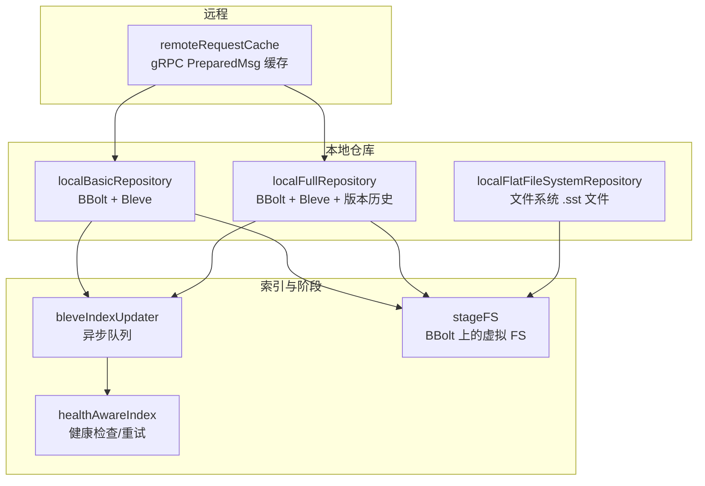
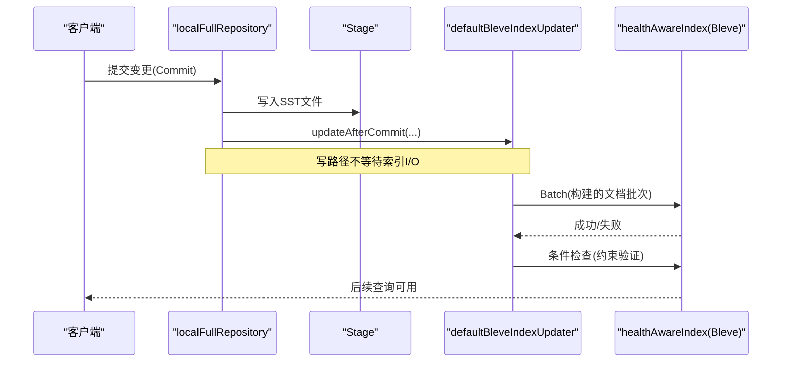
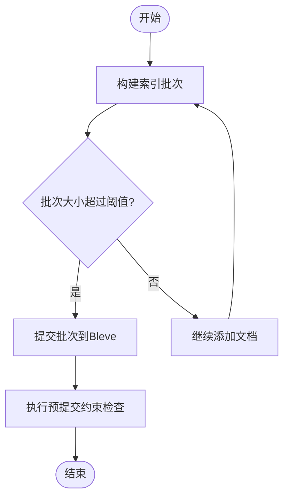
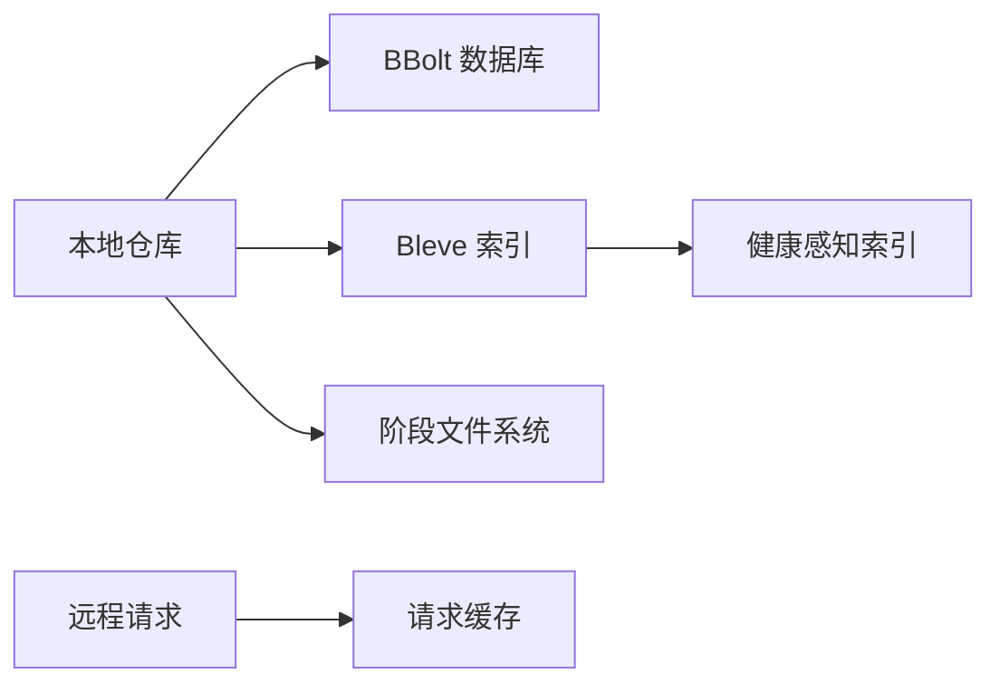

# 性能优化

<cite>
**本文引用的文件**
- [bbolt_structure.go](file://sst/bbolt_structure.go)
- [repolocalbasic.go](file://sst/repolocalbasic.go)
- [repolocalfull.go](file://sst/repolocalfull.go)
- [repolocalflatfilesystem.go](file://sst/repolocalflatfilesystem.go)
- [stagefs.go](file://sst/stagefs.go)
- [indexupdate.go](file://sst/indexupdate.go)
- [repocacherequest.go](file://sst/repocacherequest.go)
- [types.go](file://sst/types.go)
- [searchInContext_test.go](file://sst_test/searchInContext_test.go)
- [remoteRepositoryMultipleCommits_test.go](file://sst_test/remoteRepositoryMultipleCommits_test.go)
</cite>

## 目录
1. [简介](#简介)
2. [项目结构](#项目结构)
3. [核心组件](#核心组件)
4. [架构总览](#架构总览)
5. [详细组件分析](#详细组件分析)
6. [依赖关系分析](#依赖关系分析)
7. [性能考量与调优](#性能考量与调优)
8. [故障排查指南](#故障排查指南)
9. [结论](#结论)
10. [附录](#附录)

## 简介
本指南聚焦 SST 在存储后端（BBolt、文件系统）、索引策略（Bleve）、内存与缓存、批量与并发、监控与瓶颈识别、水平扩展与集群部署等方面的性能优化实践。内容基于仓库源码实现，提供可操作的配置建议、流程图与序列图，帮助在生产环境中获得稳定且高效的读写与查询体验。

## 项目结构
SST 的核心位于 sst 包，包含多种本地仓库实现（Basic、Full、FlatFileSystem）以及远程仓库能力；索引通过 Bleve 异步更新；BBolt 用于持久化元数据与版本控制；阶段文件系统将命名图以“文件”形式暴露给上层；远程请求层具备预编译消息缓存以减少网络开销。

图表来源
- [repolocalbasic.go:259-426](file://sst/repolocalbasic.go#L259-L426)
- [repolocalfull.go:259-426](file://sst/repolocalfull.go#L259-L426)
- [indexupdate.go:77-138](file://sst/indexupdate.go#L77-L138)
- [stagefs.go:23-96](file://sst/stagefs.go#L23-L96)
- [repocacherequest.go:30-52](file://sst/repocacherequest.go#L30-L52)

章节来源
- [repolocalbasic.go:259-426](file://sst/repolocalbasic.go#L259-L426)
- [repolocalfull.go:259-426](file://sst/repolocalfull.go#L259-L426)
- [indexupdate.go:77-138](file://sst/indexupdate.go#L77-L138)
- [stagefs.go:23-96](file://sst/stagefs.go#L23-L96)
- [repocacherequest.go:30-52](file://sst/repocacherequest.go#L30-L52)

## 核心组件
- BBolt 存储布局：定义数据集、命名图、提交、日志等桶结构与键前缀，支撑版本控制与引用管理。
- 本地仓库实现：
  - localBasicRepository：轻量级，支持 BBolt + Bleve 索引，无完整分支历史。
  - localFullRepository：完整版本历史、分支、合并、提交详情等高级特性。
  - localFlatFileSystemRepository：以 .sst 文件为单元，适合简单场景或离线归档。
- 索引更新器：默认异步 bleveIndexUpdater，后台队列处理索引写入，避免阻塞写路径。
- 健康感知索引：healthAwareIndex 包装 Bleve，记录错误并自动重试搜索。
- 阶段文件系统：stageFS 将命名图以“文件”方式暴露，便于遍历与读取。
- 远程请求缓存：对 gRPC 请求进行 PreparedMsg 缓存，减少序列化与网络开销。

章节来源
- [bbolt_structure.go:81-191](file://sst/bbolt_structure.go#L81-L191)
- [repolocalbasic.go:34-42](file://sst/repolocalbasic.go#L34-L42)
- [repolocalfull.go:217-230](file://sst/repolocalfull.go#L217-L230)
- [repolocalflatfilesystem.go:21-52](file://sst/repolocalflatfilesystem.go#L21-L52)
- [indexupdate.go:39-75](file://sst/indexupdate.go#L39-L75)
- [indexupdate.go:650-735](file://sst/indexupdate.go#L650-L735)
- [stagefs.go:23-96](file://sst/stagefs.go#L23-L96)
- [repocacherequest.go:30-52](file://sst/repocacherequest.go#L30-L52)

## 架构总览
下图展示一次提交到索引更新的端到端流程，体现异步解耦与健康感知机制。

图表来源
- [repolocalfull.go:616-653](file://sst/repolocalfull.go#L616-L653)
- [indexupdate.go:160-249](file://sst/indexupdate.go#L160-L249)
- [indexupdate.go:650-735](file://sst/indexupdate.go#L650-L735)

## 详细组件分析

### 存储后端选择与性能特点
- BBolt（localBasicRepository/localFullRepository）
  - 优势：事务性、高吞吐写、紧凑键值布局、版本与引用高效维护。
  - 适用：需要强一致、版本历史、分支管理的场景。
  - 关键实现：
    - 桶结构与键前缀定义，保证有序与快速定位。
    - 提交对象、数据集修订、命名图修订、日志等结构清晰。
- 文件系统（localFlatFileSystemRepository）
  - 优势：结构简单、易于迁移与备份；每个 .sst 文件即一个数据集快照。
  - 适用：只读归档、离线分析、小规模数据。
  - 限制：不支持分支、提交历史、同步等高级功能。
- 阶段文件系统（stageFS）
  - 将命名图以“文件”形式暴露，便于遍历与读取；写入时计算哈希去重并持久化。

章节来源
- [bbolt_structure.go:81-191](file://sst/bbolt_structure.go#L81-L191)
- [repolocalbasic.go:660-723](file://sst/repolocalbasic.go#L660-L723)
- [repolocalflatfilesystem.go:54-144](file://sst/repolocalflatfilesystem.go#L54-L144)
- [stagefs.go:48-96](file://sst/stagefs.go#L48-L96)

### 索引策略与查询优化
- 异步索引更新
  - 默认使用后台队列（chan）处理索引写入，避免阻塞主写路径。
  - 批大小阈值控制，防止单次批次过大导致内存峰值。
- 健康感知索引
  - 记录错误与成功状态，搜索失败时自动重试，提升鲁棒性。
- 预提交约束检查
  - 在提交后执行唯一性等约束检查，确保数据一致性。
- 重建索引
  - 当派生信息变化或索引损坏时，支持重建索引目录并重新扫描数据。

图表来源
- [indexupdate.go:424-434](file://sst/indexupdate.go#L424-L434)
- [indexupdate.go:486-502](file://sst/indexupdate.go#L486-L502)
- [indexupdate.go:650-735](file://sst/indexupdate.go#L650-L735)

章节来源
- [indexupdate.go:77-138](file://sst/indexupdate.go#L77-L138)
- [indexupdate.go:160-249](file://sst/indexupdate.go#L160-L249)
- [indexupdate.go:424-434](file://sst/indexupdate.go#L424-L434)
- [indexupdate.go:486-502](file://sst/indexupdate.go#L486-L502)
- [indexupdate.go:650-735](file://sst/indexupdate.go#L650-L735)

### 内存管理与缓存配置最佳实践
- 远程请求缓存
  - 使用 expirable-cache 缓存 gRPC PreparedMsg，减少重复序列化与网络开销。
  - 各缓存项设置最大键数，避免无限增长。
- 索引批大小
  - 通过 maxBatchDocSize 控制批次大小，平衡内存与吞吐。
- 阶段文件系统写入
  - 写入完成后计算哈希并去重，减少重复存储。

章节来源
- [repocacherequest.go:30-52](file://sst/repocacherequest.go#L30-L52)
- [indexupdate.go:27-35](file://sst/indexupdate.go#L27-L35)
- [stagefs.go:156-168](file://sst/stagefs.go#L156-L168)

### 批量操作与并发处理的性能考虑
- 异步索引更新
  - 后台 goroutine 消费队列，提交与索引解耦，提高写吞吐。
- 并发安全
  - 仓库打开/关闭使用状态机与 WaitGroup 保证资源释放顺序。
- 批量提交
  - 索引批次按阈值刷新，避免单次过大。

章节来源
- [indexupdate.go:77-138](file://sst/indexupdate.go#L77-L138)
- [repolocalbasic.go:418-442](file://sst/repolocalbasic.go#L418-L442)
- [repolocalfull.go:734-761](file://sst/repolocalfull.go#L734-L761)

### 性能监控与瓶颈识别
- 索引健康状态
  - healthAwareIndex 记录错误计数、最近成功时间、最近检查时间，便于监控。
- 统计信息
  - 仓库 Info 返回 BBolt DB 大小、Bleve 索引大小、数据集数量等。
- 测试用例参考
  - 搜索分页、排序、上下文取消等用例可用于验证查询性能与稳定性。

章节来源
- [indexupdate.go:650-735](file://sst/indexupdate.go#L650-L735)
- [repolocalbasic.go:660-723](file://sst/repolocalbasic.go#L660-L723)
- [searchInContext_test.go:215-350](file://sst_test/searchInContext_test.go#L215-L350)

### 实际性能测试案例与优化前后对比
- 多提交与分支操作
  - 测试覆盖多次提交、分支检出、合并、父提交查找等场景，验证版本历史与索引一致性。
- 搜索与分页
  - 通过 MatchQuery 与 SearchRequestOptions 验证分页与排序性能。
- 上下文取消
  - 验证长查询在超时或取消时的行为，避免资源泄漏。

章节来源
- [remoteRepositoryMultipleCommits_test.go:70-176](file://sst_test/remoteRepositoryMultipleCommits_test.go#L70-L176)
- [searchInContext_test.go:215-350](file://sst_test/searchInContext_test.go#L215-L350)

### 水平扩展与集群部署的性能考虑
- 远程仓库
  - 通过 gRPC 接口提供服务，客户端侧具备请求缓存，降低网络压力。
- 超级仓库
  - 支持创建与管理多个仓库实例，便于按业务域拆分。
- 索引重建
  - 支持重建索引目录，便于横向扩容后的索引同步。

章节来源
- [repocacherequest.go:30-52](file://sst/repocacherequest.go#L30-L52)
- [repolocalfull.go:345-426](file://sst/repolocalfull.go#L345-L426)

### 生产环境配置调优经验
- 选择合适的仓库类型
  - 需要版本历史与分支：localFullRepository。
  - 轻量场景：localBasicRepository。
  - 离线归档：localFlatFileSystemRepository。
- 索引策略
  - 启用异步更新，合理设置批大小阈值。
  - 定期重建索引以应对派生信息变更。
- 监控与告警
  - 关注索引健康状态与错误计数。
  - 监控 BBolt DB 与 Bleve 索引大小变化。

章节来源
- [repolocalbasic.go:259-426](file://sst/repolocalbasic.go#L259-L426)
- [repolocalfull.go:259-426](file://sst/repolocalfull.go#L259-L426)
- [indexupdate.go:424-434](file://sst/indexupdate.go#L424-L434)

## 依赖关系分析
- 本地仓库依赖 BBolt 进行持久化，依赖 Bleve 进行全文检索。
- 索引更新器依赖后台队列与健康感知索引，确保写路径不阻塞。
- 阶段文件系统依赖 BBolt 存储命名图内容，提供统一的文件访问接口。
- 远程请求缓存依赖 gRPC PreparedMsg 缓存，减少网络与序列化开销。

图表来源
- [repolocalbasic.go:259-426](file://sst/repolocalbasic.go#L259-L426)
- [repolocalfull.go:259-426](file://sst/repolocalfull.go#L259-L426)
- [indexupdate.go:650-735](file://sst/indexupdate.go#L650-L735)
- [stagefs.go:23-96](file://sst/stagefs.go#L23-L96)
- [repocacherequest.go:30-52](file://sst/repocacherequest.go#L30-L52)

章节来源
- [repolocalbasic.go:259-426](file://sst/repolocalbasic.go#L259-L426)
- [repolocalfull.go:259-426](file://sst/repolocalfull.go#L259-L426)
- [indexupdate.go:650-735](file://sst/indexupdate.go#L650-L735)
- [stagefs.go:23-96](file://sst/stagefs.go#L23-L96)
- [repocacherequest.go:30-52](file://sst/repocacherequest.go#L30-L52)

## 性能考量与调优
- 存储后端选择
  - 高写吞吐与版本管理：优先 BBolt。
  - 简单只读与归档：文件系统更轻。
- 索引优化
  - 异步更新、批大小控制、健康感知重试。
  - 定期重建索引以保持一致性。
- 内存与缓存
  - 合理设置缓存键数与批大小，避免内存峰值。
- 并发与批量
  - 利用后台队列解耦写与索引，提升吞吐。
- 监控与诊断
  - 关注索引健康状态、错误计数、DB 与索引大小。
  - 使用测试用例验证查询性能与稳定性。

[本节为通用指导，无需特定文件来源]

## 故障排查指南
- 索引不可用
  - 检查 healthAwareIndex 的错误计数与最近成功时间。
  - 必要时重建索引目录。
- 写路径阻塞
  - 确认异步更新器是否正常运行，队列是否积压。
- 远程请求慢
  - 检查请求缓存命中率，调整缓存键数。
- 版本不一致
  - 检查 BBolt 桶结构与键前缀是否正确。

章节来源
- [indexupdate.go:650-735](file://sst/indexupdate.go#L650-L735)
- [repolocalbasic.go:418-442](file://sst/repolocalbasic.go#L418-L442)
- [repolocalfull.go:734-761](file://sst/repolocalfull.go#L734-L761)
- [repocacherequest.go:30-52](file://sst/repocacherequest.go#L30-L52)

## 结论
SST 通过 BBolt 与 Bleve 的组合，提供了高性能的存储与检索能力。异步索引更新、健康感知索引、阶段文件系统与远程请求缓存共同构成了可扩展、稳定的性能基础。生产环境中应结合业务需求选择合适的仓库类型，合理配置索引与缓存参数，并通过监控与测试持续优化。

[本节为总结，无需特定文件来源]

## 附录
- 数据类型与常量
  - 类型定义与静态图用于 RDF 三元组处理，影响序列化与存储效率。

章节来源
- [types.go:9-30](file://sst/types.go#L9-L30)