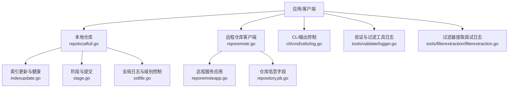
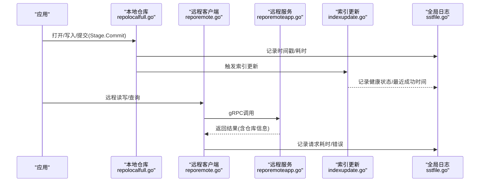
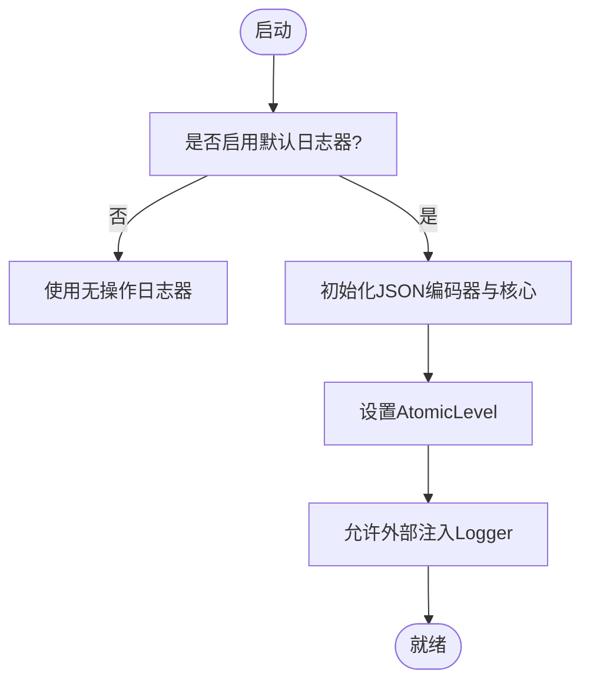
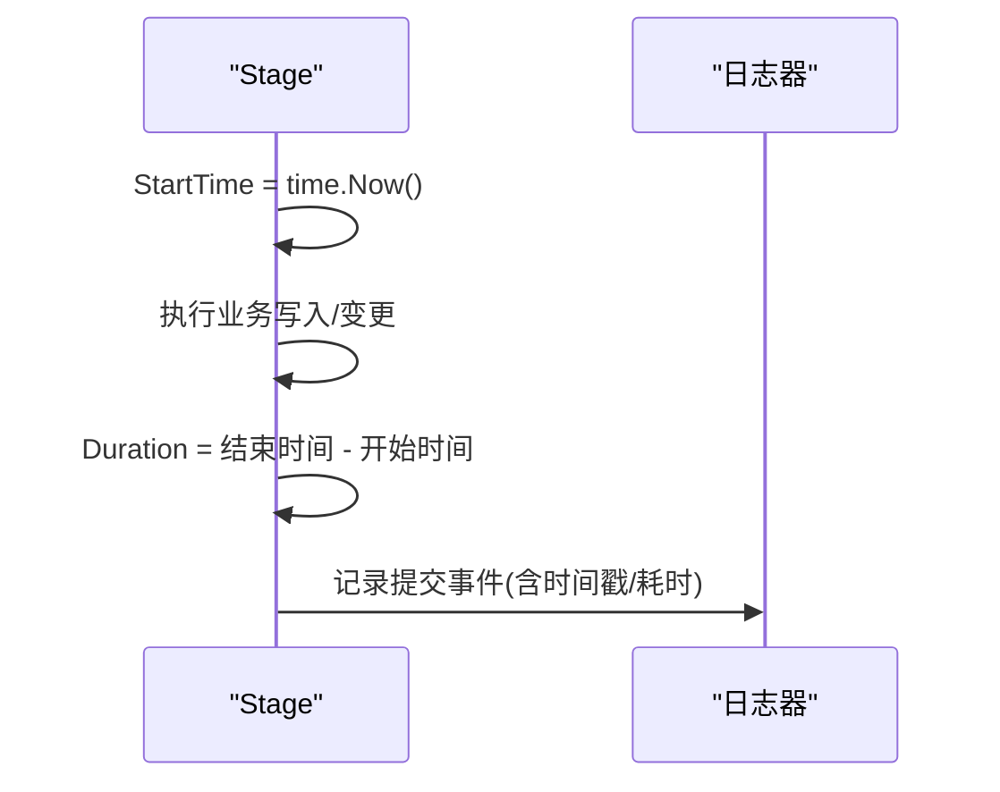
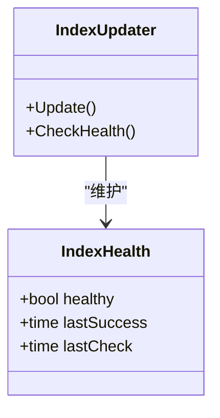
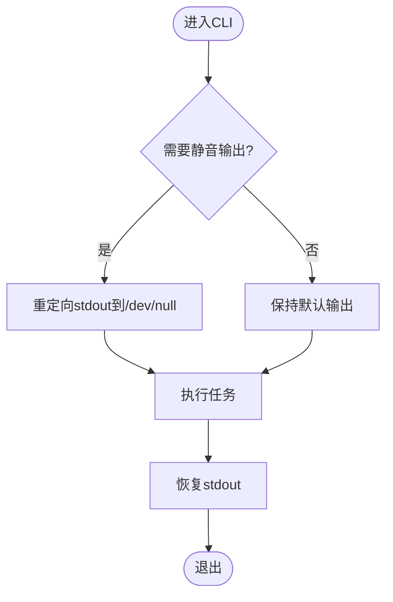
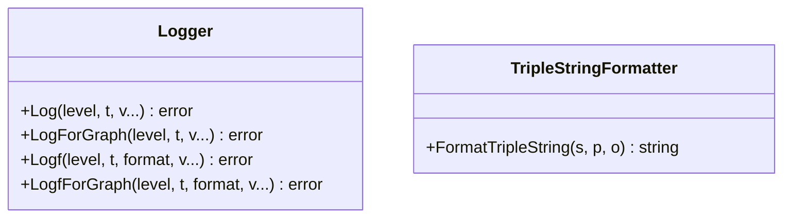
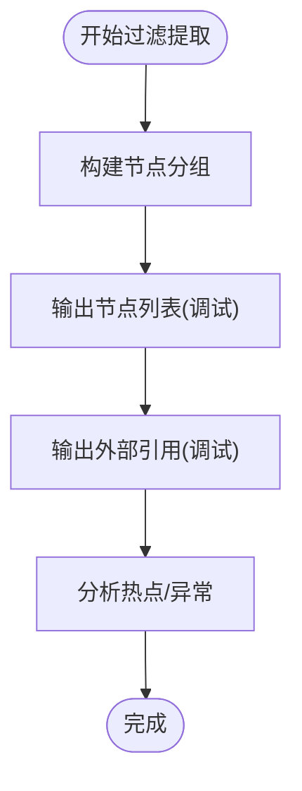
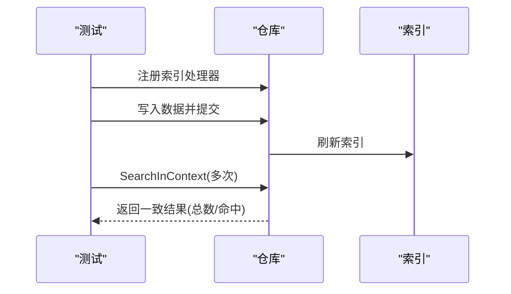
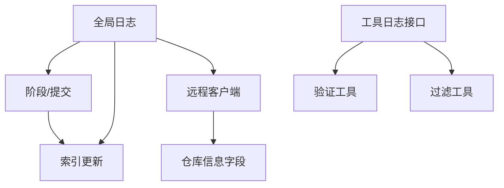

# 性能监控

<cite>
**本文引用的文件**
- [README.md](file://README.md)
- [sst/sstfile.go](file://sst/sstfile.go)
- [sst/stage.go](file://sst/stage.go)
- [sst/repolocalfull.go](file://sst/repolocalfull.go)
- [sst/reporemote.go](file://sst/reporemote.go)
- [sst/reporemoteapp.go](file://sst/reporemoteapp.go)
- [sst/indexupdate.go](file://sst/indexupdate.go)
- [cli/cmd/utils/log.go](file://cli/cmd/utils/log.go)
- [tools/validate/logger.go](file://tools/validate/logger.go)
- [tools/filterextraction/filterextraction.go](file://tools/filterextraction/filterextraction.go)
- [bboltproto/repository.pb.go](file://bboltproto/repository.pb.go)
- [sst_test/searchInContext_test.go](file://sst_test/searchInContext_test.go)
- [sst/hash_base58_benchmark_test.go](file://sst/hash_base58_benchmark_test.go)
</cite>

## 目录
1. [简介](#简介)
2. [项目结构](#项目结构)
3. [核心组件](#核心组件)
4. [架构总览](#架构总览)
5. [详细组件分析](#详细组件分析)
6. [依赖关系分析](#依赖关系分析)
7. [性能考量](#性能考量)
8. [故障排查指南](#故障排查指南)
9. [结论](#结论)
10. [附录](#附录)

## 简介
本指南面向SST（Semantic STEP Technology）核心库的性能监控与分析，聚焦以下目标：
- 定义并采集关键性能指标（CPU、内存、磁盘I/O、网络带宽、查询延迟与吞吐）。
- 解释慢查询日志、性能热点识别方法。
- 提供基准测试、压力测试与负载测试的实施建议。
- 设计实时监控仪表板、告警规则与趋势分析策略。
- 展示生产环境可用的监控工具与调试技巧。
- 建立性能回归检测与优化效果评估流程。

本指南基于仓库中现有能力（结构化日志、时间戳、索引健康状态、远程信息字段、基准测试等）进行系统化整合，确保可落地执行。

## 项目结构
SST核心包对外暴露API，内部包含存储、阶段提交、索引更新、远程通信等模块；CLI与工具链提供辅助能力；测试用例覆盖搜索、同步、版本迁移等场景，可作为性能观测的参考路径。

图表来源
- [sst/repolocalfull.go:934-1056](file://sst/repolocalfull.go#L934-L1056)
- [sst/reporemote.go:169-200](file://sst/reporemote.go#L169-L200)
- [sst/reporemoteapp.go:432-432](file://sst/reporemoteapp.go#L432-L432)
- [sst/indexupdate.go:670-699](file://sst/indexupdate.go#L670-L699)
- [sst/stage.go:383-415](file://sst/stage.go#L383-L415)
- [sst/sstfile.go:73-102](file://sst/sstfile.go#L73-L102)
- [bboltproto/repository.pb.go:3859-3867](file://bboltproto/repository.pb.go#L3859-L3867)
- [cli/cmd/utils/log.go:15-40](file://cli/cmd/utils/log.go#L15-L40)
- [tools/validate/logger.go:22-31](file://tools/validate/logger.go#L22-L31)
- [tools/filterextraction/filterextraction.go:59-71](file://tools/filterextraction/filterextraction.go#L59-L71)

章节来源
- [README.md:1-15](file://README.md#L1-L15)

## 核心组件
- 全局日志与级别控制：提供可注入的zap日志器与运行时级别调整，便于统一采集性能相关事件。
- 阶段与提交：记录操作持续时间、时间戳，用于计算延迟与吞吐。
- 索引更新与健康：维护索引健康状态与最近成功时间，支撑可用性监控。
- 远程仓库信息：通过protobuf字段暴露仓库规模、文档数量、实际大小等指标，便于容量与增长趋势监控。
- CLI输出控制：支持静音标准输出，便于在自动化或批处理场景中减少干扰。
- 工具日志接口：为验证与过滤工具提供结构化日志能力，便于追踪复杂数据处理过程。

章节来源
- [sst/sstfile.go:73-102](file://sst/sstfile.go#L73-L102)
- [sst/stage.go:383-415](file://sst/stage.go#L383-L415)
- [sst/indexupdate.go:670-699](file://sst/indexupdate.go#L670-L699)
- [bboltproto/repository.pb.go:3859-3867](file://bboltproto/repository.pb.go#L3859-L3867)
- [cli/cmd/utils/log.go:15-40](file://cli/cmd/utils/log.go#L15-L40)
- [tools/validate/logger.go:22-31](file://tools/validate/logger.go#L22-L31)

## 架构总览
下图展示了从客户端到本地/远程仓库的关键路径，以及日志、索引健康、仓库信息等监控点的位置。

图表来源
- [sst/repolocalfull.go:934-1056](file://sst/repolocalfull.go#L934-L1056)
- [sst/reporemote.go:169-200](file://sst/reporemote.go#L169-L200)
- [sst/reporemoteapp.go:432-432](file://sst/reporemoteapp.go#L432-L432)
- [sst/indexupdate.go:670-699](file://sst/indexupdate.go#L670-L699)
- [sst/sstfile.go:73-102](file://sst/sstfile.go#L73-L102)

## 详细组件分析

### 组件A：全局日志与级别控制（可观测性基础）
- 作用：统一日志入口，支持注入自定义logger与运行时调整日志级别，便于在生产环境按需开启Debug以定位性能问题。
- 关键点：
  - 默认无操作日志器，需显式启用默认JSON日志器。
  - 提供AtomicLevel用于动态调整级别。
  - 提供SetLogger供上层注入生产级日志器。

图表来源
- [sst/sstfile.go:73-102](file://sst/sstfile.go#L73-L102)

章节来源
- [sst/sstfile.go:73-102](file://sst/sstfile.go#L73-L102)

### 组件B：阶段与提交（延迟与吞吐度量）
- 作用：记录提交开始时间与持续时间，结合日志可计算端到端延迟与吞吐。
- 关键点：
  - Stage对象包含Duration字段，Commit前后可记录时间戳。
  - 配合全局日志器输出结构化事件，便于聚合分析。

图表来源
- [sst/stage.go:383-415](file://sst/stage.go#L383-L415)

章节来源
- [sst/stage.go:383-415](file://sst/stage.go#L383-L415)

### 组件C：索引更新与健康（可用性监控）
- 作用：维护索引健康状态与最近成功时间，可用于判断索引是否正常更新。
- 关键点：
  - 健康对象包含healthy标志与lastSuccess时间。
  - 定期检查与更新，失败时记录错误并影响健康状态。

图表来源
- [sst/indexupdate.go:670-699](file://sst/indexupdate.go#L670-L699)

章节来源
- [sst/indexupdate.go:670-699](file://sst/indexupdate.go#L670-L699)

### 组件D：远程仓库信息与容量监控（资源与规模）
- 作用：通过protobuf字段暴露仓库规模、文档数量、实际大小等，便于容量规划与趋势分析。
- 关键点：
  - NumberOfRepositoryLogs、NumberOfDatasetsInBranch、DocumentDbSize、NumberOfDocuments、ActualRepositorySize、MaxRepositorySize等字段。
  - 可在服务端定时上报或客户端查询后持久化，形成容量趋势图。

图表来源
- [bboltproto/repository.pb.go:3859-3867](file://bboltproto/repository.pb.go#L3859-L3867)

章节来源
- [bboltproto/repository.pb.go:3859-3867](file://bboltproto/repository.pb.go#L3859-L3867)

### 组件E：CLI输出控制（批处理与自动化）
- 作用：支持静音标准输出，避免在自动化任务中产生冗余输出，提升稳定性与可观测性。
- 关键点：
  - MuteStdout将stdout重定向到空设备。
  - RestoreStdout恢复原始stdout。

图表来源
- [cli/cmd/utils/log.go:15-40](file://cli/cmd/utils/log.go#L15-L40)

章节来源
- [cli/cmd/utils/log.go:15-40](file://cli/cmd/utils/log.go#L15-L40)

### 组件F：工具日志接口（复杂处理链路追踪）
- 作用：为验证与过滤工具提供结构化日志能力，便于追踪节点分组、引用等细节。
- 关键点：
  - Logger接口支持按节点或图级别记录日志。
  - TripleStringFormatter用于格式化三元组字符串。

图表来源
- [tools/validate/logger.go:22-31](file://tools/validate/logger.go#L22-L31)

章节来源
- [tools/validate/logger.go:22-31](file://tools/validate/logger.go#L22-L31)

### 组件G：过滤器提取调试日志（热点识别辅助）
- 作用：在过滤提取过程中输出节点列表与外部引用，帮助识别热点与异常引用。
- 关键点：
  - 对每个节点与外部引用输出调试日志，包含ID或片段信息。
  - 结合全局日志级别控制，可按需开启。

图表来源
- [tools/filterextraction/filterextraction.go:59-71](file://tools/filterextraction/filterextraction.go#L59-L71)

章节来源
- [tools/filterextraction/filterextraction.go:59-71](file://tools/filterextraction/filterextraction.go#L59-L71)

### 组件H：搜索与索引一致性（查询性能观测）
- 作用：测试用例展示了SearchInContext的使用与分页、排序、一致性校验，可作为查询性能基线与回归检测的参考。
- 关键点：
  - 多次搜索应返回一致结果，便于检测索引不一致导致的性能抖动。
  - 支持分页与字段选择，有助于评估不同查询模式的性能。

图表来源
- [sst_test/searchInContext_test.go:111-138](file://sst_test/searchInContext_test.go#L111-L138)
- [sst_test/searchInContext_test.go:215-235](file://sst_test/searchInContext_test.go#L215-L235)
- [sst_test/searchInContext_test.go:842-847](file://sst_test/searchInContext_test.go#L842-L847)
- [sst_test/searchInContext_test.go:1042-1058](file://sst_test/searchInContext_test.go#L1042-L1058)
- [sst_test/searchInContext_test.go:1409-1436](file://sst_test/searchInContext_test.go#L1409-L1436)

章节来源
- [sst_test/searchInContext_test.go:111-138](file://sst_test/searchInContext_test.go#L111-L138)
- [sst_test/searchInContext_test.go:215-235](file://sst_test/searchInContext_test.go#L215-L235)
- [sst_test/searchInContext_test.go:842-847](file://sst_test/searchInContext_test.go#L842-L847)
- [sst_test/searchInContext_test.go:1042-1058](file://sst_test/searchInContext_test.go#L1042-L1058)
- [sst_test/searchInContext_test.go:1409-1436](file://sst_test/searchInContext_test.go#L1409-L1436)

## 依赖关系分析
- 日志依赖：全局日志器被各模块复用，统一输出格式便于集中采集。
- 索引依赖：本地仓库提交后触发索引更新，健康状态由索引更新器维护。
- 远程依赖：远程客户端与服务端通过gRPC交互，仓库信息字段提供容量指标。
- 工具依赖：验证与过滤工具通过日志接口输出调试信息，辅助热点识别。

图表来源
- [sst/sstfile.go:73-102](file://sst/sstfile.go#L73-L102)
- [sst/stage.go:383-415](file://sst/stage.go#L383-L415)
- [sst/indexupdate.go:670-699](file://sst/indexupdate.go#L670-L699)
- [bboltproto/repository.pb.go:3859-3867](file://bboltproto/repository.pb.go#L3859-L3867)
- [tools/validate/logger.go:22-31](file://tools/validate/logger.go#L22-L31)

章节来源
- [sst/sstfile.go:73-102](file://sst/sstfile.go#L73-L102)
- [sst/stage.go:383-415](file://sst/stage.go#L383-L415)
- [sst/indexupdate.go:670-699](file://sst/indexupdate.go#L670-L699)
- [bboltproto/repository.pb.go:3859-3867](file://bboltproto/repository.pb.go#L3859-L3867)
- [tools/validate/logger.go:22-31](file://tools/validate/logger.go#L22-L31)

## 性能考量
- CPU使用率：
  - 通过全局日志器记录关键操作的起止时间，结合系统工具（如pprof）分析热点函数。
  - 基准测试（Base58编解码）可用于评估编码/解码路径的CPU开销。
- 内存占用：
  - 关注阶段提交时的数据结构大小与生命周期，避免长时间持有大对象。
  - 利用日志记录提交耗时与数据量，间接推断内存峰值。
- 磁盘I/O：
  - 仓库信息字段中的DocumentDbSize与实际仓库大小可用于跟踪磁盘增长。
  - 提交与索引更新涉及写放大，需关注落盘频率与批量策略。
- 网络带宽：
  - 远程客户端/服务端交互可通过日志记录请求大小与耗时，估算带宽占用。
  - 结合仓库信息字段，评估增量同步与全量同步的网络成本。
- 查询性能：
  - 使用SearchInContext进行分页与排序测试，记录延迟分布与一致性。
  - 通过多次查询的一致性断言，检测索引不一致导致的性能抖动。
- 慢查询日志：
  - 在远程客户端/服务端添加请求耗时记录，阈值超过设定值则输出慢查询日志。
  - 结合全局日志级别，按需开启Debug以捕获详细上下文。
- 性能热点识别：
  - 利用工具日志接口输出节点分组与外部引用，识别热点节点与异常引用。
  - 结合索引健康状态，判断索引更新瓶颈。

[本节为通用指导，不直接分析具体文件]

## 故障排查指南
- 日志级别调整：
  - 使用AtomicLevel.SetLevel动态调整日志级别，便于在生产环境快速定位问题。
  - 通过SetLogger注入生产级日志器，统一输出格式。
- 索引健康检查：
  - 定期检查IndexHealth.lastSuccess与healthy标志，若长时间未更新则告警。
- 远程连接问题：
  - 在远程客户端/服务端记录连接、发送、接收阶段的耗时，定位网络瓶颈。
- CLI输出干扰：
  - 在自动化任务中使用MuteStdout屏蔽标准输出，避免干扰日志采集。
- 工具调试：
  - 使用工具日志接口输出详细上下文，结合全局日志级别控制输出粒度。

章节来源
- [sst/sstfile.go:73-102](file://sst/sstfile.go#L73-L102)
- [sst/indexupdate.go:670-699](file://sst/indexupdate.go#L670-L699)
- [sst/reporemote.go:169-200](file://sst/reporemote.go#L169-L200)
- [cli/cmd/utils/log.go:15-40](file://cli/cmd/utils/log.go#L15-L40)
- [tools/validate/logger.go:22-31](file://tools/validate/logger.go#L22-L31)

## 结论
通过全局日志器、阶段提交时间戳、索引健康状态、远程仓库信息字段与工具日志接口，SST提供了完善的可观测性基础。结合基准测试、搜索一致性测试与远程交互日志，可构建完整的性能监控体系，实现慢查询识别、热点定位、容量规划与回归检测。建议在生产环境中启用结构化日志、配置告警规则，并持续收集指标以进行趋势分析与优化评估。

[本节为总结，不直接分析具体文件]

## 附录

### 关键性能指标定义与采集方法
- CPU使用率：
  - 采集方法：结合pprof与全局日志器记录的起止时间，计算热点函数耗时占比。
  - 基准测试：使用Base58编解码基准测试评估编码路径性能。
- 内存占用：
  - 采集方法：记录提交数据量与耗时，结合系统内存监控工具观察峰值。
- 磁盘I/O：
  - 采集方法：监控DocumentDbSize与实际仓库大小的变化速率。
- 网络带宽：
  - 采集方法：记录远程请求大小与耗时，估算带宽占用。
- 查询延迟与吞吐：
  - 采集方法：使用SearchInContext记录延迟分布与QPS，进行分页与排序测试。

章节来源
- [sst/hash_base58_benchmark_test.go:39-67](file://sst/hash_base58_benchmark_test.go#L39-L67)
- [sst_test/searchInContext_test.go:215-235](file://sst_test/searchInContext_test.go#L215-L235)
- [bboltproto/repository.pb.go:3859-3867](file://bboltproto/repository.pb.go#L3859-L3867)

### 慢查询日志与性能热点识别
- 慢查询日志：
  - 在远程客户端/服务端记录请求耗时，超过阈值输出慢查询日志。
- 性能热点识别：
  - 使用工具日志接口输出节点分组与外部引用，识别热点节点。
  - 结合索引健康状态，判断索引更新瓶颈。

章节来源
- [sst/reporemote.go:169-200](file://sst/reporemote.go#L169-L200)
- [tools/filterextraction/filterextraction.go:59-71](file://tools/filterextraction/filterextraction.go#L59-L71)
- [sst/indexupdate.go:670-699](file://sst/indexupdate.go#L670-L699)

### 基准测试、压力测试与负载测试
- 基准测试：
  - 使用Base58编解码基准测试评估编码路径性能。
- 压力测试：
  - 通过并发提交与搜索，观察延迟分布与一致性。
- 负载测试：
  - 模拟真实业务负载，记录CPU、内存、磁盘I/O与网络带宽使用情况。

章节来源
- [sst/hash_base58_benchmark_test.go:39-67](file://sst/hash_base58_benchmark_test.go#L39-L67)
- [sst_test/searchInContext_test.go:842-847](file://sst_test/searchInContext_test.go#L842-L847)

### 实时监控仪表板、告警规则与趋势分析
- 仪表板：
  - 展示仓库大小、文档数量、索引健康状态、查询延迟分布。
- 告警规则：
  - 索引长时间未更新、查询延迟超过阈值、仓库大小增长过快。
- 趋势分析：
  - 基于历史指标数据进行容量规划与性能趋势预测。

章节来源
- [bboltproto/repository.pb.go:3859-3867](file://bboltproto/repository.pb.go#L3859-L3867)
- [sst/indexupdate.go:670-699](file://sst/indexupdate.go#L670-L699)

### 生产环境监控工具与调试技巧
- 监控工具：
  - 使用pprof进行CPU与内存分析，结合全局日志器输出结构化事件。
- 调试技巧：
  - 动态调整日志级别，捕获详细上下文。
  - 使用工具日志接口输出节点分组与外部引用，辅助热点识别。

章节来源
- [sst/sstfile.go:73-102](file://sst/sstfile.go#L73-L102)
- [tools/validate/logger.go:22-31](file://tools/validate/logger.go#L22-L31)

### 性能回归检测与优化效果评估
- 回归检测：
  - 通过SearchInContext的一致性断言，检测索引不一致导致的性能抖动。
- 优化评估：
  - 对比优化前后的延迟分布与吞吐，评估优化效果。

章节来源
- [sst_test/searchInContext_test.go:1042-1058](file://sst_test/searchInContext_test.go#L1042-L1058)
- [sst_test/searchInContext_test.go:1409-1436](file://sst_test/searchInContext_test.go#L1409-L1436)