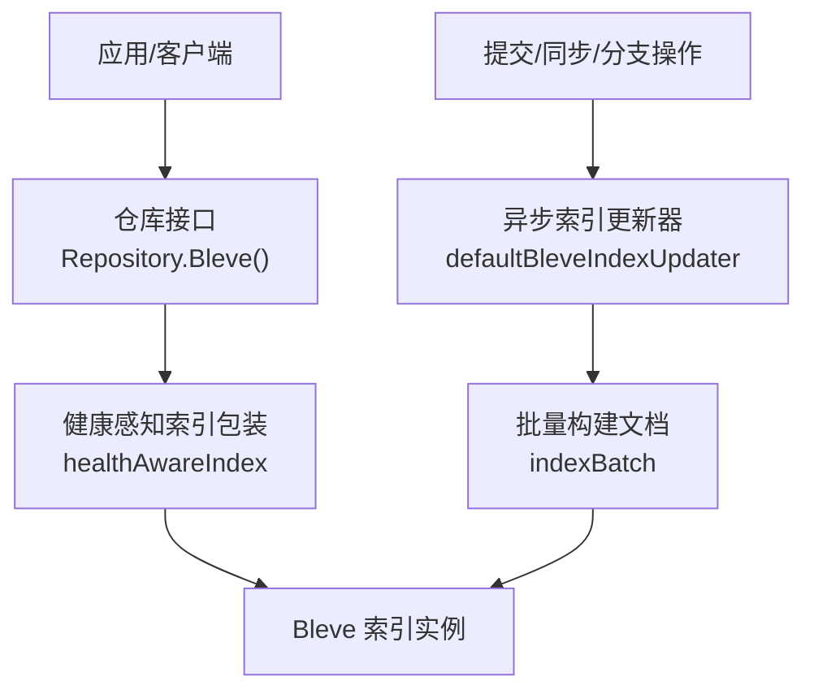
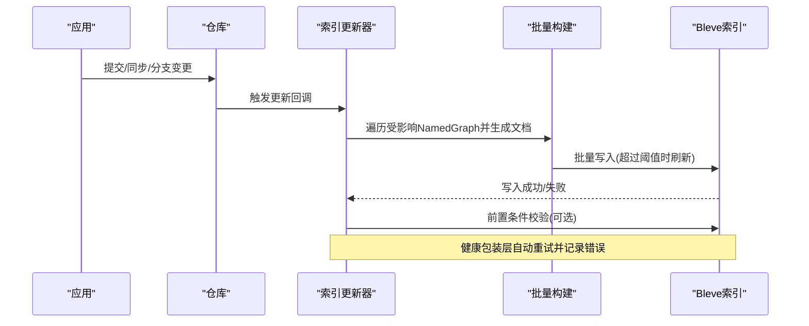
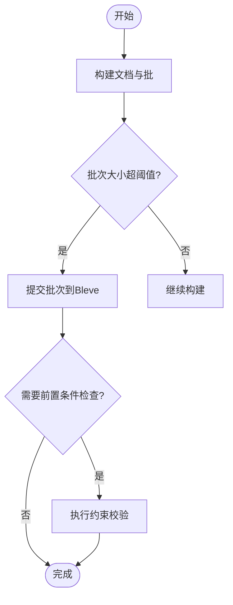
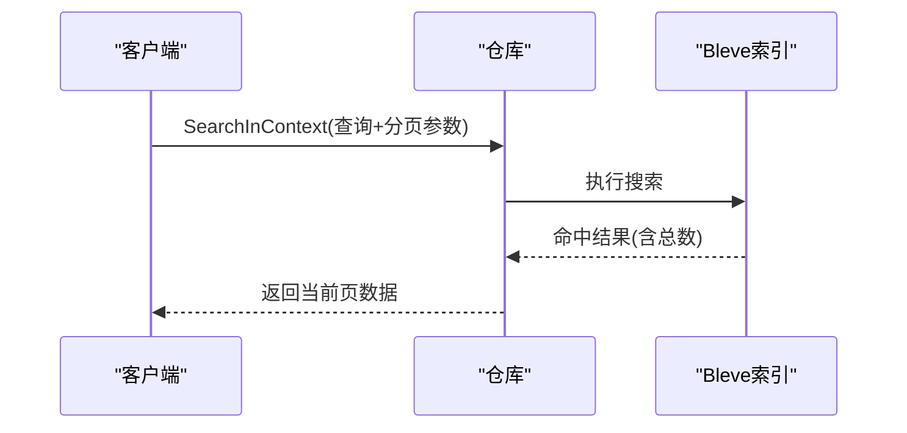
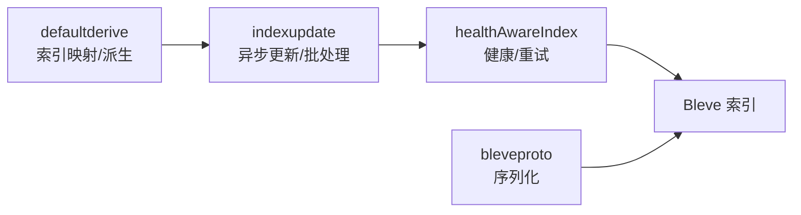

# 查询优化

<cite>
**本文引用的文件**
- [README.md](file://README.md)
- [defaultderive.go](file://defaultderive/defaultderive.go)
- [indexupdate.go](file://sst/indexupdate.go)
- [remote.go](file://bleveproto/remote.go)
- [searchInContext_test.go](file://sst_test/searchInContext_test.go)
- [remoteRepository_test.go](file://sst_test/remoteRepository_test.go)
- [repolocalfullwithbleve.go](file://examples/helloworldrepolocalfullwithbleve/repolocalfullwithbleve.go)
</cite>

## 目录
1. [简介](#简介)
2. [项目结构](#项目结构)
3. [核心组件](#核心组件)
4. [架构总览](#架构总览)
5. [详细组件分析](#详细组件分析)
6. [依赖关系分析](#依赖关系分析)
7. [性能考量](#性能考量)
8. [故障排查指南](#故障排查指南)
9. [结论](#结论)
10. [附录](#附录)

## 简介
本指南聚焦于SST中基于Bleve的全文检索与查询优化，覆盖索引策略、配置调优、查询计划与重写思路、分页与结果集优化、内存管理、复杂查询性能分析与案例，以及缓存、预计算与物化视图的实践建议。文档面向不同技术背景的读者，提供从高层到代码级的逐步深入说明。

## 项目结构
SST将“数据仓库（BBolt）”与“全文检索（Bleve）”解耦：写路径通过异步索引更新器将变更批量写入Bleve；读路径直接访问Bleve索引进行检索。默认索引映射在defaultderive中定义，支持多种文档类型与字段映射，便于高效过滤、排序与短语搜索。

图表来源
- [indexupdate.go:77-158](file://sst/indexupdate.go#L77-L158)
- [indexupdate.go:650-735](file://sst/indexupdate.go#L650-L735)
- [indexupdate.go:436-484](file://sst/indexupdate.go#L436-L484)

章节来源
- [README.md:1-15](file://README.md#L1-L15)

## 核心组件
- 默认索引映射与派生：定义字段、分词器、是否存储/DocValues等，决定查询能力与性能。
- 异步索引更新器：将BBolt提交后的变更转换为Bleve批量写入，避免阻塞写路径。
- 健康感知索引包装：对搜索失败进行重试与健康状态记录，提升稳定性。
- 远程序列化：将Bleve请求/响应序列化为JSON以支持远程调用。

章节来源
- [defaultderive.go:155-211](file://defaultderive/defaultderive.go#L155-L211)
- [indexupdate.go:77-158](file://sst/indexupdate.go#L77-L158)
- [indexupdate.go:650-735](file://sst/indexupdate.go#L650-L735)
- [remote.go:21-39](file://bleveproto/remote.go#L21-L39)

## 架构总览
下图展示了从提交到可搜索的端到端流程，包括索引重建、批处理阈值控制、前置条件检查与异常恢复。

图表来源
- [indexupdate.go:160-249](file://sst/indexupdate.go#L160-L249)
- [indexupdate.go:424-434](file://sst/indexupdate.go#L424-L434)
- [indexupdate.go:486-502](file://sst/indexupdate.go#L486-L502)
- [indexupdate.go:703-735](file://sst/indexupdate.go#L703-L735)

## 详细组件分析

### 索引映射与字段设计（defaultderive）
- 多文档类型：为不同类型（如组织、表示上下文、形状特征等）建立专用映射，利于按类型过滤。
- 字段类型与分词：
  - label/phrase：短语分词用于精确匹配与短语搜索。
  - keyword/skimmed-keyword：用于过滤、排序与聚合。
  - numeric：数值范围查询与排序。
  - store/doc values：按需开启以提升查询性能或支持排序/高亮。
- 版本字段：内置版本标记，便于索引迁移与一致性校验。

优化要点
- 仅对需要排序/聚合的字段启用DocValues，减少索引体积。
- 对高频过滤字段使用keyword或skipped-keyword，提高选择率。
- 短语搜索使用phrase字段，避免全文扫描。

章节来源
- [defaultderive.go:155-211](file://defaultderive/defaultderive.go#L155-L211)
- [defaultderive.go:213-291](file://defaultderive/defaultderive.go#L213-L291)

### 异步索引更新与批处理（indexupdate）
- 异步队列：后台goroutine消费队列，避免写路径阻塞。
- 批处理阈值：当批次大小超过阈值时主动刷新，降低单次I/O压力。
- 前置条件检查：在提交后执行唯一性约束检查，保证数据一致性。
- 健康包装：搜索失败自动重试，记录健康状态，增强鲁棒性。

图表来源
- [indexupdate.go:424-434](file://sst/indexupdate.go#L424-L434)
- [indexupdate.go:486-502](file://sst/indexupdate.go#L486-L502)

章节来源
- [indexupdate.go:77-158](file://sst/indexupdate.go#L77-L158)
- [indexupdate.go:160-249](file://sst/indexupdate.go#L160-L249)
- [indexupdate.go:366-422](file://sst/indexupdate.go#L366-L422)
- [indexupdate.go:633-648](file://sst/indexupdate.go#L633-L648)

### 查询执行与分页（测试用例体现）
- 分页：通过SearchRequestOptions设置size与from实现页内结果返回。
- 排序：对启用DocValues的字段进行排序。
- 字段投影：仅返回必要字段，减少网络与内存开销。
- 上下文取消：支持带超时/取消的搜索，避免长时间占用资源。

图表来源
- [searchInContext_test.go:215-235](file://sst_test/searchInContext_test.go#L215-L235)
- [searchInContext_test.go:1409-1436](file://sst_test/searchInContext_test.go#L1409-L1436)
- [remoteRepository_test.go:88-116](file://sst_test/remoteRepository_test.go#L88-L116)

章节来源
- [searchInContext_test.go:215-235](file://sst_test/searchInContext_test.go#L215-L235)
- [searchInContext_test.go:1409-1436](file://sst_test/searchInContext_test.go#L1409-L1436)
- [remoteRepository_test.go:88-116](file://sst_test/remoteRepository_test.go#L88-L116)

### 远程索引访问与序列化
- 通过JSON序列化Bleve的SearchRequest/SearchResult，支持跨进程/网络调用。
- 适用于远程仓库场景下的统一查询接口。

章节来源
- [remote.go:21-39](file://bleveproto/remote.go#L21-L39)

### 示例：本地仓库直接访问Bleve
- 演示如何打开已存在的Bleve索引并执行全量/分页搜索，适合导出或离线分析场景。

章节来源
- [repolocalfullwithbleve.go:90-127](file://examples/helloworldrepolocalfullwithbleve/repolocalfullwithbleve.go#L90-L127)

## 依赖关系分析
- defaultderive负责索引映射与文档派生，被仓库在索引更新时调用。
- indexupdate协调仓库事件（提交/同步/分支）与Bleve写入，包含批处理与约束检查。
- healthAwareIndex封装底层Bleve，提供健康监控与重试。
- bleveproto提供远程序列化能力。

图表来源
- [defaultderive.go:155-211](file://defaultderive/defaultderive.go#L155-L211)
- [indexupdate.go:77-158](file://sst/indexupdate.go#L77-L158)
- [indexupdate.go:650-735](file://sst/indexupdate.go#L650-L735)
- [remote.go:21-39](file://bleveproto/remote.go#L21-L39)

章节来源
- [defaultderive.go:155-211](file://defaultderive/defaultderive.go#L155-L211)
- [indexupdate.go:77-158](file://sst/indexupdate.go#L77-L158)
- [indexupdate.go:650-735](file://sst/indexupdate.go#L650-L735)
- [remote.go:21-39](file://bleveproto/remote.go#L21-L39)

## 性能考量
- 索引字段选择
  - 仅对需要排序/聚合的字段启用DocValues，减少索引体积与写入放大。
  - 对高频过滤字段使用keyword/skimmed-keyword，提高选择率。
  - 短语搜索使用phrase字段，避免全文扫描。
- 批处理与内存
  - 利用批处理阈值控制内存峰值，避免单次写入过大导致抖动。
  - 合理设置size/from，限制结果集大小，降低网络与内存消耗。
- 查询构造
  - 优先使用精确匹配与布尔组合，减少正则与通配符带来的全表扫描。
  - 使用字段投影Fields仅返回必要列，减少传输与解析成本。
- 健康与重试
  - 健康包装层自动重试短暂失败，提升可用性；同时记录错误计数以便告警。
- 远程场景
  - 通过序列化请求/响应，结合分页与字段投影，降低带宽与延迟。

[本节为通用指导，不直接分析具体文件]

## 故障排查指南
- 索引不一致或查询结果为空
  - 确认提交后是否调用Flush等待异步更新完成。
  - 检查是否存在前置条件约束冲突导致写入回滚。
- 搜索失败或超时
  - 关注健康包装层的错误计数与最近错误信息。
  - 使用带上下文的搜索，确保及时释放资源。
- 性能退化
  - 检查是否启用了不必要的DocValues或存储字段。
  - 评估查询是否使用了低选择性谓词（如大范围正则）。

章节来源
- [indexupdate.go:633-648](file://sst/indexupdate.go#L633-L648)
- [indexupdate.go:703-735](file://sst/indexupdate.go#L703-L735)
- [indexupdate.go:486-502](file://sst/indexupdate.go#L486-L502)

## 结论
SST通过“默认索引映射 + 异步索引更新 + 健康感知包装”的组合，提供了稳定高效的全文检索能力。配合合理的字段设计、批处理阈值、分页与字段投影，可在大规模数据集上获得良好的查询性能与可扩展性。对于更复杂的查询需求，建议在应用层进行查询重写与结果集裁剪，并结合远程序列化能力实现分布式查询。

[本节为总结，不直接分析具体文件]

## 附录

### 全文搜索、SPARQL与条件过滤的性能调优
- 全文搜索
  - 使用phrase字段进行短语匹配，避免全文扫描。
  - 使用Match/Boolean组合限定搜索空间，减少候选集。
- SPARQL查询
  - 将SPARQL中的过滤条件下推到Bleve查询，优先使用索引友好的谓词。
  - 对频繁过滤的属性建立keyword/skimmed-keyword映射。
- 条件过滤
  - 优先使用等值/范围过滤，避免正则与通配符。
  - 使用字段投影减少结果体积。

[本节为概念性内容，不直接分析具体文件]

### 查询计划分析、索引选择器与查询重写
- 查询计划分析
  - 通过统计信息与字段选择性估算，优先选择高选择性谓词作为入口。
- 索引选择器
  - 根据查询模式动态选择字段与分词器（例如短语 vs 关键词）。
- 查询重写
  - 将复杂表达式分解为多个简单子查询，合并结果后再过滤。
  - 将可下推的条件提前至Bleve层，减少后续计算。

[本节为概念性内容，不直接分析具体文件]

### 分页查询、结果集优化与内存管理
- 分页
  - 使用size/from控制每页大小，避免一次性加载大量结果。
- 结果集优化
  - 使用Fields仅返回必要字段，减少序列化与传输成本。
- 内存管理
  - 利用批处理阈值控制内存峰值，避免OOM。
  - 及时关闭上下文与资源，防止泄漏。

章节来源
- [searchInContext_test.go:215-235](file://sst_test/searchInContext_test.go#L215-L235)
- [searchInContext_test.go:1409-1436](file://sst_test/searchInContext_test.go#L1409-L1436)
- [indexupdate.go:424-434](file://sst/indexupdate.go#L424-L434)

### 复杂查询性能分析与优化案例
- 案例：按类型+标签短语+ID前缀过滤
  - 使用mainType进行类型过滤，label.phrase进行短语匹配，id.key/idOwner.key进行前缀匹配。
  - 结合布尔查询组合多个条件，缩小候选集。
- 案例：排序与分页
  - 对启用DocValues的字段排序，配合分页获取指定区间结果。
- 案例：远程一致性
  - 远程仓库直接访问Bleve索引，确保结果一致性与实时性。

章节来源
- [remoteRepository_test.go:88-116](file://sst_test/remoteRepository_test.go#L88-L116)
- [searchInContext_test.go:215-235](file://sst_test/searchInContext_test.go#L215-L235)

### 查询缓存、预计算与物化视图
- 查询缓存
  - 在应用层对热点查询结果进行短期缓存，注意失效策略与一致性。
- 预计算
  - 对常用聚合或连接结果进行预计算并持久化，加速查询。
- 物化视图
  - 将复杂查询结果物化为独立文档或集合，定期增量更新，提升读取性能。

[本节为概念性内容，不直接分析具体文件]

### 大规模数据集最佳实践
- 索引设计
  - 精简字段，仅保留查询所需；合理使用DocValues与存储。
- 写入优化
  - 批量写入，控制批次大小；避免频繁小批量提交。
- 查询优化
  - 使用选择性高的谓词作为入口；限制结果集大小；使用字段投影。
- 运维监控
  - 关注健康包装层的错误计数与最近错误；监控索引大小与查询延迟。

[本节为通用指导，不直接分析具体文件]