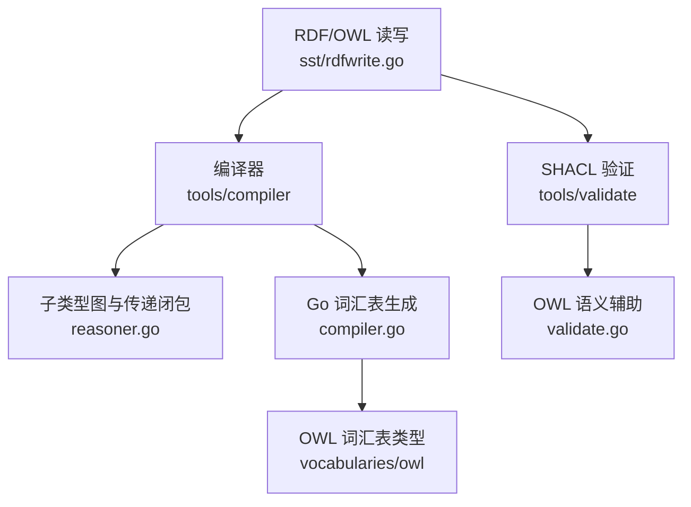
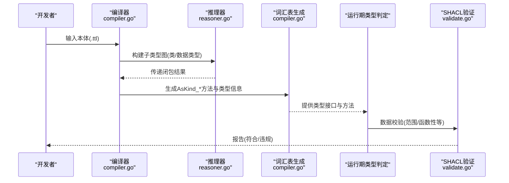
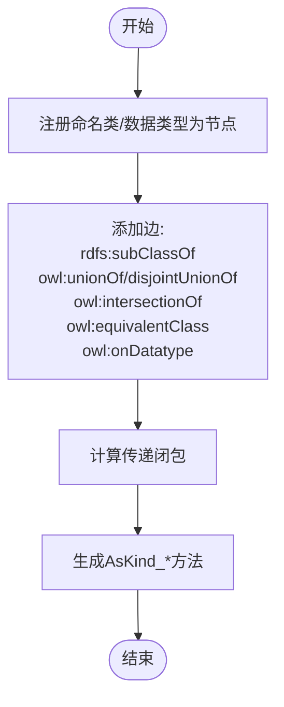
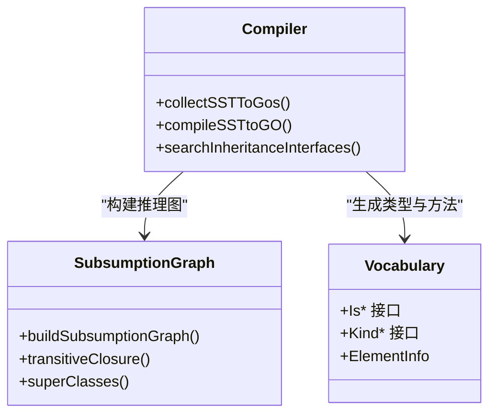
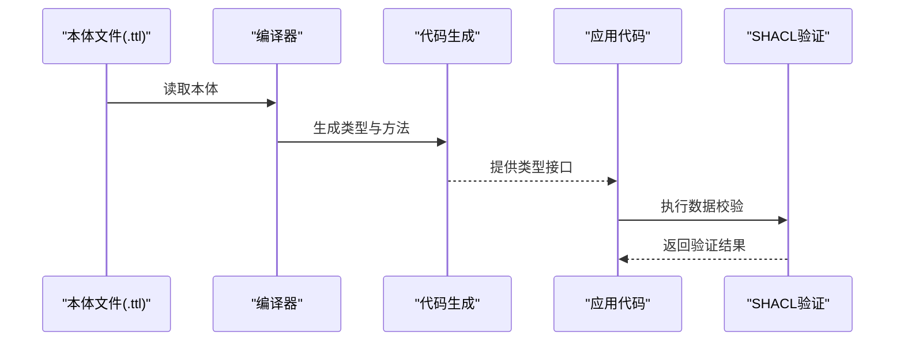
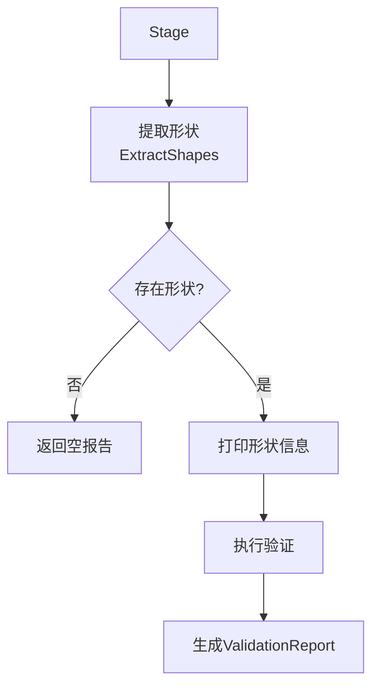
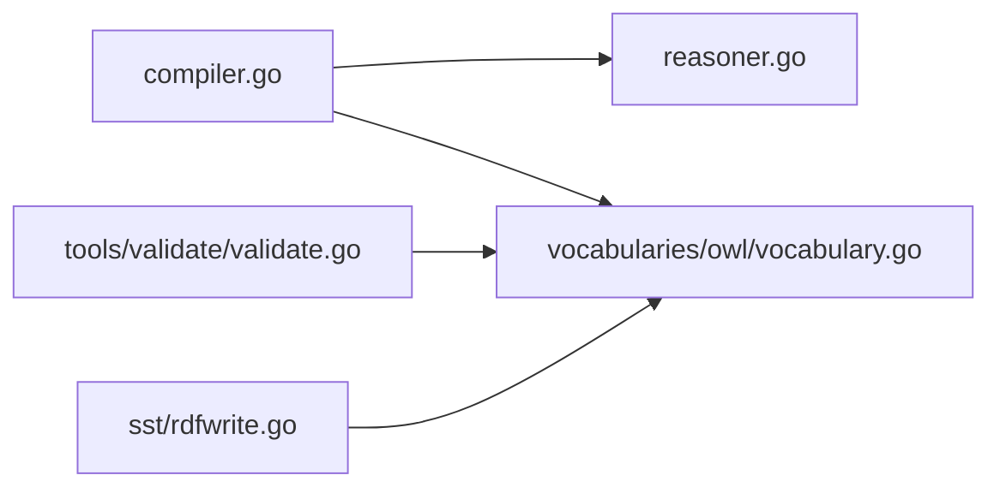

# OWL推理

<cite>
**本文引用的文件**
- [reasoner.go](file://tools/compiler/reasoner.go)
- [compiler.go](file://tools/compiler/compiler.go)
- [vocabulary.go](file://vocabularies/owl/vocabulary.go)
- [shaclSstRules.go](file://tools/validate/shaclSstRules.go)
- [validate.go](file://tools/validate/validate.go)
- [rdfwrite.go](file://sst/rdfwrite.go)
- [reasoner_test.go](file://tools/compiler/reasoner_test.go)
- [owl-test.ttl](file://sst/testdata/owl-test.ttl)
</cite>

## 目录
1. [简介](#简介)
2. [项目结构](#项目结构)
3. [核心组件](#核心组件)
4. [架构总览](#架构总览)
5. [详细组件分析](#详细组件分析)
6. [依赖关系分析](#依赖关系分析)
7. [性能考虑](#性能考虑)
8. [故障排查指南](#故障排查指南)
9. [结论](#结论)
10. [附录](#附录)

## 简介
本文件系统性说明 SST 中的 OWL 推理能力：包括本体推理的基本原理、在 SST 编译期与运行期的应用场景、类层次结构与属性约束的推理机制、推理规则配置与执行流程、结果解释与使用方式，以及性能优化策略、错误处理机制、实际用例与调试技巧，并阐述 OWL 推理与 SHACL 验证规则的集成方式。

SST 的 OWL 推理以“编译期子类型图 + 运行时类型判定”为核心：编译器将 OWL/RDFS 的类与数据类型定义解析为有向子类型图，计算传递闭包；随后在代码生成阶段为每个命名类注入所有可达超类的 AsKind_* 方法，从而在运行期通过接口匹配完成类型判断与约束检查。同时，SST 提供基于 SHACL 的验证框架，可与 OWL 语义协同工作，形成“语义推理 + 数据校验”的完整质量保障链路。

## 项目结构
与 OWL 推理直接相关的代码主要分布在以下模块：
- tools/compiler：OWL 微推理器与编译器，负责构建子类型图、计算传递闭包、生成类型标记方法
- vocabularies/owl：由编译器生成的 OWL 词汇表 Go 类型与常量（包含类、属性、限制等）
- tools/validate：SHACL 验证工具，提取形状、执行校验并与 OWL 语义结合
- sst：RDF/OWL 读写与命名空间管理，支撑推理与验证的数据载体

图表来源
- [reasoner.go:1-258](file://tools/compiler/reasoner.go#L1-L258)
- [compiler.go:46-157](file://tools/compiler/compiler.go#L46-L157)
- [vocabulary.go:1-800](file://vocabularies/owl/vocabulary.go#L1-L800)
- [shaclSstRules.go:22-139](file://tools/validate/shaclSstRules.go#L22-L139)
- [validate.go:263-951](file://tools/validate/validate.go#L263-L951)
- [rdfwrite.go:448-487](file://sst/rdfwrite.go#L448-L487)

章节来源
- [reasoner.go:1-258](file://tools/compiler/reasoner.go#L1-L258)
- [compiler.go:46-157](file://tools/compiler/compiler.go#L46-L157)
- [vocabulary.go:1-800](file://vocabularies/owl/vocabulary.go#L1-L800)
- [shaclSstRules.go:22-139](file://tools/validate/shaclSstRules.go#L22-L139)
- [validate.go:263-951](file://tools/validate/validate.go#L263-L951)
- [rdfwrite.go:448-487](file://sst/rdfwrite.go#L448-L487)

## 核心组件
- 子类型图与推理引擎：构建 rdfs:subClassOf、owl:unionOf、owl:disjointUnionOf、owl:intersectionOf、owl:equivalentClass、owl:onDatatype 的边，并计算传递闭包
- 编译器集成：在生成 Go 词汇表时，为每个命名类注入所有可达超类的 AsKind_* 方法，实现编译期可推导的类型关系
- OWL 词汇表：由编译器生成的类型、属性、限制等元素，供运行期进行类型判断与约束检查
- SHACL 验证：提取 NodeShape/PropertyShape，结合 OWL 语义进行范围、函数性、逆函数性等校验
- RDF/OWL 读写：统一命名空间管理与序列化，确保推理与验证过程中的数据一致性

章节来源
- [reasoner.go:24-258](file://tools/compiler/reasoner.go#L24-L258)
- [compiler.go:237-760](file://tools/compiler/compiler.go#L237-L760)
- [vocabulary.go:1-800](file://vocabularies/owl/vocabulary.go#L1-L800)
- [shaclSstRules.go:22-139](file://tools/validate/shaclSstRules.go#L22-L139)
- [validate.go:263-951](file://tools/validate/validate.go#L263-L951)
- [rdfwrite.go:448-487](file://sst/rdfwrite.go#L448-L487)

## 架构总览
SST 的 OWL 推理采用“编译期推理 + 运行期判定”的分层架构：
- 编译期：读取 .ttl 本体，构建子类型图，计算传递闭包，生成 Go 类型与方法
- 运行期：利用生成的 AsKind_* 方法进行类型匹配；结合 SHACL 进行数据级约束校验
- 数据层：RDF/OWL 三元组作为载体，支持命名空间、集合、列表等复杂结构

图表来源
- [compiler.go:502-760](file://tools/compiler/compiler.go#L502-L760)
- [reasoner.go:87-258](file://tools/compiler/reasoner.go#L87-L258)
- [validate.go:263-951](file://tools/validate/validate.go#L263-L951)

## 详细组件分析

### 子类型图与推理引擎
- 节点表示：命名类或匿名类（空白节点），键为 IRI 或空白节点 ID
- 边表示：A ⊑ B（A 是 B 的子类），来源于 rdfs:subClassOf、unionOf、disjointUnionOf、intersectionOf、equivalentClass、onDatatype
- 传递闭包：Floyd-Warshall 风格算法，确保所有隐式超类关系显式化
- 输出：为每个命名类生成所有可达超类的 AsKind_* 方法签名

图表来源
- [reasoner.go:87-258](file://tools/compiler/reasoner.go#L87-L258)

章节来源
- [reasoner.go:24-258](file://tools/compiler/reasoner.go#L24-L258)

### 编译器集成与词汇表生成
- 收集本体元素：遍历命名图中的所有 IRI 节点，提取类、属性、数据类型等信息
- 构建推理图：调用 buildSubsumptionGraph 获取完整的子类型关系
- 生成代码：为每个元素生成 Is* 和 Kind* 接口、结构体、变量，并注入所有可达超类的 AsKind_* 方法
- 命名空间管理：在写入 RDF/OWL 时自动注册常用命名空间前缀

图表来源
- [compiler.go:237-760](file://tools/compiler/compiler.go#L237-L760)
- [reasoner.go:87-258](file://tools/compiler/reasoner.go#L87-L258)
- [vocabulary.go:1-800](file://vocabularies/owl/vocabulary.go#L1-L800)

章节来源
- [compiler.go:237-760](file://tools/compiler/compiler.go#L237-L760)
- [reasoner.go:87-258](file://tools/compiler/reasoner.go#L87-L258)
- [vocabulary.go:1-800](file://vocabularies/owl/vocabulary.go#L1-L800)

### OWL 类层次结构、属性约束与个体关系
- 类层次：支持 rdfs:subClassOf、owl:unionOf、owl:disjointUnionOf、owl:intersectionOf、owl:equivalentClass
- 数据类型：支持 owl:onDatatype 派生数据类型，继承基数据类型
- 属性约束：在运行期校验中支持 FunctionalProperty、InverseFunctionalProperty、Domain/Range 等约束
- 个体关系：通过类型判定与属性约束确保实例符合本体定义

章节来源
- [reasoner.go:104-223](file://tools/compiler/reasoner.go#L104-L223)
- [validate.go:365-405](file://tools/validate/validate.go#L365-L405)
- [validate.go:682-951](file://tools/validate/validate.go#L682-L951)

### 推理规则配置与执行流程
- 配置：本体文件（.ttl）中声明类、属性、约束；编译器读取并构建推理图
- 执行：编译期生成类型方法；运行期通过 AsKind_* 进行类型匹配；SHACL 验证数据一致性
- 输出：类型判定结果、验证报告（符合/违规）

图表来源
- [compiler.go:502-760](file://tools/compiler/compiler.go#L502-L760)
- [validate.go:263-951](file://tools/validate/validate.go#L263-L951)

章节来源
- [compiler.go:502-760](file://tools/compiler/compiler.go#L502-L760)
- [validate.go:263-951](file://tools/validate/validate.go#L263-L951)

### 推理结果的解释与使用方法
- 类型判定：使用 AsKind_* 方法判断实例是否属于某类或其子类
- 约束检查：通过 SHACL 验证 Domain/Range、函数性等约束
- 报告解读：验证报告包含违规位置、原因与建议修复

章节来源
- [compiler.go:662-760](file://tools/compiler/compiler.go#L662-L760)
- [validate.go:263-951](file://tools/validate/validate.go#L263-L951)

### 性能优化策略
- 编译期推理：将复杂的 OWL 推理前置到编译期，减少运行期开销
- 传递闭缓存：一次性计算传递闭包，避免重复计算
- 命名空间优化：在 RDF/OWL 写入时批量注册命名空间，减少重复操作
- 增量更新：仅对变更的本体部分重新编译，降低重建成本

章节来源
- [reasoner.go:225-258](file://tools/compiler/reasoner.go#L225-L258)
- [rdfwrite.go:448-487](file://sst/rdfwrite.go#L448-L487)

### 错误处理机制
- 循环继承检测：在收集主类覆盖关系时检测循环，防止无限递归
- 未知节点警告：编译时发现未定义节点，输出警告便于定位
- 验证失败记录：SHACL 验证失败时记录详细信息，包括主体、谓词、对象与错误消息

章节来源
- [compiler.go:295-323](file://tools/compiler/compiler.go#L295-L323)
- [compiler.go:510-570](file://tools/compiler/compiler.go#L510-L570)
- [validate.go:682-951](file://tools/validate/validate.go#L682-L951)

### 实际用例与调试技巧
- 用例：测试覆盖 subClassOf、unionOf、intersectionOf、equivalentClass、onDatatype 等场景
- 调试：使用 reasoner_test.go 中的测试用例验证推理正确性
- 数据示例：参考 owl-test.ttl 了解基本 OWL 语法

章节来源
- [reasoner_test.go:41-247](file://tools/compiler/reasoner_test.go#L41-L247)
- [owl-test.ttl:1-11](file://sst/testdata/owl-test.ttl#L1-L11)

### 与 SHACL 验证规则的集成
- 形状提取：从 Stage 中提取 NodeShape 与 PropertyShape
- 语义结合：利用 OWL 语义（如 FunctionalProperty、Domain/Range）增强 SHACL 验证
- 报告输出：生成 ValidationReport，指示是否符合规范

图表来源
- [shaclSstRules.go:22-139](file://tools/validate/shaclSstRules.go#L22-L139)

章节来源
- [shaclSstRules.go:22-139](file://tools/validate/shaclSstRules.go#L22-L139)
- [validate.go:263-951](file://tools/validate/validate.go#L263-L951)

## 依赖关系分析
- 编译器依赖推理器：compiler.go 调用 reasoner.go 构建子类型图
- 词汇表依赖编译器：vocabularies/owl 由 compiler.go 生成
- 验证器依赖 OWL 语义：validate.go 使用 owl.* 常量进行类型判断
- 读写器依赖命名空间：rdfwrite.go 管理 owl/rdf/rdfs/xsd 等命名空间

图表来源
- [compiler.go:502-760](file://tools/compiler/compiler.go#L502-L760)
- [reasoner.go:87-258](file://tools/compiler/reasoner.go#L87-L258)
- [vocabulary.go:1-800](file://vocabularies/owl/vocabulary.go#L1-L800)
- [validate.go:263-951](file://tools/validate/validate.go#L263-L951)
- [rdfwrite.go:448-487](file://sst/rdfwrite.go#L448-L487)

章节来源
- [compiler.go:502-760](file://tools/compiler/compiler.go#L502-L760)
- [reasoner.go:87-258](file://tools/compiler/reasoner.go#L87-L258)
- [vocabulary.go:1-800](file://vocabularies/owl/vocabulary.go#L1-L800)
- [validate.go:263-951](file://tools/validate/validate.go#L263-L951)
- [rdfwrite.go:448-487](file://sst/rdfwrite.go#L448-L487)

## 性能考虑
- 编译期推理：将 OWL 推理前置到编译期，避免运行期开销
- 传递闭包优化：使用 Floyd-Warshall 算法一次性计算，避免重复遍历
- 命名空间批量注册：在 RDF/OWL 写入时集中注册命名空间，减少 I/O 操作
- 增量编译：仅对变更的本体部分重新生成代码，提升开发效率

[本节为通用性能指导，不直接分析具体文件]

## 故障排查指南
- 循环继承：检查 rdfs:subClassOf 是否存在环，编译器会报错并提示路径
- 未知节点：确认本体中引用的节点已正确定义，编译器会输出警告
- 验证失败：查看 SHACL 验证报告，定位违规的三元组与原因
- 调试技巧：使用 reasoner_test.go 中的测试用例逐步验证推理逻辑

章节来源
- [compiler.go:295-323](file://tools/compiler/compiler.go#L295-L323)
- [compiler.go:510-570](file://tools/compiler/compiler.go#L510-L570)
- [validate.go:682-951](file://tools/validate/validate.go#L682-L951)
- [reasoner_test.go:41-247](file://tools/compiler/reasoner_test.go#L41-L247)

## 结论
SST 的 OWL 推理系统通过编译期子类型图与传递闭包计算，实现了高效的类型判定与约束检查。结合 SHACL 验证，形成了“语义推理 + 数据校验”的完整质量保障体系。该设计在保证性能的同时，提供了灵活的扩展能力与强大的调试支持，适用于复杂本体的建模与验证场景。

[本节为总结性内容，不直接分析具体文件]

## 附录
- 术语表：OWL、RDFS、SHACL、子类型图、传递闭包、命名空间
- 参考文件：
  - [reasoner.go](file://tools/compiler/reasoner.go)
  - [compiler.go](file://tools/compiler/compiler.go)
  - [vocabulary.go](file://vocabularies/owl/vocabulary.go)
  - [shaclSstRules.go](file://tools/validate/shaclSstRules.go)
  - [validate.go](file://tools/validate/validate.go)
  - [rdfwrite.go](file://sst/rdfwrite.go)
  - [reasoner_test.go](file://tools/compiler/reasoner_test.go)
  - [owl-test.ttl](file://sst/testdata/owl-test.ttl)

[本节为参考资料，不直接分析具体文件]