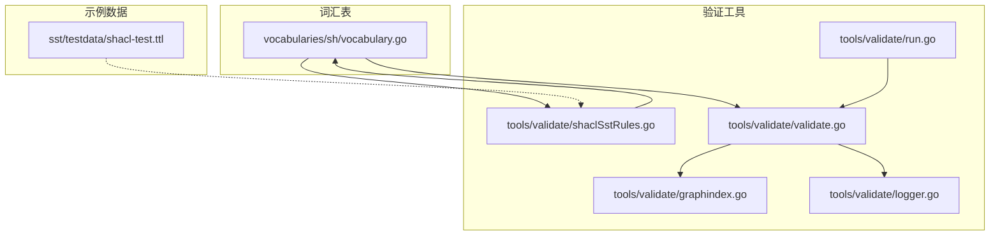
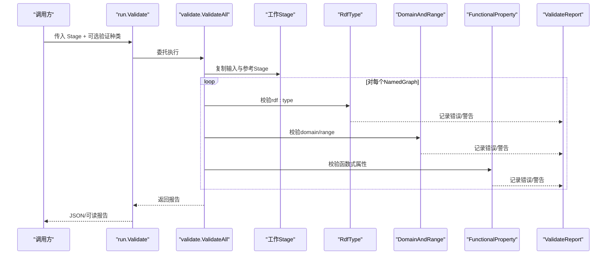
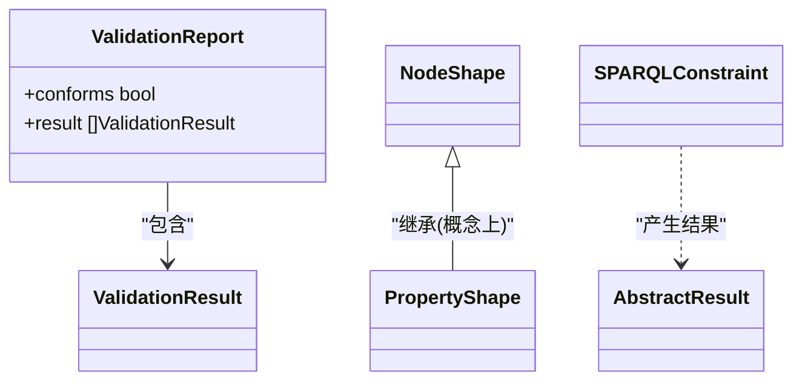
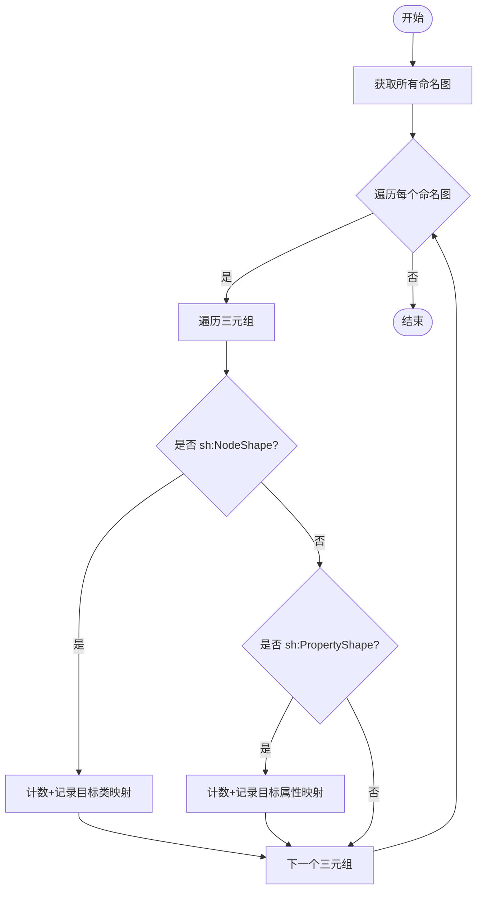
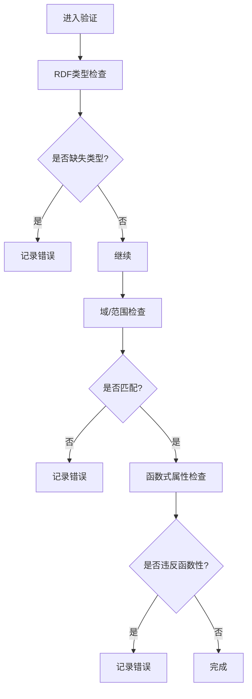
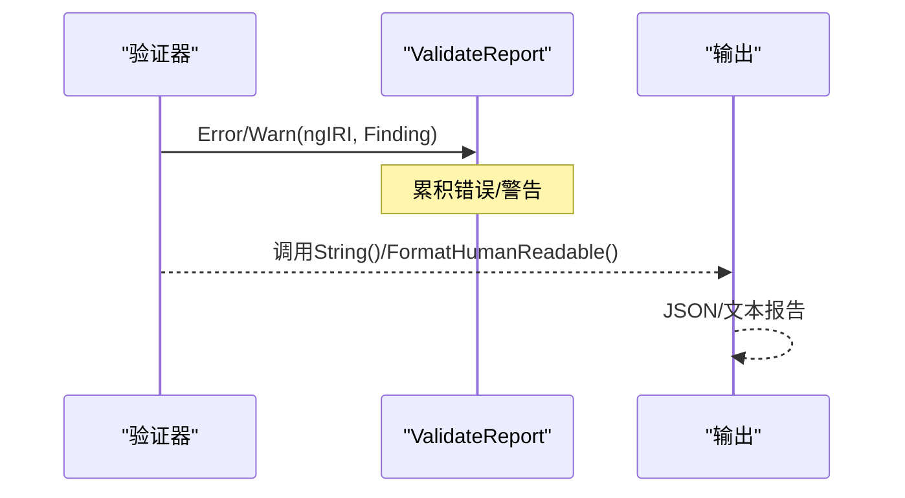
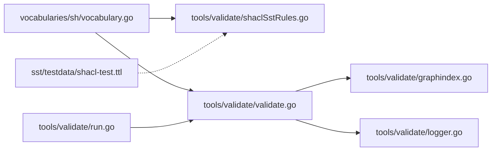

# SHACL约束验证

<cite>
**本文引用的文件**
- [tools/validate/shaclSstRules.go](file://tools/validate/shaclSstRules.go)
- [tools/validate/validate.go](file://tools/validate/validate.go)
- [tools/validate/run.go](file://tools/validate/run.go)
- [tools/validate/graphindex.go](file://tools/validate/graphindex.go)
- [tools/validate/logger.go](file://tools/validate/logger.go)
- [vocabularies/sh/vocabulary.go](file://vocabularies/sh/vocabulary.go)
- [sst/testdata/shacl-test.ttl](file://sst/testdata/shacl-test.ttl)
</cite>

## 目录
1. [简介](#简介)
2. [项目结构](#项目结构)
3. [核心组件](#核心组件)
4. [架构总览](#架构总览)
5. [详细组件分析](#详细组件分析)
6. [依赖关系分析](#依赖关系分析)
7. [性能考虑](#性能考虑)
8. [故障排查指南](#故障排查指南)
9. [结论](#结论)
10. [附录](#附录)

## 简介
本文件系统性说明SST中的SHACL约束验证能力，包括：
- SHACL基本概念与在SST中的实现现状
- 形状（Shapes）定义、约束类型与验证规则
- 内置规则与可扩展的自定义规则机制
- 验证执行流程与报告生成
- SHACL语法规范要点与最佳实践
- 实际用例与错误修复指导
- 与OWL推理的协作方式

当前仓库实现了：
- SHACL词汇表与类型体系（NodeShape、PropertyShape、ValidationReport等）
- 基础的形状提取与打印能力
- 一套内置验证器（RDF类型、域/范围、函数式属性），并输出结构化报告
- 日志与格式化能力，便于调试与集成

## 项目结构
围绕SHACL与验证的核心代码位于 tools/validate 与 vocabularies/sh 两个模块：
- vocabularies/sh：提供SHACL词汇表的类型与常量（如 NodeShape、PropertyShape、ValidationReport、SPARQLConstraint 等）
- tools/validate：提供验证入口、内置规则、图形索引、日志与报告格式化工具
- sst/testdata/shacl-test.ttl：包含W3C SHACL词汇的示例TTL片段

图表来源
- [vocabularies/sh/vocabulary.go:14-200](file://vocabularies/sh/vocabulary.go#L14-L200)
- [tools/validate/shaclSstRules.go:22-139](file://tools/validate/shaclSstRules.go#L22-L139)
- [tools/validate/validate.go:57-114](file://tools/validate/validate.go#L57-L114)
- [tools/validate/run.go:211-284](file://tools/validate/run.go#L211-L284)
- [tools/validate/graphindex.go:19-84](file://tools/validate/graphindex.go#L19-L84)
- [tools/validate/logger.go:11-58](file://tools/validate/logger.go#L11-L58)
- [sst/testdata/shacl-test.ttl:1-20](file://sst/testdata/shacl-test.ttl#L1-L20)

章节来源
- [tools/validate/shaclSstRules.go:22-139](file://tools/validate/shaclSstRules.go#L22-L139)
- [tools/validate/validate.go:57-114](file://tools/validate/validate.go#L57-L114)
- [tools/validate/run.go:211-284](file://tools/validate/run.go#L211-L284)
- [vocabularies/sh/vocabulary.go:14-200](file://vocabularies/sh/vocabulary.go#L14-L200)
- [tools/validate/graphindex.go:19-84](file://tools/validate/graphindex.go#L19-L84)
- [tools/validate/logger.go:11-58](file://tools/validate/logger.go#L11-L58)
- [sst/testdata/shacl-test.ttl:1-20](file://sst/testdata/shacl-test.ttl#L1-L20)

## 核心组件
- SHACL词汇表（vocabularies/sh/vocabulary.go）
  - 定义了SHACL核心类与属性，例如 AbstractResult、ValidationReport、ValidationResult、NodeShape、PropertyShape、SPARQLConstraint 等
  - 为形状与结果建模提供类型基础
- 形状提取与打印（tools/validate/shaclSstRules.go）
  - ExtractShapes：从Stage中扫描命名图，识别 sh:NodeShape 与 sh:PropertyShape，并建立目标类/属性的映射
  - ValidateStage：创建 ValidationReport 命名图，标记 conforms=false，并调用 ExtractShapes
  - PrintShapes：输出统计信息，辅助调试
- 内置验证器（tools/validate/validate.go）
  - ValidateAll：将输入Stage复制到工作Stage，合并可选参考Stage，依次执行三类验证：RDF类型、域/范围、函数式属性
  - RdfType：检查每个主体是否有 rdf:type，且类型为主类或属性
  - DomainAndRange：基于编译词汇表与图内声明（rdfs:domain/rdfs:range）进行早绑定与晚绑定校验
  - FunctionalProperty：校验 owl:FunctionalProperty 与 owl:InverseFunctionalProperty 的使用一致性
- 运行与报告（tools/validate/run.go）
  - Validate：统一入口，支持指定验证种类；默认执行三类验证
  - ValidateReport：JSON序列化与人类可读格式输出，包含错误/警告计数、按命名图分组的结果
- 图形索引（tools/validate/graphindex.go）
  - buildGraphIndex：构建 domainOf、rangeOf、subClassOf 的查找表，提升晚绑定验证效率
- 日志接口（tools/validate/logger.go）
  - Logger 接口与日志级别，便于扩展不同输出后端

章节来源
- [vocabularies/sh/vocabulary.go:21-200](file://vocabulararies/sh/vocabulary.go#L21-L200)
- [tools/validate/shaclSstRules.go:22-139](file://tools/validate/shaclSstRules.go#L22-L139)
- [tools/validate/validate.go:57-114](file://tools/validate/validate.go#L57-L114)
- [tools/validate/run.go:211-284](file://tools/validate/run.go#L211-L284)
- [tools/validate/graphindex.go:19-84](file://tools/validate/graphindex.go#L19-L84)
- [tools/validate/logger.go:11-58](file://tools/validate/logger.go#L11-L58)

## 架构总览
下图展示了SHACL验证在SST中的整体流程：从输入Stage到内置验证器，再到报告输出。

图表来源
- [tools/validate/run.go:441-473](file://tools/validate/run.go#L441-L473)
- [tools/validate/validate.go:57-114](file://tools/validate/validate.go#L57-L114)
- [tools/validate/validate.go:171-261](file://tools/validate/validate.go#L171-L261)
- [tools/validate/validate.go:263-362](file://tools/validate/validate.go#L263-L362)
- [tools/validate/validate.go:566-800](file://tools/validate/validate.go#L566-L800)

## 详细组件分析

### SHACL词汇与形状模型
- 词汇表提供了完整的SHACL类型体系，包括：
  - 抽象结果与报告：AbstractResult、ValidationReport、ValidationResult
  - 形状：NodeShape、PropertyShape
  - 约束组件：HasValueConstraintComponent、ClassConstraintComponent、SPARQLConstraint 等
  - 结果属性：result、sourceConstraint、shapesGraphWellFormed 等
- 这些类型为“形状定义”和“验证结果”的结构化表达奠定基础

图表来源
- [vocabularies/sh/vocabulary.go:21-200](file://vocabularies/sh/vocabulary.go#L21-L200)
- [vocabularies/sh/vocabulary.go:3309-3335](file://vocabularies/sh/vocabulary.go#L3309-L3335)
- [vocabularies/sh/vocabulary.go:3337-3353](file://vocabularies/sh/vocabulary.go#L3337-L3353)
- [vocabularies/sh/vocabulary.go:5535-5569](file://vocabularies/sh/vocabulary.go#L5535-L5569)

章节来源
- [vocabularies/sh/vocabulary.go:21-200](file://vocabularies/sh/vocabulary.go#L21-L200)
- [vocabularies/sh/vocabulary.go:3309-3353](file://vocabularies/sh/vocabulary.go#L3309-L3353)
- [vocabularies/sh/vocabulary.go:5535-5569](file://vocabularies/sh/vocabulary.go#L5535-L5569)

### 形状提取与打印
- ExtractShapes：遍历所有命名图，识别 sh:NodeShape 与 sh:PropertyShape，并维护 targetClasses、targetSubjectsOf、targetObjectsOf 等映射
- ValidateStage：创建 ValidationReport 命名图，设置 conforms=false，并调用 ExtractShapes
- PrintShapes：输出节点形状数、属性形状数、目标类/属性数量等统计信息

图表来源
- [tools/validate/shaclSstRules.go:68-139](file://tools/validate/shaclSstRules.go#L68-L139)

章节来源
- [tools/validate/shaclSstRules.go:22-139](file://tools/validate/shaclSstRules.go#L22-L139)

### 内置验证规则
- RDF类型校验（RdfType）
  - 要求每个主体具备 rdf:type，且类型属于主类或属性范畴
  - 跳过类定义与TermCollection
- 域/范围校验（DomainAndRange）
  - 早绑定：使用编译词汇表中的 domain/range
  - 晚绑定：从图内 rdfs:domain/rdfs:range 与 rdfs:subClassOf 推导
  - 支持对象与字面量范围，以及列表类型
- 函数式属性校验（FunctionalProperty）
  - 校验 owl:FunctionalProperty 与 owl:InverseFunctionalProperty 的使用次数限制

图表来源
- [tools/validate/validate.go:171-261](file://tools/validate/validate.go#L171-L261)
- [tools/validate/validate.go:263-362](file://tools/validate/validate.go#L263-L362)
- [tools/validate/validate.go:566-800](file://tools/validate/validate.go#L566-L800)

章节来源
- [tools/validate/validate.go:171-261](file://tools/validate/validate.go#L171-L261)
- [tools/validate/validate.go:263-362](file://tools/validate/validate.go#L263-L362)
- [tools/validate/validate.go:566-800](file://tools/validate/validate.go#L566-L800)

### 报告生成与输出
- ValidateReport：包含验证种类、通过状态、发现项、生成时间
- String()：JSON编码输出
- FormatHumanReadable()：生成易读文本报告，包含错误/警告统计、按命名图分组详情

图表来源
- [tools/validate/run.go:236-295](file://tools/validate/run.go#L236-L295)
- [tools/validate/run.go:297-439](file://tools/validate/run.go#L297-L439)

章节来源
- [tools/validate/run.go:236-295](file://tools/validate/run.go#L236-L295)
- [tools/validate/run.go:297-439](file://tools/validate/run.go#L297-L439)

### 与OWL推理的协作
- 晚绑定域/范围校验利用 rdfs:subClassOf 链进行子类判断，从而在不加载完整推理机的情况下获得一定程度的推理能力
- 早绑定路径直接读取编译词汇表中的 domain/range，提高性能
- 对于更复杂的推理需求（如跨图推理、复杂等价类），可结合外部OWL推理机，并将结果回填至Stage后再执行验证

章节来源
- [tools/validate/graphindex.go:19-84](file://tools/validate/graphindex.go#L19-L84)
- [tools/validate/validate.go:566-800](file://tools/validate/validate.go#L566-L800)

## 依赖关系分析
- 词汇表依赖：SHACL词汇表被形状提取与验证器引用，用于类型判定与结果建模
- 验证器依赖：
  - validate.go 依赖 graphindex.go 构建晚绑定索引
  - run.go 提供统一入口与报告格式化
  - logger.go 提供日志接口，便于扩展
- 示例数据：shacl-test.ttl 提供SHACL词汇的TTL片段，可用于测试与演示

图表来源
- [vocabularies/sh/vocabulary.go:14-200](file://vocabularies/sh/vocabulary.go#L14-L200)
- [tools/validate/shaclSstRules.go:22-139](file://tools/validate/shaclSstRules.go#L22-L139)
- [tools/validate/validate.go:57-114](file://tools/validate/validate.go#L57-L114)
- [tools/validate/graphindex.go:19-84](file://tools/validate/graphindex.go#L19-L84)
- [tools/validate/logger.go:11-58](file://tools/validate/logger.go#L11-L58)
- [tools/validate/run.go:211-284](file://tools/validate/run.go#L211-L284)
- [sst/testdata/shacl-test.ttl:1-20](file://sst/testdata/shacl-test.ttl#L1-L20)

章节来源
- [tools/validate/shaclSstRules.go:22-139](file://tools/validate/shaclSstRules.go#L22-L139)
- [tools/validate/validate.go:57-114](file://tools/validate/validate.go#L57-L114)
- [tools/validate/graphindex.go:19-84](file://tools/validate/graphindex.go#L19-L84)
- [tools/validate/logger.go:11-58](file://tools/validate/logger.go#L11-L58)
- [tools/validate/run.go:211-284](file://tools/validate/run.go#L211-L284)
- [sst/testdata/shacl-test.ttl:1-20](file://sst/testdata/shacl-test.ttl#L1-L20)

## 性能考虑
- 早绑定优先：尽量使用编译词汇表中的 domain/range，减少图扫描开销
- 晚绑定优化：通过 graphindex 预计算 domainOf、rangeOf、subClassOf，避免重复扫描
- 最小化复制：ValidateAll 仅在工作Stage中操作，不修改输入与参考Stage
- 选择性验证：run.Validate 允许指定验证种类，按需执行，降低不必要开销

[本节为通用性能建议，不直接分析具体文件]

## 故障排查指南
- 常见错误与定位
  - 缺少 rdf:type：RdfType 会记录错误，检查主体的类型声明
  - 域/范围不匹配：DomainAndRange 会记录错误，核对 rdfs:domain/rdfs:range 与对象类型
  - 函数式属性冲突：FunctionalProperty 会记录错误，确保同一主体/对象的属性值唯一
- 调试技巧
  - 启用 verbose 输出，查看进入/离开日志与详细信息
  - 使用 PrintShapes 查看形状提取结果，确认目标类/属性映射是否正确
  - 检查 graphindex 构建是否成功，确认晚绑定逻辑能正确解析子类型关系

章节来源
- [tools/validate/validate.go:171-261](file://tools/validate/validate.go#L171-L261)
- [tools/validate/validate.go:263-362](file://tools/validate/validate.go#L263-L362)
- [tools/validate/validate.go:566-800](file://tools/validate/validate.go#L566-L800)
- [tools/validate/shaclSstRules.go:36-65](file://tools/validate/shaclSstRules.go#L36-L65)
- [tools/validate/run.go:65-121](file://tools/validate/run.go#L65-L121)

## 结论
SST在当前版本中提供了：
- 完整的SHACL词汇表与类型体系
- 基础的形状提取与打印能力
- 一套实用的内置验证器（RDF类型、域/范围、函数式属性）
- 结构化报告与人类可读输出
- 与OWL推理的协作点（晚绑定子类判断）

未来可扩展方向：
- 实现更多SHACL约束组件（如 HasValue、MinCount、MaxCount、Pattern 等）
- 引入SPARQL约束执行引擎，支持复杂业务规则
- 增强形状解析与目标匹配策略，支持更丰富的 sh:target* 模式
- 集成外部OWL推理机，提供更强的语义推理能力

[本节为总结性内容，不直接分析具体文件]

## 附录

### SHACL语法规范要点（基于词汇表）
- 形状类型
  - sh:NodeShape：针对节点的约束集合
  - sh:PropertyShape：针对属性的约束集合
- 约束组件
  - sh:HasValueConstraintComponent：值存在性约束
  - sh:ClassConstraintComponent：类型约束
  - sh:SPARQLConstraint：基于SPARQL的自定义约束
- 结果模型
  - sh:ValidationReport：验证报告根节点
  - sh:ValidationResult：单个验证结果
  - sh:result：报告到结果的属性

章节来源
- [vocabularies/sh/vocabulary.go:21-200](file://vocabularies/sh/vocabulary.go#L21-L200)
- [vocabularies/sh/vocabulary.go:3309-3353](file://vocabularies/sh/vocabulary.go#L3309-L3353)
- [vocabularies/sh/vocabulary.go:5535-5569](file://vocabularies/sh/vocabulary.go#L5535-L5569)

### 实际用例与错误修复指导
- 用例：使用 shacl-test.ttl 作为SHACL词汇的TTL片段，配合形状定义进行验证
- 错误修复：
  - 若出现“缺少 rdf:type”，为主体添加合适的类型声明
  - 若出现“域/范围不匹配”，修正属性的 domain/range 或对象类型
  - 若出现“函数式属性冲突”，确保属性值唯一性或调整属性定义

章节来源
- [sst/testdata/shacl-test.ttl:1-20](file://sst/testdata/shacl-test.ttl#L1-L20)
- [tools/validate/validate.go:263-362](file://tools/validate/validate.go#L263-L362)
- [tools/validate/validate.go:566-800](file://tools/validate/validate.go#L566-L800)