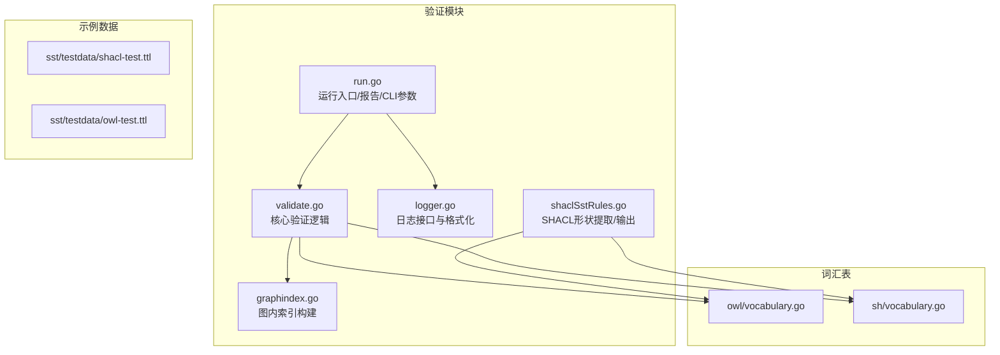
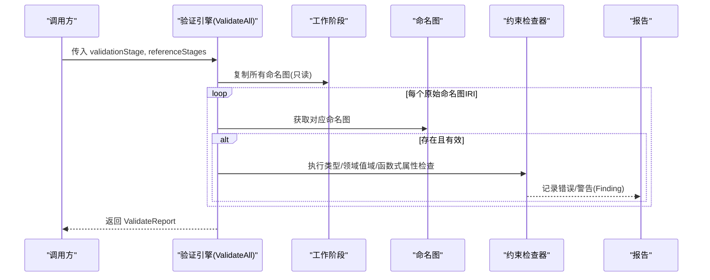
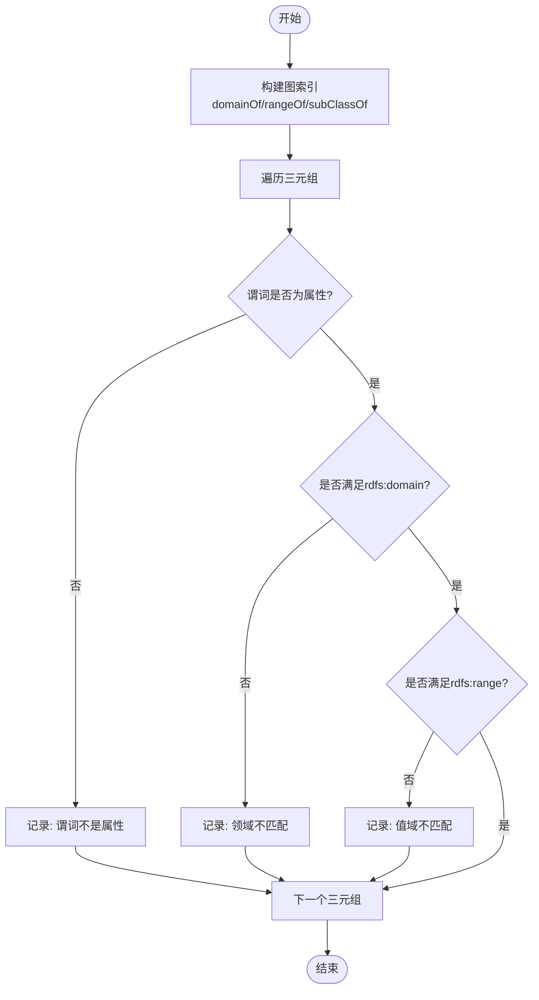
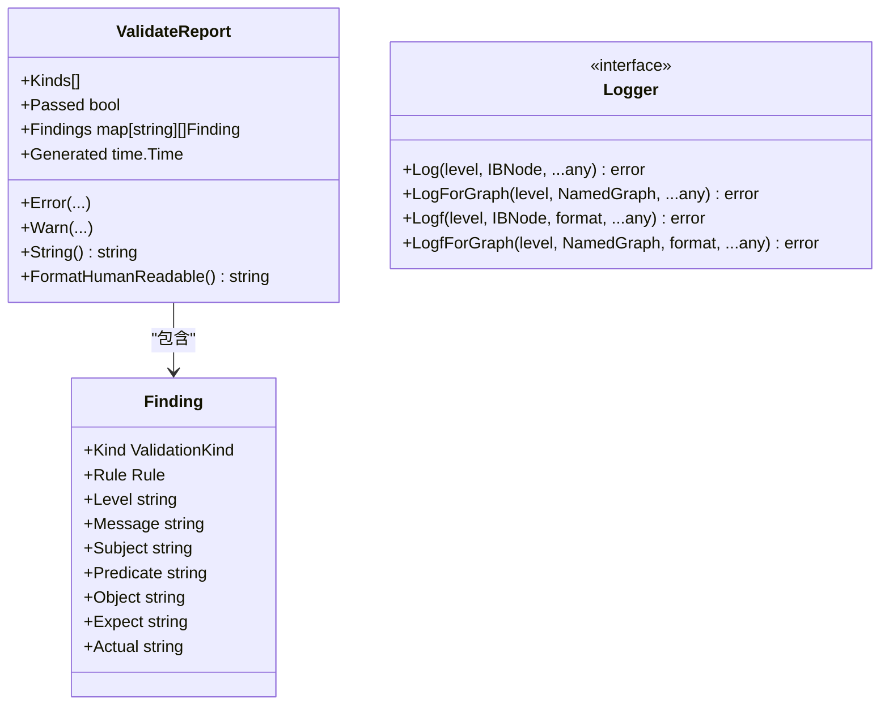
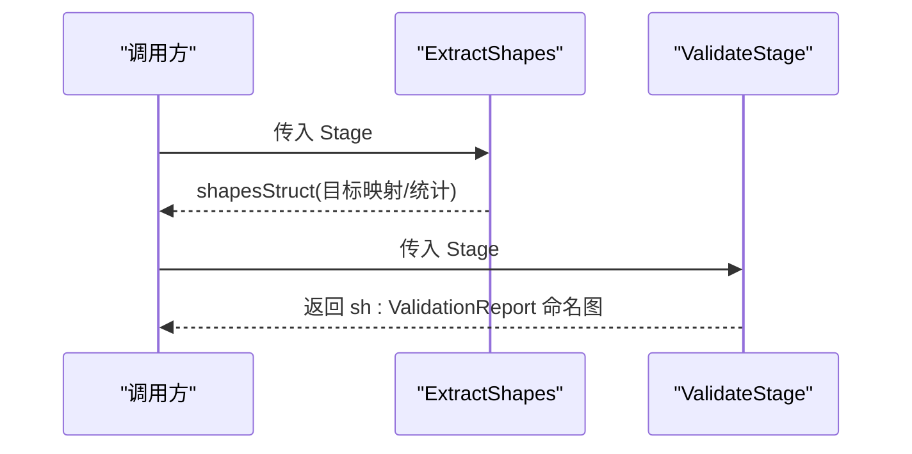
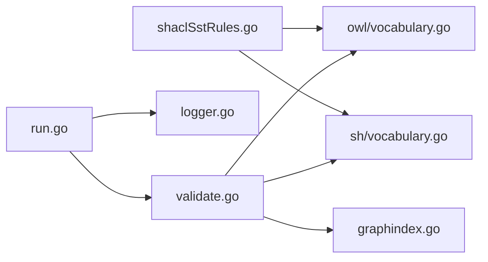

# 数据验证

<cite>
**本文引用的文件**
- [tools/validate/validate.go](file://tools/validate/validate.go)
- [tools/validate/run.go](file://tools/validate/run.go)
- [tools/validate/graphindex.go](file://tools/validate/graphindex.go)
- [tools/validate/logger.go](file://tools/validate/logger.go)
- [tools/validate/shaclSstRules.go](file://tools/validate/shaclSstRules.go)
- [vocabularies/owl/vocabulary.go](file://vocabularies/owl/vocabulary.go)
- [vocabularies/sh/vocabulary.go](file://vocabularies/sh/vocabulary.go)
- [sst/testdata/shacl-test.ttl](file://sst/testdata/shacl-test.ttl)
- [sst/testdata/owl-test.ttl](file://sst/testdata/owl-test.ttl)
</cite>

## 目录
1. [简介](#简介)
2. [项目结构](#项目结构)
3. [核心组件](#核心组件)
4. [架构总览](#架构总览)
5. [详细组件分析](#详细组件分析)
6. [依赖关系分析](#依赖关系分析)
7. [性能考虑](#性能考虑)
8. [故障排查指南](#故障排查指南)
9. [结论](#结论)
10. [附录](#附录)

## 简介
本文件面向SST数据验证系统，系统性阐述OWL推理与SHACL约束验证的原理与应用场景，说明验证规则的定义与配置方法、内置与自定义规则的创建方式、验证执行流程与结果报告生成机制，并提供批量与增量验证策略、性能优化建议、错误处理机制、实际用例与调试技巧，以及验证结果的解释与修复建议。

## 项目结构
验证子系统位于 tools/validate 包，围绕“阶段（Stage）”中的命名图（NamedGraph）进行三元组级校验，结合词汇表（Vocabulary）与RDFS/OWL语义进行领域/值域、类型、函数式属性等约束检查；同时提供SHACL形状提取与基础验证框架入口。

图表来源
- [tools/validate/validate.go:57-114](file://tools/validate/validate.go#L57-L114)
- [tools/validate/run.go:211-284](file://tools/validate/run.go#L211-L284)
- [tools/validate/graphindex.go:19-56](file://tools/validate/graphindex.go#L19-L56)
- [tools/validate/logger.go:11-35](file://tools/validate/logger.go#L11-L35)
- [tools/validate/shaclSstRules.go:22-34](file://tools/validate/shaclSstRules.go#L22-L34)
- [vocabularies/owl/vocabulary.go:17-22](file://vocabularies/owl/vocabulary.go#L17-L22)
- [vocabularies/sh/vocabulary.go:14-19](file://vocabularies/sh/vocabulary.go#L14-L19)

章节来源
- [tools/validate/validate.go:57-114](file://tools/validate/validate.go#L57-L114)
- [tools/validate/run.go:211-284](file://tools/validate/run.go#L211-L284)
- [tools/validate/graphindex.go:19-56](file://tools/validate/graphindex.go#L19-L56)
- [tools/validate/logger.go:11-35](file://tools/validate/logger.go#L11-L35)
- [tools/validate/shaclSstRules.go:22-34](file://tools/validate/shaclSstRules.go#L22-L34)
- [vocabularies/owl/vocabulary.go:17-22](file://vocabularies/owl/vocabulary.go#L17-L22)
- [vocabularies/sh/vocabulary.go:14-19](file://vocabularies/sh/vocabulary.go#L14-L19)

## 核心组件
- 验证引擎：对每个命名图执行三类内置验证
  - RDF类型检查：主体必须具有 rdf:type，且类型需为“主类”或“属性”
  - 领域/值域检查：基于词汇表或图内 rdfs:domain/rdfs:range 声明，校验三元组的谓词与对象类型
  - 函数式属性检查：基于 owl:FunctionalProperty / owl:InverseFunctionalProperty 的语义，确保同一主体/客体上属性唯一
- 图索引：在单次扫描中构建 domainOf、rangeOf、subClassOf 映射，支持“晚绑定”验证，避免重复遍历
- 报告系统：结构化 ValidateReport，包含通过状态、按命名图分组的发现项（Finding），支持JSON与人类可读格式
- 日志接口：统一日志抽象，便于扩展不同输出目标
- SHACL形状提取：从图中抽取 NodeShape/PropertyShape 并统计目标映射，作为SHACL验证的基础设施

章节来源
- [tools/validate/validate.go:171-362](file://tools/validate/validate.go#L171-L362)
- [tools/validate/validate.go:566-800](file://tools/validate/validate.go#L566-L800)
- [tools/validate/graphindex.go:19-84](file://tools/validate/graphindex.go#L19-L84)
- [tools/validate/run.go:236-295](file://tools/validate/run.go#L236-L295)
- [tools/validate/logger.go:11-35](file://tools/validate/logger.go#L11-L35)
- [tools/validate/shaclSstRules.go:22-34](file://tools/validate/shaclSstRules.go#L22-L34)

## 架构总览
验证流程以“工作阶段”为中心，将待验证阶段与参考阶段合并到临时工作阶段，逐图执行验证，不修改输入。

图表来源
- [tools/validate/validate.go:57-114](file://tools/validate/validate.go#L57-L114)
- [tools/validate/run.go:441-472](file://tools/validate/run.go#L441-L472)

## 详细组件分析

### 验证引擎与内置规则
- 类型检查（RdfType）
  - 要求每个主体具备 rdf:type
  - 若主体是“主类”或“属性”，则跳过严格检查
  - 否则报错：缺少类型或类型不符合预期
- 领域/值域检查（DomainAndRange）
  - 优先使用词汇表的早绑定信息（如谓词的 Domain/Range）
  - 若无词汇表定义，回退到图内 rdfs:domain/rdfs:range 的晚绑定解析
  - 支持对象节点与字面量类型的匹配，含集合与列表
- 函数式属性检查（FunctionalProperty）
  - 识别 owl:FunctionalProperty 与 owl:InverseFunctionalProperty
  - 维护计数映射，检测同一主体/客体上的重复赋值

图表来源
- [tools/validate/graphindex.go:28-56](file://tools/validate/graphindex.go#L28-L56)
- [tools/validate/validate.go:566-800](file://tools/validate/validate.go#L566-L800)

章节来源
- [tools/validate/validate.go:171-362](file://tools/validate/validate.go#L171-L362)
- [tools/validate/validate.go:566-800](file://tools/validate/validate.go#L566-L800)
- [tools/validate/graphindex.go:28-84](file://tools/validate/graphindex.go#L28-L84)

### 报告与日志
- 报告结构
  - ValidateReport：包含验证种类、通过标志、按命名图分组的发现项、生成时间
  - Finding：包含规则、级别、消息、相关三元组、期望与实际值
- 日志接口
  - Logger 抽象 Log/LogForGraph 等方法，支持分级输出
  - outputLog 实现默认日志行为，支持静默模式与详细模式

图表来源
- [tools/validate/run.go:211-295](file://tools/validate/run.go#L211-L295)
- [tools/validate/logger.go:11-35](file://tools/validate/logger.go#L11-L35)

章节来源
- [tools/validate/run.go:211-295](file://tools/validate/run.go#L211-L295)
- [tools/validate/logger.go:11-35](file://tools/validate/logger.go#L11-L35)

### SHACL形状提取与验证入口
- 形状提取
  - ExtractShapes 遍历命名图，识别 sh:NodeShape、sh:TargetClass、sh:Property 等，建立目标映射
  - PrintShapes 输出统计信息，便于调试
- 验证入口
  - ValidateStage 创建 sh:ValidationReport 命名图，标记 conforms=false，并打印形状信息

图表来源
- [tools/validate/shaclSstRules.go:22-34](file://tools/validate/shaclSstRules.go#L22-L34)
- [tools/validate/shaclSstRules.go:67-138](file://tools/validate/shaclSstRules.go#L67-L138)

章节来源
- [tools/validate/shaclSstRules.go:22-34](file://tools/validate/shaclSstRules.go#L22-L34)
- [tools/validate/shaclSstRules.go:67-138](file://tools/validate/shaclSstRules.go#L67-L138)

### OWL推理与SHACL约束的应用场景
- OWL推理
  - 利用 owl:FunctionalProperty / owl:InverseFunctionalProperty 等属性公理，保证数据一致性
  - 借助 rdfs:subClassOf / rdfs:subPropertyOf 进行继承链判断，支持晚绑定验证
- SHACL约束
  - 通过 sh:NodeShape/sh:PropertyShape 描述数据模型约束
  - 当前实现提供形状提取与基础报告框架，可扩展为完整SHACL验证执行器

章节来源
- [vocabularies/owl/vocabulary.go:381-440](file://vocabularies/owl/vocabulary.go#L381-L440)
- [vocabularies/sh/vocabulary.go:14-19](file://vocabularies/sh/vocabulary.go#L14-L19)
- [tools/validate/shaclSstRules.go:67-138](file://tools/validate/shaclSstRules.go#L67-L138)

## 依赖关系分析
- 验证引擎依赖
  - sst.Stage / NamedGraph / IBNode 等核心数据结构
  - vocabularies/owl 与 vocabularies/sh 提供的类型常量与接口
  - graphindex 提供图内领域/值域/子类关系的快速查找
- 外部依赖
  - 词汇表由编译器生成，提供强类型访问
  - 日志采用可插拔接口，便于集成不同后端

图表来源
- [tools/validate/validate.go:57-114](file://tools/validate/validate.go#L57-L114)
- [tools/validate/run.go:211-284](file://tools/validate/run.go#L211-L284)
- [tools/validate/shaclSstRules.go:22-34](file://tools/validate/shaclSstRules.go#L22-L34)

章节来源
- [tools/validate/validate.go:57-114](file://tools/validate/validate.go#L57-L114)
- [tools/validate/run.go:211-284](file://tools/validate/run.go#L211-L284)
- [tools/validate/shaclSstRules.go:22-34](file://tools/validate/shaclSstRules.go#L22-L34)

## 性能考虑
- 图索引一次构建，多次复用：buildGraphIndex 仅扫描一次图，后续查询 O(1)
- 早绑定优先：优先使用词汇表定义的 Domain/Range，减少图内查找
- 避免重复遍历：验证过程中尽量复用已收集的类型集合与映射
- 批量验证：ValidateAll 将多个参考阶段合并到工作阶段，减少重复IO
- 增量验证建议
  - 基于提交差异（diff）仅对变更的命名图执行验证
  - 缓存图索引，仅在图内容变化时重建
  - 对大型图分片并行处理（注意共享资源竞争）

[本节为通用指导，无需具体文件引用]

## 故障排查指南
- 常见问题
  - 缺少 rdf:type：检查主体是否声明类型，或是否属于“主类/属性”豁免范围
  - 领域/值域不匹配：确认谓词是否在词汇表中定义了 Domain/Range，或在图内声明了 rdfs:domain/rdfs:range
  - 函数式属性冲突：检查是否存在同一主体/客体上的重复赋值
- 调试技巧
  - 启用详细日志（verbose）观察进入/离开与关键步骤
  - 使用人类可读报告 FormatHumanReadable 快速定位问题
  - 通过 SHACL 形状提取输出统计，确认目标映射是否正确
- 错误处理
  - 验证过程遇到错误会立即返回，报告中标记 Passed=false
  - 日志接口支持静默模式，便于CI环境集成

章节来源
- [tools/validate/run.go:65-121](file://tools/validate/run.go#L65-L121)
- [tools/validate/run.go:286-439](file://tools/validate/run.go#L286-L439)
- [tools/validate/shaclSstRules.go:22-34](file://tools/validate/shaclSstRules.go#L22-L34)

## 结论
SST数据验证系统提供了稳健的内置规则（类型、领域/值域、函数式属性）与可扩展的SHACL形状提取能力。通过图索引与词汇表早绑定，系统在准确性与性能之间取得良好平衡。结合批量与增量策略，可在大规模数据集上高效执行验证，并通过结构化报告与日志辅助快速定位与修复问题。

[本节为总结性内容，无需具体文件引用]

## 附录

### 验证规则定义与配置
- 内置规则
  - KindRdfType：检查 rdf:type 的存在与合法性
  - KindDomainRange：检查 rdfs:domain/rdfs:range 的一致性
  - KindFunctionalProperty：检查 owl:FunctionalProperty / owl:InverseFunctionalProperty 的唯一性约束
- 配置方式
  - 通过 Validate(stage, kinds...) 指定要执行的验证种类
  - 通过 ValidateAll(validationStage, referenceStages...) 引入参考阶段以支持晚绑定

章节来源
- [tools/validate/run.go:211-234](file://tools/validate/run.go#L211-L234)
- [tools/validate/run.go:441-472](file://tools/validate/run.go#L441-L472)
- [tools/validate/validate.go:57-114](file://tools/validate/validate.go#L57-L114)

### 自定义规则创建
- 扩展点
  - 实现 Logger 接口以定制日志输出
  - 在 Validate 循环中添加新的 ValidationKind 分支，编写对应的检查函数
  - 复用 graphindex 与词汇表接口进行领域/值域判断
- 建议
  - 保持无副作用：不修改输入阶段
  - 充分利用图索引与早绑定，减少重复扫描
  - 产出结构化 Finding，便于报告聚合

[本节为通用指导，无需具体文件引用]

### 验证执行流程与结果报告
- 执行流程
  - 构建工作阶段，合并参考阶段
  - 遍历原始命名图，依次执行选定验证种类
  - 记录错误/警告至报告
- 报告生成
  - JSON 序列化：ValidateReport.String()
  - 人类可读：ValidateReport.FormatHumanReadable()

章节来源
- [tools/validate/validate.go:57-114](file://tools/validate/validate.go#L57-L114)
- [tools/validate/run.go:286-439](file://tools/validate/run.go#L286-L439)

### 批量与增量验证策略
- 批量验证
  - 使用 ValidateAll 一次性处理多个阶段，减少重复IO
- 增量验证
  - 基于提交差异仅验证变更部分
  - 缓存图索引，按需重建
  - 并行化独立命名图的验证任务

[本节为通用指导，无需具体文件引用]

### 实际用例与调试技巧
- 用例
  - 使用 shacl-test.ttl 与 owl-test.ttl 作为最小示例，验证词汇表加载与基本语义
- 调试
  - 启用 verbose 日志，观察进入/离开与关键三元组
  - 使用 PrintShapes 输出SHACL形状统计，确认目标映射
  - 通过 FormatHumanReadable 报告快速定位问题三元组

章节来源
- [sst/testdata/shacl-test.ttl:1-20](file://sst/testdata/shacl-test.ttl#L1-L20)
- [sst/testdata/owl-test.ttl:1-11](file://sst/testdata/owl-test.ttl#L1-L11)
- [tools/validate/shaclSstRules.go:36-65](file://tools/validate/shaclSstRules.go#L36-L65)
- [tools/validate/run.go:65-121](file://tools/validate/run.go#L65-L121)

### 验证结果解释与修复建议
- 结果解释
  - Passed=false 表示存在错误
  - Findings 按命名图分组，每条包含规则、级别、消息与相关三元组
- 修复建议
  - 类型错误：为主体添加合适的 rdf:type，或将其纳入“主类/属性”范畴
  - 领域/值域错误：修正谓词声明或对象类型，确保与 Domain/Range 一致
  - 函数式属性冲突：移除重复赋值，或调整数据模型

章节来源
- [tools/validate/run.go:236-295](file://tools/validate/run.go#L236-L295)
- [tools/validate/validate.go:171-362](file://tools/validate/validate.go#L171-L362)
- [tools/validate/validate.go:566-800](file://tools/validate/validate.go#L566-L800)