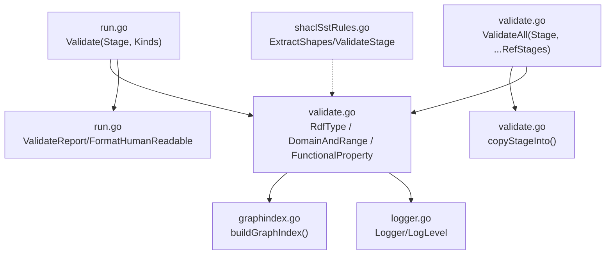
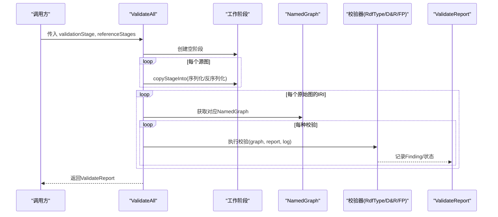
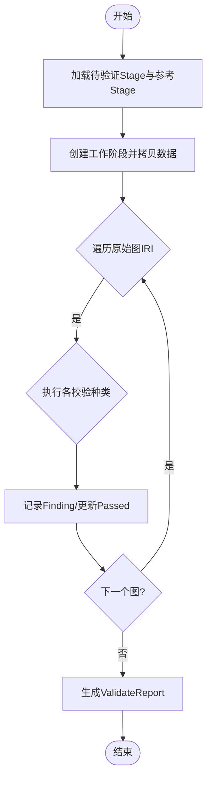
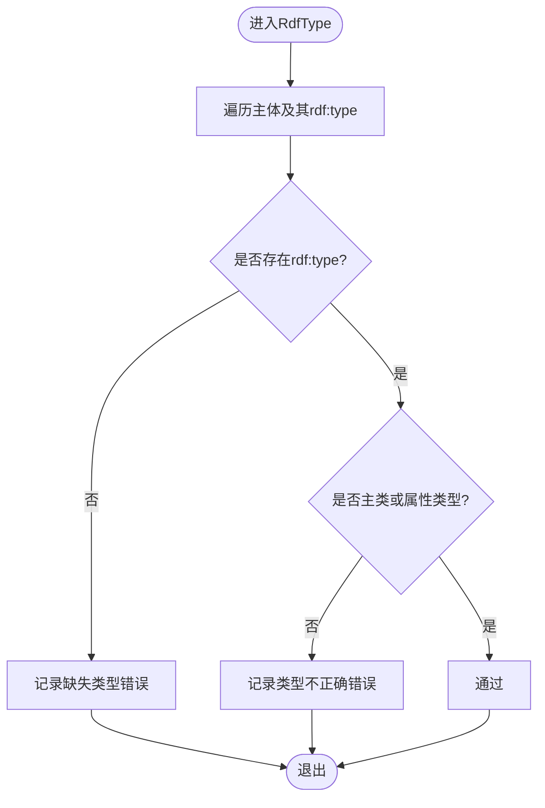
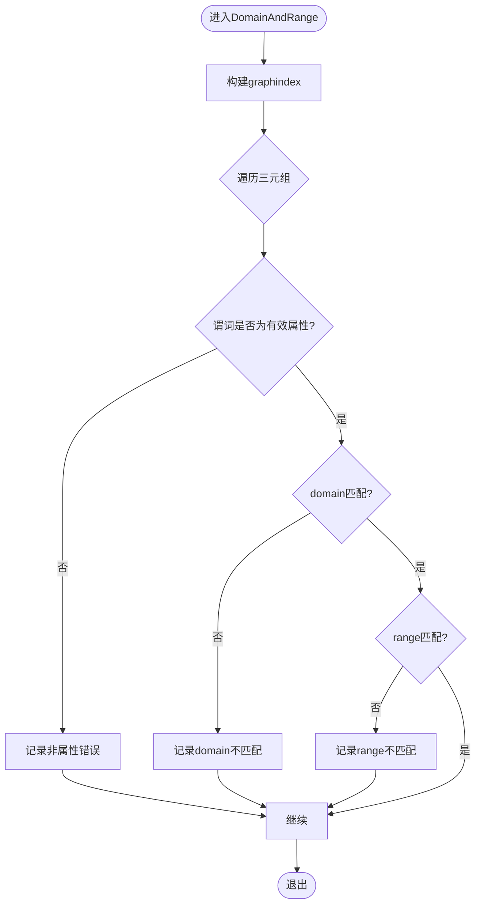
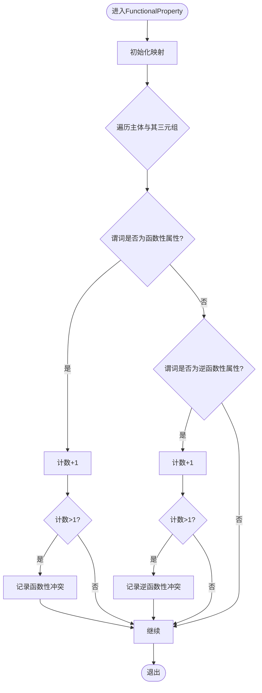
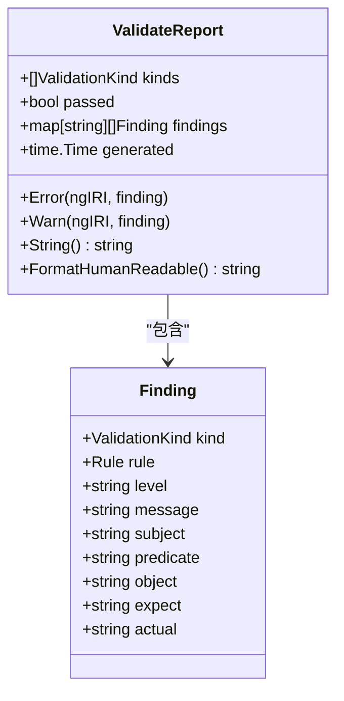
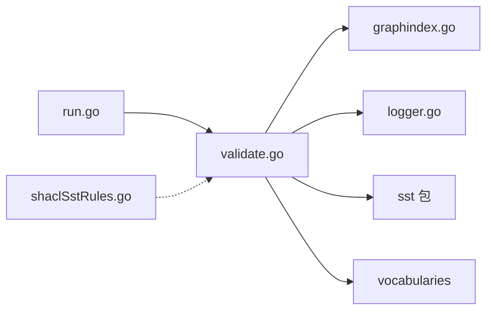

# 验证执行引擎

<cite>
**本文引用的文件**
- [run.go](file://tools/validate/run.go)
- [validate.go](file://tools/validate/validate.go)
- [graphindex.go](file://tools/validate/graphindex.go)
- [shaclSstRules.go](file://tools/validate/shaclSstRules.go)
- [logger.go](file://tools/validate/logger.go)
- [enumflags.go](file://tools/validate/enumflags.go)
- [validateall_test.go](file://tools/validate/validateall_test.go)
- [errrecovery.go](file://sst/errrecovery.go)
</cite>

## 目录
1. [简介](#简介)
2. [项目结构](#项目结构)
3. [核心组件](#核心组件)
4. [架构总览](#架构总览)
5. [详细组件分析](#详细组件分析)
6. [依赖关系分析](#依赖关系分析)
7. [性能考量](#性能考量)
8. [故障排查指南](#故障排查指南)
9. [结论](#结论)
10. [附录：API与使用示例](#附录api与使用示例)

## 简介
本文件面向“验证执行引擎”，系统性说明其调度机制、执行流程、批量与增量策略、结果收集与报告生成、错误处理与异常恢复、性能监控与优化，以及对外API接口与使用方式。该引擎基于 SST Stage/NamedGraph 数据模型，对 RDF/OWL/RDFS 语义进行类型、域/范围、函数性属性等规则校验，并输出结构化与可读的报告。

## 项目结构
验证模块位于 tools/validate，核心文件职责如下：
- run.go：命令行入口、日志输出、报告数据结构与格式化、按图遍历的调度入口 Validate
- validate.go：核心校验逻辑（RdfType、DomainAndRange、FunctionalProperty）、批量校验 ValidateAll、工作阶段构建与合并
- graphindex.go：图内索引构建（rdfs:domain/range/subClassOf），支持晚绑定校验
- shaclSstRules.go：SHACL Shapes 提取与基础报告骨架（当前为实验性/占位）
- logger.go：日志级别与日志接口定义、三元组格式化错误
- enumflags.go：枚举型命令行参数封装

图表来源
- [run.go:441-472](file://tools/validate/run.go#L441-L472)
- [validate.go:63-114](file://tools/validate/validate.go#L63-L114)
- [validate.go:171-261](file://tools/validate/validate.go#L171-L261)
- [validate.go:263-362](file://tools/validate/validate.go#L263-L362)
- [validate.go:566-800](file://tools/validate/validate.go#L566-L800)
- [graphindex.go:30-56](file://tools/validate/graphindex.go#L30-L56)
- [logger.go:11-31](file://tools/validate/logger.go#L11-L31)
- [shaclSstRules.go:22-34](file://tools/validate/shaclSstRules.go#L22-L34)

章节来源
- [run.go:24-53](file://tools/validate/run.go#L24-L53)
- [run.go:236-295](file://tools/validate/run.go#L236-L295)
- [validate.go:63-114](file://tools/validate/validate.go#L63-L114)
- [graphindex.go:19-56](file://tools/validate/graphindex.go#L19-L56)
- [logger.go:11-31](file://tools/validate/logger.go#L11-L31)
- [shaclSstRules.go:12-34](file://tools/validate/shaclSstRules.go#L12-L34)

## 核心组件
- 调度与入口
  - Validate(stage, kinds...)：按 NamedGraph 遍历，依次执行指定校验种类；默认包含 rdf:type、domain-range、functional property。
  - ValidateAll(validationStage, referenceStages...)：将待验证数据与参考数据合并到工作阶段，避免修改输入，再按原图IRI顺序执行全部校验。
- 校验器
  - RdfType：检查节点是否具备 rdf:type，且类型为主类或属性类型。
  - DomainAndRange：基于编译词汇表与图内索引，校验谓词的 domain/range 约束，支持列表与集合。
  - FunctionalProperty：校验 owl:FunctionalProperty 与 owl:InverseFunctionalProperty 的唯一性约束。
- 索引与晚绑定
  - buildGraphIndex：扫描图内 rdfs:domain/range/subClassOf，构建查找表，支持未预编译属性的晚绑定校验。
- 日志与报告
  - Logger/LogLevel：统一日志接口，支持进入/离开、信息/警告/错误级别。
  - ValidateReport/Finding：结构化结果，支持 JSON 与人类可读格式输出。
- SHACL 形状提取（实验性）
  - ExtractShapes/ValidateStage：从图中提取 NodeShape/PropertyShape 并生成 ValidationReport 骨架。

章节来源
- [run.go:441-472](file://tools/validate/run.go#L441-L472)
- [validate.go:63-114](file://tools/validate/validate.go#L63-L114)
- [validate.go:171-261](file://tools/validate/validate.go#L171-L261)
- [validate.go:263-362](file://tools/validate/validate.go#L263-L362)
- [validate.go:566-800](file://tools/validate/validate.go#L566-L800)
- [graphindex.go:30-56](file://tools/validate/graphindex.go#L30-L56)
- [run.go:236-295](file://tools/validate/run.go#L236-L295)
- [shaclSstRules.go:22-34](file://tools/validate/shaclSstRules.go#L22-L34)

## 架构总览
验证引擎采用“工作阶段 + 多校验器”的流水线式架构：
- 输入：待验证 Stage 与可选参考 Stage
- 预处理：复制至工作阶段，合并参考数据，保证输入不可变
- 执行：按 NamedGraph 顺序，依次运行各校验器
- 输出：ValidateReport（JSON/人类可读），含通过状态、发现项、时间戳

图表来源
- [validate.go:63-114](file://tools/validate/validate.go#L63-L114)
- [validate.go:171-261](file://tools/validate/validate.go#L171-L261)
- [validate.go:263-362](file://tools/validate/validate.go#L263-L362)
- [validate.go:566-800](file://tools/validate/validate.go#L566-L800)

## 详细组件分析

### 调度与执行流程
- 单图校验：Validate(stage, kinds...) 遍历 stage.NamedGraphs()，对每个图执行指定校验种类。
- 批量校验：ValidateAll 将多个图复制到工作阶段，保留原始IRI顺序，确保可复现的执行顺序与结果分组。
- 校验种类：
  - KindRdfType：检查 rdf:type 存在性与主类/属性类型判定
  - KindDomainRange：检查谓词 domain/range 约束，支持列表与集合
  - KindFunctionalProperty：检查函数性与逆函数性属性唯一性

图表来源
- [validate.go:63-114](file://tools/validate/validate.go#L63-L114)
- [run.go:441-472](file://tools/validate/run.go#L441-L472)

章节来源
- [run.go:441-472](file://tools/validate/run.go#L441-L472)
- [validate.go:63-114](file://tools/validate/validate.go#L63-L114)

### 批量验证与增量验证策略
- 批量验证
  - 通过 ValidateAll 一次性合并多个图，并在同一工作阶段中执行所有校验，减少重复开销。
  - 参考阶段用于提供外部定义的属性/类信息，支持跨图晚绑定。
- 增量验证（概念性建议）
  - 当前实现以全量扫描为主；若需增量，可在上层根据变更集（如 diff 或提交差异）筛选受影响的 NamedGraph 或 IBNode，仅对这些子图执行校验。
  - 结合 graphindex 的缓存（在单次校验中复用）可减少重复计算。

章节来源
- [validate.go:63-114](file://tools/validate/validate.go#L63-L114)
- [graphindex.go:30-56](file://tools/validate/graphindex.go#L30-L56)

### 校验器详解

#### RdfType 校验
- 目标：确保每个主体有 rdf:type，且类型为“主类”或“属性类型”。
- 行为：跳过命名图节点与 TermCollection；递归识别主类与属性类型继承链。

图表来源
- [validate.go:263-362](file://tools/validate/validate.go#L263-L362)

章节来源
- [validate.go:263-362](file://tools/validate/validate.go#L263-L362)

#### DomainAndRange 校验
- 目标：校验谓词的 domain/range 约束，支持早绑定（词汇表）与晚绑定（图内声明）。
- 行为：
  - 构建 graphindex，缓存 domain/range/subClassOf
  - 对每个谓词-对象对，判断是否为有效属性
  - 校验 domain：主体类型需匹配谓词 domain
  - 校验 range：对象类型需匹配谓词 range，支持列表与集合成员类型检查

图表来源
- [validate.go:566-800](file://tools/validate/validate.go#L566-L800)
- [graphindex.go:30-56](file://tools/validate/graphindex.go#L30-L56)

章节来源
- [validate.go:566-800](file://tools/validate/validate.go#L566-L800)
- [graphindex.go:30-56](file://tools/validate/graphindex.go#L30-L56)

#### FunctionalProperty 校验
- 目标：确保 owl:FunctionalProperty 在主体上只出现一次；owl:InverseFunctionalProperty 在对象上只出现一次。
- 行为：维护映射计数，超限时记录错误。

图表来源
- [validate.go:171-261](file://tools/validate/validate.go#L171-L261)

章节来源
- [validate.go:171-261](file://tools/validate/validate.go#L171-L261)

### 结果收集、格式化与报告生成
- 结果收集：每个校验器通过 Logger 记录日志，并通过 ValidateReport 的 Error/Warn 方法写入 Finding。
- 报告结构：ValidateReport 包含校验种类、通过状态、按 NamedGraph IRI 分组的 findings 列表、生成时间。
- 格式化：
  - JSON：ValidateReport.String()
  - 人类可读：FormatHumanReadable()，按图分组列出错误与警告，统计总数。

图表来源
- [run.go:236-295](file://tools/validate/run.go#L236-L295)
- [run.go:297-439](file://tools/validate/run.go#L297-L439)

章节来源
- [run.go:236-295](file://tools/validate/run.go#L236-L295)
- [run.go:297-439](file://tools/validate/run.go#L297-L439)

### 错误处理与异常恢复
- 校验过程中的错误：
  - 通过 Logger.ErrorLevel 记录错误，并累计 errorsEncountered。
  - ValidateReport.Passed 在遇到任何 error 时置为 false。
- 异常恢复：
  - 底层 SST 提供 handleWithRecovery 机制，可将 panic 转换为错误通道返回，便于上层捕获与恢复。
  - 校验器内部使用 errBreakFor 提前终止遍历分支，避免无谓扫描。

章节来源
- [run.go:65-121](file://tools/validate/run.go#L65-L121)
- [run.go:274-284](file://tools/validate/run.go#L274-L284)
- [validate.go:28](file://tools/validate/validate.go#L28)
- [errrecovery.go:81-92](file://sst/errrecovery.go#L81-L92)

### 性能监控与优化技术
- 图内索引：buildGraphIndex 将 domain/range/subClassOf 抽取为内存映射，避免重复扫描，提升晚绑定校验效率。
- 早绑定优先：优先使用词汇表中的属性信息，减少图内查找成本。
- 遍历优化：
  - 使用 ForAllIBNodes/ForAll 回调，尽早返回（errBreakFor）以减少不必要遍历。
  - 对 TermCollection 与 LiteralCollection 的特殊路径处理，避免误报。
- 日志控制：
  - 通过 verbose/quiet 开关控制调试与噪音输出，降低 I/O 开销。
- 建议的监控点（可在上层集成）：
  - 每图耗时、每校验器耗时、命中/未命中索引次数、错误/警告计数趋势。

章节来源
- [graphindex.go:30-56](file://tools/validate/graphindex.go#L30-L56)
- [validate.go:566-800](file://tools/validate/validate.go#L566-L800)
- [run.go:34-53](file://tools/validate/run.go#L34-L53)

## 依赖关系分析
- 模块耦合
  - run.go 依赖 validate.go 的校验器与报告结构
  - validate.go 依赖 graphindex.go 的索引能力与 logger.go 的日志接口
  - shaclSstRules.go 独立于核心校验器，提供 SHACL 形状的提取与报告骨架
- 外部依赖
  - sst 包：Stage/NamedGraph/IBNode/Term 等核心数据结构
  - vocabularies：rdf/rdfs/owl/xsd/ssmeta 等词汇表常量与类型判断
  - zap：结构化日志

图表来源
- [run.go:441-472](file://tools/validate/run.go#L441-L472)
- [validate.go:6-22](file://tools/validate/validate.go#L6-L22)
- [graphindex.go:5-8](file://tools/validate/graphindex.go#L5-L8)
- [logger.go:5-9](file://tools/validate/logger.go#L5-L9)
- [shaclSstRules.go:5-10](file://tools/validate/shaclSstRules.go#L5-L10)

章节来源
- [run.go:441-472](file://tools/validate/run.go#L441-L472)
- [validate.go:6-22](file://tools/validate/validate.go#L6-L22)
- [graphindex.go:5-8](file://tools/validate/graphindex.go#L5-L8)
- [logger.go:5-9](file://tools/validate/logger.go#L5-L9)
- [shaclSstRules.go:5-10](file://tools/validate/shaclSstRules.go#L5-L10)

## 性能考量
- 避免重复扫描：利用 graphindex 缓存 domain/range/subClassOf，显著降低晚绑定校验成本。
- 早绑定优先：优先使用词汇表信息，减少图内查找。
- 选择性校验：通过 Validate(stage, kinds...) 仅执行需要的校验种类，减少开销。
- 日志节流：关闭 verbose 或启用 quiet 减少日志输出。
- 批量化：使用 ValidateAll 合并参考数据，减少多次 IO 与重建索引的成本。

[本节为通用指导，无需具体文件引用]

## 故障排查指南
- 常见问题
  - 缺少 rdf:type：检查主体是否定义了 rdf:type，并确保类型为主类或属性类型。
  - domain/range 不匹配：确认谓词 domain/range 是否与主体/对象类型一致；对于集合/列表，检查成员类型。
  - 函数性属性冲突：检查 owl:FunctionalProperty 或 owl:InverseFunctionalProperty 的使用是否违反唯一性。
- 定位手段
  - 开启 verbose 查看进入/离开日志与三元组详情。
  - 使用 FormatHumanReadable 快速定位问题图与具体三元组。
  - 借助 graphindex 确认晚绑定信息是否正确构建。
- 异常恢复
  - 若出现 panic，可通过 SST 的错误恢复机制捕获并转为错误，便于上层处理。

章节来源
- [run.go:65-121](file://tools/validate/run.go#L65-L121)
- [run.go:297-439](file://tools/validate/run.go#L297-L439)
- [validate.go:566-800](file://tools/validate/validate.go#L566-L800)
- [errrecovery.go:81-92](file://sst/errrecovery.go#L81-L92)

## 结论
验证执行引擎以“工作阶段 + 多校验器”为核心，提供类型、域/范围、函数性属性的全面校验能力。通过图内索引与早/晚绑定结合，兼顾性能与灵活性；报告结构清晰，支持机器与人工消费。建议在大规模场景下结合增量策略与上层监控，进一步提升吞吐与可观测性。

[本节为总结，无需具体文件引用]

## 附录：API与使用示例

### 主要API
- Validate(stage, kinds...)：对单个 Stage 执行指定校验种类，返回 ValidateReport。
- ValidateAll(validationStage, referenceStages...)：合并参考数据后执行全部校验，返回 ValidateReport。
- ValidateReport.String()：输出 JSON 格式报告。
- ValidateReport.FormatHumanReadable()：输出人类可读报告。

章节来源
- [run.go:441-472](file://tools/validate/run.go#L441-L472)
- [validate.go:63-114](file://tools/validate/validate.go#L63-L114)
- [run.go:236-295](file://tools/validate/run.go#L236-L295)
- [run.go:297-439](file://tools/validate/run.go#L297-L439)

### 使用示例（来自测试）
- 基本用法：加载 TTL/Trig 数据为 Stage，调用 ValidateAll 并打印报告。
- 参考数据：将导出的 TTL 作为参考 Stage，验证 TriG 数据是否符合预期。
- 断言：检查 report.Passed 与 findings 数量，确保校验正确。

章节来源
- [validateall_test.go:19-87](file://tools/validate/validateall_test.go#L19-L87)
- [validate_trig_test.go:16-57](file://sst_test/validate_trig_test.go#L16-L57)

### 结果的可查询性与后续处理
- 可查询性：ValidateReport.Findings 按 NamedGraph IRI 分组，便于按图检索与聚合。
- 后续处理：
  - 导出 JSON 供系统消费（CI/CD、质量门禁）。
  - 解析 Finding 的 Rule/Message/Subject/Predicate/Object 字段，生成告警或修复建议。
  - 结合版本/提交信息，追踪问题回归与修复进度。

章节来源
- [run.go:236-295](file://tools/validate/run.go#L236-L295)
- [run.go:297-439](file://tools/validate/run.go#L297-L439)