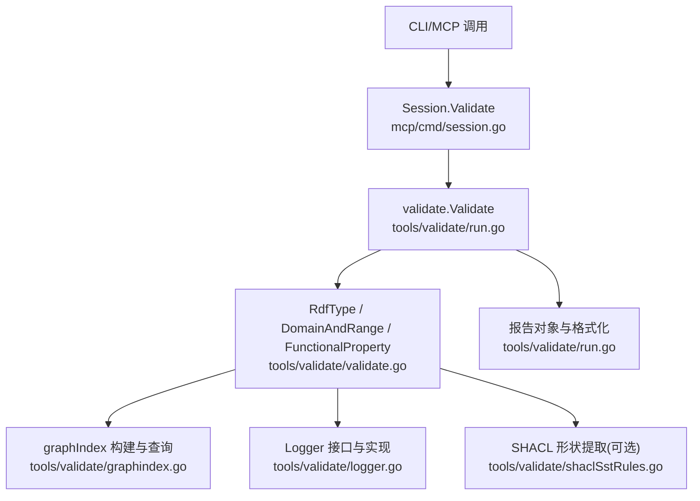
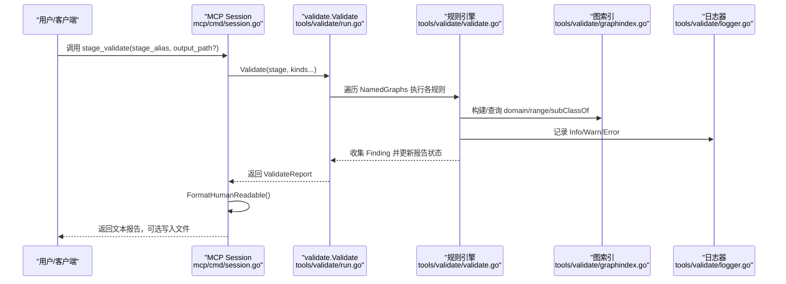
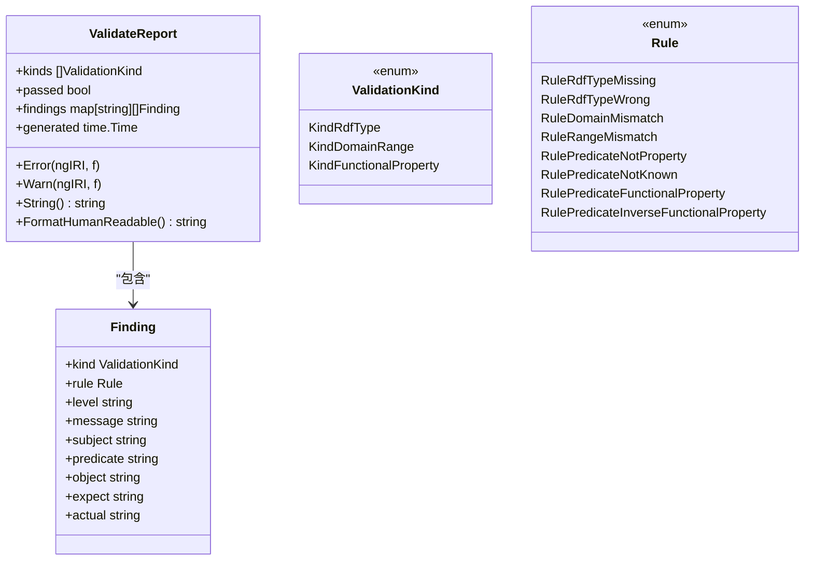
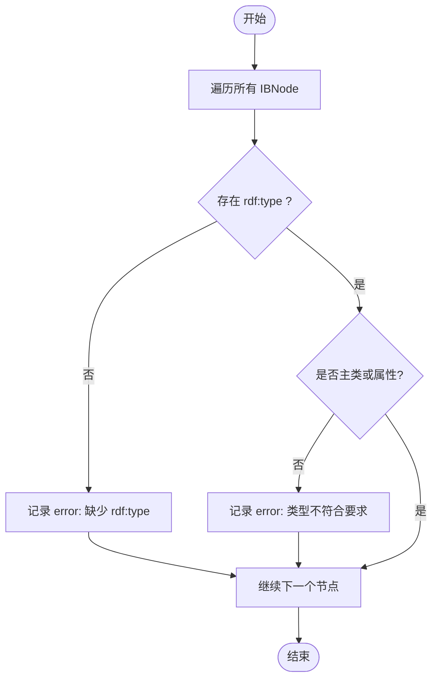
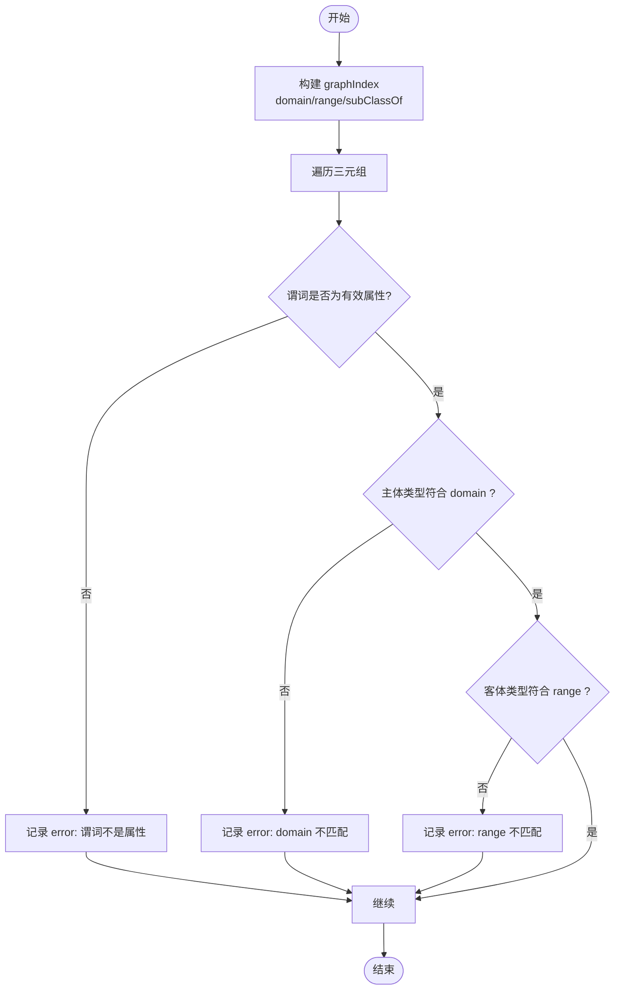
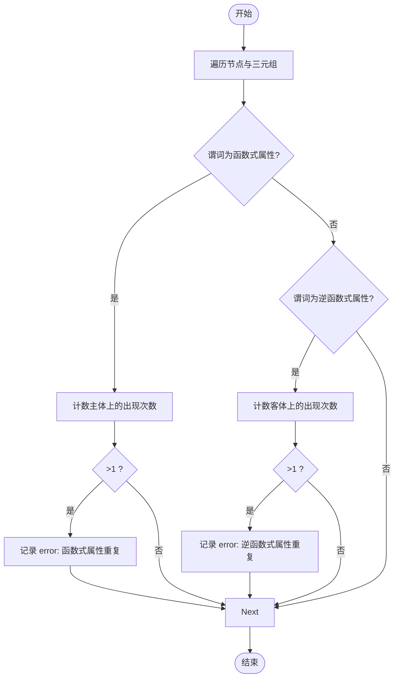
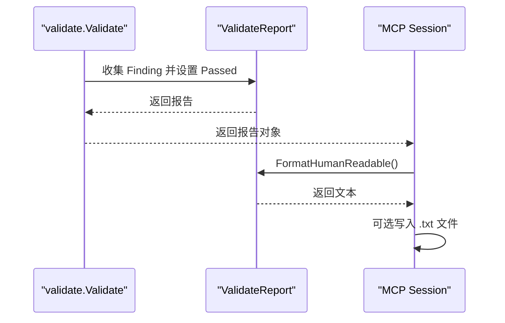
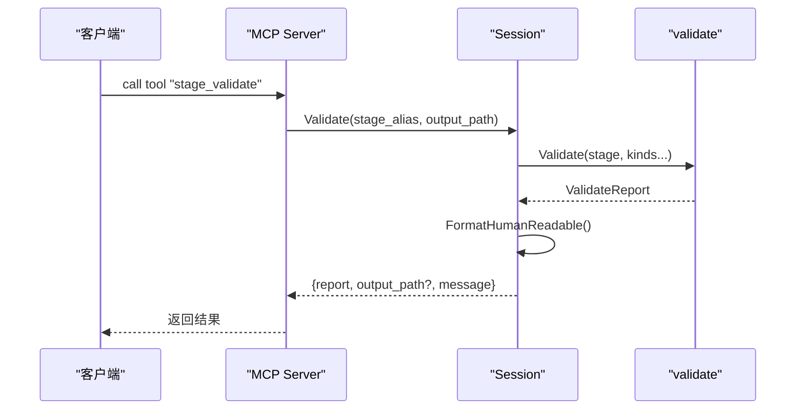
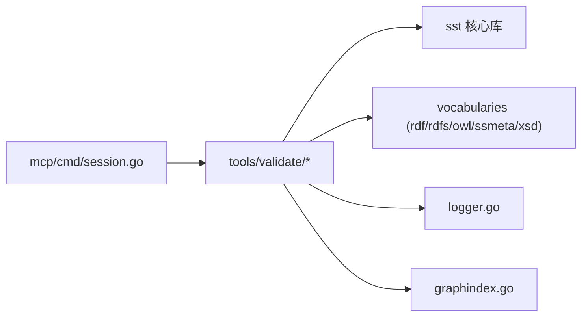

# 验证报告系统

<cite>
**本文引用的文件**
- [run.go](file://tools/validate/run.go)
- [validate.go](file://tools/validate/validate.go)
- [logger.go](file://tools/validate/logger.go)
- [graphindex.go](file://tools/validate/graphindex.go)
- [shaclSstRules.go](file://tools/validate/shaclSstRules.go)
- [enumflags.go](file://tools/validate/enumflags.go)
- [session.go](file://mcp/cmd/session.go)
</cite>

## 目录
1. [简介](#简介)
2. [项目结构](#项目结构)
3. [核心组件](#核心组件)
4. [架构总览](#架构总览)
5. [详细组件分析](#详细组件分析)
6. [依赖关系分析](#依赖关系分析)
7. [性能考虑](#性能考虑)
8. [故障排查指南](#故障排查指南)
9. [结论](#结论)
10. [附录](#附录)

## 简介
本文件面向“验证报告系统”，系统性说明：
- 验证结果的分类与严重程度定义
- 报告格式规范与数据结构设计
- 报告的生成、序列化与输出方式
- 可读性优化与可视化支持
- 报告的分析工具与解读指南
- 不同场景下的报告模板与定制方法
- 与外部系统的集成接口（MCP）

该系统基于 SST Stage 的 RDF 数据，执行多种规则校验（如类型、域/范围、函数式属性等），并产出结构化与人类可读的报告。

## 项目结构
验证相关代码集中在 tools/validate 包，并通过 MCP 会话暴露为可调用工具。关键文件职责如下：
- run.go：命令行入口、标志解析、日志输出、报告结构与格式化
- validate.go：核心校验逻辑（RDF 类型、域/范围、函数式属性）、参考阶段合并、报告收集
- logger.go：日志级别与格式化接口
- graphindex.go：图内 rdfs:domain/range/subClassOf 索引构建与查询
- shaclSstRules.go：SHACL 形状提取与基础验证报告骨架
- enumflags.go：枚举型命令行参数封装
- session.go：MCP 工具 stage_validate 的实现，调用 validate.Validate 并输出报告

图表来源
- [session.go:1108-1137](file://mcp/cmd/session.go#L1108-L1137)
- [run.go:236-295](file://tools/validate/run.go#L236-L295)
- [validate.go:57-114](file://tools/validate/validate.go#L57-L114)
- [graphindex.go:28-56](file://tools/validate/graphindex.go#L28-L56)
- [logger.go:11-35](file://tools/validate/logger.go#L11-L35)
- [shaclSstRules.go:22-34](file://tools/validate/shaclSstRules.go#L22-L34)

章节来源
- [run.go:24-53](file://tools/validate/run.go#L24-L53)
- [validate.go:57-114](file://tools/validate/validate.go#L57-L114)
- [session.go:1108-1137](file://mcp/cmd/session.go#L1108-L1137)

## 核心组件
- 验证入口与报告
  - ValidateAll：对输入 Stage 与可选参考 Stage 进行全部校验，不修改输入，返回 ValidateReport
  - Validate：按指定 kinds 执行校验，默认包含 rdf_type、domain_range、functional_property
- 校验规则
  - RdfType：检查节点是否具备 rdf:type，且为主类或属性
  - DomainAndRange：依据 rdfs:domain/range 及词汇表信息，校验主体/客体类型匹配
  - FunctionalProperty：校验 owl:FunctionalProperty 与 owl:InverseFunctionalProperty 的唯一性约束
- 索引与辅助
  - graphIndex：在 NamedGraph 中预计算 domain/range/subClassOf，加速晚绑定校验
  - Logger/TripleStringFormatter：统一日志输出与三元组格式化
- SHACL 支持
  - ExtractShapes/ValidateStage：提取 NodeShape/PropertyShape 并生成 sh:ValidationReport 骨架（当前为实验性/占位）

章节来源
- [validate.go:57-114](file://tools/validate/validate.go#L57-L114)
- [validate.go:171-261](file://tools/validate/validate.go#L171-L261)
- [validate.go:263-362](file://tools/validate/validate.go#L263-L362)
- [validate.go:566-800](file://tools/validate/validate.go#L566-L800)
- [graphindex.go:28-56](file://tools/validate/graphindex.go#L28-L56)
- [logger.go:11-35](file://tools/validate/logger.go#L11-L35)
- [shaclSstRules.go:22-34](file://tools/validate/shaclSstRules.go#L22-L34)

## 架构总览
下图展示了从 MCP 工具到具体校验规则的调用链路与数据流。

图表来源
- [session.go:1108-1137](file://mcp/cmd/session.go#L1108-L1137)
- [run.go:441-472](file://tools/validate/run.go#L441-L472)
- [validate.go:57-114](file://tools/validate/validate.go#L57-L114)
- [graphindex.go:28-56](file://tools/validate/graphindex.go#L28-L56)
- [logger.go:11-35](file://tools/validate/logger.go#L11-L35)

## 详细组件分析

### 报告数据结构与严重程度
- ValidateReport
  - kinds：本次执行的校验种类列表
  - passed：是否存在错误（任一 error 即 false）
  - findings：按命名图 IRIs 分组的发现项
  - generated：报告生成时间
- Finding
  - kind：校验种类（rdf_type、domain_range、functional_property）
  - rule：规则标识（如 RdfType_missing、domain_mismatch、predicate_is_functional_property 等）
  - level：严重级别（error、warning）
  - message：人类可读消息
  - subject/predicate/object：定位三元组
  - expect/actual：期望与实际值（用于范围/类型不匹配时）

图表来源
- [run.go:211-295](file://tools/validate/run.go#L211-L295)

章节来源
- [run.go:211-295](file://tools/validate/run.go#L211-L295)

### 校验规则与处理流程

#### 类型校验（RdfType）
- 目标：每个 IBNode 必须具有 rdf:type；若为主类或属性则跳过特定检查
- 行为：
  - 无 rdf:type -> error
  - 非主类且非属性 -> error
  - 主类或属性 -> 通过

图表来源
- [validate.go:263-362](file://tools/validate/validate.go#L263-L362)

章节来源
- [validate.go:263-362](file://tools/validate/validate.go#L263-L362)

#### 域/范围校验（DomainAndRange）
- 目标：根据 rdfs:domain/range 与词汇表信息，校验谓词的主客体类型
- 行为：
  - 谓词不是有效属性 -> error
  - 主体类型不满足 domain -> error
  - 客体类型不满足 range -> error
  - 支持 TermCollection 与字面量类型检查
  - 使用 graphIndex 加速晚绑定查询

图表来源
- [validate.go:566-800](file://tools/validate/validate.go#L566-L800)
- [graphindex.go:28-56](file://tools/validate/graphindex.go#L28-L56)

章节来源
- [validate.go:566-800](file://tools/validate/validate.go#L566-L800)
- [graphindex.go:28-56](file://tools/validate/graphindex.go#L28-L56)

#### 函数式属性校验（FunctionalProperty）
- 目标：确保 owl:FunctionalProperty 在主体上唯一，owl:InverseFunctionalProperty 在客体上唯一
- 行为：
  - 统计同一主体下函数式属性的出现次数，超过一次 -> error
  - 统计同一客体下逆函数式属性的出现次数，超过一次 -> error

图表来源
- [validate.go:171-261](file://tools/validate/validate.go#L171-L261)

章节来源
- [validate.go:171-261](file://tools/validate/validate.go#L171-L261)

### 报告生成、序列化与输出
- JSON 序列化：ValidateReport.String() 输出带缩进的 JSON
- 人类可读格式：FormatHumanReadable() 输出结构化文本，包含状态、统计、按命名图分组的问题详情
- 输出路径：MCP 层支持将人类可读报告写入 .txt 文件

图表来源
- [run.go:286-439](file://tools/validate/run.go#L286-L439)
- [session.go:1108-1137](file://mcp/cmd/session.go#L1108-L1137)

章节来源
- [run.go:286-439](file://tools/validate/run.go#L286-L439)
- [session.go:1108-1137](file://mcp/cmd/session.go#L1108-L1137)

### 可读性优化与可视化支持
- 可读性优化
  - 标题与分隔线、状态行、统计摘要
  - 按命名图排序分组展示错误与警告
  - 三元组位置与期望/实际值对比
- 可视化支持
  - 当前未内置图形化渲染；可通过外部工具将 JSON 报告导入可视化平台
  - 建议将 findings 映射为表格/树形视图，便于快速定位问题

章节来源
- [run.go:298-439](file://tools/validate/run.go#L298-L439)

### 分析工具与解读指南
- 工具
  - MCP 工具 stage_validate：提供文本报告并可写文件
  - 单元测试：validateall_test.go 演示加载 TTL、执行校验、打印报告
- 解读指南
  - 关注 level=error 的项目，优先修复
  - 根据 rule 字段定位问题类型（如 domain_mismatch、range_mismatch、predicate_not_property）
  - 结合 subject/predicate/object 定位三元组，必要时查看对应命名图上下文

章节来源
- [session.go:1108-1137](file://mcp/cmd/session.go#L1108-L1137)
- [validateall_test.go:19-37](file://tools/validate/validateall_test.go#L19-L37)

### 不同场景下的报告模板与定制方法
- 默认模板：FormatHumanReadable() 提供通用文本模板
- 定制方法
  - 自定义 Logger：实现 Log/LogForGraph 以调整输出渠道与格式
  - 扩展规则：新增 ValidationKind 与 Rule，并在 Validate/ValidateAll 中注册
  - 过滤与聚合：在报告生成前对 findings 进行筛选或汇总
  - 输出格式：复用 String() 获取 JSON，或自行实现新的 FormatXxx()

章节来源
- [run.go:211-295](file://tools/validate/run.go#L211-L295)
- [run.go:441-472](file://tools/validate/run.go#L441-L472)
- [logger.go:11-35](file://tools/validate/logger.go#L11-L35)

### 与外部系统的集成接口
- MCP 工具
  - 名称：stage_validate
  - 参数：stage_alias（必填）、output_path（可选）
  - 行为：执行校验，返回文本报告；可选写入 .txt 文件
- 返回值结构
  - stage_alias：阶段别名
  - report：人类可读报告文本
  - output_path：当提供输出路径时的写入路径
  - message：操作结果消息

图表来源
- [session.go:367-402](file://mcp/cmd/session.go#L367-L402)
- [session.go:1108-1137](file://mcp/cmd/session.go#L1108-L1137)

章节来源
- [session.go:367-402](file://mcp/cmd/session.go#L367-L402)
- [session.go:1108-1137](file://mcp/cmd/session.go#L1108-L1137)

## 依赖关系分析
- 模块耦合
  - validate 包依赖 sst 核心 API 与 vocabularies（rdf、rdfs、owl、ssmeta、xsd）
  - 通过 Logger 抽象解耦日志输出
  - graphIndex 独立于规则实现，仅依赖 rdfs 语义
- 外部依赖
  - MCP 层通过 Session 调用 validate 包，形成松耦合集成
  - 测试用例依赖 sst_test/testutil 加载 TTL 数据

图表来源
- [session.go:1108-1137](file://mcp/cmd/session.go#L1108-L1137)
- [validate.go:6-22](file://tools/validate/validate.go#L6-L22)
- [graphindex.go:5-8](file://tools/validate/graphindex.go#L5-L8)
- [logger.go:5-9](file://tools/validate/logger.go#L5-L9)

章节来源
- [validate.go:6-22](file://tools/validate/validate.go#L6-L22)
- [graphindex.go:5-8](file://tools/validate/graphindex.go#L5-L8)
- [logger.go:5-9](file://tools/validate/logger.go#L5-L9)
- [session.go:1108-1137](file://mcp/cmd/session.go#L1108-L1137)

## 性能考虑
- 避免重复扫描：graphIndex 预计算 domain/range/subClassOf，减少多次遍历
- 早绑定与晚绑定结合：优先使用词汇表信息（早绑定），否则回退到图内声明（晚绑定）
- 选择性校验：通过 kinds 参数控制执行哪些规则，降低开销
- 日志控制：quiet/verbose 标志控制输出，减少 I/O 压力

[本节为一般性指导，无需特定文件引用]

## 故障排查指南
- 常见问题
  - 缺少 rdf:type：检查节点是否定义了类型，并确保其为主类或属性
  - 域/范围不匹配：核对 rdfs:domain/range 与词汇表定义，确认主体/客体类型
  - 函数式属性重复：检查 owl:FunctionalProperty/InverseFunctionalProperty 的使用次数
- 调试手段
  - 启用 verbose 模式查看详细日志
  - 使用 quiet 模式抑制正常输出，聚焦错误
  - 借助 MCP 工具输出报告文件，便于离线分析

章节来源
- [run.go:34-53](file://tools/validate/run.go#L34-L53)
- [run.go:67-121](file://tools/validate/run.go#L67-L121)
- [validate.go:263-362](file://tools/validate/validate.go#L263-L362)
- [validate.go:566-800](file://tools/validate/validate.go#L566-L800)
- [validate.go:171-261](file://tools/validate/validate.go#L171-L261)

## 结论
验证报告系统提供了完整的 SST 数据校验能力，涵盖类型、域/范围与函数式属性等核心规则，并支持结构化与人类可读的报告输出。通过 MCP 工具，系统可与外部工作流无缝集成。未来可扩展更多规则与可视化能力，以满足更复杂的验证需求。

[本节为总结性内容，无需特定文件引用]

## 附录
- 命令行选项（示例）
  - step：选择执行的校验步骤（如 rdf-type、domain-range）
  - verbose/quiet：控制输出详细程度
- 参考
  - SHACL 形状提取：当前为实验性实现，可用于后续扩展

章节来源
- [run.go:24-53](file://tools/validate/run.go#L24-L53)
- [shaclSstRules.go:22-34](file://tools/validate/shaclSstRules.go#L22-L34)