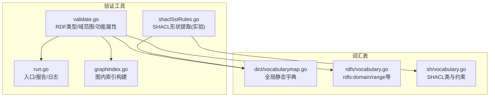
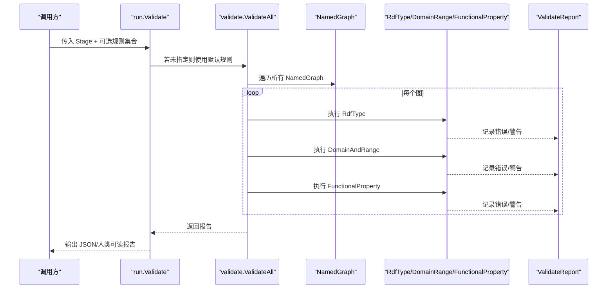
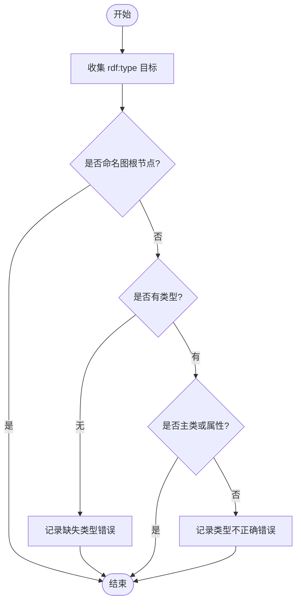
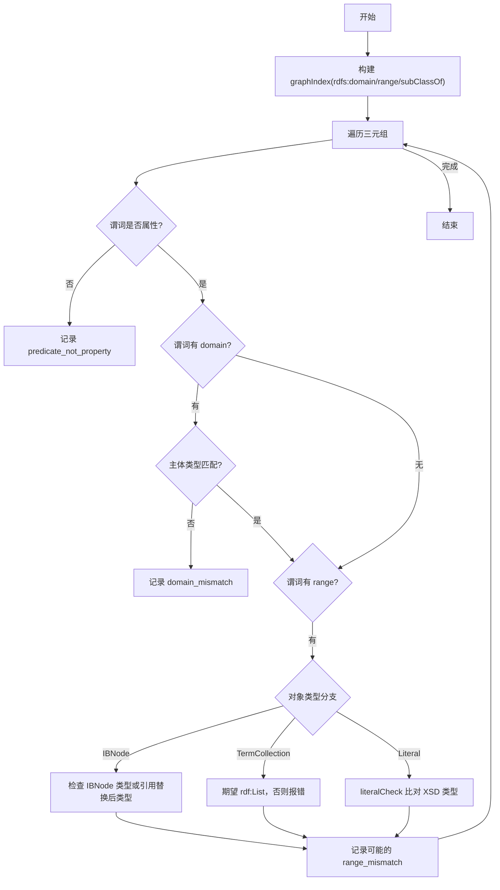
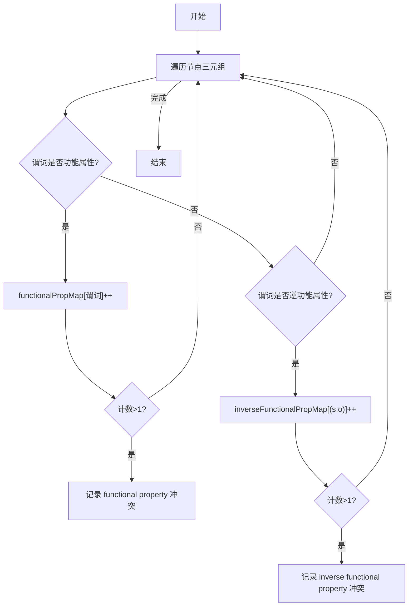
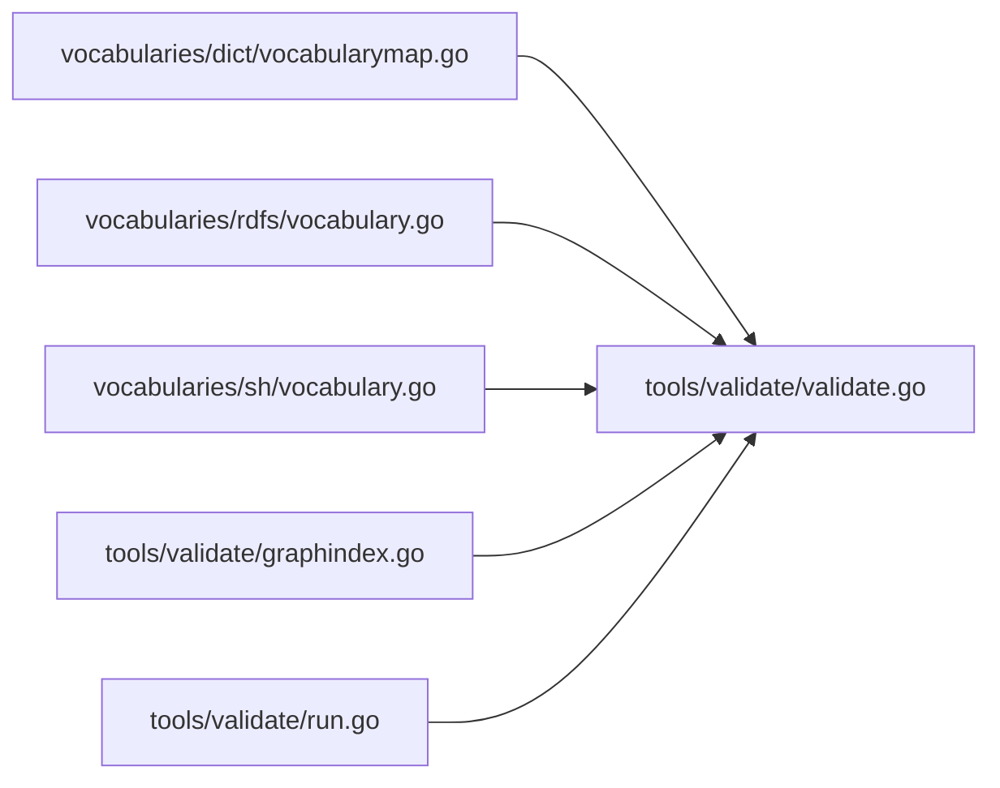

# 验证规则系统

<cite>
**本文引用的文件**
- [validate.go](file://tools/validate/validate.go)
- [run.go](file://tools/validate/run.go)
- [graphindex.go](file://tools/validate/graphindex.go)
- [shaclSstRules.go](file://tools/validate/shaclSstRules.go)
- [vocabularymap.go](file://vocabularies/dict/vocabularymap.go)
- [rdfs vocabulary.go](file://vocabularies/rdfs/vocabulary.go)
- [sh vocabulary.go](file://vocabularies/sh/vocabulary.go)
</cite>

## 目录
1. [简介](#简介)
2. [项目结构](#项目结构)
3. [核心组件](#核心组件)
4. [架构总览](#架构总览)
5. [详细组件分析](#详细组件分析)
6. [依赖关系分析](#依赖关系分析)
7. [性能考虑](#性能考虑)
8. [故障排查指南](#故障排查指南)
9. [结论](#结论)
10. [附录](#附录)

## 简介
本文件系统性说明 SST 内置验证规则的类型与作用机制，重点覆盖：
- RDF 类型检查（rdf:type）
- RDFS 域与范围验证（rdfs:domain / rdfs:range）
- 功能属性与逆功能属性验证（owl:FunctionalProperty / owl:InverseFunctionalProperty）
- 验证规则的注册、配置与执行流程
- 自定义验证规则的创建与扩展方式
- 验证规则的优先级管理与冲突解决策略
- 实际应用案例与性能优化技巧
- 与词汇表系统的集成方式

## 项目结构
验证子系统位于 tools/validate 包，围绕“阶段（Stage）”中的命名图（NamedGraph）进行遍历与校验；词汇表定义在 vocabularies 下，提供预编译的词汇映射与元素信息。

图表来源
- [validate.go:57-114](file://tools/validate/validate.go#L57-L114)
- [run.go:211-284](file://tools/validate/run.go#L211-L284)
- [graphindex.go:19-56](file://tools/validate/graphindex.go#L19-L56)
- [vocabularymap.go:30-25](file://vocabularies/dict/vocabularymap.go#L30-L25)
- [rdfs vocabulary.go:245-376](file://vocabularies/rdfs/vocabulary.go#L245-L376)
- [sh vocabulary.go:3384-3420](file://vocabularies/sh/vocabulary.go#L3384-L3420)

章节来源
- [validate.go:57-114](file://tools/validate/validate.go#L57-L114)
- [run.go:211-284](file://tools/validate/run.go#L211-L284)

## 核心组件
- 验证入口与编排
  - ValidateAll：将待验证 Stage 与参考 Stage 合并到工作 Stage，按固定顺序执行三类内置规则，并汇总报告。
  - Validate：按指定或默认规则集对每个 NamedGraph 执行校验。
- 规则实现
  - RdfType：检查节点是否具备 rdf:type，且类型为主类或属性。
  - DomainAndRange：基于词汇表与图内声明，校验谓词的 domain/range 与对象值类型匹配。
  - FunctionalProperty：校验 owl:FunctionalProperty 与 owl:InverseFunctionalProperty 的唯一性约束。
- 运行时支持
  - graphIndex：为当前图构建 rdfs:domain/range/subClassOf 的内存索引，支持“晚绑定”校验。
  - Logger/Report：统一日志与结构化报告输出。
- SHACL 形状提取（实验）
  - ExtractShapes/ValidateStage：从数据中抽取 NodeShape/PropertyShape 并生成验证报告骨架。

章节来源
- [validate.go:57-114](file://tools/validate/validate.go#L57-L114)
- [validate.go:171-362](file://tools/validate/validate.go#L171-L362)
- [validate.go:566-1049](file://tools/validate/validate.go#L566-L1049)
- [graphindex.go:19-84](file://tools/validate/graphindex.go#L19-L84)
- [run.go:211-284](file://tools/validate/run.go#L211-L284)
- [shaclSstRules.go:22-139](file://tools/validate/shaclSstRules.go#L22-L139)

## 架构总览
验证系统以“阶段-命名图”为单位，先构建工作副本，再依次执行三类内置规则，最后产出结构化报告。词汇表提供“早绑定”能力（编译期已知），而图内 rdfs:domain/range 提供“晚绑定”能力（运行期解析）。

图表来源
- [run.go:441-472](file://tools/validate/run.go#L441-L472)
- [validate.go:57-114](file://tools/validate/validate.go#L57-L114)

## 详细组件分析

### RDF 类型检查（RdfType）
- 作用：确保每个 IBNode 具有 rdf:type，且类型为“主类”或“属性”。
- 关键点：
  - 跳过命名图根节点与 TermCollection。
  - 通过词汇表判断是否为主类；或通过递归判定是否为属性（含子属性链）。
  - 不满足时记录 RuleRdfTypeMissing/RuleRdfTypeWrong。
- 复杂度：对每个节点进行一次 ForAll 遍历，整体 O(N)。

图表来源
- [validate.go:263-362](file://tools/validate/validate.go#L263-L362)

章节来源
- [validate.go:263-362](file://tools/validate/validate.go#L263-L362)

### 域与范围验证（DomainAndRange）
- 作用：根据词汇表与图内 rdfs:domain/range 声明，校验谓词与其主体/客体类型的匹配。
- 关键点：
  - 构建 graphIndex 以支持“晚绑定”（图内定义的 domain/range/subClassOf）。
  - 优先采用“早绑定”（来自编译词汇表）的 domain/range。
  - 支持对象为 IBNode、TermCollection、Literal 及 LiteralCollection 的多分支校验。
  - 对列表类型（rdf:List）进行成员级范围检查。
  - 不合法谓词直接报错（非属性）。
- 复杂度：单次扫描构建索引 O(T)，随后逐三元组校验，总体 O(T)。

图表来源
- [graphindex.go:19-84](file://tools/validate/graphindex.go#L19-L84)
- [validate.go:566-1049](file://tools/validate/validate.go#L566-L1049)

章节来源
- [graphindex.go:19-84](file://tools/validate/graphindex.go#L19-L84)
- [validate.go:566-1049](file://tools/validate/validate.go#L566-L1049)

### 功能属性与逆功能属性验证（FunctionalProperty）
- 作用：确保 owl:FunctionalProperty 的主体上同一谓词仅出现一次；owl:InverseFunctionalProperty 的客体唯一。
- 关键点：
  - 维护 functionalPropMap/inverseFunctionalPropMap 计数。
  - 支持通过 rdfs:subPropertyOf 继承链识别父属性的功能性。
  - 违反时记录 RulePredicateFunctionalProperty/RulePredicateInverseFunctionalProperty。
- 复杂度：对每个节点遍历其三元组，O(N)。

图表来源
- [validate.go:171-261](file://tools/validate/validate.go#L171-L261)

章节来源
- [validate.go:171-261](file://tools/validate/validate.go#L171-L261)

### SHACL 形状提取（实验）
- 作用：从数据中抽取 sh:NodeShape/sh:PropertyShape 及其 targetClass/targetSubjectsOf/targetObjectsOf 映射，用于后续扩展验证。
- 关键点：
  - 当前实现主要用于统计与调试，尚未接入完整执行引擎。
  - 可结合 sh:SPARQLConstraint 等扩展更丰富的约束。
- 建议：在生产环境谨慎启用，避免额外开销。

章节来源
- [shaclSstRules.go:22-139](file://tools/validate/shaclSstRules.go#L22-L139)
- [sh vocabulary.go:3384-3420](file://vocabularies/sh/vocabulary.go#L3384-L3420)

## 依赖关系分析
- 词汇表集成
  - 编译期词汇表（vocabularies/dict）提供 ElementInformer，使验证器能快速获取 domain/range、是否属性、是否主类等元信息。
  - rdfs 词汇表定义了 domain/range 等元素的语义，供验证逻辑判断。
  - sh 词汇表提供 SHACL 相关类与约束，便于未来扩展。
- 模块耦合
  - validate 依赖 run 的报告与日志接口。
  - validate 依赖 graphindex 做“晚绑定”查询。
  - 两者均依赖 sst 核心 API 与词汇表。

图表来源
- [vocabularymap.go:30-25](file://vocabularies/dict/vocabularymap.go#L30-L25)
- [rdfs vocabulary.go:245-376](file://vocabularies/rdfs/vocabulary.go#L245-L376)
- [sh vocabulary.go:3384-3420](file://vocabularies/sh/vocabulary.go#L3384-L3420)
- [graphindex.go:19-56](file://tools/validate/graphindex.go#L19-L56)
- [run.go:211-284](file://tools/validate/run.go#L211-L284)

章节来源
- [vocabularymap.go:30-25](file://vocabularies/dict/vocabularymap.go#L30-L25)
- [rdfs vocabulary.go:245-376](file://vocabularies/rdfs/vocabulary.go#L245-L376)
- [sh vocabulary.go:3384-3420](file://vocabularies/sh/vocabulary.go#L3384-L3420)
- [graphindex.go:19-56](file://tools/validate/graphindex.go#L19-L56)
- [run.go:211-284](file://tools/validate/run.go#L211-L284)

## 性能考虑
- 早绑定优先：优先使用编译词汇表的 domain/range，减少图扫描成本。
- 晚绑定索引：graphIndex 一次性构建，避免重复扫描。
- 短路策略：遇到 errBreakFor 提前退出循环，减少不必要遍历。
- 选择性执行：通过 Validate/ValidateAll 的 kinds 参数控制执行哪些规则，降低开销。
- 列表处理：对 rdf:List 的成员逐一校验，注意大数据量时的内存与时间消耗。
- 日志开关：通过 quiet/verbose 控制输出，生产环境建议关闭冗余日志。

[本节为通用性能指导，无需特定文件来源]

## 故障排查指南
- 常见错误与定位
  - rdf:type 缺失或不正确：查看 RuleRdfTypeMissing/RuleRdfTypeWrong，确认节点类型是否为主类或属性。
  - 域/范围不匹配：查看 RuleDomainMismatch/RuleRangeMismatch，核对主体/客体类型与谓词声明。
  - 谓词不是属性：查看 RulePredicateNotProperty，确认谓词是否被定义为属性。
  - 功能属性冲突：查看 RulePredicateFunctionalProperty/RulePredicateInverseFunctionalProperty，检查重复赋值。
- 诊断步骤
  - 开启 verbose 模式获取进入/离开日志。
  - 使用 FormatHumanReadable 输出易读报告，按 NamedGraph 分组查看错误。
  - 针对具体三元组（S/P/O）定位问题源。
- 参考路径
  - 报告结构与格式化：[run.go:236-439](file://tools/validate/run.go#L236-L439)
  - 错误常量与消息：[validate.go:24-29](file://tools/validate/validate.go#L24-L29)

章节来源
- [run.go:236-439](file://tools/validate/run.go#L236-L439)
- [validate.go:24-29](file://tools/validate/validate.go#L24-L29)

## 结论
SST 验证系统通过“早绑定+晚绑定”的双轨机制，结合词汇表与图内声明，提供了稳健的 RDF/RDFS/Owl 基础约束校验。其模块化设计便于扩展自定义规则，并通过报告与日志体系支持高效排障。建议在大规模数据场景下按需启用规则、利用索引与短路策略提升性能，并结合 SHACL 形状提取进行更复杂的语义校验。

[本节为总结性内容，无需特定文件来源]

## 附录

### 验证规则注册、配置与执行流程
- 注册：内置规则在代码中以常量形式定义（KindRdfType/KindDomainRange/KindFunctionalProperty），无需外部注册。
- 配置：通过 Validate/ValidateAll 的 kinds 参数选择要执行的规则；可通过 flags 在命令行工具中选择步骤。
- 执行：ValidateAll 将输入 Stage 复制到工作 Stage，依次执行选定规则，汇总结果到 ValidateReport。

章节来源
- [run.go:211-234](file://tools/validate/run.go#L211-L234)
- [run.go:441-472](file://tools/validate/run.go#L441-L472)
- [validate.go:57-114](file://tools/validate/validate.go#L57-L114)

### 自定义验证规则的创建与扩展方法
- 新增规则步骤
  - 在 validate.go 中新增函数，遵循现有签名（graph, report, log）。
  - 在 run.go 中添加新的 ValidationKind 与 Rule 常量。
  - 在 Validate/ValidateAll 的 switch 中接入新规则。
  - 如需 SHACL 支持，可在 shaclSstRules.go 中扩展形状提取与执行逻辑。
- 与词汇表集成
  - 使用 sst.StaticDictionary().Element(...) 获取元素信息，辅助类型/属性判断。
  - 利用 rdfs/owl/sh 词汇表常量进行语义判断。

章节来源
- [validate.go:57-114](file://tools/validate/validate.go#L57-L114)
- [run.go:211-234](file://tools/validate/run.go#L211-L234)
- [shaclSstRules.go:22-139](file://tools/validate/shaclSstRules.go#L22-L139)

### 优先级管理与冲突解决策略
- 规则优先级：当前内置规则按 KindRdfType → KindDomainRange → KindFunctionalProperty 的顺序执行。
- 冲突解决：
  - 各规则独立记录 Finding，互不影响；最终由 ValidateReport.Passed 综合判定。
  - 对于同一三元组的多个规则命中，分别记录各自规则与消息，便于定位。
- 可扩展点：可在未来引入规则权重或短路策略，但需权衡准确性与性能。

章节来源
- [validate.go:86-114](file://tools/validate/validate.go#L86-L114)
- [run.go:236-284](file://tools/validate/run.go#L236-L284)

### 实际应用案例
- 典型用例
  - 数据入库前校验：在提交前调用 ValidateAll，确保数据符合领域模型。
  - 批量清洗：对历史数据进行全量校验，修复类型与范围不一致问题。
  - 开发联调：开启 verbose 模式，快速定位三元组级别的问题。
- 示例参考
  - 测试数据与用例：见 sst_test 下的相关测试文件（如 validate_trig_test.go 等）。

[本节为概念性说明，无需特定文件来源]

### 与词汇表系统的集成方式
- 编译期词汇表：vocabularies/dict 提供全局静态字典，支持 InVocabulary() 快速查找元素信息。
- 运行时词汇表：rdfs/owl/sh 提供语义常量，用于判断类型、属性、约束等。
- 集成要点
  - 使用 ElementInformer 的 Domain()/Range()/IsProperty()/IsMainClass() 等方法。
  - 对不在词典中的谓词/类，回退到图内 rdfs:domain/range 的“晚绑定”校验。

章节来源
- [vocabularymap.go:30-25](file://vocabularies/dict/vocabularymap.go#L30-L25)
- [rdfs vocabulary.go:245-376](file://vocabularies/rdfs/vocabulary.go#L245-L376)
- [sh vocabulary.go:3384-3420](file://vocabularies/sh/vocabulary.go#L3384-L3420)