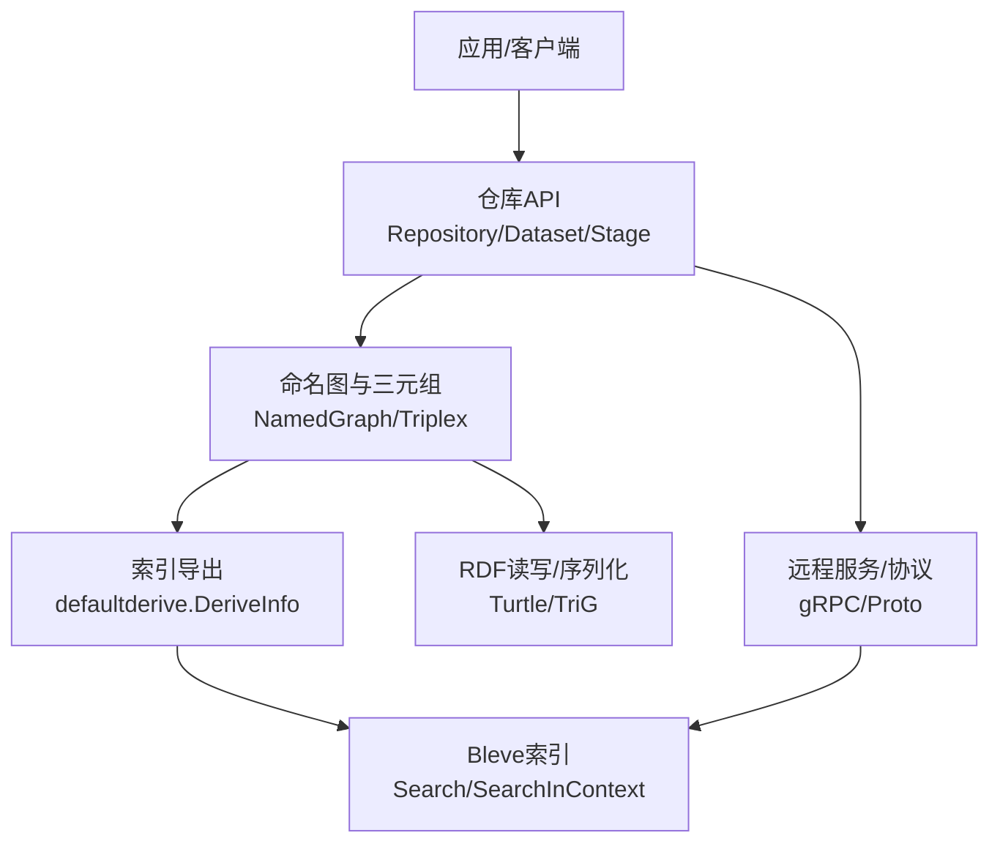
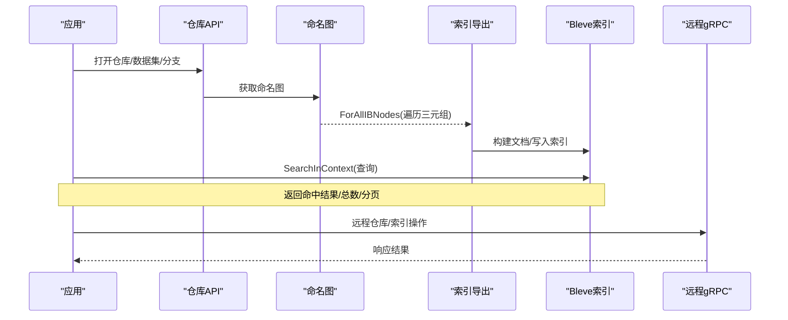
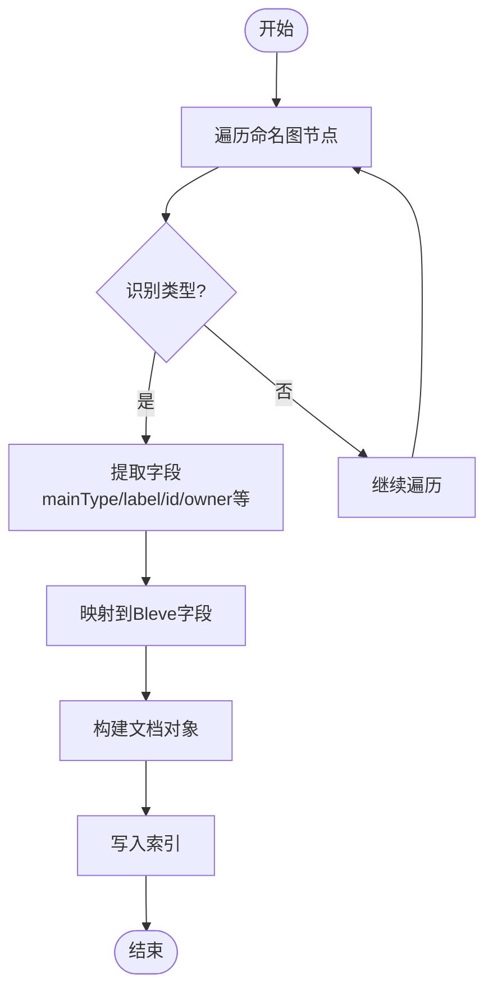
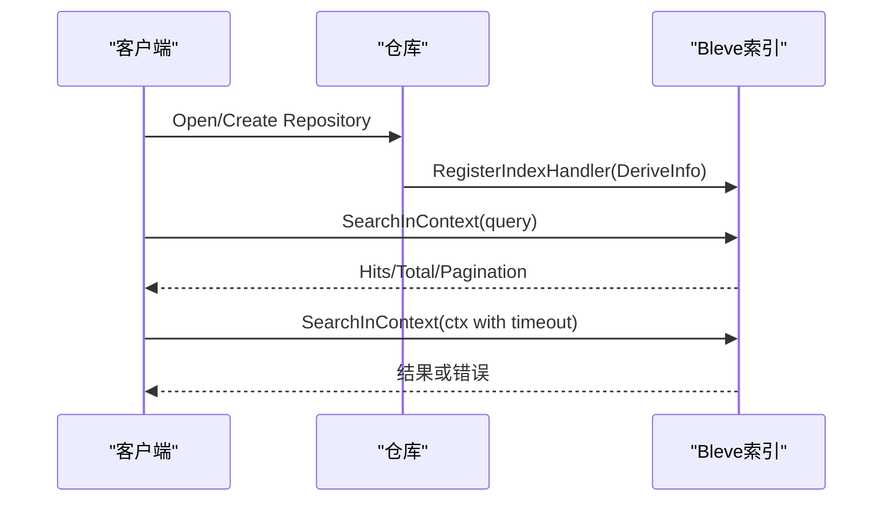
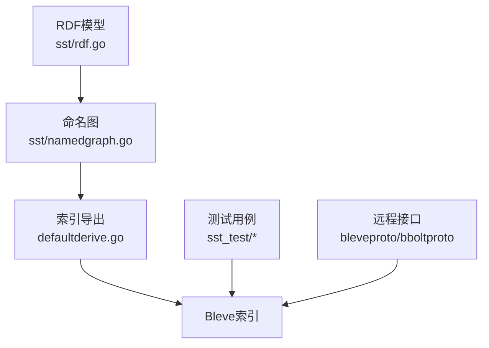

# SPARQL查询

<cite>
**本文引用的文件**
- [defaultderive.go](file://defaultderive/defaultderive.go)
- [repository.pb.go](file://bboltproto/repository.pb.go)
- [index_grpc.pb.go](file://bleveproto/index_grpc.pb.go)
- [vocabulary.go](file://vocabularies/sh/vocabulary.go)
- [rdf.go](file://sst/rdf.go)
- [namedgraph.go](file://sst/namedgraph.go)
- [types.go](file://sst/types.go)
- [repolocalfullwithbleve.go](file://examples/helloworldrepolocalfullwithbleve/repolocalfullwithbleve.go)
- [searchInContext_test.go](file://sst_test/searchInContext_test.go)
- [remoteRepository_test.go](file://sst_test/remoteRepository_test.go)
</cite>

## 目录
1. [简介](#简介)
2. [项目结构](#项目结构)
3. [核心组件](#核心组件)
4. [架构总览](#架构总览)
5. [详细组件分析](#详细组件分析)
6. [依赖关系分析](#依赖关系分析)
7. [性能考虑](#性能考虑)
8. [故障排查指南](#故障排查指南)
9. [结论](#结论)
10. [附录](#附录)

## 简介
本文件面向SST仓库中的“SPARQL查询”能力，系统性说明：
- 当前代码库中SPARQL相关的能力边界与实现现状（SHACL词汇定义、索引导出与全文检索）
- RDF数据模型与三元组存储、命名图、IRI/字面量等基础概念在SST中的体现
- 如何通过Bleve全文索引进行近似“类SPARQL”的查询实践（匹配、排序、分页、上下文控制）
- 高级查询特性（可选模式、过滤、聚合）在当前实现中的可用性与替代方案
- 查询优化策略、执行计划生成现状与建议
- 丰富的查询示例与结果输出格式建议
- 性能调优与常见问题定位

重要说明：
- 仓库未提供原生SPARQL解析器与执行引擎；现有能力通过“RDF建模 + 索引导出 + Bleve搜索”实现高效检索。
- SHACL词汇中包含SPARQL可执行类型定义，用于规则/校验场景，但不等同于通用SPARQL查询引擎。

## 项目结构
围绕SPARQL查询能力的代码组织主要涉及以下层次：
- RDF数据模型与序列化：sst/rdf.go、sst/namedgraph.go、sst/types.go
- 索引映射与文档提取：defaultderive/defaultderive.go
- 远程接口与协议：bboltproto/repository.pb.go、bleveproto/index_grpc.pb.go
- 示例与测试：examples/helloworldrepolocalfullwithbleve、sst_test/*_test.go
- SHACL词汇定义：vocabularies/sh/vocabulary.go



图表来源
- [defaultderive.go:127-210](file://defaultderive/defaultderive.go#L127-L210)
- [namedgraph.go:110-200](file://sst/namedgraph.go#L110-L200)
- [index_grpc.pb.go:24-105](file://bleveproto/index_grpc.pb.go#L24-L105)
- [rdf.go:102-117](file://sst/rdf.go#L102-L117)

章节来源
- [defaultderive.go:127-210](file://defaultderive/defaultderive.go#L127-L210)
- [namedgraph.go:110-200](file://sst/namedgraph.go#L110-L200)
- [index_grpc.pb.go:24-105](file://bleveproto/index_grpc.pb.go#L24-L105)
- [rdf.go:102-117](file://sst/rdf.go#L102-L117)

## 核心组件
- 命名图与三元组存储
  - NamedGraph承载三元组集合，支持节点创建、语句添加、导入/导出、差异比较、历史版本等。
  - IRI、Blank Node、Literal三类项构成RDF术语体系，支持多种XSD数据类型与语言标签。
- 索引导出与映射
  - defaultderive将NamedGraph遍历并抽取为Bleve文档字段（如mainType、label、literal、id等），支持短语/关键词/数值等多类字段映射。
- 搜索与上下文
  - 通过repo.Bleve().SearchInContext执行查询，支持MatchAll、Term、QueryString、分页、排序、上下文取消等。
- 远程接口
  - 通过gRPC/Proto暴露仓库与索引操作，保证本地与远端一致行为。

章节来源
- [namedgraph.go:110-200](file://sst/namedgraph.go#L110-L200)
- [rdf.go:119-196](file://sst/rdf.go#L119-L196)
- [defaultderive.go:293-800](file://defaultderive/defaultderive.go#L293-L800)
- [searchInContext_test.go:42-70](file://sst_test/searchInContext_test.go#L42-L70)
- [remoteRepository_test.go:526-563](file://sst_test/remoteRepository_test.go#L526-L563)

## 架构总览
下图展示从RDF建模到索引检索的整体流程，以及远程调用路径。



图表来源
- [defaultderive.go:293-800](file://defaultderive/defaultderive.go#L293-L800)
- [searchInContext_test.go:42-70](file://sst_test/searchInContext_test.go#L42-L70)
- [index_grpc.pb.go:24-105](file://bleveproto/index_grpc.pb.go#L24-L105)

## 详细组件分析

### 组件A：RDF数据模型与三元组处理
- 术语与类型
  - IRI、Blank Node、Literal三类术语，支持xsd:string、int、double、dateTime等类型及语言标签。
  - 提供NewIRI、newLiteral、Typed等方法完成构造与类型转换。
- 三元组与四元组
  - rdfTriple/rdfQuad表示三元组/四元组，支持序列化至Turtle/TriG等格式。
- 命名图
  - NamedGraph维护三元组存储、导入关系、版本信息，支持遍历、导出、差异比较、链接仓库等。

```mermaid
classDiagram
class IRI {
+String() string
+Split() (base, fragment)
}
class Literal {
+String() string
+Lang() string
+Typed() interface{}
}
class Triple {
+Subj
+Pred
+Obj
+Serialize(format) string
}
class Quad {
+Ctx
+Serialize(format) string
}
IRI <.. Triple : "作为主体/谓词/客体"
Literal <.. Triple : "作为客体"
IRI <.. Quad : "作为上下文"
```

图表来源
- [rdf.go:119-196](file://sst/rdf.go#L119-L196)
- [rdf.go:482-553](file://sst/rdf.go#L482-L553)

章节来源
- [rdf.go:119-196](file://sst/rdf.go#L119-L196)
- [rdf.go:482-553](file://sst/rdf.go#L482-L553)

### 组件B：索引导出与映射（defaultderive）
- 目标
  - 将NamedGraph中的三元组抽取为Bleve文档，便于全文检索与结构化查询。
- 关键步骤
  - 遍历所有IBNode，识别类型（如Organization、Person等），提取主类型、附加类型、标识符、标签、注释、ID所有者等。
  - 构建多类字段映射：短语分析、关键词、数值、存储字段等。
  - 生成顶层文档字段：mainType、graphID、graphURI、directImport、nodeCount、literal等。
- 预条件查询
  - 针对特定子文档（如idOwner）生成preConditionQueries，以限制搜索范围或提升相关性。



图表来源
- [defaultderive.go:293-800](file://defaultderive/defaultderive.go#L293-L800)

章节来源
- [defaultderive.go:293-800](file://defaultderive/defaultderive.go#L293-L800)

### 组件C：搜索与上下文（Bleve）
- 基本查询
  - MatchAll、Term、QueryString等查询类型，支持指定字段、分页、排序。
- 上下文控制
  - SearchInContext支持context超时/取消，确保远程/本地一致性。
- 一致性验证
  - 多次调用结果一致；删除后不再出现；提交后立即更新索引。



图表来源
- [searchInContext_test.go:42-70](file://sst_test/searchInContext_test.go#L42-L70)
- [searchInContext_test.go:215-235](file://sst_test/searchInContext_test.go#L215-L235)
- [searchInContext_test.go:326-350](file://sst_test/searchInContext_test.go#L326-L350)

章节来源
- [searchInContext_test.go:42-70](file://sst_test/searchInContext_test.go#L42-L70)
- [searchInContext_test.go:215-235](file://sst_test/searchInContext_test.go#L215-L235)
- [searchInContext_test.go:326-350](file://sst_test/searchInContext_test.go#L326-L350)

### 组件D：远程接口与协议
- gRPC服务
  - IndexService.Search接口定义，输入SearchRequest，输出SearchResult。
- 仓库协议
  - repository.pb.go定义仓库相关消息类型，支撑远程仓库访问。


图表来源
- [index_grpc.pb.go:24-105](file://bleveproto/index_grpc.pb.go#L24-L105)
- [repository.pb.go:6128-6146](file://bboltproto/repository.pb.go#L6128-L6146)

章节来源
- [index_grpc.pb.go:24-105](file://bleveproto/index_grpc.pb.go#L24-L105)
- [repository.pb.go:6128-6146](file://bboltproto/repository.pb.go#L6128-L6146)

### 组件E：SHACL词汇中的SPARQL元素
- 类型定义
  - SPARQLExecutable、SPARQLSelectExecutable、SPARQLAskExecutable、SPARQLFunction、SPARQLRule等类型在SHACL词汇中定义，用于规则/校验场景。
- 用途
  - 这些类型表明系统对SPARQL的可执行性有概念化支持，但并非提供通用SPARQL查询引擎。

章节来源
- [vocabulary.go:2845-3101](file://vocabularies/sh/vocabulary.go#L2845-L3101)

## 依赖关系分析
- 模块耦合
  - defaultderive依赖sst的NamedGraph接口与词汇定义，负责索引导出。
  - sst/rdf.go提供RDF术语与序列化，被命名图与导出逻辑使用。
  - 测试用例验证索引行为与一致性，覆盖本地与远程场景。
- 外部依赖
  - Bleve用于全文索引与查询。
  - gRPC/Proto用于远程服务通信。



图表来源
- [rdf.go:119-196](file://sst/rdf.go#L119-L196)
- [namedgraph.go:110-200](file://sst/namedgraph.go#L110-L200)
- [defaultderive.go:293-800](file://defaultderive/defaultderive.go#L293-L800)
- [index_grpc.pb.go:24-105](file://bleveproto/index_grpc.pb.go#L24-L105)
- [repository.pb.go:6128-6146](file://bboltproto/repository.pb.go#L6128-L6146)

章节来源
- [defaultderive.go:293-800](file://defaultderive/defaultderive.go#L293-L800)
- [searchInContext_test.go:42-70](file://sst_test/searchInContext_test.go#L42-L70)

## 性能考虑
- 索引字段设计
  - 使用短语分析与关键词字段平衡检索精度与召回率；数值字段用于排序与过滤。
- 批量写入与刷新
  - 提交后及时刷新索引，避免缓存导致的不一致。
- 查询优化
  - 限定Fields减少传输开销；使用Term/QueryString精确匹配；分页控制结果集大小。
- 上下文与超时
  - 使用带超时的context避免长时间阻塞。

章节来源
- [defaultderive.go:155-210](file://defaultderive/defaultderive.go#L155-L210)
- [searchInContext_test.go:215-235](file://sst_test/searchInContext_test.go#L215-L235)
- [searchInContext_test.go:326-350](file://sst_test/searchInContext_test.go#L326-L350)

## 故障排查指南
- 无结果或结果不一致
  - 检查是否已注册索引处理器并提交数据；确认已刷新索引。
  - 验证查询字段是否与导出字段一致（如mainType、label）。
- 远程查询失败
  - 检查认证上下文与超时设置；确认服务端索引状态。
- 删除后仍可见
  - 确认删除分支/数据集后已刷新索引；验证查询条件。

章节来源
- [searchInContext_test.go:42-70](file://sst_test/searchInContext_test.go#L42-L70)
- [searchInContext_test.go:915-964](file://sst_test/searchInContext_test.go#L915-L964)
- [remoteRepository_test.go:526-563](file://sst_test/remoteRepository_test.go#L526-L563)

## 结论
- SST当前未提供原生SPARQL解析与执行引擎，而是通过“RDF建模 + 索引导出 + Bleve搜索”实现高效检索。
- SHACL词汇包含SPARQL可执行类型定义，服务于规则/校验场景。
- 借助defaultderive的索引映射与Bleve的查询能力，可实现接近SPARQL的检索体验，包括匹配、排序、分页与上下文控制。
- 对于复杂SPARQL需求，建议结合自定义索引字段与查询组合，或在必要时引入专用SPARQL引擎。

## 附录

### 查询示例（基于Bleve）
- 全量匹配
  - 使用MatchAllQuery，指定Fields获取关键字段。
- 精确匹配
  - 使用TermQuery匹配mainType或label字段。
- 字符串查询
  - 使用QueryStringQuery进行灵活文本检索。
- 分页与排序
  - 使用SearchRequestOptions设置Size与Offset；SortBy指定排序字段。

章节来源
- [repolocalfullwithbleve.go:90-127](file://examples/helloworldrepolocalfullwithbleve/repolocalfullwithbleve.go#L90-L127)
- [searchInContext_test.go:42-70](file://sst_test/searchInContext_test.go#L42-L70)
- [searchInContext_test.go:215-235](file://sst_test/searchInContext_test.go#L215-L235)
- [remoteRepository_test.go:526-563](file://sst_test/remoteRepository_test.go#L526-L563)

### 结果输出与数据处理
- 字段选择
  - 通过SearchRequest.Fields限制返回字段，减少网络与内存开销。
- 结果结构
  - 使用Hits与Total进行分页与统计；Document可进一步获取完整文档。
- 数据清洗
  - 根据业务需要对label、literal等字段进行去重、标准化。

章节来源
- [repolocalfullwithbleve.go:90-127](file://examples/helloworldrepolocalfullwithbleve/repolocalfullwithbleve.go#L90-L127)
- [searchInContext_test.go:42-70](file://sst_test/searchInContext_test.go#L42-L70)

### 与RDF数据模型的深度集成
- 术语与类型
  - IRI、Blank Node、Literal与XSD类型支持，确保语义一致性。
- 命名图与导入
  - NamedGraph支持导入关系，便于跨图关联与引用。
- 序列化
  - Turtle/TriG格式输出，便于可视化与交换。

章节来源
- [rdf.go:119-196](file://sst/rdf.go#L119-L196)
- [namedgraph.go:110-200](file://sst/namedgraph.go#L110-L200)
- [types.go:209-235](file://sst/types.go#L209-L235)