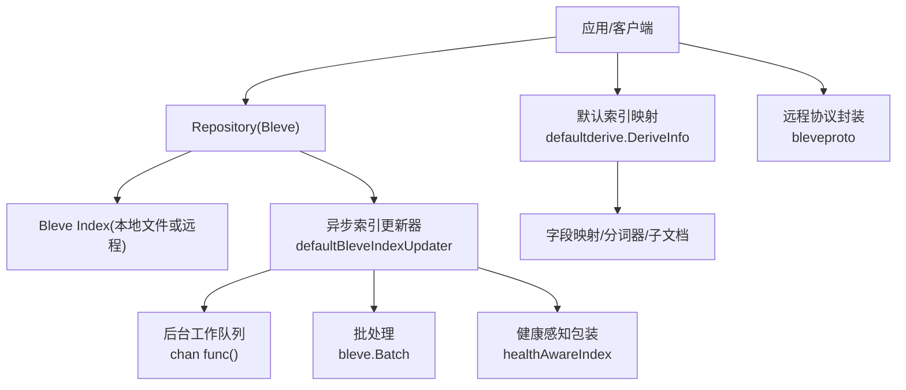
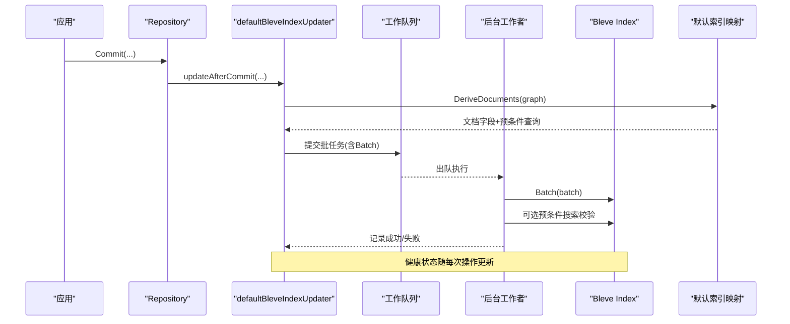
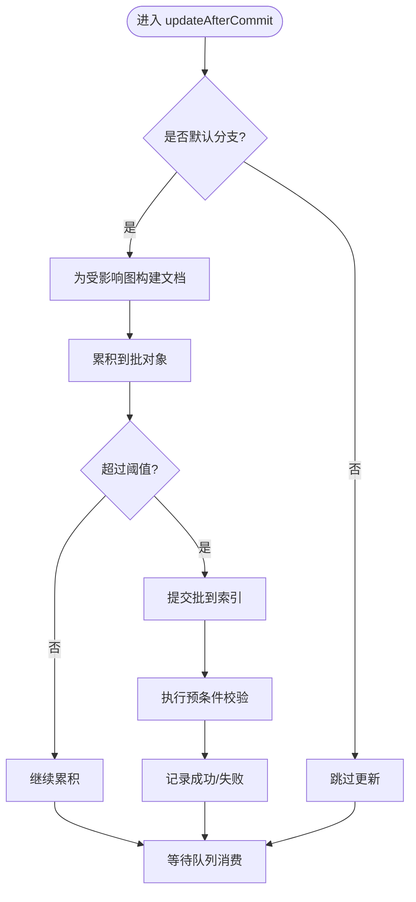
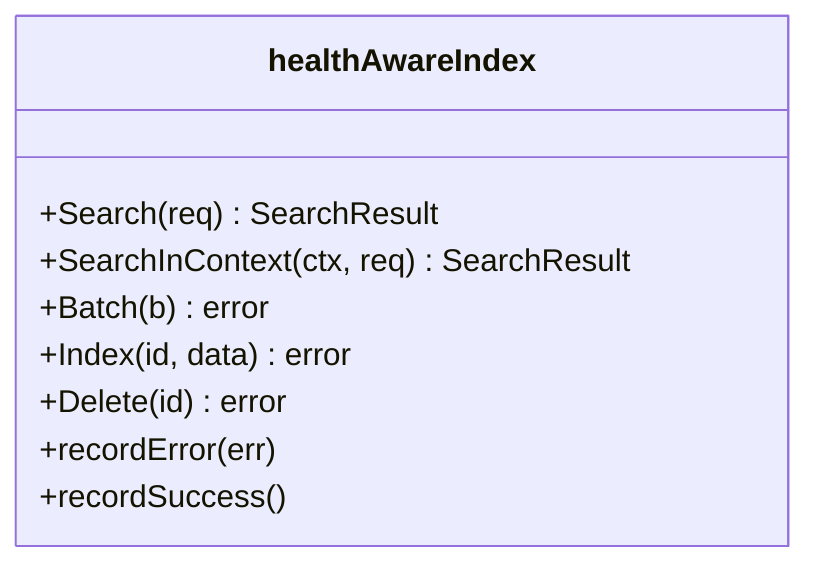
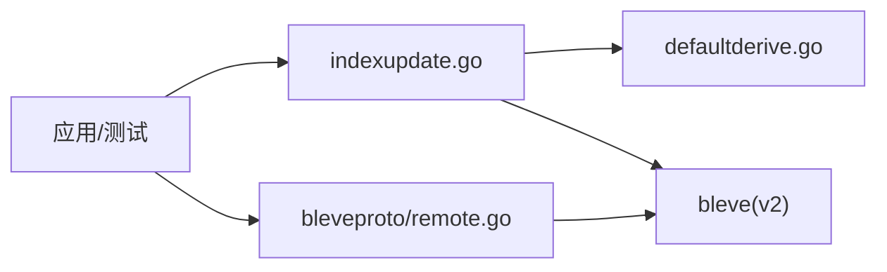

# 全文搜索

<cite>
**本文引用的文件**
- [indexupdate.go](file://sst/indexupdate.go)
- [defaultderive.go](file://defaultderive/defaultderive.go)
- [repolocalfullwithbleve.go](file://examples/helloworldrepolocalfullwithbleve/repolocalfullwithbleve.go)
- [remote.go](file://bleveproto/remote.go)
- [searchInContext_test.go](file://sst_test/searchInContext_test.go)
</cite>

## 目录
1. [简介](#简介)
2. [项目结构](#项目结构)
3. [核心组件](#核心组件)
4. [架构总览](#架构总览)
5. [详细组件分析](#详细组件分析)
6. [依赖关系分析](#依赖关系分析)
7. [性能考量](#性能考量)
8. [故障排查指南](#故障排查指南)
9. [结论](#结论)
10. [附录](#附录)

## 简介
本文件系统性说明 SST 的全文搜索能力，重点阐述基于 Bleve 搜索引擎的集成实现：索引构建、更新机制、异步工作队列与批处理、健康检查系统、索引映射与字段定义、自定义索引策略、完整搜索 API 使用示例（基本查询、复杂条件组合、排序）、以及索引维护操作（重建索引、批量更新、性能监控）和最佳实践。

## 项目结构
SST 将全文搜索能力以“可插拔”的方式集成到仓库中：
- 默认索引映射与文档提取逻辑位于 defaultderive 包，负责从 NamedGraph 抽取字段并生成 Bleve 文档。
- 索引更新器在 sst/indexupdate.go 中实现，提供异步后台队列、批处理、预条件校验与健康感知包装。
- 远程通信通过 bleveproto/remote.go 对 SearchRequest/SearchResult 进行序列化/反序列化，便于跨进程或网络访问。
- 示例与测试展示了如何注册索引处理器、写入数据、提交后刷新索引、执行搜索与分页排序等。

图表来源
- [indexupdate.go:77-158](file://sst/indexupdate.go#L77-L158)
- [defaultderive.go:127-211](file://defaultderive/defaultderive.go#L127-L211)
- [remote.go:21-39](file://bleveproto/remote.go#L21-L39)

章节来源
- [indexupdate.go:77-158](file://sst/indexupdate.go#L77-L158)
- [defaultderive.go:127-211](file://defaultderive/defaultderive.go#L127-L211)
- [remote.go:21-39](file://bleveproto/remote.go#L21-L39)

## 核心组件
- 异步索引更新器：将 BBolt 写路径与 Bleve I/O 解耦，避免阻塞主流程；支持 flush/close 保证有序关闭。
- 批处理与阈值控制：按大小阈值分批提交，降低频繁磁盘写入开销。
- 健康感知索引：对错误计数、重试、成功恢复进行追踪，并在搜索时返回健康状态提示。
- 默认索引映射：定义类型、标签、ID、所有者、图元信息、提交元数据等字段及分词策略。
- 远程协议封装：SearchRequest/SearchResult JSON 编解码，支撑远程调用。

章节来源
- [indexupdate.go:39-75](file://sst/indexupdate.go#L39-L75)
- [indexupdate.go:424-434](file://sst/indexupdate.go#L424-L434)
- [indexupdate.go:650-735](file://sst/indexupdate.go#L650-L735)
- [defaultderive.go:155-211](file://defaultderive/defaultderive.go#L155-L211)
- [remote.go:21-39](file://bleveproto/remote.go#L21-L39)

## 架构总览
下图展示一次“提交后索引更新”的端到端流程，包括异步队列、批处理、预条件校验与健康记录。

图表来源
- [indexupdate.go:160-249](file://sst/indexupdate.go#L160-L249)
- [indexupdate.go:486-502](file://sst/indexupdate.go#L486-L502)
- [indexupdate.go:650-735](file://sst/indexupdate.go#L650-L735)

章节来源
- [indexupdate.go:160-249](file://sst/indexupdate.go#L160-L249)
- [indexupdate.go:486-502](file://sst/indexupdate.go#L486-L502)
- [indexupdate.go:650-735](file://sst/indexupdate.go#L650-L735)

## 详细组件分析

### 异步索引更新器与工作队列
- 设计要点
  - 通过 channel 缓冲队列承载待执行的函数闭包，确保 BBolt 提交不阻塞于 Bleve I/O。
  - 后台 goroutine 持续消费队列，执行批提交与预条件校验。
  - flush 通过入队一个“完成信号”等待所有已提交任务执行完毕，便于测试与一致性验证。
  - close 安全停止队列并等待工作者退出，避免资源泄漏。
- 关键行为
  - 仅对默认分支触发索引更新（非默认分支跳过），减少不必要开销。
  - 针对每个受影响的 NamedGraph 构建文档，累积到 batch，超过阈值即提交。
  - 提交后执行预条件校验（如唯一性约束），失败则记录错误。

图表来源
- [indexupdate.go:160-249](file://sst/indexupdate.go#L160-L249)
- [indexupdate.go:424-434](file://sst/indexupdate.go#L424-L434)
- [indexupdate.go:486-502](file://sst/indexupdate.go#L486-L502)

章节来源
- [indexupdate.go:77-158](file://sst/indexupdate.go#L77-L158)
- [indexupdate.go:160-249](file://sst/indexupdate.go#L160-L249)
- [indexupdate.go:424-434](file://sst/indexupdate.go#L424-L434)
- [indexupdate.go:486-502](file://sst/indexupdate.go#L486-L502)

### 健康检查系统
- healthAwareIndex 作为 bleve.Index 的代理，记录每次操作的错误/成功，并在搜索出错时尝试短暂休眠后重试。
- 若搜索前索引处于不健康状态，即使本次搜索成功也会附带警告信息，便于上层监控告警。
- 所有方法（Search/Batch/Index/Delete 等）均会更新健康状态。

图表来源
- [indexupdate.go:650-735](file://sst/indexupdate.go#L650-L735)
- [indexupdate.go:739-794](file://sst/indexupdate.go#L739-L794)

章节来源
- [indexupdate.go:650-735](file://sst/indexupdate.go#L650-L735)
- [indexupdate.go:739-794](file://sst/indexupdate.go#L739-L794)

### 索引映射配置与字段定义
- 默认索引映射由 defaultderive.DeriveInfo 提供，包含：
  - 类型字段 mainType、附加类型 additionalType、具体类型 specificType
  - 图标识 graphID/graphURI、直接导入 directImport、节点数 nodeCount
  - 主节点 mainNode、字面量集合 literal、标签 label（含短语分词）、注释 comment
  - ID 体系 id.id、id.key、id.type、id.sort、idOwner.*（URI、graph、fragment、label、comment 等）
  - 提交元数据 commitHash、commitAuthor、commitTime、commitMessage
  - 特定类型扩展字段（如 partCategory、shapeFeatureType 等）
- 分词与存储策略：
  - 短语字段使用短语分词器，适合精确匹配。
  - 关键字字段用于聚合/过滤/排序，禁用索引但启用 DocValues 或 Store 以满足不同场景。
  - 数值字段用于统计与范围查询。
- 版本标记字段用于检测映射版本变更，便于迁移与兼容性管理。

章节来源
- [defaultderive.go:39-107](file://defaultderive/defaultderive.go#L39-L107)
- [defaultderive.go:155-211](file://defaultderive/defaultderive.go#L155-L211)
- [defaultderive.go:213-291](file://defaultderive/defaultderive.go#L213-L291)

### 自定义索引策略
- 通过替换 DeriveInfo 中的 DefaultIndexMapping 与 DeriveDocuments，可实现：
  - 自定义字段抽取规则（例如只索引部分属性）。
  - 自定义分词器与字段映射（例如引入语言特定的分词）。
  - 自定义文档类型与子文档结构，满足不同业务检索需求。
- 注意：自定义策略需保持与预条件校验一致，避免违反唯一性等约束。

章节来源
- [defaultderive.go:127-134](file://defaultderive/defaultderive.go#L127-L134)
- [indexupdate.go:436-484](file://sst/indexupdate.go#L436-L484)

### 搜索 API 使用示例
- 基本查询：MatchAll、MatchQuery 指定字段。
- 分页：使用 NewSearchRequestOptions 设置 size 与 offset。
- 排序：利用 sortable 字段（如 id.sort）进行排序。
- 上下文取消：SearchInContext 支持 context 超时与取消。
- 远程访问：通过 Repository.Bleve() 获取 bleve.Index，或使用 bleveproto 进行远程序列化传输。

参考示例与测试路径：
- 示例程序演示创建仓库、注册索引处理器、写入数据、提交、搜索、打开已有索引并搜索、checkout 验证。
- 测试覆盖分页、排序、上下文取消、删除后结果一致性、远程仓库无缓存直连等。

章节来源
- [repolocalfullwithbleve.go:44-88](file://examples/helloworldrepolocalfullwithbleve/repolocalfullwithbleve.go#L44-L88)
- [repolocalfullwithbleve.go:90-129](file://examples/helloworldrepolocalfullwithbleve/repolocalfullwithbleve.go#L90-L129)
- [searchInContext_test.go:215-235](file://sst_test/searchInContext_test.go#L215-L235)
- [searchInContext_test.go:237-324](file://sst_test/searchInContext_test.go#L237-L324)
- [searchInContext_test.go:326-355](file://sst_test/searchInContext_test.go#L326-L355)
- [searchInContext_test.go:966-1010](file://sst_test/searchInContext_test.go#L966-L1010)

### 索引维护操作
- 重建索引：遍历仓库数据集，按分支 checkout 并重新构建文档，批量提交。
- 批量更新：通过 indexBatchIfOverThreshold 控制批大小，避免单次过大导致内存压力。
- 性能监控：借助 healthAwareIndex 的健康状态与 Stats/StatsMap 接口，结合日志观察错误率与成功率。
- 刷新与同步：FlushBleveIndex 等待队列清空，确保后续读取可见最新结果；SetBranch/RemoveBranch/Sync 触发对应索引更新。

章节来源
- [indexupdate.go:366-422](file://sst/indexupdate.go#L366-L422)
- [indexupdate.go:424-434](file://sst/indexupdate.go#L424-L434)
- [indexupdate.go:633-648](file://sst/indexupdate.go#L633-L648)
- [indexupdate.go:251-344](file://sst/indexupdate.go#L251-L344)

## 依赖关系分析
- 模块耦合
  - sst/indexupdate.go 依赖 defaultderive 提供的映射与文档抽取。
  - 远程访问依赖 bleveproto 对请求/结果的 JSON 编解码。
  - 健康感知层透明代理底层 bleve.Index，屏蔽错误与重试细节。
- 外部依赖
  - Bleve 搜索引擎提供索引、搜索、批处理与高级接口。
  - UUID 用于文档 ID 与图标识。
  - Zap 日志用于错误与调试输出。

图表来源
- [indexupdate.go:160-249](file://sst/indexupdate.go#L160-L249)
- [defaultderive.go:127-211](file://defaultderive/defaultderive.go#L127-L211)
- [remote.go:21-39](file://bleveproto/remote.go#L21-L39)

章节来源
- [indexupdate.go:160-249](file://sst/indexupdate.go#L160-L249)
- [defaultderive.go:127-211](file://defaultderive/defaultderive.go#L127-L211)
- [remote.go:21-39](file://bleveproto/remote.go#L21-L39)

## 性能考量
- 异步解耦：BBolt 提交与 Bleve I/O 分离，避免写路径阻塞。
- 批处理阈值：按文档大小限制批次，平衡吞吐与延迟。
- 健康感知：自动重试与错误计数，提升鲁棒性。
- 字段选择：按需启用 DocValues/Store，减少不必要的存储与解析开销。
- 远程优化：仅在必要时序列化请求/结果，避免大对象频繁传输。

[本节为通用指导，无需引用具体文件]

## 故障排查指南
- 常见问题
  - 提交后搜索不到新数据：确认是否调用 FlushBleveIndex 等待异步队列清空。
  - 搜索结果不稳定：检查 healthAwareIndex 的错误计数与最近错误信息。
  - 预条件冲突：查看日志中关于唯一性约束失败的详细信息。
- 定位步骤
  - 使用 Stats/StatsMap 获取索引统计，核对文档数量与字段分布。
  - 通过日志级别提高输出，关注 “failed to commit bleve batch”、“pre-condition check failed” 等关键词。
  - 对于远程场景，确认 bleveproto 编解码正常，且服务端索引可用。

章节来源
- [indexupdate.go:633-648](file://sst/indexupdate.go#L633-L648)
- [indexupdate.go:650-735](file://sst/indexupdate.go#L650-L735)
- [indexupdate.go:486-502](file://sst/indexupdate.go#L486-L502)

## 结论
SST 的全文搜索以 Bleve 为核心，通过异步更新器、批处理与健康感知包装，实现了高吞吐、低延迟且健壮的索引维护。默认索引映射覆盖了常见语义实体与元数据，支持灵活的自定义策略。配合完整的搜索 API 与远程协议封装，可满足多种应用场景下的检索需求。建议在生产环境中合理设置批大小、监控健康状态，并结合上下文超时与分页优化查询体验。

[本节为总结，无需引用具体文件]

## 附录
- 常用字段速查
  - mainType：文档主类型
  - label/literal/comment：文本检索与展示
  - id.* / idOwner.*：标识与所有者关系
  - commit*：提交元数据，便于溯源
  - graphID/graphURI：图级标识
- 典型用法路径
  - 示例：[repolocalfullwithbleve.go](file://examples/helloworldrepolocalfullwithbleve/repolocalfullwithbleve.go)
  - 测试用例：[searchInContext_test.go](file://sst_test/searchInContext_test.go)
  - 索引映射：[defaultderive.go](file://defaultderive/defaultderive.go)
  - 异步更新与健康：[indexupdate.go](file://sst/indexupdate.go)
  - 远程协议：[remote.go](file://bleveproto/remote.go)