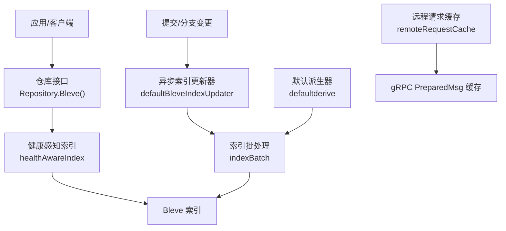
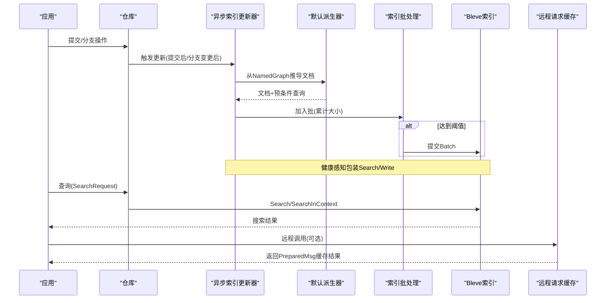
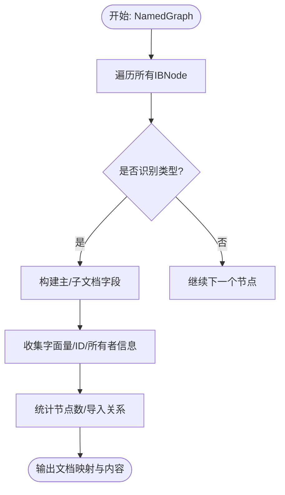
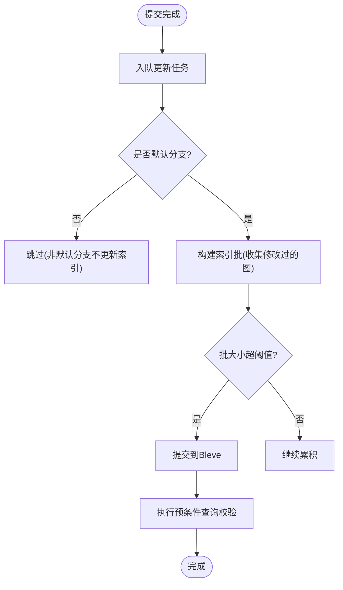
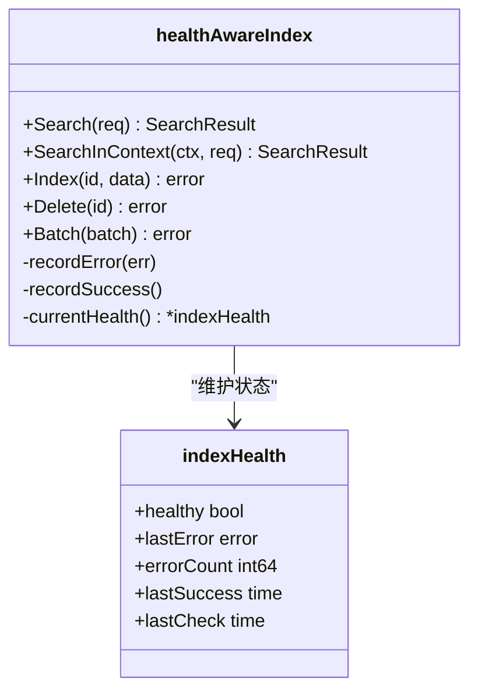
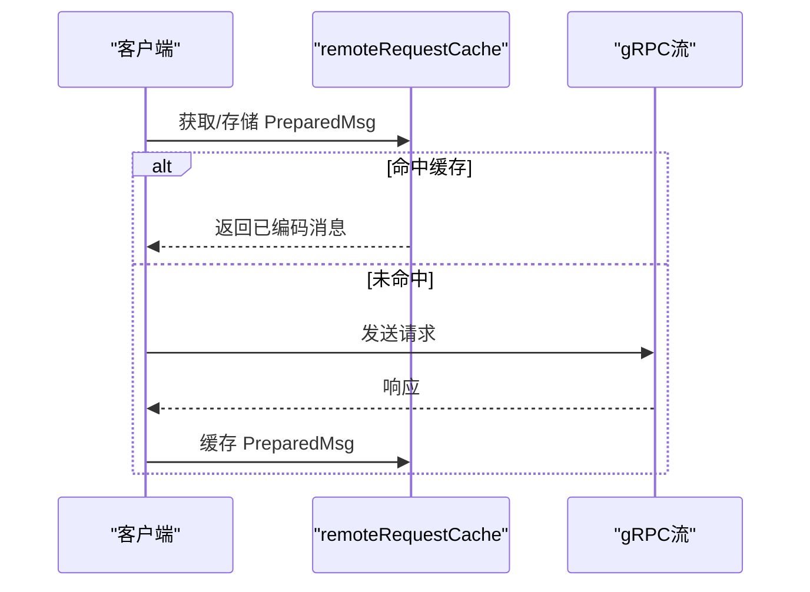
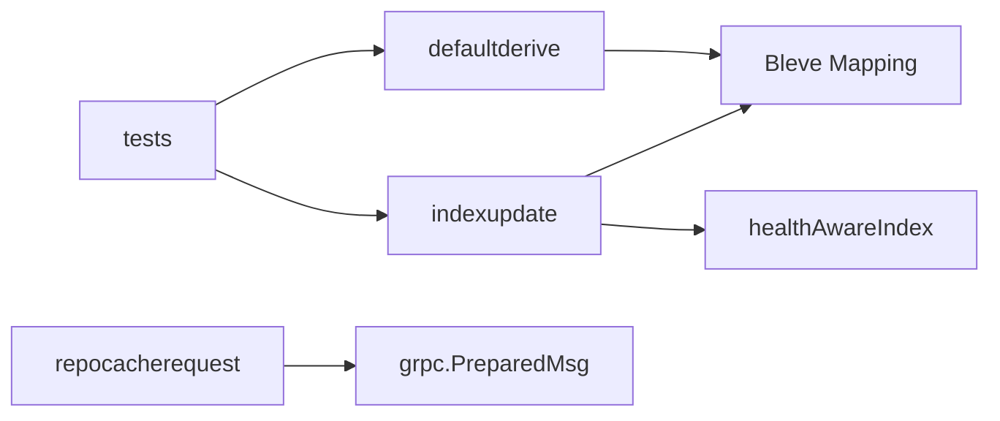

# 查询优化

<cite>
**本文引用的文件**
- [indexupdate.go](file://sst/indexupdate.go)
- [defaultderive.go](file://defaultderive/defaultderive.go)
- [repocacherequest.go](file://sst/repocacherequest.go)
- [index.pb.go](file://bleveproto/index.pb.go)
- [repolocalfullwithbleve.go](file://examples/helloworldrepolocalfullwithbleve/repolocalfullwithbleve.go)
- [searchInContext_test.go](file://sst_test/searchInContext_test.go)
</cite>

## 目录
1. [简介](#简介)
2. [项目结构](#项目结构)
3. [核心组件](#核心组件)
4. [架构总览](#架构总览)
5. [详细组件分析](#详细组件分析)
6. [依赖关系分析](#依赖关系分析)
7. [性能考量](#性能考量)
8. [故障排查指南](#故障排查指南)
9. [结论](#结论)
10. [附录](#附录)

## 简介
本文件聚焦SST的查询优化能力，围绕“索引构建与更新、查询执行计划与优化策略、缓存机制、查询重写、并行执行与内存管理、性能分析与调优、生产监控与诊断”等主题展开。SST将RDF三元组数据通过默认派生器映射为Bleve全文检索文档，并在提交后异步更新索引；查询通过Bleve接口执行，支持分页、排序、字段选择等常见优化点；同时提供远程请求预编译消息缓存以提升网络调用效率。

## 项目结构
- 索引映射与文档派生：位于 defaultderive 包，负责从NamedGraph提取字段并生成Bleve文档映射与内容。
- 索引更新与执行：位于 sst 包的 indexupdate.go，负责在提交后异步批量更新索引、健康检查与重试、预条件校验。
- 远程请求缓存：位于 sst 包的 repocacherequest.go，缓存gRPC PreparedMsg以减少重复序列化开销。
- 远程搜索协议：位于 bleveproto 包，定义SearchRequest/Result的protobuf结构。
- 示例与测试：examples 与 sst_test 展示了如何注册索引处理器、写入数据、刷新索引并执行搜索（含分页、排序、上下文取消等）。

图表来源
- [indexupdate.go:77-158](file://sst/indexupdate.go#L77-L158)
- [indexupdate.go:351-501](file://sst/indexupdate.go#L351-L501)
- [defaultderive.go:155-210](file://defaultderive/defaultderive.go#L155-L210)
- [repocacherequest.go:30-52](file://sst/repocacherequest.go#L30-L52)

章节来源
- [indexupdate.go:77-158](file://sst/indexupdate.go#L77-L158)
- [defaultderive.go:155-210](file://defaultderive/defaultderive.go#L155-L210)
- [repocacherequest.go:30-52](file://sst/repocacherequest.go#L30-L52)

## 核心组件
- 健康感知索引（healthAwareIndex）：封装底层Bleve索引，记录错误/成功状态，对可重试错误进行短暂休眠后重试，并在恢复后发出告警。
- 异步索引更新器（defaultBleveIndexUpdater）：在BBolt提交成功后，将索引更新任务放入后台队列，避免阻塞写路径；支持flush/close保证优雅退出。
- 索引批处理（indexBatch）：聚合多个文档到单个Batch，超过阈值时自动提交，减少I/O次数。
- 默认派生器（defaultderive）：定义Bleve文档映射与字段类型（关键词、短语、数值、存储字段），并从NamedGraph推导文档内容与约束查询。
- 远程请求缓存（remoteRequestCache）：缓存gRPC PreparedMsg，按数据集ID、分支名或提交哈希等维度复用，降低序列化与网络开销。

章节来源
- [indexupdate.go:650-795](file://sst/indexupdate.go#L650-L795)
- [indexupdate.go:77-158](file://sst/indexupdate.go#L77-L158)
- [indexupdate.go:351-501](file://sst/indexupdate.go#L351-L501)
- [defaultderive.go:155-210](file://defaultderive/defaultderive.go#L155-L210)
- [repocacherequest.go:30-52](file://sst/repocacherequest.go#L30-L52)

## 架构总览
下图展示从数据写入到索引更新再到查询执行的端到端流程，以及远程场景下的请求缓存位置。

图表来源
- [indexupdate.go:160-249](file://sst/indexupdate.go#L160-L249)
- [indexupdate.go:424-501](file://sst/indexupdate.go#L424-L501)
- [indexupdate.go:650-795](file://sst/indexupdate.go#L650-L795)
- [repocacherequest.go:138-147](file://sst/repocacherequest.go#L138-L147)

## 详细组件分析

### 索引映射与文档派生（默认派生器）
- 文档类型与字段：定义mainType、additionalType、id、idOwner、label、comment、literal、nodeCount、commit*等字段，并为不同文档类型配置子文档映射（如PartCategory、ShapeFeatureType等）。
- 分析器与索引策略：短语字段使用phrase分析器，关键词字段使用keyword分析器，数值字段用于范围/排序，部分字段仅存储不索引以节省空间。
- 派生逻辑：遍历NamedGraph节点，识别类型与属性，填充主文档与子文档，收集字面量集合，计算节点计数，必要时加载跨图引用（punning node）补充信息。

图表来源
- [defaultderive.go:155-210](file://defaultderive/defaultderive.go#L155-L210)
- [defaultderive.go:293-800](file://defaultderive/defaultderive.go#L293-L800)

章节来源
- [defaultderive.go:155-210](file://defaultderive/defaultderive.go#L155-L210)
- [defaultderive.go:293-800](file://defaultderive/defaultderive.go#L293-L800)

### 索引更新与批处理
- 触发时机：提交后、设置分支、删除分支、同步后。
- 批处理策略：累积文档大小，超过阈值（例如16MB）即提交一次，降低磁盘I/O压力。
- 预条件校验：在提交后基于派生的查询验证唯一性约束（如root节点的id+idOwner+mainType组合），冲突则报错。

图表来源
- [indexupdate.go:160-249](file://sst/indexupdate.go#L160-L249)
- [indexupdate.go:424-501](file://sst/indexupdate.go#L424-L501)

章节来源
- [indexupdate.go:160-249](file://sst/indexupdate.go#L160-L249)
- [indexupdate.go:424-501](file://sst/indexupdate.go#L424-L501)

### 健康感知索引与重试
- 健康状态：记录最近错误、成功时间、错误计数；当连续失败时标记为不健康。
- 搜索重试：对可重试错误进行短暂休眠后重试一次，若成功则恢复健康；即使之前不健康但本次成功，也会返回带警告的结果以便上层告警。

图表来源
- [indexupdate.go:650-795](file://sst/indexupdate.go#L650-L795)

章节来源
- [indexupdate.go:650-795](file://sst/indexupdate.go#L650-L795)

### 远程请求缓存（gRPC PreparedMsg）
- 缓存键：按数据集ID+分支名或提交哈希区分，覆盖GetDataset、DatasetInquiry、GetRef、GetCommit、ListCommits等请求。
- 缓存对象：grpc.PreparedMsg，避免重复编码与网络准备开销。
- 生命周期：无过期时间（TTL=0），容量上限由底层cache实现控制。

图表来源
- [repocacherequest.go:30-52](file://sst/repocacherequest.go#L30-L52)
- [repocacherequest.go:138-147](file://sst/repocacherequest.go#L138-L147)

章节来源
- [repocacherequest.go:30-52](file://sst/repocacherequest.go#L30-L52)
- [repocacherequest.go:138-147](file://sst/repocacherequest.go#L138-L147)

### 远程搜索协议
- 协议定义：SearchRequest包含原始请求字节与仓库名；SearchResult包含序列化后的结果。
- 用途：用于跨进程/跨机器的索引搜索服务化。

章节来源
- [index.pb.go:25-86](file://bleveproto/index.pb.go#L25-L86)

### 查询执行与优化实践
- 分页：通过SearchRequestOptions设置Size与Start，减少单次返回数据量。
- 排序：使用SortBy指定字段（前缀“-”表示降序），配合keyword字段提升排序性能。
- 字段选择：Fields限制返回字段，降低网络与序列化成本。
- 上下文取消：SearchInContext支持context超时/取消，便于长查询保护。
- 直接访问索引：示例中演示了打开本地Bleve索引并执行搜索。

章节来源
- [searchInContext_test.go:218-235](file://sst_test/searchInContext_test.go#L218-L235)
- [searchInContext_test.go:326-350](file://sst_test/searchInContext_test.go#L326-L350)
- [repolocalfullwithbleve.go:90-127](file://examples/helloworldrepolocalfullwithbleve/repolocalfullwithbleve.go#L90-L127)

## 依赖关系分析
- 默认派生器依赖vocabularies（lci、rdfs、sso、rep等）识别类型与属性，生成结构化文档。
- 索引更新器依赖Bleve Index API进行批处理与健康监控。
- 远程缓存依赖grpc.PreparedMsg与expirable-cache库。
- 测试用例验证了分页、排序、上下文取消、一致性等行为。

图表来源
- [defaultderive.go:155-210](file://defaultderive/defaultderive.go#L155-L210)
- [indexupdate.go:650-795](file://sst/indexupdate.go#L650-L795)
- [repocacherequest.go:30-52](file://sst/repocacherequest.go#L30-L52)

章节来源
- [defaultderive.go:155-210](file://defaultderive/defaultderive.go#L155-L210)
- [indexupdate.go:650-795](file://sst/indexupdate.go#L650-L795)
- [repocacherequest.go:30-52](file://sst/repocacherequest.go#L30-L52)

## 性能考量
- 索引更新批大小：通过阈值控制批量提交频率，平衡吞吐与延迟。
- 异步更新：将索引I/O移出写路径，避免阻塞提交。
- 健康感知与重试：提高鲁棒性，减少瞬时错误对查询的影响。
- 远程请求缓存：重用PreparedMsg，减少序列化与网络准备成本。
- 查询优化：分页、排序字段选择、只取必要字段，结合keyword/phrase分析器提升匹配与排序效率。

[本节为通用指导，无需特定文件来源]

## 故障排查指南
- 索引不健康：关注healthAwareIndex的错误计数与最后错误；必要时等待重试或重建索引。
- 预条件冲突：提交后若出现唯一性约束违反，检查root节点的id+idOwner+mainType组合是否存在冲突。
- 远程缓存失效：确认缓存键（数据集ID、分支名/提交哈希）是否正确；检查缓存容量与清理策略。
- 查询超时/取消：确保SearchInContext传入合适的context，避免长时间占用资源。

章节来源
- [indexupdate.go:650-795](file://sst/indexupdate.go#L650-L795)
- [indexupdate.go:504-573](file://sst/indexupdate.go#L504-L573)
- [repocacherequest.go:30-52](file://sst/repocacherequest.go#L30-L52)

## 结论
SST通过默认派生器将RDF数据高效映射为Bleve文档，并以异步批处理方式更新索引；查询层借助健康感知索引与重试机制保障稳定性；远程场景下通过PreparedMsg缓存降低开销。结合分页、排序与字段选择等查询优化手段，可在不同数据规模下取得良好性能。生产环境中建议关注索引健康、预条件冲突与缓存命中率，并结合上下文取消与合理批大小进行调优。

[本节为总结，无需特定文件来源]

## 附录
- 常用API参考
  - 注册索引处理器：见示例中调用RegisterIndexHandler。
  - 刷新索引：FlushBleveIndex用于测试中观察异步更新结果。
  - 搜索：repo.Bleve().SearchInContext，支持分页、排序、字段选择。
  - 远程搜索：通过bleveproto.SearchRequest/Result进行序列化传输。

章节来源
- [repolocalfullwithbleve.go:154-174](file://examples/helloworldrepolocalfullwithbleve/repolocalfullwithbleve.go#L154-L174)
- [indexupdate.go:633-648](file://sst/indexupdate.go#L633-L648)
- [index.pb.go:25-86](file://bleveproto/index.pb.go#L25-L86)