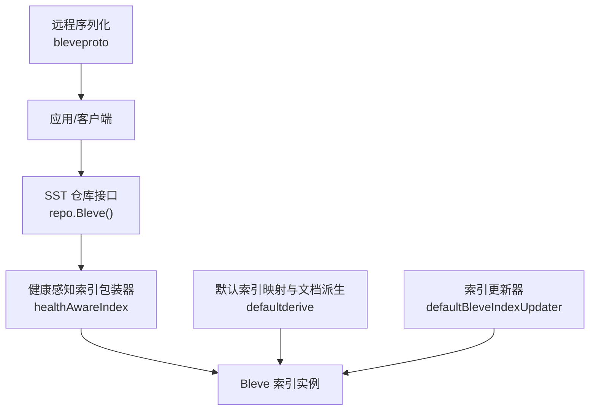
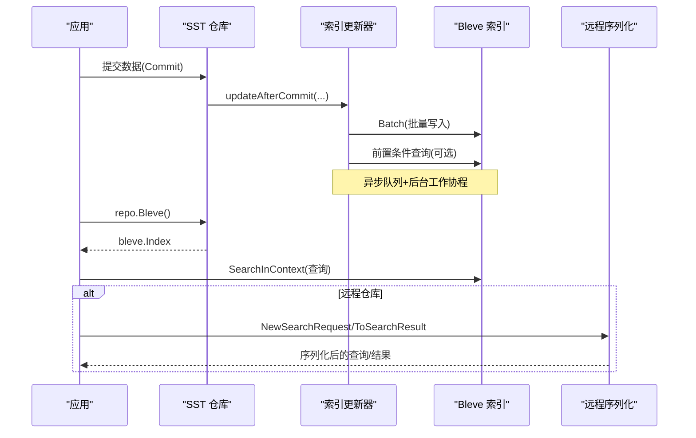
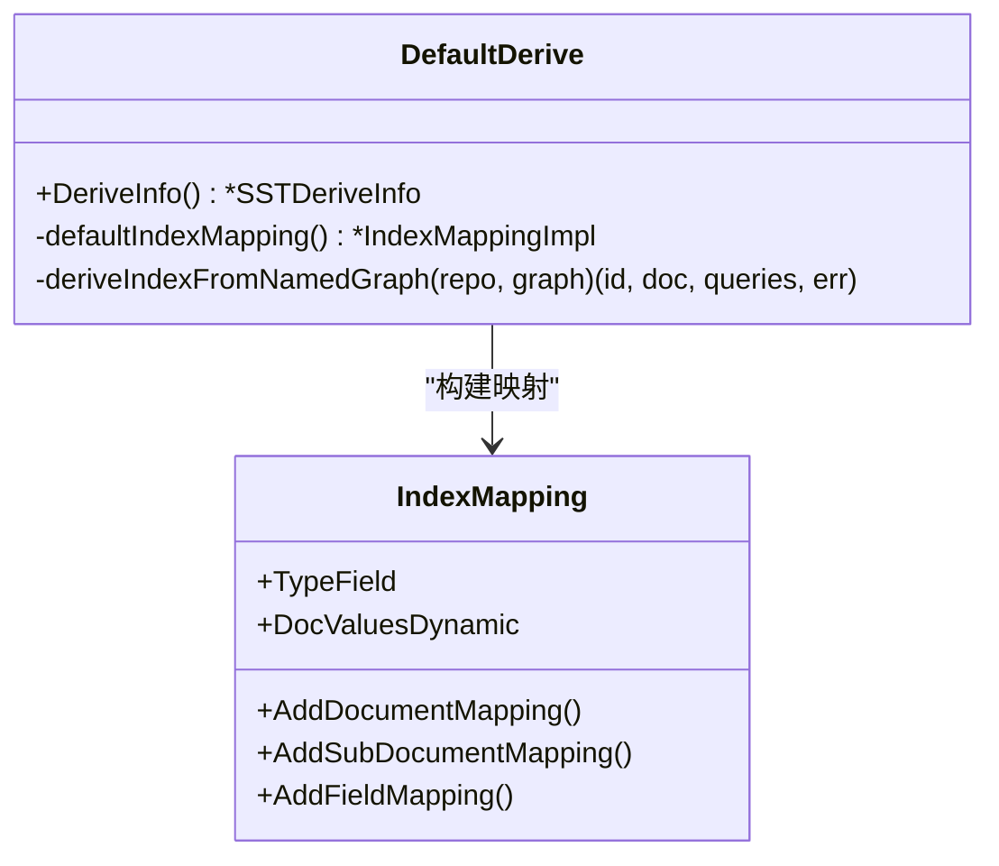
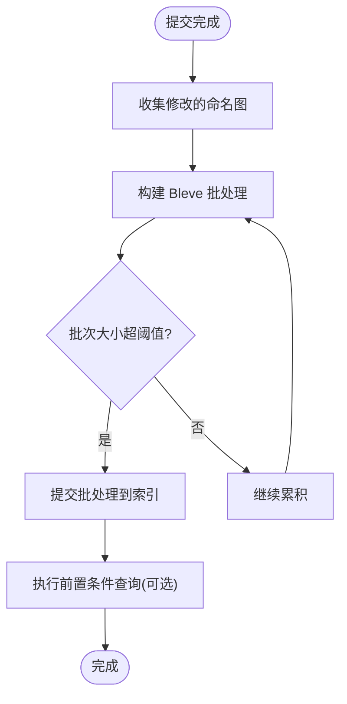
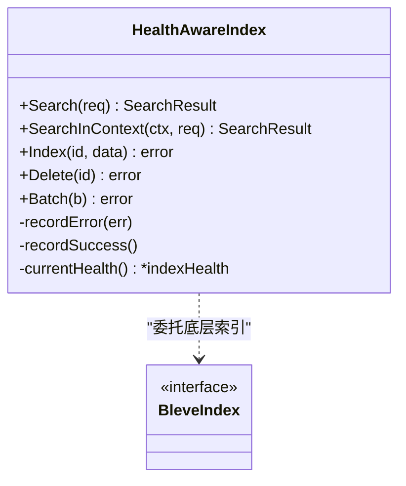
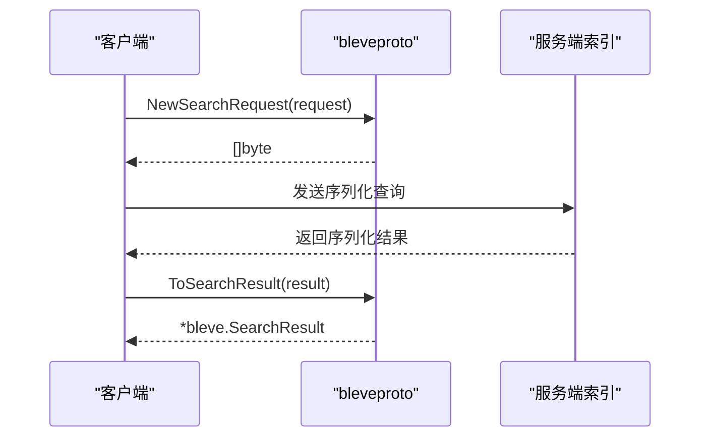
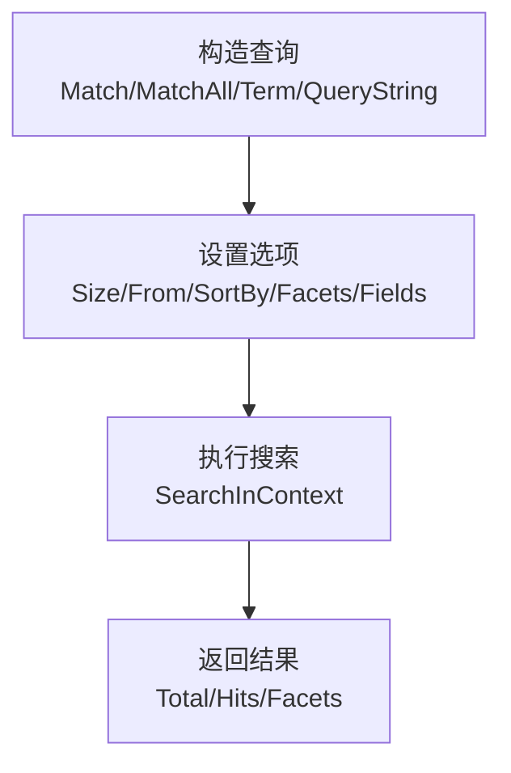
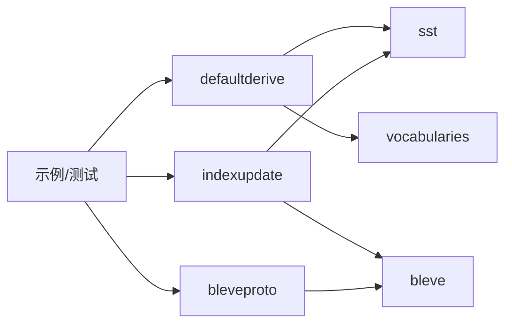

# 查询和搜索

<cite>
**本文引用的文件**
- [indexupdate.go](file://sst/indexupdate.go)
- [defaultderive.go](file://defaultderive/defaultderive.go)
- [remote.go](file://bleveproto/remote.go)
- [repolocalfullwithbleve.go](file://examples/helloworldrepolocalfullwithbleve/repolocalfullwithbleve.go)
- [searchInContext_test.go](file://sst_test/searchInContext_test.go)
</cite>

## 目录
1. [简介](#简介)
2. [项目结构](#项目结构)
3. [核心组件](#核心组件)
4. [架构总览](#架构总览)
5. [详细组件分析](#详细组件分析)
6. [依赖关系分析](#依赖关系分析)
7. [性能考虑](#性能考虑)
8. [故障排查指南](#故障排查指南)
9. [结论](#结论)
10. [附录](#附录)

## 简介
本文件系统性说明 SST 的查询与搜索能力，重点覆盖：
- 基于 Bleve 的全文搜索引擎集成与配置
- 索引更新机制（提交后异步更新、分支变更同步、健康检查与重试）
- 条件过滤器的构建与执行（唯一性约束等前置条件检查）
- 复杂查询构建技巧与性能调优建议
- 搜索结果处理与分页、排序、分面统计
- 查询缓存与结果集管理机制（本地直接访问 bleve.Index，无额外缓存层）
- 实际查询示例与最佳实践

## 项目结构
SST 将“数据仓库”与“全文检索”解耦：
- 数据层：SST 仓库、阶段、命名图、提交历史
- 索引层：Bleve 索引，通过默认派生映射从命名图导出文档字段
- 传输层：远程仓库通过 gRPC 序列化 Bleve 查询/结果进行跨进程检索
- 应用层：示例程序演示创建仓库、注册索引处理器、写入数据、执行搜索

**图表来源**
- [indexupdate.go:650-795](file://sst/indexupdate.go#L650-L795)
- [defaultderive.go:155-210](file://defaultderive/defaultderive.go#L155-L210)
- [remote.go:21-39](file://bleveproto/remote.go#L21-L39)

**章节来源**
- [repolocalfullwithbleve.go:44-88](file://examples/helloworldrepolocalfullwithbleve/repolocalfullwithbleve.go#L44-L88)
- [indexupdate.go:77-158](file://sst/indexupdate.go#L77-L158)
- [defaultderive.go:127-134](file://defaultderive/defaultderive.go#L127-L134)

## 核心组件
- 默认索引映射与文档派生：定义字段类型、分词器、子文档结构，将命名图节点转换为可检索文档。
- 索引更新器：在提交、分支切换、同步后异步更新索引；批量写入、阈值刷新、前置条件校验。
- 健康感知索引：对搜索/写入操作进行错误记录、重试与健康状态维护。
- 远程序列化：将 Bleve 查询与结果序列化为 JSON，便于远程调用。
- 示例与测试：展示如何注册索引处理器、写入数据、构造查询、分页、排序、分面统计。

**章节来源**
- [defaultderive.go:155-210](file://defaultderive/defaultderive.go#L155-L210)
- [indexupdate.go:160-249](file://sst/indexupdate.go#L160-L249)
- [indexupdate.go:650-795](file://sst/indexupdate.go#L650-L795)
- [remote.go:21-39](file://bleveproto/remote.go#L21-L39)
- [searchInContext_test.go:42-69](file://sst_test/searchInContext_test.go#L42-L69)

## 架构总览
SST 的搜索流程由“写路径”和“读路径”组成：
- 写路径：提交后收集修改的命名图，生成文档并批量写入索引；必要时执行前置条件查询校验。
- 读路径：客户端通过 repo.Bleve() 获取 bleve.Index，使用 SearchInContext 执行查询；远程场景通过 bleveproto 序列化请求与结果。

**图表来源**
- [indexupdate.go:160-249](file://sst/indexupdate.go#L160-L249)
- [indexupdate.go:633-648](file://sst/indexupdate.go#L633-L648)
- [remote.go:21-39](file://bleveproto/remote.go#L21-L39)

## 详细组件分析

### 索引映射与文档派生（defaultderive）
- 字段设计：mainType、label、literal、idOwner.*、commit*、graphID 等，支持短语分词、关键词、数值、存储字段等。
- 多文档类型：组织、人员、产品、文档等，按类型扩展子文档映射。
- 版本字段：用于索引版本控制与兼容性。
- 派生逻辑：遍历命名图节点，识别类型与属性，填充主文档与子文档，提取 ID、标签、注释、所有者信息等。

**图表来源**
- [defaultderive.go:127-134](file://defaultderive/defaultderive.go#L127-L134)
- [defaultderive.go:155-210](file://defaultderive/defaultderive.go#L155-L210)
- [defaultderive.go:293-800](file://defaultderive/defaultderive.go#L293-L800)

**章节来源**
- [defaultderive.go:155-210](file://defaultderive/defaultderive.go#L155-L210)
- [defaultderive.go:293-800](file://defaultderive/defaultderive.go#L293-L800)

### 索引更新机制（indexupdate）
- 异步更新：提交后通过队列将索引 I/O 交给后台协程，避免阻塞 BBolt 写入。
- 批量写入：累积文档到 batch，超过阈值时提交，减少频繁磁盘写入。
- 前置条件检查：为 idOwner 等约束生成查询，确保唯一性等约束不被违反。
- 分支与同步：SetBranch/RemoveBranch/Sync 后重建或清理对应数据集的索引文档。
- Flush：提供 flush 接口等待队列中所有任务完成，便于测试一致性验证。

**图表来源**
- [indexupdate.go:160-249](file://sst/indexupdate.go#L160-L249)
- [indexupdate.go:424-434](file://sst/indexupdate.go#L424-L434)
- [indexupdate.go:486-502](file://sst/indexupdate.go#L486-L502)

**章节来源**
- [indexupdate.go:77-158](file://sst/indexupdate.go#L77-L158)
- [indexupdate.go:160-249](file://sst/indexupdate.go#L160-L249)
- [indexupdate.go:251-344](file://sst/indexupdate.go#L251-L344)
- [indexupdate.go:366-434](file://sst/indexupdate.go#L366-L434)
- [indexupdate.go:486-502](file://sst/indexupdate.go#L486-L502)
- [indexupdate.go:586-648](file://sst/indexupdate.go#L586-L648)

### 健康感知索引与重试（indexupdate）
- 健康状态：记录最近成功/失败时间、错误计数，标记是否可用。
- 搜索重试：遇到可重试错误时短暂休眠并重试一次，成功后恢复健康。
- 透明代理：实现 bleve.Index 接口，对上层调用透明。

**图表来源**
- [indexupdate.go:650-795](file://sst/indexupdate.go#L650-L795)

**章节来源**
- [indexupdate.go:650-795](file://sst/indexupdate.go#L650-L795)

### 远程序列化（bleveproto）
- 将 Bleve 查询对象序列化为 JSON 字节流，便于 gRPC 传输。
- 将搜索结果反序列化为 bleve.SearchResult，供客户端使用。

**图表来源**
- [remote.go:21-39](file://bleveproto/remote.go#L21-L39)

**章节来源**
- [remote.go:21-39](file://bleveproto/remote.go#L21-L39)

### 查询语言与过滤器
- 查询语言：直接使用 Bleve 查询 API（MatchAll、Match、Term、QueryString 等），并通过 SearchRequestOptions 设置分页、排序、分面。
- 条件过滤器：通过前置条件查询（checkPreCondition）实现唯一性约束等；也可在业务层组合查询实现过滤。
- 字段选择：SearchRequest.Fields 指定返回字段，提升网络与解析效率。

**图表来源**
- [searchInContext_test.go:42-69](file://sst_test/searchInContext_test.go#L42-L69)
- [searchInContext_test.go:183-195](file://sst_test/searchInContext_test.go#L183-L195)
- [searchInContext_test.go:218-235](file://sst_test/searchInContext_test.go#L218-L235)
- [searchInContext_test.go:485-524](file://sst_test/searchInContext_test.go#L485-L524)
- [searchInContext_test.go:1913-1920](file://sst_test/searchInContext_test.go#L1913-L1920)

**章节来源**
- [searchInContext_test.go:42-69](file://sst_test/searchInContext_test.go#L42-L69)
- [searchInContext_test.go:183-195](file://sst_test/searchInContext_test.go#L183-L195)
- [searchInContext_test.go:218-235](file://sst_test/searchInContext_test.go#L218-L235)
- [searchInContext_test.go:485-524](file://sst_test/searchInContext_test.go#L485-L524)
- [searchInContext_test.go:1913-1920](file://sst_test/searchInContext_test.go#L1913-L1920)

### 分页、排序与分面
- 分页：使用 SearchRequestOptions(size, from, ...) 控制每页数量与偏移。
- 排序：SortBy 指定排序字段（如 -_id 表示降序）。
- 分面：AddFacet 对字段进行分组统计（如 mainType）。

**章节来源**
- [searchInContext_test.go:218-235](file://sst_test/searchInContext_test.go#L218-L235)
- [searchInContext_test.go:1876-1885](file://sst_test/searchInContext_test.go#L1876-L1885)
- [searchInContext_test.go:1913-1920](file://sst_test/searchInContext_test.go#L1913-L1920)

### 实际查询示例与最佳实践
- 基本匹配：MatchAll 或 Match 查询 label/mainType 等字段。
- 精确匹配：TermQuery 针对 keyword 字段进行精确匹配。
- 查询字符串：QueryStringQuery 支持字段限定语法（如 mainType:Organization）。
- 分页：合理设置 Size 与 From，避免一次性拉取过多数据。
- 排序：优先使用 DocValues 字段排序，提高性能。
- 分面：对枚举型字段添加 Facet，辅助前端筛选。
- 字段投影：仅返回必要字段，降低网络开销。

**章节来源**
- [searchInContext_test.go:42-69](file://sst_test/searchInContext_test.go#L42-L69)
- [searchInContext_test.go:183-195](file://sst_test/searchInContext_test.go#L183-L195)
- [searchInContext_test.go:485-524](file://sst_test/searchInContext_test.go#L485-L524)
- [searchInContext_test.go:218-235](file://sst_test/searchInContext_test.go#L218-L235)
- [searchInContext_test.go:1876-1885](file://sst_test/searchInContext_test.go#L1876-L1885)
- [searchInContext_test.go:1913-1920](file://sst_test/searchInContext_test.go#L1913-L1920)

### 查询缓存与结果集管理
- 本地仓库：repo.Bleve() 返回 bleve.Index 的直接实例，无额外缓存包装，保证结果实时一致。
- 远程仓库：每次搜索通过网络传递查询与结果，不缓存；服务端索引健康感知保障稳定性。
- 一致性：测试覆盖本地与远程的一致性、删除后即时更新、多次调用结果稳定。

**章节来源**
- [searchInContext_test.go:776-797](file://sst_test/searchInContext_test.go#L776-L797)
- [searchInContext_test.go:799-847](file://sst_test/searchInContext_test.go#L799-L847)
- [searchInContext_test.go:915-942](file://sst_test/searchInContext_test.go#L915-L942)
- [searchInContext_test.go:1012-1058](file://sst_test/searchInContext_test.go#L1012-L1058)
- [searchInContext_test.go:2022-2119](file://sst_test/searchInContext_test.go#L2022-L2119)

## 依赖关系分析
- defaultderive 依赖 sst 与 vocabularies，负责字段映射与文档派生。
- indexupdate 依赖 bleve 与 sst，负责索引生命周期管理与约束检查。
- bleveproto 依赖 bleve，负责远程序列化。
- 示例与测试依赖上述模块，验证端到端流程。

**图表来源**
- [defaultderive.go:11-37](file://defaultderive/defaultderive.go#L11-L37)
- [indexupdate.go:5-25](file://sst/indexupdate.go#L5-L25)
- [remote.go:5-9](file://bleveproto/remote.go#L5-L9)

**章节来源**
- [defaultderive.go:11-37](file://defaultderive/defaultderive.go#L11-L37)
- [indexupdate.go:5-25](file://sst/indexupdate.go#L5-L25)
- [remote.go:5-9](file://bleveproto/remote.go#L5-L9)

## 性能考虑
- 批量写入：利用 indexBatchIfOverThreshold 控制批次大小，减少频繁 I/O。
- 异步更新：后台协程处理索引 I/O，避免阻塞提交。
- 字段优化：对需要排序的字段启用 DocValues；对只存储不索引的字段禁用索引。
- 查询优化：限制返回字段、合理使用分页、避免全表扫描。
- 健康重试：遇到临时错误自动重试，提升可用性。
- 远程传输：序列化查询与结果，注意网络带宽与延迟。

[本节为通用指导，无需具体文件引用]

## 故障排查指南
- 提交后未立即可见：确认已调用 FlushBleveIndex 等待异步任务完成。
- 约束冲突：检查前置条件查询是否命中其他文档，调整数据或约束。
- 远程超时：为 SearchInContext 传入带超时的 context，避免长时间阻塞。
- 健康告警：关注健康状态中的错误计数与最近错误信息，定位底层问题。

**章节来源**
- [indexupdate.go:633-648](file://sst/indexupdate.go#L633-L648)
- [indexupdate.go:504-573](file://sst/indexupdate.go#L504-L573)
- [searchInContext_test.go:326-354](file://sst_test/searchInContext_test.go#L326-L354)
- [indexupdate.go:707-735](file://sst/indexupdate.go#L707-L735)

## 结论
SST 通过默认索引映射与异步索引更新器，实现了高效、可靠的全文检索能力。结合 Bleve 的强大查询能力，用户可使用丰富的查询语言与选项进行复杂检索。健康感知与重试机制提升了稳定性，远程序列化支持分布式场景。遵循分页、排序、字段投影等最佳实践，可获得更优的性能与体验。

[本节为总结，无需具体文件引用]

## 附录
- 快速开始：参考示例程序，创建仓库、注册索引处理器、写入数据、执行搜索。
- 常用查询：MatchAll、Match、Term、QueryString、分页、排序、分面。
- 调试技巧：使用 FlushBleveIndex 确保一致性；打印健康状态与错误信息。

**章节来源**
- [repolocalfullwithbleve.go:44-88](file://examples/helloworldrepolocalfullwithbleve/repolocalfullwithbleve.go#L44-L88)
- [searchInContext_test.go:42-69](file://sst_test/searchInContext_test.go#L42-L69)
- [searchInContext_test.go:218-235](file://sst_test/searchInContext_test.go#L218-L235)
- [searchInContext_test.go:1876-1885](file://sst_test/searchInContext_test.go#L1876-L1885)
- [searchInContext_test.go:1913-1920](file://sst_test/searchInContext_test.go#L1913-L1920)