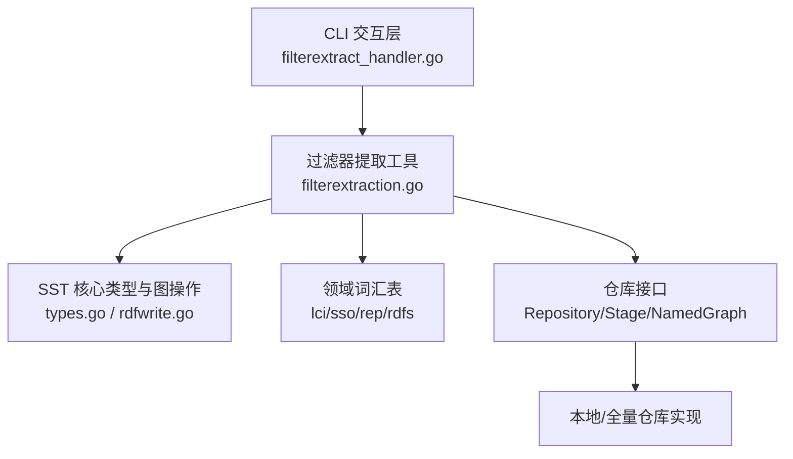
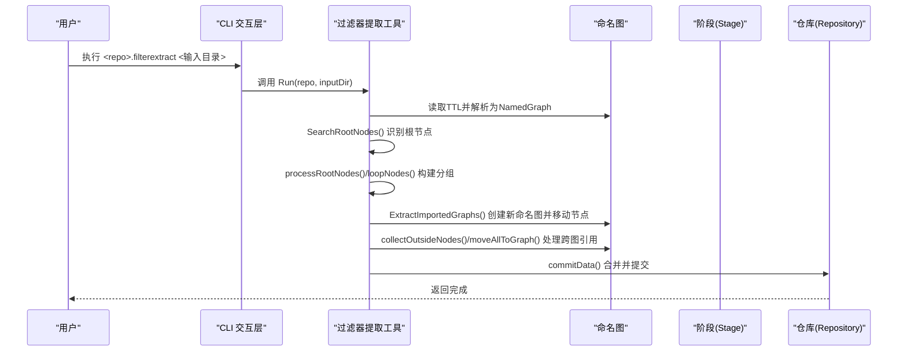
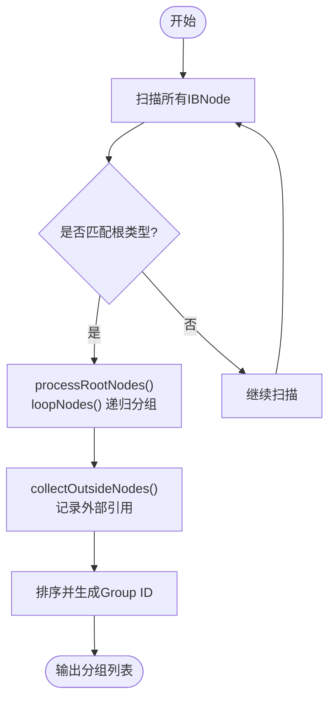
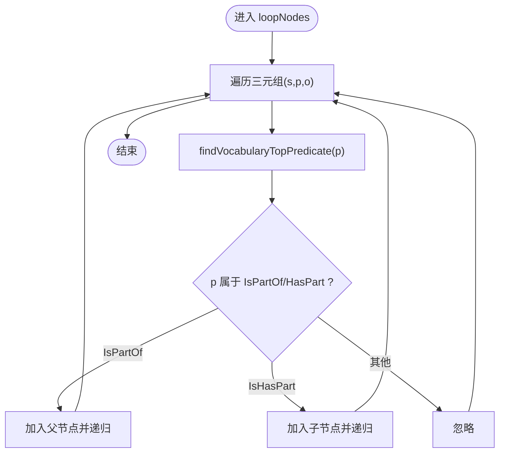
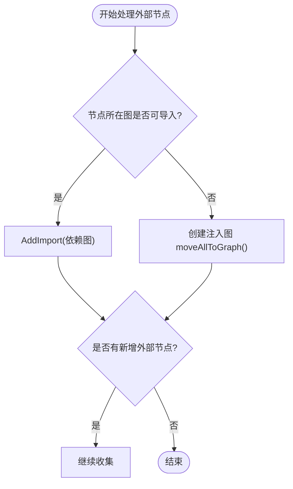
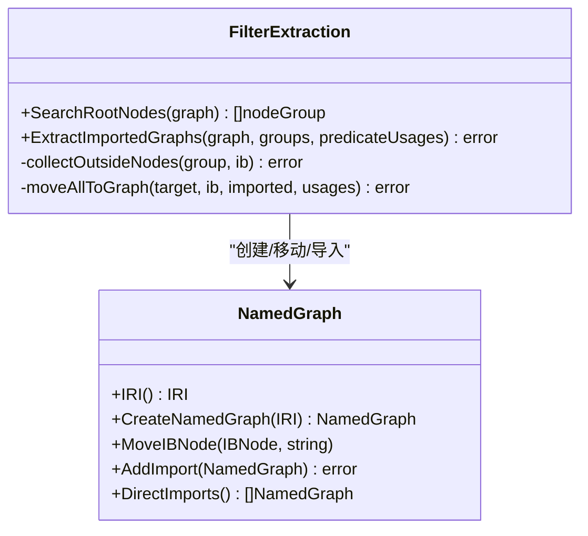
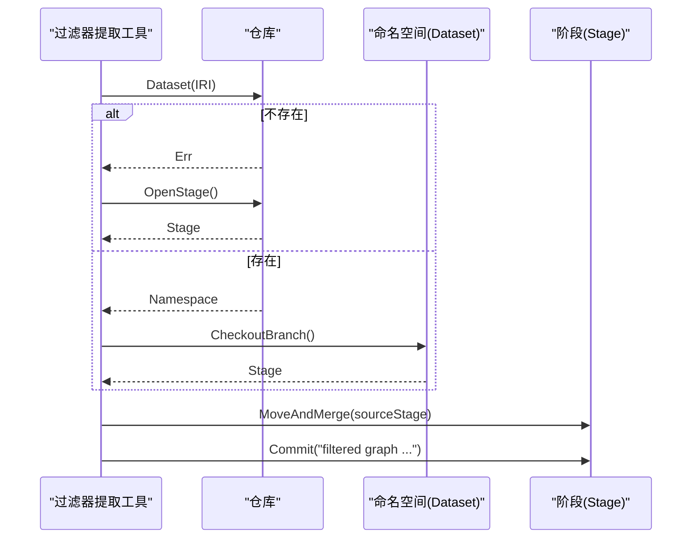
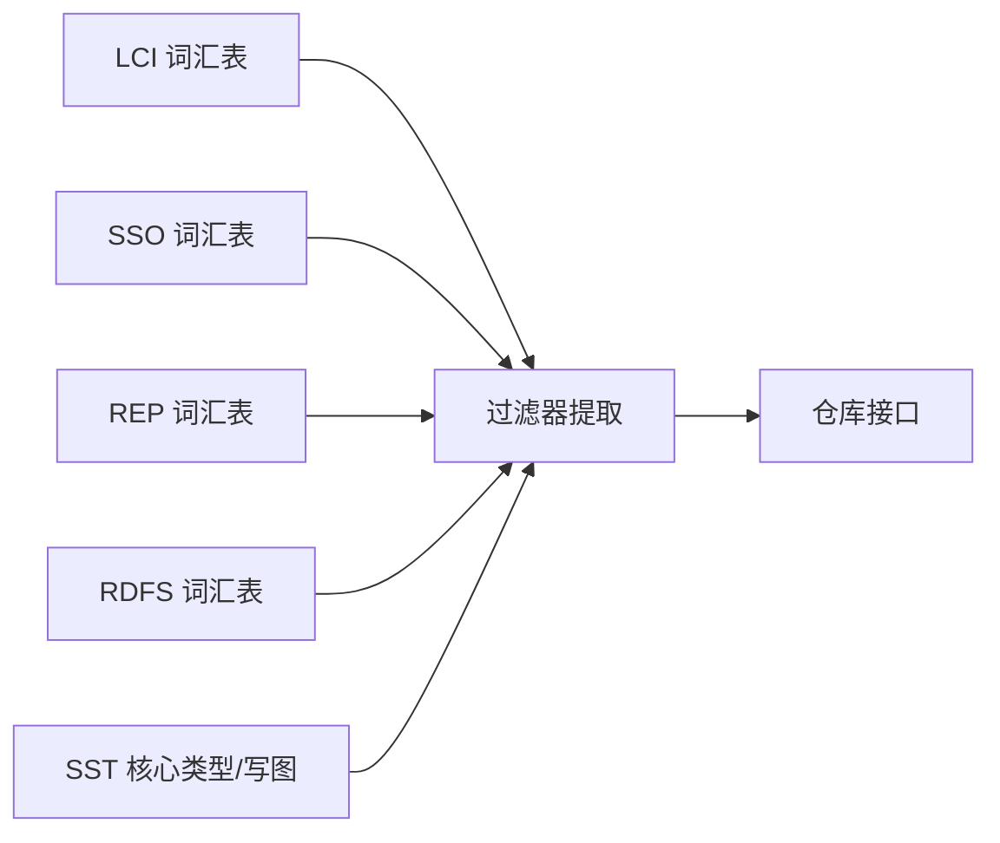

# 过滤器提取

<cite>
**本文引用的文件**
- [tools/filterextraction/filterextraction.go](file://tools/filterextraction/filterextraction.go)
- [cli/cmd/interactive/filterextract_handler.go](file://cli/cmd/interactive/filterextract_handler.go)
- [tools/filterextraction/filterextraction_test.go](file://tools/filterextraction/filterextraction_test.go)
- [sst/types.go](file://sst/types.go)
- [sst/rdfwrite.go](file://sst/rdfwrite.go)
- [vocabularies/lci/vocabulary.go](file://vocabularies/lci/vocabulary.go)
- [vocabularies/sso/vocabulary.go](file://vocabularies/sso/vocabulary.go)
- [vocabularies/rep/vocabulary.go](file://vocabularies/rep/vocabulary.go)
- [vocabularies/rdfs/vocabulary.go](file://vocabularies/rdfs/vocabulary.go)
</cite>

## 目录
1. [简介](#简介)
2. [项目结构](#项目结构)
3. [核心组件](#核心组件)
4. [架构总览](#架构总览)
5. [详细组件分析](#详细组件分析)
6. [依赖关系分析](#依赖关系分析)
7. [性能考虑](#性能考虑)
8. [故障排查指南](#故障排查指南)
9. [结论](#结论)
10. [附录：使用与最佳实践](#附录：使用与最佳实践)

## 简介
本文件围绕 SST 的“过滤器提取”能力进行系统化说明。该功能将大型命名图（NamedGraph）按照领域本体（如 LCIA、SSO、REP 等）的结构语义，拆分为多个更小的、可独立管理的命名图，并自动维护跨图的引用与导入关系，最终提交到仓库中。它适用于 STEP XML 等结构化数据在转换为 RDF/Turtle 后，按业务实体（如零件、组织、表示上下文等）进行模块化存储的场景。

需要特别说明的是：当前仓库中的“过滤器提取”并非传统意义上的“查询语言过滤”，而是基于本体语义的“图结构分割与重组”。因此，文档重点聚焦于：
- 如何识别根节点与相关子图
- 如何处理部分-整体关系（IsPartOf/HasPart）
- 如何创建并导入新的命名图以承载子图
- 如何处理跨图引用与循环导入保护
- 如何在本地仓库中提交结果

## 项目结构
与过滤器提取直接相关的代码主要位于以下位置：
- 工具实现：tools/filterextraction/filterextraction.go
- CLI 交互入口：cli/cmd/interactive/filterextract_handler.go
- 测试用例：tools/filterextraction/filterextraction_test.go
- 类型与基础设施：sst/types.go、sst/rdfwrite.go
- 领域词汇表：vocabularies/lci、sso、rep、rdfs

图表来源
- [cli/cmd/interactive/filterextract_handler.go:15-53](file://cli/cmd/interactive/filterextract_handler.go#L15-L53)
- [tools/filterextraction/filterextraction.go:646-708](file://tools/filterextraction/filterextraction.go#L646-L708)
- [sst/types.go:1-200](file://sst/types.go#L1-L200)
- [sst/rdfwrite.go:973-1051](file://sst/rdfwrite.go#L973-L1051)

章节来源
- [cli/cmd/interactive/filterextract_handler.go:15-53](file://cli/cmd/interactive/filterextract_handler.go#L15-L53)
- [tools/filterextraction/filterextraction.go:646-708](file://tools/filterextraction/filterextraction.go#L646-L708)

## 核心组件
- 根节点发现与分组：根据节点的类型（如 KindPart、KindOrganization、KindShapeFeatureDefinition、KindRepresentationContext）识别潜在的分片根，并递归收集与其相关的节点。
- 部分-整体关系处理：通过 IsPartOf/HasPart 语义扩展分组范围，确保父子实体在同一组内。
- 外部节点收集与迁移：当某节点被移出但仍有引用时，将其作为“外部节点”记录，并在必要时注入到目标图中或引入依赖图。
- 命名图拆分与导入：为每个分组创建新的命名图，移动节点，建立导入关系，避免循环导入。
- 提交与持久化：将处理后的图合并并提交到仓库。

章节来源
- [tools/filterextraction/filterextraction.go:190-313](file://tools/filterextraction/filterextraction.go#L190-L313)
- [tools/filterextraction/filterextraction.go:345-465](file://tools/filterextraction/filterextraction.go#L345-L465)
- [tools/filterextraction/filterextraction.go:608-708](file://tools/filterextraction/filterextraction.go#L608-L708)

## 架构总览
下图展示了从 CLI 调用到实际执行、再到仓库提交的完整流程。

图表来源
- [cli/cmd/interactive/filterextract_handler.go:15-53](file://cli/cmd/interactive/filterextract_handler.go#L15-L53)
- [tools/filterextraction/filterextraction.go:646-708](file://tools/filterextraction/filterextraction.go#L646-L708)
- [tools/filterextraction/filterextraction.go:190-465](file://tools/filterextraction/filterextraction.go#L190-L465)

## 详细组件分析

### 根节点识别与分组策略
- 根节点候选：类型为 sso.KindPart、lci.KindOrganization、sso.KindShapeFeatureDefinition 或 rep.KindRepresentationContext 的节点。
- 针对表示上下文（RepresentationContext）的特殊判断：仅当包含外部几何模型或满足“仅放置项”且维度为3D时，才作为根节点。
- 分组过程：从根节点出发，遍历其三元组，依据谓词所属词汇表（如 lci.IsPartOf、lci.IsHasPart）递归加入分组；同时记录外部节点以便后续处理。

图表来源
- [tools/filterextraction/filterextraction.go:190-313](file://tools/filterextraction/filterextraction.go#L190-L313)
- [tools/filterextraction/filterextraction.go:103-188](file://tools/filterextraction/filterextraction.go#L103-L188)

章节来源
- [tools/filterextraction/filterextraction.go:103-188](file://tools/filterextraction/filterextraction.go#L103-L188)
- [tools/filterextraction/filterextraction.go:190-313](file://tools/filterextraction/filterextraction.go#L190-L313)

### 部分-整体关系的处理
- 支持 lci.IsPartOf 与 lci.IsHasPart 两种方向的关系，确保父部件与子部件在同一分组内。
- 通过 findVocabularyTopPredicate 向上追溯属性继承链，确定谓词所属的顶层词汇元素，再据此决定行为。

图表来源
- [tools/filterextraction/filterextraction.go:73-147](file://tools/filterextraction/filterextraction.go#L73-L147)

章节来源
- [tools/filterextraction/filterextraction.go:73-147](file://tools/filterextraction/filterextraction.go#L73-L147)

### 外部节点收集与注入图
- 当某个节点被移动到目标分组图但仍被原图或其他图引用时，会将其加入 outsideNodes。
- 若无法直接导入依赖图（例如存在循环导入），则创建一个“注入图”，将被引用的节点及其依赖一并移动到注入图中，并在目标图添加对注入图的导入。

图表来源
- [tools/filterextraction/filterextraction.go:345-465](file://tools/filterextraction/filterextraction.go#L345-L465)
- [tools/filterextraction/filterextraction.go:503-571](file://tools/filterextraction/filterextraction.go#L503-L571)

章节来源
- [tools/filterextraction/filterextraction.go:345-465](file://tools/filterextraction/filterextraction.go#L345-L465)
- [tools/filterextraction/filterextraction.go:503-571](file://tools/filterextraction/filterextraction.go#L503-L571)

### 命名图拆分与导入管理
- 为每个分组创建新的命名图，并将分组内的节点移动到该图。
- 对于外部节点，尝试将其移动到目标图；若涉及跨图引用，则建立导入关系。
- 检测并防止循环导入（ErrNamedGraphImportCycle）与重复导入（ErrNamedGraphAlreadyImported）。

图表来源
- [tools/filterextraction/filterextraction.go:345-465](file://tools/filterextraction/filterextraction.go#L345-L465)
- [tools/filterextraction/filterextraction.go:573-606](file://tools/filterextraction/filterextraction.go#L573-L606)

章节来源
- [tools/filterextraction/filterextraction.go:345-465](file://tools/filterextraction/filterextraction.go#L345-L465)
- [tools/filterextraction/filterextraction.go:573-606](file://tools/filterextraction/filterextraction.go#L573-L606)

### 提交与持久化
- 如果目标命名图已存在于仓库中，则检出分支并合并；否则创建新阶段。
- 使用 MoveAndMerge 将源阶段的数据合并到目标仓库，然后提交变更。

图表来源
- [tools/filterextraction/filterextraction.go:608-643](file://tools/filterextraction/filterextraction.go#L608-L643)

章节来源
- [tools/filterextraction/filterextraction.go:608-643](file://tools/filterextraction/filterextraction.go#L608-L643)

### CLI 入口与限制
- 命令格式：<repo>.filterextract <input-directory>
- 目前仅支持本地仓库（包括 localflat），远程仓库暂不支持。
- 会处理目录下所有 .ttl 文件（跳过以“_”开头的名称），并将结果提交到仓库。

章节来源
- [cli/cmd/interactive/filterextract_handler.go:15-53](file://cli/cmd/interactive/filterextract_handler.go#L15-L53)

## 依赖关系分析
- 词汇表依赖：
  - lci：用于组织、部分-整体关系等（如 IsPartOf、IsHasPart、KindOrganization）。
  - sso：用于零件、形状特征定义等（如 KindPart、KindShapeFeatureDefinition）。
  - rep：用于表示上下文（KindRepresentationContext）、坐标维度等。
  - rdfs：用于属性继承（SubPropertyOf）的追溯。
- SST 核心：
  - types.go：定义了基础类型与静态图（RDF/XSD/SST 命名空间）。
  - rdfwrite.go：负责将多命名图写入 TriG 格式，保证空白节点标签全局唯一。

图表来源
- [tools/filterextraction/filterextraction.go:7-27](file://tools/filterextraction/filterextraction.go#L7-L27)
- [vocabularies/lci/vocabulary.go](file://vocabularies/lci/vocabulary.go)
- [vocabularies/sso/vocabulary.go](file://vocabularies/sso/vocabulary.go)
- [vocabularies/rep/vocabulary.go](file://vocabularies/rep/vocabulary.go)
- [vocabularies/rdfs/vocabulary.go](file://vocabularies/rdfs/vocabulary.go)
- [sst/types.go:1-200](file://sst/types.go#L1-L200)
- [sst/rdfwrite.go:973-1051](file://sst/rdfwrite.go#L973-L1051)

章节来源
- [tools/filterextraction/filterextraction.go:7-27](file://tools/filterextraction/filterextraction.go#L7-L27)
- [sst/types.go:1-200](file://sst/types.go#L1-L200)
- [sst/rdfwrite.go:973-1051](file://sst/rdfwrite.go#L973-L1051)

## 性能考虑
- 图遍历复杂度：SearchRootNodes 与 loopNodes 会对图进行多次遍历，建议在大数据集上分批处理或预处理索引。
- 外部节点迭代：collectOutsideNodes 与 moveAllToGraph 可能引发多次图修改，建议控制单次处理的图规模。
- 导入关系优化：尽量避免深层嵌套导入，减少循环检测开销。
- 日志与调试：启用调试日志有助于定位瓶颈（如大量外部节点导致的反复迁移）。

[本节提供通用指导，不直接分析具体文件]

## 故障排查指南
- 远程仓库不支持：CLI 会明确提示当前仅支持本地仓库。
- 循环导入错误：当试图向目标图导入一个已存在环路的图时，会返回 ErrNamedGraphImportCycle。此时应检查数据模型，或通过注入图规避。
- 重复导入错误：若目标图已导入同一依赖图，会返回 ErrNamedGraphAlreadyImported。
- 空图或无效路径：CLI 会校验输入目录是否存在且为目录。
- 提交失败：MoveAndMerge 或 Commit 失败时，需检查权限、分支状态及数据一致性。

章节来源
- [cli/cmd/interactive/filterextract_handler.go:22-33](file://cli/cmd/interactive/filterextract_handler.go#L22-L33)
- [tools/filterextraction/filterextraction.go:414-465](file://tools/filterextraction/filterextraction.go#L414-L465)
- [tools/filterextraction/filterextraction.go:573-606](file://tools/filterextraction/filterextraction.go#L573-L606)
- [tools/filterextraction/filterextraction.go:608-643](file://tools/filterextraction/filterextraction.go#L608-L643)

## 结论
SST 的“过滤器提取”功能通过领域本体语义对大型命名图进行智能分片与重组，形成更细粒度的命名图集合，便于后续检索、版本管理与按需加载。其核心在于：
- 基于词汇表的根节点识别
- 部分-整体关系的递归扩展
- 外部节点与导入关系的正确处理
- 安全地创建与提交新图

尽管当前实现未提供“查询语言过滤”的能力，但它为上层查询与索引提供了良好的数据组织基础。

[本节总结性内容，不直接分析具体文件]

## 附录：使用与最佳实践
- 使用方式
  - 在交互式 CLI 中执行：<repo>.filterextract <输入目录>
  - 输入目录应为包含 .ttl 文件的文件夹，文件名不以“_”开头才会被处理。
  - 结果会自动提交到指定仓库的默认分支。
- 数据准备
  - 确保数据遵循所用词汇表（LCIA/SSO/REP/RDFS）的约定，尤其是部分-整体关系与类型声明。
- 性能优化
  - 对超大 TTL 文件，建议先进行预处理或分块处理。
  - 合理设计命名图粒度，避免过深的导入层级。
- 调试技巧
  - 开启调试日志观察分组与外部节点变化。
  - 在测试环境中验证导入关系与循环检测逻辑。
- 扩展开发
  - 如需支持更多根类型或关系，可在 SearchRootNodes 与 loopNodes 中添加对应分支。
  - 自定义词汇表集成：确保 InVocabulary() 能正确识别新增谓词或类型。

章节来源
- [cli/cmd/interactive/filterextract_handler.go:29-53](file://cli/cmd/interactive/filterextract_handler.go#L29-L53)
- [tools/filterextraction/filterextraction.go:190-313](file://tools/filterextraction/filterextraction.go#L190-L313)
- [tools/filterextraction/filterextraction_test.go:30-118](file://tools/filterextraction/filterextraction_test.go#L30-L118)