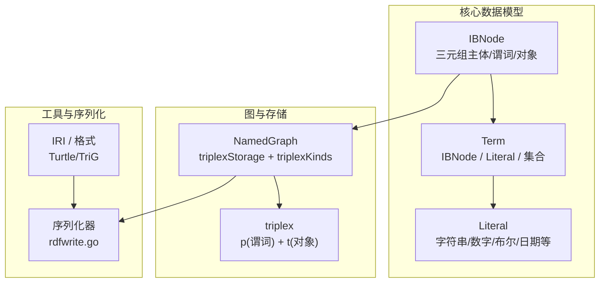
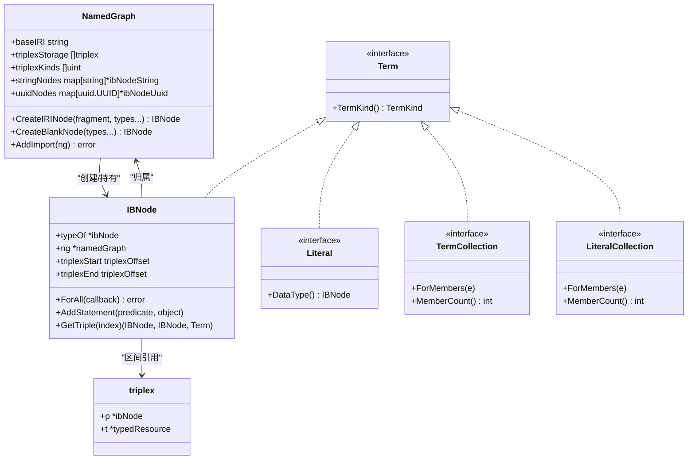
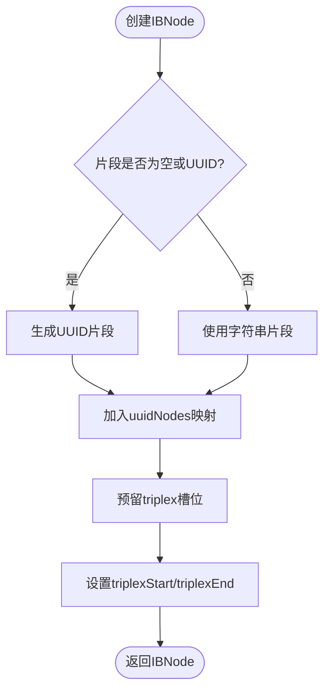
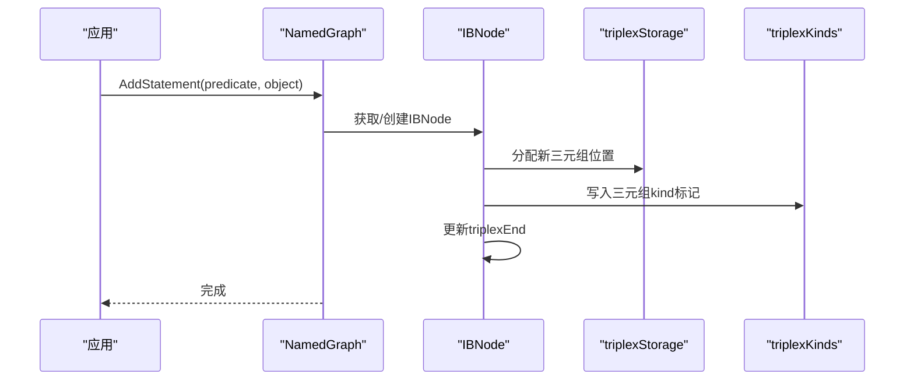
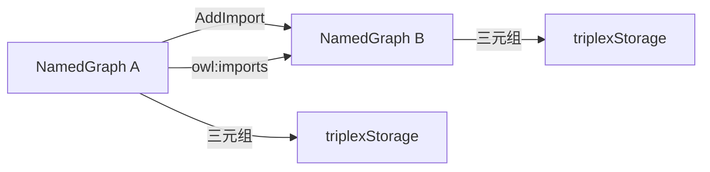
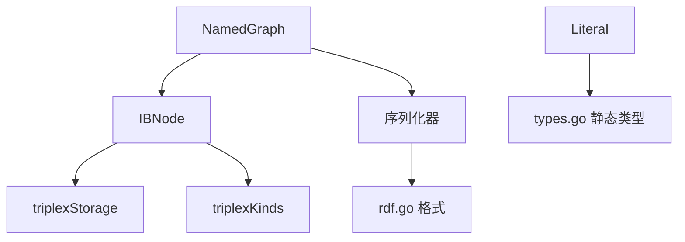

# RDF三元组模型

<cite>
**本文引用的文件**
- [ibnode.go](file://sst/ibnode.go)
- [literals.go](file://sst/literals.go)
- [literaltypes.go](file://sst/literaltypes.go)
- [namedgraph.go](file://sst/namedgraph.go)
- [rdf.go](file://sst/rdf.go)
- [types.go](file://sst/types.go)
- [rdfwrite.go](file://sst/rdfwrite.go)
</cite>

## 目录
1. [简介](#简介)
2. [项目结构](#项目结构)
3. [核心组件](#核心组件)
4. [架构总览](#架构总览)
5. [详细组件分析](#详细组件分析)
6. [依赖关系分析](#依赖关系分析)
7. [性能考量](#性能考量)
8. [故障排查指南](#故障排查指南)
9. [结论](#结论)
10. [附录](#附录)

## 简介
本文件系统性阐述SST Core中的RDF三元组模型，覆盖以下要点：
- RDF三元组的基本概念（主题-谓词-对象）及其在语义网中的作用。
- IRI节点与空白节点（IBNode）的实现机制：类型、标识符生成、内存布局与管理。
- 字面量（Literal）的类型支持：字符串、数字、布尔、日期时间等。
- 三元组的存储结构与索引机制：紧凑的triplex数组与位标记、反向索引策略。
- 三元组与命名图的关系：基于NamedGraph的隔离、导入与版本化。
- 不同存储后端下的实现差异：本地与远程仓库通过统一接口暴露。
- 性能优化建议与最佳实践：批量操作、集合优化、避免重复插入等。

## 项目结构
围绕RDF三元组的核心代码集中在sst包中：
- ibnode.go：定义IBNode、Term、三元组存储结构（triplex）、三元组比较与迭代、集合（TermCollection/LiteralCollection）等。
- literals.go：提供多种字面量类型的Go封装（String、Int、Double、Boolean、LangString等）。
- literaltypes.go：定义Literal接口及内部literal到外部API值的转换。
- namedgraph.go：NamedGraph内存表示、三元组存储（triplexStorage/triplexKinds）、节点管理、导入关系、版本信息。
- rdf.go：RDF术语、IRI解析、序列化格式（Turtle/TriG）的基础设施。
- types.go：静态词汇表与内置类型节点（如xsd:string、rdf:langString等）。
- rdfwrite.go：将NamedGraph序列化为Turtle/TriG，处理集合与命名空间前缀。



图表来源
- [ibnode.go:1022-1039](file://sst/ibnode.go#L1022-L1039)
- [namedgraph.go:59-107](file://sst/namedgraph.go#L59-L107)
- [rdf.go:102-117](file://sst/rdf.go#L102-L117)

章节来源
- [ibnode.go:1022-1039](file://sst/ibnode.go#L1022-L1039)
- [namedgraph.go:59-107](file://sst/namedgraph.go#L59-L107)
- [rdf.go:102-117](file://sst/rdf.go#L102-L117)

## 核心组件
- IBNode：既可表示IRI节点也可表示空白节点；每个IBNode关联一个NamedGraph，并通过triplexStart/triplexEnd指向该图的三元组区间。
- Term：三元组对象的抽象，包括IBNode、Literal、TermCollection、LiteralCollection。
- Literal：带数据类型或语言标签的字面量，支持多种XSD类型与rdf:langString。
- NamedGraph：内存中的命名图，维护triplexStorage（三元组数组）与triplexKinds（三元组类型位标记），以及stringNodes/uuidNodes索引。
- triplex：最小三元组单元，包含谓词p与对象t（typedResource），三元组种类由triplexKinds编码。

章节来源
- [ibnode.go:634-660](file://sst/ibnode.go#L634-L660)
- [ibnode.go:1022-1039](file://sst/ibnode.go#L1022-L1039)
- [namedgraph.go:59-107](file://sst/namedgraph.go#L59-L107)

## 架构总览
SST的RDF三元组模型以“NamedGraph持有triplex数组”为核心，IBNode通过区间定位其三元组，Triples按subject/predicate/object三种kind存储并共享同一数组，使用紧凑的位标记减少开销。



图表来源
- [namedgraph.go:59-107](file://sst/namedgraph.go#L59-L107)
- [ibnode.go:634-660](file://sst/ibnode.go#L634-L660)
- [ibnode.go:1022-1039](file://sst/ibnode.go#L1022-L1039)

## 详细组件分析

### 三元组基本概念与作用
- 三元组是RDF数据模型的最小单位，表达“主题-谓词-对象”关系，用于构建知识图谱与语义网络。
- SST通过IBNode作为主题/谓词，Term作为对象，支持资源（IBNode）与字面量（Literal）两类对象，并提供集合能力。

章节来源
- [rdf.go:119-139](file://sst/rdf.go#L119-L139)
- [ibnode.go:1027-1039](file://sst/ibnode.go#L1027-L1039)

### IRI节点（IBNode）实现机制
- 节点类型：
  - IRI节点：基于字符串片段（fragment）或UUID片段，存储在stringNodes或uuidNodes中。
  - 空白节点：随机UUID标识，不持久化片段，仅存在于内存阶段。
- 标识符生成：
  - IRI节点：可传入空字符串自动生成UUID片段；或解析已有UUID；否则使用字符串片段。
  - 空白节点：createBlankUUIDNode生成v4 UUID。
- 内存管理：
  - 每个IBNode通过triplexStart/triplexEnd指向NamedGraph.triplexStorage中的三元组区间。
  - 节点类型标志（ibNodeFlag）区分字符串节点/UUID节点、空白/IRI、是否修改等。
  - typedResource.typeOf记录主类型（如xsd:string、rdf:langString等），用于字面量与集合识别。



图表来源
- [namedgraph.go:1147-1182](file://sst/namedgraph.go#L1147-L1182)
- [namedgraph.go:1184-1200](file://sst/namedgraph.go#L1184-L1200)
- [ibnode.go:618-660](file://sst/ibnode.go#L618-L660)

章节来源
- [namedgraph.go:1147-1182](file://sst/namedgraph.go#L1147-L1182)
- [namedgraph.go:1184-1200](file://sst/namedgraph.go#L1184-L1200)
- [ibnode.go:618-660](file://sst/ibnode.go#L618-L660)

### 字面量（Literal）类型支持
- 支持的类型：
  - 字符串：String（xsd:string）、LangString（rdf:langString，含语言标签）、TypedString（自定义数据类型）。
  - 整数：Byte、Short、Int、Long、UnsignedByte、UnsignedShort、UnsignedInt、UnsignedLong、Integer。
  - 浮点：Float、Double。
  - 布尔：Boolean。
  - 日期时间：DateTime、DateTimeStamp（以字符串形式存储，配合数据类型节点）。
- 内部存储：
  - literal.value为紧凑的二进制或字符串表示，数值类型通过big-endian字节串存储，便于高效比较与序列化。
  - 语言标签字符串采用值+最后两字节语言标签的拼接方式。
- API转换：
  - literalToObject将内部literal转换为外部Literal接口实例，供上层使用。

```mermaid
classDiagram
class Literal {
<<interface>>
+DataType() IBNode
+apiValue() interface{}
}
class String
class LangString {
+Val string
+LangTag string
}
class Integer
class Double
class Boolean
class TypedString {
+Val string
+Type Node
}
Literal <|.. String
Literal <|.. LangString
Literal <|.. Integer
Literal <|.. Double
Literal <|.. Boolean
Literal <|.. TypedString
```

图表来源
- [literals.go:12-442](file://sst/literals.go#L12-L442)
- [literaltypes.go:10-74](file://sst/literaltypes.go#L10-L74)
- [ibnode.go:1041-1110](file://sst/ibnode.go#L1041-L1110)

章节来源
- [literals.go:12-442](file://sst/literals.go#L12-L442)
- [literaltypes.go:10-74](file://sst/literaltypes.go#L10-L74)
- [ibnode.go:1041-1110](file://sst/ibnode.go#L1041-L1110)

### 三元组的存储结构与索引机制
- 存储结构：
  - NamedGraph.triplexStorage：所有三元组的连续数组，元素为triplex{p, t}。
  - NamedGraph.triplexKinds：与triplexStorage对齐的位标记数组，指示每个三元组是subject/predicate/object kind。
  - IBNode通过triplexStart/triplexEnd定位其在triplexStorage中的三元组区间。
- 索引机制：
  - stringNodes/uuidNodes：按片段或UUID快速查找IBNode。
  - 可选谓词跟踪：当启用trackPredicates时，可对谓词进行反向索引，加速按谓词查询。
  - 去重与唯一性：添加三元组时检查重复（assertUniqueTriplex），避免重复插入。
- 集合支持：
  - TermCollection：基于rdf:first/rdf:rest链式结构的空白节点集合。
  - LiteralCollection：同类型字面量的紧凑数组，提升存储与遍历效率。



图表来源
- [namedgraph.go:59-107](file://sst/namedgraph.go#L59-L107)
- [ibnode.go:330-341](file://sst/ibnode.go#L330-L341)
- [ibnode.go:1442-1507](file://sst/ibnode.go#L1442-L1507)

章节来源
- [namedgraph.go:59-107](file://sst/namedgraph.go#L59-L107)
- [ibnode.go:330-341](file://sst/ibnode.go#L330-L341)
- [ibnode.go:1442-1507](file://sst/ibnode.go#L1442-L1507)

### 三元组与命名图的关系
- 命名图隔离：每个IBNode属于特定NamedGraph，三元组仅在所属图中可见。
- 导入关系：NamedGraph可通过AddImport引入其他图，导出时写入owl:imports。
- 版本与一致性：Info()统计三元组数量、导入图数量，并计算NamedGraphRevision/DatasetRevision，确保内容变更可追踪。



图表来源
- [namedgraph.go:222-235](file://sst/namedgraph.go#L222-L235)
- [namedgraph.go:863-934](file://sst/namedgraph.go#L863-L934)
- [rdfwrite.go:575-623](file://sst/rdfwrite.go#L575-L623)

章节来源
- [namedgraph.go:222-235](file://sst/namedgraph.go#L222-L235)
- [namedgraph.go:863-934](file://sst/namedgraph.go#L863-L934)
- [rdfwrite.go:575-623](file://sst/rdfwrite.go#L575-L623)

### 不同存储后端的实现差异
- 本地仓库：直接操作内存中的NamedGraph与triplexStorage，提交后落盘。
- 远程仓库：通过gRPC/protobuf协议同步状态，但API层保持一致（OpenStage/CreateNamedGraph/AddStatement等）。
- 统一接口：Repository/Stage/NamedGraph抽象屏蔽底层差异，应用无需关心具体存储。

章节来源
- [namedgraph.go:415-503](file://sst/namedgraph.go#L415-L503)
- [rdfwrite.go:448-623](file://sst/rdfwrite.go#L448-L623)

### 代码示例路径（创建与操作三元组）
- 创建命名图与节点：
  - [CreateIRINode:1147-1182](file://sst/namedgraph.go#L1147-L1182)
  - [CreateBlankNode:1184-1196](file://sst/namedgraph.go#L1184-L1196)
- 添加三元组：
  - [AddStatement:773-780](file://sst/ibnode.go#L773-L780)
- 读取三元组：
  - [GetTriple:765-771](file://sst/ibnode.go#L765-L771)
  - [ForAll:743-758](file://sst/ibnode.go#L743-L758)
- 集合操作：
  - [CreateCollection](file://sst/namedgraph.go:211-214)
  - [TermCollection.ForMembers](file://sst/ibnode.go:1391-L1412)
  - [LiteralCollection.NewLiteralCollection](file://sst/ibnode.go:1262-L1279)

章节来源
- [namedgraph.go:1147-1196](file://sst/namedgraph.go#L1147-L1196)
- [ibnode.go:743-780](file://sst/ibnode.go#L743-L780)
- [ibnode.go:1262-1279](file://sst/ibnode.go#L1262-L1279)
- [ibnode.go:1391-1412](file://sst/ibnode.go#L1391-L1412)

## 依赖关系分析
- IBNode依赖NamedGraph以访问triplexStorage与节点索引。
- Literal依赖types.go中的静态类型节点（如literalTypeString等）。
- 序列化器依赖IRI与格式定义，输出Turtle/TriG。



图表来源
- [namedgraph.go:59-107](file://sst/namedgraph.go#L59-L107)
- [types.go:63-207](file://sst/types.go#L63-L207)
- [rdf.go:102-117](file://sst/rdf.go#L102-L117)

章节来源
- [namedgraph.go:59-107](file://sst/namedgraph.go#L59-L107)
- [types.go:63-207](file://sst/types.go#L63-L207)
- [rdf.go:102-117](file://sst/rdf.go#L102-L117)

## 性能考量
- 紧凑存储：triplexStorage与triplexKinds共用数组，减少指针与额外结构开销。
- 位标记kind：用位运算判断三元组角色，避免分支预测失败。
- 集合优化：LiteralCollection对同类型字面量使用连续内存，提升遍历与序列化速度。
- 去重检查：添加三元组时检测重复，避免冗余存储。
- 批量操作：优先使用SetMembers/批量AddStatement减少多次分配。
- 谓词跟踪：按需启用trackPredicates以换取谓词查询性能。

章节来源
- [ibnode.go:1217-1279](file://sst/ibnode.go#L1217-L1279)
- [ibnode.go:330-341](file://sst/ibnode.go#L330-L341)
- [namedgraph.go:74-79](file://sst/namedgraph.go#L74-L79)

## 故障排查指南
- 常见错误：
  - ErrDuplicateTriplex：重复三元组插入。
  - ErrIndexOutOfRange：访问不存在的三元组索引。
  - ErrNodeDeletedOrInvalid：操作已删除或无效节点。
  - ErrLiteralDataTypesDiffer：LiteralCollection成员类型不一致。
- 调试方法：
  - 使用PrintTriples/DumpTriples查看当前图内容。
  - 检查IBNode.IsValid与NamedGraph.IsModified状态。
  - 确认triplexStart/triplexEnd范围有效。

章节来源
- [ibnode.go:47-60](file://sst/ibnode.go#L47-L60)
- [ibnode.go:910-952](file://sst/ibnode.go#L910-L952)
- [namedgraph.go:1035-1064](file://sst/namedgraph.go#L1035-L1064)

## 结论
SST Core的RDF三元组模型以紧凑高效的triplex存储为核心，结合IBNode与NamedGraph提供强大的语义网建模能力。通过丰富的Literal类型、集合支持与导入机制，满足复杂知识图谱需求。合理的索引与去重策略保障了性能与一致性，统一的API屏蔽了存储后端差异，便于扩展与维护。

## 附录
- 参考接口与类型：
  - IBNode接口方法：IRI、Fragment、ID、TypeOf、ForAll、AddStatement、GetTriple等。
  - Term/Literal接口：TermKind、DataType、ForMembers等。
  - NamedGraph接口：CreateIRINode、CreateBlankNode、AddImport、Diff、Equal等。

章节来源
- [ibnode.go:702-908](file://sst/ibnode.go#L702-L908)
- [namedgraph.go:117-409](file://sst/namedgraph.go#L117-L409)
- [literals.go:12-442](file://sst/literals.go#L12-L442)