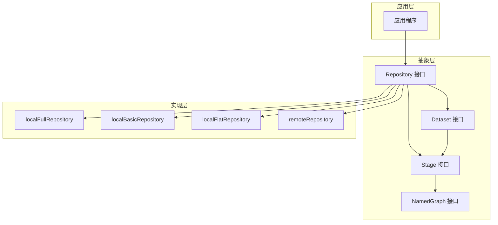
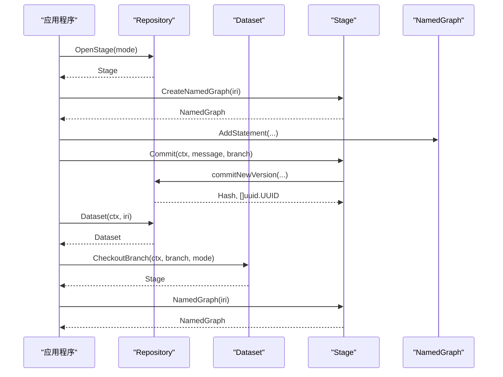
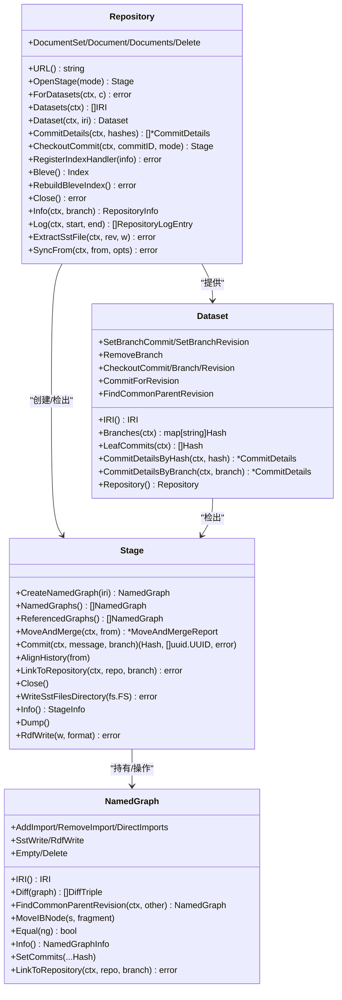
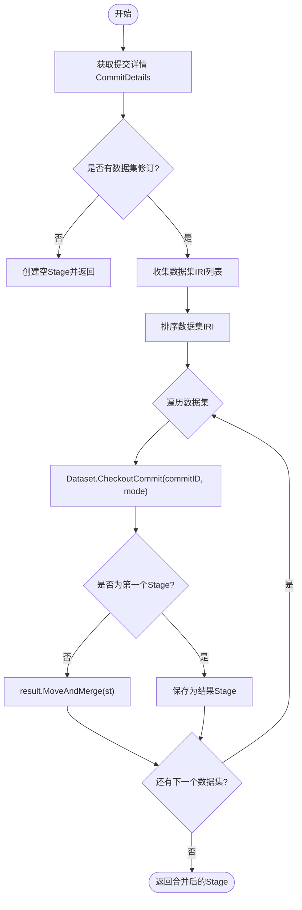
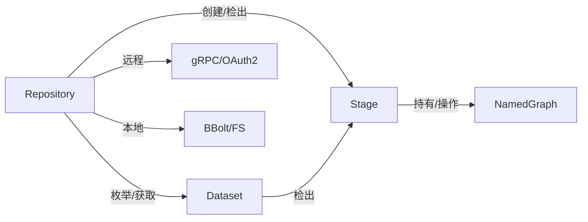

# Repository接口设计

<cite>
**本文引用的文件**
- [repository.go](file://sst/repository.go)
- [dataset.go](file://sst/dataset.go)
- [stage.go](file://sst/stage.go)
- [namedgraph.go](file://sst/namedgraph.go)
- [commit.go](file://sst/commit.go)
- [repocheckout.go](file://sst/repocheckout.go)
- [repolocalbasic_test.go](file://examples/helloworldrepolocalbasic/repolocalbasic_test.go)
- [repolocalfull.go](file://examples/helloworldrepolocalfull/repolocalfull.go)
- [reporemoteread.go](file://examples/helloworldreporemote/reporemoteread/reporemoteread.go)
</cite>

## 目录
1. [简介](#简介)
2. [项目结构](#项目结构)
3. [核心组件](#核心组件)
4. [架构总览](#架构总览)
5. [详细组件分析](#详细组件分析)
6. [依赖关系分析](#依赖关系分析)
7. [性能考虑](#性能考虑)
8. [故障排查指南](#故障排查指南)
9. [结论](#结论)
10. [附录：使用示例与最佳实践](#附录使用示例与最佳实践)

## 简介
本文件围绕SST Core中的Repository接口进行系统化文档化，重点解释其作为持久化存储抽象层的设计理念、关键方法语义、上下文参数的作用（超时控制与用户身份认证）、仓库与数据集/工作区/命名图之间的抽象关系，以及扩展点与自定义实现的可能性。同时提供错误处理与性能方面的最佳实践建议，并给出具体代码路径以便读者快速定位实现细节。

## 项目结构
SST Core将“仓库”概念抽象为Repository接口，并通过多种具体实现覆盖本地与远程场景：
- 本地仓库：支持完整历史版本（LocalFull）、基础版本（LocalBasic）、扁平文件（LocalFlat）等
- 远程仓库：通过gRPC访问服务端实现的仓库能力
- 工作区（Stage）：用于在内存中加载、修改、合并数据，再提交到仓库
- 数据集（Dataset）：一组命名图的集合及其版本历史
- 命名图（NamedGraph）：RDF三元组的逻辑容器，支持导入关系、差异比较、三向合并等

图表来源
- [repository.go:34-179](file://sst/repository.go#L34-L179)
- [dataset.go:9-94](file://sst/dataset.go#L9-L94)
- [stage.go:64-234](file://sst/stage.go#L64-L234)
- [namedgraph.go:110-409](file://sst/namedgraph.go#L110-L409)

章节来源
- [repository.go:34-179](file://sst/repository.go#L34-L179)
- [dataset.go:9-94](file://sst/dataset.go#L9-L94)
- [stage.go:64-234](file://sst/stage.go#L64-L234)
- [namedgraph.go:110-409](file://sst/namedgraph.go#L110-L409)

## 核心组件
- Repository：持久化存储的抽象层，负责打开/关闭仓库、列举数据集、获取数据集、提交元信息、检出特定提交、索引管理、日志、同步、文档管理等
- Stage：工作区，承载内存中的命名图集合，支持创建/读取/修改/合并/提交
- Dataset：数据集接口，封装命名图集合的版本历史、分支、检出等操作
- NamedGraph：命名图接口，提供节点操作、导入关系、差异比较、三向合并、序列化等

章节来源
- [repository.go:34-179](file://sst/repository.go#L34-L179)
- [dataset.go:9-94](file://sst/dataset.go#L9-L94)
- [stage.go:64-234](file://sst/stage.go#L64-L234)
- [namedgraph.go:110-409](file://sst/namedgraph.go#L110-L409)

## 架构总览
Repository作为统一入口，屏蔽底层存储差异（本地BBolt+文件系统或远程gRPC服务），向上暴露一致的API。Stage是临时的内存工作区，Dataset是逻辑上的数据集视图，NamedGraph是具体的三元组容器。三者协作完成数据的加载、修改、合并、提交与查询。

图表来源
- [repository.go:60-89](file://sst/repository.go#L60-L89)
- [dataset.go:30-94](file://sst/dataset.go#L30-L94)
- [stage.go:74-130](file://sst/stage.go#L74-L130)
- [namedgraph.go:110-235](file://sst/namedgraph.go#L110-L235)

## 详细组件分析

### Repository接口设计与关键方法
- URL()：返回仓库的具体位置URL；远程主仓库无Fragment，超级仓库成员包含Fragment标识仓库名/ID
- SuperRepository()：若该仓库属于SuperRepository则返回父对象，否则nil
- OpenStage(mode)：创建工作区Stage，可加载/修改/提交数据
- ForDatasets(ctx, c)：遍历仓库中所有数据集，回调函数返回错误时终止
- ForDocuments(ctx, c)：遍历仓库中所有文档元信息
- Datasets(ctx)：获取所有数据集IRI列表
- Dataset(ctx, iri)：获取指定IRI的数据集
- CommitDetails(ctx, hashes)：批量获取提交的元信息（作者、时间、消息、父提交、数据集/命名图修订）
- CheckoutCommit(ctx, commitID, mode)：基于某次提交生成Stage，包含对应命名图修订及检出元数据
- RegisterIndexHandler(*SSTDeriveInfo)：注册Bleve索引处理器（仅本地仓库可用）
- Bleve()：返回已注册的Bleve索引客户端（远程仓库返回服务端索引客户端）
- RebuildBleveIndex()：重建索引（不同实现支持度不同）
- Close()：关闭仓库
- Info(ctx, branchName)：返回仓库基本信息（大小、数量、是否远程、索引信息等）
- Log(ctx, start, end)：获取日志条目（支持分页/范围）
- ExtractSstFile(ctx, namedGraphRevision, w)：导出某命名图修订为SST格式流
- SyncFrom(ctx, from, options...)：从其他仓库同步提交（支持按数据集/分支过滤）
- DocumentSet/Document/Documents/DocumentDelete：文档存取与管理

上下文参数ctx的作用：
- 超时控制：所有方法均接受context，便于设置请求截止时间与取消信号（尤其远程仓库）
- 用户身份认证：远程仓库通过context中的AuthProvider提取OAuth2令牌，附加到gRPC调用中

章节来源
- [repository.go:34-179](file://sst/repository.go#L34-L179)
- [repository.go:240-309](file://sst/repository.go#L240-L309)

### 仓库与数据集、工作区、命名图的抽象关系
- 仓库（Repository）：持久化存储与版本管理的抽象，提供数据集枚举、提交元信息、检出、索引、日志、同步、文档等能力
- 数据集（Dataset）：一组命名图及其版本历史的逻辑视图，支持分支管理、提交详情查询、检出特定提交/分支/修订
- 工作区（Stage）：内存中的临时工作空间，承载多个命名图，支持创建、修改、合并、提交
- 命名图（NamedGraph）：RDF三元组的容器，支持导入关系、差异比较、三向合并、序列化等

图表来源
- [repository.go:34-179](file://sst/repository.go#L34-L179)
- [dataset.go:9-94](file://sst/dataset.go#L9-L94)
- [stage.go:64-234](file://sst/stage.go#L64-L234)
- [namedgraph.go:110-409](file://sst/namedgraph.go#L110-L409)

### CheckoutCommit流程与内部实现
CheckoutCommit用于基于某次提交生成Stage，包含对应命名图修订与检出元数据。内部实现会：
- 根据提交详情获取涉及的数据集IRI列表
- 对每个数据集执行CheckoutCommit，得到对应的Stage
- 将多个Stage通过MoveAndMerge合并为一个统一的Stage

图表来源
- [repocheckout.go:10-44](file://sst/repocheckout.go#L10-L44)
- [dataset.go:30-94](file://sst/dataset.go#L30-L94)
- [stage.go:132-152](file://sst/stage.go#L132-L152)

### 提交元信息与日志
- CommitDetails：包含提交哈希、作者、时间、消息、父提交映射、数据集修订映射、命名图修订映射
- RepositoryLogEntry：记录仓库操作日志（提交、分支设置/删除、文档上传/下载/删除、同步等）

章节来源
- [commit.go:18-63](file://sst/commit.go#L18-L63)
- [repository.go:746-800](file://sst/repository.go#L746-L800)

### 索引管理与查询
- RegisterIndexHandler：注册索引处理器（本地仓库），用于Bleve全文检索
- Bleve：返回索引客户端（远程仓库返回服务端索引客户端）
- RebuildBleveIndex：重建索引（不同实现支持度不同）

章节来源
- [repository.go:91-120](file://sst/repository.go#L91-L120)

### 同步与文档管理
- SyncFrom：从其他仓库同步提交，支持按数据集/分支过滤
- DocumentSet/Document/Documents/DocumentDelete：文档内容的增删改查

章节来源
- [repository.go:157-179](file://sst/repository.go#L157-L179)

## 依赖关系分析
- Repository与Stage：Repository负责创建和检出Stage；Stage负责内存中的图操作与提交
- Repository与Dataset：Repository提供数据集枚举与获取；Dataset提供版本历史与检出
- Stage与NamedGraph：Stage持有多个NamedGraph；NamedGraph提供图操作与导入关系
- 远程仓库依赖gRPC与OAuth2认证；本地仓库依赖BBolt与文件系统

图表来源
- [repository.go:34-179](file://sst/repository.go#L34-L179)
- [dataset.go:9-94](file://sst/dataset.go#L9-L94)
- [stage.go:64-234](file://sst/stage.go#L64-L234)
- [namedgraph.go:110-409](file://sst/namedgraph.go#L110-L409)

章节来源
- [repository.go:34-179](file://sst/repository.go#L34-L179)
- [dataset.go:9-94](file://sst/dataset.go#L9-L94)
- [stage.go:64-234](file://sst/stage.go#L64-L234)
- [namedgraph.go:110-409](file://sst/namedgraph.go#L110-L409)

## 性能考虑
- TriplexMode：选择subject/predicate/object三元组的管理策略，平衡内存与遍历性能
- 索引重建：按需重建Bleve索引，避免频繁重建影响性能
- 批量操作：使用ForDatasets/ForDocuments回调遍历，减少中间数据结构开销
- 合并优化：MoveAndMerge利用共同祖先进行三向合并，减少重复计算
- 远程调用：合理使用context超时与取消，避免长耗时阻塞

[本节为通用指导，不直接分析具体文件]

## 故障排查指南
常见错误与处理建议：
- ErrRepositoryNotFound/ErrDatasetNotFound：检查仓库路径/URL与数据集IRI是否正确
- ErrNotAvailable/ErrNotSupported：确认当前仓库类型是否支持相应功能（如索引重建）
- ErrStageDeletedOrInvalid/ErrStageNotLinkToRepository：确保Stage有效且已链接到仓库
- ErrPreCommitConditionFailed：检查预提交条件是否满足
- ErrBranchNotFound/ErrEmptyCommitMessage：确保分支存在且提交消息非空
- ErrQuotaExceeded：检查仓库配额限制

章节来源
- [stage.go:21-31](file://sst/stage.go#L21-L31)
- [repository.go:197-215](file://sst/repository.go#L197-L215)

## 结论
Repository接口为SST Core提供了统一的持久化存储抽象，屏蔽了本地与远程实现的差异，通过Stage、Dataset、NamedGraph三层抽象实现了灵活的数据操作与版本管理。结合上下文参数支持超时与认证，配合索引与日志能力，适用于构建高性能、可扩展的语义数据存储系统。

[本节为总结性内容，不直接分析具体文件]

## 附录：使用示例与最佳实践

### 基本用法示例（本地仓库）
- 创建仓库、添加数据、提交、重新打开并检出数据集、验证节点数量
- 参考路径：[repolocalbasic_test.go:37-74](file://examples/helloworldrepolocalbasic/repolocalbasic_test.go#L37-L74)、[repolocalbasic_test.go:76-106](file://examples/helloworldrepolocalbasic/repolocalbasic_test.go#L76-L106)

### 完整历史版本示例（本地仓库）
- 创建LocalFull仓库、添加数据、提交、写入TTL、重新打开并检出验证
- 参考路径：[repolocalfull.go:41-69](file://examples/helloworldrepolocalfull/repolocalfull.go#L41-L69)、[repolocalfull.go:72-93](file://examples/helloworldrepolocalfull/repolocalfull.go#L72-L93)

### 远程仓库读取示例
- 连接远程gRPC仓库、检出数据集、执行Bleve搜索
- 参考路径：[reporemoteread.go:27-71](file://examples/helloworldreporemote/reporemoteread/reporemoteread.go#L27-L71)

### 上下文参数最佳实践
- 设置超时：使用context.WithTimeout控制远程调用时长
- 携带认证：通过context注入AuthProvider，自动附加OAuth2令牌
- 取消操作：使用context.WithCancel在需要时中断长时间操作

章节来源
- [repository.go:240-309](file://sst/repository.go#L240-L309)
- [repolocalbasic_test.go:37-106](file://examples/helloworldrepolocalbasic/repolocalbasic_test.go#L37-L106)
- [repolocalfull.go:41-93](file://examples/helloworldrepolocalfull/repolocalfull.go#L41-L93)
- [reporemoteread.go:27-71](file://examples/helloworldreporemote/reporemoteread/reporemoteread.go#L27-L71)