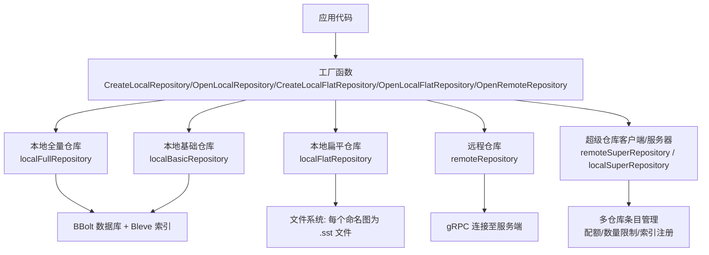
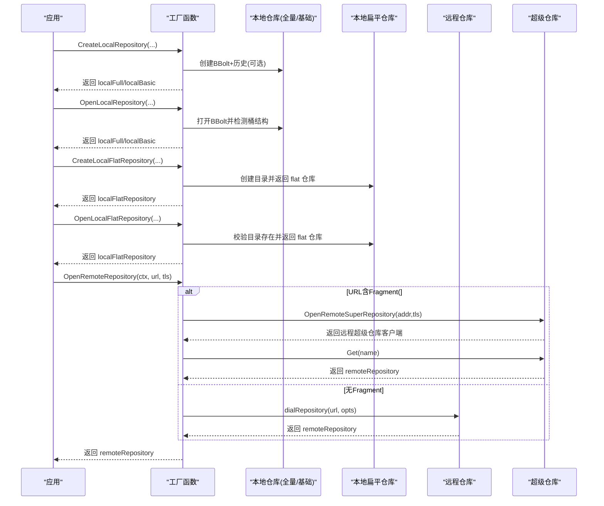
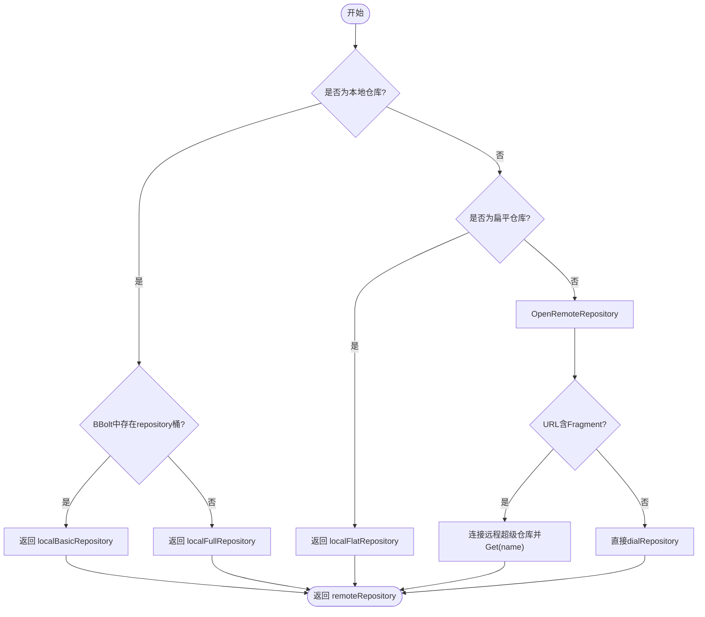
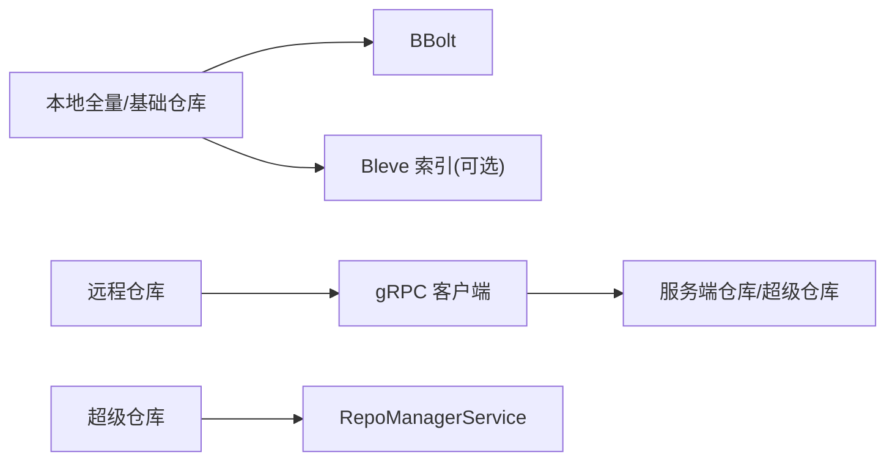

# 仓库工厂模式

<cite>
**本文引用的文件**
- [repository.go](file://sst/repository.go)
- [repolocalbasic.go](file://sst/repolocalbasic.go)
- [repolocalfull.go](file://sst/repolocalfull.go)
- [repolocalflat.go](file://sst/repolocalflat.go)
- [superlocalrepository.go](file://sst/superlocalrepository.go)
- [superremoterepository.go](file://sst/superremoterepository.go)
- [reporemote.go](file://sst/reporemote.go)
- [examples/helloworldrepolocalfull/repolocalfull.go](file://examples/helloworldrepolocalfull/repolocalfull.go)
- [examples/helloworldrepolocalflat/helloworldrepolocalflat.go](file://examples/helloworldrepolocalflat/helloworldrepolocalflat.go)
</cite>

## 目录
1. [简介](#简介)
2. [项目结构](#项目结构)
3. [核心组件](#核心组件)
4. [架构总览](#架构总览)
5. [详细组件分析](#详细组件分析)
6. [依赖关系分析](#依赖关系分析)
7. [性能考量](#性能考量)
8. [故障排查指南](#故障排查指南)
9. [结论](#结论)
10. [附录](#附录)

## 简介
本文件围绕 SST Core 的“仓库工厂模式”进行系统化说明，聚焦以下目标：
- 解释不同仓库类型的创建与打开方式：CreateLocalRepository、OpenLocalRepository、CreateLocalFlatRepository、OpenLocalFlatRepository、OpenRemoteRepository。
- 阐述仓库类型检测与自动选择机制（本地 BBolt 仓库 vs 扁平文件仓库）。
- 说明超级仓库（SuperRepository）的创建与管理（本地与远程），以及 URL Fragment 语义。
- 提供基于需求的仓库选型决策树与初始化示例路径。
- 总结通用与特定配置项、错误处理最佳实践、生命周期管理与资源清理。
- 给出性能对比分析与优化建议。

## 项目结构
SST Core 将仓库抽象为统一的 Repository 接口，并通过多种实现满足不同场景：
- 本地全量仓库（支持版本历史、分支、索引重建等）
- 本地基础仓库（无版本历史，轻量）
- 本地扁平仓库（按命名图存储为独立 SST 文件，无事务、无历史）
- 远程仓库（通过 gRPC 访问服务端仓库或超级仓库中的子仓库）
- 超级仓库（管理多个仓库条目，支持配额、数量限制、统一索引注册等）



图表来源
- [repository.go:240-309](file://sst/repository.go#L240-L309)
- [repository.go:340-423](file://sst/repository.go#L340-L423)
- [repository.go:491-562](file://sst/repository.go#L491-L562)
- [repository.go:579-628](file://sst/repository.go#L579-L628)
- [repository.go:650-694](file://sst/repository.go#L650-L694)
- [superlocalrepository.go:112-163](file://sst/superlocalrepository.go#L112-L163)
- [superremoterepository.go:26-47](file://sst/superremoterepository.go#L26-L47)

章节来源
- [repository.go:240-309](file://sst/repository.go#L240-L309)
- [repository.go:340-423](file://sst/repository.go#L340-L423)
- [repository.go:491-562](file://sst/repository.go#L491-L562)
- [repository.go:579-628](file://sst/repository.go#L579-L628)
- [repository.go:650-694](file://sst/repository.go#L650-L694)
- [superlocalrepository.go:112-163](file://sst/superlocalrepository.go#L112-L163)
- [superremoterepository.go:26-47](file://sst/superremoterepository.go#L26-L47)

## 核心组件
- Repository 接口：定义统一的仓库操作（数据集、文档、日志、索引、同步、检出等）。
- 本地全量仓库（localFullRepository）：基于 BBolt 持久化，支持提交历史、分支、Bleve 索引重建。
- 本地基础仓库（localBasicRepository）：基于 BBolt，无版本历史，适合简单读写。
- 本地扁平仓库（localFlatRepository）：以文件系统组织 SST 文件，无事务、无历史。
- 远程仓库（remoteRepository）：通过 gRPC 访问服务端仓库，支持认证上下文。
- 超级仓库（SuperRepository）：管理多个仓库条目，支持配额、最大数量限制、统一索引注册；URL 使用 Fragment 标识具体仓库条目。

章节来源
- [repository.go:50-179](file://sst/repository.go#L50-L179)
- [repolocalfull.go:220-230](file://sst/repolocalfull.go#L220-L230)
- [repolocalbasic.go:34-42](file://sst/repolocalbasic.go#L34-L42)
- [repolocalflat.go:28-32](file://sst/repolocalflat.go#L28-L32)
- [superlocalrepository.go:28-88](file://sst/superlocalrepository.go#L28-L88)
- [superremoterepository.go:20-47](file://sst/superremoterepository.go#L20-L47)

## 架构总览
下图展示了工厂函数如何根据参数和运行时环境选择并返回合适的仓库实现：



图表来源
- [repository.go:240-309](file://sst/repository.go#L240-L309)
- [repository.go:340-423](file://sst/repository.go#L340-L423)
- [repository.go:491-562](file://sst/repository.go#L491-L562)
- [repository.go:579-628](file://sst/repository.go#L579-L628)
- [repository.go:650-694](file://sst/repository.go#L650-L694)
- [superremoterepository.go:26-47](file://sst/superremoterepository.go#L26-L47)

## 详细组件分析

### 工厂函数详解
- CreateLocalRepository(repoDir, email, name, revisionHistory)
  - 作用：在指定目录创建新的本地仓库。若 revisionHistory=true，则创建支持版本历史的 full 仓库；否则创建基础仓库。
  - 关键步骤：检查目录是否存在、创建目录、打开 BBolt、写入初始日志、设置状态。
  - 返回：localFullRepository 或 localBasicRepository。
  - 参考路径：[repository.go:340-423](file://sst/repository.go#L340-L423)

- OpenLocalRepository(repoDir, email, name)
  - 作用：打开已存在的本地仓库。通过读取 BBolt 中是否存在 repository 桶来区分基础仓库与全量仓库。
  - 关键步骤：校验目录、打开 BBolt、检测桶结构、构造对应仓库实例。
  - 返回：localBasicRepository 或 localFullRepository。
  - 参考路径：[repository.go:491-562](file://sst/repository.go#L491-L562)

- CreateLocalFlatRepository(repoDir)
  - 作用：创建扁平仓库目录并返回 localFlatRepository。
  - 关键步骤：检查目录是否已存在、创建目录、规范化路径、设置访问权限。
  - 返回：localFlatRepository。
  - 参考路径：[repository.go:579-628](file://sst/repository.go#L579-L628)

- OpenLocalFlatRepository(repoDir)
  - 作用：打开已有扁平仓库目录并返回 localFlatRepository。
  - 关键步骤：校验目录存在性、规范化路径、设置访问权限。
  - 返回：localFlatRepository。
  - 参考路径：[repository.go:650-694](file://sst/repository.go#L650-L694)

- OpenRemoteRepository(ctx, URL, tlsOption)
  - 作用：打开远程仓库。若 URL 包含 Fragment（如 grpc://host#repoName），则视为超级仓库中的子仓库，先连接超级仓库再获取具体仓库；否则直接连接单仓库服务。
  - 关键步骤：构建 gRPC 选项、解析 URL、选择超级仓库或直接连接、附加 OAuth 凭据、验证连接有效性。
  - 返回：remoteRepository。
  - 参考路径：[repository.go:240-309](file://sst/repository.go#L240-L309)

章节来源
- [repository.go:240-309](file://sst/repository.go#L240-L309)
- [repository.go:340-423](file://sst/repository.go#L340-L423)
- [repository.go:491-562](file://sst/repository.go#L491-L562)
- [repository.go:579-628](file://sst/repository.go#L579-L628)
- [repository.go:650-694](file://sst/repository.go#L650-L694)

### 仓库类型检测与自动选择
- 本地仓库类型检测：OpenLocalRepository 通过检查 BBolt 中是否存在 repository 桶来判断是基础仓库还是全量仓库。
- 扁平仓库：OpenLocalFlatRepository 仅校验目录存在性与可写性，不依赖 BBolt。
- 远程仓库：OpenRemoteRepository 依据 URL 是否包含 Fragment 决定走超级仓库流程或直接连接单仓库。



图表来源
- [repository.go:491-562](file://sst/repository.go#L491-L562)
- [repository.go:650-694](file://sst/repository.go#L650-L694)
- [repository.go:240-309](file://sst/repository.go#L240-L309)

### 超级仓库的创建与管理
- 本地超级仓库：NewLocalSuperRepository(rootDir) 会扫描根目录、加载配额配置、确保默认仓库存在。
- 远程超级仓库：OpenRemoteSuperRepository(ctx, URL, tlsOption) 建立 gRPC 连接并暴露 RepoManagerService。
- 超级仓库能力：
  - 管理多个仓库条目（Get/Create/Delete/List）
  - 配额管理（单个仓库配额、总配额、最大仓库数量）
  - 统一索引注册（RegisterIndexHandler）
  - URL 约定：超级仓库 URL 作为 base，子仓库通过 Fragment 标识（例如 grpc://host#repoName）

```mermaid
classDiagram
class SuperRepository {
+URL() string
+Get(ctx,name) Repository
+Create(ctx,name) Repository
+Delete(ctx,name) error
+List(ctx) []string
+RegisterIndexHandler(*SSTDeriveInfo) error
+GetQuota(ctx,name) RepositoryQuota
+SetQuota(ctx,name,maxSizeBytes) error
+GetTotalQuota(ctx) RepositoryQuota
+SetTotalQuota(ctx,maxSizeBytes) error
+GetMaxRepositoryCount(ctx) int
+SetMaxRepositoryCount(ctx,count) error
+Close() error
}
class localSuperRepository {
-rootDir string
-repos map[string]Repository
-known map[string]struct{}
-quotas quotasConfig
-quotaPath string
}
class remoteSuperRepository {
-url *url.URL
-cc *grpc.ClientConn
-mgrClient bboltproto.RepoManagerServiceClient
}
SuperRepository <|.. localSuperRepository
SuperRepository <|.. remoteSuperRepository
```

图表来源
- [superlocalrepository.go:28-88](file://sst/superlocalrepository.go#L28-L88)
- [superlocalrepository.go:112-163](file://sst/superlocalrepository.go#L112-L163)
- [superlocalrepository.go:233-281](file://sst/superlocalrepository.go#L233-L281)
- [superlocalrepository.go:283-331](file://sst/superlocalrepository.go#L283-L331)
- [superremoterepository.go:26-47](file://sst/superremoterepository.go#L26-L47)
- [superremoterepository.go:102-124](file://sst/superremoterepository.go#L102-L124)

章节来源
- [superlocalrepository.go:112-163](file://sst/superlocalrepository.go#L112-L163)
- [superlocalrepository.go:233-281](file://sst/superlocalrepository.go#L233-L281)
- [superlocalrepository.go:283-331](file://sst/superlocalrepository.go#L283-L331)
- [superremoterepository.go:26-47](file://sst/superremoterepository.go#L26-L47)
- [superremoterepository.go:102-124](file://sst/superremoterepository.go#L102-L124)

### 配置项与选项
- 通用选项
  - Context：用于超时、取消、认证信息（OAuth2 Token）。
  - TLS 选项：OpenRemoteRepository 需要传入 grpc.DialOption 以配置 TLS。
  - 索引映射：SSTDeriveInfo，用于本地仓库的 Bleve 索引注册与重建。
- 特定选项
  - CreateLocalRepository(revisionHistory)：决定是否启用版本历史。
  - 扁平仓库：无需额外选项，仅依赖目录结构与文件系统权限。
  - 超级仓库：配额（单个仓库配额、总配额）、最大仓库数量限制。

章节来源
- [repository.go:181-238](file://sst/repository.go#L181-L238)
- [repository.go:240-309](file://sst/repository.go#L240-L309)
- [repository.go:340-423](file://sst/repository.go#L340-L423)
- [superlocalrepository.go:101-110](file://sst/superlocalrepository.go#L101-L110)
- [superlocalrepository.go:389-443](file://sst/superlocalrepository.go#L389-L443)

### 错误处理与异常最佳实践
- 常见错误
  - ErrRepositoryAlreadyExists：创建仓库时目录已存在。
  - ErrRepositoryDoesNotExist：打开仓库时目录不存在。
  - ErrNotSupported/ErrNotAvailable：某些功能在特定仓库类型不可用（如远程仓库不支持本地重建索引）。
  - ErrQuotaExceeded：超级仓库配额超限。
- 最佳实践
  - 打开失败时优先判断错误类型，必要时回退到创建逻辑（例如先尝试 Open，若不存在则 Create）。
  - 对远程仓库，确保 Context 中包含有效的 AuthProvider，以便附加 OAuth 凭据。
  - 对本地仓库，确保目录权限正确，避免权限错误导致无法打开 BBolt。
  - 对超级仓库，合理设置配额与最大仓库数量，避免资源耗尽。

章节来源
- [repository.go:197-215](file://sst/repository.go#L197-L215)
- [repository.go:340-423](file://sst/repository.go#L340-L423)
- [repository.go:491-562](file://sst/repository.go#L491-L562)
- [superlocalrepository.go:283-331](file://sst/superlocalrepository.go#L283-L331)
- [superremoterepository.go:74-90](file://sst/superremoterepository.go#L74-L90)

### 生命周期管理与资源清理
- 所有仓库实现均提供 Close() 方法，用于释放底层资源（BBolt 连接、gRPC 连接、索引句柄等）。
- 超级仓库关闭时会遍历并关闭所有已打开的子仓库。
- 建议在应用退出或不再使用时立即调用 Close()，避免资源泄漏。

章节来源
- [repository.go:122-123](file://sst/repository.go#L122-L123)
- [superlocalrepository.go:459-474](file://sst/superlocalrepository.go#L459-L474)
- [superremoterepository.go:198-204](file://sst/superremoterepository.go#L198-L204)

### 代码示例与选型决策
- 示例路径
  - 本地全量仓库示例：[examples/helloworldrepolocalfull/repolocalfull.go:41-69](file://examples/helloworldrepolocalfull/repolocalfull.go#L41-L69)
  - 本地扁平仓库示例：[examples/helloworldrepolocalflat/helloworldrepolocalflat.go:45-66](file://examples/helloworldrepolocalflat/helloworldrepolocalflat.go#L45-L66)
- 选型决策树
  - 是否需要版本历史？
    - 是：使用 CreateLocalRepository(..., true) 或 OpenLocalRepository(...)
    - 否：考虑基础仓库或扁平仓库
  - 是否需要高性能批量写入且无事务？
    - 是：使用 CreateLocalFlatRepository/OpenLocalFlatRepository
  - 是否需要跨进程/网络访问？
    - 是：使用 OpenRemoteRepository，必要时结合超级仓库 URL Fragment
  - 是否需要统一管理多个仓库与配额？
    - 是：使用超级仓库（本地或远程）

章节来源
- [examples/helloworldrepolocalfull/repolocalfull.go:41-69](file://examples/helloworldrepolocalfull/repolocalfull.go#L41-L69)
- [examples/helloworldrepolocalflat/helloworldrepolocalflat.go:45-66](file://examples/helloworldrepolocalflat/helloworldrepolocalflat.go#L45-L66)
- [repository.go:240-309](file://sst/repository.go#L240-L309)
- [repository.go:340-423](file://sst/repository.go#L340-L423)
- [repository.go:491-562](file://sst/repository.go#L491-L562)
- [repository.go:579-628](file://sst/repository.go#L579-L628)
- [repository.go:650-694](file://sst/repository.go#L650-L694)

## 依赖关系分析
- 本地仓库依赖 BBolt 与 Bleve（可选）：
  - BBolt 用于持久化数据与元数据。
  - Bleve 用于全文检索与索引重建。
- 远程仓库依赖 gRPC：
  - 通过 gRPC 与服务端通信，支持 OAuth 认证。
- 超级仓库依赖 RepoManagerService：
  - 提供仓库条目管理、配额控制、数量限制等功能。



图表来源
- [repolocalbasic.go:67-145](file://sst/repolocalbasic.go#L67-L145)
- [repolocalfull.go:41-52](file://sst/repolocalfull.go#L41-L52)
- [reporemote.go:265-285](file://sst/reporemote.go#L265-L285)
- [superlocalrepository.go:476-593](file://sst/superlocalrepository.go#L476-L593)

章节来源
- [repolocalbasic.go:67-145](file://sst/repolocalbasic.go#L67-L145)
- [repolocalfull.go:41-52](file://sst/repolocalfull.go#L41-L52)
- [reporemote.go:265-285](file://sst/reporemote.go#L265-L285)
- [superlocalrepository.go:476-593](file://sst/superlocalrepository.go#L476-L593)

## 性能考量
- 本地全量仓库
  - 优势：支持版本历史、分支、索引重建；适合复杂查询与回溯。
  - 成本：BBolt 写入与 Bleve 索引更新带来一定开销。
- 本地基础仓库
  - 优势：无版本历史，写入更轻量。
  - 成本：不支持历史回溯与部分高级功能。
- 本地扁平仓库
  - 优势：按命名图独立文件存储，无事务、无历史，适合高并发写入与简单场景。
  - 成本：无索引、无事务，不适合复杂查询与一致性要求高的场景。
- 远程仓库
  - 优势：跨进程/网络访问，适合分布式部署。
  - 成本：网络延迟与认证开销；需合理设置超时与重试。
- 超级仓库
  - 优势：集中管理多个仓库，配额与数量限制保障系统稳定性。
  - 成本：管理开销增加；需监控配额使用情况。

[本节为一般性指导，不直接分析具体文件]

## 故障排查指南
- 常见问题
  - 目录已存在：CreateLocalRepository 返回 errRepositoryAlreadyExists。
  - 目录不存在：OpenLocalRepository/OpenLocalFlatRepository 返回 ErrRepositoryDoesNotExist。
  - 权限问题：无法打开 BBolt 或写入目录。
  - 远程连接失败：TLS 配置错误或认证失败。
  - 配额超限：超级仓库创建仓库时报 ErrQuotaExceeded。
- 排查步骤
  - 检查目录是否存在与权限是否正确。
  - 确认 Context 中是否包含有效 AuthProvider。
  - 对于远程仓库，验证 TLS 选项与服务端证书配置。
  - 对于超级仓库，检查配额与最大仓库数量设置。

章节来源
- [repository.go:197-215](file://sst/repository.go#L197-L215)
- [repository.go:340-423](file://sst/repository.go#L340-L423)
- [repository.go:491-562](file://sst/repository.go#L491-L562)
- [superlocalrepository.go:283-331](file://sst/superlocalrepository.go#L283-L331)
- [superremoterepository.go:74-90](file://sst/superremoterepository.go#L74-L90)

## 结论
SST Core 的仓库工厂模式通过统一的接口与多种实现，灵活适配不同业务需求：
- 本地全量仓库适合需要版本历史与复杂查询的场景。
- 本地基础仓库适合轻量级读写。
- 本地扁平仓库适合高并发写入与简单场景。
- 远程仓库与超级仓库支持分布式与集中化管理。
通过合理的选型、配置与错误处理，可以在保证性能的同时满足多样化的数据存储与管理需求。

[本节为总结性内容，不直接分析具体文件]

## 附录
- 更多示例与测试用例可参考 sst_test 目录下的相关测试文件，覆盖仓库创建、打开、提交、检出、同步等场景。
- 如需进一步定制索引或行为，可通过 RegisterIndexHandler 与 repoConfig 中的回调进行扩展。

[本节为补充信息，不直接分析具体文件]