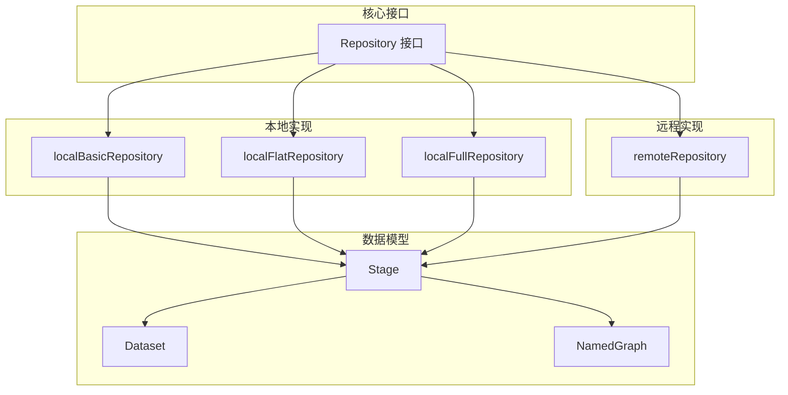
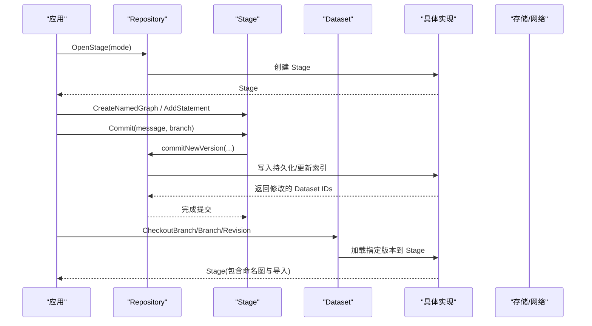
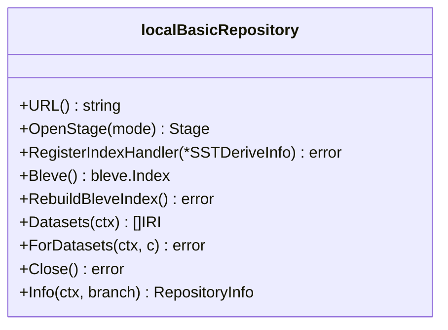
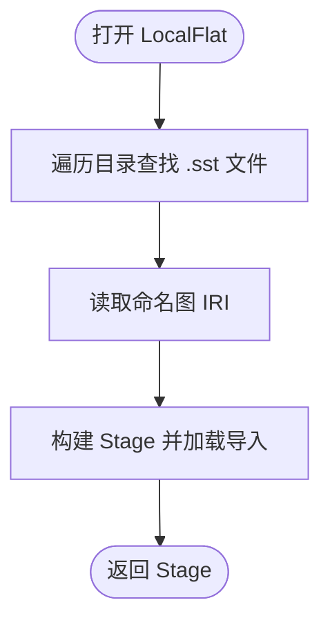
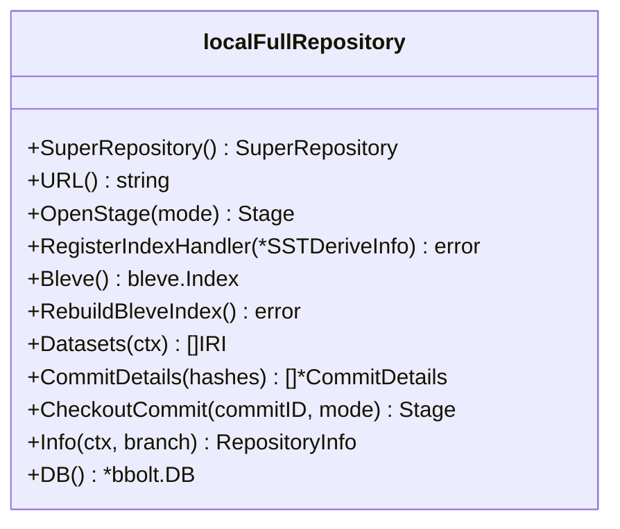
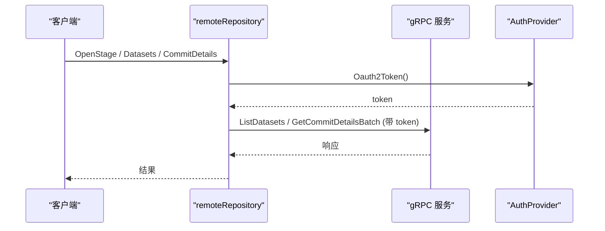
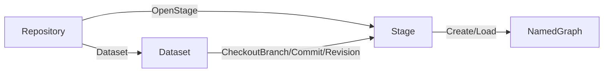
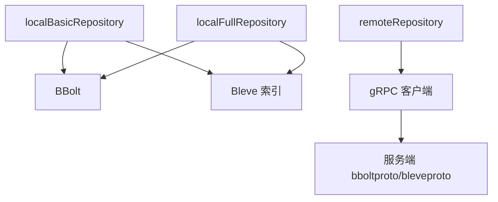

# 仓库抽象

<cite>
**本文引用的文件**
- [repository.go](file://sst/repository.go)
- [repolocalbasic.go](file://sst/repolocalbasic.go)
- [repolocalflat.go](file://sst/repolocalflat.go)
- [repolocalfull.go](file://sst/repolocalfull.go)
- [reporemote.go](file://sst/reporemote.go)
- [stage.go](file://sst/stage.go)
- [dataset.go](file://sst/dataset.go)
- [namedgraph.go](file://sst/namedgraph.go)
- [repolocalbasic_test.go](file://examples/helloworldrepolocalbasic/repolocalbasic_test.go)
- [repolocalfull.go](file://examples/helloworldrepolocalfull/repolocalfull.go)
- [main.go](file://examples/helloworldreporemote/main.go)
</cite>

## 目录
1. [简介](#简介)
2. [项目结构](#项目结构)
3. [核心组件](#核心组件)
4. [架构总览](#架构总览)
5. [详细组件分析](#详细组件分析)
6. [依赖关系分析](#依赖关系分析)
7. [性能考量](#性能考量)
8. [故障排查指南](#故障排查指南)
9. [结论](#结论)
10. [附录：使用示例与最佳实践](#附录使用示例与最佳实践)

## 简介
本文件围绕 SST Core 的“仓库抽象”展开，系统性阐述 Repository 接口的设计理念、抽象层次以及不同实现（本地基础存储、本地扁平存储、本地完整存储、远程仓库）的特性对比。文档还覆盖仓库的创建、配置与初始化流程；解释仓库与数据集（Dataset）、工作区（Stage）、命名图（NamedGraph）之间的关系；提供具体代码路径示例展示如何使用不同仓库实现进行数据操作；说明认证授权机制与安全考虑；给出仓库选择的指导原则与性能调优建议；并介绍扩展点与自定义实现方法。

## 项目结构
SST Core 在 sst 包中定义了统一的 Repository 接口及其多种实现，并通过 Stage/Dataset/NamedGraph 等核心概念组织 RDF 数据的版本化与查询能力。相关关键文件如下：
- 接口与工厂：repository.go
- 本地基础实现：repolocalbasic.go
- 本地扁平实现：repolocalflat.go
- 本地完整实现（含历史、分支、索引重建）：repolocalfull.go
- 远程实现（gRPC + Bleve 远程索引）：reporemote.go
- 工作区与图模型：stage.go, dataset.go, namedgraph.go
- 示例：examples 下的多个仓库用法样例

图表来源
- [repository.go:50-179](file://sst/repository.go#L50-L179)
- [repolocalbasic.go:34-42](file://sst/repolocalbasic.go#L34-L42)
- [repolocalflat.go:28-32](file://sst/repolocalflat.go#L28-L32)
- [repolocalfull.go:220-230](file://sst/repolocalfull.go#L220-L230)
- [reporemote.go:88-99](file://sst/reporemote.go#L88-L99)
- [stage.go:53-74](file://sst/stage.go#L53-L74)
- [dataset.go:9-29](file://sst/dataset.go#L9-L29)
- [namedgraph.go:110-117](file://sst/namedgraph.go#L110-L117)

章节来源
- [repository.go:50-179](file://sst/repository.go#L50-L179)
- [stage.go:53-74](file://sst/stage.go#L53-L74)
- [dataset.go:9-29](file://sst/dataset.go#L9-L29)
- [namedgraph.go:110-117](file://sst/namedgraph.go#L110-L117)

## 核心组件
- Repository 接口：定义统一的数据集管理、提交历史、索引、同步、文档存取等能力。所有方法支持 context，用于超时、取消、用户标识与认证传递。
- Stage 工作区：内存中的图集合，可链接到仓库进行读写、合并、提交。
- Dataset 数据集：一组默认命名图及导入的命名图的版本化视图，支持分支、提交、检出等操作。
- NamedGraph 命名图：RDF 命名图的内存表示，支持节点、三元组、导入关系、序列化等。

章节来源
- [repository.go:50-179](file://sst/repository.go#L50-L179)
- [stage.go:53-74](file://sst/stage.go#L53-L74)
- [dataset.go:9-29](file://sst/dataset.go#L9-L29)
- [namedgraph.go:110-117](file://sst/namedgraph.go#L110-L117)

## 架构总览
仓库抽象通过接口隔离了底层存储与网络细节，上层应用以统一 API 操作数据。四种主要实现分别面向不同场景：
- 本地基础（LocalBasic）：BBolt + Bleve，无数据集修订历史，适合轻量级本地存储与全文检索。
- 本地扁平（LocalFlat）：纯文件系统 .sst 文件，无事务、无历史、无索引，适合简单持久化与跨进程共享。
- 本地完整（LocalFull）：BBolt + Bleve，支持数据集修订历史、分支、提交、检出、索引重建等高级特性。
- 远程（Remote）：gRPC 客户端，将数据与索引操作委托给服务端，支持 OAuth2 认证与 TLS。

图表来源
- [repository.go:60-89](file://sst/repository.go#L60-L89)
- [repolocalfull.go:721-732](file://sst/repolocalfull.go#L721-L732)
- [reporemote.go:639-653](file://sst/reporemote.go#L639-L653)
- [stage.go:121-130](file://sst/stage.go#L121-L130)

## 详细组件分析

### Repository 接口与抽象层次
- URL/SuperRepository：标识仓库位置与所属超级仓库。
- OpenStage：创建工作区，支持 TriplexMode 控制内部三元组结构。
- ForDatasets/Datasets/Dataset：枚举或获取数据集。
- CommitDetails/CheckoutCommit：提交元数据与按提交检出。
- RegisterIndexHandler/Bleve/RebuildBleveIndex：索引注册、访问与重建（仅本地）。
- Info/Log/ExtractSstFile/SyncFrom：仓库信息、日志、导出、同步。
- DocumentSet/Document/Documents/Delete：文档存取（部分实现不支持）。

章节来源
- [repository.go:50-179](file://sst/repository.go#L50-L179)

### 本地基础存储（LocalBasic）
- 存储：BBolt 数据库 + Bleve 全文索引。
- 特性：支持数据集列表、命名图读取、索引注册与重建；不支持数据集修订历史、分支、提交详情、日志、文档存取、同步。
- 适用场景：需要本地快速读写与全文检索，但不需要版本历史的场景。

图表来源
- [repolocalbasic.go:34-42](file://sst/repolocalbasic.go#L34-L42)
- [repolocalbasic.go:67-145](file://sst/repolocalbasic.go#L67-L145)
- [repolocalbasic.go:224-253](file://sst/repolocalbasic.go#L224-L253)
- [repolocalbasic.go:660-723](file://sst/repolocalbasic.go#L660-L723)

章节来源
- [repolocalbasic.go:34-42](file://sst/repolocalbasic.go#L34-L42)
- [repolocalbasic.go:67-145](file://sst/repolocalbasic.go#L67-L145)
- [repolocalbasic.go:224-253](file://sst/repolocalbasic.go#L224-L253)
- [repolocalbasic.go:660-723](file://sst/repolocalbasic.go#L660-L723)

### 本地扁平存储（LocalFlat）
- 存储：文件系统目录，每个命名图一个 .sst 二进制文件。
- 特性：无事务、无历史、无索引、无文档存取、无同步；支持列出数据集、按 IRI 定位文件、检出为 Stage。
- 适用场景：简单持久化、跨进程共享、无需版本控制的场景。

图表来源
- [repolocalflat.go:63-86](file://sst/repolocalflat.go#L63-L86)
- [repolocalflat.go:211-235](file://sst/repolocalflat.go#L211-L235)

章节来源
- [repolocalflat.go:28-32](file://sst/repolocalflat.go#L28-L32)
- [repolocalflat.go:63-86](file://sst/repolocalflat.go#L63-L86)
- [repolocalflat.go:211-235](file://sst/repolocalflat.go#L211-L235)
- [repolocalflat.go:381-430](file://sst/repolocalflat.go#L381-L430)

### 本地完整存储（LocalFull）
- 存储：BBolt 数据库 + Bleve 全文索引。
- 特性：支持数据集修订历史、分支、提交详情、检出、索引重建、版本哈希计算、配额状态（在超级仓库中）。
- 适用场景：需要完整版本控制、分支管理与全文检索的场景。

图表来源
- [repolocalfull.go:220-230](file://sst/repolocalfull.go#L220-L230)
- [repolocalfull.go:259-341](file://sst/repolocalfull.go#L259-L341)
- [repolocalfull.go:595-732](file://sst/repolocalfull.go#L595-L732)

章节来源
- [repolocalfull.go:220-230](file://sst/repolocalfull.go#L220-L230)
- [repolocalfull.go:259-341](file://sst/repolocalfull.go#L259-L341)
- [repolocalfull.go:595-732](file://sst/repolocalfull.go#L595-L732)

### 远程仓库（Remote）
- 通信：gRPC 客户端，封装数据集、提交、引用、索引服务。
- 特性：通过上下文注入 OAuth2 Token 进行认证；支持分页列举数据集、批量获取提交详情、远程搜索；不支持本地索引重建。
- 适用场景：多客户端共享服务端仓库、集中式权限与索引管理。

图表来源
- [reporemote.go:146-207](file://sst/reporemote.go#L146-L207)
- [reporemote.go:296-347](file://sst/reporemote.go#L296-L347)
- [reporemote.go:546-637](file://sst/reporemote.go#L546-L637)

章节来源
- [reporemote.go:88-99](file://sst/reporemote.go#L88-L99)
- [reporemote.go:146-207](file://sst/reporemote.go#L146-L207)
- [reporemote.go:296-347](file://sst/reporemote.go#L296-L347)
- [reporemote.go:546-637](file://sst/reporemote.go#L546-L637)

### 仓库与 Stage/Dataset/NamedGraph 的关系
- Stage：工作区，承载当前操作的命名图集合，可链接到仓库进行提交。
- Dataset：对某个数据集的版本化视图，支持按分支/提交/修订检出到 Stage。
- NamedGraph：RDF 命名图的内存表示，支持导入关系、序列化、节点操作。

图表来源
- [stage.go:53-74](file://sst/stage.go#L53-L74)
- [dataset.go:9-29](file://sst/dataset.go#L9-L29)
- [namedgraph.go:110-117](file://sst/namedgraph.go#L110-L117)

章节来源
- [stage.go:53-74](file://sst/stage.go#L53-L74)
- [dataset.go:9-29](file://sst/dataset.go#L9-L29)
- [namedgraph.go:110-117](file://sst/namedgraph.go#L110-L117)

## 依赖关系分析
- 本地基础/完整实现依赖 BBolt 作为主存储，Bleve 作为全文索引；通过 repoConfig 注入 pre/post 提交钩子与索引更新器。
- 远程实现依赖 gRPC 客户端与服务端协议（bboltproto、bleveproto），通过上下文携带认证令牌。
- Stage/Dataset/NamedGraph 构成内存模型，与仓库实现解耦，使同一套 API 可适配不同后端。

图表来源
- [repolocalbasic.go:34-42](file://sst/repolocalbasic.go#L34-L42)
- [repolocalfull.go:220-230](file://sst/repolocalfull.go#L220-L230)
- [reporemote.go:88-99](file://sst/reporemote.go#L88-L99)

章节来源
- [repolocalbasic.go:34-42](file://sst/repolocalbasic.go#L34-L42)
- [repolocalfull.go:220-230](file://sst/repolocalfull.go#L220-L230)
- [reporemote.go:88-99](file://sst/reporemote.go#L88-L99)

## 性能考量
- 本地基础/完整：
  - 使用 BBolt 提供高吞吐写与事务一致性。
  - Bleve 索引异步更新，避免阻塞提交；可通过 RebuildBleveIndex 全量重建。
  - 合理设置 TriplexMode 平衡内存与遍历性能（默认模式包含主体/谓词/对象三元组）。
- 本地扁平：
  - 无索引与事务，适合小数据集或离线共享；大目录扫描可能较慢。
- 远程：
  - 网络延迟与带宽影响性能；建议使用分页与批处理（如批量获取提交详情）。
  - 启用 TLS 与 OAuth2 认证会增加握手开销，但提升安全性。

[本节为通用性能讨论，不直接分析具体文件]

## 故障排查指南
- 常见错误：
  - ErrNotSupported/ErrNotAvailable：某些功能在未实现的仓库类型上调用（如 Basic/Flat 不支持提交历史、文档存取、同步）。
  - ErrRepositoryDoesNotExist/ErrRepositoryAlreadyExists：路径检查失败。
  - ErrDatasetNotFound/ErrCommitNotFound：资源不存在。
  - ErrPreCommitConditionFailed：索引预提交条件失败（如唯一性约束）。
- 排查步骤：
  - 确认仓库类型是否支持所需功能。
  - 检查上下文是否包含有效的 AuthProvider（远程仓库）。
  - 查看仓库 Info 与 Log，确认状态与变更历史。
  - 对于索引问题，尝试 RebuildBleveIndex 并验证 deriveInfo 匹配。

章节来源
- [repository.go:197-215](file://sst/repository.go#L197-L215)
- [repolocalbasic.go:769-798](file://sst/repolocalbasic.go#L769-L798)
- [repolocalflat.go:480-505](file://sst/repolocalflat.go#L480-L505)
- [reporemote.go:655-670](file://sst/reporemote.go#L655-L670)

## 结论
SST Core 通过 Repository 接口实现了存储与网络的抽象，提供了从轻量级本地存储到具备完整版本控制与远程能力的多种实现。选择仓库时应基于是否需要版本历史、分支、全文检索、跨进程共享与多客户端协作等因素。结合 Stage/Dataset/NamedGraph 的内存模型，开发者可以以一致的方式操作数据，并在不同后端间切换。

[本节为总结性内容，不直接分析具体文件]

## 附录：使用示例与最佳实践

### 仓库创建、配置与初始化
- 本地基础仓库：
  - 创建：CreateLocalRepository(path, email, name, revisionHistory=false)
  - 索引：RegisterIndexHandler(defaultderive.DeriveInfo())
  - 工作区：OpenStage(DefaultTriplexMode)
  - 参考示例路径：[repolocalbasic_test.go:37-74](file://examples/helloworldrepolocalbasic/repolocalbasic_test.go#L37-L74)
- 本地完整仓库：
  - 创建：CreateLocalRepository(path, email, name, revisionHistory=true)
  - 工作区：OpenStage(DefaultTriplexMode)
  - 参考示例路径：[repolocalfull.go:41-66](file://examples/helloworldrepolocalfull/repolocalfull.go#L41-L66)
- 远程仓库：
  - 启动服务端：NewServer(&RepositoryServerConfig{...})
  - 客户端连接：OpenRemoteRepository(ctx, url, tlsOption)
  - 参考示例路径：[main.go:68-110](file://examples/helloworldreporemote/main.go#L68-L110)

章节来源
- [repository.go:311-423](file://sst/repository.go#L311-L423)
- [repository.go:240-309](file://sst/repository.go#L240-L309)
- [repolocalbasic_test.go:37-74](file://examples/helloworldrepolocalbasic/repolocalbasic_test.go#L37-L74)
- [repolocalfull.go:41-66](file://examples/helloworldrepolocalfull/repolocalfull.go#L41-L66)
- [main.go:68-110](file://examples/helloworldreporemote/main.go#L68-L110)

### 数据操作示例
- 基本流程：
  - 打开仓库 -> 创建工作区 -> 创建命名图 -> 添加三元组 -> 提交 -> 重新打开 -> 检出分支/提交 -> 验证数据
- 参考示例路径：
  - 本地基础：[repolocalbasic_test.go:37-127](file://examples/helloworldrepolocalbasic/repolocalbasic_test.go#L37-L127)
  - 本地完整：[repolocalfull.go:41-93](file://examples/helloworldrepolocalfull/repolocalfull.go#L41-L93)
  - 远程服务器：[main.go:28-115](file://examples/helloworldreporemote/main.go#L28-L115)

章节来源
- [repolocalbasic_test.go:37-127](file://examples/helloworldrepolocalbasic/repolocalbasic_test.go#L37-L127)
- [repolocalfull.go:41-93](file://examples/helloworldrepolocalfull/repolocalfull.go#L41-L93)
- [main.go:28-115](file://examples/helloworldreporemote/main.go#L28-L115)

### 认证授权与安全
- 远程仓库通过上下文中的 AuthProvider 获取 OAuth2 Token，附加到 gRPC 请求头。
- 服务端可配置 OIDC Issuer、ClientID、TLS 证书。
- 安全建议：
  - 始终启用 TLS 传输加密。
  - 使用最小权限原则配置服务端访问控制。
  - 定期轮换 Token 与证书。

章节来源
- [repository.go:286-309](file://sst/repository.go#L286-L309)
- [reporemote.go:157-166](file://sst/reporemote.go#L157-L166)
- [reporemote.go:313-322](file://sst/reporemote.go#L313-L322)
- [main.go:68-76](file://examples/helloworldreporemote/main.go#L68-L76)

### 仓库选择指导原则
- 需要版本历史与分支：选择 LocalFull 或 Remote。
- 仅需本地全文检索且无历史：选择 LocalBasic。
- 简单持久化与跨进程共享：选择 LocalFlat。
- 多客户端协作与集中式管理：选择 Remote。

[本节为通用指导，不直接分析具体文件]

### 性能调优建议
- 本地基础/完整：
  - 合理使用 Bleve 索引字段映射，减少不必要字段索引。
  - 提交后利用异步索引更新，避免阻塞。
  - 大数据集分批提交，降低单次事务大小。
- 远程：
  - 使用分页与批处理减少往返次数。
  - 合理设置超时与重试策略。
  - 监控网络延迟与带宽，必要时增加缓存层。

[本节为通用建议，不直接分析具体文件]

### 扩展点与自定义实现
- 扩展点：
  - RegisterIndexHandler：注册自定义索引映射与文档提取逻辑。
  - repoConfig.preCommitCondition/postCommitNotification：提交前后钩子，用于校验、通知、审计。
  - 自定义仓库实现：实现 Repository 接口，适配自有存储或网络协议。
- 注意事项：
  - 确保上下文传播与认证处理。
  - 正确处理错误码与状态机（stateControl）。
  - 保证并发安全（enter/leave 与 WaitGroup）。

章节来源
- [repository.go:93-120](file://sst/repository.go#L93-L120)
- [repository.go:217-231](file://sst/repository.go#L217-L231)
- [reporemote.go:83-124](file://sst/reporemote.go#L83-L124)