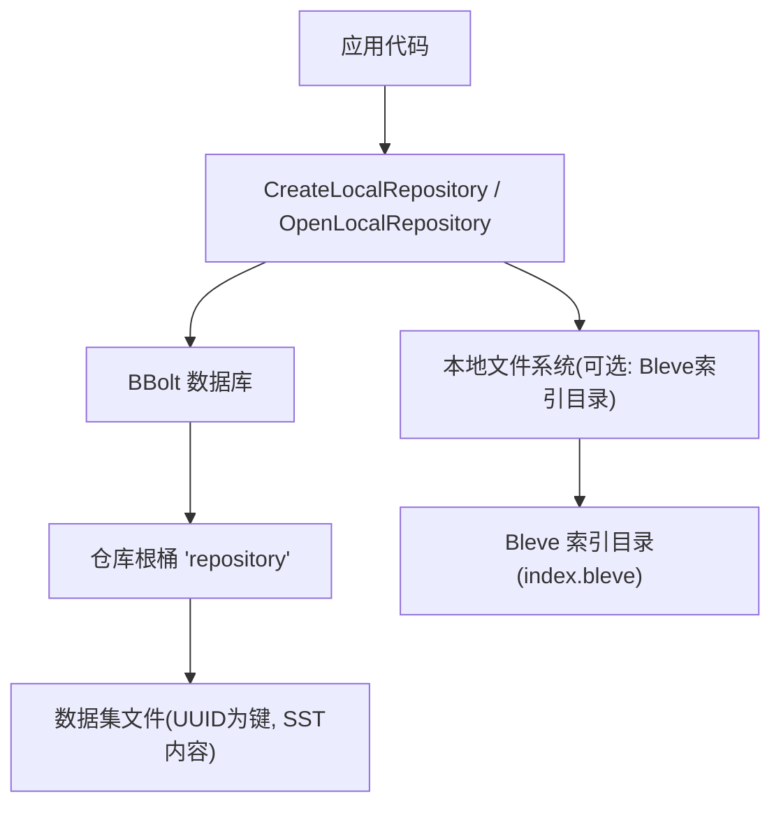
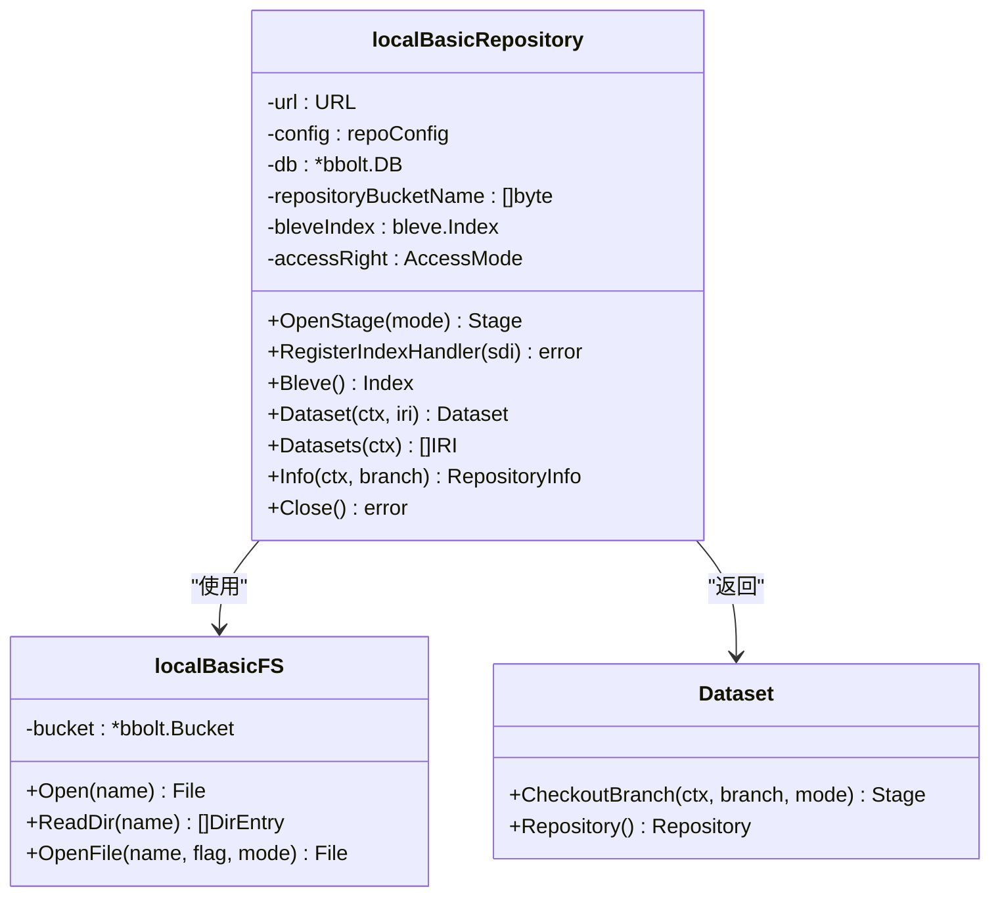
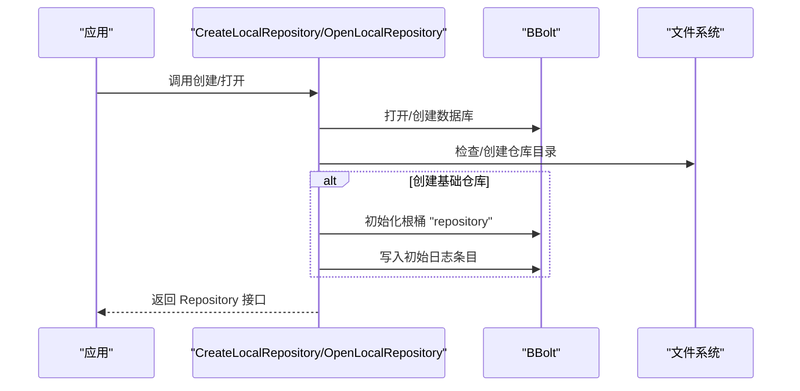
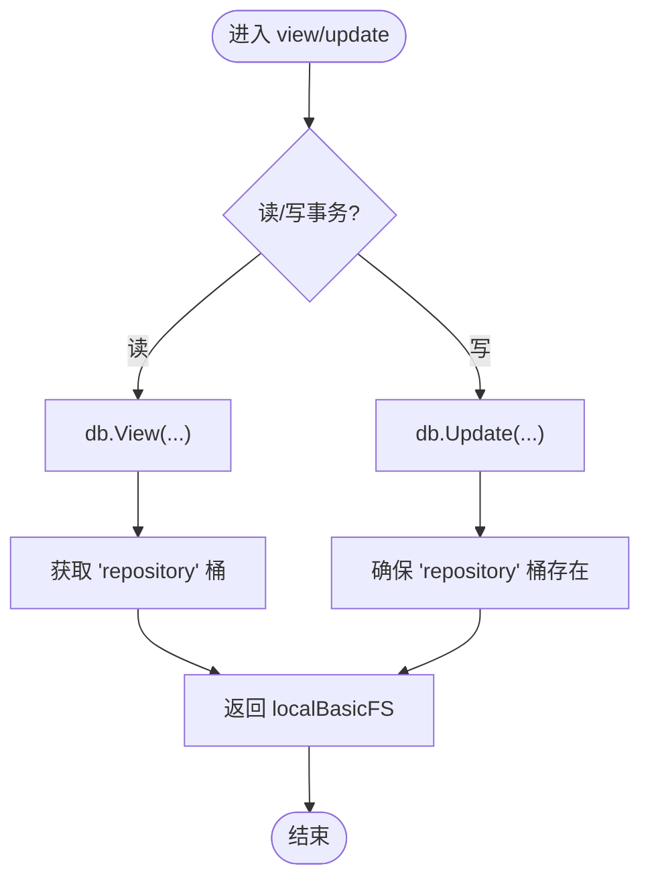
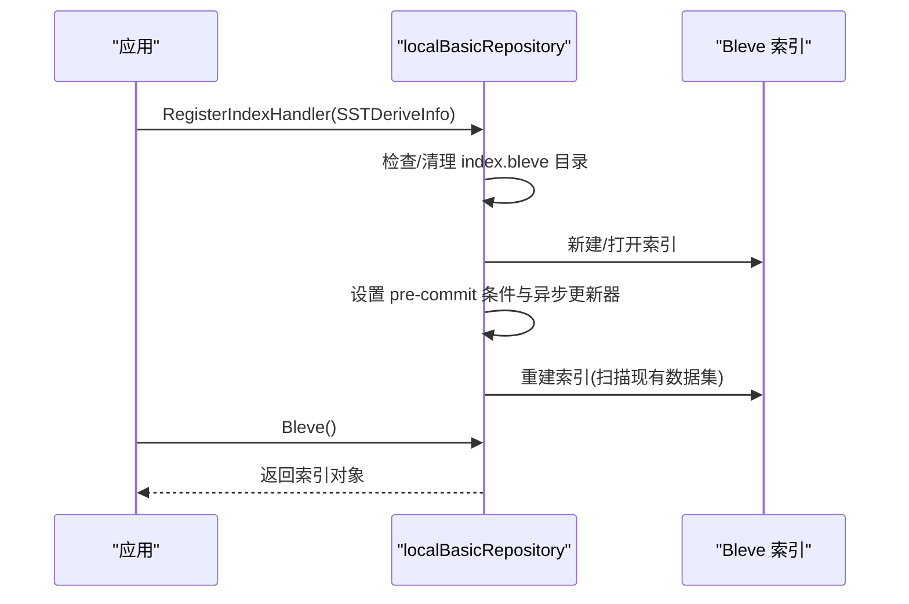
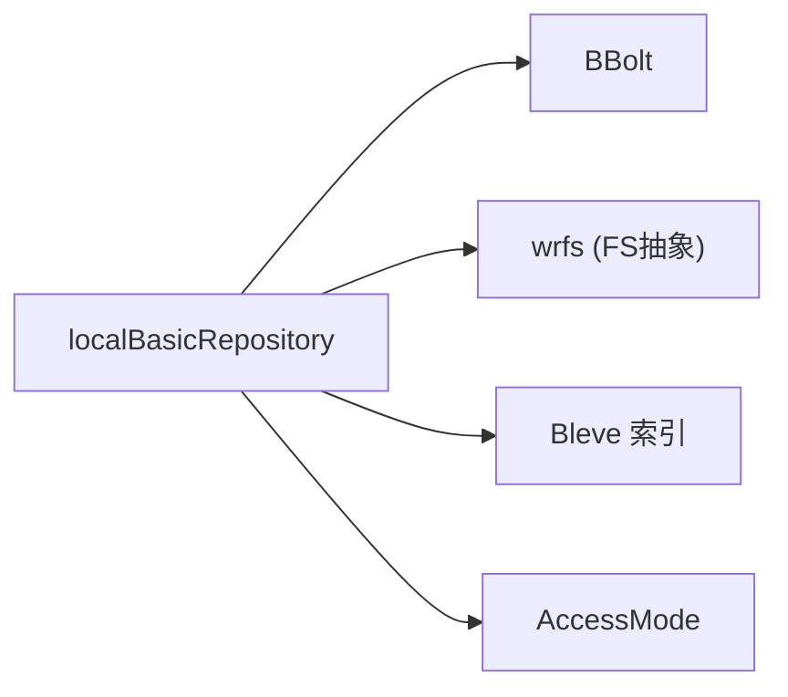

# 本地基础仓库

<cite>
**本文引用的文件**
- [repolocalbasic.go](file://sst/repolocalbasic.go)
- [repository.go](file://sst/repository.go)
- [stagefslocalbasic.go](file://sst/stagefslocalbasic.go)
- [bbolt_structure.go](file://sst/bbolt_structure.go)
- [accessmode.go](file://sstauth/accessmode.go)
- [ACCESS_RIGHTS.md](file://sstauth/ACCESS_RIGHTS.md)
- [repolocalbasic_test.go](file://examples/helloworldrepolocalbasic/repolocalbasic_test.go)
</cite>

## 目录
1. [简介](#简介)
2. [项目结构](#项目结构)
3. [核心组件](#核心组件)
4. [架构总览](#架构总览)
5. [详细组件分析](#详细组件分析)
6. [依赖关系分析](#依赖关系分析)
7. [性能考虑](#性能考虑)
8. [故障排查指南](#故障排查指南)
9. [结论](#结论)
10. [附录：使用示例与最佳实践](#附录使用示例与最佳实践)

## 简介
本地基础仓库（LocalBasicRepository）是 SST Core 提供的一种轻量级本地 RDF 存储实现。它基于 BBolt 键值数据库持久化数据集，并通过可选的 Bleve 全文索引支持查询能力。其设计目标是“最小可用”：不支持版本历史、分支管理、提交日志等高级特性，但保留数据集级别的创建、提交、检出和查询能力，适合对功能要求简单、追求低开销的场景。

## 项目结构
围绕本地基础仓库的关键代码分布在以下文件中：
- 仓库实现与生命周期：[repolocalbasic.go](file://sst/repolocalbasic.go)、[repository.go](file://sst/repository.go)
- 基于 BBolt 的文件系统抽象：[stagefslocalbasic.go](file://sst/stagefslocalbasic.go)
- BBolt 数据结构定义（含仓库桶布局说明）：[bbolt_structure.go](file://sst/bbolt_structure.go)
- 访问权限模型：[accessmode.go](file://sstauth/accessmode.go)、[ACCESS_RIGHTS.md](file://sstauth/ACCESS_RIGHTS.md)
- 示例与测试：[repolocalbasic_test.go](file://examples/helloworldrepolocalbasic/repolocalbasic_test.go)

图表来源
- [repository.go:310-423](file://sst/repository.go#L310-L423)
- [repository.go:465-562](file://sst/repository.go#L465-L562)
- [repolocalbasic.go:147-222](file://sst/repolocalbasic.go#L147-L222)

章节来源
- [repository.go:310-423](file://sst/repository.go#L310-L423)
- [repository.go:465-562](file://sst/repository.go#L465-L562)

## 核心组件
- localBasicRepository：本地基础仓库的核心类型，封装 BBolt 连接、仓库桶名、Bleve 索引、访问权限等。
- localBasicFS：将 BBolt Bucket 暴露为 fs.FS，使数据集以“文件”形式按 UUID 存取。
- Dataset/Stage：通过 CheckoutBranch 加载当前分支的数据集到内存 Stage，支持 MoveAndMerge、Commit 等操作。
- 索引子系统：RegisterIndexHandler/RebuildBleveIndex/Bleve() 用于启用或重建 Bleve 全文索引，并支持异步更新。

章节来源
- [repolocalbasic.go:34-42](file://sst/repolocalbasic.go#L34-L42)
- [stagefslocalbasic.go:21-34](file://sst/stagefslocalbasic.go#L21-L34)
- [repolocalbasic.go:67-145](file://sst/repolocalbasic.go#L67-L145)

## 架构总览
本地基础仓库采用“BBolt + 可选 Bleve”的组合：
- 数据层：BBolt 作为主存储，仓库根桶名为 "repository"，每个数据集以 UUID 为键，值为该数据集的 SST 序列化内容。
- 索引层：可选的 Bleve 全文索引，位于仓库目录下的 index.bleve 子目录，支持注册自定义派生信息并异步更新。
- 访问控制：仓库实例在打开/创建时根据目录权限确定 AccessMode，并在生命周期内固定。

图表来源
- [repolocalbasic.go:34-42](file://sst/repolocalbasic.go#L34-L42)
- [stagefslocalbasic.go:21-34](file://sst/stagefslocalbasic.go#L21-L34)
- [repolocalbasic.go:474-478](file://sst/repolocalbasic.go#L474-L478)

## 详细组件分析

### 仓库创建与打开
- CreateLocalRepository：
  - 若 revisionHistory=false，则创建本地基础仓库；否则创建支持历史的完整仓库。
  - 初始化 BBolt 数据库，写入初始日志条目，设置访问权限为读写。
- OpenLocalRepository：
  - 打开已有仓库，检测是否存在 "repository" 根桶以区分基础仓库与完整仓库。
  - 基础仓库实例化时从目录权限推断 AccessMode，并标记为已打开状态。

图表来源
- [repository.go:310-423](file://sst/repository.go#L310-L423)
- [repository.go:465-562](file://sst/repository.go#L465-L562)

章节来源
- [repository.go:310-423](file://sst/repository.go#L310-L423)
- [repository.go:465-562](file://sst/repository.go#L465-L562)

### 数据存储结构与组织
- 根桶名称："repository"（常量 rootRepositoryBucketName）。
- 数据集文件：以 UUID 为键，值为 SST 序列化内容。通过 localBasicFS 暴露为 fs.FS 语义，支持 Open/ReadDir/OpenFile。
- 读取流程：view/update 方法封装 BBolt 事务，统一处理只读/写路径，并返回 localBasicFS 供上层遍历或读写。

图表来源
- [repolocalbasic.go:444-472](file://sst/repolocalbasic.go#L444-L472)
- [stagefslocalbasic.go:36-88](file://sst/stagefslocalbasic.go#L36-L88)

章节来源
- [repolocalbasic.go:444-472](file://sst/repolocalbasic.go#L444-L472)
- [stagefslocalbasic.go:36-88](file://sst/stagefslocalbasic.go#L36-L88)

### 索引与查询
- RegisterIndexHandler：
  - 接收 SSTDeriveInfo，若为空则删除现有 Bleve 索引；否则检查并比较索引配置，决定是否重建。
  - 设置 pre-commit 条件回调，提交后异步更新索引。
- RebuildBleveIndex：关闭旧索引并重建。
- Bleve：返回健康感知的索引对象，支持 SearchInContext 等查询。

图表来源
- [repolocalbasic.go:67-145](file://sst/repolocalbasic.go#L67-L145)
- [repolocalbasic.go:147-222](file://sst/repolocalbasic.go#L147-L222)
- [repolocalbasic.go:224-253](file://sst/repolocalbasic.go#L224-L253)

章节来源
- [repolocalbasic.go:67-145](file://sst/repolocalbasic.go#L67-L145)
- [repolocalbasic.go:147-222](file://sst/repolocalbasic.go#L147-L222)
- [repolocalbasic.go:224-253](file://sst/repolocalbasic.go#L224-L253)

### 数据集操作与限制
- 支持：
  - DatasetIDs/Datasets/ForDatasets：枚举数据集及其 IRI。
  - Dataset：按 IRI 获取数据集。
  - CheckoutBranch：加载当前分支的数据集到 Stage，并递归合并导入图。
- 不支持：
  - CommitDetails、Log、ExtractSstFile、DocumentSet/Document/Documents/DocumentDelete、SyncFrom 等。
  - 版本历史相关：calculateRepositoryVersionHash 返回空，表示无版本哈希。

章节来源
- [repolocalbasic.go:255-368](file://sst/repolocalbasic.go#L255-L368)
- [repolocalbasic.go:410-416](file://sst/repolocalbasic.go#L410-L416)
- [repolocalbasic.go:616-653](file://sst/repolocalbasic.go#L616-L653)
- [repolocalbasic.go:655-727](file://sst/repolocalbasic.go#L655-L727)
- [repolocalbasic.go:773-798](file://sst/repolocalbasic.go#L773-L798)

### 访问权限与安全
- 访问模式：AccessMode 为有序整数，级别 None < ReadOnly < ReadWrite < Admin < SuperAdmin。
- 本地基础仓库在创建/打开时根据目录权限确定 AccessMode，并在实例生命周期内保持不变。
- 远程仓库的细粒度授权策略与 gRPC 拦截器见 sstauth 文档；本地仓库主要依赖文件系统权限与实例级 AccessMode。

章节来源
- [accessmode.go:7-36](file://sstauth/accessmode.go#L7-L36)
- [accessmode.go:100-129](file://sstauth/accessmode.go#L100-L129)
- [ACCESS_RIGHTS.md:13-29](file://sstauth/ACCESS_RIGHTS.md#L13-L29)
- [repository.go:381-423](file://sst/repository.go#L381-L423)
- [repository.go:540-562](file://sst/repository.go#L540-L562)

## 依赖关系分析
- 外部依赖：
  - BBolt：持久化存储，提供事务与桶结构。
  - Bleve：可选全文检索，支持异步更新与健康感知。
  - wrfs：文件系统抽象，使 BBolt Bucket 可被当作 FS 使用。
- 内部耦合：
  - localBasicRepository 依赖 stagefslocalbasic.go 提供的 FS 适配。
  - 索引子系统与预提交条件回调耦合，保证提交后索引一致性。

图表来源
- [repolocalbasic.go:34-42](file://sst/repolocalbasic.go#L34-L42)
- [stagefslocalbasic.go:21-34](file://sst/stagefslocalbasic.go#L21-L34)
- [accessmode.go:7-36](file://sstauth/accessmode.go#L7-L36)

章节来源
- [repolocalbasic.go:34-42](file://sst/repolocalbasic.go#L34-L42)
- [stagefslocalbasic.go:21-34](file://sst/stagefslocalbasic.go#L21-L34)
- [accessmode.go:7-36](file://sstauth/accessmode.go#L7-L36)

## 性能考虑
- BBolt 配置：
  - NoFreelistSync=true、FreelistType=MapType，减少元数据同步开销，提升写入吞吐。
- 索引更新：
  - 使用默认异步更新器，提交后批量更新索引，避免阻塞主流程。
  - 重建索引会清空并重新构建，建议在低峰期执行。
- 数据集规模：
  - 数据集数量与大小直接影响 Info 统计与索引构建时间。
- 并发访问：
  - 通过 enter/leave 状态机保护共享资源，避免并发冲突。

章节来源
- [repository.go:371-376](file://sst/repository.go#L371-L376)
- [repolocalbasic.go:196-213](file://sst/repolocalbasic.go#L196-L213)
- [repolocalbasic.go:418-442](file://sst/repolocalbasic.go#L418-L442)

## 故障排查指南
- 常见错误：
  - 仓库桶不存在：当尝试读取但不存在 "repository" 桶时会报错。
  - 数据集未找到：按 ID 查找失败返回特定错误。
  - 方法不支持：如 CommitDetails、Log、Document* 等方法明确返回“不支持”。
- 诊断建议：
  - 检查仓库目录是否存在且包含 bbolt 数据库文件。
  - 确认是否调用了 RegisterIndexHandler 以启用查询。
  - 查看 Info 输出中的 SupportRevisionHistory 字段，确认是否为 false（基础仓库）。

章节来源
- [repolocalbasic.go:263-284](file://sst/repolocalbasic.go#L263-L284)
- [repolocalbasic.go:374-408](file://sst/repolocalbasic.go#L374-L408)
- [repolocalbasic.go:410-416](file://sst/repolocalbasic.go#L410-L416)
- [repolocalbasic.go:725-727](file://sst/repolocalbasic.go#L725-L727)

## 结论
本地基础仓库以极简方式提供 RDF 数据的本地持久化与可选全文检索能力，适合不需要版本历史、分支管理的场景。其基于 BBolt 的存储结构简单可靠，配合 Bleve 可实现高效查询。对于需要版本控制、审计日志、多分支协作的需求，应选择完整仓库（LocalFullRepository）。

## 附录：使用示例与最佳实践

### 创建与使用本地基础仓库（步骤概览）
- 创建仓库：调用 CreateLocalRepository(path, email, name, revisionHistory=false)。
- 注册索引处理器：调用 RegisterIndexHandler(defaultderive.DeriveInfo())。
- 打开阶段并提交数据：OpenStage -> CreateNamedGraph -> AddStatement -> Commit。
- 重新打开并检索：OpenLocalRepository -> Dataset -> CheckoutBranch -> NamedGraph -> 计数/导出。
- 查询：调用 Bleve() 并使用 SearchInContext 进行检索。

章节来源
- [repolocalbasic_test.go:31-74](file://examples/helloworldrepolocalbasic/repolocalbasic_test.go#L31-L74)
- [repolocalbasic_test.go:76-127](file://examples/helloworldrepolocalbasic/repolocalbasic_test.go#L76-L127)

### 与完整仓库的区别与选择指导
- 本地基础仓库：
  - 优点：轻量、启动快、存储开销小、支持查询。
  - 限制：无版本历史、无分支管理、无提交日志、无文档管理、无 SyncFrom。
- 完整仓库：
  - 优点：支持版本历史、分支、提交、日志、文档管理等。
  - 适用：需要审计、回滚、多分支协作、复杂工作流。

章节来源
- [repolocalbasic.go:655-727](file://sst/repolocalbasic.go#L655-L727)
- [repolocalbasic.go:773-798](file://sst/repolocalbasic.go#L773-L798)
- [repository.go:310-423](file://sst/repository.go#L310-L423)

### 性能优化建议与最佳实践
- 合理设置索引：仅在需要查询时启用 RegisterIndexHandler；定期重建索引以保持一致性。
- 批量提交：合并多次变更后再 Commit，减少索引更新次数。
- 控制数据集规模：拆分大图为多个数据集，降低单次 IO 压力。
- 监控 Info：关注 MasterDBSize、NumberOfDatasets、Bleve 相关字段，评估存储与索引增长。
- 安全与权限：确保仓库目录权限正确，避免非授权用户写入；结合远程仓库的 RBAC 策略进行统一管理。

章节来源
- [repolocalbasic.go:660-723](file://sst/repolocalbasic.go#L660-L723)
- [accessmode.go:7-36](file://sstauth/accessmode.go#L7-L36)
- [ACCESS_RIGHTS.md:13-29](file://sstauth/ACCESS_RIGHTS.md#L13-L29)