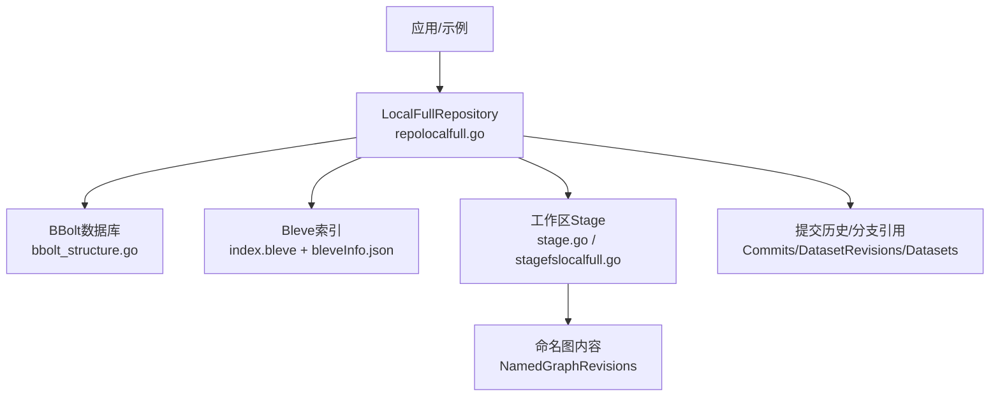
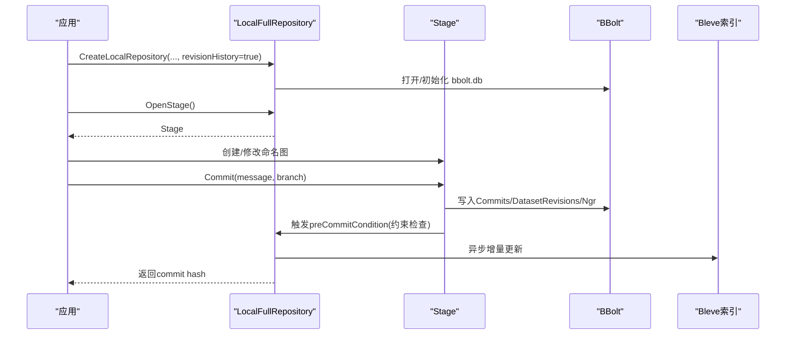
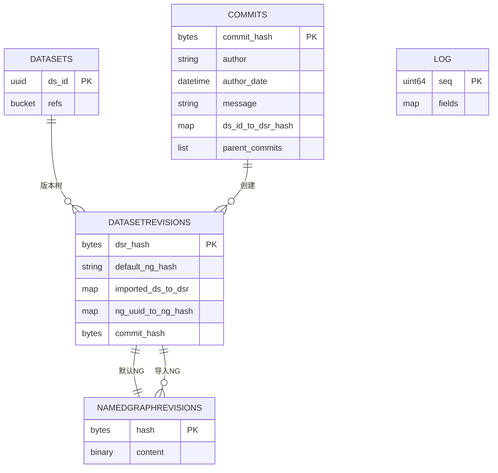
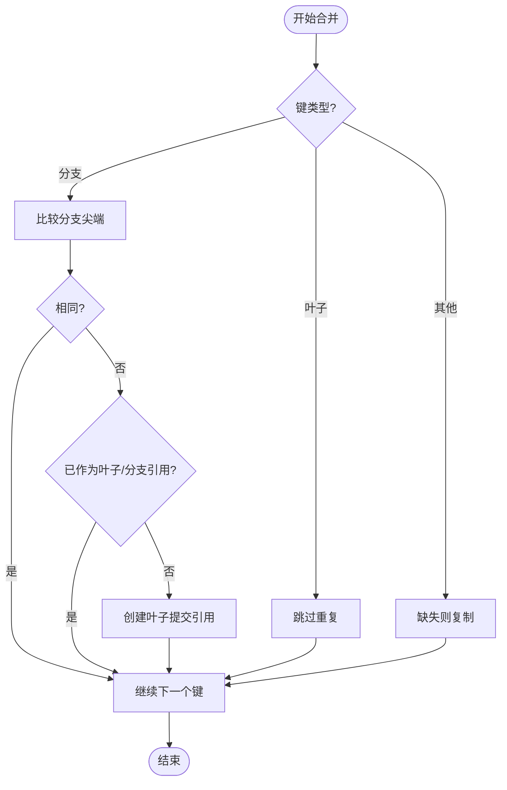
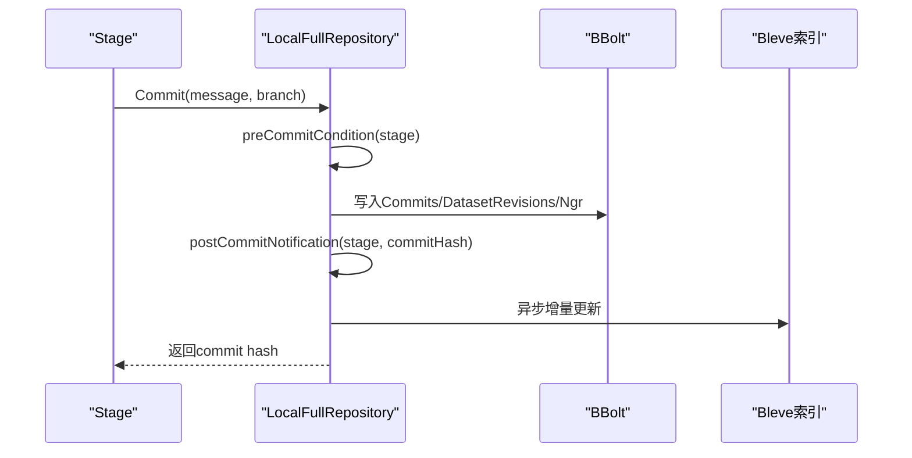
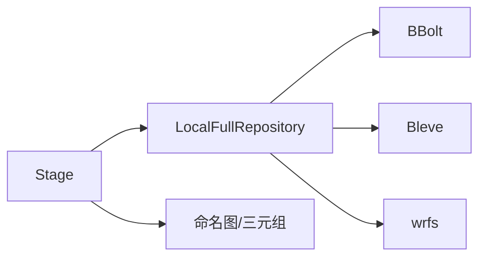

# 本地完整仓库

<cite>
**本文引用的文件**
- [repolocalfull.go](file://sst/repolocalfull.go)
- [bbolt_structure.go](file://sst/bbolt_structure.go)
- [stagefslocalfull.go](file://sst/stagefslocalfull.go)
- [repository.go](file://sst/repository.go)
- [stage.go](file://sst/stage.go)
- [repolocalfull.go（示例）](file://examples/helloworldrepolocalfull/repolocalfull.go)
- [repolocalfullwithbleve.go（示例）](file://examples/helloworldrepolocalfullwithbleve/repolocalfullwithbleve.go)
</cite>

## 目录
1. [简介](#简介)
2. [项目结构](#项目结构)
3. [核心组件](#核心组件)
4. [架构总览](#架构总览)
5. [详细组件分析](#详细组件分析)
6. [依赖关系分析](#依赖关系分析)
7. [性能考虑](#性能考虑)
8. [故障排除指南](#故障排除指南)
9. [结论](#结论)
10. [附录：代码示例与操作清单](#附录代码示例与操作清单)

## 简介
本文件面向SST Core的本地完整仓库（LocalFullRepository），系统性阐述其版本历史、分支管理、合并操作、基于BBolt的复杂存储结构、工作区（Stage）的事务性模式、Bleve全文检索集成，以及性能调优、备份恢复、兼容性/迁移等主题。文档以源码为依据，提供可视化图示与可追溯的“章节来源”和“图示来源”，帮助读者从概念到实现全面理解。

## 项目结构
围绕LocalFullRepository的关键源码分布在以下模块：
- 仓库实现与配置：repolocalfull.go、repository.go
- BBolt存储布局与键空间：bbolt_structure.go
- 工作区文件系统适配：stagefslocalfull.go
- 工作区接口与事务语义：stage.go
- 使用示例：examples/helloworldrepolocalfull/*、examples/helloworldrepolocalfullwithbleve/*

**图示来源**
- [repolocalfull.go:217-230](file://sst/repolocalfull.go#L217-L230)
- [bbolt_structure.go:81-146](file://sst/bbolt_structure.go#L81-L146)
- [stagefslocalfull.go:16-27](file://sst/stagefslocalfull.go#L16-L27)
- [stage.go:53-74](file://sst/stage.go#L53-L74)

**章节来源**
- [repolocalfull.go:217-230](file://sst/repolocalfull.go#L217-L230)
- [bbolt_structure.go:81-146](file://sst/bbolt_structure.go#L81-L146)
- [stagefslocalfull.go:16-27](file://sst/stagefslocalfull.go#L16-L27)
- [stage.go:53-74](file://sst/stage.go#L53-L74)

## 核心组件
- LocalFullRepository：基于BBolt的本地完整仓库，支持提交历史、分支、数据集/命名图版本、Bleve索引。
- Stage：内存中的工作区，封装对命名图的增删改查与事务化提交。
- BBolt存储层：定义Datasets、DatasetRevisions、NamedGraphRevisions、Commits、Log等桶结构与键前缀。
- Bleve搜索引擎：可选的全文检索能力，通过RegisterIndexHandler注册并异步更新。

**章节来源**
- [repolocalfull.go:217-230](file://sst/repolocalfull.go#L217-L230)
- [stage.go:53-74](file://sst/stage.go#L53-L74)
- [bbolt_structure.go:81-146](file://sst/bbolt_structure.go#L81-L146)
- [repolocalfull.go:259-426](file://sst/repolocalfull.go#L259-L426)

## 架构总览
LocalFullRepository将“数据版本化”与“检索能力”解耦：
- 数据持久化：BBolt多桶结构保存提交、分支、数据集/命名图版本。
- 检索索引：Bleve独立目录index.bleve，配合bleveInfo.json记录派生信息；提交后异步增量更新。
- 工作区：Stage在内存中维护本地与引用命名图，提交时原子写入BBolt并触发索引更新。

**图示来源**
- [repository.go:340-398](file://sst/repository.go#L340-L398)
- [repolocalfull.go:259-426](file://sst/repolocalfull.go#L259-L426)
- [stage.go:121-130](file://sst/stage.go#L121-L130)

## 详细组件分析

### 1) 仓库创建与配置选项（含revisionHistory）
- 创建API：CreateLocalRepository(repoDir, email, name, revisionHistory)
  - 当revisionHistory为true时，创建LocalFullRepository，启用提交历史、分支、版本控制。
  - 当为false时，创建无历史的轻量仓库（Basic）。
- 打开API：OpenLocalRepository(...)
  - 自动探测已有仓库类型（Basic或Full），并返回对应实现。
- BBolt打开参数：NoFreelistSync=true、FreelistType=MapType，提升写性能。

**章节来源**
- [repository.go:340-398](file://sst/repository.go#L340-L398)
- [repository.go:491-562](file://sst/repository.go#L491-L562)

### 2) BBolt存储结构（提交历史、分支引用、命名图版本）
- 关键桶与键空间：
  - NamedGraphRevisions（ngr）：按命名图版本哈希存储二进制内容。
  - DatasetRevisions（dsr）：每个数据集版本包含默认NG哈希、导入NG映射、扁平NG列表、创建该版本的commitHash。
  - Datasets（ds）：按数据集UUID组织，内部子桶保存分支引用（refBranchPrefix）、叶子提交（refLeafPrefix）、IRI映射等。
  - Commits（c）：提交对象，包含作者、消息、数据集版本及父提交链。
  - Log（dl）：仓库级操作日志（commit/set_branch/remove_branch/upload/delete/sync_from/admin）。
  - document_info：上传文档元数据。
- 引用前缀：
  - refBranchPrefix：分支指向最新提交。
  - refLeafPrefix：不可达分支尖端的叶子提交，保证历史可达。

**图示来源**
- [bbolt_structure.go:81-146](file://sst/bbolt_structure.go#L81-L146)

**章节来源**
- [bbolt_structure.go:81-146](file://sst/bbolt_structure.go#L81-L146)

### 3) 分支管理与合并
- 分支操作：
  - getBranchCommitRef/setBranchCommitRef/deleteBranchCommitRef：读取/设置/删除分支指向的提交。
  - mergeDatasetRefsFromSource：合并源仓库的引用到目标，冲突时保留目标分支尖，并将源尖作为叶子提交保留历史。
  - mergeIncomingDatasetRef：流式合并单个引用，若分支分歧且未引用则创建叶子提交。
- 合并策略要点：
  - 保持目标分支尖端不变，避免覆盖用户分支。
  - 通过叶子提交确保所有历史可达，便于listcommits/history。

**图示来源**
- [repolocalfull.go:83-120](file://sst/repolocalfull.go#L83-L120)
- [repolocalfull.go:122-145](file://sst/repolocalfull.go#L122-L145)

**章节来源**
- [repolocalfull.go:83-120](file://sst/repolocalfull.go#L83-L120)
- [repolocalfull.go:122-145](file://sst/repolocalfull.go#L122-L145)

### 4) 工作区（Stage）与事务性操作
- Stage职责：
  - 内存中维护本地与引用命名图，支持创建、查询、移动与合并。
  - Commit将变更原子写入BBolt，生成新的命名图/数据集版本，并可选择更新分支指针。
- 事务模型：
  - Pre-commit条件：可通过RegisterIndexHandler注入约束检查（如唯一性）。
  - Post-commit通知：用于索引更新、审计等。
- 文件系统适配：
  - localFullFs将BBolt中的命名图版本暴露为只读目录，支持Open/ReadDir/OpenFile（写时需截断标志）。

**图示来源**
- [stage.go:121-130](file://sst/stage.go#L121-L130)
- [repolocalfull.go:259-426](file://sst/repolocalfull.go#L259-L426)
- [stagefslocalfull.go:39-88](file://sst/stagefslocalfull.go#L39-L88)

**章节来源**
- [stage.go:121-130](file://sst/stage.go#L121-L130)
- [stagefslocalfull.go:39-88](file://sst/stagefslocalfull.go#L39-L88)

### 5) 与Bleve搜索引擎的集成
- 注册索引处理器：RegisterIndexHandler(SSTDeriveInfo)
  - 若存在旧索引且派生信息不一致，重建索引。
  - 设置PreCommitCondition与异步更新器。
- 重建索引：RebuildBleveIndex/ buildBleveIndex
  - 关闭当前索引，删除index.bleve目录，重新创建并全量重建。
- 搜索：
  - 通过repo.Bleve()获取bleve.Index进行查询。
  - 也可直接打开index.bleve目录进行外部工具访问。

**章节来源**
- [repolocalfull.go:259-426](file://sst/repolocalfull.go#L259-L426)
- [repolocalfull.go:428-458](file://sst/repolocalfull.go#L428-L458)
- [repolocalfullwithbleve.go:44-79](file://examples/helloworldrepolocalfullwithbleve/repolocalfullwithbleve.go#L44-L79)

### 6) 版本历史与查看
- 提交详情：CommitDetails/CommitDetailsByHash
  - 解析作者、时间戳、消息、数据集版本与父提交链。
  - 同时解析命名图版本（默认NG与导入NG）。
- 检出：CheckoutCommit/CheckoutBranch/CheckoutRevision
  - 根据提交或分支构建Stage视图，支持按版本检出。

**章节来源**
- [repolocalfull.go:595-732](file://sst/repolocalfull.go#L595-L732)

## 依赖关系分析
- LocalFullRepository依赖：
  - BBolt：持久化提交、版本、引用。
  - Bleve：全文检索（可选）。
  - wrfs：将BBolt内容抽象为FS接口供Stage使用。
- Stage依赖：
  - 命名图与三元组内存结构。
  - 仓库接口以完成提交与历史回溯。

**图示来源**
- [repolocalfull.go:217-230](file://sst/repolocalfull.go#L217-L230)
- [stagefslocalfull.go:16-27](file://sst/stagefslocalfull.go#L16-L27)
- [stage.go:53-74](file://sst/stage.go#L53-L74)

**章节来源**
- [repolocalfull.go:217-230](file://sst/repolocalfull.go#L217-L230)
- [stagefslocalfull.go:16-27](file://sst/stagefslocalfull.go#L16-L27)
- [stage.go:53-74](file://sst/stage.go#L53-L74)

## 性能考虑
- BBolt优化：
  - NoFreelistSync=true、FreelistType=MapType减少写放大与锁竞争。
  - 批量写入与事务边界控制（Stage.Commit内聚写入）。
- 索引更新：
  - 异步增量更新，降低提交延迟。
  - 派生信息变化时重建索引，避免不一致。
- 内存与遍历：
  - TriplexMode影响内存占用与遍历效率（默认三向三元组）。
  - 大仓库建议分批提交，避免单次提交过大。
- 磁盘与IO：
  - 将index.bleve置于高性能盘，与bbolt.db分离可降低争用。
  - 定期重建索引以压缩碎片。

[本节为通用指导，不直接分析具体文件]

## 故障排除指南
- 常见错误与定位：
  - 提交未找到/版本不存在：检查Commits/DatasetRevisions桶是否存在对应键。
  - 分支冲突：确认merge逻辑是否创建了叶子提交，历史是否可达。
  - 索引不一致：调用RebuildBleveIndex重建；核对bleveInfo.json与当前派生信息。
  - 并发修改：注意preCommitCondition失败与ErrConcurrentModification。
- 诊断工具：
  - 使用CLI工具导出BBolt桶内容，辅助定位键值问题。
  - 直接打开index.bleve目录验证索引状态。

**章节来源**
- [bbolt_structure.go:53-59](file://sst/bbolt_structure.go#L53-L59)
- [repolocalfull.go:259-426](file://sst/repolocalfull.go#L259-L426)
- [cli/cmd/utils/bboltdump.go:16-57](file://cli/cmd/utils/bboltdump.go#L16-L57)

## 结论
LocalFullRepository通过BBolt实现了强一致的数据版本化与分支管理，结合Bleve提供高效全文检索。Stage提供事务化的工作区体验，使开发者可以安全地编辑、合并与提交数据。合理配置revisionHistory、索引与存储位置，可获得良好的性能与可维护性。

[本节为总结，不直接分析具体文件]

## 附录：代码示例与操作清单

### A. 创建仓库与工作区
- 创建带历史的本地完整仓库：
  - 参考：[repository.go:340-398](file://sst/repository.go#L340-L398)
- 打开仓库：
  - 参考：[repository.go:491-562](file://sst/repository.go#L491-L562)
- 创建工作区并提交：
  - 参考：[stage.go:121-130](file://sst/stage.go#L121-L130)

### B. 创建分支、提交更改、查看历史记录
- 创建分支并设置提交尖：
  - 参考：[repolocalfull.go:153-169](file://sst/repolocalfull.go#L153-L169)
- 提交更改：
  - 参考：[stage.go:121-130](file://sst/stage.go#L121-L130)
- 查看提交详情：
  - 参考：[repolocalfull.go:595-719](file://sst/repolocalfull.go#L595-L719)

### C. 检出与版本切换
- 按分支检出：
  - 参考：[repolocalfull.go:721-732](file://sst/repolocalfull.go#L721-L732)
- 按提交/版本检出：
  - 参考：[repolocalfull.go:721-732](file://sst/repolocalfull.go#L721-L732)

### D. 启用Bleve全文搜索
- 注册索引处理器：
  - 参考：[repolocalfull.go:259-426](file://sst/repolocalfull.go#L259-L426)
- 执行搜索：
  - 参考：[repolocalfullwithbleve.go:74-129](file://examples/helloworldrepolocalfullwithbleve/repolocalfullwithbleve.go#L74-L129)

### E. 备份与恢复
- 备份：
  - 停止写入后复制bbolt.db与index.bleve目录。
- 恢复：
  - 将备份文件放回原路径，重启仓库；必要时重建索引。

### F. 与其他仓库类型的兼容性与迁移
- Basic vs Full：
  - 通过OpenLocalRepository自动识别类型；如需迁移，可将Basic数据导入Full并通过提交建立历史。
- 同步与合并：
  - 使用SyncFrom与mergeDatasetRefsFromSource处理跨仓库数据合并与分支对齐。

**章节来源**
- [repolocalfull.go:153-169](file://sst/repolocalfull.go#L153-L169)
- [repolocalfull.go:595-732](file://sst/repolocalfull.go#L595-L732)
- [repolocalfullwithbleve.go:74-129](file://examples/helloworldrepolocalfullwithbleve/repolocalfullwithbleve.go#L74-L129)