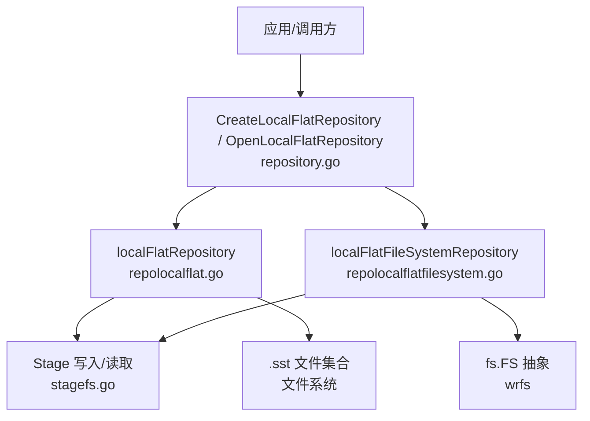
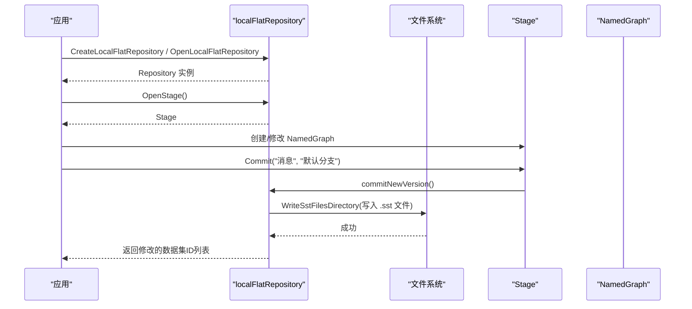
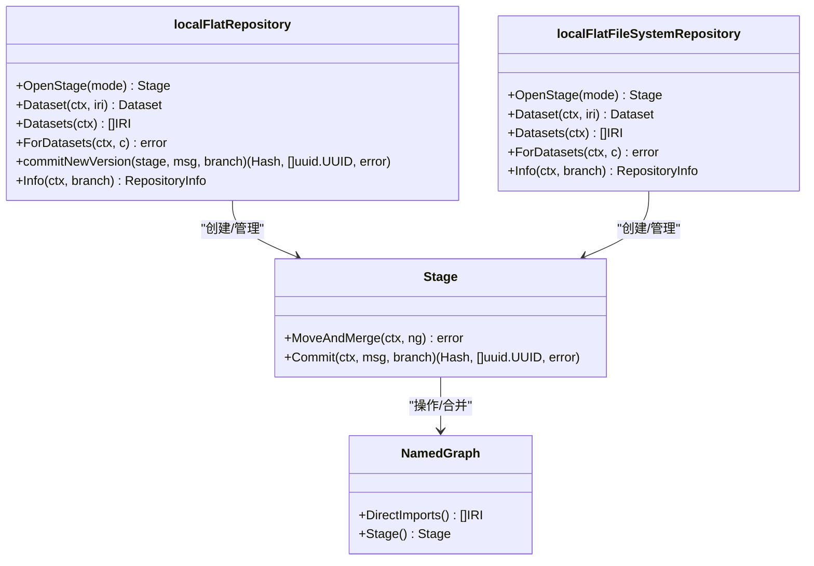

# 本地扁平仓库

<cite>
**本文引用的文件**
- [repository.go](file://sst/repository.go)
- [repolocalflat.go](file://sst/repolocalflat.go)
- [repolocalflatfilesystem.go](file://sst/repolocalflatfilesystem.go)
- [stagefs.go](file://sst/stagefs.go)
- [stagefsdatasetsfs.go](file://sst/stagefsdatasetsfs.go)
- [helloworldrepolocalflat.go](file://examples/helloworldrepolocalflat/helloworldrepolocalflat.go)
</cite>

## 目录
1. [简介](#简介)
2. [项目结构](#项目结构)
3. [核心组件](#核心组件)
4. [架构总览](#架构总览)
5. [详细组件分析](#详细组件分析)
6. [依赖关系分析](#依赖关系分析)
7. [性能考量](#性能考量)
8. [故障排查指南](#故障排查指南)
9. [结论](#结论)
10. [附录](#附录)

## 简介
本地扁平仓库（LocalFlatRepository）是 SST Core 中的一种仓库类型，其设计理念是“每个命名图即一个独立的 SST 二进制文件”，直接以文件形式存储在本地文件系统或可抽象的文件系统中。该设计强调简单性、可移植性与无事务/无版本历史的特点：
- 简单性：数据以独立 .sst 文件组织，无需复杂数据库与索引；读写路径清晰。
- 可移植性：通过 fs.FS 抽象支持真实文件系统与内存/虚拟文件系统，便于测试与跨平台使用。
- 无事务/无版本历史：不支持提交历史、分支、远程同步等高级特性，适合静态或只读为主的场景。

本仓库的命名图标识采用 IRI，并在存储时通过 base64URL 编码的“基础 URL”作为文件名，从而保证文件名安全与唯一性。对于非 UUID 形式的 IRI，内部会基于 IRI 派生 UUID 用于定位与引用。

## 项目结构
围绕本地扁平仓库的关键代码分布在以下文件中：
- 仓库创建/打开与接口实现：[repository.go](file://sst/repository.go)
- 本地文件系统实现的仓库与数据集：[repolocalflat.go](file://sst/repolocalflat.go)、[repolocalflatfilesystem.go](file://sst/repolocalflatfilesystem.go)
- 阶段（Stage）与文件系统抽象：[stagefs.go](file://sst/stagefs.go)、[stagefsdatasetsfs.go](file://sst/stagefsdatasetsfs.go)
- 示例程序：[helloworldrepolocalflat.go](file://examples/helloworldrepolocalflat/helloworldrepolocalflat.go)

图表来源
- [repository.go:564-694](file://sst/repository.go#L564-L694)
- [repolocalflat.go:28-61](file://sst/repolocalflat.go#L28-L61)
- [repolocalflatfilesystem.go:21-52](file://sst/repolocalflatfilesystem.go#L21-L52)
- [stagefs.go:23-46](file://sst/stagefs.go#L23-L46)

章节来源
- [repository.go:564-694](file://sst/repository.go#L564-L694)
- [repolocalflat.go:28-61](file://sst/repolocalflat.go#L28-L61)
- [repolocalflatfilesystem.go:21-52](file://sst/repolocalflatfilesystem.go#L21-L52)
- [stagefs.go:23-46](file://sst/stagefs.go#L23-L46)

## 核心组件
- localFlatRepository：面向真实文件系统的扁平仓库实现，负责：
  - 仓库创建/打开（CreateLocalFlatRepository/OpenLocalFlatRepository）
  - 数据集枚举与访问（Datasets/Dataset/ForDatasets）
  - 命名图检出与导入合并（CheckoutBranch/getAllImportsForLocalFlatRepo）
  - 仓库信息统计（Info，含版本哈希计算）
  - 提交落盘（commitNewVersion -> WriteSstFilesDirectory）
- localFlatFileSystemRepository：面向 fs.FS 抽象的扁平仓库实现，提供与上述类似能力，但通过 wrfs 抽象文件系统，便于测试与跨平台。
- Stage：在扁平仓库中，Commit 会将当前阶段的命名图写为独立 .sst 文件到仓库目录；Checkout 则从 .sst 文件读取并构建 Stage，同时递归加载 DirectImports。
- 命名图与数据集：每个命名图对应一个 .sst 文件；数据集由 IRI 映射到文件名（base64URL 编码的基础 URL + .sst）。

章节来源
- [repolocalflat.go:28-61](file://sst/repolocalflat.go#L28-L61)
- [repolocalflatfilesystem.go:21-52](file://sst/repolocalflatfilesystem.go#L21-L52)
- [repolocalflat.go:301-322](file://sst/repolocalflat.go#L301-L322)
- [repolocalflat.go:114-152](file://sst/repolocalflat.go#L114-L152)
- [repolocalflatfilesystem.go:117-144](file://sst/repolocalflatfilesystem.go#L117-L144)

## 架构总览
本地扁平仓库将“命名图 = 独立 .sst 文件”的理念贯穿始终。仓库层负责：
- 创建/打开仓库目录
- 将命名图持久化为 .sst 文件
- 通过 IRI 解析与 base64URL 编码生成稳定文件名
- 在检出时读取 .sst 文件并递归加载导入依赖

图表来源
- [repository.go:564-694](file://sst/repository.go#L564-L694)
- [repolocalflat.go:301-322](file://sst/repolocalflat.go#L301-L322)

## 详细组件分析

### 仓库创建与打开
- CreateLocalFlatRepository：
  - 检查目标目录是否存在，不存在则创建
  - 规范化路径（Windows 前缀处理）
  - 构造 localFlatRepository 实例，设置访问权限为读写
- OpenLocalFlatRepository：
  - 校验目录存在且为目录
  - 构造 localFlatRepository 实例，访问权限按目录探测

章节来源
- [repository.go:564-628](file://sst/repository.go#L564-L628)
- [repository.go:650-694](file://sst/repository.go#L650-L694)

### 命名图与文件组织结构
- 文件名规则：
  - 对 IRI 的基础 URL 进行 base64URL 编码，追加 ".sst" 后缀形成文件名
  - 通过 sstFilePathFromIRI/sstFileNameFromIRI 计算文件路径
- 数据集访问：
  - Dataset(IRI)：根据 IRI 计算文件名并尝试打开
  - Datasets()/ForDatasets()：遍历仓库目录，收集所有 .sst 文件并解码为基础 URL 作为数据集 IRI
- 导入依赖：
  - CheckoutBranch 读取 .sst 文件构建 Stage，并递归加载 DirectImports，合并到当前 Stage

章节来源
- [repolocalflat.go:114-152](file://sst/repolocalflat.go#L114-L152)
- [repolocalflat.go:166-235](file://sst/repolocalflat.go#L166-L235)
- [repolocalflat.go:507-523](file://sst/repolocalflat.go#L507-L523)
- [repolocalflatfilesystem.go:117-144](file://sst/repolocalflatfilesystem.go#L117-L144)
- [repolocalflatfilesystem.go:203-227](file://sst/repolocalflatfilesystem.go#L203-L227)

### UUID 命名机制
- 当命名图的 IRI 不是 urn:uuid 形式时，内部会基于 IRI 派生 UUID（如 SHA1 Version 5），用于内部引用与定位
- 完整 IRI 仍保存在 .sst 文件内，确保可读性与互操作性
- 数据集 ID 与文件名解耦：ID 用于内部引用，文件名由 IRI 基础 URL 编码决定

章节来源
- [repository.go:630-638](file://sst/repository.go#L630-L638)
- [repolocalflat.go:176-181](file://sst/repolocalflat.go#L176-L181)

### 提交与落盘流程
- Stage.Commit 触发仓库层的 commitNewVersion
- commitNewVersion 调用 WriteSstFilesDirectory 将当前 Stage 中的命名图写入仓库目录为独立 .sst 文件
- 可选地触发 postCommitNotification（若配置）
- 返回被修改的数据集 ID 列表（扁平仓库不维护提交哈希）

章节来源
- [repolocalflat.go:301-322](file://sst/repolocalflat.go#L301-L322)

### 文件系统抽象与跨平台兼容
- localFlatFileSystemRepository 通过 fs.FS 抽象文件系统，支持真实磁盘与内存/虚拟文件系统
- 适用于单元测试、容器化部署与跨平台一致性
- 与本地文件系统实现共享相同的 I/O 逻辑，仅底层存储介质不同

章节来源
- [repolocalflatfilesystem.go:21-52](file://sst/repolocalflatfilesystem.go#L21-L52)
- [stagefs.go:23-46](file://sst/stagefs.go#L23-L46)

### 仓库信息与版本哈希
- Info 方法计算仓库的版本哈希：
  - 遍历仓库目录下所有 .sst 文件，按相对路径排序后逐文件内容计算 SHA256
  - 返回包含 VersionHash 的 RepositoryInfo
- 扁平仓库不支持日志、分支、提交历史等特性

章节来源
- [repolocalflat.go:324-430](file://sst/repolocalflat.go#L324-L430)
- [repolocalflatfilesystem.go:295-374](file://sst/repolocalflatfilesystem.go#L295-L374)

### 示例：创建与操作扁平仓库中的命名图
- 示例展示了如何：
  - 创建/打开本地扁平仓库
  - 打开 Stage 并创建命名图
  - 添加三元组并提交
  - 导出为 TTL 文件

章节来源
- [helloworldrepolocalflat.go:23-75](file://examples/helloworldrepolocalflat/helloworldrepolocalflat.go#L23-L75)

## 依赖关系分析

图表来源
- [repolocalflat.go:28-61](file://sst/repolocalflat.go#L28-L61)
- [repolocalflatfilesystem.go:21-52](file://sst/repolocalflatfilesystem.go#L21-L52)
- [stagefs.go:23-46](file://sst/stagefs.go#L23-L46)

章节来源
- [repolocalflat.go:28-61](file://sst/repolocalflat.go#L28-L61)
- [repolocalflatfilesystem.go:21-52](file://sst/repolocalflatfilesystem.go#L21-L52)
- [stagefs.go:23-46](file://sst/stagefs.go#L23-L46)

## 性能考量
- 写入性能：
  - 每次 Commit 将命名图写为独立 .sst 文件，避免大库单文件 I/O 瓶颈
  - 适合增量更新与并行处理不同命名图
- 读取性能：
  - 按需读取单个 .sst 文件，减少无关 I/O
  - 检出时会递归加载 DirectImports，注意导入链深度对性能的影响
- 统计与哈希：
  - Info 需要遍历全部 .sst 文件并计算哈希，数据量大时可能较慢，建议缓存结果或在后台异步计算
- 并发与锁：
  - 扁平仓库无事务，多进程/多线程并发写入同一命名图需外部协调

## 故障排查指南
- 常见错误与原因：
  - ErrRepositoryAlreadyExists：创建仓库时目录已存在
  - ErrRepositoryDoesNotExist：打开仓库时目录不存在
  - ErrDatasetNotFound：按 IRI 查找数据集失败（文件或解码失败）
  - ErrNotSupported：扁平仓库不支持的功能（如分支、提交历史、远程同步）
- 排查步骤：
  - 确认仓库目录存在且为目录
  - 检查 .sst 文件名是否符合 base64URL 编码规范
  - 验证命名图 IRI 与导入链是否有效，避免循环导入
  - 查看 Info 返回的 VersionHash 是否变化，判断文件是否被正确写入

章节来源
- [repository.go:564-694](file://sst/repository.go#L564-L694)
- [repolocalflat.go:154-160](file://sst/repolocalflat.go#L154-L160)
- [repolocalflat.go:480-505](file://sst/repolocalflat.go#L480-L505)
- [repolocalflatfilesystem.go:146-152](file://sst/repolocalflatfilesystem.go#L146-L152)
- [repolocalflatfilesystem.go:380-405](file://sst/repolocalflatfilesystem.go#L380-L405)

## 结论
本地扁平仓库以“命名图即文件”的极简模型提供了高可移植性与易用的数据存取方式，特别适合不需要版本历史与事务的场景。通过 base64URL 编码的 IRI 文件名与 fs.FS 抽象，它在跨平台与测试友好方面表现良好。尽管不支持分支、提交历史与远程同步，但其简单性与稳定性使其成为许多应用的理想选择。

## 附录

### 备份策略
- 直接复制仓库目录即可备份所有 .sst 文件
- 建议使用快照或增量备份工具保护目录
- 定期校验 VersionHash 以确保备份完整性

### 迁移指南
- 从其他仓库类型迁移到扁平仓库：
  - 导出命名图为 .ttl/.trig，再转换为 .sst 文件并按 IRI 命名放入仓库目录
  - 或使用 SST 提供的转换工具将现有数据写入扁平仓库
- 从扁平仓库迁移到其他仓库类型：
  - 读取 .sst 文件并导入到目标仓库（Full/Remote），保留 IRI 与导入关系

### 与其他仓库类型的转换方法
- 扁平仓库不支持 SyncFrom，如需同步请使用 LocalFullRepository 或 RemoteRepository
- 可通过中间格式（TTL/TRIG/SST）在不同仓库类型间转换