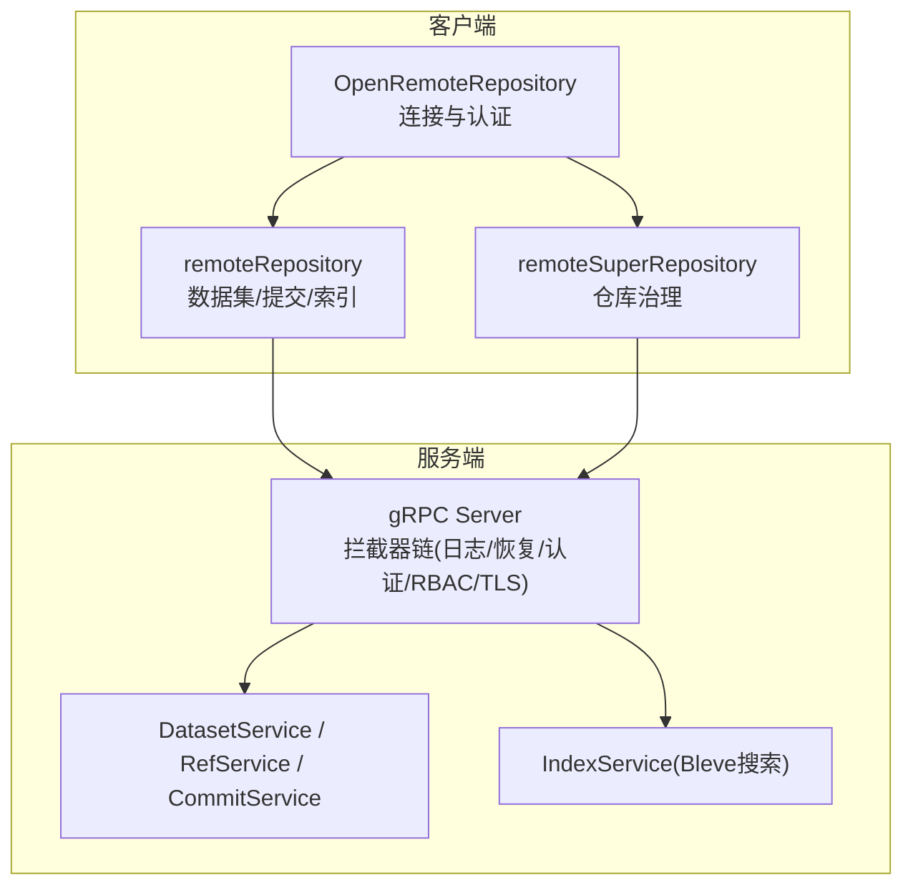
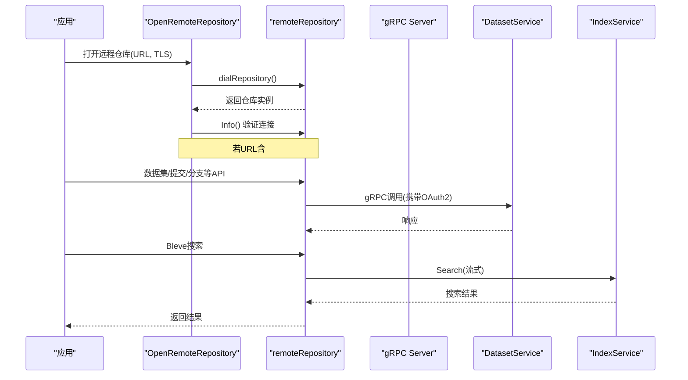
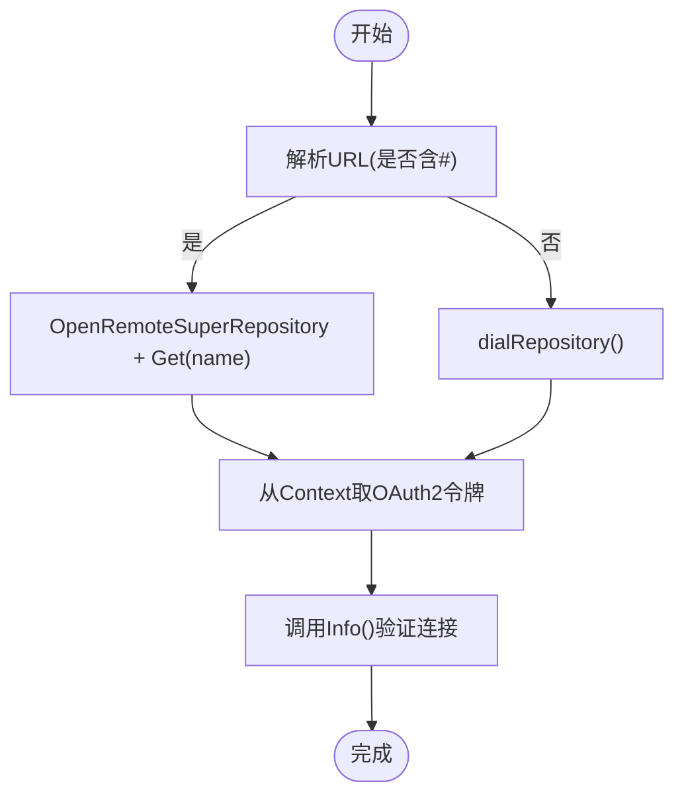
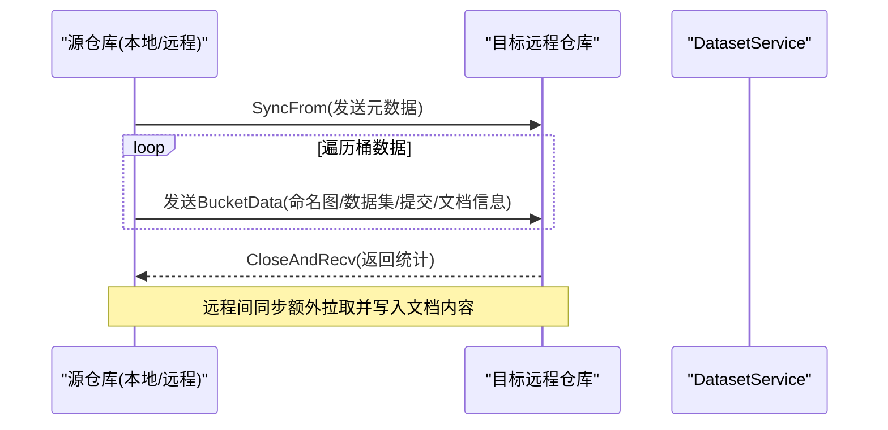
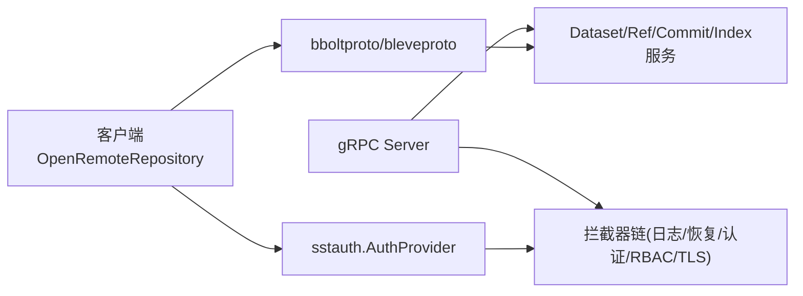

# 远程仓库

<cite>
**本文引用的文件**
- [reporemote.go](file://sst/reporemote.go)
- [superremoterepository.go](file://sst/superremoterepository.go)
- [repository.go](file://sst/repository.go)
- [reporemoteapp.go](file://sst/reporemoteapp.go)
- [remote.go](file://bboltproto/remote.go)
- [remote.go](file://bleveproto/remote.go)
- [main.go](file://examples/helloworldreporemote/main.go)
- [reporemoteread.go](file://examples/helloworldreporemote/reporemoteread/reporemoteread.go)
- [reporemotewrite.go](file://examples/helloworldreporemote/reporemotewrite/reporemotewrite.go)
- [main.go](file://examples/helloworldsuperreporemote/main.go)
- [auth.go](file://sstauth/auth.go)
</cite>

## 目录
1. [简介](#简介)
2. [项目结构](#项目结构)
3. [核心组件](#核心组件)
4. [架构总览](#架构总览)
5. [详细组件分析](#详细组件分析)
6. [依赖关系分析](#依赖关系分析)
7. [性能考虑](#性能考虑)
8. [故障排查指南](#故障排查指南)
9. [结论](#结论)
10. [附录](#附录)

## 简介
本文件面向SST Core的远程仓库实现，系统性阐述其网络架构与gRPC通信机制，覆盖客户端-服务器模型、连接建立、认证授权、数据同步、超级仓库（SuperRepository）管理、安全与性能优化、部署与监控建议等。文档以代码级为依据，提供可追溯的源码路径与图示，帮助读者快速理解并正确使用远程仓库能力。

## 项目结构
远程仓库由“客户端侧”和“服务端侧”两部分组成：
- 客户端侧
  - 远程仓库实例：封装gRPC连接、数据集/提交/索引服务客户端，以及请求缓存与状态控制。
  - 超级仓库客户端：用于列举、创建、删除、配额管理等多仓库治理操作。
  - 开放入口：OpenRemoteRepository负责解析URL片段（是否属于超级仓库）、建立gRPC连接、注入OAuth2令牌、验证连通性。
- 服务端侧
  - gRPC服务注册：DatasetService、RefService、CommitService、IndexService等。
  - 认证与RBAC：基于OIDC的鉴权拦截器与方法级访问控制。
  - TLS支持：可选启用TLS加密传输。
  - 示例程序：提供本地启动服务端与读写示例。

图表来源
- [repository.go:257-309](file://sst/repository.go#L257-L309)
- [reporemote.go:265-285](file://sst/reporemote.go#L265-L285)
- [superremoterepository.go:26-47](file://sst/superremoterepository.go#L26-L47)
- [reporemoteapp.go:456-530](file://sst/reporemoteapp.go#L456-L530)

章节来源
- [repository.go:257-309](file://sst/repository.go#L257-L309)
- [reporemote.go:265-285](file://sst/reporemote.go#L265-L285)
- [superremoterepository.go:26-47](file://sst/superremoterepository.go#L26-L47)
- [reporemoteapp.go:456-530](file://sst/reporemoteapp.go#L456-L530)

## 核心组件
- remoteRepository
  - 职责：维护gRPC连接、数据集/提交/索引服务客户端；提供数据集枚举、获取、分支/提交查询、Bleve搜索代理、阶段提交、同步等能力。
  - 关键特性：状态机（open/closing/closed）+ WaitGroup保证并发安全；请求消息缓存减少重复编码；分页拉取数据集列表。
- remoteIndex
  - 职责：将Bleve搜索请求序列化为字节流，通过gRPC流式调用远端IndexService.Search，返回搜索结果。
- remoteSuperRepository
  - 职责：连接超级仓库服务，提供仓库列举、创建、删除、配额查询/设置、最大仓库数量限制等操作。
- RepositoryServer（服务端）
  - 职责：组装gRPC拦截器链（状态转换、日志、恢复、认证、RBAC、TLS），注册各服务处理器，提供优雅停止。

章节来源
- [reporemote.go:88-144](file://sst/reporemote.go#L88-L144)
- [reporemote.go:146-228](file://sst/reporemote.go#L146-L228)
- [superremoterepository.go:20-47](file://sst/superremoterepository.go#L20-L47)
- [reporemoteapp.go:286-353](file://sst/reporemoteapp.go#L286-L353)

## 架构总览
远程仓库采用典型的客户端-服务器模型：
- 客户端通过OpenRemoteRepository建立gRPC连接，根据URL片段判断是否进入超级仓库流程。
- 所有业务方法在调用前从Context中读取AuthProvider，提取OAuth2令牌并附加到每次gRPC调用。
- 服务端通过拦截器链完成认证与RBAC校验，再路由至具体服务处理逻辑。
- 搜索能力通过Bleve协议序列化后走gRPC流式接口，避免在客户端维护索引。

图表来源
- [repository.go:257-309](file://sst/repository.go#L257-L309)
- [reporemote.go:265-285](file://sst/reporemote.go#L265-L285)
- [reporemote.go:146-207](file://sst/reporemote.go#L146-L207)
- [reporemoteapp.go:387-427](file://sst/reporemoteapp.go#L387-L427)

## 详细组件分析

### 连接建立与认证授权
- 连接建立
  - OpenRemoteRepository根据URL是否包含片段决定直连仓库或经由超级仓库获取仓库实例。
  - 使用grpc.NewClient建立连接，并传入TLS DialOption。
  - 调用Info进行连通性校验。
- 认证与授权
  - 客户端：从Context中获取AuthProvider，提取OAuth2令牌并通过PerRPCCredentials附加到每次gRPC调用。
  - 服务端：配置OIDC验证器与方法级RBAC拦截器，按方法最小权限要求校验角色。

图表来源
- [repository.go:257-309](file://sst/repository.go#L257-L309)
- [reporemote.go:265-285](file://sst/reporemote.go#L265-L285)
- [superremoterepository.go:26-47](file://sst/superremoterepository.go#L26-L47)
- [reporemoteapp.go:474-512](file://sst/reporemoteapp.go#L474-L512)

章节来源
- [repository.go:257-309](file://sst/repository.go#L257-L309)
- [reporemote.go:265-285](file://sst/reporemote.go#L265-L285)
- [superremoterepository.go:26-47](file://sst/superremoterepository.go#L26-L47)
- [reporemoteapp.go:474-512](file://sst/reporemoteapp.go#L474-L512)

### 数据同步（SyncFrom/SyncTo）
- 场景
  - 本地仓库向远程仓库同步：将本地BBolt桶数据分片通过gRPC流式发送到远程仓库的SyncFrom。
  - 远程仓库间同步：源仓库通过SyncTo推送数据，目标仓库通过SyncFrom接收并重放。
- 过程要点
  - 发送元数据（仓库名、分支、数据集过滤）。
  - 顺序流式发送命名图修订、数据集修订、数据集引用、提交、文档信息等。
  - 完成后统计并返回同步计数。
  - 文档内容在远程间同步时单独拉取并写入目标仓库。

图表来源
- [reporemote.go:2007-2207](file://sst/reporemote.go#L2007-L2207)
- [reporemote.go:2259-2520](file://sst/reporemote.go#L2259-L2520)

章节来源
- [reporemote.go:2007-2207](file://sst/reporemote.go#L2007-L2207)
- [reporemote.go:2259-2520](file://sst/reporemote.go#L2259-L2520)

### 超级仓库（SuperRepository）
- 功能
  - 列举仓库、创建/删除仓库、查询/设置仓库与全局配额、限制最大仓库数量。
  - 通过Get(name)返回具体仓库实例，复用同一gRPC连接。
- 使用方式
  - URL带片段形式（如host#name）时，OpenRemoteRepository自动走超级仓库流程。
  - 也可直接调用OpenRemoteSuperRepository进行治理操作。

章节来源
- [superremoterepository.go:20-124](file://sst/superremoterepository.go#L20-L124)
- [superremoterepository.go:135-196](file://sst/superremoterepository.go#L135-L196)
- [repository.go:265-277](file://sst/repository.go#L265-L277)

### 搜索与索引
- 客户端
  - remoteIndex将Bleve搜索请求序列化为JSON字节，通过IndexService.Search流式接口发送。
  - 服务端反序列化后执行搜索，并将结果序列化回传。
- 注意
  - 远程仓库不支持客户端重建索引（ErrNotSupported），需在服务端部署级别管理索引映射。

章节来源
- [reporemote.go:146-228](file://sst/reporemote.go#L146-L228)
- [bleveproto/remote.go:21-39](file://bleveproto/remote.go#L21-L39)
- [reporemoteapp.go:387-427](file://sst/reporemoteapp.go#L387-L427)

### 状态管理与并发安全
- remoteRepository使用原子状态与WaitGroup确保：
  - 进入操作时检查状态并计数，退出时释放计数。
  - Close时等待所有进行中操作结束，再关闭gRPC连接。

章节来源
- [reporemote.go:75-124](file://sst/reporemote.go#L75-L124)
- [reporemote.go:655-670](file://sst/reporemote.go#L655-L670)

## 依赖关系分析
- 客户端与服务端通过bboltproto与bleveproto定义的数据结构与gRPC服务交互。
- 认证依赖sstauth提供的上下文注入与OIDC验证。
- 服务端拦截器链组合了状态转换、日志、恢复、认证、RBAC与TLS。

图表来源
- [reporemoteapp.go:456-530](file://sst/reporemoteapp.go#L456-L530)
- [reporemote.go:265-285](file://sst/reporemote.go#L265-L285)
- [auth.go:40-53](file://sstauth/auth.go#L40-L53)

章节来源
- [reporemoteapp.go:456-530](file://sst/reporemoteapp.go#L456-L530)
- [reporemote.go:265-285](file://sst/reporemote.go#L265-L285)
- [auth.go:40-53](file://sstauth/auth.go#L40-L53)

## 性能考虑
- 批量与分页
  - 数据集列表采用分页拉取（PageSize=1024），避免一次性加载大量数据。
  - 提交详情支持批量获取（GetCommitDetailsBatch）。
- 流式传输
  - 搜索与同步均使用gRPC流式接口，降低内存占用与延迟。
- 请求缓存
  - 对GetDataset等请求进行PreparedMsg缓存，减少重复编码开销。
- 带宽优化
  - 同步时可按数据集与分支过滤，仅传输必要数据。
  - 文档内容在远程间同步按需拉取与写入，避免冗余。
- 连接复用
  - 超级仓库模式下多个仓库共享同一gRPC连接，减少握手成本。

章节来源
- [reporemote.go:296-468](file://sst/reporemote.go#L296-L468)
- [reporemote.go:546-637](file://sst/reporemote.go#L546-L637)
- [reporemote.go:470-536](file://sst/reporemote.go#L470-L536)
- [reporemote.go:2031-2093](file://sst/reporemote.go#L2031-L2093)
- [reporemote.go:2259-2520](file://sst/reporemote.go#L2259-L2520)

## 故障排查指南
- 常见错误
  - 仓库已关闭：enter()检查状态失败，返回ErrRepoClosed。
  - 数据集不存在：GetDataset返回NotFound时转换为ErrDatasetNotFound。
  - 配额超限：创建仓库时ResourceExhausted转换为ErrQuotaExceeded。
- 诊断建议
  - 开启Verbose日志，观察拦截器链与gRPC调用细节。
  - 检查OIDC Issuer与ClientID配置是否正确，确认令牌有效。
  - 核对TLS证书与DialOption匹配。
  - 同步失败时关注流式发送/接收错误与EOF处理。

章节来源
- [reporemote.go:69-81](file://sst/reporemote.go#L69-L81)
- [reporemote.go:517-527](file://sst/reporemote.go#L517-L527)
- [superremoterepository.go:74-90](file://sst/superremoterepository.go#L74-L90)
- [reporemoteapp.go:574-605](file://sst/reporemoteapp.go#L574-L605)

## 结论
SST Core的远程仓库通过清晰的客户端-服务器分层、严格的认证与RBAC、流式与批量的数据传输策略，提供了高内聚、可扩展的远程数据管理能力。配合超级仓库的多仓库治理、Bleve全文检索代理、以及完善的错误处理与日志体系，能够满足生产环境的安全、性能与可运维需求。

## 附录

### 配置选项与安全
- TLS设置
  - 客户端：通过grpc.DialOption传入证书配置。
  - 服务端：RepositoryServerConfig.ServerCert启用TLS。
- OAuth2令牌
  - 客户端：通过Context中的AuthProvider获取令牌并附加到每次调用。
  - 服务端：基于OIDC验证器与方法级RBAC进行鉴权与授权。
- 访问控制
  - 服务端为每个gRPC方法定义最小AccessMode，拦截器强制校验。

章节来源
- [reporemoteapp.go:474-530](file://sst/reporemoteapp.go#L474-L530)
- [reporemote.go:157-166](file://sst/reporemote.go#L157-L166)
- [reporemote.go:313-322](file://sst/reporemote.go#L313-L322)
- [reporemoteapp.go:41-97](file://sst/reporemoteapp.go#L41-L97)

### 代码示例（连接与数据操作）
- 启动远程仓库服务器
  - 参考示例程序，绑定地址、仓库目录、OIDC参数、TLS证书等。
- 客户端读取远程仓库
  - 建立gRPC连接（可使用insecure或TLS），打开仓库，获取数据集并执行Bleve搜索。
- 客户端写入远程仓库
  - 打开Stage，创建NamedGraph，添加三元组，提交并设置分支。

章节来源
- [main.go:28-115](file://examples/helloworldreporemote/main.go#L28-L115)
- [reporemoteread.go:27-72](file://examples/helloworldreporemote/reporemoteread/reporemoteread.go#L27-L72)
- [reporemotewrite.go:25-57](file://examples/helloworldreporemote/reporemotewrite/reporemotewrite.go#L25-L57)

### 部署与监控建议
- 部署
  - 服务端：配置OIDC Issuer与ClientID，启用TLS证书，按需开启Verbose日志。
  - 客户端：根据环境选择TLS或Insecure凭据，确保Context中包含AuthProvider。
- 监控
  - 利用拦截器日志记录方法调用与异常堆栈。
  - 关注同步统计指标（命名图/数据集/提交/文档计数）。
  - 定期巡检配额使用情况与最大仓库数量限制。

章节来源
- [reporemoteapp.go:456-530](file://sst/reporemoteapp.go#L456-L530)
- [reporemote.go:2083-2090](file://sst/reporemote.go#L2083-L2090)
- [reporemote.go:2193-2200](file://sst/reporemote.go#L2193-L2200)