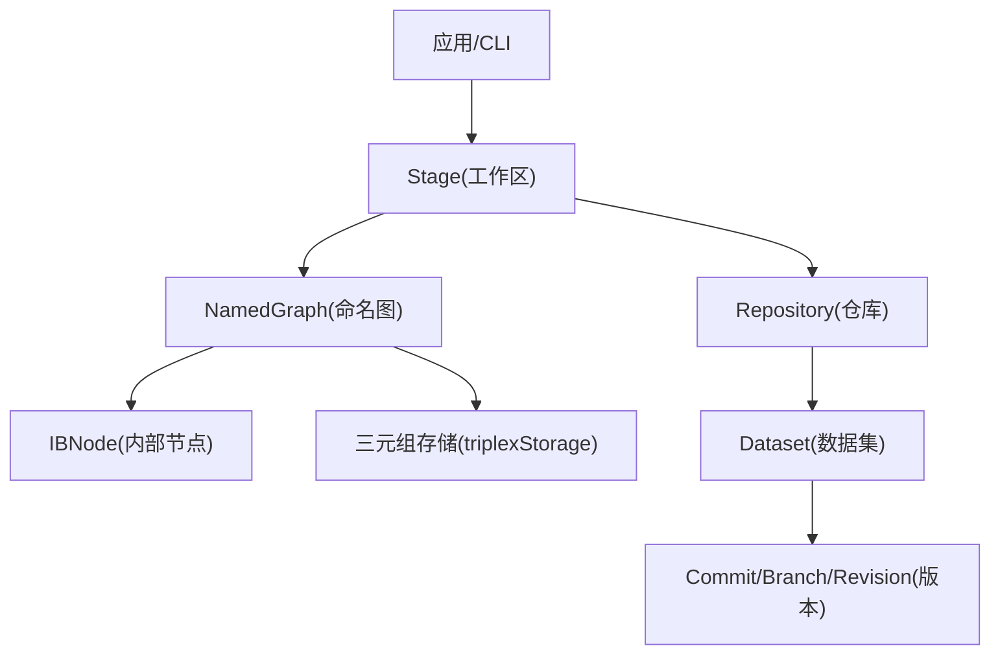
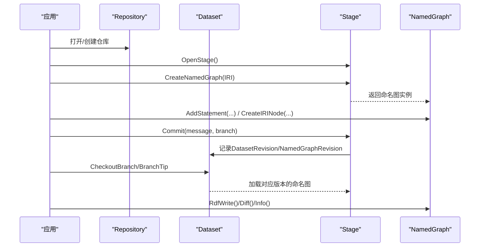
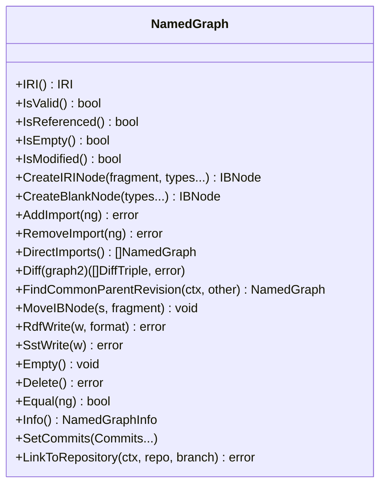
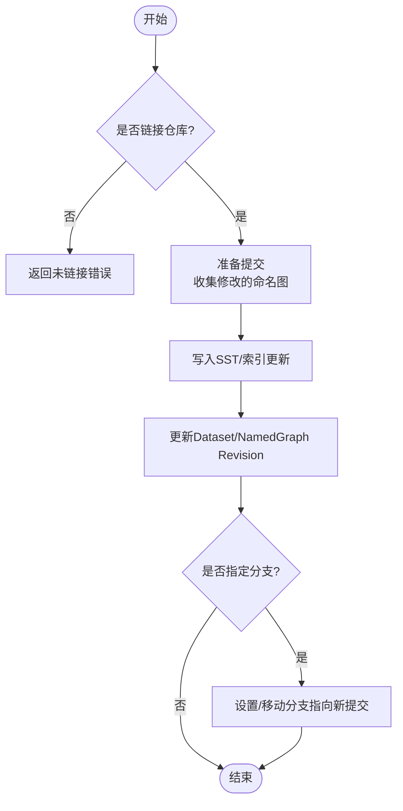
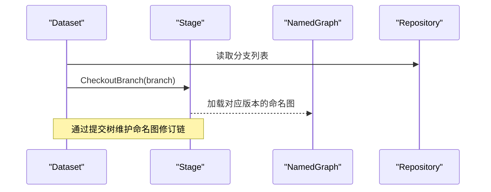

# 命名图

<cite>
**本文引用的文件**
- [sst/namedgraph.go](file://sst/namedgraph.go)
- [sst/dataset.go](file://sst/dataset.go)
- [sst/stage.go](file://sst/stage.go)
- [sst/rdf.go](file://sst/rdf.go)
- [sst/types.go](file://sst/types.go)
- [examples/helloworldrepolocalfull/repolocalfull.go](file://examples/helloworldrepolocalfull/repolocalfull.go)
- [cli/cmd/interactive/namedgraph_handler.go](file://cli/cmd/interactive/namedgraph_handler.go)
</cite>

## 目录
1. [简介](#简介)
2. [项目结构](#项目结构)
3. [核心组件](#核心组件)
4. [架构总览](#架构总览)
5. [详细组件分析](#详细组件分析)
6. [依赖关系分析](#依赖关系分析)
7. [性能考量](#性能考量)
8. [故障排查指南](#故障排查指南)
9. [结论](#结论)
10. [附录：操作示例与最佳实践](#附录：操作示例与最佳实践)

## 简介
本章节面向SST Core的“命名图”（Named Graph）能力，系统性阐述其在RDF数据组织中的角色、创建与管理方式、与数据集（Dataset）的关系、版本控制与变更追踪机制、在不同存储后端下的实现要点、以及常见问题的解决方案。文档同时提供可追溯的代码级参考路径，便于读者快速定位实现细节。

## 项目结构
围绕命名图的核心代码主要分布在以下模块：
- 命名图接口与实现：sst/namedgraph.go
- 数据集抽象与版本管理：sst/dataset.go
- 工作区（Stage）与合并流程：sst/stage.go
- RDF术语与序列化基础：sst/rdf.go
- 内置类型与静态图定义：sst/types.go
- 示例应用（本地仓库读写）：examples/helloworldrepolocalfull/repolocalfull.go
- CLI交互层对命名图的列举与查询：cli/cmd/interactive/namedgraph_handler.go

图表来源
- [sst/stage.go:53-74](file://sst/stage.go#L53-L74)
- [sst/namedgraph.go:59-107](file://sst/namedgraph.go#L59-L107)
- [sst/dataset.go:9-30](file://sst/dataset.go#L9-L30)

章节来源
- [sst/stage.go:53-74](file://sst/stage.go#L53-L74)
- [sst/namedgraph.go:59-107](file://sst/namedgraph.go#L59-L107)
- [sst/dataset.go:9-30](file://sst/dataset.go#L9-L30)

## 核心组件
- NamedGraph接口与实现：定义了命名图的标识IRI、状态判断、节点与三元组操作、导入关系、差异比较、版本关联等能力。
- Stage工作区：负责在内存中组织多个命名图，支持创建、获取、遍历、提交、移动合并等操作。
- Dataset数据集：表示一个默认命名图及其直接/间接导入的所有命名图，并提供分支、提交、检出等版本管理能力。
- RDF基础：提供IRI、字面量、三元组/四元组的序列化与解析基础。
- 类型系统：内置RDF/XSD/SST等静态命名图与类型节点，支撑类型化建模。

章节来源
- [sst/namedgraph.go:110-409](file://sst/namedgraph.go#L110-L409)
- [sst/stage.go:64-170](file://sst/stage.go#L64-L170)
- [sst/dataset.go:9-94](file://sst/dataset.go#L9-L94)
- [sst/rdf.go:102-117](file://sst/rdf.go#L102-L117)
- [sst/types.go:9-30](file://sst/types.go#L9-L30)

## 架构总览
命名图是SST中RDF数据的逻辑单元，承载一组IBNode与其三元组。Stage将多个命名图组织到内存工作区，支持增删改查与合并；Dataset则对这些命名图进行版本化管理（分支、提交、检出），并通过导入关系形成数据集视图。

图表来源
- [sst/stage.go:74-170](file://sst/stage.go#L74-L170)
- [sst/dataset.go:30-94](file://sst/dataset.go#L30-L94)
- [sst/namedgraph.go:110-409](file://sst/namedgraph.go#L110-L409)

## 详细组件分析

### 命名图（NamedGraph）
- 标识与状态
  - IRI()：命名图唯一标识IRI；ID()已废弃，建议使用IRI()。
  - IsReferenced()：仅包含无主体三元组的IBNode时为引用态，不会被提交写出。
  - IsEmpty()/IsModified()：空图与修改标记。
- 节点与三元组
  - CreateIRINode/CreateBlankNode/CreateCollection：创建节点与集合。
  - ForAllIBNodes/ForIRINodes/ForBlankNodes/ForTermCollection：遍历节点与集合。
  - GetIRINodeByFragment/GetBlankNodeByID：按片段或UUID查找节点。
  - AddImport/RemoveImport/DirectImports：管理owl:imports导入关系。
  - Diff(graph2)：计算两个命名图差异，包含导入级别与内容级别变化。
  - MoveIBNode/Merge：跨图移动节点与合并。
- 版本与仓库关联
  - LinkToRepository(repo, branch)：将命名图与仓库分支关联，准备后续提交以保留历史。
  - FindCommonParentRevision(other)：在三方差异/合并时寻找共同祖先。
  - SetCommits：设置父提交信息（用于MoveAndMerge或手动合并）。
- 输出与调试
  - RdfWrite(w, format)/SstWrite(w)：导出为Turtle/TriG或SST格式。
  - Info()/Dump()/PrintTriples()：统计与调试输出。

图表来源
- [sst/namedgraph.go:110-409](file://sst/namedgraph.go#L110-L409)

章节来源
- [sst/namedgraph.go:110-409](file://sst/namedgraph.go#L110-L409)

### 工作区（Stage）
- 命名图管理
  - CreateNamedGraph(iri)：在当前Stage创建命名图。
  - NamedGraphs()/ForNamedGraphs()：枚举本地命名图。
  - ReferencedGraphs()/ForReferencedNamedGraphs()：枚举引用态命名图。
- 提交与合并
  - Commit(ctx, message, branch)：持久化修改，生成DatasetRevision/NamedGraphRevision。
  - MoveAndMerge(from)：跨Stage移动与合并命名图，自动处理三方差异与父提交。
  - AlignHistory(from)：对齐历史元数据，使从不同来源创建的命名图能正确提交到同一仓库。
- 仓库链接
  - LinkToRepository(repo, branch)：批量将Stage内所有本地命名图链接到指定仓库与分支。

图表来源
- [sst/stage.go:121-170](file://sst/stage.go#L121-L170)

章节来源
- [sst/stage.go:64-170](file://sst/stage.go#L64-L170)

### 数据集（Dataset）
- 视图模型：默认命名图+直接/间接导入的所有命名图构成数据集视图。
- 版本管理：
  - Branches()：列出分支名到提交哈希的映射。
  - CheckoutBranch/CheckoutCommit/CheckoutRevision：检出版本到Stage。
  - CommitDetailsByHash/ByBranch：获取提交详情（含各命名图修订）。
  - FindCommonParentRevision：用于三方差异/合并的共同祖先查找。
- 分支操作：SetBranchCommit/SetBranchRevision/RemoveBranch。

图表来源
- [sst/dataset.go:30-94](file://sst/dataset.go#L30-L94)

章节来源
- [sst/dataset.go:9-94](file://sst/dataset.go#L9-L94)

### RDF基础与序列化
- 支持的序列化格式：Turtle、TriG。
- 术语与三元组：IRI、字面量（含语言标签）、三元组/四元组序列化。
- 命名图导出：
  - NamedGraph.RdfWrite：导出单个命名图为Turtle。
  - Stage.RdfWrite：导出多命名图为TriG（默认图+导入图）。

章节来源
- [sst/rdf.go:102-117](file://sst/rdf.go#L102-L117)
- [sst/namedgraph.go:191-195](file://sst/namedgraph.go#L191-L195)
- [sst/stage.go:219-222](file://sst/stage.go#L219-L222)

### 类型系统与静态图
- 内置静态命名图：RDF、XSD、SST框架等，提供常用类型与资源节点。
- 类型节点：如string、int、dateTime、langString等，用于字面量类型化。

章节来源
- [sst/types.go:9-30](file://sst/types.go#L9-L30)
- [sst/types.go:63-199](file://sst/types.go#L63-L199)

## 依赖关系分析
- Stage依赖Repository与Dataset进行版本化提交；命名图依赖Stage进行生命周期管理。
- 命名图之间通过导入关系形成DAG，Dataset确保导入无环。
- 版本控制通过提交树（commit tree）与命名图修订（NamedGraphRevision）实现。

图表来源
- [sst/dataset.go:9-30](file://sst/dataset.go#L9-L30)
- [sst/stage.go:53-74](file://sst/stage.go#L53-L74)
- [sst/namedgraph.go:222-235](file://sst/namedgraph.go#L222-L235)

章节来源
- [sst/dataset.go:9-30](file://sst/dataset.go#L9-L30)
- [sst/stage.go:53-74](file://sst/stage.go#L53-L74)
- [sst/namedgraph.go:222-235](file://sst/namedgraph.go#L222-L235)

## 性能考量
- TriplexMode：当前默认模式同时维护subject/predicate/object三类三元组索引，适合复杂查询但占用更多内存。可根据应用场景选择更轻量模式（未来扩展）。
- 导入关系：大量导入会增加遍历与合并成本，建议合理划分命名图粒度。
- 批量操作：尽量使用批量添加三元组与集合构造，减少频繁分配与索引更新。
- 导出优化：大规模数据导出优先使用TriG格式，避免多次Turtle写开销。

[本节为通用指导，不直接分析具体文件]

## 故障排查指南
- 常见错误
  - 命名图不存在：ErrNamedGraphNotFound
  - 重复片段：ErrDuplicatedFragment
  - 无法删除被引用的命名图：ErrReferencedNamedGraphCanNotBeDeleted
  - 导入循环：ErrNamedGraphImportCycle
  - 阶段无效或未链接仓库：ErrStageDeletedOrInvalid / ErrStageNotLinkToRepository
  - 分支名为空：ErrEmptyBranchName
  - 命名图已被链接：ErrNamedGraphAlreadyLinked
- 排查步骤
  - 检查命名图是否处于引用态（IsReferenced），引用态不可直接提交写出。
  - 确认导入关系无环（AddImport会检测）。
  - 若需删除，先解除引用或使用Empty清空内容。
  - 提交前确保Stage已链接到仓库并指定有效分支。

章节来源
- [sst/namedgraph.go:20-40](file://sst/namedgraph.go#L20-L40)
- [sst/stage.go:21-31](file://sst/stage.go#L21-L31)

## 结论
SST Core的命名图提供了强大的RDF数据组织能力，结合Stage的工作区模型与Dataset的版本控制，实现了灵活的创建、管理、查询与合并流程。通过导入关系与三元组索引，既能满足复杂查询需求，也能保持较好的可扩展性。遵循最佳实践与故障排查指引，可在实际项目中高效稳定地使用命名图功能。

[本节为总结，不直接分析具体文件]

## 附录：操作示例与最佳实践

### 创建与添加三元组
- 在工作区创建命名图并添加节点与三元组，随后提交到仓库分支。
- 参考路径
  - [examples/helloworldrepolocalfull/repolocalfull.go:41-59](file://examples/helloworldrepolocalfull/repolocalfull.go#L41-L59)

### 查询与列举
- 列举IRI节点、空白节点、全部IBNode，或通过片段/UUID获取节点。
- 参考路径
  - [cli/cmd/interactive/namedgraph_handler.go:18-100](file://cli/cmd/interactive/namedgraph_handler.go#L18-L100)
  - [cli/cmd/interactive/namedgraph_handler.go:103-200](file://cli/cmd/interactive/namedgraph_handler.go#L103-L200)

### 删除与清空
- Empty()：清空命名图内容但保持命名图有效。
- Delete()：尝试删除命名图，若被其他命名图引用则失败。
- 参考路径
  - [sst/namedgraph.go:277-294](file://sst/namedgraph.go#L277-L294)

### 版本控制与变更追踪
- LinkToRepository：将命名图与仓库分支关联，以便后续提交保留历史。
- FindCommonParentRevision：在三方差异/合并时寻找共同祖先。
- 参考路径
  - [sst/namedgraph.go:415-503](file://sst/namedgraph.go#L415-L503)
  - [sst/namedgraph.go:572-622](file://sst/namedgraph.go#L572-L622)

### 导入与差异
- AddImport/RemoveImport/DirectImports：管理owl:imports导入关系。
- Diff：计算两个命名图的差异，包括导入级别与内容级别变化。
- 参考路径
  - [sst/namedgraph.go:222-253](file://sst/namedgraph.go#L222-L253)

### 导出与序列化
- RdfWrite：导出为Turtle；Stage.RdfWrite：导出多命名图为TriG。
- 参考路径
  - [sst/namedgraph.go:191-195](file://sst/namedgraph.go#L191-L195)
  - [sst/stage.go:219-222](file://sst/stage.go#L219-L222)

### 最佳实践
- 合理划分命名图粒度，避免过大图导致性能问题。
- 谨慎使用导入关系，确保无环且最小化间接导入深度。
- 使用LinkToRepository将命名图与仓库分支关联，保证提交历史连续性。
- 大规模导出优先使用TriG格式，减少序列化开销。
- 在需要只读访问的场景，使用CheckoutBranch/CheckoutCommit加载只读视图。

[本节为实践指导，不直接分析具体文件]