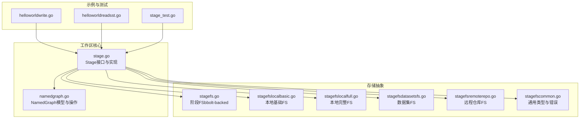
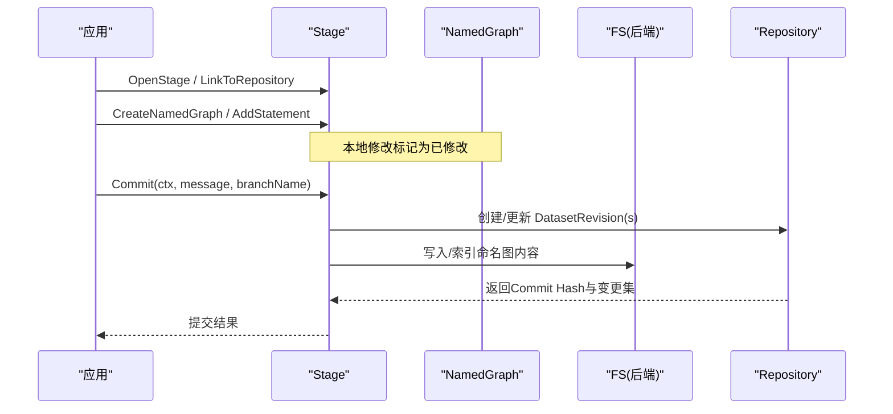
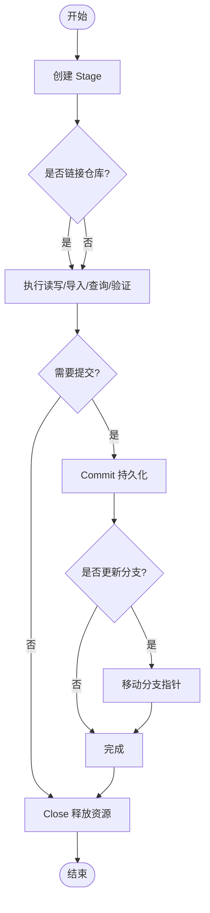
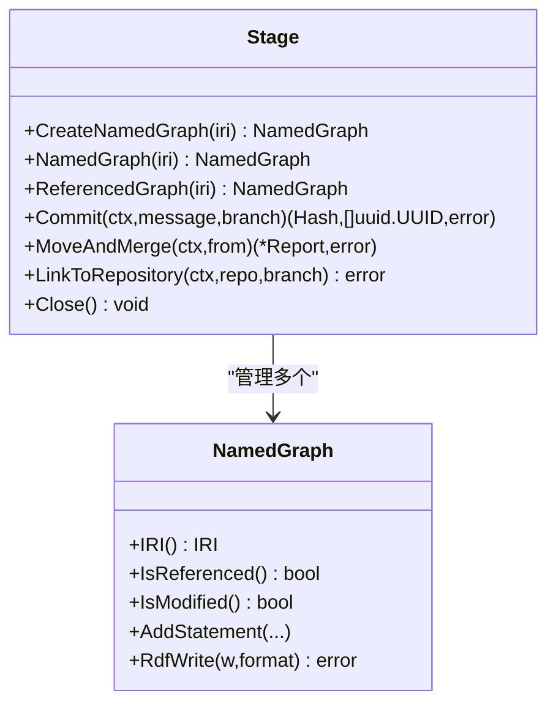
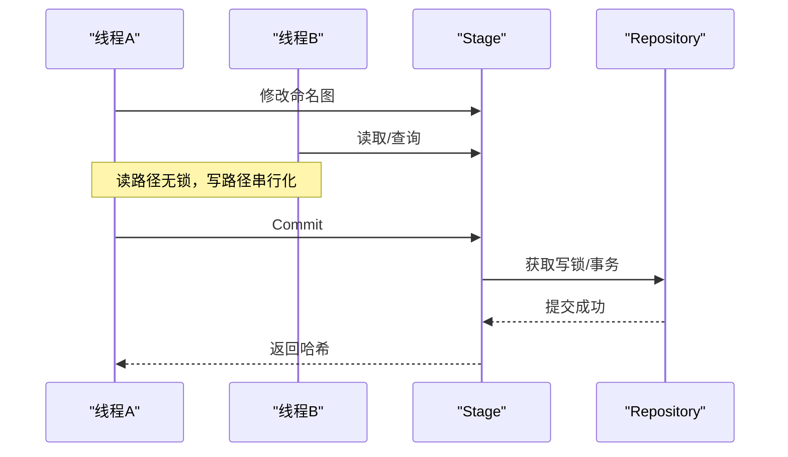
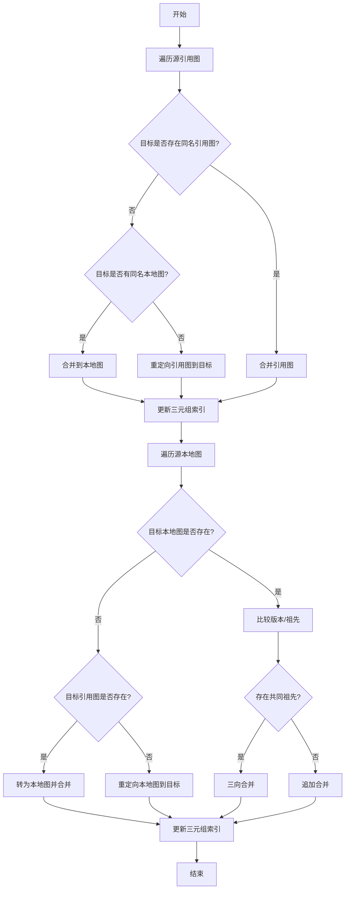
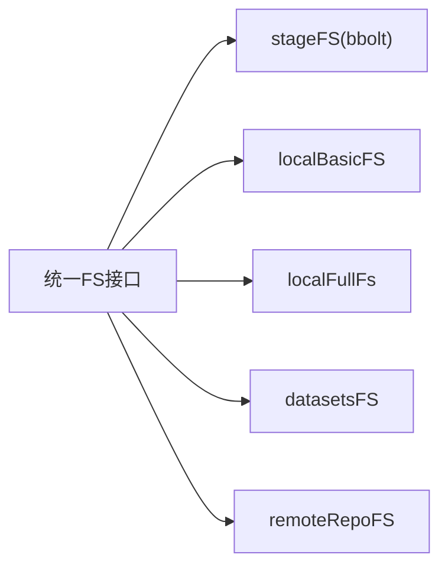
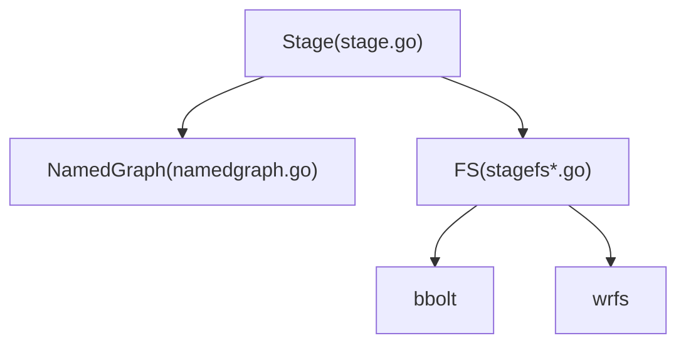

# 工作区（Stage）

<cite>
**本文引用的文件**
- [stage.go](file://sst/stage.go)
- [namedgraph.go](file://sst/namedgraph.go)
- [stagefs.go](file://sst/stagefs.go)
- [stagefscommon.go](file://sst/stagefscommon.go)
- [stagefslocalbasic.go](file://sst/stagefslocalbasic.go)
- [stagefslocalfull.go](file://sst/stagefslocalfull.go)
- [stagefsdatasetsfs.go](file://sst/stagefsdatasetsfs.go)
- [stagefsremoterepo.go](file://sst/stagefsremoterepo.go)
- [helloworldwrite.go](file://examples/helloworldwrite/helloworldwrite.go)
- [helloworldreadsst.go](file://examples/helloworldreadsst/helloworldreadsst.go)
- [stage_test.go](file://sst/stage_test.go)
</cite>

## 目录
1. [简介](#简介)
2. [项目结构](#项目结构)
3. [核心组件](#核心组件)
4. [架构总览](#架构总览)
5. [详细组件分析](#详细组件分析)
6. [依赖关系分析](#依赖关系分析)
7. [性能考虑](#性能考虑)
8. [故障排除指南](#故障排除指南)
9. [结论](#结论)
10. [附录：使用示例与最佳实践](#附录：使用示例与最佳实践)

## 简介
本章节面向SST Core的工作区（Stage）能力，系统阐述其概念、生命周期、事务特性、并发控制以及与命名图（NamedGraph）的关联和数据隔离机制。同时给出在不同存储模式下的行为差异、性能考量、最佳实践与常见问题排查方法，帮助读者在批量导入、复杂查询、数据验证等场景中高效、安全地使用工作区。

## 项目结构
围绕工作区的核心代码主要位于 sst 包中，关键文件包括：
- 工作区接口与实现：stage.go
- 命名图模型与操作：namedgraph.go
- 文件系统抽象与多种后端实现：stagefs*.go
- 示例程序：examples/*
- 测试用例：sst/stage_test.go

图表来源
- [stage.go:53-234](file://sst/stage.go#L53-L234)
- [stagefs.go:23-169](file://sst/stagefs.go#L23-L169)
- [stagefslocalbasic.go:21-126](file://sst/stagefslocalbasic.go#L21-L126)
- [stagefslocalfull.go:16-129](file://sst/stagefslocalfull.go#L16-L129)
- [stagefsdatasetsfs.go:22-85](file://sst/stagefsdatasetsfs.go#L22-L85)
- [stagefsremoterepo.go:16-131](file://sst/stagefsremoterepo.go#L16-L131)
- [stagefscommon.go:16-93](file://sst/stagefscommon.go#L16-L93)

章节来源
- [stage.go:53-234](file://sst/stage.go#L53-L234)
- [stagefs.go:23-169](file://sst/stagefs.go#L23-L169)

## 核心组件
- 工作区（Stage）
  - 内存中的图集合容器，维护本地命名图与引用命名图，支持创建、提交、合并、对齐历史、导出等操作。
  - 可链接到仓库进行持久化提交；也可作为临时工作区不绑定仓库。
- 命名图（NamedGraph）
  - RDF 命名图的内存表示，包含IBNode、三元组及导入关系，支持只读引用状态与本地修改状态。
- 存储抽象（FS）
  - 通过统一的 fs.FS 接口屏蔽底层存储差异，支持 bbolt 桶、内存映射、远程仓库等多种后端。

章节来源
- [stage.go:53-234](file://sst/stage.go#L53-L234)
- [namedgraph.go:42-108](file://sst/namedgraph.go#L42-L108)
- [stagefs.go:23-169](file://sst/stagefs.go#L23-L169)

## 架构总览
工作区以“内存图+可选仓库链接”为核心，配合统一的文件系统抽象对接不同持久化后端。提交时生成新的命名图版本与数据集版本，并可选择分支指针更新。

图表来源
- [stage.go:121-170](file://sst/stage.go#L121-L170)
- [stagefs.go:98-169](file://sst/stagefs.go#L98-L169)

章节来源
- [stage.go:121-170](file://sst/stage.go#L121-L170)
- [stagefs.go:98-169](file://sst/stagefs.go#L98-L169)

## 详细组件分析

### 工作区（Stage）生命周期
- 创建
  - 通过 OpenStage 创建临时工作区；或通过 RepositoryOpenStage 从仓库检出特定版本的数据集。
- 链接仓库
  - LinkToRepository 将工作区与仓库绑定，所有本地命名图默认附加到同一分支；如需细粒度分支控制，可直接对命名图调用 LinkToRepository。
- 提交
  - Commit 将工作区内所有命名图与IBNode变更持久化，为每个修改的命名图创建新版本，并为受影响的数据集创建新版本；可选择更新分支指针。
- 回滚
  - 未提交的变更可通过丢弃工作区或重新检出历史版本实现；提交后通过分支/标签回退至历史提交。
- 销毁
  - Close 释放工作区占用的内存资源，之后不可再用。

图表来源
- [stage.go:118-177](file://sst/stage.go#L118-L177)

章节来源
- [stage.go:118-177](file://sst/stage.go#L118-L177)

### 工作区与命名图的关联与数据隔离
- 关联关系
  - 工作区维护 localGraphs 与 referencedGraphs 两张表：本地命名图可被修改并提交；引用命名图仅用于承载被其他图引用的IBNode，默认不可直接修改。
- 数据隔离
  - 每个命名图有独立的三元组存储与节点集合；跨图访问通过引用与导入关系进行，避免共享可变状态。
- 导入与可见性
  - 命名图可声明导入关系，工作区在加载数据集时会解析并构建可见视图；提交时按依赖顺序处理。

图表来源
- [stage.go:53-234](file://sst/stage.go#L53-L234)
- [namedgraph.go:42-108](file://sst/namedgraph.go#L42-L108)

章节来源
- [stage.go:53-234](file://sst/stage.go#L53-L234)
- [namedgraph.go:42-108](file://sst/namedgraph.go#L42-L108)

### 工作区的事务特性与并发访问控制
- 事务特性
  - 提交过程原子地创建命名图版本与数据集版本；若失败则不改变仓库状态。
  - 支持三向合并策略：当存在共同祖先时，优先基于共同祖先进行合并；否则追加式合并。
- 并发控制
  - 工作区内部以内存结构为主，适合单进程内并发；跨进程/跨实例需依赖仓库层面的锁或分布式协调。
  - 提交时对仓库写路径加锁（由仓库实现保证），避免多客户端冲突。

图表来源
- [stage.go:121-170](file://sst/stage.go#L121-L170)

章节来源
- [stage.go:121-170](file://sst/stage.go#L121-L170)

### 合并与移动（MoveAndMerge）流程
- 目标
  - 将源工作区的命名图移动到目标工作区，并在必要时进行合并。
- 策略
  - 引用图到引用图：合并IBNode。
  - 引用图到本地图：合并IBNode并更新三元组索引。
  - 本地图到本地图：若版本相同且同仓库，比较修改标记决定保留；若有共同祖先，执行三向合并；否则追加合并。
  - 跨仓库移动：标记为已修改，确保后续提交能正确反映变更。

图表来源
- [stage.go:468-800](file://sst/stage.go#L468-L800)

章节来源
- [stage.go:468-800](file://sst/stage.go#L468-L800)

### 存储模式与文件系统抽象
- 阶段FS（stageFS）
  - 基于 bbolt 桶组织命名图版本，键为SHA哈希，值为二进制内容；提供 Open/ReadDir/OpenFile 语义。
- 本地基础FS（localBasicFS）
  - 简单桶存储，适合基本读写场景。
- 本地完整FS（localFullFs）
  - 维护排序后的图ID与哈希列表，优化遍历与查找。
- 数据集FS（datasetsFS）
  - 暴露数据集级别的目录视图，便于上层工具访问。
- 远程仓库FS（remoteRepoFS）
  - 内存映射命名图版本与哈希映射，模拟文件系统接口，便于远程场景下的一致性读取。

图表来源
- [stagefs.go:23-169](file://sst/stagefs.go#L23-L169)
- [stagefslocalbasic.go:21-126](file://sst/stagefslocalbasic.go#L21-L126)
- [stagefslocalfull.go:16-129](file://sst/stagefslocalfull.go#L16-L129)
- [stagefsdatasetsfs.go:22-85](file://sst/stagefsdatasetsfs.go#L22-L85)
- [stagefsremoterepo.go:16-131](file://sst/stagefsremoterepo.go#L16-L131)

章节来源
- [stagefs.go:23-169](file://sst/stagefs.go#L23-L169)
- [stagefslocalbasic.go:21-126](file://sst/stagefslocalbasic.go#L21-L126)
- [stagefslocalfull.go:16-129](file://sst/stagefslocalfull.go#L16-L129)
- [stagefsdatasetsfs.go:22-85](file://sst/stagefsdatasetsfs.go#L22-L85)
- [stagefsremoterepo.go:16-131](file://sst/stagefsremoterepo.go#L16-L131)

## 依赖关系分析
- 模块耦合
  - Stage 强依赖 NamedGraph 与 FS 抽象；FS 实现之间相互独立，通过统一接口解耦。
- 外部依赖
  - UUID、bbolt、wrfs 等库用于标识、持久化与文件系统抽象。
- 潜在循环
  - 当前设计无循环依赖；Stage 与 NamedGraph 单向依赖。

图表来源
- [stage.go:53-234](file://sst/stage.go#L53-L234)
- [stagefs.go:23-169](file://sst/stagefs.go#L23-L169)

章节来源
- [stage.go:53-234](file://sst/stage.go#L53-L234)
- [stagefs.go:23-169](file://sst/stagefs.go#L23-L169)

## 性能考虑
- 三元组模式
  - 默认模式同时维护主体、谓词、对象三元组，利于双向遍历但占用更多内存；可根据场景权衡。
- 存储选择
  - 本地基础FS适合小数据集；本地完整FS适合频繁遍历；远程FS适合只读或轻量编辑。
- 提交批量化
  - 尽量批量添加语句后再提交，减少版本碎片与索引重建开销。
- 合并成本
  - 三向合并可能昂贵，建议先做增量校验与去重，再触发合并。

[本节为通用指导，无需具体文件来源]

## 故障排除指南
- 常见错误
  - 命名图不存在：检查IRI与导入链是否正确。
  - 阶段无效或已删除：确认未调用 Close 或已被 MoveAndMerge 清空。
  - 未链接仓库：尝试提交前调用 LinkToRepository。
  - 预提交条件失败：检查业务规则或约束。
- 定位方法
  - 使用 Info/Dump 输出工作区统计与内容摘要。
  - 查看 MoveAndMergeReport 中的 Actions 与 Warnings。
  - 结合日志与上下文错误信息定位问题。

章节来源
- [stage.go:21-31](file://sst/stage.go#L21-L31)
- [stage.go:198-217](file://sst/stage.go#L198-L217)
- [stage.go:348-433](file://sst/stage.go#L348-L433)

## 结论
工作区（Stage）为SST Core提供了强大的内存图管理与事务化提交能力，结合统一的文件系统抽象，可在多种存储后端上实现一致的行为。通过合理的生命周期管理、合并策略与存储模式选择，能够支撑批量导入、复杂查询与数据验证等多样化场景。遵循最佳实践与故障排除建议，可显著提升开发效率与系统稳定性。

[本节为总结，无需具体文件来源]

## 附录：使用示例与最佳实践

### 典型使用场景
- 批量数据导入
  - 创建工作区 -> 创建命名图 -> 批量添加语句 -> 提交。
  - 参考路径：[helloworldwrite.go:39-97](file://examples/helloworldwrite/helloworldwrite.go#L39-L97)
- 复杂查询
  - 在工作区中遍历IBNode与三元组，利用 ForAllIBNodes/ForIRINodes 等方法进行过滤与聚合。
  - 参考路径：[helloworldreadsst.go:30-68](file://examples/helloworldreadsst/helloworldreadsst.go#L30-L68)
- 数据验证
  - 在提交前对工作区内容进行校验，如类型检查、完整性检查；失败则丢弃工作区或修正后重试。
  - 可结合 NamedGraph.IsModified 与 Info 统计信息进行快速自检。

章节来源
- [helloworldwrite.go:39-97](file://examples/helloworldwrite/helloworldwrite.go#L39-L97)
- [helloworldreadsst.go:30-68](file://examples/helloworldreadsst/helloworldreadsst.go#L30-L68)

### 最佳实践
- 明确工作区用途
  - 临时编辑：使用 OpenStage；持久化协作：LinkToRepository 后提交。
- 合理管理命名图
  - 区分本地与引用命名图；避免对引用图直接修改。
- 控制提交粒度
  - 按业务单元分组提交，便于回滚与审计。
- 利用合并报告
  - 审查 MoveAndMergeReport 的 Actions 与 Stats，确保合并符合预期。
- 资源释放
  - 及时调用 Close，避免内存泄漏。

章节来源
- [stage.go:118-177](file://sst/stage.go#L118-L177)
- [stage.go:348-433](file://sst/stage.go#L348-L433)

### 测试与验证
- 对齐历史
  - AlignHistory 可将源工作区的仓库指针与检出元数据复制到目标工作区，便于跨工作区一致性提交。
  - 参考路径：[stage_test.go:115-198](file://sst/stage_test.go#L115-L198)

章节来源
- [stage_test.go:115-198](file://sst/stage_test.go#L115-L198)