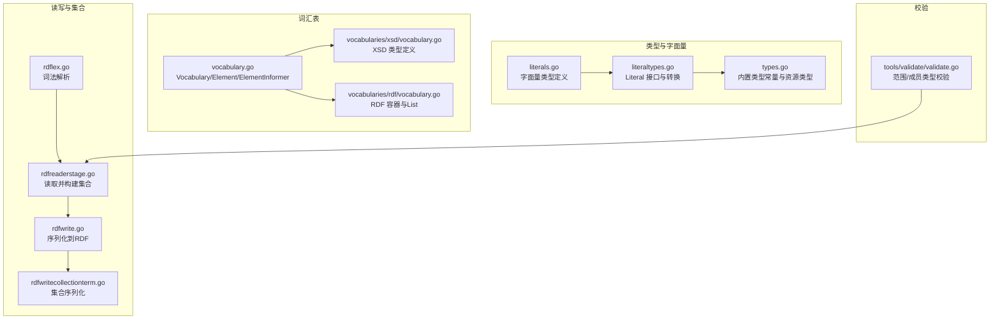
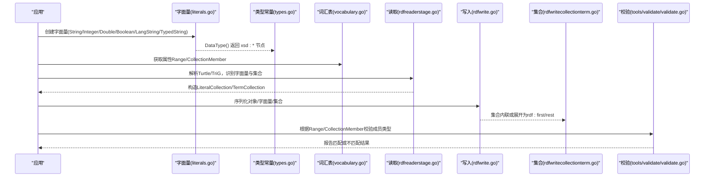
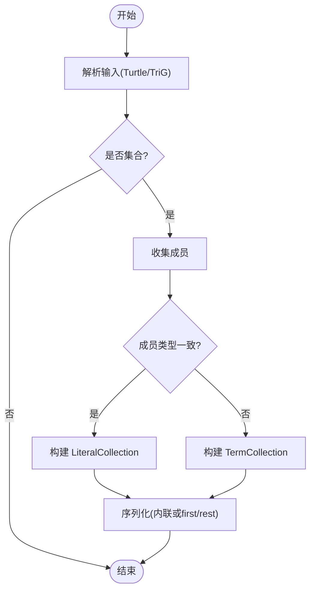
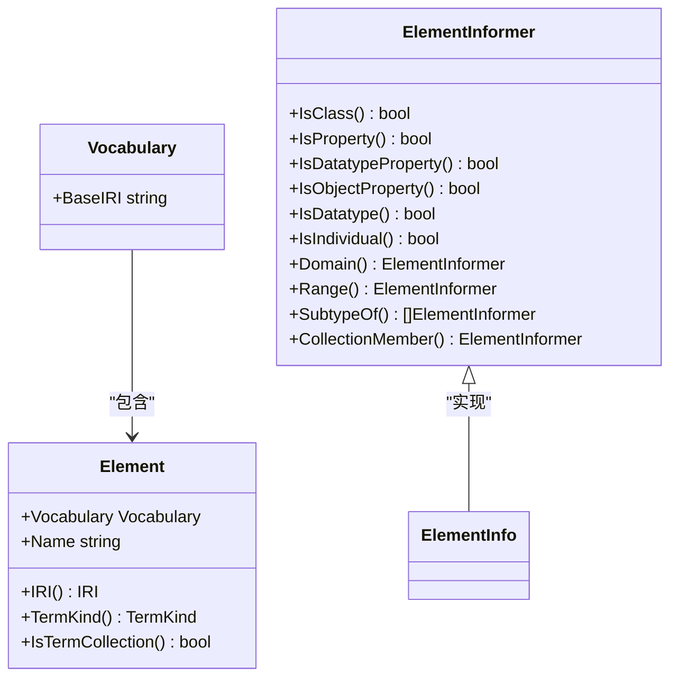
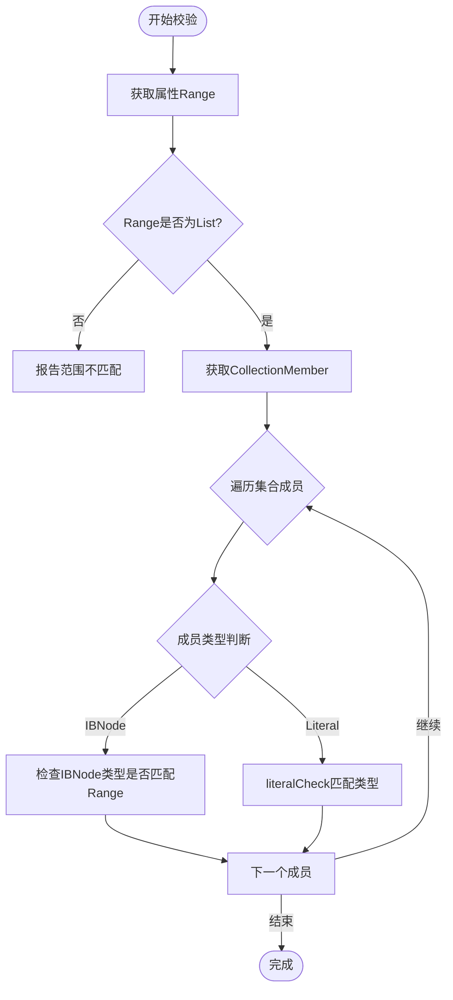
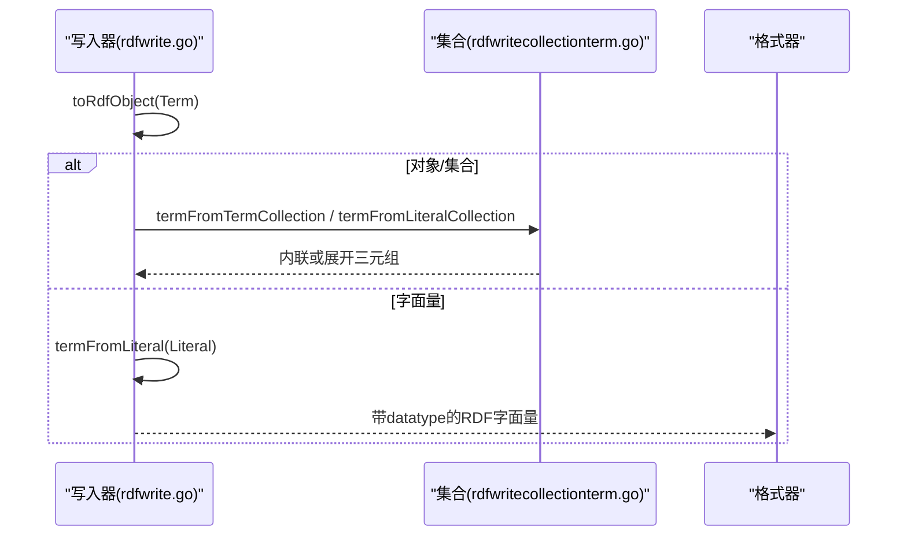
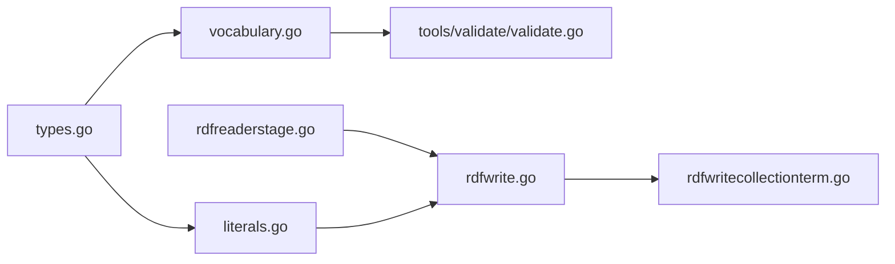

# 数据类型系统

<cite>
**本文引用的文件**
- [literaltypes.go](file://sst/literaltypes.go)
- [literals.go](file://sst/literals.go)
- [types.go](file://sst/types.go)
- [vocabulary.go](file://sst/vocabulary.go)
- [ibnode.go](file://sst/ibnode.go)
- [rdflex.go](file://sst/rdflex.go)
- [rdfwrite.go](file://sst/rdfwrite.go)
- [rdfwritecollectionterm.go](file://sst/rdfwritecollectionterm.go)
- [rdfreaderstage.go](file://sst/rdfreaderstage.go)
- [validate.go](file://tools/validate/validate.go)
- [vocabulary.go (xsd)](file://vocabularies/xsd/vocabulary.go)
- [vocabulary.go (rdf)](file://vocabularies/rdf/vocabulary.go)
</cite>

## 目录
1. [简介](#简介)
2. [项目结构](#项目结构)
3. [核心组件](#核心组件)
4. [架构总览](#架构总览)
5. [详细组件分析](#详细组件分析)
6. [依赖关系分析](#依赖关系分析)
7. [性能考量](#性能考量)
8. [故障排查指南](#故障排查指南)
9. [结论](#结论)
10. [附录](#附录)

## 简介
本文件系统性阐述 SST Core 的数据类型系统，覆盖以下主题：
- 支持的 RDF 数据类型：基本类型（字符串、整数、浮点数、布尔等）、复合类型（集合、列表）与自定义类型。
- 字面量的类型转换与序列化机制。
- 词汇表（Vocabulary）的作用与管理方式。
- 类型验证规则与约束检查机制。
- 具体代码示例路径，展示各类数据类型的创建与使用。
- 类型系统与 RDF 标准的兼容性说明。
- 扩展方法与自定义类型定义。
- 类型系统在查询与索引中的作用。

## 项目结构
SST Core 的类型系统由多模块协作实现：
- 字面量与类型接口定义位于 sst 包的核心文件。
- 词汇表与本体元素在 vocabularies 下按命名空间组织。
- RDF 读写与集合处理在 sst 包中完成。
- 校验逻辑在 tools/validate 中实现。



图表来源
- [literals.go:12-442](file://sst/literals.go#L12-L442)
- [literaltypes.go:10-112](file://sst/literaltypes.go#L10-L112)
- [types.go:32-207](file://sst/types.go#L32-L207)
- [vocabulary.go:15-212](file://sst/vocabulary.go#L15-L212)
- [rdflex.go:634-750](file://sst/rdflex.go#L634-L750)
- [rdfwrite.go:727-836](file://sst/rdfwrite.go#L727-L836)
- [rdfwritecollectionterm.go:10-108](file://sst/rdfwritecollectionterm.go#L10-L108)
- [rdfreaderstage.go:283-387](file://sst/rdfreaderstage.go#L283-L387)
- [validate.go:719-867](file://tools/validate/validate.go#L719-L867)

章节来源
- [literals.go:12-442](file://sst/literals.go#L12-L442)
- [literaltypes.go:10-112](file://sst/literaltypes.go#L10-L112)
- [types.go:32-207](file://sst/types.go#L32-L207)
- [vocabulary.go:15-212](file://sst/vocabulary.go#L15-L212)
- [rdflex.go:634-750](file://sst/rdflex.go#L634-L750)
- [rdfwrite.go:727-836](file://sst/rdfwrite.go#L727-L836)
- [rdfwritecollectionterm.go:10-108](file://sst/rdfwritecollectionterm.go#L10-L108)
- [rdfreaderstage.go:283-387](file://sst/rdfreaderstage.go#L283-L387)
- [validate.go:719-867](file://tools/validate/validate.go#L719-L867)

## 核心组件
- Literal 接口与专用类型：提供统一的字面量抽象与类型标识，支持 xsd:string、rdf:langString、xsd:double、xsd:float、xsd:integer、xsd:boolean、xsd:dateTime、xsd:dateTimeStamp 以及多种整型/无符号整型。
- 类型常量与资源类型：集中定义内置字面量类型节点（如 literalTypeString、literalTypeInteger 等），并关联到 XSD/RDF 命名空间。
- 词汇表体系：通过 Vocabulary、Element、ElementInformer 管理外部本体元素，并提供类型信息（域、值域、子类关系、集合成员类型等）。
- 集合与列表：TermCollection 与 LiteralCollection 分别表示对象集合与字面量集合；RDF List 通过 rdf:first/rdf:rest 链式结构表达。
- 读写与序列化：词法解析器识别字面量与集合语法；写入器将类型化字面量序列化为带 datatype 的 RDF 字面量；集合可内联或展开为三元组。
- 校验与约束：基于词汇表的 Range 与 CollectionMember 进行范围与成员类型校验，确保数据符合模型约定。

章节来源
- [literaltypes.go:10-112](file://sst/literaltypes.go#L10-L112)
- [literals.go:12-442](file://sst/literals.go#L12-L442)
- [types.go:32-207](file://sst/types.go#L32-L207)
- [vocabulary.go:15-212](file://sst/vocabulary.go#L15-L212)
- [rdfwrite.go:727-836](file://sst/rdfwrite.go#L727-L836)
- [rdfwritecollectionterm.go:10-108](file://sst/rdfwritecollectionterm.go#L10-L108)
- [rdfreaderstage.go:283-387](file://sst/rdfreaderstage.go#L283-L387)
- [validate.go:719-867](file://tools/validate/validate.go#L719-L867)

## 架构总览
下图展示了从字面量创建、类型标注、集合构建到序列化与校验的整体流程。



图表来源
- [literals.go:12-442](file://sst/literals.go#L12-L442)
- [types.go:32-207](file://sst/types.go#L32-L207)
- [vocabulary.go:15-212](file://sst/vocabulary.go#L15-L212)
- [rdfreaderstage.go:283-387](file://sst/rdfreaderstage.go#L283-L387)
- [rdfwrite.go:727-836](file://sst/rdfwrite.go#L727-L836)
- [rdfwritecollectionterm.go:10-108](file://sst/rdfwritecollectionterm.go#L10-L108)
- [validate.go:719-867](file://tools/validate/validate.go#L719-L867)

## 详细组件分析

### 字面量类型与转换
- 支持的类型包括：
  - 字符串：String（xsd:string）、LangString（rdf:langString）、TypedString（自定义 datatype）。
  - 数值：Integer（xsd:integer）、Double（xsd:double）、Float（xsd:float）、Byte/Short/Int/Long 及其无符号变体。
  - 布尔：Boolean（xsd:boolean）。
  - 日期时间：TypedString 配合 dateTime/dateTimeStamp。
- 每个字面量类型实现 Literal 接口，并通过 DataType() 返回对应的 IBNode 类型标识。
- 内部转换：
  - literalToObject 将内部存储的字面量转换为对应 Go 类型。
  - literalToString 将字面量序列化为可读字符串（用于调试或输出）。

```mermaid
classDiagram
class Literal {
+DataType() IBNode
+apiValue() interface{}
}
class String
class LangString
class TypedString
class Integer
class Double
class Float
class Boolean
class Byte
class Short
class Int
class Long
class UnsignedByte
class UnsignedShort
class UnsignedInt
class UnsignedLong
Literal <|.. String
Literal <|.. LangString
Literal <|.. TypedString
Literal <|.. Integer
Literal <|.. Double
Literal <|.. Float
Literal <|.. Boolean
Literal <|.. Byte
Literal <|.. Short
Literal <|.. Int
Literal <|.. Long
Literal <|.. UnsignedByte
Literal <|.. UnsignedShort
Literal <|.. UnsignedInt
Literal <|.. UnsignedLong
```

图表来源
- [literaltypes.go:10-112](file://sst/literaltypes.go#L10-L112)
- [literals.go:12-442](file://sst/literals.go#L12-L442)

章节来源
- [literaltypes.go:10-112](file://sst/literaltypes.go#L10-L112)
- [literals.go:12-442](file://sst/literals.go#L12-L442)

### 复合类型：集合与列表
- TermCollection：对象集合，成员为 Term（IBNode 或 Literal）。
- LiteralCollection：字面量集合，成员为 Literal。
- RDF List：通过 rdf:first/rdf:rest 链式三元组表示，空列表为 rdf:nil。
- 读取阶段：
  - 解析器识别集合语法，递归收集成员，若成员类型一致则构建 LiteralCollection，否则转为 TermCollection。
- 写入阶段：
  - 集合可内联为 Turtle 语法中的括号形式，或展开为 first/rest 三元组。



图表来源
- [rdfreaderstage.go:283-387](file://sst/rdfreaderstage.go#L283-L387)
- [rdfwrite.go:678-882](file://sst/rdfwrite.go#L678-L882)
- [rdfwritecollectionterm.go:10-108](file://sst/rdfwritecollectionterm.go#L10-L108)

章节来源
- [rdfreaderstage.go:283-387](file://sst/rdfreaderstage.go#L283-L387)
- [rdfwrite.go:678-882](file://sst/rdfwrite.go#L678-L882)
- [rdfwritecollectionterm.go:10-108](file://sst/rdfwritecollectionterm.go#L10-L108)

### 词汇表（Vocabulary）与作用
- Vocabulary 表示一个外部本体命名空间，Element 表示该命名空间下的 IRI 节点，ElementInformer 提供丰富的本体信息（类、属性、数据类型、域、值域、子类关系、集合成员类型等）。
- StaticDictionary 提供只读字典阶段，可访问内置本体图与元素。
- NamespaceToPrefix 支持 IRI 到前缀的映射，便于序列化与调试。
- 通过 ElementInformer.CollectionMember() 可获取集合成员类型，用于校验。



图表来源
- [vocabulary.go:15-212](file://sst/vocabulary.go#L15-L212)
- [vocabulary.go:214-403](file://sst/vocabulary.go#L214-L403)

章节来源
- [vocabulary.go:15-212](file://sst/vocabulary.go#L15-L212)
- [vocabulary.go:214-403](file://sst/vocabulary.go#L214-L403)

### 类型验证与约束检查
- 校验依据：
  - 属性的 Range：指定对象或字面量的期望类型。
  - 集合的 CollectionMember：指定集合成员的期望类型。
- 校验过程：
  - 对于 TermCollection，遍历成员，若为 IBNode 则检查其类型是否符合 Range；若为 Literal 则调用 literalCheck 进行类型匹配。
  - 对于 LiteralCollection，仅检查第一个成员的类型以推断集合成员类型。
- 错误报告：
  - 当类型不匹配时记录错误，包含主体、谓词、对象信息与期望/实际类型描述。



图表来源
- [validate.go:719-867](file://tools/validate/validate.go#L719-L867)

章节来源
- [validate.go:719-867](file://tools/validate/validate.go#L719-L867)

### 字面量序列化机制
- 序列化策略：
  - 字符串：直接输出引号包裹的值。
  - 语言标签字符串：输出值与语言标签。
  - 数值：根据类型格式化（保留小数点或科学计数法）。
  - 布尔：true/false。
  - 日期时间：作为带 datatype 的字符串。
- 集合序列化：
  - 内联模式：使用括号表示集合。
  - 展开模式：生成 rdf:first/rdf:rest 三元组链。



图表来源
- [rdfwrite.go:727-836](file://sst/rdfwrite.go#L727-L836)
- [rdfwritecollectionterm.go:10-108](file://sst/rdfwritecollectionterm.go#L10-L108)

章节来源
- [rdfwrite.go:727-836](file://sst/rdfwrite.go#L727-L836)
- [rdfwritecollectionterm.go:10-108](file://sst/rdfwritecollectionterm.go#L10-L108)

### 与 RDF 标准的兼容性
- 支持 RDF 核心概念：
  - IRI、空白节点、字面量、命名图。
  - 集合与列表：TermCollection/LiteralCollection 与 RDF List（rdf:first/rdf:rest）。
- 兼容 XSD 数据类型：
  - 内置类型映射到 xsd:string、xsd:integer、xsd:double、xsd:float、xsd:boolean、xsd:dateTime、xsd:dateTimeStamp 等。
- 兼容 RDF Schema 与 OWL：
  - 通过词汇表提供类、属性、数据类型及关系信息，支持域/值域与子类关系。

章节来源
- [types.go:32-207](file://sst/types.go#L32-L207)
- [vocabulary.go:15-212](file://sst/vocabulary.go#L15-L212)
- [vocabulary.go (xsd):1-800](file://vocabularies/xsd/vocabulary.go#L1-L800)
- [vocabulary.go (rdf):165-191](file://vocabularies/rdf/vocabulary.go#L165-L191)

### 扩展方法与自定义类型定义
- 自定义字面量类型：
  - 通过 TypedString 携带任意 Node 作为 datatype，支持非标准类型。
- 扩展词汇表：
  - 新增 vocabulary 包，定义 Element/ElementInformer，注册到全局词汇表映射。
- 集合成员类型：
  - 通过 ElementInformer.CollectionMember() 指定集合成员类型，驱动校验逻辑。

章节来源
- [literals.go:283-335](file://sst/literals.go#L283-L335)
- [vocabulary.go:15-212](file://sst/vocabulary.go#L15-L212)

### 类型系统在查询与索引中的作用
- 类型区分：
  - TermKind 区分 IBNode、Literal、LiteralCollection、TermCollection，影响查询与索引策略。
- 资源类型识别：
  - typedResource.resourceType 识别字面量与集合类型，辅助索引与复制操作。
- 词汇索引：
  - 在节点移动/复制时更新词汇索引，支持高效查询与合并。

章节来源
- [ibnode.go:19-34](file://sst/ibnode.go#L19-L34)
- [ibnode.go:546-588](file://sst/ibnode.go#L546-L588)
- [ibnode.go:181-328](file://sst/ibnode.go#L181-L328)

## 依赖关系分析
- 字面量类型依赖类型常量（types.go）提供的 IBNode 类型标识。
- 词汇表依赖静态图（types.go）与命名空间映射（vocabulary.go）。
- 读写模块依赖词法解析器与集合序列化组件。
- 校验模块依赖词汇表提供的 Range 与 CollectionMember。



图表来源
- [types.go:32-207](file://sst/types.go#L32-L207)
- [literals.go:12-442](file://sst/literals.go#L12-L442)
- [vocabulary.go:15-212](file://sst/vocabulary.go#L15-L212)
- [rdfreaderstage.go:283-387](file://sst/rdfreaderstage.go#L283-L387)
- [rdfwrite.go:727-836](file://sst/rdfwrite.go#L727-L836)
- [rdfwritecollectionterm.go:10-108](file://sst/rdfwritecollectionterm.go#L10-L108)
- [validate.go:719-867](file://tools/validate/validate.go#L719-L867)

章节来源
- [types.go:32-207](file://sst/types.go#L32-L207)
- [literals.go:12-442](file://sst/literals.go#L12-L442)
- [vocabulary.go:15-212](file://sst/vocabulary.go#L15-L212)
- [rdfreaderstage.go:283-387](file://sst/rdfreaderstage.go#L283-L387)
- [rdfwrite.go:727-836](file://sst/rdfwrite.go#L727-L836)
- [rdfwritecollectionterm.go:10-108](file://sst/rdfwritecollectionterm.go#L10-L108)
- [validate.go:719-867](file://tools/validate/validate.go#L719-L867)

## 性能考量
- 字面量序列化采用最小内存分配策略，避免不必要的中间对象。
- 集合序列化支持内联模式，减少三元组数量，提升输出效率。
- 词汇索引在节点移动/复制时增量更新，降低重复计算开销。
- 校验逻辑按需执行，仅在需要时检查 Range 与 CollectionMember。

[本节为通用指导，无需特定文件引用]

## 故障排查指南
- 常见错误：
  - 字面量类型不匹配：检查 DataType() 与 Range 是否一致。
  - 集合成员类型不一致：确认所有成员类型相同，或允许混合时使用 TermCollection。
  - 词汇表未注册：确保 RegisterDictionary 已调用，且命名空间映射正确。
- 定位方法：
  - 查看校验日志中的 Finding 信息，包含主体、谓词、对象与期望/实际类型。
  - 使用 ForAll 遍历三元组，确认集合结构与成员类型。

章节来源
- [validate.go:719-867](file://tools/validate/validate.go#L719-L867)
- [ibnode.go:47-60](file://sst/ibnode.go#L47-L60)

## 结论
SST Core 的数据类型系统以 Literal 接口为核心，结合词汇表与集合机制，提供了对 RDF/XSD 类型的高度兼容与扩展能力。通过严格的类型验证与高效的序列化策略，确保了数据的正确性与性能。开发者可通过自定义类型与词汇表扩展系统，满足复杂领域建模需求。

[本节为总结性内容，无需特定文件引用]

## 附录
- 代码示例路径（创建与使用各类数据类型）：
  - 字面量创建：参考 [literals.go:12-442](file://sst/literals.go#L12-L442)。
  - 集合创建：参考 [rdfreaderstage.go:283-387](file://sst/rdfreaderstage.go#L283-L387)。
  - 词汇表使用：参考 [vocabulary.go:15-212](file://sst/vocabulary.go#L15-L212)。
  - 序列化输出：参考 [rdfwrite.go:727-836](file://sst/rdfwrite.go#L727-L836)。
  - 类型校验：参考 [validate.go:719-867](file://tools/validate/validate.go#L719-L867)。

[本节为补充信息，无需特定文件引用]