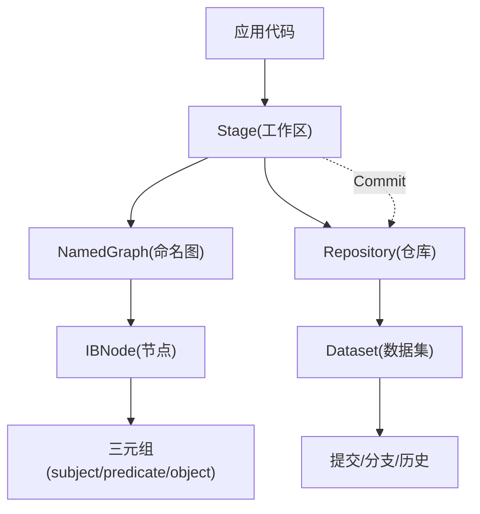
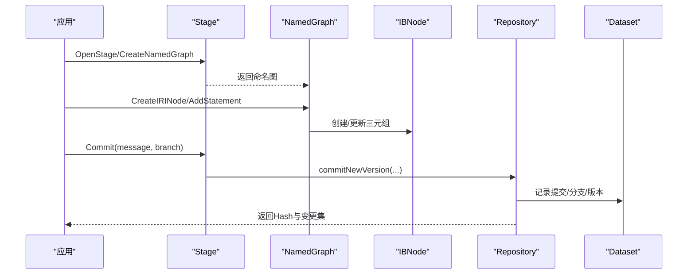
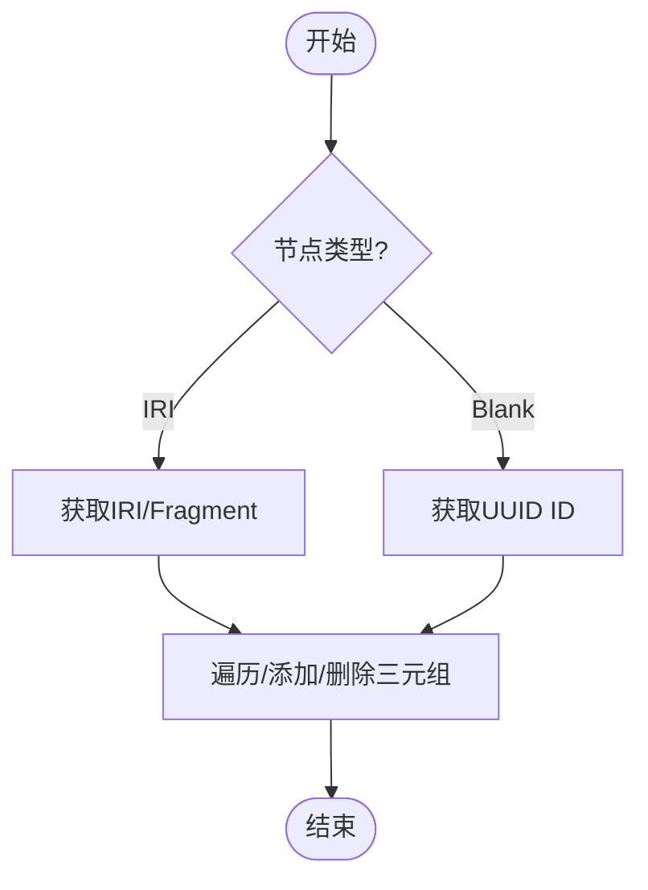
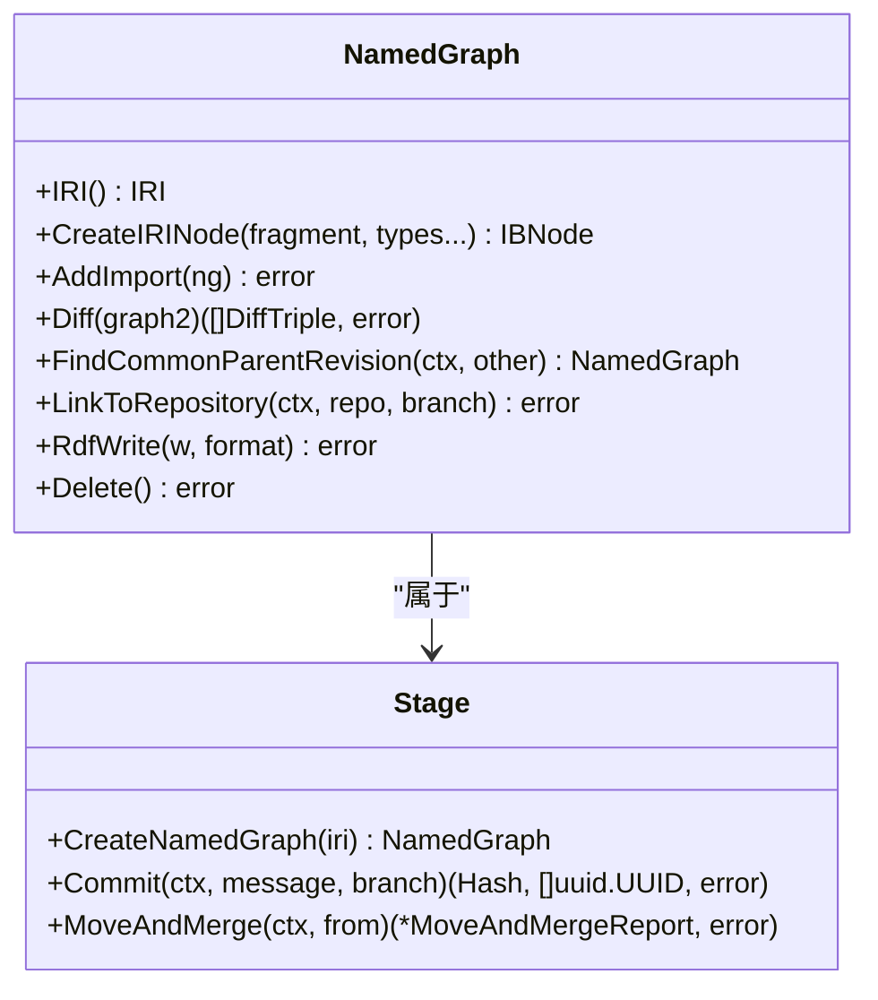
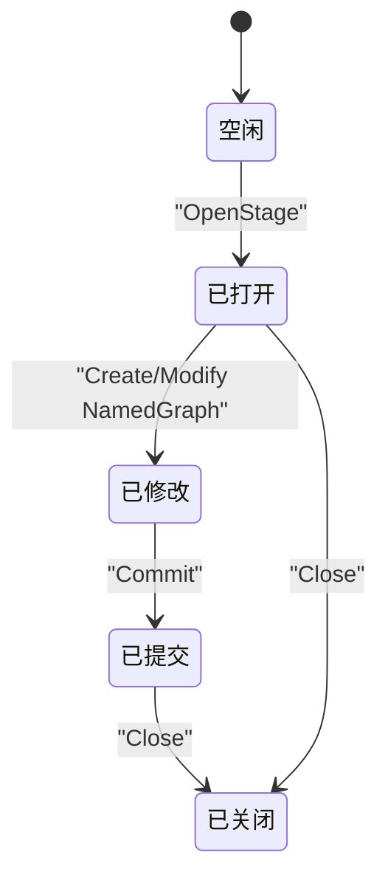
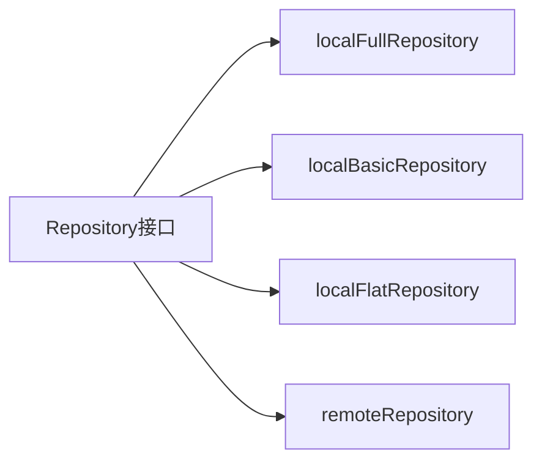
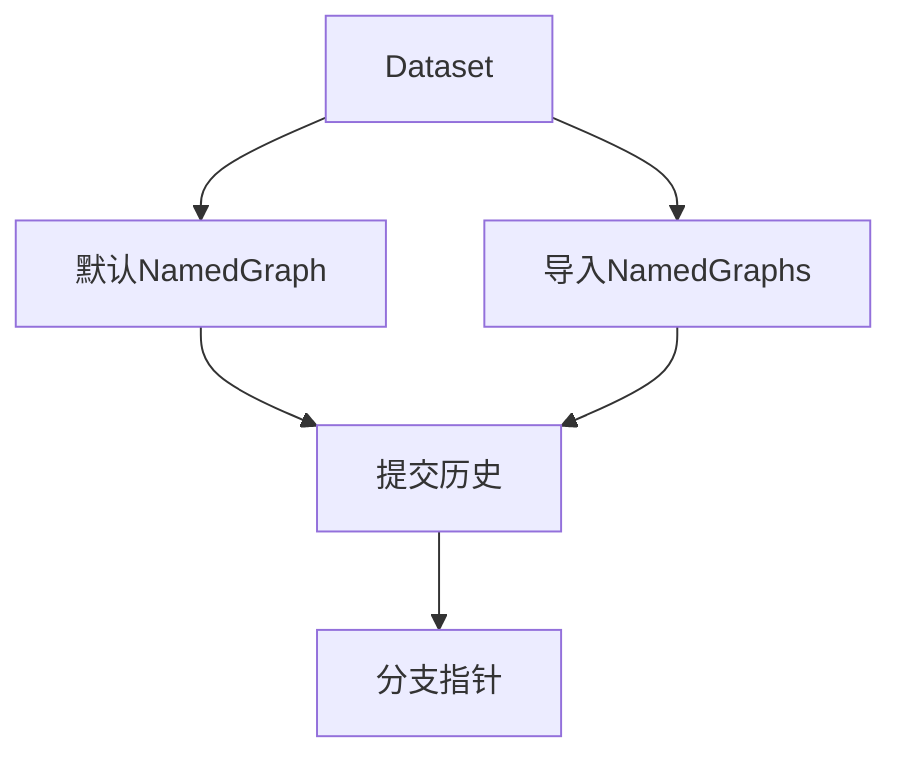
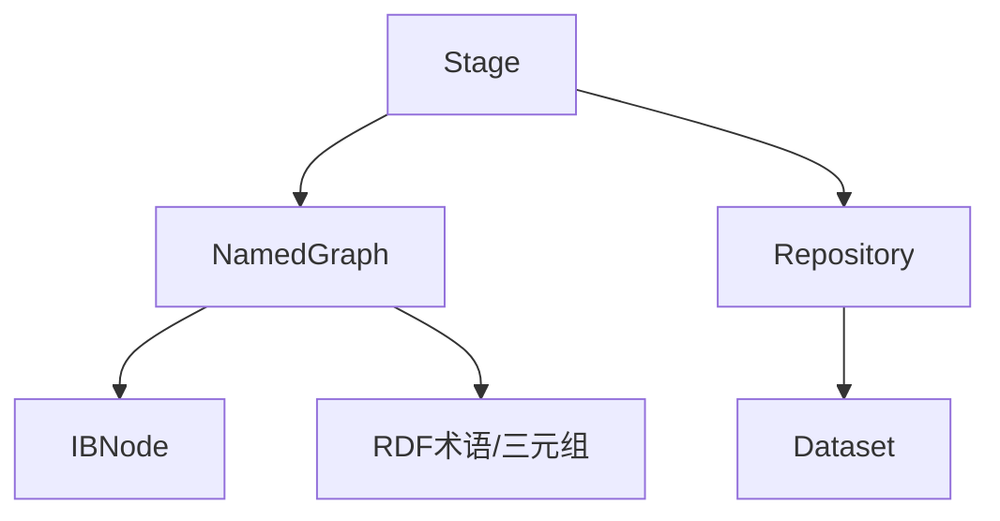

# 核心概念

<cite>
**本文引用的文件**
- [rdf.go](file://sst/rdf.go)
- [ibnode.go](file://sst/ibnode.go)
- [namedgraph.go](file://sst/namedgraph.go)
- [stage.go](file://sst/stage.go)
- [repository.go](file://sst/repository.go)
- [dataset.go](file://sst/dataset.go)
- [helloworldwrite.go](file://examples/helloworldwrite/helloworldwrite.go)
- [helloworldreadsst.go](file://examples/helloworldreadsst/helloworldreadsst.go)
</cite>

## 目录
1. [简介](#简介)
2. [项目结构](#项目结构)
3. [核心组件](#核心组件)
4. [架构总览](#架构总览)
5. [详细组件分析](#详细组件分析)
6. [依赖关系分析](#依赖关系分析)
7. [性能考虑](#性能考虑)
8. [故障排查指南](#故障排查指南)
9. [结论](#结论)
10. [附录：示例与最佳实践](#附录示例与最佳实践)

## 简介
本章节面向SST Core的核心概念，系统性阐述RDF三元组模型（主题-谓词-对象）、IRI节点与字面量的区别与用法、命名图（NamedGraph）的概念与管理、工作区（Stage）在事务性操作中的作用与生命周期、仓库（Repository）的抽象设计与不同实现模式、数据集（Dataset）的组织方式与版本控制机制。同时提供具体代码示例路径，解释概念之间的关系与数据流转过程，并给出最佳实践与性能建议。

## 项目结构
SST Core以“内存工作区 + 持久化仓库”的分层设计组织核心能力：
- RDF基础类型与序列化：定义三元组、四元组、IRI、字面量等基础类型及Turtle/TriG读写。
- 节点与三元组存储：IBNode作为资源或空白节点，承载三元组集合；三元组按subject/predicate/object三种索引存储。
- 命名图：NamedGraph封装一组IBNode及其三元组，支持导入、差异比较、合并、提交等。
- 工作区：Stage是内存中的可修改视图，支持创建/加载/合并/提交等操作。
- 仓库：Repository抽象出本地/远程等多种实现，提供数据集、分支、提交历史、文档、索引等能力。
- 数据集：Dataset表示一个默认命名图及其直接/间接导入的命名图集合，并提供基于分支/提交的检出与版本管理。



图表来源
- [stage.go:64-177](file://sst/stage.go#L64-L177)
- [namedgraph.go:110-399](file://sst/namedgraph.go#L110-L399)
- [ibnode.go:698-800](file://sst/ibnode.go#L698-L800)
- [repository.go:34-179](file://sst/repository.go#L34-L179)
- [dataset.go:9-94](file://sst/dataset.go#L9-L94)

章节来源
- [stage.go:64-177](file://sst/stage.go#L64-L177)
- [repository.go:34-179](file://sst/repository.go#L34-L179)
- [dataset.go:9-94](file://sst/dataset.go#L9-L94)

## 核心组件
- RDF三元组与术语：三元组由Subject/Predicate/Object构成，Object可为IBNode、Literal或集合；支持语言标签与数据类型。
- IRI与字面量：IRI用于标识资源，字面量用于表示值（字符串、数字、时间等），二者在语义与用途上严格区分。
- IBNode：统一表示IRI节点或空白节点，承载三元组访问与增删改查。
- NamedGraph：命名图是一组IBNode与三元组的容器，支持导入、差异、合并、导出、删除等。
- Stage：工作区是内存中的可编辑视图，支持创建/加载/移动合并/提交到仓库。
- Repository：仓库抽象了多种后端（本地BBolt+Bleve、远程gRPC、扁平文件等），提供数据集、分支、提交、文档、索引等能力。
- Dataset：数据集是默认命名图与其导入图的集合，提供基于分支/提交的检出与版本管理。

章节来源
- [rdf.go:119-571](file://sst/rdf.go#L119-L571)
- [ibnode.go:698-800](file://sst/ibnode.go#L698-L800)
- [namedgraph.go:110-399](file://sst/namedgraph.go#L110-L399)
- [stage.go:64-177](file://sst/stage.go#L64-L177)
- [repository.go:34-179](file://sst/repository.go#L34-L179)
- [dataset.go:9-94](file://sst/dataset.go#L9-L94)

## 架构总览
下图展示了从应用调用到数据落盘的典型流程：应用通过Stage创建/加载NamedGraph，对IBNode进行增删改，最终通过Repository提交为新的提交，形成Dataset的版本历史。



图表来源
- [stage.go:121-177](file://sst/stage.go#L121-L177)
- [namedgraph.go:191-349](file://sst/namedgraph.go#L191-L349)
- [repository.go:60-179](file://sst/repository.go#L60-L179)
- [dataset.go:30-94](file://sst/dataset.go#L30-L94)

## 详细组件分析

### RDF三元组模型与术语（主题-谓词-对象）
- 三元组：由Subject（IBNode）、Predicate（IRI）、Object（IBNode/Literal/集合）组成，支持序列化与比较。
- IRI：唯一标识资源，支持拆分base/fragment、校验与规范化。
- 字面量：带数据类型或语言标签的值，支持整数、浮点、布尔、日期时间、字节串等。
- 三元组存储：内部维护subject/predicate/object三类triplex，便于正向/反向遍历与查询。

```mermaid
classDiagram
class rdfTriple {
+Subj : IBNode
+Pred : IRI
+Obj : Term
+Serialize(format) string
}
class IRI {
+String() string
+Split() (base, fragment)
+rdfSerialize(format) string
}
class Literal {
+String() string
+Lang() string
+DataType() IRI
+Typed() interface{}
}
rdfTriple --> IRI : "使用"
rdfTriple --> Literal : "使用"
```

图表来源
- [rdf.go:119-571](file://sst/rdf.go#L119-L571)

章节来源
- [rdf.go:119-571](file://sst/rdf.go#L119-L571)

### IBNode：IRI节点与空白节点
- IBNode统一表示IRI节点或空白节点，提供类型、IRI/Fragment/ID、三元组遍历、增删改、删除等方法。
- 三元组访问：ForAll/GetObjects/GetTriple/AddStatement/AddStatementAlt/DeleteTriples等。
- 节点类型：支持IRI节点与空白节点，空白节点通过UUID标识。



图表来源
- [ibnode.go:698-800](file://sst/ibnode.go#L698-L800)

章节来源
- [ibnode.go:698-800](file://sst/ibnode.go#L698-L800)

### 命名图（NamedGraph）：概念、作用与管理
- 概念：命名图是包含IBNode与三元组的容器，具有唯一IRI标识，支持导入其他命名图。
- 状态：本地/引用（referenced）、已修改/未修改、已删除等。
- 管理：创建IRI/空白节点、添加语句、导入/移除导入、差异比较、三向合并、导出Turtle/SST、删除/清空。
- 版本：LinkToRepository将命名图关联到仓库分支，后续提交继承父提交历史。



图表来源
- [namedgraph.go:110-399](file://sst/namedgraph.go#L110-L399)
- [stage.go:74-177](file://sst/stage.go#L74-L177)

章节来源
- [namedgraph.go:110-399](file://sst/namedgraph.go#L110-L399)
- [stage.go:74-177](file://sst/stage.go#L74-L177)

### 工作区（Stage）：事务性操作与生命周期
- 作用：内存中可编辑的工作视图，支持创建/加载/移动合并/提交。
- 生命周期：OpenStage -> 操作NamedGraph -> Commit -> 可选Close释放资源。
- 事务性：Commit将多个NamedGraph的变更原子写入仓库，生成提交与版本信息。
- 移动合并：MoveAndMerge支持跨仓库/同仓库的图迁移与合并，自动处理父提交与三向合并。



图表来源
- [stage.go:64-177](file://sst/stage.go#L64-L177)

章节来源
- [stage.go:64-177](file://sst/stage.go#L64-L177)

### 仓库（Repository）：抽象设计与实现模式
- 抽象：提供URL、数据集枚举/获取、提交详情、检出、索引、日志、文档、同步等接口。
- 实现模式：
  - 本地完整仓库：BBolt+ Bleve，支持提交历史与查询。
  - 本地基础仓库：无提交历史，仅基本功能。
  - 本地扁平仓库：SST二进制文件目录，无事务与历史。
  - 远程仓库：gRPC服务，具备日志、查询、版本历史。
- 关键方法：OpenLocalRepository/OpenRemoteRepository/CreateLocal*、CheckoutCommit、RegisterIndexHandler等。



图表来源
- [repository.go:34-179](file://sst/repository.go#L34-L179)

章节来源
- [repository.go:34-179](file://sst/repository.go#L34-L179)

### 数据集（Dataset）：组织方式与版本控制
- 组织：默认命名图+直接/间接导入的命名图集合，导入关系需为有向无环图。
- 版本：基于提交树维护DatasetRevisions与NamedGraphRevisions，支持分支指针。
- 检出：CheckoutCommit/CheckoutBranch/CheckoutRevision将指定版本载入Stage。
- 公共祖先：FindCommonParentRevision用于三向差异与合并。



图表来源
- [dataset.go:9-94](file://sst/dataset.go#L9-L94)

章节来源
- [dataset.go:9-94](file://sst/dataset.go#L9-L94)

## 依赖关系分析
- Stage依赖NamedGraph与Repository，负责协调内存操作与持久化。
- NamedGraph依赖IBNode与RDF基础类型，管理三元组与导入关系。
- Repository依赖底层存储（BBolt/Bleve/gRPC），对外暴露统一接口。
- Dataset依赖Repository，提供版本与分支管理能力。



图表来源
- [stage.go:64-177](file://sst/stage.go#L64-L177)
- [namedgraph.go:110-399](file://sst/namedgraph.go#L110-L399)
- [repository.go:34-179](file://sst/repository.go#L34-L179)
- [dataset.go:9-94](file://sst/dataset.go#L9-L94)

章节来源
- [stage.go:64-177](file://sst/stage.go#L64-L177)
- [namedgraph.go:110-399](file://sst/namedgraph.go#L110-L399)
- [repository.go:34-179](file://sst/repository.go#L34-L179)
- [dataset.go:9-94](file://sst/dataset.go#L9-L94)

## 性能考虑
- TriplexMode选择：仅subject triplex最省内存；subject+object适合双向遍历；三者全开适合复杂子属性场景。
- 批量操作：优先使用AddStatementAlt避免重复检查开销；合并时利用MoveAndMerge减少重复计算。
- 序列化优化：Turtle输出时注意前缀与行长度；SST二进制格式更适合大规模读写。
- 索引与查询：注册Bleve索引以提升检索性能，但需注意重建成本。
- 内存管理：及时Close Stage释放资源；避免长时间持有大量未提交图。

[本节为通用性能建议，不直接分析具体文件]

## 故障排查指南
- 常见错误：
  - 命名图不存在/已删除：检查IsValid与IsDeleted状态。
  - 重复三元组：使用AddStatementAlt捕获冲突。
  - 分支不存在：确认Branches与CommitDetailsByBranch。
  - 仓库不匹配：确保Stage链接的Repository一致。
- 调试手段：
  - 使用Dump/PrintTriples输出图结构与三元组。
  - 使用Diff/FindCommonParentRevision定位差异与祖先。
  - 查看Repository Log了解提交与分支变更。

章节来源
- [namedgraph.go:20-40](file://sst/namedgraph.go#L20-L40)
- [stage.go:21-31](file://sst/stage.go#L21-L31)
- [repository.go:197-215](file://sst/repository.go#L197-L215)

## 结论
SST Core通过清晰的层次化设计，将RDF三元组模型、命名图、工作区、仓库与数据集有机结合，提供了强大的版本控制与查询能力。理解各组件的职责与交互，有助于构建高效、可维护的数据处理系统。

[本节为总结，不直接分析具体文件]

## 附录：示例与最佳实践

### 示例：创建与读取SST图
- 写示例：创建Stage与NamedGraph，添加IRI节点与字面量，导出Turtle与SST。
- 读示例：读取SST文件，遍历IBNode与三元组，打印内容。

章节来源
- [helloworldwrite.go:39-97](file://examples/helloworldwrite/helloworldwrite.go#L39-L97)
- [helloworldreadsst.go:30-68](file://examples/helloworldreadsst/helloworldreadsst.go#L30-L68)

### 最佳实践
- 使用DefaultTriplexMode平衡性能与内存。
- 合理命名IRI，避免过长或非法字符。
- 提交前验证数据完整性（如主类、属性域/值）。
- 使用LinkToRepository保持历史连续性。
- 定期重建索引以优化查询性能。

[本节为通用实践建议，不直接分析具体文件]