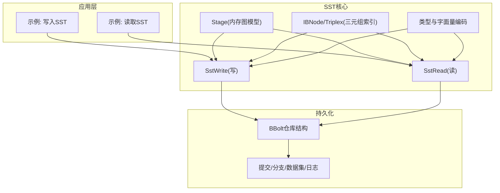
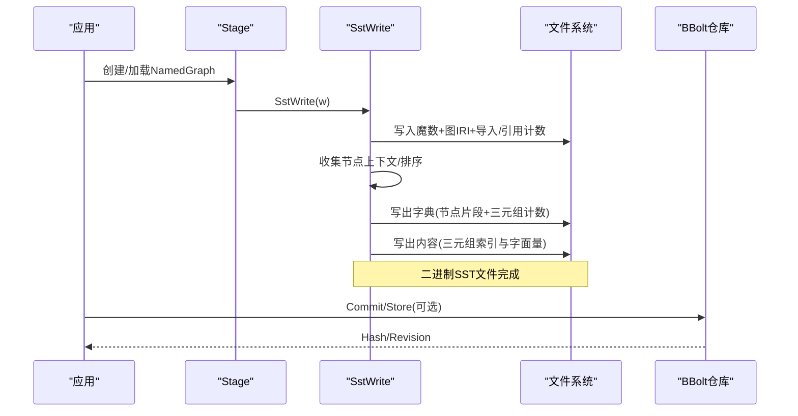
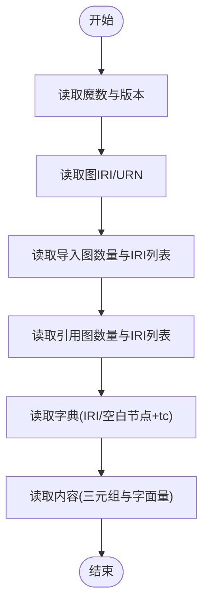
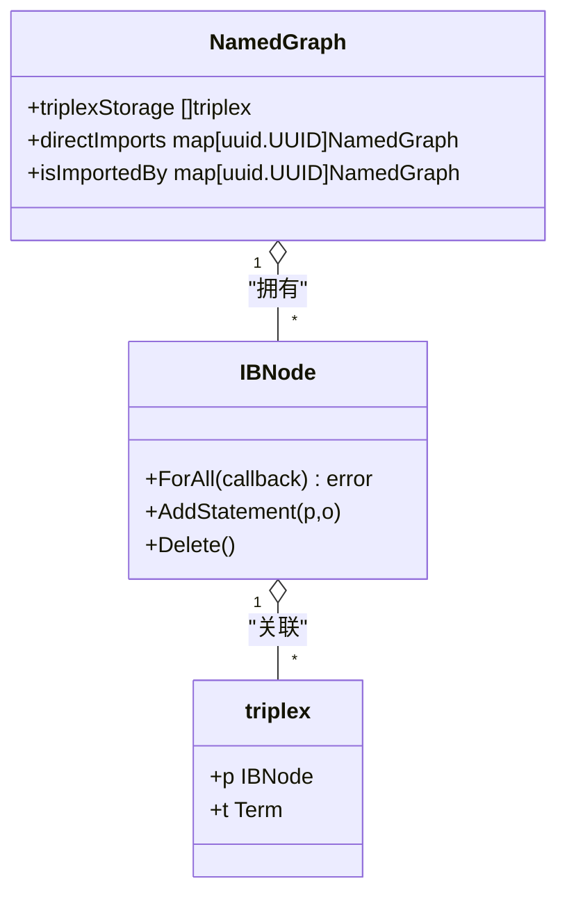
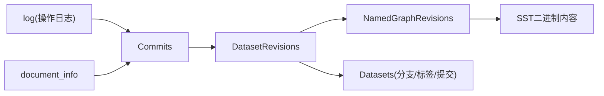
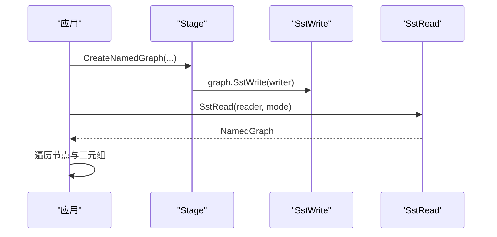
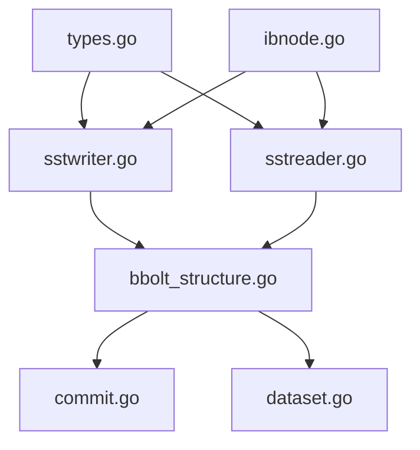

# SST二进制格式

<cite>
**本文引用的文件**
- [sstfile.go](file://sst/sstfile.go)
- [sstreader.go](file://sst/sstreader.go)
- [sstwriter.go](file://sst/sstwriter.go)
- [bbolt_structure.go](file://sst/bbolt_structure.go)
- [types.go](file://sst/types.go)
- [stage.go](file://sst/stage.go)
- [ibnode.go](file://sst/ibnode.go)
- [commit.go](file://sst/commit.go)
- [dataset.go](file://sst/dataset.go)
- [helloworldwrite.go](file://examples/helloworldwrite/helloworldwrite.go)
- [helloworldreadsst.go](file://examples/helloworldreadsst/helloworldreadsst.go)
</cite>

## 目录
1. [简介](#简介)
2. [项目结构](#项目结构)
3. [核心组件](#核心组件)
4. [架构总览](#架构总览)
5. [详细组件分析](#详细组件分析)
6. [依赖关系分析](#依赖关系分析)
7. [性能考虑](#性能考虑)
8. [故障排查指南](#故障排查指南)
9. [结论](#结论)
10. [附录](#附录)

## 简介
本技术文档面向SST二进制文件格式，系统性说明其内部结构与存储布局、版本控制与元数据存储、索引机制、读写API（流式处理、随机访问、批量操作）、与BBolt数据库的集成方式、数据结构设计、性能基准与优化建议，以及备份恢复、版本升级和数据迁移方案。同时总结该二进制格式的优势与兼容性考量。

## 项目结构
SST二进制格式的核心实现位于sst包中，围绕“图”（NamedGraph）进行序列化与反序列化；仓库持久化通过BBolt键值存储管理版本、提交、数据集和日志等元数据。示例代码展示了如何写入和读取SST文件。

图表来源
- [sstwriter.go:67-82](file://sst/sstwriter.go#L67-L82)
- [sstreader.go:44-80](file://sst/sstreader.go#L44-L80)
- [bbolt_structure.go:81-191](file://sst/bbolt_structure.go#L81-L191)

章节来源
- [sstfile.go:12-53](file://sst/sstfile.go#L12-L53)
- [sstwriter.go:67-82](file://sst/sstwriter.go#L67-L82)
- [sstreader.go:44-80](file://sst/sstreader.go#L44-L80)
- [bbolt_structure.go:81-191](file://sst/bbolt_structure.go#L81-L191)

## 核心组件
- 二进制文件头与版本：固定魔数字节标识SST-1.0，后续扩展可通过头部兼容。
- 图标识与导入/引用：记录主图的IRI/URN-UUID、显式导入的图集合、外部引用图集合。
- 字典区：按排序顺序列出所有节点（IRI与空白节点），并记录每个节点的三元组分配计数，用于快速定位内容区。
- 内容区：按节点顺序输出非字面量三元组与字面量三元组，使用紧凑编码（变长整数、定长浮点/整型）。
- 三元组索引：内存中以subject/predicate/object三种triplex组织，支持高效前后向遍历与去重。
- 版本与元数据：BBolt中维护NamedGraphRevisions、DatasetRevisions、Commits、Datasets、log、document_info等桶结构，支撑分支、提交、数据集版本与审计日志。

章节来源
- [sstfile.go:12-53](file://sst/sstfile.go#L12-L53)
- [sstreader.go:148-186](file://sst/sstreader.go#L148-L186)
- [sstwriter.go:84-139](file://sst/sstwriter.go#L84-L139)
- [sstwriter.go:219-275](file://sst/sstwriter.go#L219-L275)
- [sstreader.go:223-299](file://sst/sstreader.go#L223-L299)
- [ibnode.go:618-660](file://sst/ibnode.go#L618-L660)
- [bbolt_structure.go:81-191](file://sst/bbolt_structure.go#L81-L191)

## 架构总览
SST将RDF图以二进制形式序列化，包含头、导入/引用声明、字典与内容四段。读取时先解析头与导入/引用，再构建字典，最后按字典顺序重建三元组。写入时统计节点与三元组数量，排序后写出字典，再写出内容。仓库层面通过BBolt管理版本历史、分支指针、提交对象与日志，使SST文件可作为可版本化的图单元。

图表来源
- [sstwriter.go:67-82](file://sst/sstwriter.go#L67-L82)
- [sstwriter.go:84-139](file://sst/sstwriter.go#L84-L139)
- [sstwriter.go:219-275](file://sst/sstwriter.go#L219-L275)
- [sstwriter.go:331-438](file://sst/sstwriter.go#L331-L438)

## 详细组件分析

### 二进制格式与存储布局
- 魔数与版本：固定8字节头，当前为SST-1.0，便于未来版本演进。
- 图标识：主图的IRI或URN-UUID，若为空则用基于图ID生成的URN。
- 导入与引用：分别记录显式导入的图IRI列表与外部引用图IRI列表，用于跨图节点引用与共享。
- 字典区：
  - 首先写入IRI节点数与空白节点数。
  - 对每个节点写入片段（空白节点为空串）与其分配的三元组总数（tc），用于内容区定位。
  - 随后依次写入导入图与引用图的节点字典（按片段排序，确保唯一性）。
- 内容区：
  - 对每个节点，先写非字面量三元组数量，再按序写出谓词与对象的节点索引。
  - 接着写字面量三元组数量，再写出谓词索引与字面量数据（含类型标记与具体编码）。
  - 字面量类型包括字符串、语言标签字符串、布尔、整数族、浮点族、日期时间族、字节数组及集合等，采用紧凑编码（变长整数、大端定长浮点/整型）。

图表来源
- [sstreader.go:148-186](file://sst/sstreader.go#L148-L186)
- [sstreader.go:223-299](file://sst/sstreader.go#L223-L299)
- [sstreader.go:334-376](file://sst/sstreader.go#L334-L376)
- [sstwriter.go:84-139](file://sst/sstwriter.go#L84-L139)
- [sstwriter.go:219-275](file://sst/sstwriter.go#L219-L275)
- [sstwriter.go:331-438](file://sst/sstwriter.go#L331-L438)

章节来源
- [sstfile.go:12-53](file://sst/sstfile.go#L12-L53)
- [sstreader.go:148-186](file://sst/sstreader.go#L148-L186)
- [sstreader.go:223-299](file://sst/sstreader.go#L223-L299)
- [sstwriter.go:84-139](file://sst/sstwriter.go#L84-L139)
- [sstwriter.go:219-275](file://sst/sstwriter.go#L219-L275)

### 索引机制与三元组组织
- 三元组在内存中以subject/predicate/object三类triplex存储，支持双向遍历与自引用检测。
- 写入前统计每个节点的三元组数量，并在字典中记录tc，以便读取时预分配空间与快速定位。
- 节点排序与索引：
  - 主图节点按自定义比较规则排序，保证确定性输出。
  - 导入/引用图节点按片段排序，确保唯一性并支持二分查找定位。
- 读取时根据节点索引与偏移表（graphOffsets）确定节点所属图，从而正确解析跨图引用。

图表来源
- [ibnode.go:618-660](file://sst/ibnode.go#L618-L660)
- [sstwriter.go:321-329](file://sst/sstwriter.go#L321-L329)
- [sstreader.go:378-404](file://sst/sstreader.go#L378-L404)

章节来源
- [ibnode.go:618-660](file://sst/ibnode.go#L618-L660)
- [sstwriter.go:321-329](file://sst/sstwriter.go#L321-L329)
- [sstreader.go:378-404](file://sst/sstreader.go#L378-L404)

### 字面量编码与类型系统
- 字面量类型通过单一字节标记区分，如字符串、语言标签字符串、布尔、整数族、浮点族、日期时间族、集合等。
- 数值类型采用大端定长编码（float32/float64/int8/int16/int32/int64/uint8/uint16/uint32/uint64），字符串与日期时间采用变长长度前缀+字节序列。
- 集合类型以成员数量开头，后接成员列表递归编码。

章节来源
- [sstfile.go:104-228](file://sst/sstfile.go#L104-L228)
- [sstwriter.go:479-638](file://sst/sstwriter.go#L479-L638)
- [sstreader.go:406-710](file://sst/sstreader.go#L406-L710)

### 版本控制、元数据与BBolt集成
- BBolt仓库提供以下关键桶：
  - NamedGraphRevisions：存储各NamedGraph的版本哈希到二进制SST内容的映射。
  - DatasetRevisions：存储数据集版本，包含默认NG哈希、直接导入的DS UUID树、扁平化的NG哈希列表与创建该版本的commit哈希。
  - Datasets：存储数据集的引用（分支名、标签、叶子提交、原始IRI）。
  - Commits：存储提交对象，包含变更的DS修订、作者信息、消息等。
  - log：有序的操作日志，记录提交、分支更新、文档上传等事件。
  - document_info：存储上传文档的元数据（文件名、MIME类型、作者、时间戳）。
- 提交详情（CommitDetails）暴露作者、时间、父提交、数据集与命名图修订等信息，便于查询与审计。

图表来源
- [bbolt_structure.go:81-191](file://sst/bbolt_structure.go#L81-L191)
- [commit.go:18-63](file://sst/commit.go#L18-L63)

章节来源
- [bbolt_structure.go:81-191](file://sst/bbolt_structure.go#L81-L191)
- [commit.go:18-63](file://sst/commit.go#L18-L63)
- [dataset.go:9-94](file://sst/dataset.go#L9-L94)

### 读写API与使用方式
- 写入SST：
  - 通过Stage创建NamedGraph，添加三元组后调用SstWrite将图写入io.Writer。
  - 示例展示了创建节点、添加属性并导出为Turtle与SST二进制。
- 读取SST：
  - 使用SstRead从bufio.Reader读取，返回NamedGraph，支持遍历节点与三元组。
  - 示例演示了读取SST并打印图IRI与三元组。

图表来源
- [helloworldwrite.go:39-98](file://examples/helloworldwrite/helloworldwrite.go#L39-L98)
- [helloworldreadsst.go:30-69](file://examples/helloworldreadsst/helloworldreadsst.go#L30-L69)
- [sstwriter.go:67-82](file://sst/sstwriter.go#L67-L82)
- [sstreader.go:44-80](file://sst/sstreader.go#L44-L80)

章节来源
- [helloworldwrite.go:39-98](file://examples/helloworldwrite/helloworldwrite.go#L39-L98)
- [helloworldreadsst.go:30-69](file://examples/helloworldreadsst/helloworldreadsst.go#L30-L69)
- [sstwriter.go:67-82](file://sst/sstwriter.go#L67-L82)
- [sstreader.go:44-80](file://sst/sstreader.go#L44-L80)

## 依赖关系分析
- 模块耦合：
  - sstwriter与sstreader强依赖类型定义（types.go）与节点结构（ibnode.go），确保编解码一致。
  - 版本控制与持久化通过bbolt_structure.go抽象出BBolt布局，commit.go与dataset.go提供高层接口。
- 外部依赖：
  - 使用google/uuid生成与解析UUID。
  - 使用zap进行结构化日志记录。
  - 使用bbolt作为嵌入式键值存储。

图表来源
- [types.go:1-235](file://sst/types.go#L1-L235)
- [ibnode.go:618-660](file://sst/ibnode.go#L618-L660)
- [sstwriter.go:67-82](file://sst/sstwriter.go#L67-L82)
- [sstreader.go:44-80](file://sst/sstreader.go#L44-L80)
- [bbolt_structure.go:81-191](file://sst/bbolt_structure.go#L81-L191)

章节来源
- [types.go:1-235](file://sst/types.go#L1-L235)
- [ibnode.go:618-660](file://sst/ibnode.go#L618-L660)
- [sstwriter.go:67-82](file://sst/sstwriter.go#L67-L82)
- [sstreader.go:44-80](file://sst/sstreader.go#L44-L80)
- [bbolt_structure.go:81-191](file://sst/bbolt_structure.go#L81-L191)

## 性能考虑
- 流式处理：
  - 读取时使用bufio.Reader逐块解析，避免一次性加载整个文件到内存。
  - 写入时通过io.Writer逐步输出，减少内存峰值。
- 随机访问：
  - 字典区提供节点索引与tc计数，读取时可快速定位节点范围，支持按节点随机访问。
  - 导入/引用图通过graphOffsets与二分查找定位节点所属图，提升跨图引用解析效率。
- 批量操作：
  - 写入前统计三元组数量并预分配，减少动态扩容开销。
  - 节点排序与去重检查（如重复片段）在写入阶段集中处理，降低运行时成本。
- 优化建议：
  - 合理设置TriplexMode以平衡内存与遍历性能（当前默认模式包含subject/predicate/object三类）。
  - 对大规模图，优先使用流式读写，避免全量加载。
  - 利用字典区的tc信息进行增量更新与差异计算。

章节来源
- [sstreader.go:44-80](file://sst/sstreader.go#L44-L80)
- [sstreader.go:378-404](file://sst/sstreader.go#L378-L404)
- [sstwriter.go:141-217](file://sst/sstwriter.go#L141-L217)
- [sstwriter.go:321-329](file://sst/sstwriter.go#L321-L329)
- [stage.go:33-51](file://sst/stage.go#L33-L51)

## 故障排查指南
- 常见错误：
  - 头部校验失败：文件不以SST-1.0开头，可能为损坏或不兼容版本。
  - EOF异常：读取过程中意外结束，检查输入流完整性。
  - 重复节点：写入阶段检测到重复片段，需修正节点生成逻辑。
  - 缺失导入：写入时未包含必要的导入图，导致跨图引用无法解析。
- 调试建议：
  - 启用默认日志输出，观察读取/写入过程中的节点与字面量类型。
  - 使用示例程序验证最小可复现场景。
  - 检查BBolt仓库中的提交与分支状态，确认版本一致性。

章节来源
- [sstreader.go:24-30](file://sst/sstreader.go#L24-L30)
- [sstwriter.go:18-19](file://sst/sstwriter.go#L18-L19)
- [sstwriter.go:287-296](file://sst/sstwriter.go#L287-L296)

## 结论
SST二进制格式通过紧凑的头部、字典与内容三段式布局，结合高效的三元组索引与字面量编码，实现了高性能的RDF图序列化与反序列化。配合BBolt仓库的版本控制能力，SST文件可作为可追溯、可合并、可审计的数据单元。建议在大规模场景中采用流式读写与合理的内存模式，以获得最佳性能与稳定性。

## 附录
- 备份恢复：
  - 备份：复制SST文件与BBolt数据库文件，或使用仓库提供的导出工具导出为可读格式（如Turtle）。
  - 恢复：将SST文件导入Stage，并通过Commit提交至仓库；或还原BBolt数据库文件。
- 版本升级：
  - 保持魔数向后兼容，新增字段时采用可选编码策略。
  - 升级读取器时，忽略未知字段并继续解析已知部分。
- 数据迁移：
  - 使用MoveAndMerge在不同Stage间迁移与合并图，自动处理节点与三元组的对齐。
  - 通过CommitDetails与Branches接口验证迁移结果的一致性。

章节来源
- [stage.go:132-163](file://sst/stage.go#L132-L163)
- [commit.go:18-63](file://sst/commit.go#L18-L63)
- [dataset.go:9-94](file://sst/dataset.go#L9-L94)