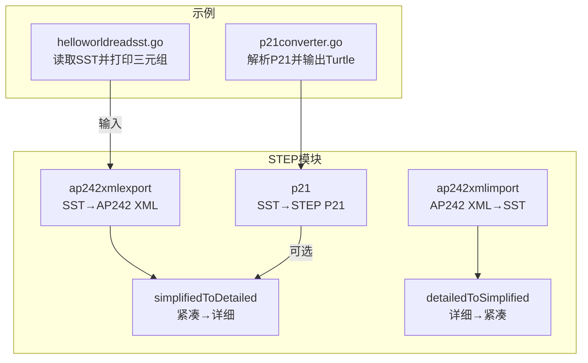
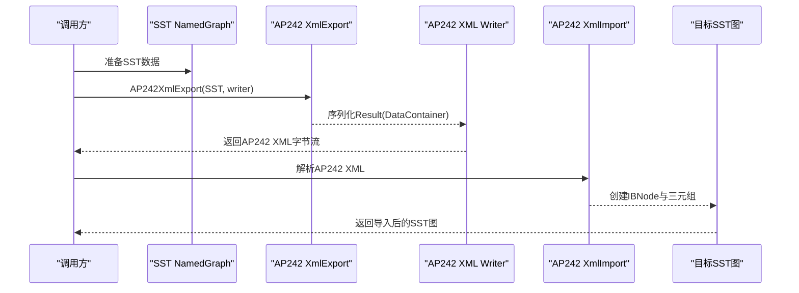
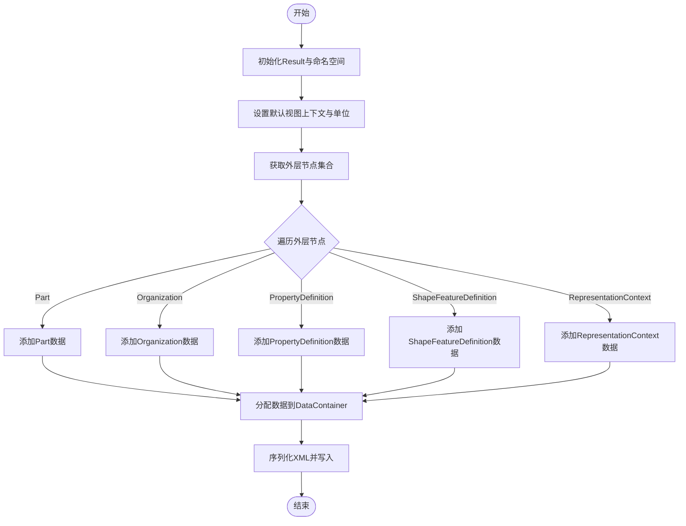
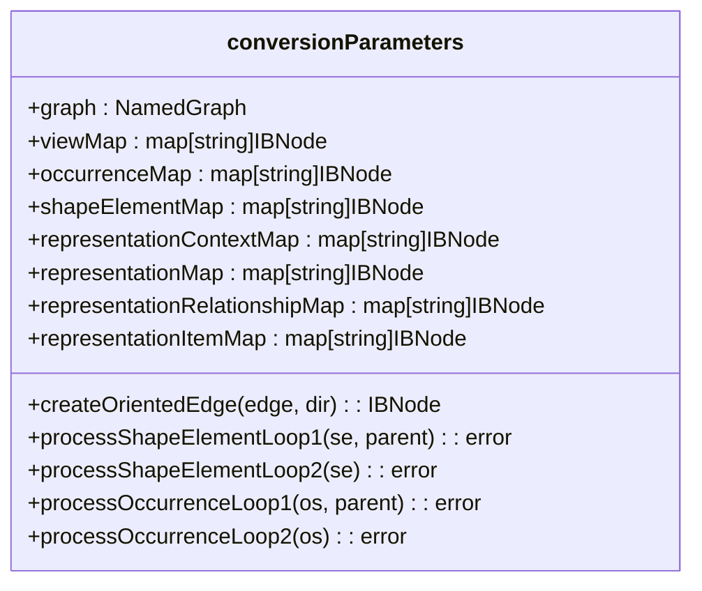
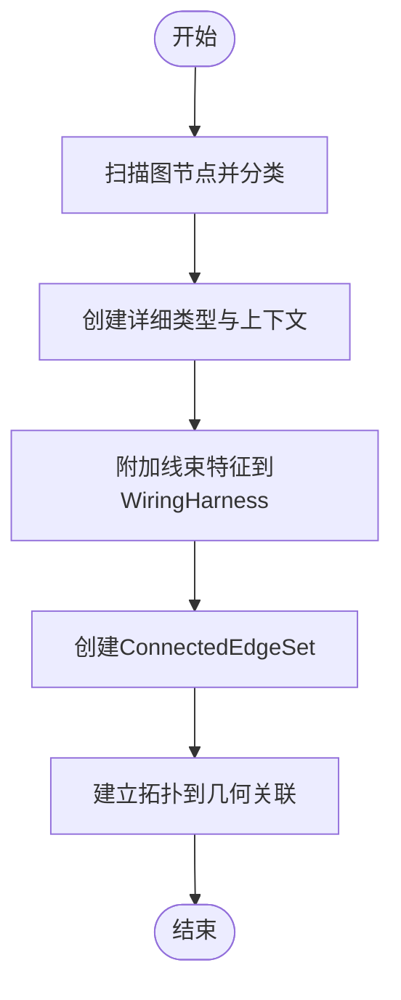
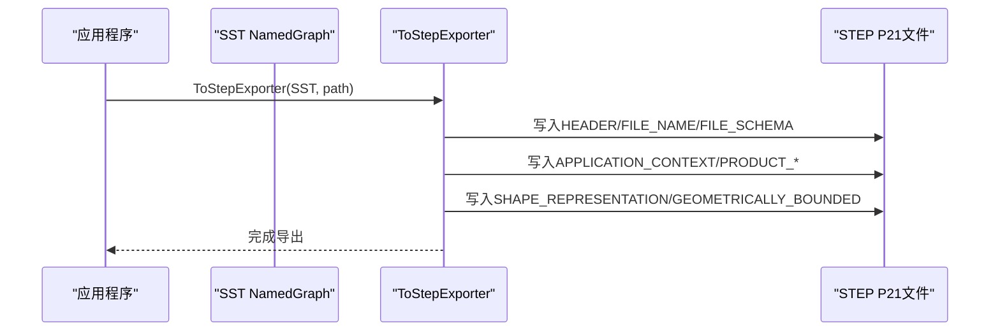
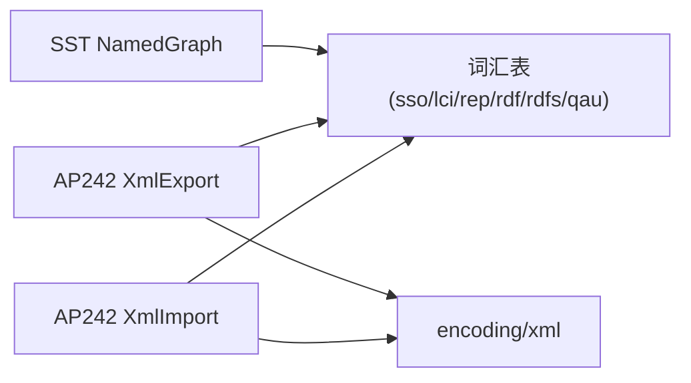

# STEP AP242 XML转换

<cite>
**本文引用的文件**
- [ap242xmlexport.go](file://step/ap242xmlexport/ap242xmlexport.go)
- [ap242xmlimport.go](file://step/ap242xmlimport/ap242xmlimport.go)
- [xmltranslateimpl.go](file://step/ap242xmlimport/xmltranslateimpl.go)
- [simplifiedToDetailed.go](file://step/simplifiedToDetailed/simplifiedToDetailed.go)
- [detailedToSimplified.go](file://step/detailedToSimplified/detailedToSimplified.go)
- [sstToStepexport.go](file://step/p21/sstToStepexport.go)
- [p21converter.go](file://examples/p21/p21converter.go)
- [helloworldreadsst.go](file://examples/helloworldreadsst/helloworldreadsst.go)
- [DomainModel.xsd](file://step/testdata/ewh/DomainModel.xsd)
</cite>

## 目录
1. [简介](#简介)
2. [项目结构](#项目结构)
3. [核心组件](#核心组件)
4. [架构总览](#架构总览)
5. [详细组件分析](#详细组件分析)
6. [依赖关系分析](#依赖关系分析)
7. [性能考虑](#性能考虑)
8. [故障排查指南](#故障排查指南)
9. [结论](#结论)
10. [附录](#附录)

## 简介
本文件面向STEP AP242（ISO 10303-242）XML与SST数据之间的双向转换，提供从SST到AP242 XML的导出、从AP242 XML导入到SST的完整流程说明。文档涵盖：
- STEP标准实体结构与SST三元组的映射关系（产品定义、装配结构、属性信息等）
- 导入导出API的使用方式（配置选项、错误处理、性能调优建议）
- 完整的转换示例（SST→STEP XML导出；STEP XML→SST导入）
- 数据验证规则与约束检查
- 批量处理与增量更新的实现方案

## 项目结构
该功能位于step子包中，主要包含：
- ap242xmlexport：将SST数据导出为STEP AP242 XML
- ap242xmlimport：将STEP AP242 XML导入为SST数据
- simplifiedToDetailed / detailedToSimplified：在SST内部进行“紧凑形式”和“详细形式”的转换，以适配AP242导出需求
- p21：支持STEP Part 21格式读写及SST到P21的导出
- examples：示例程序，演示如何读取SST、解析P21等

图表来源
- [ap242xmlexport.go:370-432](file://step/ap242xmlexport/ap242xmlexport.go#L370-L432)
- [ap242xmlimport.go:325-376](file://step/ap242xmlimport/ap242xmlimport.go#L325-L376)
- [simplifiedToDetailed.go:49-65](file://step/simplifiedToDetailed/simplifiedToDetailed.go#L49-L65)
- [detailedToSimplified.go:12-18](file://step/detailedToSimplified/detailedToSimplified.go#L12-L18)
- [sstToStepexport.go:221-439](file://step/p21/sstToStepexport.go#L221-L439)
- [p21converter.go:22-63](file://examples/p21/p21converter.go#L22-L63)
- [helloworldreadsst.go:30-68](file://examples/helloworldreadsst/helloworldreadsst.go#L30-L68)

章节来源
- [ap242xmlexport.go:1-800](file://step/ap242xmlexport/ap242xmlexport.go#L1-L800)
- [ap242xmlimport.go:1-800](file://step/ap242xmlimport/ap242xmlimport.go#L1-L800)
- [simplifiedToDetailed.go:1-329](file://step/simplifiedToDetailed/simplifiedToDetailed.go#L1-L329)
- [detailedToSimplified.go:1-20](file://step/detailedToSimplified/detailedToSimplified.go#L1-L20)
- [sstToStepexport.go:1-731](file://step/p21/sstToStepexport.go#L1-L731)
- [p21converter.go:1-102](file://examples/p21/p21converter.go#L1-L102)
- [helloworldreadsst.go:1-69](file://examples/helloworldreadsst/helloworldreadsst.go#L1-L69)

## 核心组件
- AP242 XML导出器（ap242xmlexport）
  - 入口函数：AP242XmlExport(graph, writer)，负责将SST NamedGraph转换为符合ISO 10303-242域模型的XML结构
  - 关键数据结构：DataContainer、Part、PartVersion、PartView、Occurrence、ShapeElement、RepresentationContext、Unit、Organization、PropertyDefinition等
  - 处理流程：提取外层节点（Part/Organization/PropertyDefinition/ShapeFeatureDefinition/RepresentationContext），构建视图上下文、单位、格式属性，生成XML并写入

- AP242 XML导入器（ap242xmlimport）
  - 入口函数：解析XML为Result/DataContainer，并通过conversionParameters维护多张映射表（视图、实例、形状元素、表示项等）
  - 关键流程：两阶段处理（Loop1创建节点与层级，Loop2建立引用关系与类型），支持装配、连接、几何拓扑关联
  - 错误定义：多种缺失或长度不匹配的错误（如Origin/Target长度不一致、表示项未找到等）

- 紧凑/详细形式转换（simplifiedToDetailed / detailedToSimplified）
  - 目的：使SST内部图结构满足AP242导出的“详细形式”要求（例如EdgeBasedTopologicalRepresentationWithLengthConstraint、ConnectedEdgeSet等）
  - 行为：移除冗余类型、创建必要的几何/拓扑节点、建立拓扑到几何的关联

- STEP P21导出（sstToStepexport）
  - 入口：ToStepExporter(graph, fileLocation)，将SST数据写为STEP Part 21文本
  - 能力：生成文件头、产品上下文、产品定义、几何表示、形状表示等

章节来源
- [ap242xmlexport.go:370-432](file://step/ap242xmlexport/ap242xmlexport.go#L370-L432)
- [ap242xmlimport.go:325-376](file://step/ap242xmlimport/ap242xmlimport.go#L325-L376)
- [simplifiedToDetailed.go:49-65](file://step/simplifiedToDetailed/simplifiedToDetailed.go#L49-L65)
- [detailedToSimplified.go:12-18](file://step/detailedToSimplified/detailedToSimplified.go#L12-L18)
- [sstToStepexport.go:221-439](file://step/p21/sstToStepexport.go#L221-L439)

## 架构总览
下图展示了从SST到AP242 XML的导出与反向导入的整体流程，以及P21互操作路径。

图表来源
- [ap242xmlexport.go:370-432](file://step/ap242xmlexport/ap242xmlexport.go#L370-L432)
- [ap242xmlimport.go:325-376](file://step/ap242xmlimport/ap242xmlimport.go#L325-L376)

章节来源
- [ap242xmlexport.go:370-432](file://step/ap242xmlexport/ap242xmlexport.go#L370-L432)
- [ap242xmlimport.go:325-376](file://step/ap242xmlimport/ap242xmlimport.go#L325-L376)

## 详细组件分析

### 组件A：AP242 XML导出（SST → AP242 XML）
- 入口与职责
  - AP242XmlExport(graph, xmlfile)：初始化Result与命名空间，设置默认视图上下文和单位，遍历外层节点并填充DataContainer，最终序列化为XML
- 数据模型映射
  - Part/PartVersion/PartView：对应产品及其版本、视图
  - Occurrence/ShapeElement：装配实例与形状特征
  - RepresentationContext/RepresentationItem：几何表示与拓扑项
  - Unit/FormatProperty/Organization/PropertyDefinition：单位、格式、组织、属性定义
- 处理逻辑要点
  - 获取外层节点（Part/Organization/PropertyDefinition/ShapeFeatureDefinition/RepresentationContext）
  - 处理枚举值（如IntendedJointType、InterfaceOrJoinTerminal、JointType）
  - 处理ID与标识符（支持简单ID与带上下文的IdentifierSet）
  - 处理数量（Quantity）与属性赋值（PropertyValueAssignment）
  - 递归处理嵌套的形状元素与装配关系

图表来源
- [ap242xmlexport.go:370-432](file://step/ap242xmlexport/ap242xmlexport.go#L370-L432)
- [ap242xmlexport.go:444-483](file://step/ap242xmlexport/ap242xmlexport.go#L444-L483)

章节来源
- [ap242xmlexport.go:370-432](file://step/ap242xmlexport/ap242xmlexport.go#L370-L432)
- [ap242xmlexport.go:444-483](file://step/ap242xmlexport/ap242xmlexport.go#L444-L483)

### 组件B：AP242 XML导入（AP242 XML → SST）
- 入口与职责
  - 解析XML为Result/DataContainer，通过conversionParameters维护多张映射表，分两阶段处理：
    - Loop1：创建节点（Occurrence/ShapeElement等）并建立父子层级
    - Loop2：建立引用关系（定义、几何、关系、类型等）
- 关键映射与约束
  - ShapeElement类型映射到SSO词汇（如PartShapeElement、AssemblyShapeJoint等）
  - Occurrence类型映射到SSO词汇（SingleOccurrence、QuantifiedOccurrence等）
  - 表示项与关系的校验（Origin/Target长度一致性、表示项存在性）
- 错误处理
  - 定义了多种错误（位置缺失、形状特征类型未知、表示项未找到、关系长度不匹配等）

图表来源
- [ap242xmlimport.go:325-376](file://step/ap242xmlimport/ap242xmlimport.go#L325-L376)
- [ap242xmlimport.go:378-398](file://step/ap242xmlimport/ap242xmlimport.go#L378-L398)
- [ap242xmlimport.go:405-481](file://step/ap242xmlimport/ap242xmlimport.go#L405-L481)
- [ap242xmlimport.go:483-599](file://step/ap242xmlimport/ap242xmlimport.go#L483-L599)
- [ap242xmlimport.go:601-658](file://step/ap242xmlimport/ap242xmlimport.go#L601-L658)

章节来源
- [ap242xmlimport.go:28-53](file://step/ap242xmlimport/ap242xmlimport.go#L28-L53)
- [ap242xmlimport.go:325-376](file://step/ap242xmlimport/ap242xmlimport.go#L325-L376)
- [ap242xmlimport.go:405-658](file://step/ap242xmlimport/ap242xmlimport.go#L405-L658)

### 组件C：紧凑/详细形式转换（SST内部）
- 目的：将SST中的“紧凑形式”转换为AP242所需的“详细形式”，包括创建EdgeBasedTopologicalRepresentationWithLengthConstraint、ConnectedEdgeSet、拓扑到几何关联等
- 行为：
  - 识别并转换特定类型（PartDesign/AssemblyDesign/WiringHarnessAssemblyDesign等）
  - 创建几何上下文与拓扑项，附加到WiringHarness
  - 收集并创建ConnectedEdgeSet，将边与拓扑关联
  - 建立TopologyToGeometryModelAssociation与ItemDefinedTransformation

图表来源
- [simplifiedToDetailed.go:49-65](file://step/simplifiedToDetailed/simplifiedToDetailed.go#L49-L65)
- [simplifiedToDetailed.go:67-215](file://step/simplifiedToDetailed/simplifiedToDetailed.go#L67-L215)
- [simplifiedToDetailed.go:269-329](file://step/simplifiedToDetailed/simplifiedToDetailed.go#L269-L329)

章节来源
- [simplifiedToDetailed.go:49-65](file://step/simplifiedToDetailed/simplifiedToDetailed.go#L49-L65)
- [simplifiedToDetailed.go:67-215](file://step/simplifiedToDetailed/simplifiedToDetailed.go#L67-L215)
- [simplifiedToDetailed.go:269-329](file://step/simplifiedToDetailed/simplifiedToDetailed.go#L269-L329)

### 组件D：STEP P21导出（SST → STEP P21）
- 入口：ToStepExporter(graph, fileLocation)
- 行为：
  - 写入文件头（HEADER）、应用上下文、产品上下文、产品定义、几何表示、形状表示
  - 排序并输出所有实体行，最后写入ENDSEC与结束标记
- 使用示例：examples/p21/p21converter.go展示如何解析P21并输出Turtle

图表来源
- [sstToStepexport.go:221-439](file://step/p21/sstToStepexport.go#L221-L439)
- [p21converter.go:22-63](file://examples/p21/p21converter.go#L22-L63)

章节来源
- [sstToStepexport.go:221-439](file://step/p21/sstToStepexport.go#L221-L439)
- [p21converter.go:22-63](file://examples/p21/p21converter.go#L22-L63)

## 依赖关系分析
- 词汇表依赖
  - sso（语义STEP对象）：用于产品、装配、形状特征等类型
  - lci（生命周期信息）：用于组织、属性定义、装配关系等
  - rep（表示与几何）：用于几何表示、拓扑项、变换关系等
  - rdfs/rdf：通用RDF/RDFS语义
  - qau：量化单位（长度等）
- 外部依赖
  - encoding/xml：用于AP242 XML的序列化与反序列化
  - google/uuid：生成唯一UID
  - vocabularies/dict：注册词汇映射

图表来源
- [ap242xmlexport.go:6-24](file://step/ap242xmlexport/ap242xmlexport.go#L6-L24)
- [ap242xmlimport.go:6-26](file://step/ap242xmlimport/ap242xmlimport.go#L6-L26)

章节来源
- [ap242xmlexport.go:6-24](file://step/ap242xmlexport/ap242xmlexport.go#L6-L24)
- [ap242xmlimport.go:6-26](file://step/ap242xmlimport/ap242xmlimport.go#L6-L26)

## 性能考虑
- 导出性能
  - 使用内存映射（map）缓存已处理的节点与引用，避免重复计算
  - 预置常用单位与格式属性，减少运行时开销
  - 对大型装配树采用递归处理，注意栈深度与内存占用
- 导入性能
  - 两阶段处理（先建节点再建关系）有利于批量构建与后期修正
  - 使用多张映射表加速查找（occurrenceMap、shapeElementMap、representationItemMap等）
  - 对Origin/Target长度一致性进行提前校验，减少无效处理
- 内存与I/O
  - 导出时直接写入io.Writer，适合流式输出大文件
  - 导入时解析XML为结构体，注意大文件的内存峰值

[本节为通用指导，无需具体文件来源]

## 故障排查指南
- 常见错误
  - 表示项未找到：检查RepresentationItem是否存在且UID正确
  - Origin/Target长度不匹配：确保几何与拓扑项一一对应
  - 形状元素定义未找到：确认Definition/PartDefinition引用有效
  - 视图或装配关系未找到：检查ViewContext与NextAssemblyOccurrenceUsage
- 调试建议
  - 启用日志（导入器内置logger）
  - 使用示例程序读取SST并打印三元组，辅助定位问题
  - 对照DomainModel.xsd验证XML结构

章节来源
- [ap242xmlimport.go:28-53](file://step/ap242xmlimport/ap242xmlimport.go#L28-L53)
- [helloworldreadsst.go:30-68](file://examples/helloworldreadsst/helloworldreadsst.go#L30-L68)
- [DomainModel.xsd](file://step/testdata/ewh/DomainModel.xsd)

## 结论
本代码库提供了完整的STEP AP242 XML与SST数据的双向转换能力，覆盖产品定义、装配结构、属性信息与几何拓扑。通过紧凑/详细形式转换，确保SST内部图结构满足AP242导出要求。导入器具备完善的错误处理与校验机制，导出器支持流式输出与高效缓存。结合P21导出与示例程序，可快速集成到实际工程中。

[本节为总结，无需具体文件来源]

## 附录

### API使用方法与示例
- 导出SST到AP242 XML
  - 调用AP242XmlExport(graph, writer)，writer可为文件句柄或缓冲区
  - 建议在调用前执行simplifiedToDetailed.SimplifiedToDetailed(graph)以确保详细形式
- 导入AP242 XML到SST
  - 解析XML为Result/DataContainer，调用导入器的两阶段处理
  - 导入后可执行detailedToSimplified.DetailedToSimplified(graph)以简化图结构
- 导出SST到STEP P21
  - 调用ToStepExporter(graph, fileLocation)
  - 参考examples/p21/p21converter.go了解P21解析与输出

章节来源
- [ap242xmlexport.go:370-432](file://step/ap242xmlexport/ap242xmlexport.go#L370-L432)
- [simplifiedToDetailed.go:49-65](file://step/simplifiedToDetailed/simplifiedToDetailed.go#L49-L65)
- [detailedToSimplified.go:12-18](file://step/detailedToSimplified/detailedToSimplified.go#L12-L18)
- [sstToStepexport.go:221-439](file://step/p21/sstToStepexport.go#L221-L439)
- [p21converter.go:22-63](file://examples/p21/p21converter.go#L22-L63)

### 数据验证规则与约束检查
- 视图上下文与应用领域/生命周期阶段映射
- 形状元素类型必须属于预定义集合（PartShapeElement、AssemblyShapeJoint等）
- 数量与单位映射（目前支持长度单位为米）
- 拓扑到几何关联需保持一一对应，长度一致
- ID与标识符支持简单ID与带上下文的IdentifierSet

章节来源
- [ap242xmlimport.go:660-681](file://step/ap242xmlimport/ap242xmlimport.go#L660-L681)
- [ap242xmlimport.go:746-778](file://step/ap242xmlimport/ap242xmlimport.go#L746-L778)
- [ap242xmlexport.go:719-736](file://step/ap242xmlexport/ap242xmlexport.go#L719-L736)

### 批量处理与增量更新方案
- 批量处理
  - 对多个SST文件或数据集，循环调用AP242XmlExport或ToStepExporter
  - 使用并发goroutine并行处理不同数据集，注意共享资源保护
- 增量更新
  - 利用SST的Stage与Commit机制，仅处理变更的数据集
  - 通过MoveAndMerge合并分支结果，提交新commit
  - 在导入/导出前后记录影响的数据集，便于审计与回滚

章节来源
- [repocheckout.go:10-44](file://sst/repocheckout.go#L10-L44)
- [remoteRepositoryMultipleCommits_test.go:143-267](file://sst_test/remoteRepositoryMultipleCommits_test.go#L143-L267)