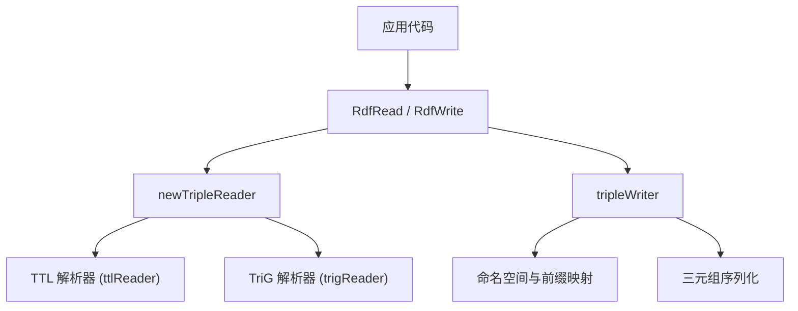
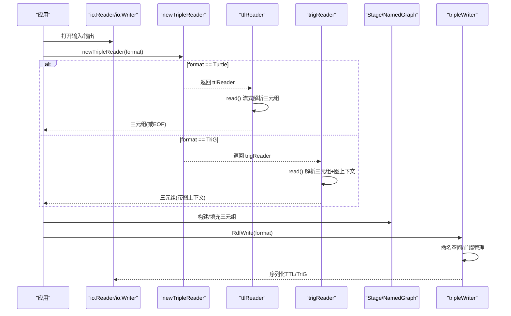
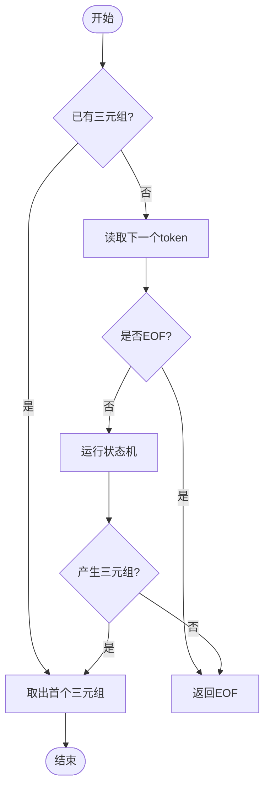
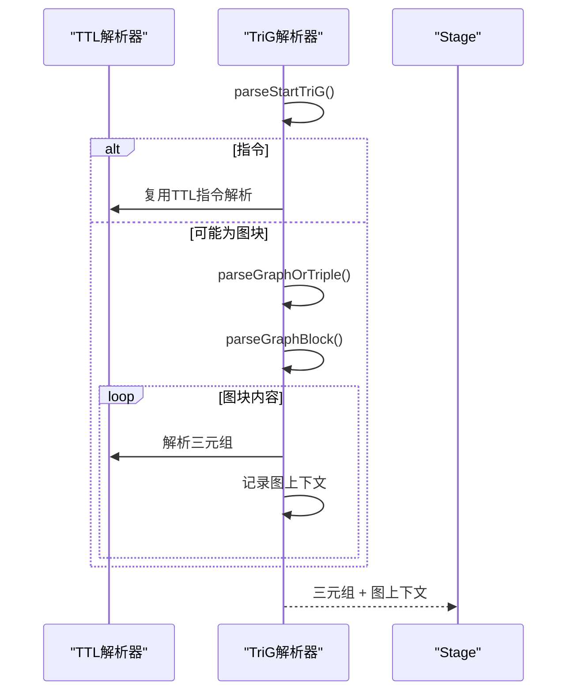
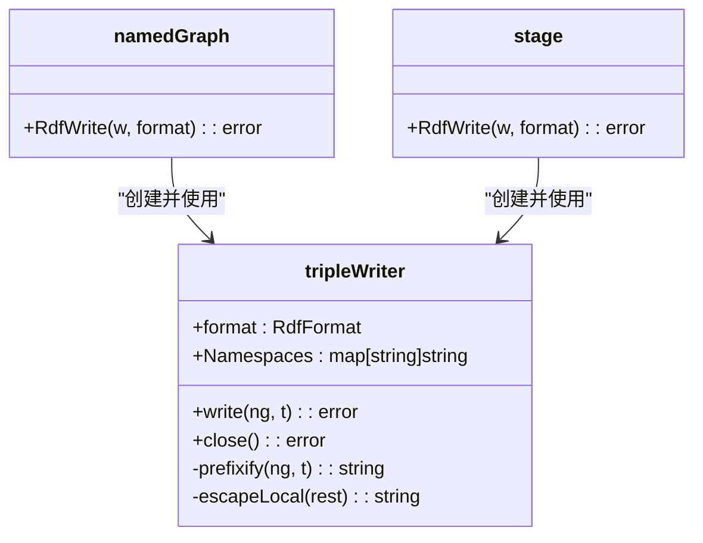
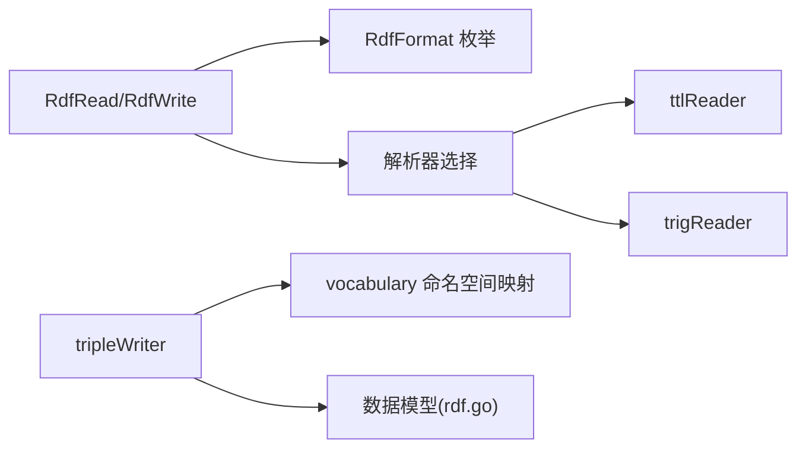

# TTL格式处理

<cite>
**本文引用的文件**
- [rdfttl.go](file://sst/rdfttl.go)
- [rdftrig.go](file://sst/rdftrig.go)
- [rdfreader.go](file://sst/rdfreader.go)
- [rdfwrite.go](file://sst/rdfwrite.go)
- [rdf.go](file://sst/rdf.go)
- [vocabulary.go](file://sst/vocabulary.go)
- [helloworldreadttl.go](file://examples/helloworldreadttl/helloworldreadttl.go)
- [helloworldwrite.go](file://examples/helloworldwrite/helloworldwrite.go)
</cite>

## 目录
1. [简介](#简介)
2. [项目结构](#项目结构)
3. [核心组件](#核心组件)
4. [架构总览](#架构总览)
5. [详细组件分析](#详细组件分析)
6. [依赖关系分析](#依赖关系分析)
7. [性能考虑](#性能考虑)
8. [故障排查指南](#故障排查指南)
9. [结论](#结论)
10. [附录](#附录)

## 简介
本文件系统性说明 SST 中 Turtle（TTL）与 TriG 格式的读写能力，覆盖命名空间管理、前缀映射、三元组序列化、RDF 枚举类型与转换规则、特殊字符转义、输出格式优化、批量写入与流式处理示例，以及 TTL 与 TriG 的区别与适用场景。文档同时给出性能优化建议与错误处理策略，帮助读者在工程实践中高效使用。

## 项目结构
SST 的 RDF 读写位于 sst 包内：
- 读取端：TTL/TriG 解析器分别实现为流式 reader，统一通过 newTripleReader 选择具体实现；TriG 在 TTL 基础上扩展了命名图块解析。
- 写入端：tripleWriter 负责将三元组序列化为 TTL/TriG，支持自动前缀生成、命名空间注册、集合与空白节点的内联优化。
- 数据模型：rdf.go 定义 RDF 术语、字面量、三元组/四元组及序列化方法；vocabulary.go 提供词汇表与命名空间到前缀的映射机制。
- 示例：examples 下提供读/写 TTL 的最小可运行示例。

图表来源
- [rdfreader.go:62-73](file://sst/rdfreader.go#L62-L73)
- [rdfwrite.go:40-48](file://sst/rdfwrite.go#L40-L48)

章节来源
- [rdfreader.go:62-73](file://sst/rdfreader.go#L62-L73)
- [rdfwrite.go:40-48](file://sst/rdfwrite.go#L40-L48)

## 核心组件
- TTL 解析器 ttlReader：基于状态机逐 token 解析，维护 base IRI、命名空间映射、上下文栈以支持列表/集合与嵌套结构。
- TriG 解析器 trigReader：继承 TTL 解析能力，增加命名图块识别与三元组图上下文绑定。
- tripleWriter：流式写入三元组，自动管理命名空间与前缀，支持对象列表、谓词列表、集合与空白节点内联等优化。
- 数据模型与类型：rdf.go 中的 rdfTerm、rdfTypeLiteral、IRI、rdfTriple 等，以及 RdfFormat 枚举。
- 词汇表与命名空间：vocabulary.go 提供 namespaceToPrefixMap 与静态字典，供写入时自动前缀化。

章节来源
- [rdfttl.go:13-40](file://sst/rdfttl.go#L13-L40)
- [rdftrig.go:21-33](file://sst/rdftrig.go#L21-L33)
- [rdfwrite.go:21-48](file://sst/rdfwrite.go#L21-L48)
- [rdf.go:102-117](file://sst/rdf.go#L102-L117)
- [vocabulary.go:94-107](file://sst/vocabulary.go#L94-L107)

## 架构总览
下图展示从输入到输出的完整流程，包括格式选择、解析、构建 Stage/NamedGraph、再序列化的路径。

图表来源
- [rdfreader.go:62-73](file://sst/rdfreader.go#L62-L73)
- [rdfreader.go:121-143](file://sst/rdfreader.go#L121-L143)
- [rdfwrite.go:400-432](file://sst/rdfwrite.go#L400-L432)

## 详细组件分析

### TTL 解析器（ttlReader）
- 功能要点
  - 维护 base IRI 与命名空间映射 ns，支持 @prefix/@base 与 SPARQL 风格指令。
  - 状态机驱动：parseStart -> parseTriple -> parseSubject/predicate/object -> parseEnd，支持分号逗号语法、列表/集合、匿名节点。
  - 字面量解析：支持字符串、语言标签、XSD 数据类型（整数、浮点、布尔、日期时间、字节等）。
  - 错误恢复：panic 捕获并转为 error，便于上层统一处理。
- 关键流程
  - read(): 循环执行状态机，产出三元组；无三元组则返回 EOF。
  - parseStart(): 处理前缀/基址指令，更新 base 与 ns。
  - parseObject(): 处理 IRIs、字面量、列表/集合、属性列表等，必要时推入上下文栈。
  - emit(): 将当前三元组加入 triples 队列，供上层消费。

图表来源
- [rdfttl.go:57-86](file://sst/rdfttl.go#L57-L86)
- [rdfttl.go:101-144](file://sst/rdfttl.go#L101-L144)
- [rdfttl.go:232-430](file://sst/rdfttl.go#L232-L430)

章节来源
- [rdfttl.go:13-40](file://sst/rdfttl.go#L13-L40)
- [rdfttl.go:57-86](file://sst/rdfttl.go#L57-L86)
- [rdfttl.go:101-144](file://sst/rdfttl.go#L101-L144)
- [rdfttl.go:232-430](file://sst/rdfttl.go#L232-L430)
- [rdfttl.go:559-600](file://sst/rdfttl.go#L559-L600)

### TriG 解析器（trigReader）
- 功能要点
  - 继承 TTL 解析能力，新增命名图块识别：@prefix/@base 后跟随 graphName { ... }。
  - 维护 currentGraph 与 graphStack，将三元组与其所属图关联，最终由 fromTriGReaderToStage 写入对应 NamedGraph。
  - 支持图内局部前缀声明。
- 关键流程
  - parseStartTriG(): 识别指令或图块入口。
  - parseGraphOrTriple(): 前瞻判断是否为命名图块，若是则进入 parseGraphBlock。
  - parseGraphBlock(): 循环解析直到 '}'，期间允许前缀声明与三元组。
  - read(): 记录每次状态机产生的三元组数量，将其图上下文压入 graphStack，并在取回三元组时弹出作为该三元组的图。

图表来源
- [rdftrig.go:21-33](file://sst/rdftrig.go#L21-L33)
- [rdftrig.go:35-84](file://sst/rdftrig.go#L35-L84)
- [rdftrig.go:86-221](file://sst/rdftrig.go#L86-L221)
- [rdfreader.go:470-537](file://sst/rdfreader.go#L470-L537)

章节来源
- [rdftrig.go:21-33](file://sst/rdftrig.go#L21-L33)
- [rdftrig.go:35-84](file://sst/rdftrig.go#L35-L84)
- [rdftrig.go:86-221](file://sst/rdftrig.go#L86-L221)
- [rdfreader.go:470-537](file://sst/rdfreader.go#L470-L537)

### 三元组序列化（tripleWriter）
- 功能要点
  - 流式 write(): 按三元组顺序写出，自动合并谓词列表与对象列表，减少冗余。
  - 命名空间与前缀：prefixify() 根据 IRI 拆分 base/fragment，查找或生成前缀，必要时输出 @prefix 指令。
  - 特殊字符转义：escapeLocal() 对 PN_LOCAL 片段进行合规转义。
  - 集合与空白节点：支持 (a b c) 集合与内联空白节点 [ p o ] 的紧凑表示。
  - 批量写入：toWriter() 内部先收集命名空间，排序输出，再遍历节点写出三元组。
- 关键流程
  - write(): 跟踪 curSubj/curPred/OpenStatement，智能拼接分隔符与换行。
  - prefixify(): 处理 rdf:type 简写 a、IRI 前缀化、字面量数据类型前缀化。
  - toWriter()/toWriterTriG(): 设置默认命名空间、收集引用图命名空间、输出前缀、写出三元组。

图表来源
- [rdfwrite.go:21-48](file://sst/rdfwrite.go#L21-L48)
- [rdfwrite.go:50-121](file://sst/rdfwrite.go#L50-L121)
- [rdfwrite.go:227-343](file://sst/rdfwrite.go#L227-L343)
- [rdfwrite.go:400-432](file://sst/rdfwrite.go#L400-L432)

章节来源
- [rdfwrite.go:50-121](file://sst/rdfwrite.go#L50-L121)
- [rdfwrite.go:227-343](file://sst/rdfwrite.go#L227-L343)
- [rdfwrite.go:400-432](file://sst/rdfwrite.go#L400-L432)

### RDF 格式枚举与转换规则
- RdfFormat 枚举：支持 Turtle 与 TriG；内部格式用于序列化细节控制。
- 术语类型：rdfTermBlank、rdfTermIRI、rdfTermLiteral。
- 字面量类型：xsd:string、integer、double、decimal、boolean、dateTime、byte 等；语言标签字符串使用 rdf:langString。
- 转换规则
  - IRI 序列化：Turtle/TriG 中以尖括号包裹；rdf:type 可简写为 a。
  - 字面量序列化：根据数据类型决定是否需要 ^^^ 显式类型标注或 @lang 标签。
  - 三元组/四元组 Serialize：仅输出自身，不包含前缀指令。

章节来源
- [rdf.go:102-117](file://sst/rdf.go#L102-L117)
- [rdf.go:119-139](file://sst/rdf.go#L119-L139)
- [rdf.go:294-335](file://sst/rdf.go#L294-L335)
- [rdf.go:482-515](file://sst/rdf.go#L482-L515)

### 命名空间管理与前缀映射
- 默认命名空间：写入时预置 owl、rdf、rdfs、lci、sso、xsd 等前缀。
- 动态前缀：遇到未注册命名空间时，若处于非默认图，会生成 nsN 前缀；否则 panic 提示需注册词汇表。
- 自定义映射：可通过 writer.Namespaces 注入自定义映射；也可通过 vocabulary.RegisterDictionary 全局注册 namespaceToPrefixMap。
- 输出顺序：TTL 模式下，命名空间按字母序输出，保证稳定。

章节来源
- [rdfwrite.go:460-506](file://sst/rdfwrite.go#L460-L506)
- [rdfwrite.go:240-303](file://sst/rdfwrite.go#L240-L303)
- [vocabulary.go:94-107](file://sst/vocabulary.go#L94-L107)
- [vocabulary.go:115-123](file://sst/vocabulary.go#L115-L123)

### 特殊字符转义与输出格式优化
- 特殊字符转义：escapeLocal() 对 PN_LOCAL_ESC 字符进行反斜杠转义，并对首尾位置的 '-' 与 '.' 做条件转义，符合 Turtle 规范。
- 列表/集合：TTL 支持 (a b c) 集合与 [ p o ] 内联空白节点，减少中间节点开销。
- 行宽控制：lineLen=80，长对象列表自动换行，提升可读性。
- 谓词/对象列表：连续三元组共享主语/谓词时，使用 ; 和 , 压缩输出。

章节来源
- [rdfwrite.go:308-343](file://sst/rdfwrite.go#L308-L343)
- [rdfwrite.go:391-398](file://sst/rdfwrite.go#L391-L398)
- [rdfwriteblanknodeterm.go:49-92](file://sst/rdfwriteblanknodeterm.go#L49-L92)

### 批量写入与流式处理示例
- 流式读取：RdfRead 返回 Stage，内部通过 tripleReader.read() 流式消费三元组，适合大文件。
- 批量写入：toWriter() 内部先收集命名空间，再遍历节点写出三元组；可结合 forAll 遍历 IBNode 批量添加语句。
- 示例参考
  - 读取 TTL：examples/helloworldreadttl/helloworldreadttl.go
  - 写入 TTL：examples/helloworldwrite/helloworldwrite.go

章节来源
- [rdfreader.go:121-143](file://sst/rdfreader.go#L121-L143)
- [rdfwriter.go:447-666](file://sst/rdfwrite.go#L447-L666)
- [helloworldreadttl.go:34-54](file://examples/helloworldreadttl/helloworldreadttl.go#L34-L54)
- [helloworldwrite.go:39-78](file://examples/helloworldwrite/helloworldwrite.go#L39-L78)

### TTL 与 TriG 的区别与适用场景
- 区别
  - TTL：单图三元组序列化，适合扁平知识图谱或单一命名图。
  - TriG：支持多个命名图块，适合多源数据、隔离上下文、版本化图。
- 适用场景
  - 单图发布、简单交换：优先 TTL。
  - 多图组织、权限/版本隔离：优先 TriG。
- 行为差异
  - 读取：TriG 解析器会为三元组附加图上下文，写入时区分默认图与命名图。
  - 写入：stage.RdfWrite 在非 TriG 格式仅写第一个图；TriG 格式可输出全部图。

章节来源
- [rdftrig.go:9-26](file://sst/rdftrig.go#L9-L26)
- [rdfwrite.go:406-432](file://sst/rdfwrite.go#L406-L432)
- [rdfreader.go:470-537](file://sst/rdfreader.go#L470-L537)

## 依赖关系分析
- 读取端依赖
  - newTripleReader 根据 RdfFormat 选择 ttlReader 或 trigReader。
  - fromReaderToStage/fromTriGReaderToStage 将三元组转换为 Stage/NamedGraph 内部结构。
- 写入端依赖
  - tripleWriter 依赖 vocabulary 提供的命名空间映射与内置词汇表。
  - toWriter/toWriterTriG 负责命名空间收集、排序与三元组序列化。
- 数据模型依赖
  - rdf.go 提供术语、字面量、三元组/四元组及其序列化方法。

图表来源
- [rdfreader.go:62-73](file://sst/rdfreader.go#L62-L73)
- [rdfwrite.go:460-506](file://sst/rdfwrite.go#L460-L506)
- [rdf.go:102-117](file://sst/rdf.go#L102-L117)

章节来源
- [rdfreader.go:62-73](file://sst/rdfreader.go#L62-L73)
- [rdfwrite.go:460-506](file://sst/rdfwrite.go#L460-L506)
- [rdf.go:102-117](file://sst/rdf.go#L102-L117)

## 性能考虑
- 流式处理：解析与写入均采用流式接口，避免一次性加载大文件至内存。
- 列表/集合优化：TTL 支持集合与内联空白节点，减少中间节点与三元组数量。
- 命名空间去重：toWriter 收集并排序命名空间，避免重复输出。
- 行宽控制：lineLen 控制输出行长，提高可读性与兼容性。
- 建议
  - 大批量写入：尽量按主体/谓词排序，最大化谓词/对象列表压缩。
  - 合理命名空间：预先注册常用命名空间，避免运行时生成 nsN 前缀。
  - 选择性导出：stage.RdfWrite 在非 TriG 仅写第一个图，注意数据范围。

[本节为通用指导，不直接分析具体文件]

## 故障排查指南
- 常见错误
  - 缺少命名空间：写入时若未注册命名空间且不在命名图，会 panic 提示检查词汇表注册。
  - 非法 IRI：NewIRI 校验失败，包含空标识符、非法 scheme、非法片段等。
  - 字面量类型不支持：解析或序列化未知数据类型时报错。
  - 空白节点跨图冲突：TriG 中同一空白节点标签出现在不同图块时报错。
- 错误处理策略
  - 读取错误：RdfRead 支持 StrictHandler（终止）与 RecoverHandler（忽略继续），可自定义 readErrorHandler。
  - 写入错误：tripleWriter 内部 errWriter 累积错误，close 时返回；调用方应检查返回值。
- 调试建议
  - 启用日志：GlobalLogger.Debug 输出三元组添加过程。
  - 逐步验证：先用小样本验证命名空间与数据类型，再扩展到大数据集。

章节来源
- [rdf.go:242-292](file://sst/rdf.go#L242-L292)
- [rdfreader.go:75-107](file://sst/rdfreader.go#L75-L107)
- [rdfreader.go:172-231](file://sst/rdfreader.go#L172-L231)
- [rdfreader.go:635-676](file://sst/rdfreader.go#L635-L676)
- [rdfwrite.go:215-225](file://sst/rdfwrite.go#L215-L225)

## 结论
SST 提供了完整的 TTL/TriG 读写能力，具备流式解析、智能前缀化、集合与空白节点优化、多命名图支持等特性。通过合理的命名空间注册、错误处理策略与性能优化手段，可在大规模 RDF 数据处理中保持稳定与高效。TTL 适用于单图场景，TriG 适用于多图与上下文隔离场景。

[本节为总结，不直接分析具体文件]

## 附录
- 快速上手
  - 读取 TTL：参考 examples/helloworldreadttl/helloworldreadttl.go
  - 写入 TTL：参考 examples/helloworldwrite/helloworldwrite.go
- 配置命名空间映射
  - 通过 writer.Namespaces 注入自定义映射，或在应用启动时调用 vocabulary.RegisterDictionary 注册全局映射。
- 特殊字符转义
  - 遵循 Turtle PN_LOCAL_ESC 规则，由 escapeLocal() 自动处理。
- 批量写入与流式处理
  - 使用 RdfRead 流式读取三元组，配合 forAll 遍历 IBNode 批量添加语句；写入时使用 RdfWrite 流式输出。

[本节为补充信息，不直接分析具体文件]