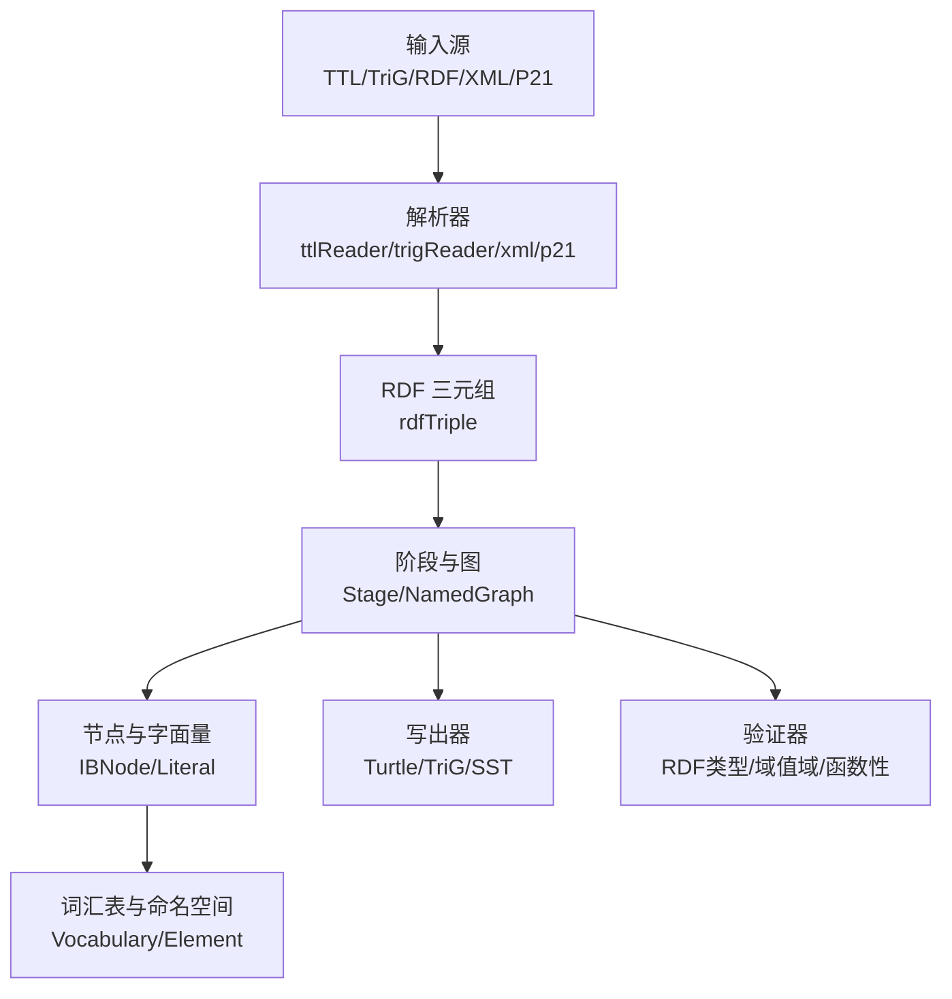
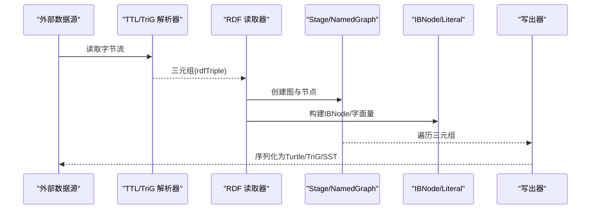
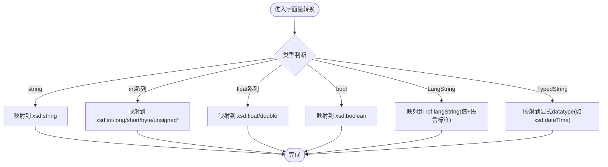
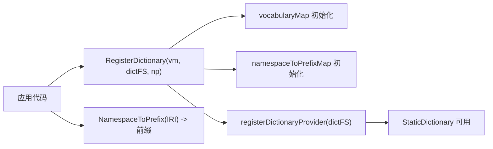
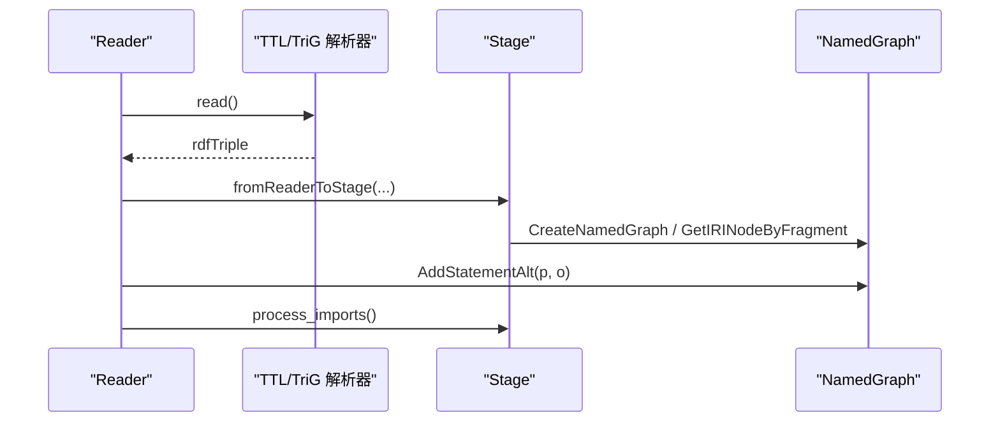
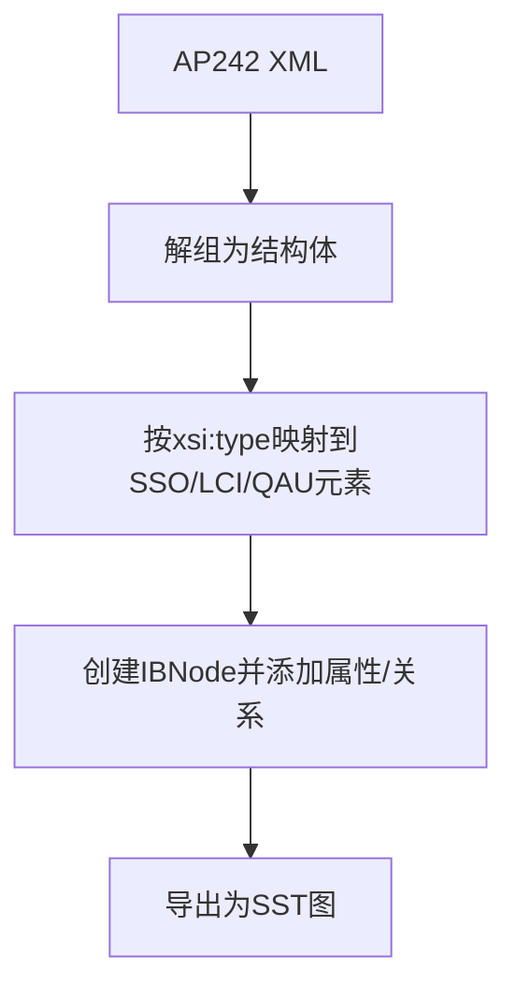
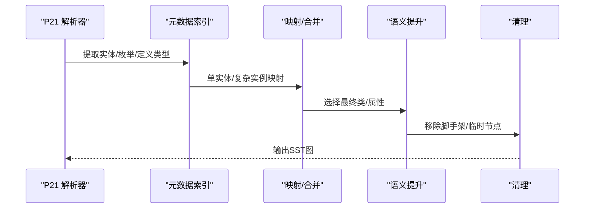
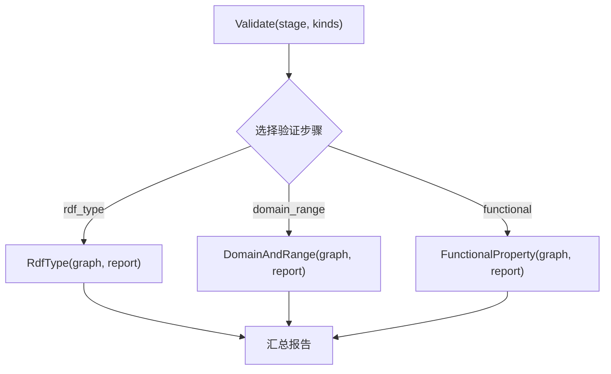
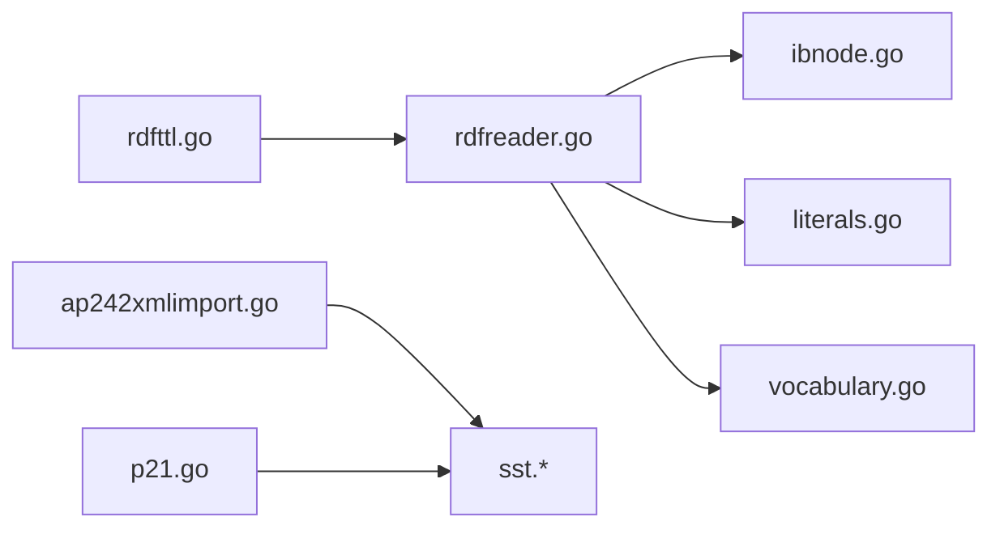

# 格式映射和转换规则

<cite>
**本文引用的文件**
- [types.go](file://sst/types.go)
- [literals.go](file://sst/literals.go)
- [literaltypes.go](file://sst/literaltypes.go)
- [vocabulary.go](file://sst/vocabulary.go)
- [rdf.go](file://sst/rdf.go)
- [rdfttl.go](file://sst/rdfttl.go)
- [rdfreader.go](file://sst/rdfreader.go)
- [ibnode.go](file://sst/ibnode.go)
- [ap242xmlimport.go](file://step/ap242xmlimport/ap242xmlimport.go)
- [p21.go](file://step/p21/p21.go)
- [run.go](file://tools/validate/run.go)
</cite>

## 目录
1. [简介](#简介)
2. [项目结构](#项目结构)
3. [核心组件](#核心组件)
4. [架构总览](#架构总览)
5. [详细组件分析](#详细组件分析)
6. [依赖关系分析](#依赖关系分析)
7. [性能考虑](#性能考虑)
8. [故障排查指南](#故障排查指南)
9. [结论](#结论)
10. [附录](#附录)

## 简介
本文件系统性说明 SST 内部数据类型与外部格式（TTL、XML、二进制）之间的映射与转换规则，覆盖 IRI 节点、字面量、空白节点等核心类型的处理逻辑；解释词汇表注册与命名空间管理机制；提供自定义类型扩展方法；阐述数据验证与类型检查流程；并给出格式兼容性矩阵、版本升级指南、实际转换示例与最佳实践。

## 项目结构
SST 将“读入—建模—写出”的转换链路拆分为：
- 解析层：TTL/TriG 流式解析器，RDF/XML 与 STEP P21/AP242 XML 的专用导入器
- 模型层：IBNode、Literal、NamedGraph、Stage 等核心数据结构
- 词汇表层：Vocabulary/Element/ElementInformer 与静态字典
- 输出层：Turtle/TriG 序列化与 SST 文件写入
- 验证层：基于规则的 RDF 校验工具



**图表来源**
- [rdfttl.go:57-86](file://sst/rdfttl.go#L57-L86)
- [rdfreader.go:118-232](file://sst/rdfreader.go#L118-L232)
- [rdf.go:102-117](file://sst/rdf.go#L102-L117)
- [ibnode.go:698-800](file://sst/ibnode.go#L698-L800)
- [vocabulary.go:15-107](file://sst/vocabulary.go#L15-L107)
- [run.go:441-472](file://tools/validate/run.go#L441-L472)

**章节来源**
- [rdf.go:102-117](file://sst/rdf.go#L102-L117)
- [rdfreader.go:118-232](file://sst/rdfreader.go#L118-L232)

## 核心组件
- 术语与类型
  - TermKind：区分 IBNode、Literal、LiteralCollection、TermCollection
  - Literal：统一字面量抽象，支持 xsd:string、xsd:integer、xsd:boolean、xsd:dateTime、rdf:langString 等
  - IBNode：IRI 或空白节点，承载三元组关系
- 图与阶段
  - NamedGraph：按基 IRI 组织三元组
  - Stage：管理多个 NamedGraph 及引用关系
- 词汇表
  - Vocabulary/Element/ElementInformer：编译期绑定与运行时查询结合
  - StaticDictionary：内置只读词典，提供预定义本体元素

**章节来源**
- [ibnode.go:19-34](file://sst/ibnode.go#L19-L34)
- [literals.go:12-442](file://sst/literals.go#L12-L442)
- [literaltypes.go:10-74](file://sst/literaltypes.go#L10-L74)
- [vocabulary.go:15-107](file://sst/vocabulary.go#L15-L107)
- [types.go:9-234](file://sst/types.go#L9-L234)

## 架构总览
下图展示从外部格式到 SST 内部模型的读取路径，以及写回外部格式的序列化路径。



**图表来源**
- [rdfttl.go:57-86](file://sst/rdfttl.go#L57-L86)
- [rdfreader.go:118-232](file://sst/rdfreader.go#L118-L232)
- [rdf.go:102-117](file://sst/rdf.go#L102-L117)

## 详细组件分析

### 1) 字面量与数据类型映射
- 内部类型到 XSD/IANA 语言标签
  - String → xsd:string
  - Integer/Int/Long/Short/Byte/Unsigned* → 对应 xsd:* 整数类型
  - Double/Float → xsd:double/xsd:float
  - Boolean → xsd:boolean
  - LangString → rdf:langString（值+语言标签）
  - TypedString → 显式指定 datatype（如 xsd:dateTime、xsd:dateTimeStamp）
- 存储与转换
  - literalToObject：根据 typeOf 将内部存储还原为具体 Go 包装类型
  - literalToString：用于调试/日志输出
- 时间日期
  - 使用 RFC3339 作为默认 xsd:dateTime 字符串布局，可配置



**图表来源**
- [literals.go:12-442](file://sst/literals.go#L12-L442)
- [literaltypes.go:35-74](file://sst/literaltypes.go#L35-L74)
- [rdf.go:52-100](file://sst/rdf.go#L52-L100)

**章节来源**
- [literals.go:12-442](file://sst/literals.go#L12-L442)
- [literaltypes.go:10-74](file://sst/literaltypes.go#L10-L74)
- [rdf.go:52-100](file://sst/rdf.go#L52-L100)

### 2) IRI、空白节点与集合
- IRI 节点
  - 通过 Fragment/BaseIRI 定位 NamedGraph 中的资源
  - PrefixedFragment 支持 Turtle 前缀表示
- 空白节点
  - 在 TriG 中按命名图作用域管理，避免跨图重名冲突
  - 支持 UUID 与自增标签两种形式
- 集合
  - 解析时展开为 rdf:first/rdf:rest 链
  - 内部以 LiteralCollection/TermCollection 表达

```mermaid
classDiagram
class IBNode {
+IRI() IRI
+Fragment() string
+ID() uuid.UUID
+PrefixedFragment() string
+ForAll(callback) error
+AddStatement(p, o) void
}
class Literal {
+DataType() IBNode
+apiValue() interface{}
}
class LangString {
+Val string
+LangTag string
}
class TypedString {
+Val string
+Type Node
}
IBNode <.. Literal : "对象可为字面量"
Literal <|.. LangString
Literal <|.. TypedString
```

**图表来源**
- [ibnode.go:698-800](file://sst/ibnode.go#L698-L800)
- [literals.go:246-335](file://sst/literals.go#L246-L335)

**章节来源**
- [rdfreader.go:539-677](file://sst/rdfreader.go#L539-L677)
- [rdfttl.go:236-430](file://sst/rdfttl.go#L236-L430)

### 3) 词汇表注册与命名空间管理
- 注册机制
  - RegisterDictionary：初始化词汇表映射、命名空间前缀映射，并加载内置词典
  - NamespaceToPrefix：由 IRI 获取前缀，用于序列化与可读性
- 元素信息
  - ElementInformer：提供类/属性/数据类型/个体等元信息，支持域/范围/子类等查询
- 静态图
  - 内置 RDF/RDFS/XSD 等基础图常量，确保类型与谓词一致性



**图表来源**
- [vocabulary.go:15-107](file://sst/vocabulary.go#L15-L107)
- [vocabulary.go:115-123](file://sst/vocabulary.go#L115-L123)
- [types.go:209-227](file://sst/types.go#L209-L227)

**章节来源**
- [vocabulary.go:15-107](file://sst/vocabulary.go#L15-L107)
- [vocabulary.go:115-123](file://sst/vocabulary.go#L115-L123)
- [types.go:209-227](file://sst/types.go#L209-L227)

### 4) 外部格式到 SST 的转换流程

#### 4.1 TTL/TriG 读取
- 流式解析：newTripleReader 选择 ttlReader 或 trigReader
- 三元组生成：parseSubject/parsePredicate/parseObject 构建 rdfTriple
- 阶段构建：fromReaderToStage/fromTriGReaderToStage 将三元组写入 Stage/NamedGraph
- 导入处理：processImports 处理 owl:imports 引用



**图表来源**
- [rdfreader.go:118-232](file://sst/rdfreader.go#L118-L232)
- [rdfreader.go:470-537](file://sst/rdfreader.go#L470-L537)
- [rdfttl.go:57-86](file://sst/rdfttl.go#L57-L86)

**章节来源**
- [rdfreader.go:118-232](file://sst/rdfreader.go#L118-L232)
- [rdfreader.go:470-537](file://sst/rdfreader.go#L470-L537)
- [rdfttl.go:57-86](file://sst/rdfttl.go#L57-L86)

#### 4.2 STEP AP242 XML 导入
- 解析结构体：Header/Part/Occurrence/ShapeElement 等
- 映射策略：依据 xsi:type 与领域模型映射到 sso/lci/qau 等词汇表元素
- 关系构建：建立装配、几何、拓扑关联，填充标识与数量属性



**图表来源**
- [ap242xmlimport.go:28-53](file://step/ap242xmlimport/ap242xmlimport.go#L28-L53)
- [ap242xmlimport.go:325-376](file://step/ap242xmlimport/ap242xmlimport.go#L325-L376)
- [ap242xmlimport.go:405-599](file://step/ap242xmlimport/ap242xmlimport.go#L405-L599)

**章节来源**
- [ap242xmlimport.go:28-53](file://step/ap242xmlimport/ap242xmlimport.go#L28-L53)
- [ap242xmlimport.go:325-376](file://step/ap242xmlimport/ap242xmlimport.go#L325-L376)
- [ap242xmlimport.go:405-599](file://step/ap242xmlimport/ap242xmlimport.go#L405-L599)

#### 4.3 STEP P21 (ISO 10303-21) 导入
- 多阶段流水线：Raw 解析 → 元数据索引 → 映射到草稿本体 → 合并复杂实例 → 语义提升 → 清理临时 IR
- 实体映射：ssmeta.StepImEntityMap 驱动 STEP 实体到 SST 类的映射
- 枚举与单位：qau 单位与枚举值映射，保持物理量语义



**图表来源**
- [p21.go:343-404](file://step/p21/p21.go#L343-L404)
- [p21.go:406-448](file://step/p21/p21.go#L406-L448)
- [p21.go:450-776](file://step/p21/p21.go#L450-L776)

**章节来源**
- [p21.go:343-404](file://step/p21/p21.go#L343-L404)
- [p21.go:406-448](file://step/p21/p21.go#L406-L448)
- [p21.go:450-776](file://step/p21/p21.go#L450-L776)

### 5) 写出与序列化
- 支持的 RDF 序列化：Turtle、TriG
- 字面量序列化：根据 datatype 与语言标签格式化
- 前缀与基 IRI：利用词汇表与前缀映射生成可读输出

**章节来源**
- [rdf.go:102-117](file://sst/rdf.go#L102-L117)
- [rdf.go:294-335](file://sst/rdf.go#L294-L335)
- [vocabulary.go:115-123](file://sst/vocabulary.go#L115-L123)

### 6) 数据验证与类型检查
- 验证种类
  - RDF 类型检查：主体/客体是否符合预期类型
  - 域/值域检查：谓词的 domain/range 约束
  - 函数性属性：同一主体对某谓词仅允许一个值
- 报告格式：JSON 与人类可读文本，包含错误/警告、相关三元组、期望与实际值



**图表来源**
- [run.go:441-472](file://tools/validate/run.go#L441-L472)
- [run.go:211-284](file://tools/validate/run.go#L211-L284)

**章节来源**
- [run.go:211-284](file://tools/validate/run.go#L211-L284)
- [run.go:441-472](file://tools/validate/run.go#L441-L472)

## 依赖关系分析
- 解析器依赖
  - rdfttl.go 依赖 lexer/token 状态机
  - rdfreader.go 协调不同解析器并构建 Stage/NamedGraph
- 模型依赖
  - ibnode.go 提供节点与三元组操作
  - literals.go/literaltypes.go 提供字面量类型与转换
- 词汇表依赖
  - vocabulary.go 提供 ElementInformer 与静态词典
- 导入器依赖
  - ap242xmlimport.go/p21.go 依赖词汇表与 SST API 进行映射



**图表来源**
- [rdfreader.go:118-232](file://sst/rdfreader.go#L118-L232)
- [ibnode.go:698-800](file://sst/ibnode.go#L698-L800)
- [literals.go:12-442](file://sst/literals.go#L12-L442)
- [vocabulary.go:15-107](file://sst/vocabulary.go#L15-L107)
- [ap242xmlimport.go:28-53](file://step/ap242xmlimport/ap242xmlimport.go#L28-L53)
- [p21.go:343-404](file://step/p21/p21.go#L343-L404)

**章节来源**
- [rdfreader.go:118-232](file://sst/rdfreader.go#L118-L232)
- [ibnode.go:698-800](file://sst/ibnode.go#L698-L800)
- [literals.go:12-442](file://sst/literals.go#L12-L442)
- [vocabulary.go:15-107](file://sst/vocabulary.go#L15-L107)
- [ap242xmlimport.go:28-53](file://step/ap242xmlimport/ap242xmlimport.go#L28-L53)
- [p21.go:343-404](file://step/p21/p21.go#L343-L404)

## 性能考虑
- 流式解析：TTL/TriG 解析器按需产出三元组，降低内存峰值
- 集合展开：仅在需要时展开 rdf:first/rdf:rest，减少中间结构
- 词汇表查找：ElementInformer 缓存与静态词典加速类型判定
- 批量写入：AddStatementAlt 容忍重复，减少重复检查开销
- 建议
  - 大文件优先使用流式读取
  - 合理设置 Strict/RecoverHandler 控制错误恢复策略
  - 复用 NamedGraph 与 IBNode 以减少分配

[本节为通用指导，不直接分析具体文件]

## 故障排查指南
- 常见错误
  - 空白节点跨图冲突：TriG 中同名空白节点出现在不同图块会报错
  - 非法谓词/类型：谓词非属性或类型不匹配导致验证失败
  - 语言标签无效：不符合 RFC 规范的语言标签会被拒绝
- 诊断手段
  - 使用 Validate 工具输出 JSON/人类可读报告
  - 启用严格模式捕获解析错误
  - 借助 Debug/Dump 输出节点与三元组详情

**章节来源**
- [rdfreader.go:75-86](file://sst/rdfreader.go#L75-L86)
- [rdfttl.go:515-557](file://sst/rdfttl.go#L515-L557)
- [run.go:211-284](file://tools/validate/run.go#L211-L284)

## 结论
SST 通过清晰的解析—建模—写出分层，配合强大的词汇表与验证体系，实现了多种外部格式到统一 RDF 模型的稳定转换。遵循本文档的映射规则与最佳实践，可在保证数据一致性的同时，获得良好的可扩展性与性能表现。

## 附录

### A. 格式兼容性矩阵
- 读取
  - Turtle：完全支持（含集合、语言标签、类型化字面量）
  - TriG：完全支持（命名图、空白节点作用域）
  - RDF/XML：通过专用导入器（如 AP242 XML）
  - STEP P21：通过多阶段解析与映射
- 写出
  - Turtle/TriG：完全支持
  - SST 文件：内部持久化格式

[本节为概念性总结，不直接分析具体文件]

### B. 版本升级指南
- 新增数据类型：在 literals.go 中添加包装类型并在 literaltypes.go 补充转换分支
- 新词汇表：在 vocabulary.go 注册 ElementInformer 与命名空间前缀
- 新导入器：参照 ap242xmlimport/p21 的多阶段模式，分离解析、映射与清理
- 向后兼容：保持旧有 IRI/Fragment 约定，谨慎修改静态图常量

[本节为概念性指导，不直接分析具体文件]

### C. 实际转换示例（路径指引）
- TTL 到 SST 图
  - 入口：RdfRead → fromReaderToStage
  - 参考路径：[rdfreader.go:118-232](file://sst/rdfreader.go#L118-L232)
- TriG 到 SST 图（多命名图）
  - 入口：fromTriGReaderToStage
  - 参考路径：[rdfreader.go:470-537](file://sst/rdfreader.go#L470-L537)
- AP242 XML 到 SST 图
  - 入口：ap242xmlimport 结构体映射
  - 参考路径：[ap242xmlimport.go:325-376](file://step/ap242xmlimport/ap242xmlimport.go#L325-L376)
- STEP P21 到 SST 图
  - 入口：Parse → ParseRaw → 多阶段处理
  - 参考路径：[p21.go:343-404](file://step/p21/p21.go#L343-L404)

**章节来源**
- [rdfreader.go:118-232](file://sst/rdfreader.go#L118-L232)
- [rdfreader.go:470-537](file://sst/rdfreader.go#L470-L537)
- [ap242xmlimport.go:325-376](file://step/ap242xmlimport/ap242xmlimport.go#L325-L376)
- [p21.go:343-404](file://step/p21/p21.go#L343-L404)

### D. 最佳实践
- 使用词汇表常量与 ElementInformer 进行类型与关系校验
- 优先流式读写，避免一次性加载大文档
- 在导入后执行 Validate，确保数据质量
- 对集合与空白节点谨慎处理，必要时显式展开与作用域隔离
- 自定义类型扩展时，保持 DataType().IRI() 与序列化一致

[本节为通用指导，不直接分析具体文件]