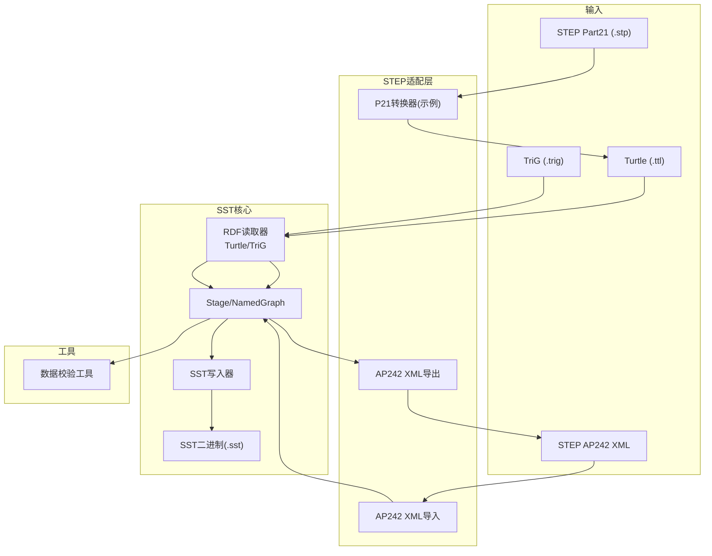
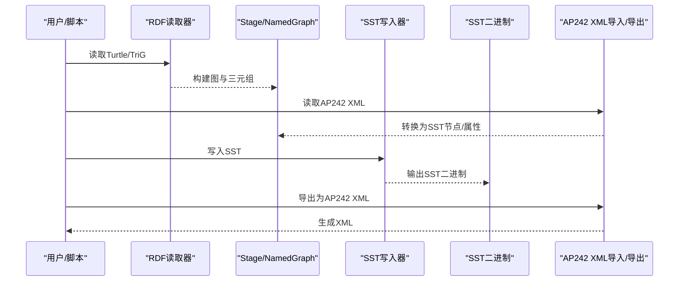
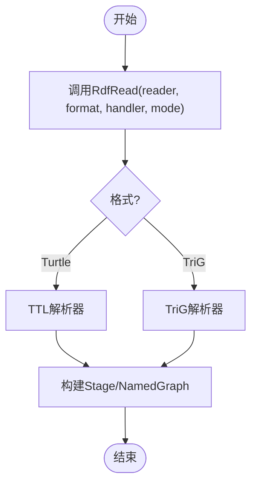
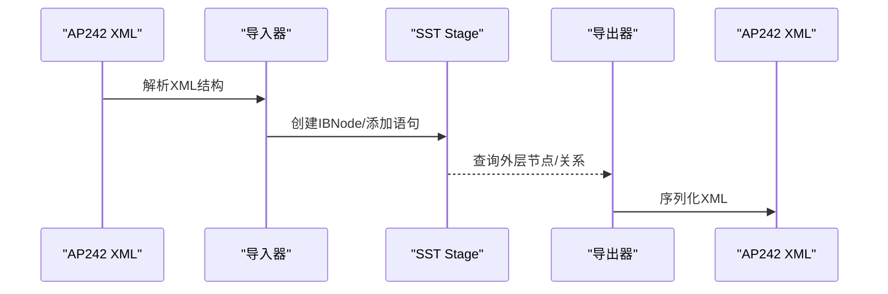
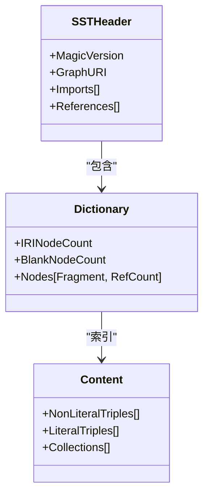
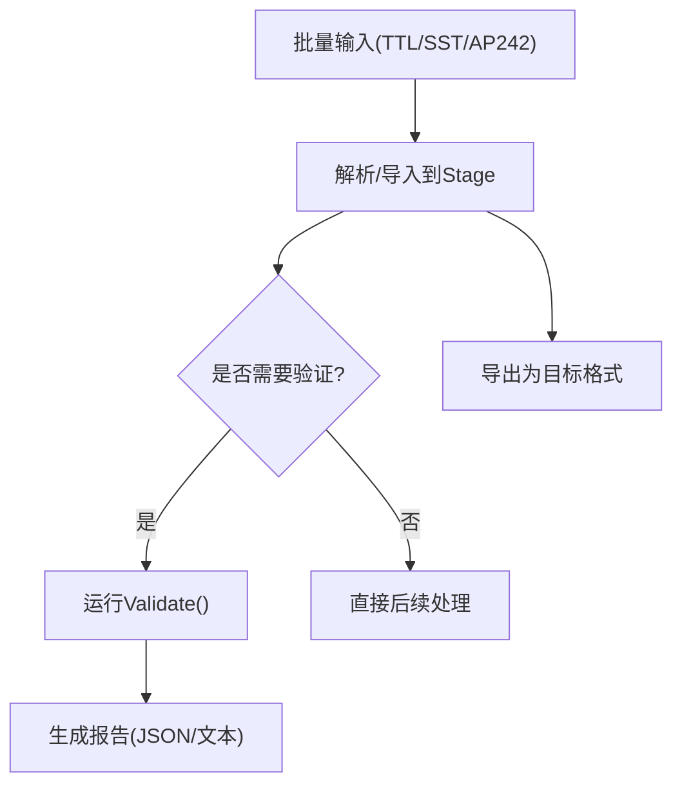
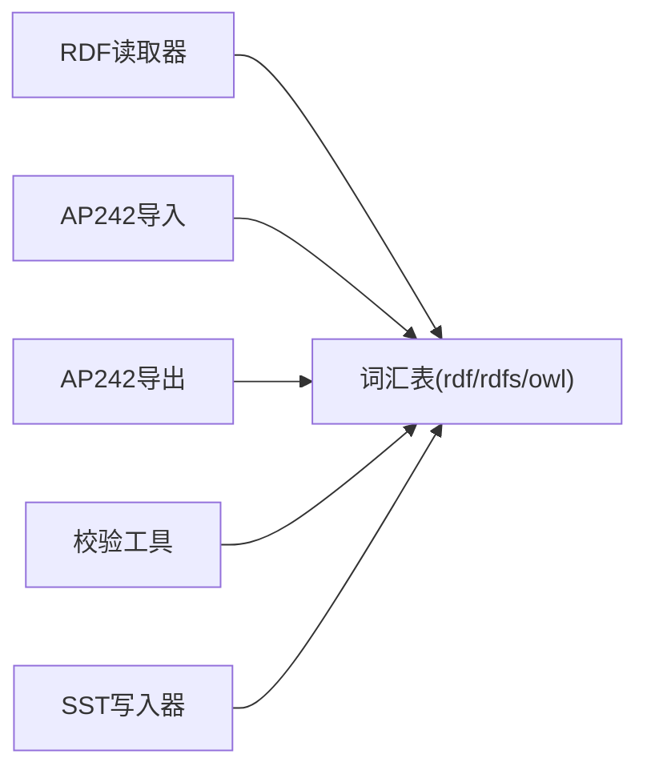

# 格式转换

<cite>
**本文引用的文件**
- [README.md](file://README.md)
- [sst/README.md](file://sst/README.md)
- [step/doc.go](file://step/doc.go)
- [examples/p21/p21converter.go](file://examples/p21/p21converter.go)
- [sst/rdf.go](file://sst/rdf.go)
- [sst/rdfttl.go](file://sst/rdfttl.go)
- [sst/rdfreader.go](file://sst/rdfreader.go)
- [sst/sstfile.go](file://sst/sstfile.go)
- [sst/sstwriter.go](file://sst/sstwriter.go)
- [step/ap242xmlimport/ap242xmlimport.go](file://step/ap242xmlimport/ap242xmlimport.go)
- [step/ap242xmlexport/ap242xmlexport.go](file://step/ap242xmlexport/ap242xmlexport.go)
- [tools/validate/run.go](file://tools/validate/run.go)
</cite>

## 目录
1. [简介](#简介)
2. [项目结构](#项目结构)
3. [核心组件](#核心组件)
4. [架构总览](#架构总览)
5. [详细组件分析](#详细组件分析)
6. [依赖关系分析](#依赖关系分析)
7. [性能考虑](#性能考虑)
8. [故障排查指南](#故障排查指南)
9. [结论](#结论)
10. [附录](#附录)

## 简介
本文件面向SST（Semantic STEP Technology）的格式转换能力，系统性说明：
- TTL格式的读写操作与配置选项
- STEP AP242 XML格式的导入导出流程
- SST二进制格式的特性与优势
- 不同格式之间的映射关系与数据转换规则
- 批量转换与格式验证工具使用方法
- 转换性能优化与错误处理策略
- 实际转换示例与最佳实践
- 格式兼容性与版本升级考虑

SST以RDF/RDFS/OWL为基础，Turtle（*.ttl）为主要交换/表示格式；内部采用优化的二进制SST格式存储，支持高效差异计算与快速读写。同时提供STEP AP242 XML的导入/导出能力，便于与工业标准数据生态集成。

**章节来源**
- [README.md:1-15](file://README.md#L1-L15)
- [sst/README.md:1-110](file://sst/README.md#L1-L110)

## 项目结构
围绕格式转换的核心目录与职责：
- sst：RDF/TriG/Turtle解析、SST二进制读写、Stage/NamedGraph模型
- step：STEP AP242 XML导入/导出、P21转换器示例
- tools/validate：数据校验工具，输出结构化报告
- examples：示例程序，演示从P21到TTL的转换

**图表来源**
- [sst/rdfreader.go:118-143](file://sst/rdfreader.go#L118-L143)
- [sst/sstwriter.go:67-82](file://sst/sstwriter.go#L67-L82)
- [step/ap242xmlimport/ap242xmlimport.go:325-376](file://step/ap242xmlimport/ap242xmlimport.go#L325-L376)
- [step/ap242xmlexport/ap242xmlexport.go:370-432](file://step/ap242xmlexport/ap242xmlexport.go#L370-L432)
- [examples/p21/p21converter.go:22-63](file://examples/p21/p21converter.go#L22-L63)

**章节来源**
- [sst/rdfreader.go:118-143](file://sst/rdfreader.go#L118-L143)
- [sst/sstwriter.go:67-82](file://sst/sstwriter.go#L67-L82)
- [step/ap242xmlimport/ap242xmlimport.go:325-376](file://step/ap242xmlimport/ap242xmlimport.go#L325-L376)
- [step/ap242xmlexport/ap242xmlexport.go:370-432](file://step/ap242xmlexport/ap242xmlexport.go#L370-L432)
- [examples/p21/p21converter.go:22-63](file://examples/p21/p21converter.go#L22-L63)

## 核心组件
- RDF读取器：支持Turtle与TriG流式解析，构建Stage/NamedGraph
- SST写入器：将NamedGraph序列化为SST二进制，包含字典与内容段
- STEP AP242 XML导入/导出：在SST与AP242 XML之间进行双向映射
- 数据校验工具：对Stage执行类型、域值范围等规则检查，生成报告

**章节来源**
- [sst/rdfreader.go:118-143](file://sst/rdfreader.go#L118-L143)
- [sst/sstwriter.go:67-82](file://sst/sstwriter.go#L67-L82)
- [step/ap242xmlimport/ap242xmlimport.go:325-376](file://step/ap242xmlimport/ap242xmlimport.go#L325-L376)
- [step/ap242xmlexport/ap242xmlexport.go:370-432](file://step/ap242xmlexport/ap242xmlexport.go#L370-L432)
- [tools/validate/run.go:441-473](file://tools/validate/run.go#L441-L473)

## 架构总览
下图展示从多种输入到SST内部模型，再到多种输出的整体流程。

**图表来源**
- [sst/rdfreader.go:118-143](file://sst/rdfreader.go#L118-L143)
- [sst/sstwriter.go:67-82](file://sst/sstwriter.go#L67-L82)
- [step/ap242xmlimport/ap242xmlimport.go:325-376](file://step/ap242xmlimport/ap242xmlimport.go#L325-L376)
- [step/ap242xmlexport/ap242xmlexport.go:370-432](file://step/ap242xmlexport/ap242xmlexport.go#L370-L432)

## 详细组件分析

### TTL格式读写与配置
- 读取
  - 通过RdfRead接口，指定RdfFormatTurtle或RdfFormatTriG，配合错误处理策略（StrictHandler/RecoverHandler）控制解析行为
  - 支持Base IRI解析相对IRI，支持命名空间前缀、集合、列表等语法
- 写入
  - NamedGraph.RdfWrite可输出Turtle/TriG（由具体实现决定），用于序列化与交换
- 配置项
  - Base IRI：用于相对IRI解析
  - Strict模式：严格模式下遇到非法输入即报错；恢复模式下忽略错误继续解析
  - 错误输出：可通过自定义readErrorHandler记录行号与上下文

**图表来源**
- [sst/rdfreader.go:118-143](file://sst/rdfreader.go#L118-L143)
- [sst/rdfttl.go:13-40](file://sst/rdfttl.go#L13-L40)

**章节来源**
- [sst/rdfreader.go:118-143](file://sst/rdfreader.go#L118-L143)
- [sst/rdfttl.go:13-40](file://sst/rdfttl.go#L13-L40)
- [sst/rdf.go:102-117](file://sst/rdf.go#L102-L117)

### STEP AP242 XML导入导出
- 导入
  - 解析AP242 XML结构体，建立uid到IBNode的映射，逐步创建视图、部件、形状元素、表示上下文等
  - 将枚举、单位、组织、属性定义等映射到SST词汇表中的元素
  - 处理几何与拓扑关联、装配关系、连接终端等复杂关系
- 导出
  - 遍历SST图中的外层节点（Part、Organization、RepresentationContext等）
  - 提取视图、形状元素、数量、属性赋值等信息，组装为AP242 XML结构并写出

**图表来源**
- [step/ap242xmlimport/ap242xmlimport.go:325-376](file://step/ap242xmlimport/ap242xmlimport.go#L325-L376)
- [step/ap242xmlexport/ap242xmlexport.go:444-483](file://step/ap242xmlexport/ap242xmlexport.go#L444-L483)

**章节来源**
- [step/ap242xmlimport/ap242xmlimport.go:325-376](file://step/ap242xmlimport/ap242xmlimport.go#L325-L376)
- [step/ap242xmlexport/ap242xmlexport.go:370-432](file://step/ap242xmlexport/ap242xmlexport.go#L370-L432)

### SST二进制格式特性与优势
- 文件结构
  - 头部：魔数与版本标识
  - 导入/引用图清单
  - 字典：IRI节点与空白节点索引、引用计数
  - 内容：按节点排序的非字面量三元组与字面量三元组，支持集合与多成员编码
- 优势
  - 标准化顺序与归一化存储，利于快速差异计算
  - 紧凑的二进制编码（变长整数、原生浮点、布尔压缩等）
  - 支持导入与外部引用图，保持自包含性

**图表来源**
- [sst/sstfile.go:12-53](file://sst/sstfile.go#L12-L53)
- [sst/sstwriter.go:219-275](file://sst/sstwriter.go#L219-L275)

**章节来源**
- [sst/sstfile.go:12-53](file://sst/sstfile.go#L12-L53)
- [sst/sstwriter.go:219-275](file://sst/sstwriter.go#L219-L275)

### 格式映射与转换规则
- Turtle/TriG → SST
  - 三元组subject/predicate/object映射为IBNode与Term
  - 集合与列表展开为rdf:first/rdf:rest链
  - owl:Ontology声明被跳过，避免污染应用数据
- SST → Turtle/TriG
  - 通过RdfWrite输出可读文本，保留语言标签与数据类型
- AP242 XML ↔ SST
  - uid→IBNode Fragment映射
  - 视图上下文、单位、组织、属性定义等词汇映射
  - 几何/拓扑关系通过rep词汇表达
  - 装配关系、连接终端、关节类型等通过sso/lci词汇表达

**章节来源**
- [sst/rdfreader.go:156-232](file://sst/rdfreader.go#L156-L232)
- [step/ap242xmlimport/ap242xmlimport.go:405-599](file://step/ap242xmlimport/ap242xmlimport.go#L405-L599)
- [step/ap242xmlexport/ap242xmlexport.go:485-629](file://step/ap242xmlexport/ap242xmlexport.go#L485-L629)

### 批量转换与格式验证工具
- 批量转换
  - 使用示例程序p21converter将STEP Part21转为Turtle，并可输出原始解析图
  - 结合文件系统遍历与并发goroutine可实现批量处理
- 格式验证
  - 使用tools/validate对Stage执行类型、域/值范围、函数式属性等规则检查
  - 输出JSON或人类可读报告，便于自动化流水线集成

**图表来源**
- [examples/p21/p21converter.go:22-63](file://examples/p21/p21converter.go#L22-L63)
- [tools/validate/run.go:441-473](file://tools/validate/run.go#L441-L473)

**章节来源**
- [examples/p21/p21converter.go:22-63](file://examples/p21/p21converter.go#L22-L63)
- [tools/validate/run.go:441-473](file://tools/validate/run.go#L441-L473)

## 依赖关系分析
- sst包依赖词汇表（rdf/rdfs/owl/ssmeta/sso/lci/qau等）进行语义建模
- AP242导入/导出依赖词汇表完成领域概念映射
- 校验工具依赖词汇表与规则集进行一致性检查

**图表来源**
- [step/ap242xmlimport/ap242xmlimport.go:6-26](file://step/ap242xmlimport/ap242xmlimport.go#L6-L26)
- [step/ap242xmlexport/ap242xmlexport.go:6-24](file://step/ap242xmlexport/ap242xmlexport.go#L6-L24)
- [tools/validate/run.go:5-22](file://tools/validate/run.go#L5-L22)

**章节来源**
- [step/ap242xmlimport/ap242xmlimport.go:6-26](file://step/ap242xmlimport/ap242xmlimport.go#L6-L26)
- [step/ap242xmlexport/ap242xmlexport.go:6-24](file://step/ap242xmlexport/ap242xmlexport.go#L6-L24)
- [tools/validate/run.go:5-22](file://tools/validate/run.go#L5-L22)

## 性能考虑
- 流式解析：Turtle/TriG读取器逐三元组产出，降低内存峰值
- 归一化与排序：SST写入时对节点与三元组进行排序，提升差异计算效率
- 紧凑编码：SST二进制使用变长整数、原生浮点、布尔压缩等减少体积
- 导入/导出缓存：AP242导入过程中维护uid→IBNode映射，避免重复查找
- 建议
  - 大批量处理时启用日志级别控制，减少IO开销
  - 合理选择Strict/Recover模式，平衡速度与鲁棒性
  - 复用Stage与NamedGraph实例，减少对象分配

**章节来源**
- [sst/rdfreader.go:156-232](file://sst/rdfreader.go#L156-L232)
- [sst/sstwriter.go:141-217](file://sst/sstwriter.go#L141-L217)
- [step/ap242xmlimport/ap242xmlimport.go:325-376](file://step/ap242xmlimport/ap242xmlimport.go#L325-L376)

## 故障排查指南
- 常见错误
  - 空白节点跨图冲突：TriG中同一空白节点标签出现在不同图块时报错
  - 缺失导入：SST写入时若缺少导入图会返回错误
  - 几何/拓扑关系不完整：AP242导入时Origin/Target长度不匹配或缺失相关项
- 调试手段
  - 启用默认日志或注入自定义Logger，查看关键步骤
  - 使用校验工具输出详细发现，定位问题三元组
  - 对TTL/TriG使用RecoverHandler捕获并继续解析，定位坏片段

**章节来源**
- [sst/rdfreader.go:470-537](file://sst/rdfreader.go#L470-L537)
- [sst/sstwriter.go:141-217](file://sst/sstwriter.go#L141-L217)
- [step/ap242xmlimport/ap242xmlimport.go:38-53](file://step/ap242xmlimport/ap242xmlimport.go#L38-L53)
- [tools/validate/run.go:65-121](file://tools/validate/run.go#L65-L121)

## 结论
SST提供了完整的格式转换能力：
- 高效的Turtle/TriG读写与SST二进制存储
- 完善的STEP AP242 XML导入/导出，覆盖工程领域的复杂关系
- 强大的数据校验工具，保障数据质量
- 清晰的映射规则与可扩展的词汇体系，便于版本演进与兼容性管理

建议在工程中结合批量处理与校验流程，确保转换的正确性与性能。

## 附录

### 实际转换示例与最佳实践
- STEP Part21 → Turtle
  - 使用示例程序p21converter，传入-in/-out参数，输出转换后的Turtle与原始解析图
- TTL → SST
  - 通过RdfRead读取TTL，再调用NamedGraph.SstWrite输出SST二进制
- AP242 XML ↔ SST
  - 导入：解析XML结构，建立uid映射，填充SST图
  - 导出：遍历外层节点，提取信息并序列化XML

**章节来源**
- [examples/p21/p21converter.go:22-63](file://examples/p21/p21converter.go#L22-L63)
- [sst/rdfreader.go:118-143](file://sst/rdfreader.go#L118-L143)
- [sst/sstwriter.go:67-82](file://sst/sstwriter.go#L67-L82)
- [step/ap242xmlimport/ap242xmlimport.go:325-376](file://step/ap242xmlimport/ap242xmlimport.go#L325-L376)
- [step/ap242xmlexport/ap242xmlexport.go:370-432](file://step/ap242xmlexport/ap242xmlexport.go#L370-L432)

### 格式兼容性与版本升级考虑
- 版本标识：SST文件头包含版本信息，确保向后兼容
- 词汇演进：新增词汇需保持与既有三元组的互操作性
- 导入/引用图：通过明确清单管理依赖，避免破坏性变更
- 校验规则：随词汇扩展更新校验规则，保证数据一致性

**章节来源**
- [sst/sstfile.go:12-53](file://sst/sstfile.go#L12-L53)
- [tools/validate/run.go:211-284](file://tools/validate/run.go#L211-L284)