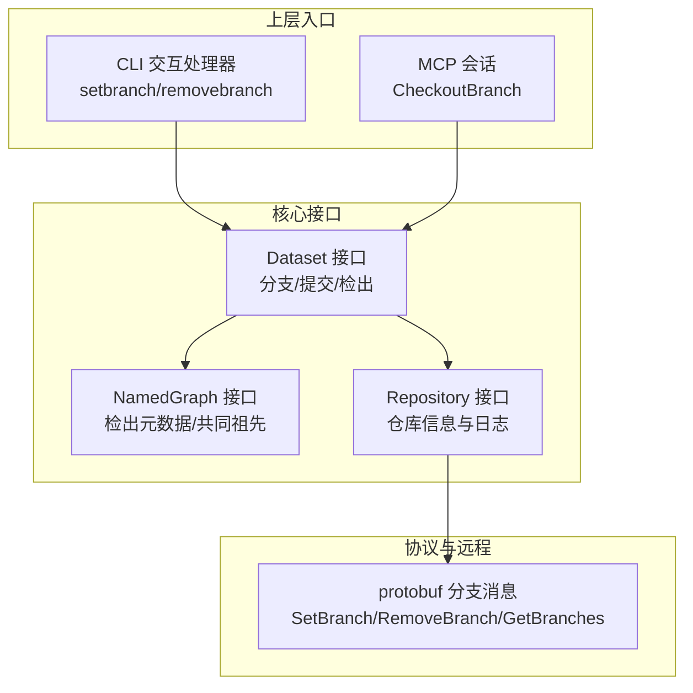
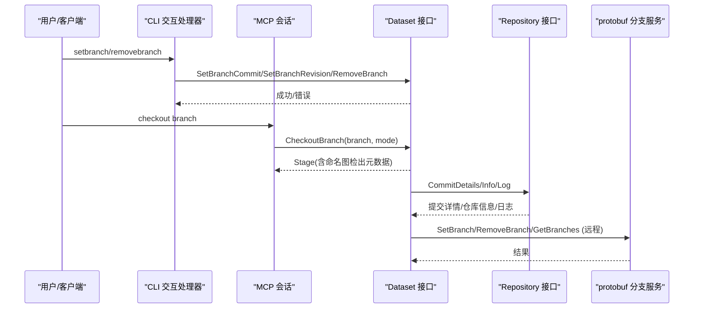
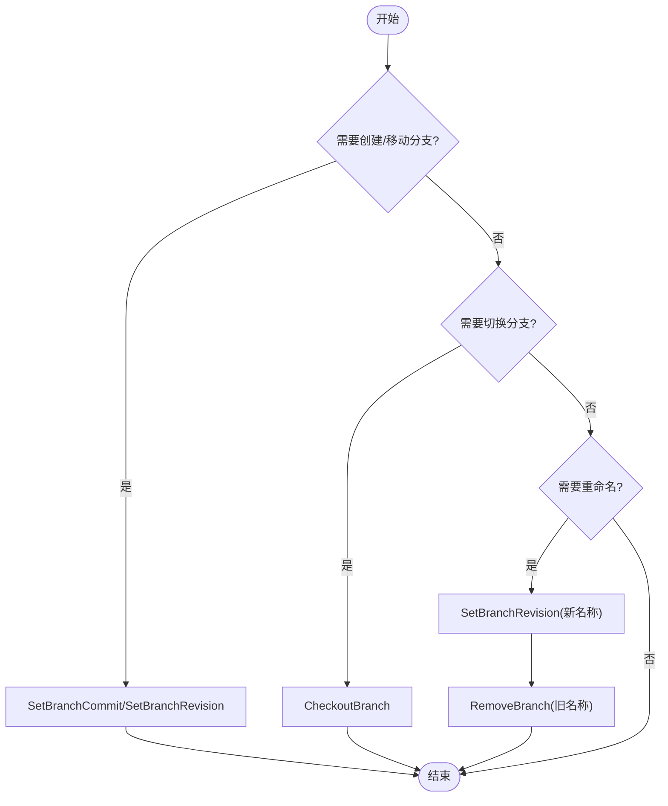
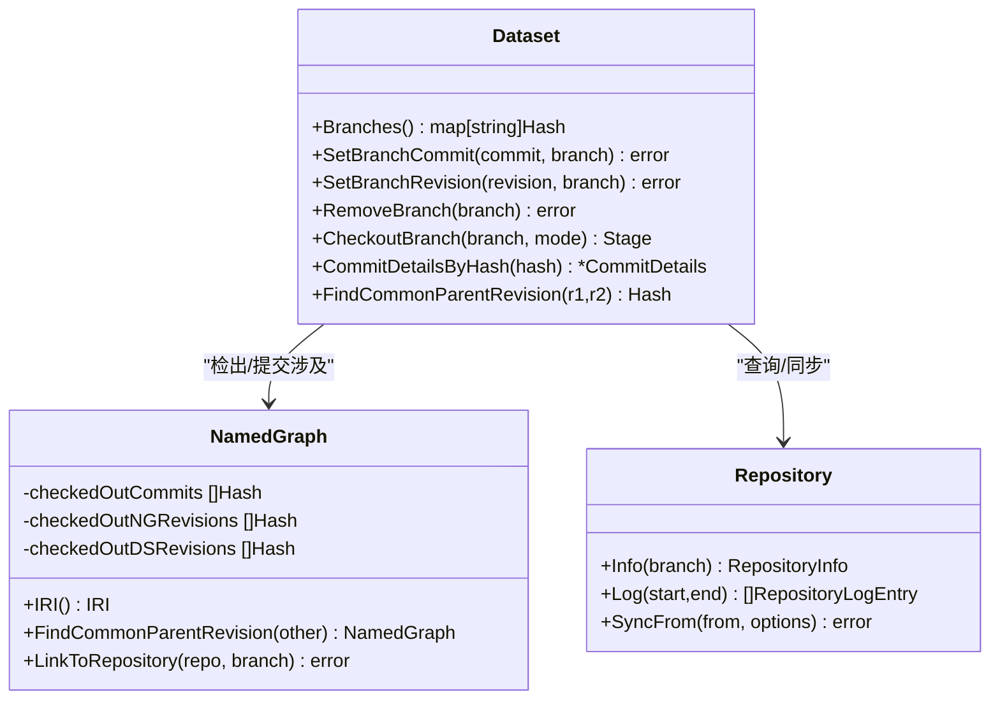
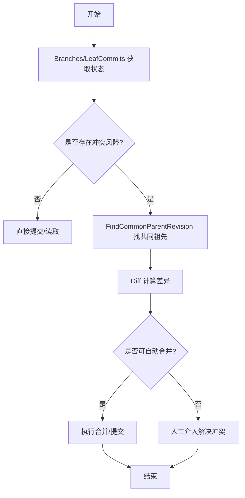
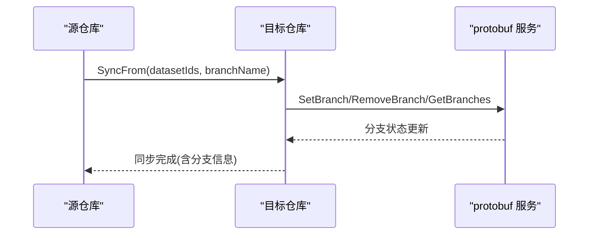
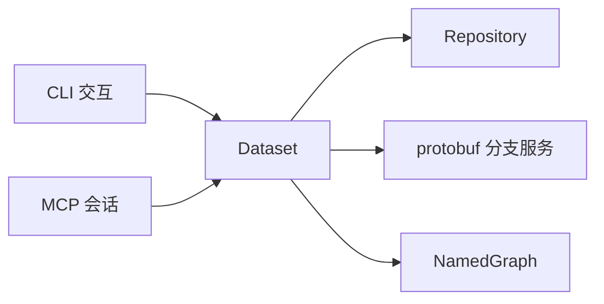

# 分支管理

<cite>
**本文引用的文件**
- [dataset.go](file://sst/dataset.go)
- [namedgraph.go](file://sst/namedgraph.go)
- [repository.go](file://sst/repository.go)
- [branch_test.go](file://sst_test/branch_test.go)
- [remoteRepositoryMultipleCommits_test.go](file://sst_test/remoteRepositoryMultipleCommits_test.go)
- [remoteRepository_test.go](file://sst_test/remoteRepository_test.go)
- [repository.pb.go](file://bboltproto/repository.pb.go)
- [dataset_handler.go](file://cli/cmd/interactive/dataset_handler.go)
- [session.go](file://mcp/cmd/session.go)
</cite>

## 目录
1. [简介](#简介)
2. [项目结构](#项目结构)
3. [核心组件](#核心组件)
4. [架构总览](#架构总览)
5. [详细组件分析](#详细组件分析)
6. [依赖关系分析](#依赖关系分析)
7. [性能考虑](#性能考虑)
8. [故障排查指南](#故障排查指南)
9. [结论](#结论)
10. [附录：API与使用示例](#附录api与使用示例)

## 简介
本章节面向SST的分支管理能力，系统阐述以下要点：
- 分支的概念与作用：在版本控制中，分支用于隔离开发、实验与发布等场景；SST以“数据集（Dataset）”为单位维护可重放的历史提交（Commit），并通过分支名指向特定提交或修订。
- 默认分支master的设置与管理：通过接口与测试用例可见，默认分支常量存在并被广泛使用；可通过设置分支指向某提交来创建或移动分支。
- 分支操作：创建、切换（检出）、删除、重命名（通过先设后删实现）。
- 分支与数据集（Dataset）和命名图（NamedGraph）的关系：分支属于Dataset级别，但影响其包含的默认命名图及导入链上的命名图；提交会记录受影响的Dataset集合。
- 状态检查与冲突检测：提供分支列表查询、提交详情、共同祖先查找等能力，为三向差异与合并提供基础。
- API与CLI/MCP集成：提供本地/远程一致的API，并在CLI交互与MCP会话中暴露分支操作。
- 分布式同步策略：支持按数据集与分支维度的同步，元数据中包含分支信息，便于跨仓库同步。

## 项目结构
围绕分支管理的代码主要分布在以下位置：
- sst/dataset.go：定义Dataset接口，包括分支查询、设置、删除、检出等能力。
- sst/namedgraph.go：命名图在检出时携带提交/修订元数据，并参与共同祖先查找与LinkToRepository流程。
- sst/repository.go：仓库级信息与日志类型，包含分支相关日志条目定义。
- bboltproto/repository.pb.go：远程服务协议中的分支相关请求/响应消息与RPC方法。
- cli/cmd/interactive/dataset_handler.go：交互式CLI对分支操作的封装。
- mcp/cmd/session.go：MCP会话中对分支检出的封装。
- sst_test/*：覆盖分支创建、切换、删除、默认分支、远程/本地一致性等测试。

图表来源
- [dataset.go:30-94](file://sst/dataset.go#L30-L94)
- [namedgraph.go:415-503](file://sst/namedgraph.go#L415-L503)
- [repository.go:746-800](file://sst/repository.go#L746-L800)
- [repository.pb.go:5095-5139](file://bboltproto/repository.pb.go#L5095-L5139)
- [dataset_handler.go:289-357](file://cli/cmd/interactive/dataset_handler.go#L289-L357)
- [session.go:954-982](file://mcp/cmd/session.go#L954-L982)

章节来源
- [dataset.go:30-94](file://sst/dataset.go#L30-L94)
- [repository.go:746-800](file://sst/repository.go#L746-L800)
- [repository.pb.go:5095-5139](file://bboltproto/repository.pb.go#L5095-L5139)

## 核心组件
- Dataset接口
  - 分支管理：Branches、SetBranchCommit/SetBranchRevision、RemoveBranch
  - 提交与历史：CommitDetailsByHash/ByBranch、LeafCommits、FindCommonParentRevision
  - 检出：CheckoutCommit/CheckoutBranch/CheckoutRevision
- NamedGraph
  - 检出元数据：checkedOutCommits / checkedOutNGRevisions / checkedOutDSRevisions
  - LinkToRepository：将无历史的命名图关联到仓库与分支，准备后续提交继承历史
  - FindCommonParentRevision：基于仓库提交树寻找共同祖先
- Repository
  - Info：可按分支过滤统计（如NumberOfDatasetsInBranch）
  - Log：包含set_branch、remove_branch等日志条目
  - SyncFrom/SyncTo：支持按数据集与分支维度同步

章节来源
- [dataset.go:30-94](file://sst/dataset.go#L30-L94)
- [namedgraph.go:415-503](file://sst/namedgraph.go#L415-L503)
- [repository.go:746-800](file://sst/repository.go#L746-L800)

## 架构总览
下图展示了从上层调用到核心接口的分支操作流程，以及远程协议映射。

图表来源
- [dataset_handler.go:289-357](file://cli/cmd/interactive/dataset_handler.go#L289-L357)
- [session.go:954-982](file://mcp/cmd/session.go#L954-L982)
- [dataset.go:30-94](file://sst/dataset.go#L30-L94)
- [repository.pb.go:5095-5139](file://bboltproto/repository.pb.go#L5095-L5139)

## 详细组件分析

### 分支概念与默认分支
- 分支是Dataset级别的引用，指向某个提交或数据集修订。
- 默认分支常量被广泛用于检出与提交路径，测试覆盖了默认分支的检出与行为。
- 分支不随数据集自动同步，需显式设置或删除。

章节来源
- [dataset.go:21-29](file://sst/dataset.go#L21-L29)
- [branch_test.go:56-95](file://sst_test/branch_test.go#L56-L95)
- [remoteRepositoryMultipleCommits_test.go:73-100](file://sst_test/remoteRepositoryMultipleCommits_test.go#L73-L100)

### 分支的创建、切换、删除与重命名
- 创建/移动分支：通过SetBranchCommit/SetBranchRevision将分支指向指定提交或数据集修订。
- 切换（检出）：CheckoutBranch返回Stage，其中每个命名图携带检出元数据，便于后续提交继承历史。
- 删除：RemoveBranch移除分支；若删除的是唯一指向某提交的分支，该提交可能成为叶提交。
- 重命名：先SetBranchRevision到新名称，再RemoveBranch旧名称。

图表来源
- [dataset.go:54-63](file://sst/dataset.go#L54-L63)
- [branch_test.go:56-95](file://sst_test/branch_test.go#L56-L95)
- [remoteRepository_test.go:737-769](file://sst_test/remoteRepository_test.go#L737-L769)

章节来源
- [dataset.go:54-63](file://sst/dataset.go#L54-L63)
- [branch_test.go:56-95](file://sst_test/branch_test.go#L56-L95)
- [remoteRepository_test.go:737-769](file://sst_test/remoteRepository_test.go#L737-L769)

### 分支与数据集（Dataset）和命名图（NamedGraph）的关系
- 分支属于Dataset，但提交会记录受影响的Dataset集合；命名图在检出时携带对应的提交、命名图修订与数据集修订。
- LinkToRepository可将无历史的命名图关联到仓库与分支，使后续提交能正确继承父提交。
- FindCommonParentRevision基于提交树寻找共同祖先，支撑三向差异与合并。

图表来源
- [dataset.go:30-94](file://sst/dataset.go#L30-L94)
- [namedgraph.go:415-503](file://sst/namedgraph.go#L415-L503)
- [repository.go:746-800](file://sst/repository.go#L746-L800)

章节来源
- [dataset.go:30-94](file://sst/dataset.go#L30-L94)
- [namedgraph.go:415-503](file://sst/namedgraph.go#L415-L503)
- [repository.go:746-800](file://sst/repository.go#L746-L800)

### 分支状态检查与冲突检测机制
- 状态检查：
  - Branches：获取所有分支及其指向的提交哈希。
  - LeafCommits：获取未被任何分支标识的叶提交。
  - CommitDetailsByHash/ByBranch：获取提交详情（包含数据集/命名图修订、父提交等）。
  - Info(branch)：按分支统计数据集数量，验证分支可见性。
- 冲突检测：
  - FindCommonParentRevision：在三向差异/合并前寻找共同祖先，辅助识别分叉与冲突区域。
  - Diff：命名图差异比较，结合import变更与三元组变更，帮助定位冲突。

图表来源
- [dataset.go:34-93](file://sst/dataset.go#L34-L93)
- [namedgraph.go:237-265](file://sst/namedgraph.go#L237-L265)

章节来源
- [dataset.go:34-93](file://sst/dataset.go#L34-L93)
- [namedgraph.go:237-265](file://sst/namedgraph.go#L237-L265)

### 分布式环境下的同步策略
- 协议层：protobuf定义了SetBranch/RemoveBranch/GetBranches等方法，支持远程分支管理。
- 同步元数据：SyncFromMetadata/SyncToMetadata包含branch_name字段，允许按分支进行同步。
- 日志追踪：RepositoryLogEntry包含set_branch、remove_branch等条目，便于审计与回溯。

图表来源
- [repository.pb.go:5095-5139](file://bboltproto/repository.pb.go#L5095-L5139)
- [repository.pb.go:5367-5392](file://bboltproto/repository.pb.go#L5367-L5392)
- [repository.go:746-800](file://sst/repository.go#L746-L800)

章节来源
- [repository.pb.go:5095-5139](file://bboltproto/repository.pb.go#L5095-L5139)
- [repository.pb.go:5367-5392](file://bboltproto/repository.pb.go#L5367-L5392)
- [repository.go:746-800](file://sst/repository.go#L746-L800)

## 依赖关系分析
- Dataset接口依赖Repository进行提交详情、日志与信息查询。
- NamedGraph在检出时依赖Repository提供的提交树进行共同祖先查找。
- 远程分支操作通过protobuf消息与gRPC服务交互。
- CLI与MCP作为上层入口，调用Dataset接口完成分支操作。

图表来源
- [dataset.go:30-94](file://sst/dataset.go#L30-L94)
- [repository.pb.go:5095-5139](file://bboltproto/repository.pb.go#L5095-L5139)
- [dataset_handler.go:289-357](file://cli/cmd/interactive/dataset_handler.go#L289-L357)
- [session.go:954-982](file://mcp/cmd/session.go#L954-L982)

章节来源
- [dataset.go:30-94](file://sst/dataset.go#L30-L94)
- [repository.pb.go:5095-5139](file://bboltproto/repository.pb.go#L5095-L5139)

## 性能考虑
- 分支查询与检出：优先使用Branches/LeafCommits快速了解分支拓扑，避免全量遍历。
- 共同祖先查找：FindCommonParentRevision沿提交树回溯，建议在大规模历史中谨慎使用或缓存结果。
- 差异计算：Diff仅在必要时触发，并结合import层级与内容层级增量处理。
- 同步：按数据集与分支粒度同步可减少不必要的数据传输。

[本节为通用指导，无需具体文件来源]

## 故障排查指南
- 分支未找到：
  - 现象：CheckoutBranch报错“branch not found”。
  - 排查：确认Branches返回的分支列表；检查是否误删或拼写错误。
- 数据集修订不存在：
  - 现象：SetBranchRevision时报错“dataset revision not found”。
  - 排查：通过CommitDetailsByHash确认数据集修订是否存在。
- 默认分支为空：
  - 现象：Info(branch="master")显示分支内数据集数量为0。
  - 排查：确认是否有提交指向默认分支；必要时重新设置分支。
- 同步失败：
  - 现象：SyncFrom未按预期同步分支。
  - 排查：检查SyncFromMetadata中的branch_name；确认服务端protobuf分支方法可用。

章节来源
- [branch_test.go:561-586](file://sst_test/branch_test.go#L561-L586)
- [remoteRepository_test.go:737-769](file://sst_test/remoteRepository_test.go#L737-L769)
- [remoteRepository_test.go:853-878](file://sst_test/remoteRepository_test.go#L853-L878)

## 结论
SST的分支管理以Dataset为核心，结合提交历史与命名图检出元数据，提供了完整的创建、切换、删除与重命名能力；通过共同祖先查找与差异计算，为冲突检测与合并奠定基础；同时通过protobuf协议与同步元数据，支持分布式环境下的分支同步。遵循最佳实践（如合理使用默认分支、明确分支生命周期、谨慎使用共同祖先查找）可有效提升协作效率与稳定性。

[本节为总结，无需具体文件来源]

## 附录：API与使用示例
- 分支操作API（Dataset接口）
  - Branches(ctx) -> map[string]Hash：列出所有分支及其指向的提交哈希。
  - SetBranchCommit(ctx, commit, branch)：将分支指向某提交。
  - SetBranchRevision(ctx, datasetRevision, branch)：将分支指向某数据集修订。
  - RemoveBranch(ctx, branch)：删除分支。
  - CheckoutBranch(ctx, branch, mode)：检出分支到Stage。
  - CommitDetailsByHash/ByBranch：获取提交详情。
  - LeafCommits：获取叶提交。
  - FindCommonParentRevision：寻找共同祖先。

- CLI示例（交互式）
  - setbranchrevision <dataset-revision-hash> <branch-name>
  - removebranch <branch-name>

- MCP示例（会话）
  - CheckoutBranch：根据分支名检出到Stage，并记录分支元数据。

章节来源
- [dataset.go:30-94](file://sst/dataset.go#L30-L94)
- [dataset_handler.go:289-357](file://cli/cmd/interactive/dataset_handler.go#L289-L357)
- [session.go:954-982](file://mcp/cmd/session.go#L954-L982)