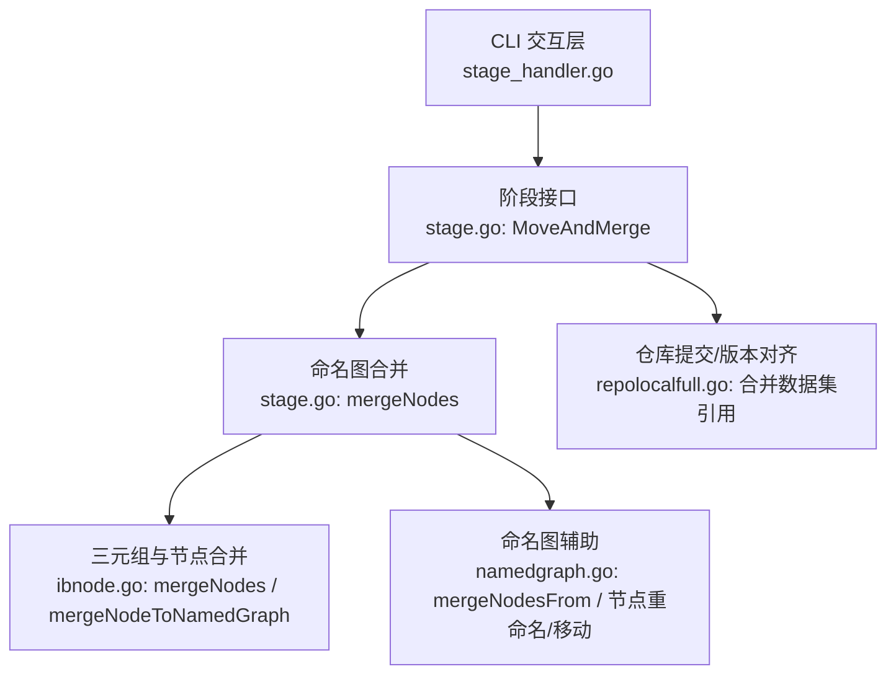
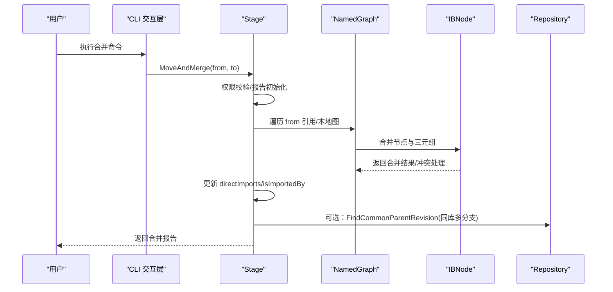
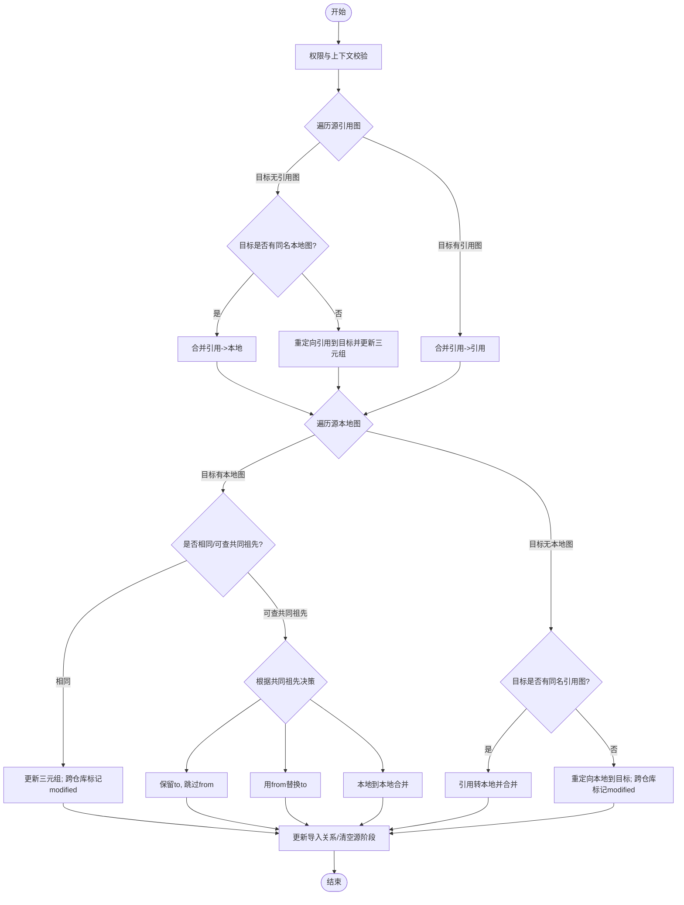
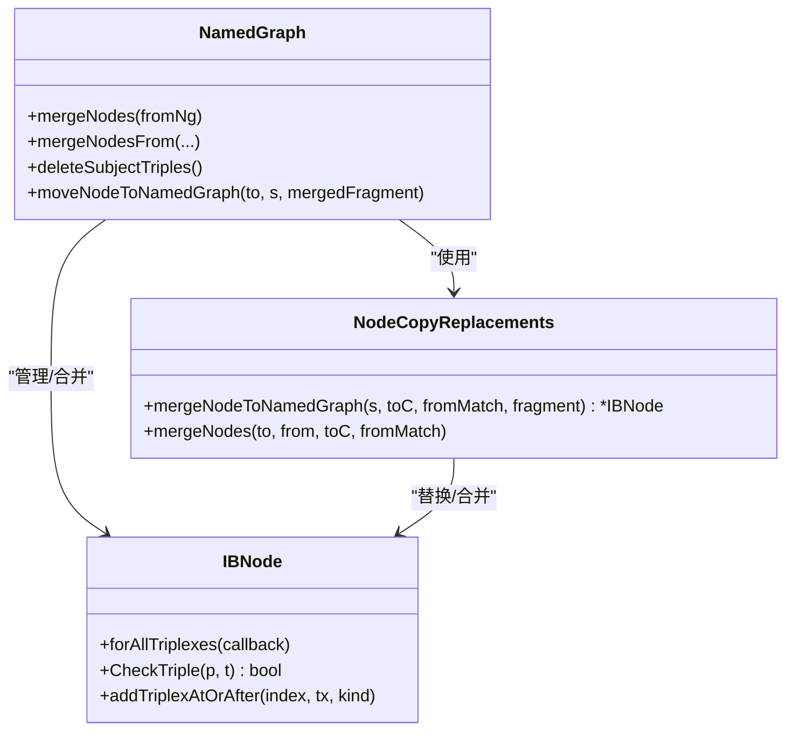
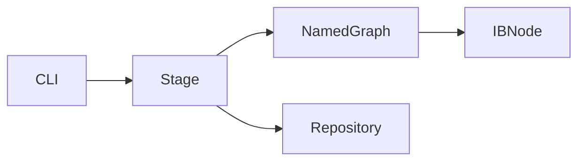

# 合并操作

<cite>
**本文引用的文件**
- [stage.go](file://sst/stage.go)
- [ibnode.go](file://sst/ibnode.go)
- [namedgraph.go](file://sst/namedgraph.go)
- [repolocalfull.go](file://sst/repolocalfull.go)
- [stage_handler.go](file://cli/cmd/interactive/stage_handler.go)
</cite>

## 目录
1. [简介](#简介)
2. [项目结构](#项目结构)
3. [核心组件](#核心组件)
4. [架构总览](#架构总览)
5. [详细组件分析](#详细组件分析)
6. [依赖关系分析](#依赖关系分析)
7. [性能考虑](#性能考虑)
8. [故障排查指南](#故障排查指南)
9. [结论](#结论)
10. [附录](#附录)

## 简介
本文件系统性说明 SST 的“合并”能力，围绕 Stage 的 MoveAndMerge 流程展开，覆盖自动与手动合并场景、合并策略与执行过程、三元组级冲突检测与处理、合并前预检查与验证、API 接口与错误处理、对索引与搜索的影响、最佳实践与故障恢复方法，并给出实际工作流示例与调试技巧。

## 项目结构
SST 将“图数据版本化与合并”的核心逻辑集中在 sst 包中：
- 阶段（Stage）：内存中的图集合视图，支持创建、引用、提交与合并。
- 命名图（NamedGraph）：具体图的实体，维护节点（IBNode）与三元组（triplex）。
- 节点（IBNode）：三元组的主体/谓词/客体承载者，负责三元组存储与索引。
- 仓库（Repository）：持久化与版本管理，提供分支、提交、数据集版本等能力。
- CLI：交互式命令入口，封装 MoveAndMerge 调用。

图表来源
- [stage.go:468-874](file://sst/stage.go#L468-L874)
- [ibnode.go:141-339](file://sst/ibnode.go#L141-L339)
- [namedgraph.go:1484-1619](file://sst/namedgraph.go#L1484-L1619)
- [repolocalfull.go:86-124](file://sst/repolocalfull.go#L86-L124)

章节来源
- [stage.go:468-874](file://sst/stage.go#L468-L874)
- [stage_handler.go:100](file://cli/cmd/interactive/stage_handler.go#L100)

## 核心组件
- 阶段（Stage）
  - 职责：管理本地与引用命名图；提供 MoveAndMerge、Commit、LinkToRepository、AlignHistory 等方法。
  - 关键行为：MoveAndMerge 会遍历源阶段的引用和本地图，按规则迁移或合并到目标阶段，并更新导入关系与三元组索引。
- 命名图（NamedGraph）
  - 职责：维护 IBNode 集合与三元组；提供 mergeNodes、mergeNodesFrom、删除/清空等操作。
  - 关键行为：在合并时，将源节点的三元组增量并入目标节点，必要时移动节点或重命名片段。
- 节点（IBNode）
  - 职责：存储三元组，维护三种 triplex 索引（主体、谓词、客体）；提供 forAllTriplexes、CheckTriple、addTriplexAtOrAfter 等。
  - 关键行为：合并过程中替换节点引用、更新三元组、去重与冲突检测。
- 仓库（Repository）
  - 职责：持久化提交、分支、数据集版本；提供 FindCommonParentRevision 等。
  - 关键行为：在跨仓库或同库不同分支合并时，基于共同祖先决定保留/替换/三路合并。

章节来源
- [stage.go:53-234](file://sst/stage.go#L53-L234)
- [stage.go:1061-1178](file://sst/stage.go#L1061-L1178)
- [ibnode.go:141-339](file://sst/ibnode.go#L141-L339)
- [namedgraph.go:1484-1619](file://sst/namedgraph.go#L1484-L1619)

## 架构总览
下图展示一次典型的 MoveAndMerge 调用链：从 CLI 触发，进入 Stage 合并主流程，再下沉到命名图与节点层面的三元组合并，最终可能影响仓库的数据集引用与提交。

图表来源
- [stage.go:468-874](file://sst/stage.go#L468-L874)
- [ibnode.go:141-339](file://sst/ibnode.go#L141-L339)
- [namedgraph.go:1484-1619](file://sst/namedgraph.go#L1484-L1619)

## 详细组件分析

### 合并主流程（Stage.MoveAndMerge）
- 前置检查
  - 访问权限校验（assertAccess），确保阶段有效。
  - 判断是否跨仓库合并，用于后续标记 modified 标志。
- 合并策略
  - 先处理源阶段的“引用图”：
    - 若目标阶段无对应引用图：
      - 若目标有同名本地图：将引用图合并进本地图。
      - 否则：将引用图重定向至目标阶段，并更新其三元组索引。
    - 若目标已有同名引用图：直接合并节点。
  - 再处理源阶段的“本地图”：
    - 若目标无对应本地图：
      - 若目标有同名引用图：将其转为本地图并合并。
      - 否则：将本地图重定向至目标阶段；跨仓库时标记 modified。
    - 若目标已有同名本地图：
      - 若两者完全相同：仅更新三元组索引；跨仓库时标记 modified。
      - 若存在 checkout 信息且同库：查找共同祖先，决定保留/替换/合并。
      - 否则：执行本地到本地的节点与三元组合并。
- 后处理
  - 更新所有图的 directImports 与 isImportedBy 映射。
  - 清空源阶段的所有图（完成“移动+合并”语义）。
  - 生成合并报告（记录动作类型、统计、耗时等）。

图表来源
- [stage.go:468-874](file://sst/stage.go#L468-L874)

章节来源
- [stage.go:468-874](file://sst/stage.go#L468-L874)

### 三元组合并与冲突处理（IBNode.mergeNodes / mergeNodeToNamedGraph）
- 节点匹配与替换
  - 通过 fragment/ID 定位目标节点；若已存在则合并节点，否则重定向到新节点。
  - 对字符串片段与 UUID 片段分别处理，必要时重命名。
- 三元组迁移与去重
  - 遍历源节点的所有三元组，更新谓词/客体指向的目标节点引用。
  - 使用 CheckTriple 与 assertUniqueTriplex 进行重复检测；遇到重复三元组视为幂等合并。
- 索引一致性
  - 在添加三元组时同步更新主体/谓词/客体三类索引，保证查询一致性。
  - 对词汇表节点（IBNode Vocabulary）进行额外索引维护。

图表来源
- [ibnode.go:141-339](file://sst/ibnode.go#L141-L339)
- [namedgraph.go:1484-1619](file://sst/namedgraph.go#L1484-L1619)

章节来源
- [ibnode.go:141-339](file://sst/ibnode.go#L141-L339)
- [namedgraph.go:1484-1619](file://sst/namedgraph.go#L1484-L1619)

### 合并前的预检查与验证
- 阶段有效性检查：assertAccess 确保阶段未被销毁或无效。
- 访问控制：MoveAndMerge 前后对源/目标阶段均进行权限校验。
- 跨仓库限制：当两个阶段关联不同仓库时，需设置 modified 标志以反映变更。
- 导入关系一致性：合并完成后统一刷新 directImports 与 isImportedBy，避免悬挂引用。

章节来源
- [stage.go:468-494](file://sst/stage.go#L468-L494)
- [stage.go:816-858](file://sst/stage.go#L816-L858)

### 合并策略配置与执行
- 自动合并
  - 默认策略：优先复用目标节点，增量合并三元组；遇到重复三元组幂等忽略。
  - 同库多分支：基于共同祖先决定保留/替换/三路合并。
- 手动合并
  - 通过 CLI 触发 MoveAndMerge，结合报告输出观察动作类型（如 redirect_graph、merge_graph、update_triples 等）。
  - 可在应用层选择特定图进行合并，或通过 AlignHistory 将读取生成的阶段与仓库历史对齐后再提交。

章节来源
- [stage.go:468-874](file://sst/stage.go#L468-L874)
- [stage.go:876-943](file://sst/stage.go#L876-L943)

### 对索引与搜索的影响
- 三元组索引
  - 合并过程中会更新主体/谓词/客体三类索引，确保查询路径一致。
  - 新增三元组时调用 addTriplexAtOrAfter，并在必要时重建词汇表索引。
- 导入关系
  - 合并后刷新 directImports 与 isImportedBy，保证图间依赖关系正确。
- 提交与版本
  - 合并后的修改会在 Commit 时生成新提交，受分支与数据集版本管理约束。

章节来源
- [ibnode.go:197-328](file://sst/ibnode.go#L197-L328)
- [stage.go:816-858](file://sst/stage.go#L816-L858)
- [stage.go:1381-1401](file://sst/stage.go#L1381-L1401)

### API 接口与错误处理
- 主要接口
  - Stage.MoveAndMerge(ctx, from) -> (*MoveAndMergeReport, error)
  - Stage.Commit(ctx, message, branch) -> (Hash, []uuid.UUID, error)
  - Stage.LinkToRepository(ctx, repo, branch) -> error
  - Stage.AlignHistory(from) -> void
- 错误处理要点
  - 阶段无效/未链接仓库：返回相应错误（如 ErrStageDeletedOrInvalid、ErrStageNotLinkToRepository）。
  - 跨仓库差异：FindCommonParentRevision 失败时返回错误。
  - 三元组重复：视为幂等，不报错。
  - 外部图冲突：当尝试移动包含内容的引用图时会返回错误（如 errReferencedGraphAlreadyExists、errCannotMoveReferencedGraphsWithNamedGraphContent）。

章节来源
- [stage.go:21-31](file://sst/stage.go#L21-L31)
- [stage.go:468-874](file://sst/stage.go#L468-L874)
- [stage.go:1381-1401](file://sst/stage.go#L1381-L1401)
- [stage.go:1360-1379](file://sst/stage.go#L1360-L1379)

### 最佳实践
- 小步合并：频繁提交小型变更，降低冲突面。
- 明确分支策略：同库多分支合并前先确认共同祖先，减少三路合并复杂度。
- 利用报告：解析 MoveAndMergeReport 的动作与统计，快速定位问题。
- 谨慎跨仓库：跨仓库合并会标记 modified，注意后续提交与权限。
- 清理无效阶段：合并后及时释放阶段资源（Close），避免内存泄漏。

[本节为通用建议，无需代码来源]

### 故障恢复方法
- 回滚到上一提交：通过仓库分支与提交历史回退。
- 重新对齐历史：使用 AlignHistory 将读取生成的阶段与仓库历史对齐，再提交。
- 修复引用图：若引用图冲突，先解决内容冲突再执行重定向或合并。
- 日志与调试：启用详细日志（GlobalLogger.Debug）跟踪合并路径与三元组更新。

章节来源
- [stage.go:876-943](file://sst/stage.go#L876-L943)
- [stage.go:468-874](file://sst/stage.go#L468-L874)

## 依赖关系分析
- 模块耦合
  - Stage 强依赖 NamedGraph 与 IBNode，负责编排合并流程与状态管理。
  - IBNode 内部维护三元组与索引，被 NamedGraph 调用以实现数据合并。
  - Repository 提供版本与分支能力，参与同库多分支的合并决策。
- 外部集成点
  - CLI 通过 stage_handler 暴露合并能力给终端用户。
  - 文件系统/远程仓库作为持久化后端，受 Commit 与 LinkToRepository 调用。

图表来源
- [stage_handler.go:100](file://cli/cmd/interactive/stage_handler.go#L100)
- [stage.go:468-874](file://sst/stage.go#L468-L874)

章节来源
- [stage_handler.go:100](file://cli/cmd/interactive/stage_handler.go#L100)
- [stage.go:468-874](file://sst/stage.go#L468-L874)

## 性能考虑
- 三元组增量合并：仅在必要时添加三元组，重复三元组幂等忽略，减少冗余写入。
- 索引更新：在添加三元组时即时更新三类索引，避免后期批量重建。
- 导入关系刷新：合并后集中刷新 directImports/isImportedBy，降低多次扫描开销。
- 内存管理：合并完成后清空源阶段，及时释放内存。

[本节为通用指导，无需代码来源]

## 故障排查指南
- 常见问题
  - 阶段无效或未链接仓库：检查 assertAccess 与 LinkToRepository 调用。
  - 跨仓库合并失败：确认仓库连通性与权限，查看 FindCommonParentRevision 错误。
  - 引用图冲突：检查是否存在同名引用图或包含内容的引用图移动。
- 调试技巧
  - 启用详细日志：关注“redirect referenced graph”“merge the local graph”等日志。
  - 分析合并报告：通过 MoveAndMergeReport 的动作类型与统计定位问题路径。
  - 逐步缩小范围：先对单个命名图执行合并，再扩展到多图场景。

章节来源
- [stage.go:468-874](file://sst/stage.go#L468-L874)
- [stage.go:1318-1323](file://sst/stage.go#L1318-L1323)

## 结论
SST 的合并机制以 Stage 为核心，围绕命名图与三元组实现细粒度的增量合并与冲突处理。通过共同祖先判定、幂等三元组合并、导入关系刷新与完善的报告机制，既支持自动化合并，也便于人工干预与排障。遵循最佳实践可有效降低冲突风险，提升合并效率与稳定性。

[本节为总结性内容，无需代码来源]

## 附录

### 实际工作流示例
- 自动合并（同库多分支）
  - 打开目标阶段并链接仓库。
  - 打开源阶段（来自另一分支）。
  - 调用 MoveAndMerge，解析报告确认动作类型（如 three_way_merge、replace、skip）。
  - 提交变更，观察分支指针与数据集版本变化。
- 手动合并（跨仓库）
  - 将源阶段移动到目标阶段（重定向或合并）。
  - 跨仓库时注意 modified 标志，随后提交。
  - 若出现引用图冲突，先解决内容冲突再执行重定向。

章节来源
- [stage.go:468-874](file://sst/stage.go#L468-L874)
- [stage.go:1381-1401](file://sst/stage.go#L1381-L1401)

### 调试技巧清单
- 打印阶段信息：Info/Dump 帮助了解图数量与三元组规模。
- 关注日志关键词：redirect、merge、update triples、common parent。
- 使用报告：Actions 列表与 Stats 统计快速定位问题。
- 分步验证：先对单图合并，再扩展至多图与跨仓库场景。

章节来源
- [stage.go:319-344](file://sst/stage.go#L319-L344)
- [stage.go:468-874](file://sst/stage.go#L468-L874)