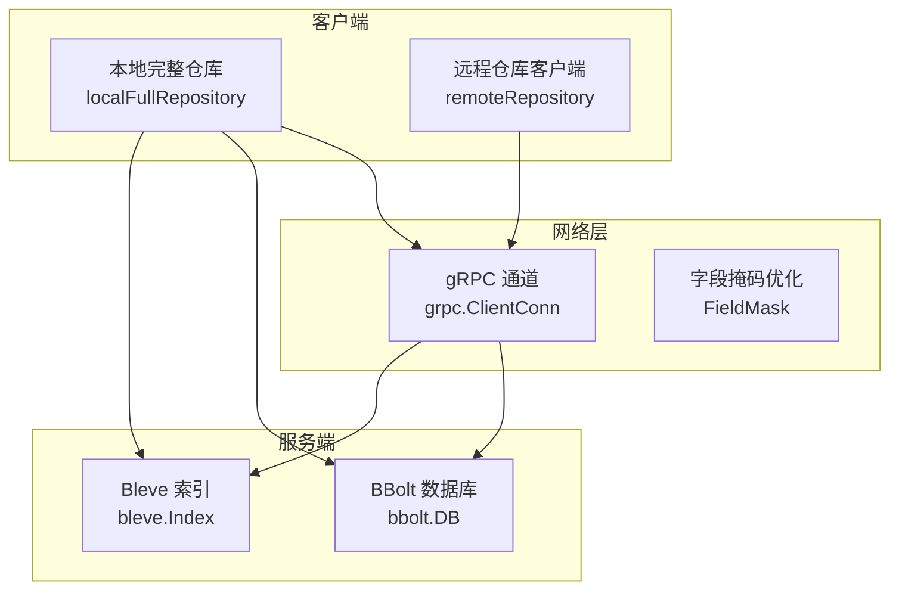
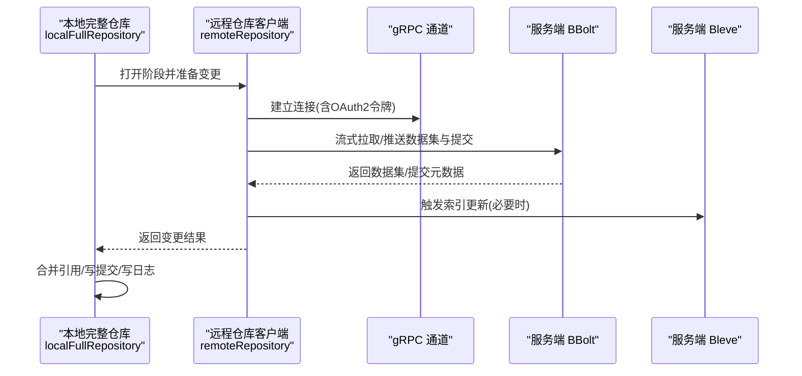
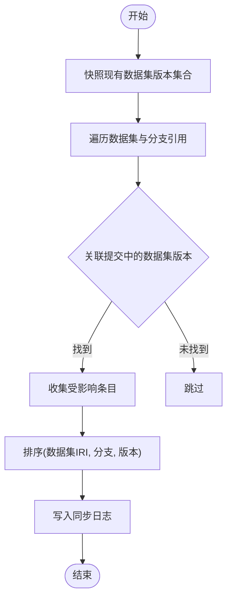
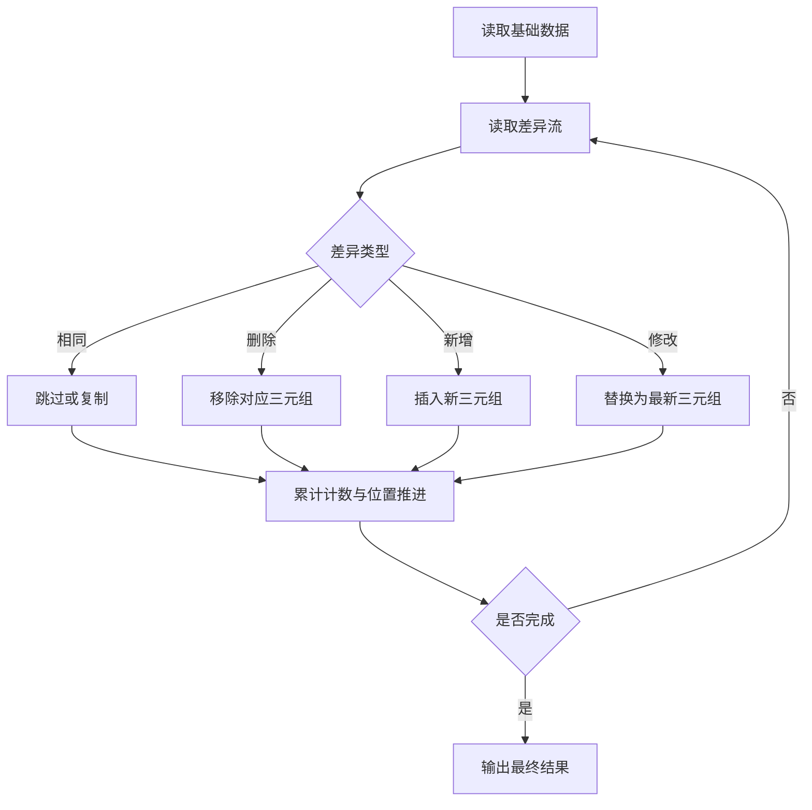
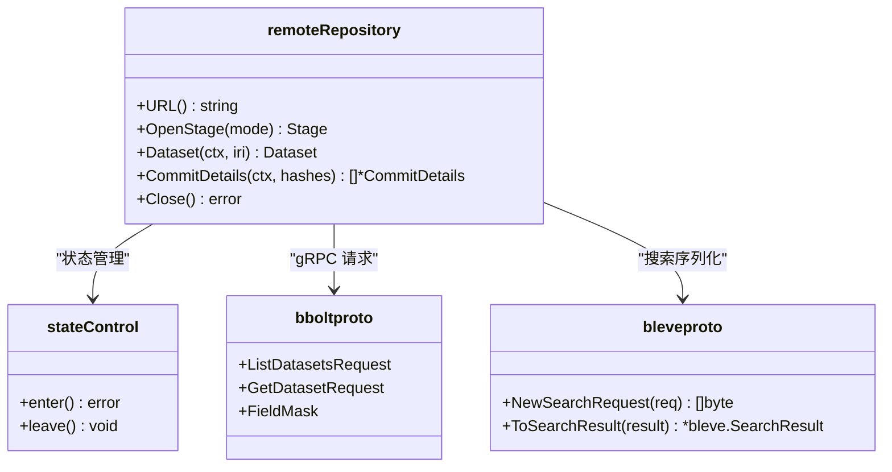
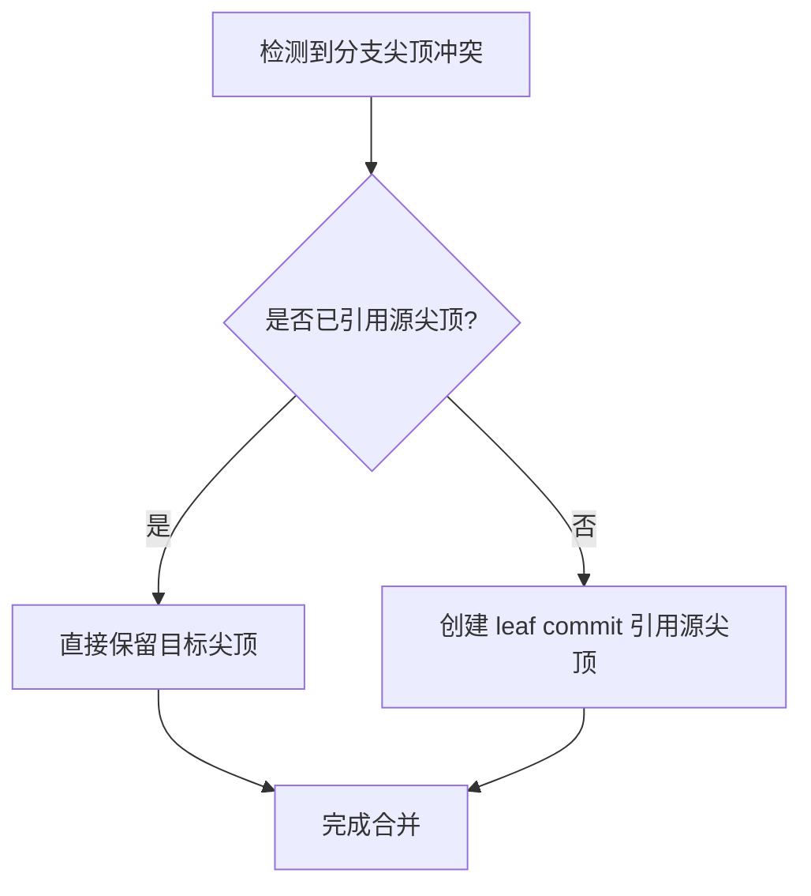
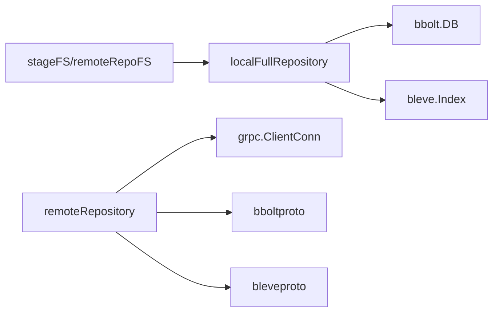

# 同步机制

<cite>
**本文引用的文件**
- [sst/syncfromlog.go](file://sst/syncfromlog.go)
- [sst/reporemote.go](file://sst/reporemote.go)
- [sst/repolocalfull.go](file://sst/repolocalfull.go)
- [sst/stagefsremoterepo.go](file://sst/stagefsremoterepo.go)
- [sst/stagefs.go](file://sst/stagefs.go)
- [bboltproto/remote.go](file://bboltproto/remote.go)
- [bleveproto/remote.go](file://bleveproto/remote.go)
- [sst_test/syncfrom_test.go](file://sst_test/syncfrom_test.go)
</cite>

## 目录
1. [简介](#简介)
2. [项目结构](#项目结构)
3. [核心组件](#核心组件)
4. [架构总览](#架构总览)
5. [详细组件分析](#详细组件分析)
6. [依赖关系分析](#依赖关系分析)
7. [性能考虑](#性能考虑)
8. [故障排查指南](#故障排查指南)
9. [结论](#结论)
10. [附录](#附录)

## 简介
本文件面向分布式版本控制场景下的 SST（三元组存储与版本化）同步机制，系统性阐述以下主题：
- 同步原理与数据一致性保证
- 日志同步与增量同步的实现机制
- 远程仓库连接管理与通信协议
- 冲突处理与解决策略
- 同步配置参数与性能调优建议
- 断点续传与错误恢复机制
- 同步监控与日志分析工具使用
- 分布式部署的同步模式与最佳实践

SST 通过“提交对象 + 数据集版本 + 命名图版本”的不可变数据结构，结合 gRPC 流式传输、BBolt 本地持久化与 Bleve 全文索引，实现跨节点的数据一致同步。

## 项目结构
围绕同步的关键代码分布在如下模块：
- sst：核心仓库实现、阶段文件系统、增量差异读取、同步日志记录
- bboltproto：gRPC 服务定义与字段掩码工具
- bleveproto：搜索请求/结果序列化适配
- sst_test：覆盖同步流程与日志记录的集成测试

图表来源
- [sst/repolocalfull.go:220-242](file://sst/repolocalfull.go#L220-L242)
- [sst/reporemote.go:88-99](file://sst/reporemote.go#L88-L99)
- [bboltproto/remote.go:26-37](file://bboltproto/remote.go#L26-L37)

章节来源
- [sst/repolocalfull.go:220-242](file://sst/repolocalfull.go#L220-L242)
- [sst/reporemote.go:88-99](file://sst/reporemote.go#L88-L99)
- [bboltproto/remote.go:26-37](file://bboltproto/remote.go#L26-L37)

## 核心组件
- 本地完整仓库（localFullRepository）
  - 基于 BBolt 的本地持久化，维护数据集、提交、命名图版本及分支引用
  - 提供 CommitDetails、CheckoutCommit、Dataset/DatasetIDs 等能力
  - 支持 Bleve 索引构建与重建
- 远程仓库客户端（remoteRepository）
  - 封装 gRPC 客户端连接，提供 Dataset/Commit/Branches/LeafCommits 等远程访问
  - 通过 FieldMask 减少不必要字段传输
  - 支持 OAuth2 认证上下文注入
- 阶段文件系统（stageFS / remoteRepoFS）
  - 将数据集以“命名图”为单位进行版本化读写
  - 写入时计算内容哈希，去重存储；读取时按哈希定位内容
- 同步日志（syncFromLog）
  - 记录每次从某仓库同步的影响范围（受影响的数据集、分支、版本）
  - 用于审计与回溯

章节来源
- [sst/repolocalfull.go:220-242](file://sst/repolocalfull.go#L220-L242)
- [sst/reporemote.go:88-99](file://sst/reporemote.go#L88-L99)
- [sst/stagefs.go:37-46](file://sst/stagefs.go#L37-L46)
- [sst/stagefsremoterepo.go:16-32](file://sst/stagefsremoterepo.go#L16-L32)
- [sst/syncfromlog.go:16-24](file://sst/syncfromlog.go#L16-L24)

## 架构总览
下图展示了从本地仓库发起同步到远程仓库，再到本地落库与索引更新的端到端流程。

图表来源
- [sst/reporemote.go:264-285](file://sst/reporemote.go#L264-L285)
- [sst/repolocalfull.go:721-732](file://sst/repolocalfull.go#L721-L732)
- [bboltproto/remote.go:26-37](file://bboltproto/remote.go#L26-L37)

## 详细组件分析

### 同步日志与影响范围记录
- 作用：在同步完成后，记录受影响的“数据集-分支-版本”三元组，便于审计与问题定位
- 关键流程：
  - 快照现有数据集版本集合，识别新增版本
  - 遍历数据集与分支引用，关联提交中的数据集版本
  - 排序后写入 log 表，包含作者、时间戳、来源仓库 URL、受影响计数与明细

图表来源
- [sst/syncfromlog.go:22-37](file://sst/syncfromlog.go#L22-L37)
- [sst/syncfromlog.go:55-170](file://sst/syncfromlog.go#L55-L170)
- [sst/syncfromlog.go:172-204](file://sst/syncfromlog.go#L172-L204)

章节来源
- [sst/syncfromlog.go:22-37](file://sst/syncfromlog.go#L22-L37)
- [sst/syncfromlog.go:55-170](file://sst/syncfromlog.go#L55-L170)
- [sst/syncfromlog.go:172-204](file://sst/syncfromlog.go#L172-L204)

### 增量同步与差异读取
- 设计要点：
  - 使用差异格式对三元组进行压缩表示，支持相同、删除、新增、三元组修改等标记
  - 通过 deltaSpan/deltaNodeSpanT 管理基础数据与差异流的迭代，避免全量拷贝
  - 在应用差异时，保持顺序一致性与完整性校验
- 适用场景：
  - 仅传输变更部分，降低网络与存储开销
  - 支持多层级差异叠加（如多次提交累积）

图表来源
- [sst/sstfiledeltaspanread.go:158-170](file://sst/sstfiledeltaspanread.go#L158-L170)
- [sst/sstfiledeltaspanread.go:173-317](file://sst/sstfiledeltaspanread.go#L173-L317)
- [sst/sstfiledeltaspanread.go:335-431](file://sst/sstfiledeltaspanread.go#L335-L431)

章节来源
- [sst/sstfiledeltaspanread.go:158-170](file://sst/sstfiledeltaspanread.go#L158-L170)
- [sst/sstfiledeltaspanread.go:173-317](file://sst/sstfiledeltaspanread.go#L173-L317)
- [sst/sstfiledeltaspanread.go:335-431](file://sst/sstfiledeltaspanread.go#L335-L431)

### 远程仓库连接管理与通信协议
- 连接管理：
  - 使用 grpc.NewClient 创建通道，封装 dataset/commit/index 服务客户端
  - 通过 stateControl 管理生命周期（open/closing/closed），并发安全
  - 支持 OAuth2 令牌注入，确保鉴权
- 协议与优化：
  - 使用 FieldMask 屏蔽不必要字段，减少带宽占用
  - 分页拉取数据集列表，避免一次性加载过大
  - 搜索请求通过 bleveproto 序列化为二进制流，提升效率

图表来源
- [sst/reporemote.go:88-99](file://sst/reporemote.go#L88-L99)
- [sst/reporemote.go:264-285](file://sst/reporemote.go#L264-L285)
- [bboltproto/remote.go:26-37](file://bboltproto/remote.go#L26-L37)
- [bleveproto/remote.go:21-39](file://bleveproto/remote.go#L21-L39)

章节来源
- [sst/reporemote.go:88-99](file://sst/reporemote.go#L88-L99)
- [sst/reporemote.go:264-285](file://sst/reporemote.go#L264-L285)
- [bboltproto/remote.go:26-37](file://bboltproto/remote.go#L26-L37)
- [bleveproto/remote.go:21-39](file://bleveproto/remote.go#L21-L39)

### 冲突处理与解决策略
- 分支分叉时的引用合并：
  - 当目标与源在同一分支存在不同提交尖顶时，保留目标尖顶，并将源尖顶作为 leaf commit 保留可达性
  - 通过 mergeDatasetRefsFromSource 与 mergeIncomingDatasetRef 实现
- 命名图版本冲突：
  - 写入阶段计算内容哈希，重复内容不重复存储
  - 读取阶段按哈希定位，保证一致性
- 提交历史与父提交：
  - 通过 CommitDetails 解析父提交链，辅助冲突检测与合并

图表来源
- [sst/repolocalfull.go:83-120](file://sst/repolocalfull.go#L83-L120)
- [sst/repolocalfull.go:122-145](file://sst/repolocalfull.go#L122-L145)

章节来源
- [sst/repolocalfull.go:83-120](file://sst/repolocalfull.go#L83-L120)
- [sst/repolocalfull.go:122-145](file://sst/repolocalfull.go#L122-L145)

### 断点续传与错误恢复
- 阶段文件系统：
  - 写入时计算哈希，若内容已存在则复用，避免重复传输与存储
  - 关闭时持久化映射，支持后续读取
- 错误处理：
  - 统一包装错误信息，包含调用位置，便于定位
  - 针对常见错误（如数据集不存在、提交不存在）返回明确语义的错误类型
- 重试与幂等：
  - 基于哈希的内容去重，使重复操作具备幂等性
  - 通过分页与流式接口逐步推进，支持中断后继续

章节来源
- [sst/stagefsremoterepo.go:106-131](file://sst/stagefsremoterepo.go#L106-L131)
- [sst/reporemote.go:51-61](file://sst/reporemote.go#L51-L61)
- [sst/reporemote.go:515-536](file://sst/reporemote.go#L515-L536)

### 同步监控与日志分析
- 同步日志：
  - 每条 sync_from 日志包含作者、时间戳、来源仓库 URL、受影响数据集数量与明细
  - 可通过 Log 接口查询与分析
- 测试验证：
  - 集成测试覆盖本地到本地、远程到远程、导入依赖等场景，验证日志字段与数量

章节来源
- [sst/syncfromlog.go:172-204](file://sst/syncfromlog.go#L172-L204)
- [sst_test/syncfrom_test.go:1351-1461](file://sst_test/syncfrom_test.go#L1351-L1461)
- [sst_test/syncfrom_test.go:1620-1666](file://sst_test/syncfrom_test.go#L1620-L1666)

## 依赖关系分析
- 组件耦合：
  - localFullRepository 依赖 BBolt 与 Bleve，负责本地持久化与索引
  - remoteRepository 依赖 gRPC 客户端与认证上下文，负责远程交互
  - stageFS/remoteRepoFS 抽象命名图的文件系统视图，解耦具体存储
- 外部依赖：
  - bboltproto 提供 gRPC 请求结构与字段掩码
  - bleveproto 提供搜索请求/结果的序列化适配
- 潜在循环依赖：
  - 当前结构清晰分层，未见明显循环依赖

图表来源
- [sst/repolocalfull.go:220-242](file://sst/repolocalfull.go#L220-L242)
- [sst/reporemote.go:88-99](file://sst/reporemote.go#L88-L99)
- [sst/stagefs.go:37-46](file://sst/stagefs.go#L37-L46)
- [sst/stagefsremoterepo.go:16-32](file://sst/stagefsremoterepo.go#L16-L32)

章节来源
- [sst/repolocalfull.go:220-242](file://sst/repolocalfull.go#L220-L242)
- [sst/reporemote.go:88-99](file://sst/reporemote.go#L88-L99)
- [sst/stagefs.go:37-46](file://sst/stagefs.go#L37-L46)
- [sst/stagefsremoterepo.go:16-32](file://sst/stagefsremoterepo.go#L16-L32)

## 性能考虑
- 网络传输优化
  - 使用 FieldMask 屏蔽不必要字段，减少载荷大小
  - 分页拉取数据集列表，避免大响应阻塞
- 存储与索引
  - 基于哈希的内容去重，减少重复存储
  - Bleve 索引异步更新，降低提交路径延迟
- 差异计算与传输
  - 增量差异格式压缩三元组变更，降低带宽与 CPU 开销
- 并发与生命周期
  - stateControl 保证并发安全与优雅关闭，避免资源泄漏

[本节为通用指导，无需特定文件来源]

## 故障排查指南
- 常见问题定位
  - 数据集/提交不存在：检查 CommitDetails 与 Dataset 查询返回值，确认 ID/IRI 正确
  - 索引重建失败：查看 buildBleveIndex 日志，确认目录权限与磁盘空间
  - 同步日志缺失：确认 writeSyncFromLogAfterSync 被调用且 affected 非空
- 调试建议
  - 启用详细日志（GlobalLogger），关注 gRPC 调用与错误包装信息
  - 使用测试用例中的场景复现问题，验证日志字段与数量

章节来源
- [sst/reporemote.go:515-536](file://sst/reporemote.go#L515-L536)
- [sst/repolocalfull.go:345-426](file://sst/repolocalfull.go#L345-L426)
- [sst/syncfromlog.go:206-224](file://sst/syncfromlog.go#L206-L224)

## 结论
SST 同步机制通过“提交对象 + 数据集版本 + 命名图版本”的不可变模型，结合 gRPC 流式传输、BBolt 持久化与 Bleve 索引，实现了高效、可靠、可审计的分布式同步。其关键优势包括：
- 增量差异传输，降低带宽与存储成本
- 冲突处理策略保障数据一致性与可达性
- 同步日志提供完整的审计与回溯能力
- 模块化设计与清晰的依赖关系，便于扩展与维护

[本节为总结性内容，无需特定文件来源]

## 附录
- 配置与调优建议
  - 合理设置分页大小与超时，平衡吞吐与延迟
  - 根据数据集规模调整 Bleve 索引重建频率
  - 在网络不稳定环境下，利用幂等性与哈希去重特性提升鲁棒性
- 分布式部署模式
  - 多副本只读远端 + 单写本地：适合读多写少场景
  - 多写本地 + 定期同步：适合协作编辑场景
  - 中心枢纽模式：所有节点向中心仓库同步，便于集中治理

[本节为通用指导，无需特定文件来源]