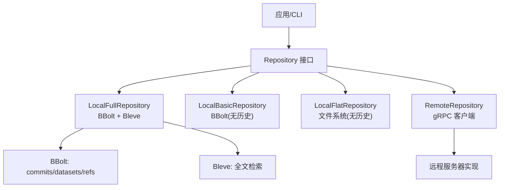
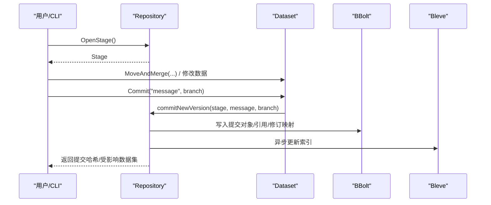
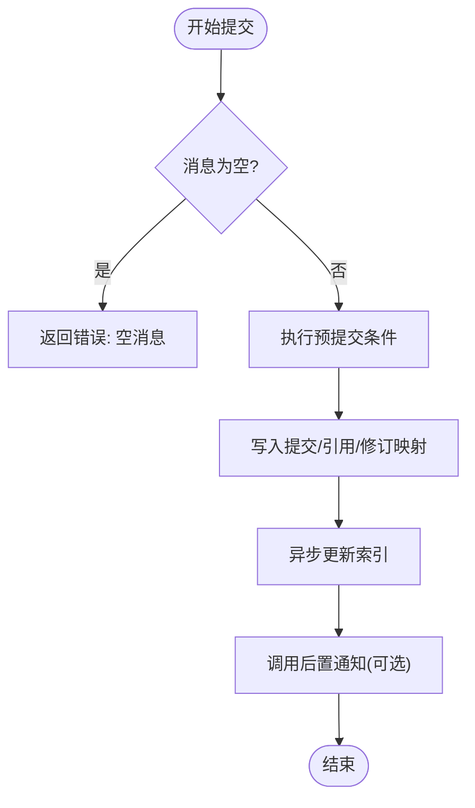
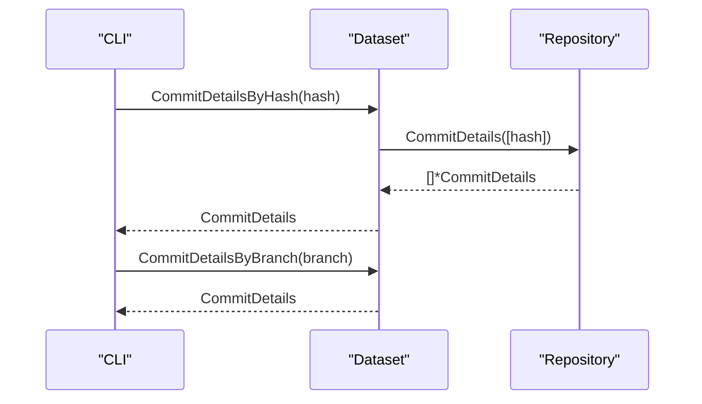
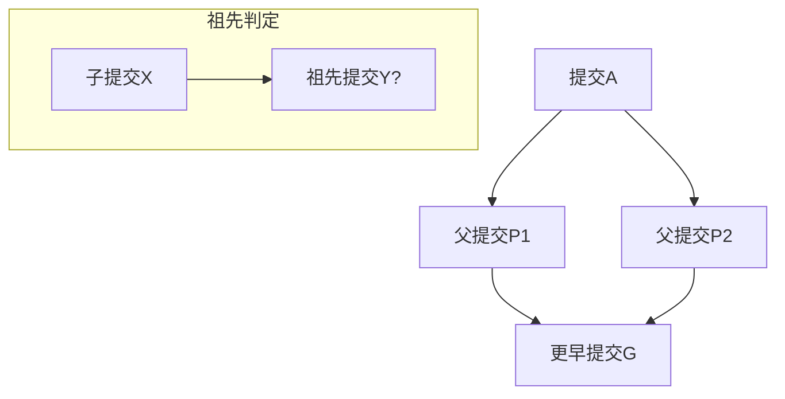
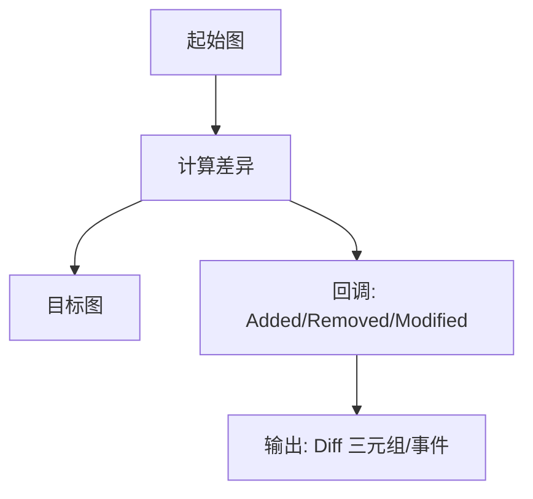
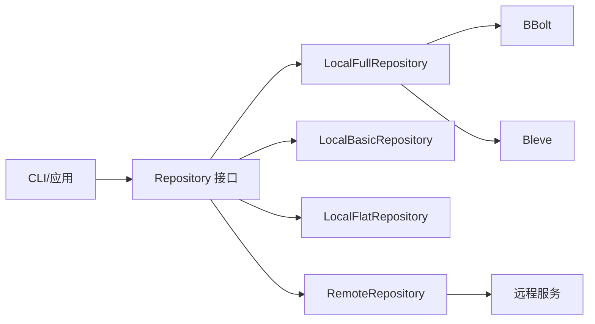

# 提交历史

<cite>
**本文引用的文件**
- [commit.go](file://sst/commit.go)
- [repository.go](file://sst/repository.go)
- [repolocalfull.go](file://sst/repolocalfull.go)
- [repolocalbasic.go](file://sst/repolocalbasic.go)
- [repolocalflat.go](file://sst/repolocalflat.go)
- [repointernalcommit.go](file://sst/repointernalcommit.go)
- [diff.go](file://sst/diff.go)
- [history_graph.go](file://cli/cmd/interactive/history_graph.go)
- [log_helpers.go](file://cli/cmd/interactive/log_helpers.go)
- [dataset_handler.go](file://cli/cmd/interactive/dataset_handler.go)
</cite>

## 目录
1. [简介](#简介)
2. [项目结构](#项目结构)
3. [核心组件](#核心组件)
4. [架构总览](#架构总览)
5. [详细组件分析](#详细组件分析)
6. [依赖关系分析](#依赖关系分析)
7. [性能考量](#性能考量)
8. [故障排查指南](#故障排查指南)
9. [结论](#结论)
10. [附录](#附录)

## 简介
本文件系统性说明 SST 的“提交历史”能力：提交（Commit）的概念与结构、创建流程与元数据管理、按哈希/分支/数据集查询与浏览、父子关系与依赖、差异比较与变更追踪，以及 API 与 CLI 使用示例。同时给出存储策略与性能优化建议，帮助读者在本地或远程仓库中高效管理与追溯数据版本。

## 项目结构
SST 提供多种仓库实现以支持不同场景的版本历史能力：
- LocalFullRepository：基于 BBolt 的完整版本历史，支持提交、分支、日志、差异等高级功能。
- LocalBasicRepository：基础本地仓库，具备索引与基本操作，但不提供提交历史。
- LocalFlatRepository：扁平文件仓库，无事务与提交历史，适合简单快照式存储。
- RemoteRepository：通过 gRPC 暴露相同接口，服务端维护提交历史与索引。

图表来源
- [repository.go:34-179](file://sst/repository.go#L34-L179)
- [repolocalfull.go:217-230](file://sst/repolocalfull.go#L217-L230)
- [repolocalbasic.go:34-42](file://sst/repolocalbasic.go#L34-L42)
- [repolocalflat.go:28-32](file://sst/repolocalflat.go#L28-L32)

章节来源
- [repository.go:34-179](file://sst/repository.go#L34-L179)

## 核心组件
- CommitDetails：描述一次提交的元数据，包括提交哈希、作者、作者时间戳、消息、父提交映射、数据集修订映射、命名图修订映射。
- Repository：统一抽象，定义打开阶段、数据集枚举、提交详情获取、检出提交、日志查询、同步、文档管理等接口。
- Dataset：面向单个数据集的提交历史操作，如按哈希/分支获取提交详情、设置分支指向、列出叶子提交等。
- 日志条目 RepositoryLogEntry：记录仓库级事件（初始化、提交、分支变更、文档上传/下载/删除、同步等）。

章节来源
- [commit.go:18-29](file://sst/commit.go#L18-L29)
- [repository.go:34-179](file://sst/repository.go#L34-L179)
- [dataset.go:41-62](file://sst/dataset.go#L41-L62)
- [repository.go:746-800](file://sst/repository.go#L746-L800)

## 架构总览
提交历史的核心由“提交对象 + 引用（分支/叶子）+ 数据集/命名图修订映射 + 日志”构成。LocalFullRepository 将提交信息持久化在 BBolt 中，并通过 Bleve 提供检索能力；RemoteRepository 通过 gRPC 将请求转发到服务端，服务端执行相同的逻辑。

图表来源
- [repolocalfull.go:595-719](file://sst/repolocalfull.go#L595-L719)
- [repolocalbasic.go:616-653](file://sst/repolocalbasic.go#L616-L653)
- [repolocalflat.go:301-322](file://sst/repolocalflat.go#L301-L322)

## 详细组件分析

### 提交结构与元数据
- 提交哈希：唯一标识一次提交，用于定位提交对象与关联的数据集/命名图修订。
- 作者信息与时间戳：记录提交者身份与提交时间，便于审计与排序。
- 提交消息：人类可读的变更说明。
- 父提交映射：按数据集维度记录多个父提交，体现合并与多源演进。
- 数据集修订映射：记录每个数据集在本次提交中的修订哈希。
- 命名图修订映射：记录默认命名图及导入命名图的修订哈希。

章节来源
- [commit.go:18-29](file://sst/commit.go#L18-L29)
- [repolocalfull.go:616-719](file://sst/repolocalfull.go#L616-L719)

### 提交创建过程
- 在 LocalBasicRepository 中，提交会写回 SST 文件并触发索引更新，但不记录提交历史。
- 在 LocalFlatRepository 中，提交仅将当前状态落盘为 .sst 文件，不记录历史。
- 在 LocalFullRepository 中，提交会：
  - 校验预提交条件（如唯一性约束），必要时延迟索引更新。
  - 写入提交对象、数据集/命名图修订映射、分支/叶子引用。
  - 触发异步 Bleve 索引更新。
  - 可选地调用后置通知回调。

图表来源
- [repolocalbasic.go:616-653](file://sst/repolocalbasic.go#L616-L653)
- [repolocalflat.go:301-322](file://sst/repolocalflat.go#L301-L322)
- [repolocalfull.go:595-719](file://sst/repolocalfull.go#L595-L719)

章节来源
- [repolocalbasic.go:616-653](file://sst/repolocalbasic.go#L616-L653)
- [repolocalflat.go:301-322](file://sst/repolocalflat.go#L301-L322)
- [repolocalfull.go:595-719](file://sst/repolocalfull.go#L595-L719)

### 提交历史的查询与浏览
- 按哈希查询：通过 Dataset.CommitDetailsByHash 获取指定提交的详细信息。
- 按分支查询：通过 Dataset.CommitDetailsByBranch 获取某分支当前指向的提交详情。
- 数据集范围：上述方法均在特定数据集上下文中进行，避免跨数据集混淆。
- 日志浏览：通过 Repository.Log 获取仓库级事件序列，结合 CommitDetails 可展示更丰富的上下文。

图表来源
- [repolocalfull.go:595-719](file://sst/repolocalfull.go#L595-L719)
- [dataset.go:41-62](file://sst/dataset.go#L41-L62)
- [repository.go:133-147](file://sst/repository.go#L133-L147)

章节来源
- [dataset.go:41-62](file://sst/dataset.go#L41-L62)
- [repolocalfull.go:595-719](file://sst/repolocalfull.go#L595-L719)
- [repository.go:133-147](file://sst/repository.go#L133-L147)

### 父子关系与依赖
- 父提交：每次提交可包含多个父提交，体现合并或多源演进。
- 祖先判定：通过遍历提交链判断一个提交是否为另一个提交的祖先。
- 共同祖先：可使用双指针法在两条提交链上寻找最近公共祖先。
- 叶子提交：未再被其他提交引用的提交作为叶子，常用于构建历史图起点。

图表来源
- [repolocalfull.go:777-800](file://sst/repolocalfull.go#L777-L800)
- [repointernalcommit.go:234-266](file://sst/repointernalcommit.go#L234-L266)

章节来源
- [repolocalfull.go:777-800](file://sst/repolocalfull.go#L777-L800)
- [repointernalcommit.go:234-266](file://sst/repointernalcommit.go#L234-L266)

### 差异比较与变更追踪
- 图级差异：对两个命名图进行节点与三元组的增量对比，输出新增、删除、修改的三元组。
- 回调驱动：通过 deltaGraphCallback 接收具体变更事件，便于下游消费（如生成补丁、统计变更）。
- 适用场景：比较两次提交间的数据变化、可视化 diff、审计变更影响面。

图表来源
- [diff.go:28-59](file://sst/diff.go#L28-L59)
- [diff.go:61-143](file://sst/diff.go#L61-L143)
- [diff.go:145-327](file://sst/diff.go#L145-L327)

章节来源
- [diff.go:28-59](file://sst/diff.go#L28-L59)
- [diff.go:61-143](file://sst/diff.go#L61-L143)
- [diff.go:145-327](file://sst/diff.go#L145-L327)

### API 与 CLI 使用示例
- 按哈希获取提交详情：
  - CLI: dataset.commitdetailsbyhash <hash>
  - 代码路径参考：[dataset_handler.go:57-77](file://cli/cmd/interactive/dataset_handler.go#L57-L77)
- 按分支获取提交详情：
  - CLI: dataset.commitdetailsbybranch <branch>
  - 代码路径参考：[dataset_handler.go:79-100](file://cli/cmd/interactive/dataset_handler.go#L79-L100)
- 查看历史图：
  - CLI: dataset.history
  - 代码路径参考：[history_graph.go:26-340](file://cli/cmd/interactive/history_graph.go#L26-L340)
- 查看仓库日志：
  - CLI: repository.log
  - 代码路径参考：[log_helpers.go:17-177](file://cli/cmd/interactive/log_helpers.go#L17-L177)

章节来源
- [dataset_handler.go:57-100](file://cli/cmd/interactive/dataset_handler.go#L57-L100)
- [history_graph.go:26-340](file://cli/cmd/interactive/history_graph.go#L26-L340)
- [log_helpers.go:17-177](file://cli/cmd/interactive/log_helpers.go#L17-L177)

## 依赖关系分析
- LocalFullRepository 依赖 BBolt 存储提交、引用与修订映射，依赖 Bleve 提供检索。
- LocalBasicRepository 与 LocalFlatRepository 不维护提交历史，仅提供基础数据访问与索引。
- CLI 层通过 Repository/Dataset 接口调用底层实现，屏蔽差异。
- 远程仓库通过 gRPC 复用相同语义，服务端负责实际存储与索引。

图表来源
- [repository.go:34-179](file://sst/repository.go#L34-L179)
- [repolocalfull.go:217-230](file://sst/repolocalfull.go#L217-L230)
- [repolocalbasic.go:34-42](file://sst/repolocalbasic.go#L34-L42)
- [repolocalflat.go:28-32](file://sst/repolocalflat.go#L28-L32)

章节来源
- [repository.go:34-179](file://sst/repository.go#L34-L179)

## 性能考量
- 提交写入与索引更新解耦：LocalFullRepository 在提交后异步更新 Bleve 索引，减少提交阻塞。
- 批量查询：CLI 在显示日志时批量拉取 CommitDetails，降低网络/IO 开销。
- 祖先判定并行化：在比较提交关系时使用并发检查，提升大历史下的性能。
- 存储布局：BBolt 使用分桶组织 commits/datasets/refs，键前缀区分类型，提高查找效率。
- 版本哈希：LocalFlatRepository 通过扫描所有 .sst 文件计算仓库版本哈希，适用于不可变快照场景。

章节来源
- [repolocalfull.go:595-719](file://sst/repolocalfull.go#L595-L719)
- [log_helpers.go:17-43](file://cli/cmd/interactive/log_helpers.go#L17-L43)
- [repointernalcommit.go:107-135](file://sst/repointernalcommit.go#L107-L135)
- [repolocalflat.go:324-379](file://sst/repolocalflat.go#L324-L379)

## 故障排查指南
- 提交未找到：当按哈希查询提交时若不存在，会返回相应错误；请确认哈希是否正确且属于该数据集上下文。
- 分支未找到：按分支查询提交详情时若分支不存在，需先设置分支或检查分支名拼写。
- 空提交消息：提交时必须提供非空消息，否则返回错误。
- 索引重建：如需重建 Bleve 索引，调用 RebuildBleveIndex；注意重建期间搜索不可用。
- 日志缺失：某些仓库类型不支持 Log，应切换到支持历史的仓库类型（如 LocalFullRepository）。

章节来源
- [commit.go:11-13](file://sst/commit.go#L11-L13)
- [repolocalbasic.go:725-727](file://sst/repolocalbasic.go#L725-L727)
- [repolocalflat.go:432-434](file://sst/repolocalflat.go#L432-L434)
- [repolocalfull.go:438-458](file://sst/repolocalfull.go#L438-L458)

## 结论
SST 的提交历史以 LocalFullRepository 为核心，提供完整的提交、分支、日志与差异能力；LocalBasicRepository 与 LocalFlatRepository 则分别侧重基础功能与轻量快照。通过统一的 Repository/Dataset 接口，上层应用与 CLI 可以一致地访问历史与变更。结合 BBolt 与 Bleve 的存储与检索策略，系统在正确性与性能之间取得平衡。建议在需要强版本控制与审计的场景优先选择 LocalFullRepository 或 RemoteRepository。

## 附录
- 常用命令速查
  - dataset.commitdetailsbyhash <hash>：按哈希获取提交详情
  - dataset.commitdetailsbybranch <branch>：按分支获取提交详情
  - dataset.history：查看数据集的历史图
  - repository.log：查看仓库日志
- 关键数据结构
  - CommitDetails：提交元数据
  - RepositoryLogEntry：仓库日志条目
  - RepositoryInfo：仓库统计信息

章节来源
- [dataset_handler.go:57-100](file://cli/cmd/interactive/dataset_handler.go#L57-L100)
- [history_graph.go:26-340](file://cli/cmd/interactive/history_graph.go#L26-L340)
- [log_helpers.go:17-177](file://cli/cmd/interactive/log_helpers.go#L17-L177)
- [commit.go:18-29](file://sst/commit.go#L18-L29)
- [repository.go:706-727](file://sst/repository.go#L706-L727)