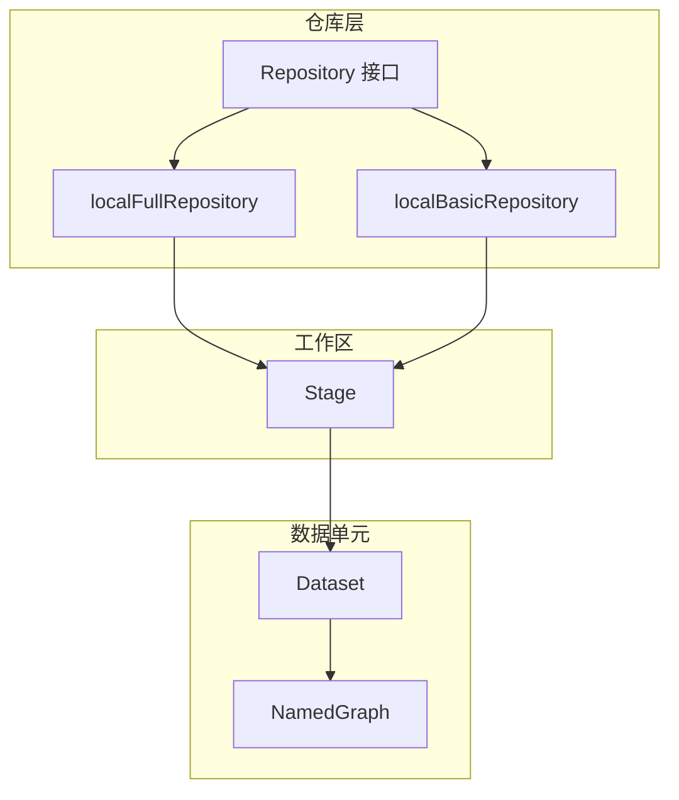
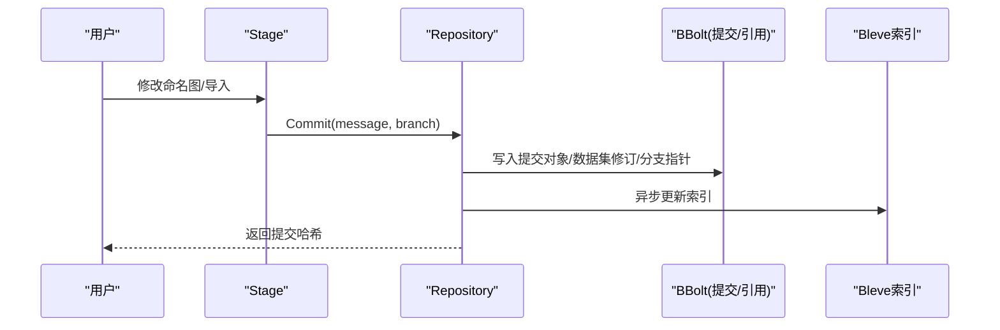
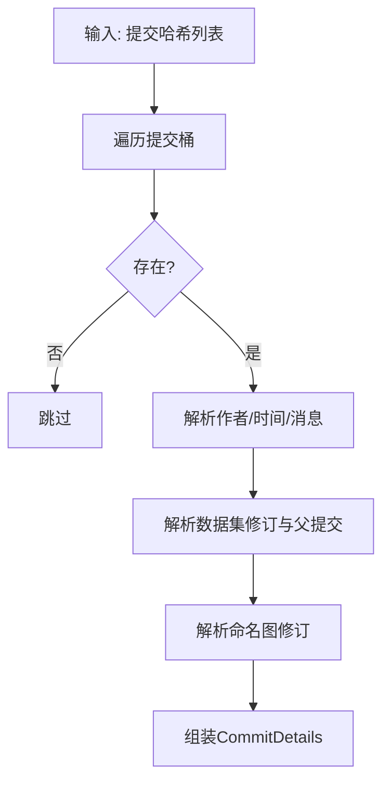
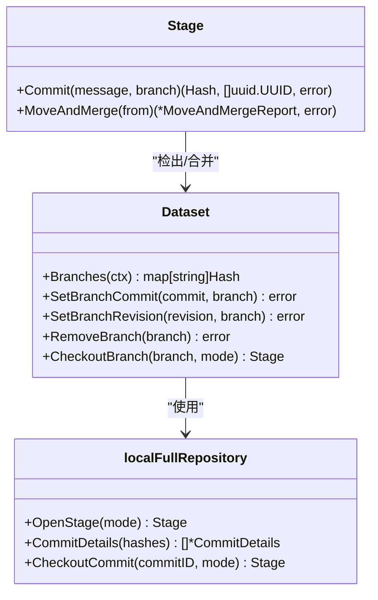
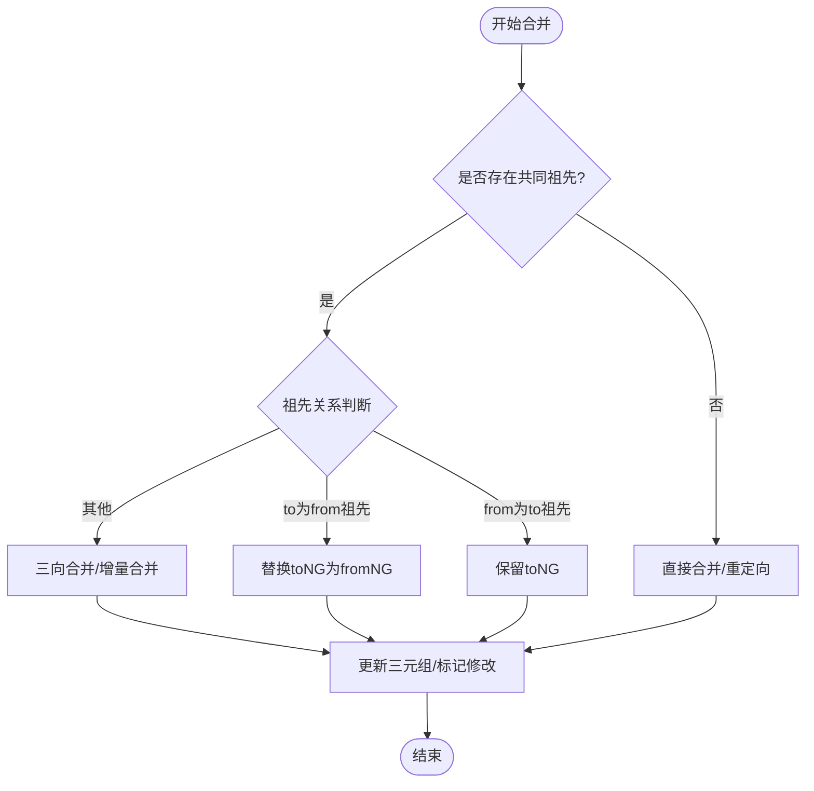
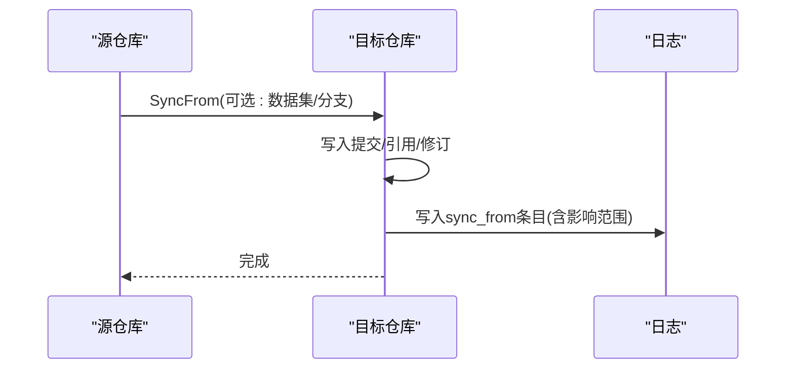
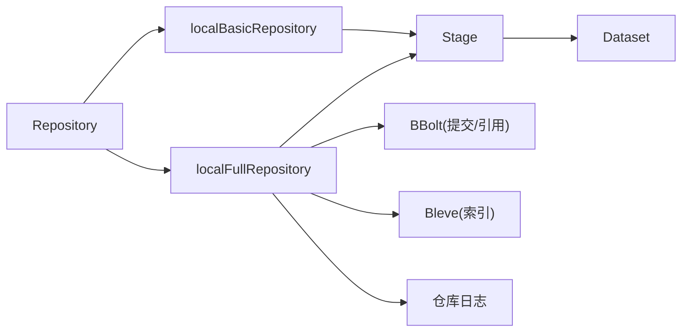

# 版本控制

<cite>
**本文引用的文件**
- [commit.go](file://sst/commit.go)
- [repository.go](file://sst/repository.go)
- [stage.go](file://sst/stage.go)
- [dataset.go](file://sst/dataset.go)
- [repolocalfull.go](file://sst/repolocalfull.go)
- [repolocalbasic.go](file://sst/repolocalbasic.go)
- [repocheckout.go](file://sst/repocheckout.go)
- [syncfromlog.go](file://sst/syncfromlog.go)
</cite>

## 目录
1. [简介](#简介)
2. [项目结构](#项目结构)
3. [核心组件](#核心组件)
4. [架构总览](#架构总览)
5. [详细组件分析](#详细组件分析)
6. [依赖关系分析](#依赖关系分析)
7. [性能与扩展性](#性能与扩展性)
8. [故障排查指南](#故障排查指南)
9. [结论](#结论)
10. [附录：工作流示例](#附录工作流示例)

## 简介
本文件面向SST版本控制系统，围绕“基于提交的版本控制模型”进行系统化说明。内容涵盖提交（Commit）、分支（Branch）和标签（Tag）的概念；分支的创建、切换、合并与删除；提交历史的管理与查询；合并策略与冲突解决；版本回滚与快照恢复；分布式版本同步与日志同步机制；并提供可操作的工作流示例与性能扩展建议。

## 项目结构
SST的版本控制能力由以下关键模块协同实现：
- Repository接口与实现：提供仓库级能力（打开阶段、数据集枚举、提交详情、检出、索引、日志、同步等）。
- Stage：内存工作区，承载对NamedGraph的增删改查，并支持提交到仓库。
- Dataset：数据集抽象，封装分支、提交、检出版本等操作。
- localFullRepository/localBasicRepository：本地仓库的具体实现，前者具备完整的历史与分支能力，后者为轻量模式。
- 提交与引用管理：通过BBolt存储提交对象、数据集修订、分支指针与叶提交引用。
- 同步与日志：记录同步事件与受影响的数据集/分支/修订，便于审计与追踪。

图表来源
- [repository.go:34-179](file://sst/repository.go#L34-L179)
- [repolocalfull.go:220-257](file://sst/repolocalfull.go#L220-L257)
- [repolocalbasic.go:34-65](file://sst/repolocalbasic.go#L34-L65)
- [stage.go:64-130](file://sst/stage.go#L64-L130)
- [dataset.go:9-30](file://sst/dataset.go#L9-L30)

章节来源
- [repository.go:34-179](file://sst/repository.go#L34-L179)
- [repolocalfull.go:220-257](file://sst/repolocalfull.go#L220-L257)
- [repolocalbasic.go:34-65](file://sst/repolocalbasic.go#L34-L65)
- [stage.go:64-130](file://sst/stage.go#L64-L130)
- [dataset.go:9-30](file://sst/dataset.go#L9-L30)

## 核心组件
- 提交（Commit）：以哈希标识的不可变对象，包含作者、时间戳、消息、父提交、数据集修订映射与命名图修订映射。
- 分支（Branch）：指向某次提交的引用，支持按数据集维度设置/移动/删除。
- 标签（Tag）：在代码中未直接暴露Tag类型，但可通过“叶提交引用”或外部约定标记稳定点；当前仓库通过“叶提交”保留非分支可达的提交。
- 数据集（Dataset）：一组命名图的集合，维护其提交历史与分支指针。
- 阶段（Stage）：内存工作区，支持创建/修改命名图、合并、对齐历史并提交。

章节来源
- [commit.go:18-29](file://sst/commit.go#L18-L29)
- [dataset.go:9-30](file://sst/dataset.go#L9-L30)
- [stage.go:64-130](file://sst/stage.go#L64-L130)
- [repolocalfull.go:54-170](file://sst/repolocalfull.go#L54-L170)

## 架构总览
SST采用“提交为中心”的DAG模型：每次提交记录数据集的修订与父提交，形成有向无环图；分支是提交的可写指针；叶提交用于保存未被分支引用的提交，保证历史可达。

图表来源
- [stage.go:121-130](file://sst/stage.go#L121-L130)
- [repolocalfull.go:595-732](file://sst/repolocalfull.go#L595-L732)
- [repolocalfull.go:54-170](file://sst/repolocalfull.go#L54-L170)

章节来源
- [stage.go:121-130](file://sst/stage.go#L121-L130)
- [repolocalfull.go:595-732](file://sst/repolocalfull.go#L595-L732)
- [repolocalfull.go:54-170](file://sst/repolocalfull.go#L54-L170)

## 详细组件分析

### 提交与提交详情
- 提交详情包含：提交哈希、作者、作者时间、消息、父提交映射、数据集修订映射、命名图修订映射。
- 仓库提供按哈希批量获取提交详情的能力，内部从BBolt的提交桶解析作者、消息、数据集修订与命名图修订。

图表来源
- [commit.go:18-29](file://sst/commit.go#L18-L29)
- [repolocalfull.go:595-719](file://sst/repolocalfull.go#L595-L719)

章节来源
- [commit.go:18-29](file://sst/commit.go#L18-L29)
- [repolocalfull.go:595-719](file://sst/repolocalfull.go#L595-L719)

### 分支管理（创建、切换、合并、删除）
- 创建/移动分支：将分支指针指向指定提交或数据集修订。
- 切换分支：基于分支尖端的提交构建Stage。
- 删除分支：移除分支指针；若该提交仅被分支引用，则转为叶提交以保持可达性。
- 合并：通过MoveAndMerge在Stage层面执行三向合并或增量合并，必要时寻找共同祖先。

图表来源
- [dataset.go:30-94](file://sst/dataset.go#L30-L94)
- [repolocalfull.go:153-184](file://sst/repolocalfull.go#L153-L184)
- [stage.go:132-163](file://sst/stage.go#L132-L163)

章节来源
- [dataset.go:30-94](file://sst/dataset.go#L30-L94)
- [repolocalfull.go:153-184](file://sst/repolocalfull.go#L153-L184)
- [stage.go:132-163](file://sst/stage.go#L132-L163)

### 合并策略与冲突解决
- 同仓库内两命名图合并时，优先查找共同祖先：
  - 若一方为另一方的祖先，则保留另一方。
  - 否则执行三向合并或增量合并，并标记修改。
- 跨仓库移动/合并时，会标记修改以确保后续提交正确反映变更。
- MoveAndMerge报告记录每一步动作（合并、重定向、变更类型、跳过、更新三元组等），便于审计与排错。

图表来源
- [stage.go:468-800](file://sst/stage.go#L468-L800)

章节来源
- [stage.go:468-800](file://sst/stage.go#L468-L800)

### 提交历史管理与查询
- 提交历史：通过提交对象的父链构成DAG；支持查询提交详情、数据集修订、命名图修订。
- 日志：仓库维护统一日志，记录提交、分支设置/删除、文档操作、同步事件等。
- 信息统计：仓库Info提供数据集数量、修订数量、提交数量、索引大小等。

章节来源
- [repolocalfull.go:595-732](file://sst/repolocalfull.go#L595-L732)
- [repository.go:706-800](file://sst/repository.go#L706-L800)

### 版本回滚与快照恢复
- 快照恢复：通过CheckoutCommit基于任意提交哈希构建Stage，获得该时刻的数据视图。
- 版本回滚：可将分支指针移动到更早的提交，或使用CheckoutRevision基于数据集修订构建Stage。
- 注意：基础本地仓库不支持历史相关操作，需使用full模式。

章节来源
- [repolocalfull.go:721-732](file://sst/repolocalfull.go#L721-L732)
- [repolocalbasic.go:414-416](file://sst/repolocalbasic.go#L414-L416)
- [dataset.go:68-82](file://sst/dataset.go#L68-L82)

### 分布式版本同步与日志同步
- 同步入口：Repository.SyncFrom支持从远程/其他仓库同步提交与引用，可选择数据集与分支范围。
- 影响分析：同步后收集受影响的数据集/分支/修订，生成同步日志条目，记录作者、时间、来源仓库URL及影响范围。
- 日志字段：type=“sync_from”，包含from_repo_url、affected_count及每个影响的dataset/branch/ds_revision。

图表来源
- [repository.go:157-163](file://sst/repository.go#L157-L163)
- [syncfromlog.go:55-204](file://sst/syncfromlog.go#L55-L204)

章节来源
- [repository.go:157-163](file://sst/repository.go#L157-L163)
- [syncfromlog.go:55-204](file://sst/syncfromlog.go#L55-L204)

## 依赖关系分析
- Repository接口定义了统一的仓库能力，具体由localFullRepository与localBasicRepository实现。
- Stage依赖Repository进行提交与合并；Dataset作为仓库与Stage之间的桥梁，负责分支与提交语义。
- BBolt用于持久化提交、引用、修订；Bleve用于全文检索索引（异步更新）。
- 同步逻辑依赖BBolt读取/写入提交与引用，并追加日志。

图表来源
- [repository.go:34-179](file://sst/repository.go#L34-L179)
- [repolocalfull.go:220-257](file://sst/repolocalfull.go#L220-L257)
- [repolocalbasic.go:34-65](file://sst/repolocalbasic.go#L34-L65)
- [syncfromlog.go:172-204](file://sst/syncfromlog.go#L172-L204)

章节来源
- [repository.go:34-179](file://sst/repository.go#L34-L179)
- [repolocalfull.go:220-257](file://sst/repolocalfull.go#L220-L257)
- [repolocalbasic.go:34-65](file://sst/repolocalbasic.go#L34-L65)
- [syncfromlog.go:172-204](file://sst/syncfromlog.go#L172-L204)

## 性能与扩展性
- 提交与引用：BBolt键值存储适合高并发读与顺序写；提交DAG查询通过父链回溯，复杂度与历史深度线性相关。
- 索引：Bleve索引异步更新，避免阻塞提交路径；重建索引时短暂不可用搜索，但不影响BBolt读写。
- 合并：MoveAndMerge在内存中进行，复杂合并可能带来CPU与内存开销；建议在合适粒度（数据集/命名图）进行合并以减少成本。
- 同步：按数据集/分支过滤可减少网络与计算开销；日志记录有助于定位影响面。
- 扩展：通过SuperRepository与远程仓库支持多仓库协作；索引映射可定制以提升检索性能。

[本节为通用指导，不直接分析具体文件]

## 故障排查指南
- 常见错误：
  - 提交未找到：检查提交哈希是否正确，或仓库是否支持历史（basic模式不支持）。
  - 分支未找到：确认分支名称与数据集范围。
  - 预提交条件失败：检查索引约束或业务前置条件。
  - 仓库不存在/已存在：检查路径与权限。
- 诊断手段：
  - 使用仓库Info查看容量、索引状态、支持特性。
  - 使用Log查看最近操作，包括提交、分支变更、同步事件。
  - 使用CommitDetails核对提交元数据与父链。

章节来源
- [repository.go:197-215](file://sst/repository.go#L197-L215)
- [repolocalbasic.go:769-799](file://sst/repolocalbasic.go#L769-L799)
- [repolocalfull.go:595-732](file://sst/repolocalfull.go#L595-L732)

## 结论
SST以提交为核心，结合分支与叶提交，构建了灵活且可扩展的版本控制模型。Stage提供了强大的内存工作区与合并能力；BBolt与Bleve分别承担持久化与检索；同步与日志机制保障了分布式场景下的可观测性与一致性。对于需要历史与分支能力的场景，推荐使用full本地仓库或远程仓库；对于轻量场景，basic仓库可满足基本需求。

[本节为总结，不直接分析具体文件]

## 附录：工作流示例
- 创建仓库与工作区
  - 创建本地full仓库，注册索引处理器。
  - 打开Stage，创建/修改命名图，添加导入。
- 提交与分支
  - 提交到默认分支或新分支；重复多次形成历史。
  - 设置分支到特定提交或修订；删除不再需要的分支。
- 合并与冲突
  - 在不同分支上并行修改，使用MoveAndMerge合并；根据共同祖先自动处理冲突。
- 快照与回滚
  - 基于提交哈希检出快照；将分支指针回退到早期提交。
- 同步与审计
  - 从远程仓库同步选定数据集/分支；查看同步日志了解影响范围。

章节来源
- [repolocalfull.go:220-257](file://sst/repolocalfull.go#L220-L257)
- [stage.go:121-163](file://sst/stage.go#L121-L163)
- [repolocalfull.go:153-184](file://sst/repolocalfull.go#L153-L184)
- [repolocalfull.go:721-732](file://sst/repolocalfull.go#L721-L732)
- [syncfromlog.go:172-204](file://sst/syncfromlog.go#L172-L204)