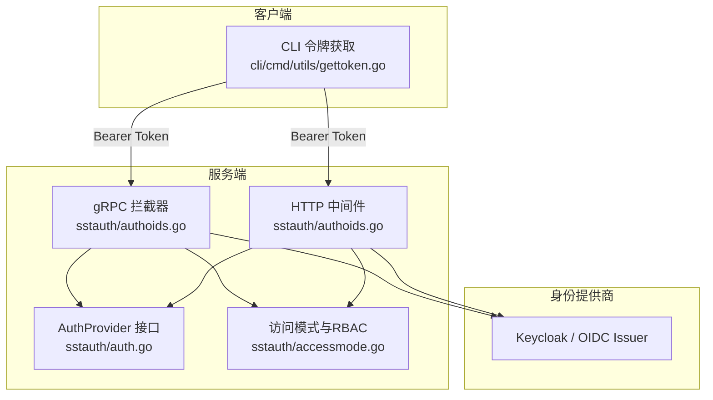
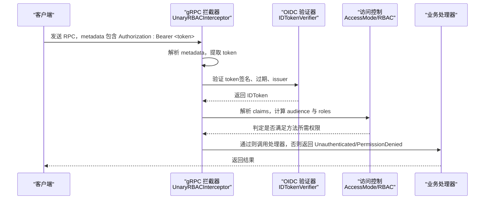
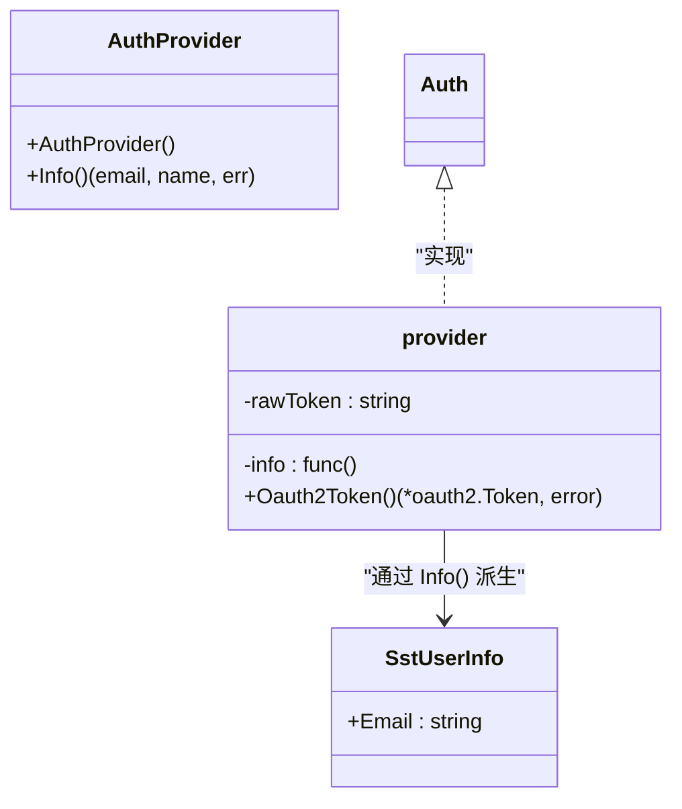
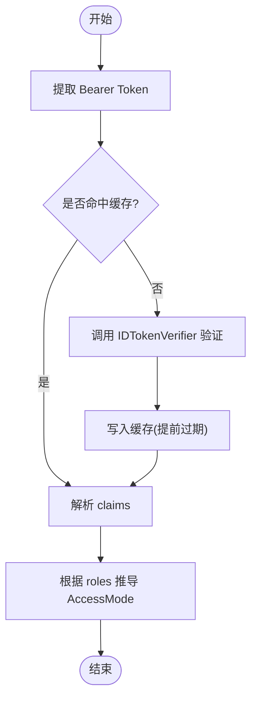
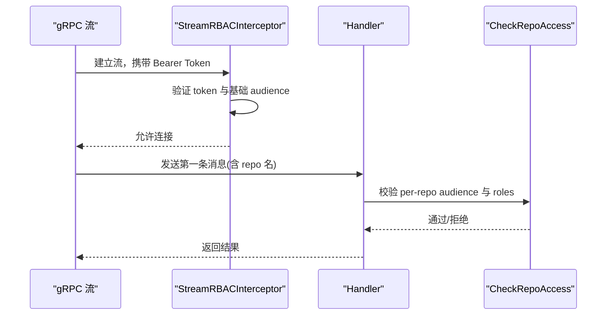
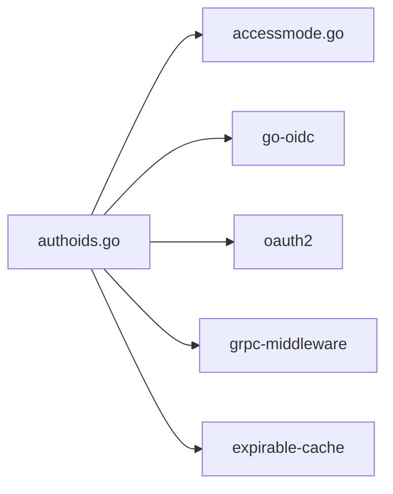

# OAuth2/OIDC认证

<cite>
**本文引用的文件**
- [auth.go](file://sstauth/auth.go)
- [authoids.go](file://sstauth/authoids.go)
- [accessmode.go](file://sstauth/accessmode.go)
- [ACCESS_RIGHTS.md](file://sstauth/ACCESS_RIGHTS.md)
- [gettoken.go](file://cli/cmd/utils/gettoken.go)
- [oidc_provider.go](file://sst_test/testutil/oidc_provider.go)
- [main.go](file://examples/helloworldreporemote/main.go)
</cite>

## 目录
1. [简介](#简介)
2. [项目结构](#项目结构)
3. [核心组件](#核心组件)
4. [架构总览](#架构总览)
5. [详细组件分析](#详细组件分析)
6. [依赖关系分析](#依赖关系分析)
7. [性能考虑](#性能考虑)
8. [故障排查指南](#故障排查指南)
9. [结论](#结论)
10. [附录：完整认证流程示例与配置](#附录完整认证流程示例与配置)

## 简介
本文件面向使用 SST Core 的开发者，系统性说明 OAuth2/OIDC 认证在仓库服务中的设计与实现，覆盖以下主题：
- AuthProvider 接口的设计与上下文传递机制
- OIDC 令牌的获取、验证与缓存策略
- Keycloak 等身份提供商的集成配置（单仓库与多仓库模式）
- 用户信息提取与上下文传播
- 令牌刷新与安全考量
- 常见错误处理与调试方法
- 多仓库认证的配置方式

## 项目结构
认证相关能力集中在 sstauth 包中，并通过 gRPC 拦截器与 HTTP 中间件接入；CLI 提供客户端侧的令牌获取与刷新；测试工具提供了本地 Fake OIDC Provider；示例展示了服务端如何启用 OIDC。

图表来源
- [authoids.go:71-140](file://sstauth/authoids.go#L71-L140)
- [auth.go:9-52](file://sstauth/auth.go#L9-L52)
- [accessmode.go:7-129](file://sstauth/accessmode.go#L7-L129)
- [gettoken.go:85-142](file://cli/cmd/utils/gettoken.go#L85-L142)

章节来源
- [authoids.go:71-140](file://sstauth/authoids.go#L71-L140)
- [auth.go:9-52](file://sstauth/auth.go#L9-L52)
- [accessmode.go:7-129](file://sstauth/accessmode.go#L7-L129)
- [gettoken.go:85-142](file://cli/cmd/utils/gettoken.go#L85-L142)

## 核心组件
- AuthProvider 接口：抽象认证提供者，统一暴露 Info() 获取用户信息，并支持通过 ContextWithAuthProvider/FromContext 在请求上下文中传递。
- OIDC 验证与缓存：基于 go-oidc 的 IDTokenVerifier，周期性更新并缓存已验证的 IDToken，减少重复校验开销。
- RBAC 拦截器：UnaryRBACInterceptor 与 StreamRBACInterceptor 负责从 gRPC metadata 提取 Bearer Token，验证签名与过期时间，校验 audience 与角色，并将 Principal 注入上下文。
- 访问模式与角色映射：AccessMode 定义权限层级，结合 Keycloak 的 resource_access.<clientID>.roles 推导有效权限。
- 令牌刷新：提供 refresh_token 与 client_credentials 两种 TokenSource，便于客户端或服务端自动续期。

章节来源
- [auth.go:9-52](file://sstauth/auth.go#L9-L52)
- [authoids.go:206-288](file://sstauth/authoids.go#L206-L288)
- [authoids.go:375-510](file://sstauth/authoids.go#L375-L510)
- [accessmode.go:7-129](file://sstauth/accessmode.go#L7-L129)
- [authoids.go:529-560](file://sstauth/authoids.go#L529-L560)

## 架构总览
下图展示一次 gRPC 调用从客户端携带 OIDC Token 到服务端鉴权、授权并执行业务处理的完整链路。

图表来源
- [authoids.go:71-92](file://sstauth/authoids.go#L71-L92)
- [authoids.go:206-288](file://sstauth/authoids.go#L206-L288)
- [authoids.go:375-423](file://sstauth/authoids.go#L375-L423)
- [accessmode.go:100-129](file://sstauth/accessmode.go#L100-L129)

## 详细组件分析

### AuthProvider 接口与上下文传递
- 设计目标：将“谁在调用”的信息以统一接口暴露，并在请求生命周期内通过 context 传递。
- 关键能力：
  - Info() 返回邮箱与姓名，供审计或提交元数据使用。
  - ContextWithAuthProvider/FromContext 用于在服务端中间件或客户端封装时注入/读取提供者。
  - SstUserInfo 与对应 Context 存取函数，用于在更细粒度处获取当前用户标识。

图表来源
- [auth.go:9-52](file://sstauth/auth.go#L9-L52)
- [authoids.go:94-106](file://sstauth/authoids.go#L94-L106)

章节来源
- [auth.go:9-52](file://sstauth/auth.go#L9-L52)
- [authoids.go:94-106](file://sstauth/authoids.go#L94-L106)

### OIDC 令牌获取、验证与缓存
- 令牌来源：
  - 客户端通过 CLI 的 GetToken 向 Keycloak 的 token endpoint 发起 password 或 refresh_token 授权，得到 access_token 与 refresh_token。
  - 服务端也可通过 client_credentials 或 refresh_token 获取 TokenSource，用于服务间调用。
- 验证流程：
  - 从 gRPC metadata 或 HTTP Header 提取 Bearer Token。
  - 使用 IDTokenVerifier 验证签名、过期时间与 issuer。
  - 解析 claims 提取 email/name 及 resource_access.roles。
- 缓存策略：
  - 使用 LRU 缓存存储已验证的 IDToken，过期时间略早于 token 自身过期，避免抖动导致频繁校验。
  - 定期刷新 verifier，确保公钥轮换后能正确验签。

图表来源
- [authoids.go:151-198](file://sstauth/authoids.go#L151-L198)
- [authoids.go:255-288](file://sstauth/authoids.go#L255-L288)
- [gettoken.go:85-142](file://cli/cmd/utils/gettoken.go#L85-L142)

章节来源
- [authoids.go:151-198](file://sstauth/authoids.go#L151-L198)
- [authoids.go:255-288](file://sstauth/authoids.go#L255-L288)
- [gettoken.go:85-142](file://cli/cmd/utils/gettoken.go#L85-L142)

### RBAC 拦截器与多仓库授权
- 单仓库模式（PerRepoAuth=false）：
  - 期望 token 的 aud 等于服务器配置的 ClientID。
  - 所有方法权限由 resource_access.<ClientID>.roles 决定。
- 多仓库模式（PerRepoAuth=true，SuperRepository）：
  - RepoManagerService 始终使用 super client ID。
  - 其他方法使用 per-repo client ID：<superClientID>#<repoName>。
  - Unary 调用在拦截器中即可解析 repo 名并严格校验 audience 与 roles。
  - Streaming 调用在拦截器中进行初步校验（audience 属于该服务器），具体 per-repo 权限在 handler 读取首条消息后调用 CheckRepoAccess 完成。

图表来源
- [authoids.go:445-510](file://sstauth/authoids.go#L445-L510)
- [authoids.go:314-373](file://sstauth/authoids.go#L314-L373)

章节来源
- [authoids.go:375-510](file://sstauth/authoids.go#L375-L510)
- [ACCESS_RIGHTS.md:130-166](file://sstauth/ACCESS_RIGHTS.md#L130-L166)

### Keycloak 集成配置
- 单仓库服务器：
  - 创建一个 Keycloak Client，其 Client ID 与服务器的 ClientID 一致。
  - 为该 Client 添加角色 ReadOnly/ReadWrite/Admin/SuperAdmin，并通过 Role mappings 分配给用户或组。
  - 确保 Token 中包含 resource_access.<ClientID>.roles。
- 多仓库服务器（SuperRepository）：
  - 创建 super client，并为每个子仓库创建 per-repo client，ID 格式为 <superClientID>#<repoName>。
  - 为每个 per-repo client 配置相应角色。
  - 若需跨仓库访问，可在 Keycloak 中为客户端配置多个 Audience。

章节来源
- [ACCESS_RIGHTS.md:173-238](file://sstauth/ACCESS_RIGHTS.md#L173-L238)

### 用户信息提取与上下文传递
- 服务端：
  - 拦截器解析 token 后将 Principal（含 email/name/claims/audience）注入上下文，供后续逻辑使用。
  - 同时可通过 ContextWithSstUserInfo 将简化版用户信息（如仅邮箱）放入上下文，便于轻量场景。
- 客户端：
  - 通过 ContextWithAuthProvider 将带 token 的 Provider 注入上下文，远程调用会自动附加 Bearer Token。

章节来源
- [authoids.go:420-443](file://sstauth/authoids.go#L420-L443)
- [auth.go:25-52](file://sstauth/auth.go#L25-L52)

### 令牌刷新与安全考虑
- 刷新策略：
  - 客户端侧：refreshableProvider 在 access token 即将过期前使用 refresh_token 刷新；若无 refresh_token 则重新走密码授权。
  - 服务端侧：提供 sstRefreshTokenSource 与 clientCredentialsTokenSource，配合 oauth2.ReuseTokenSource 自动复用与刷新。
- 安全建议：
  - 使用 TLS 加密传输。
  - 合理设置 token 过期时间与缓存过期时间，避免过久缓存导致权限变更延迟。
  - 严格校验 audience 与 roles，禁止绕过 RBAC。
  - 对敏感操作增加二次确认或审计日志。

章节来源
- [gettoken.go:144-192](file://cli/cmd/utils/gettoken.go#L144-L192)
- [authoids.go:529-560](file://sstauth/authoids.go#L529-L560)
- [authoids.go:255-288](file://sstauth/authoids.go#L255-L288)

## 依赖关系分析
- 外部依赖：
  - go-oidc：OIDC 发现、JWKS 拉取与 IDToken 验证。
  - golang.org/x/oauth2：OAuth2 TokenSource 与客户端凭证模式。
  - grpc-middleware：从 metadata 提取 Authorization。
  - expirable-cache：LRU 缓存已验证的 IDToken。
- 内部耦合：
  - authoids 依赖 accessmode 进行权限判定。
  - 服务端通过拦截器将 Principal 注入上下文，下游业务无需感知认证细节。

图表来源
- [authoids.go:5-23](file://sstauth/authoids.go#L5-L23)
- [accessmode.go:1-129](file://sstauth/accessmode.go#L1-L129)

章节来源
- [authoids.go:5-23](file://sstauth/authoids.go#L5-L23)
- [accessmode.go:1-129](file://sstauth/accessmode.go#L1-L129)

## 性能考虑
- 令牌验证缓存：
  - 使用 LRU 缓存 IDToken，最大键数与过期时间可调，显著降低重复验证开销。
  - 定期刷新 verifier，保证公钥轮换后的正确性。
- 流式鉴权：
  - 对 streaming RPC 先做基础鉴权，再在 handler 中精确校验 per-repo 权限，平衡安全性与性能。
- 最小化网络调用：
  - 客户端侧尽量复用 TokenSource，避免频繁刷新。

[本节为通用性能讨论，不直接分析具体文件]

## 故障排查指南
- 常见错误与定位：
  - Unauthenticated：缺少或无效的 authorization header/metadata；token 签名或过期失败。
  - PermissionDenied：audience 不匹配或角色不足；per-repo 模式下未包含正确的 per-repo client ID。
  - bad claims：无法解析 claims 或字段缺失。
- 调试建议：
  - 检查 Keycloak 的 Client ID、Audience 与 Roles 映射是否正确。
  - 使用测试用的 FakeOIDCProvider 快速验证服务端鉴权逻辑。
  - 开启 verbose 输出，查看服务端启动配置与拦截器行为。
  - 在客户端打印或记录 access_token 的 payload（仅 exp 等必要字段），确认过期时间。

章节来源
- [authoids.go:290-312](file://sstauth/authoids.go#L290-L312)
- [authoids.go:375-423](file://sstauth/authoids.go#L375-L423)
- [oidc_provider.go:167-236](file://sst_test/testutil/oidc_provider.go#L167-L236)

## 结论
本系统通过统一的 AuthProvider 接口、严格的 OIDC 验证与 RBAC 拦截器，实现了可扩展、可维护的认证与授权体系。支持单仓库与多仓库两种模式，兼容 Keycloak 等主流身份提供商，并提供完善的令牌刷新与缓存机制，兼顾安全性与性能。

[本节为总结性内容，不直接分析具体文件]

## 附录：完整认证流程示例与配置

### 服务端启用 OIDC（单仓库）
- 配置 RepositoryServerConfig 的 Issuer 与 ClientID，并可选配置 ServerCert。
- 示例入口参考：

章节来源
- [main.go:68-78](file://examples/helloworldreporemote/main.go#L68-L78)

### 客户端获取与刷新令牌
- 环境变量：
  - SST_OIDC_REALM_URL：Keycloak realm 地址
  - SST_OIDC_CLIENT_ID：客户端 ID
  - SST_OIDC_CLIENT_SECRET：客户端密钥
- 流程：
  - 首次登录使用 password grant 获取 access_token 与 refresh_token。
  - 后续使用 refresh_token 刷新；若无 refresh_token 则重新登录。
  - 将 Provider 注入上下文，远程调用自动附带 Bearer Token。

章节来源
- [gettoken.go:65-142](file://cli/cmd/utils/gettoken.go#L65-L142)
- [gettoken.go:144-192](file://cli/cmd/utils/gettoken.go#L144-L192)

### 多仓库认证配置（SuperRepository）
- 在 Keycloak 中为每个仓库创建 per-repo client，ID 格式为 <superClientID>#<repoName>。
- 为每个 per-repo client 配置角色，并确保 Token 中包含对应的 resource_access.<clientID>.roles。
- 服务端通过 PerRepoAuth=true 启用 per-repo 鉴权。

章节来源
- [ACCESS_RIGHTS.md:203-232](file://sstauth/ACCESS_RIGHTS.md#L203-L232)

### 测试环境：Fake OIDC Provider
- 使用测试工具启动本地 OIDC 服务，模拟 discovery 与 JWKS 端点，签发带 Keycloak 风格 claims 的 JWT。
- 可用于端到端验证拦截器与 RBAC 逻辑。

章节来源
- [oidc_provider.go:26-165](file://sst_test/testutil/oidc_provider.go#L26-L165)