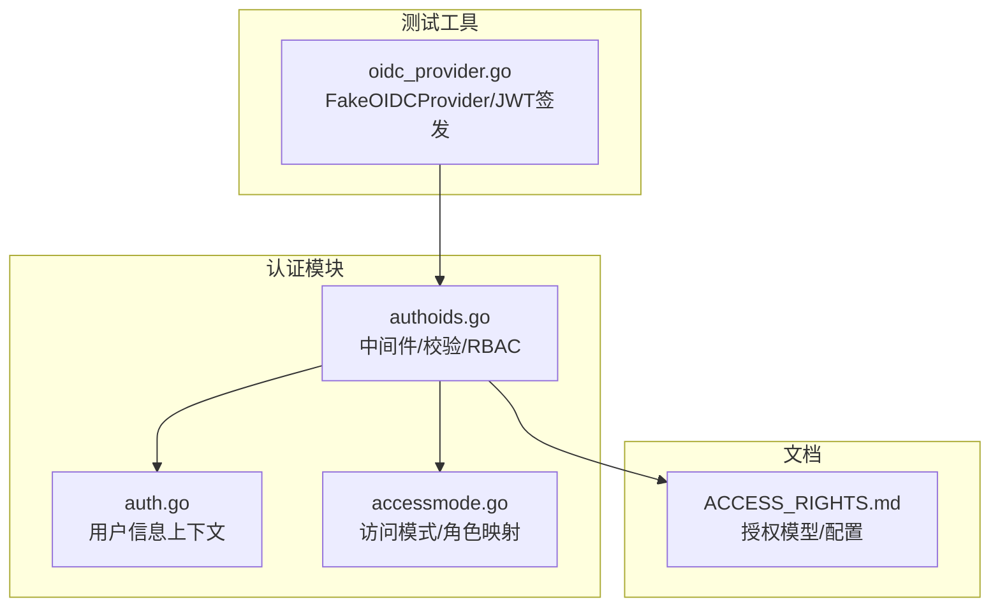
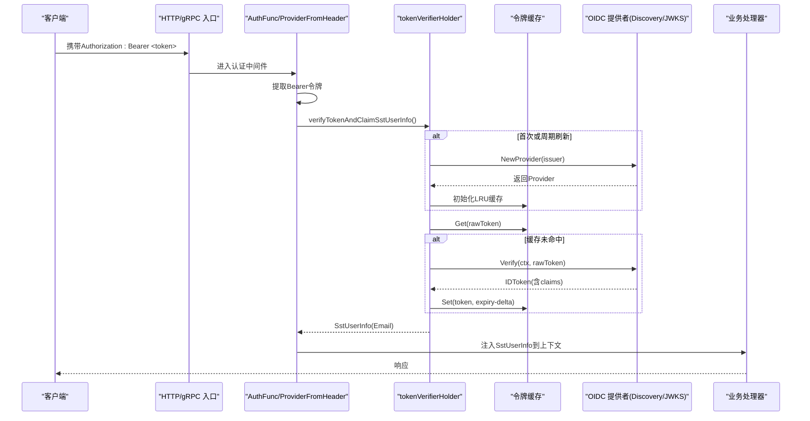
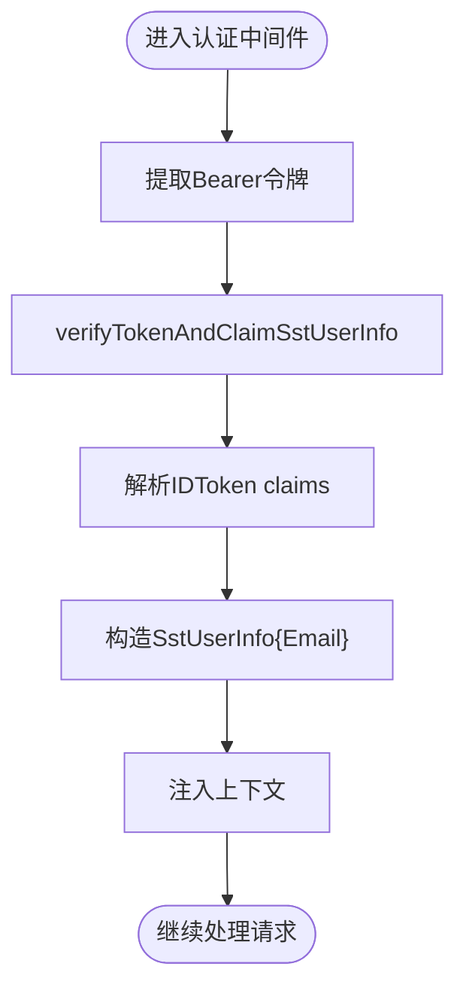
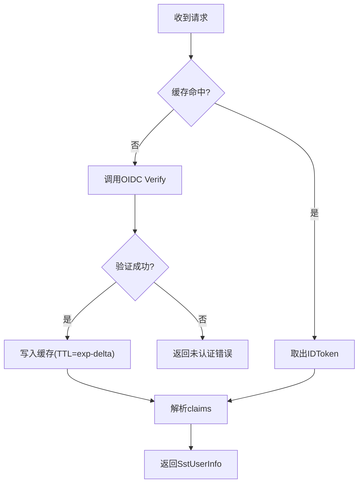
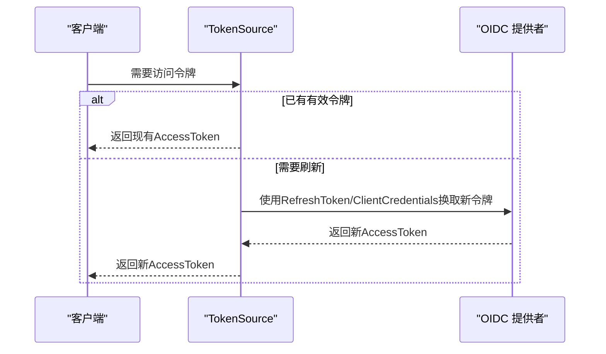
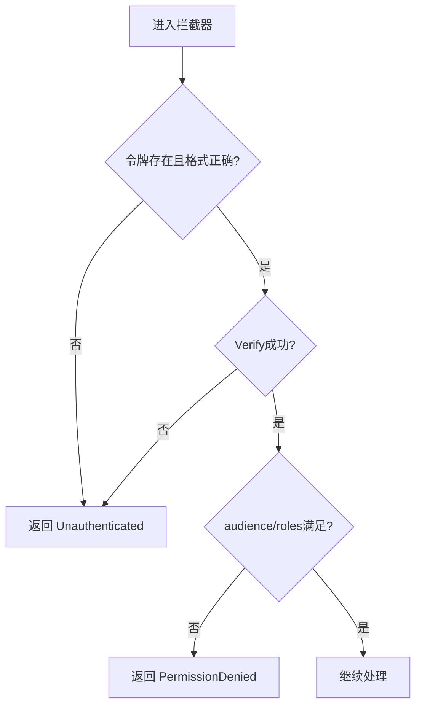
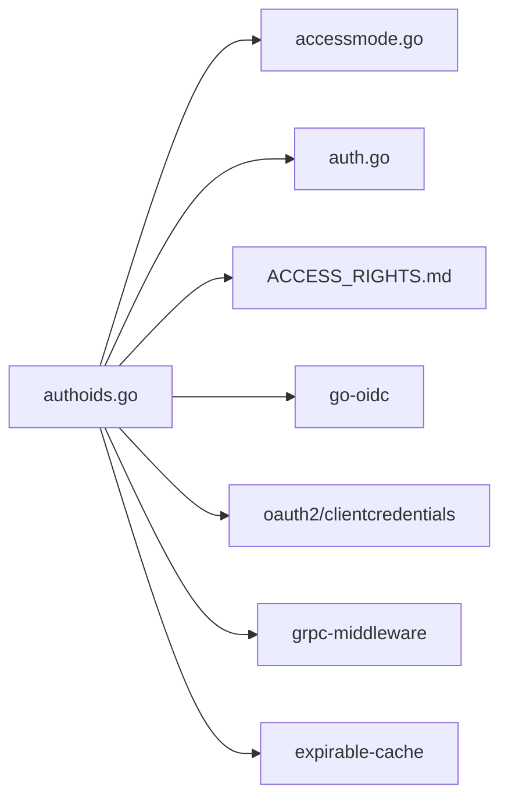

# OIDC令牌处理

<cite>
**本文引用的文件**
- [authoids.go](file://sstauth/authoids.go)
- [auth.go](file://sstauth/auth.go)
- [accessmode.go](file://sstauth/accessmode.go)
- [ACCESS_RIGHTS.md](file://sstauth/ACCESS_RIGHTS.md)
- [oidc_provider.go](file://sst_test/testutil/oidc_provider.go)
</cite>

## 目录
1. [简介](#简介)
2. [项目结构](#项目结构)
3. [核心组件](#核心组件)
4. [架构总览](#架构总览)
5. [详细组件分析](#详细组件分析)
6. [依赖关系分析](#依赖关系分析)
7. [性能考虑](#性能考虑)
8. [故障排查指南](#故障排查指南)
9. [结论](#结论)
10. [附录](#附录)

## 简介
本文件面向OIDC令牌处理系统，聚焦以下目标：
- 解释SstUserInfo结构设计与用户信息提取流程
- 详述令牌的解析、验证与缓存机制
- 说明JWT令牌结构与关键字段含义
- 说明令牌过期处理与自动刷新策略
- 提供令牌安全存储与传输的最佳实践
- 展示令牌验证失败的错误处理
- 给出与不同OIDC提供商的集成示例
- 解释令牌撤销与黑名单机制在本仓库中的现状与建议

## 项目结构
本仓库中与OIDC令牌处理相关的代码集中在认证包sstauth中，并辅以测试用的模拟OIDC提供者。关键文件如下：
- sstauth/authoids.go：gRPC/HTTP中间件、令牌校验、RBAC拦截器、令牌缓存与刷新源
- sstauth/auth.go：用户信息上下文封装、AuthProvider接口
- sstauth/accessmode.go：访问模式定义与角色到权限的映射
- sstauth/ACCESS_RIGHTS.md：授权模型、方法级权限表、Keycloak配置指引
- sst_test/testutil/oidc_provider.go：用于测试的FakeOIDCProvider（JWKS、签发JWT）

图表来源
- [authoids.go:71-92](file://sstauth/authoids.go#L71-L92)
- [auth.go:19-36](file://sstauth/auth.go#L19-L36)
- [accessmode.go:7-36](file://sstauth/accessmode.go#L7-L36)
- [ACCESS_RIGHTS.md:52-101](file://sstauth/ACCESS_RIGHTS.md#L52-L101)
- [oidc_provider.go:26-71](file://sst_test/testutil/oidc_provider.go#L26-L71)

章节来源
- [authoids.go:71-92](file://sstauth/authoids.go#L71-L92)
- [auth.go:19-36](file://sstauth/auth.go#L19-L36)
- [accessmode.go:7-36](file://sstauth/accessmode.go#L7-L36)
- [ACCESS_RIGHTS.md:52-101](file://sstauth/ACCESS_RIGHTS.md#L52-L101)
- [oidc_provider.go:26-71](file://sst_test/testutil/oidc_provider.go#L26-L71)

## 核心组件
- SstUserInfo：承载通过令牌提取的用户标识（当前为邮箱），用于在上下文中传递用户身份。
- ProviderFromHeader/AuthFunc：从HTTP或gRPC请求中提取Bearer令牌，调用统一校验流程，将用户信息注入上下文。
- tokenVerifierHolder与tokenVerifier：持有可更新的IDTokenVerifier与LRU令牌缓存，周期性刷新以获取最新公钥。
- oidcTokenVerificationAndCaching：先查缓存，未命中则使用OIDC库验证签名与有效期，并将结果按接近令牌过期的时间写入缓存。
- RBAC拦截器（Unary/Stream）：校验audience与roles，派生AccessMode，执行方法级鉴权。
- AccessMode与角色映射：基于Keycloak resource_access.<clientID>.roles推导最小所需权限。
- FakeOIDCProvider：测试用OIDC提供者，暴露发现文档与JWKS，支持签发带resource_access的JWT。

章节来源
- [auth.go:19-36](file://sstauth/auth.go#L19-L36)
- [authoids.go:71-92](file://sstauth/authoids.go#L71-L92)
- [authoids.go:151-198](file://sstauth/authoids.go#L151-L198)
- [authoids.go:200-233](file://sstauth/authoids.go#L200-L233)
- [authoids.go:255-288](file://sstauth/authoids.go#L255-L288)
- [authoids.go:375-423](file://sstauth/authoids.go#L375-L423)
- [authoids.go:445-510](file://sstauth/authoids.go#L445-L510)
- [accessmode.go:7-36](file://sstauth/accessmode.go#L7-L36)
- [accessmode.go:100-129](file://sstauth/accessmode.go#L100-L129)
- [oidc_provider.go:26-71](file://sst_test/testutil/oidc_provider.go#L26-L71)

## 架构总览
下图展示了客户端携带OIDC令牌发起gRPC/HTTP请求，服务端中间件提取、校验、鉴权，并将用户信息注入上下文供业务处理的完整流程。

图表来源
- [authoids.go:71-92](file://sstauth/authoids.go#L71-L92)
- [authoids.go:151-198](file://sstauth/authoids.go#L151-L198)
- [authoids.go:200-233](file://sstauth/authoids.go#L200-L233)
- [authoids.go:255-288](file://sstauth/authoids.go#L255-L288)

## 详细组件分析

### SstUserInfo设计与用户信息提取
- 设计要点：SstUserInfo仅包含Email字段，作为跨层传递的最小化用户标识；通过ContextWithSstUserInfo/SstUserInfoFromContext在上下文中存取。
- 提取路径：AuthFunc/ProviderFromHeader从请求头或gRPC元数据提取Bearer令牌，调用verifyTokenAndClaimSstUserInfo进行校验，最终将SstUserInfo注入上下文。
- 适用场景：提交审计、日志记录、简单身份识别等。

图表来源
- [auth.go:19-36](file://sstauth/auth.go#L19-L36)
- [authoids.go:71-92](file://sstauth/authoids.go#L71-L92)
- [authoids.go:151-198](file://sstauth/authoids.go#L151-L198)
- [authoids.go:255-288](file://sstauth/authoids.go#L255-L288)

章节来源
- [auth.go:19-36](file://sstauth/auth.go#L19-L36)
- [authoids.go:71-92](file://sstauth/authoids.go#L71-L92)
- [authoids.go:151-198](file://sstauth/authoids.go#L151-L198)
- [authoids.go:255-288](file://sstauth/authoids.go#L255-L288)

### 令牌解析、验证与缓存机制
- 解析：从HTTP Header或gRPC metadata中解析Bearer令牌。
- 验证：使用go-oidc的IDTokenVerifier对签名、iss、exp等进行校验；配置SkipClientIDCheck以便由拦截器自行校验audience。
- 缓存：使用LRU缓存IDToken，缓存TTL略小于令牌剩余有效期（减去固定delta），减少重复网络开销。
- 更新：每30秒尝试重建Verifier以拉取最新JWKS，避免公钥过期导致验证失败。

图表来源
- [authoids.go:151-198](file://sstauth/authoids.go#L151-L198)
- [authoids.go:255-288](file://sstauth/authoids.go#L255-L288)
- [authoids.go:200-233](file://sstauth/authoids.go#L200-L233)

章节来源
- [authoids.go:151-198](file://sstauth/authoids.go#L151-L198)
- [authoids.go:200-233](file://sstauth/authoids.go#L200-L233)
- [authoids.go:255-288](file://sstauth/authoids.go#L255-L288)

### JWT令牌结构与字段含义
- 标准字段（由OIDC提供方签发）：
  - iss：颁发者
  - sub：主体
  - aud：受众（必须匹配服务器配置的ClientID或per-repo audience）
  - exp/iat：过期时间与签发时间
  - email/name：用户基本信息（用于SstUserInfo）
- Keycloak扩展字段：
  - resource_access.<clientID>.roles：客户端角色列表，用于推导AccessMode

章节来源
- [oidc_provider.go:78-129](file://sst_test/testutil/oidc_provider.go#L78-L129)
- [ACCESS_RIGHTS.md:31-50](file://sstauth/ACCESS_RIGHTS.md#L31-L50)

### 令牌过期处理与自动刷新策略
- 服务端验证：IDTokenVerifier会检查exp，过期即拒绝。
- 缓存策略：缓存TTL设置为“令牌到期前减去固定delta”，确保缓存不会比令牌更晚失效。
- 自动刷新：每30秒重建Verifier以拉取最新JWKS，保证公钥轮换后仍能正确验签。
- 客户端刷新：提供两种TokenSource实现：
  - 基于Refresh Token的刷新源
  - 基于Client Credentials的机器间令牌刷新源
  两者均使用ReuseTokenSource进行复用与自动刷新。

图表来源
- [authoids.go:529-560](file://sstauth/authoids.go#L529-L560)

章节来源
- [authoids.go:25-33](file://sstauth/authoids.go#L25-L33)
- [authoids.go:255-288](file://sstauth/authoids.go#L255-L288)
- [authoids.go:529-560](file://sstauth/authoids.go#L529-L560)

### 令牌安全存储与传输最佳实践
- 传输：
  - 始终通过TLS加密通道传输Bearer令牌
  - gRPC中使用metadata携带Authorization: Bearer
  - HTTP使用Authorization: Bearer头部
- 存储：
  - 客户端侧将令牌保存在内存或受保护的凭据管理器中，避免落盘明文
  - 服务端不持久化原始令牌，仅缓存已验证的IDToken对象且设置合理TTL
  - 谨慎记录日志，避免泄露敏感令牌片段
- 生命周期：
  - 使用短寿命Access Token配合Refresh Token或Client Credentials刷新
  - 定期轮换密钥与证书，确保JWKS可用

章节来源
- [authoids.go:71-92](file://sstauth/authoids.go#L71-L92)
- [authoids.go:255-288](file://sstauth/authoids.go#L255-L288)
- [ACCESS_RIGHTS.md:52-101](file://sstauth/ACCESS_RIGHTS.md#L52-L101)

### 令牌验证失败的错误处理
- 缺失或格式错误：返回Unauthenticated
- 签名无效或过期：返回Unauthenticated
- audience不匹配或角色不足：返回PermissionDenied
- 流式RPC：首条消息后才精确校验per-repo audience与角色，在此之前仅做基础认证与aud归属校验

图表来源
- [authoids.go:71-92](file://sstauth/authoids.go#L71-L92)
- [authoids.go:375-423](file://sstauth/authoids.go#L375-L423)
- [authoids.go:445-510](file://sstauth/authoids.go#L445-L510)

章节来源
- [authoids.go:71-92](file://sstauth/authoids.go#L71-L92)
- [authoids.go:375-423](file://sstauth/authoids.go#L375-L423)
- [authoids.go:445-510](file://sstauth/authoids.go#L445-L510)

### 与不同OIDC提供商的集成示例
- 单Repository服务器（PerRepoAuth=false）：
  - 在Keycloak创建Client，ClientID与服务端一致
  - 配置Client roles并在令牌中包含resource_access.<clientID>.roles
  - 令牌aud为服务端的ClientID
- SuperRepository服务器（PerRepoAuth=true）：
  - 创建Super Client（super client ID）
  - 为每个子仓库创建per-repo Client，ID形如<superClientID>#<repoName>
  - 为每个per-repo Client配置相应角色
  - 令牌aud为对应per-repo audience
- 测试集成：
  - 使用FakeOIDCProvider启动本地OIDC服务，暴露/.well-known/openid-configuration与/jwks_uri
  - 通过IssueToken生成带resource_access的JWT，用于端到端测试

章节来源
- [ACCESS_RIGHTS.md:173-238](file://sstauth/ACCESS_RIGHTS.md#L173-L238)
- [oidc_provider.go:26-71](file://sst_test/testutil/oidc_provider.go#L26-L71)
- [oidc_provider.go:78-129](file://sst_test/testutil/oidc_provider.go#L78-L129)

### 令牌撤销与黑名单机制
- 当前实现：
  - 未发现全局令牌黑名单或撤销列表的实现
  - 服务端依赖OIDC标准字段（exp）与JWKS进行验证，无法主动撤销已签发但仍在有效期内的令牌
- 建议方案：
  - 引入短期Access Token与Refresh Token，缩短攻击窗口
  - 在服务端增加令牌指纹/子集哈希的短期黑名单（内存或KV存储），结合事件驱动同步
  - 利用OIDC后端提供的令牌撤销端点（若支持）进行主动撤销
  - 对高风险操作强制二次认证或会话刷新

章节来源
- [authoids.go:200-233](file://sstauth/authoids.go#L200-L233)
- [authoids.go:255-288](file://sstauth/authoids.go#L255-L288)

## 依赖关系分析
- 外部依赖：
  - go-oidc：OIDC提供者发现、JWKS获取、IDToken验证
  - oauth2/clientcredentials：客户端凭证与刷新令牌管理
  - grpc-middleware：gRPC认证中间件
  - expirable-cache：LRU令牌缓存
- 内部依赖：
  - accessmode.go：角色到访问模式的映射
  - auth.go：用户信息上下文封装
  - ACCESS_RIGHTS.md：授权模型与方法权限表

图表来源
- [authoids.go:5-23](file://sstauth/authoids.go#L5-L23)
- [accessmode.go:7-36](file://sstauth/accessmode.go#L7-L36)
- [auth.go:19-36](file://sstauth/auth.go#L19-L36)
- [ACCESS_RIGHTS.md:52-101](file://sstauth/ACCESS_RIGHTS.md#L52-L101)

章节来源
- [authoids.go:5-23](file://sstauth/authoids.go#L5-L23)
- [accessmode.go:7-36](file://sstauth/accessmode.go#L7-L36)
- [auth.go:19-36](file://sstauth/auth.go#L19-L36)
- [ACCESS_RIGHTS.md:52-101](file://sstauth/ACCESS_RIGHTS.md#L52-L101)

## 性能考虑
- 缓存命中率：LRU缓存最大键数与TTL直接影响验证延迟与网络开销
- 公钥轮转：30秒周期刷新Verifier，平衡新鲜度与CPU/IO成本
- 并发安全：原子值存储Verifier实例，避免竞态
- 流式RPC：仅在首条消息后进行精确per-repo鉴权，降低握手阶段开销

章节来源
- [authoids.go:25-33](file://sstauth/authoids.go#L25-L33)
- [authoids.go:151-198](file://sstauth/authoids.go#L151-L198)
- [authoids.go:445-510](file://sstauth/authoids.go#L445-L510)

## 故障排查指南
- 常见错误与定位：
  - Unauthenticated：检查Authorization头是否存在、Bearer格式是否正确、令牌是否过期或签名无效
  - PermissionDenied：核对audience是否为预期的ClientID或per-repo audience；确认resource_access.<clientID>.roles是否包含所需角色
  - 流式RPC权限问题：确认在读取首条消息后调用了CheckRepoAccess进行per-repo audience与角色校验
- 调试建议：
  - 启用Verbose输出，观察OIDC发现与JWKS加载过程
  - 打印IDToken的aud与resource_access内容，确认与Keycloak配置一致
  - 检查缓存是否命中，必要时调整maxTokenCacheSize与tokenExpiryDelta

章节来源
- [authoids.go:71-92](file://sstauth/authoids.go#L71-L92)
- [authoids.go:375-423](file://sstauth/authoids.go#L375-L423)
- [authoids.go:445-510](file://sstauth/authoids.go#L445-L510)
- [ACCESS_RIGHTS.md:52-101](file://sstauth/ACCESS_RIGHTS.md#L52-L101)

## 结论
该OIDC令牌处理系统通过统一的中间件与拦截器实现了安全的令牌提取、验证、鉴权与用户信息注入。其缓存与周期性刷新机制提升了性能与健壮性；基于Keycloak resource_access的角色映射提供了灵活的细粒度权限控制。对于令牌撤销与黑名单，当前未内置实现，建议结合短期令牌与动态黑名单增强安全性。测试工具FakeOIDCProvider便于快速集成与验证。

## 附录
- 方法级权限参考：见ACCESS_RIGHTS.md中的gRPC方法权限表
- 服务器配置示例：见ACCESS_RIGHTS.md中的NewServer/NewSuperServer配置片段
- 客户端用法：通过ContextWithAuthProvider注入Provider，远程客户端会自动携带Bearer令牌

章节来源
- [ACCESS_RIGHTS.md:240-335](file://sstauth/ACCESS_RIGHTS.md#L240-L335)
- [ACCESS_RIGHTS.md:337-359](file://sstauth/ACCESS_RIGHTS.md#L337-L359)