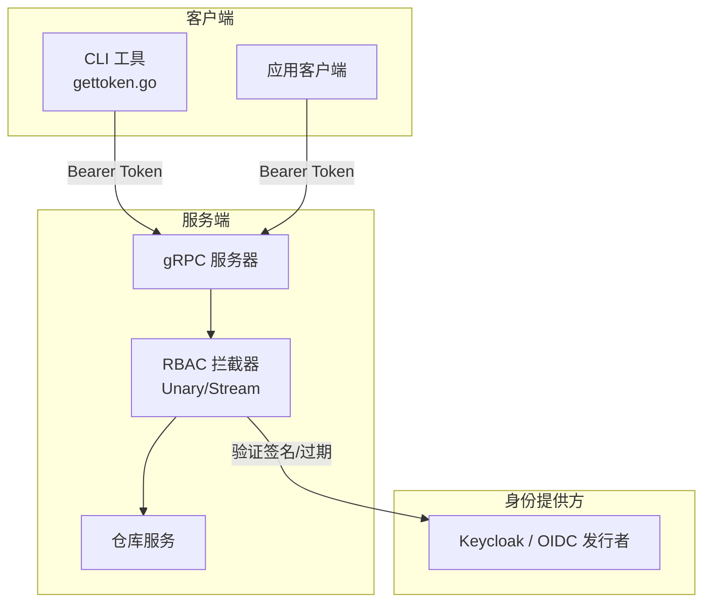
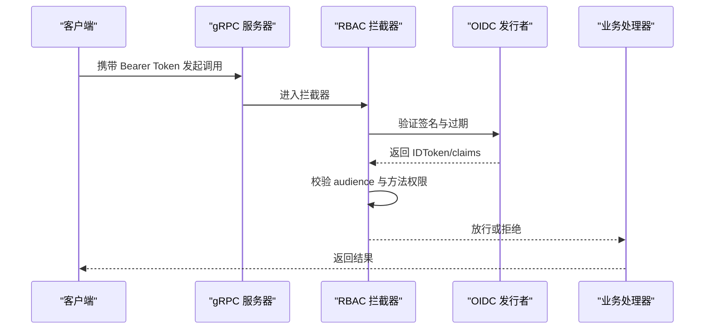
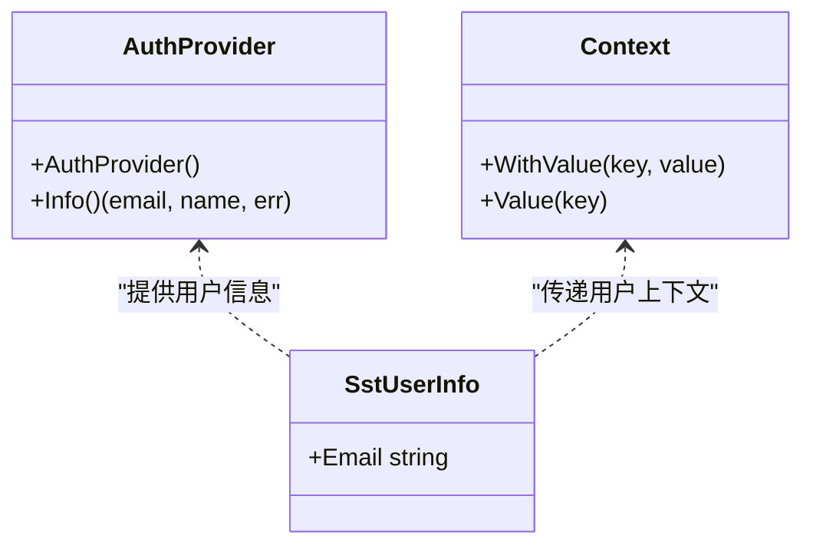
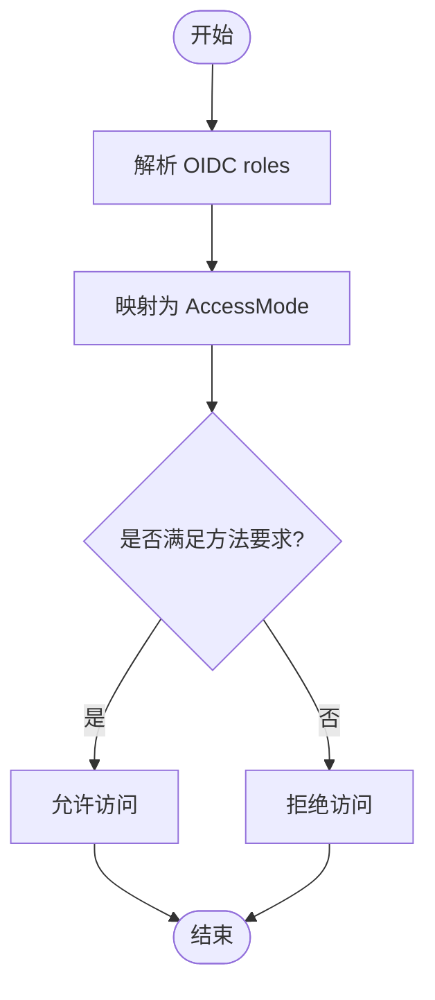
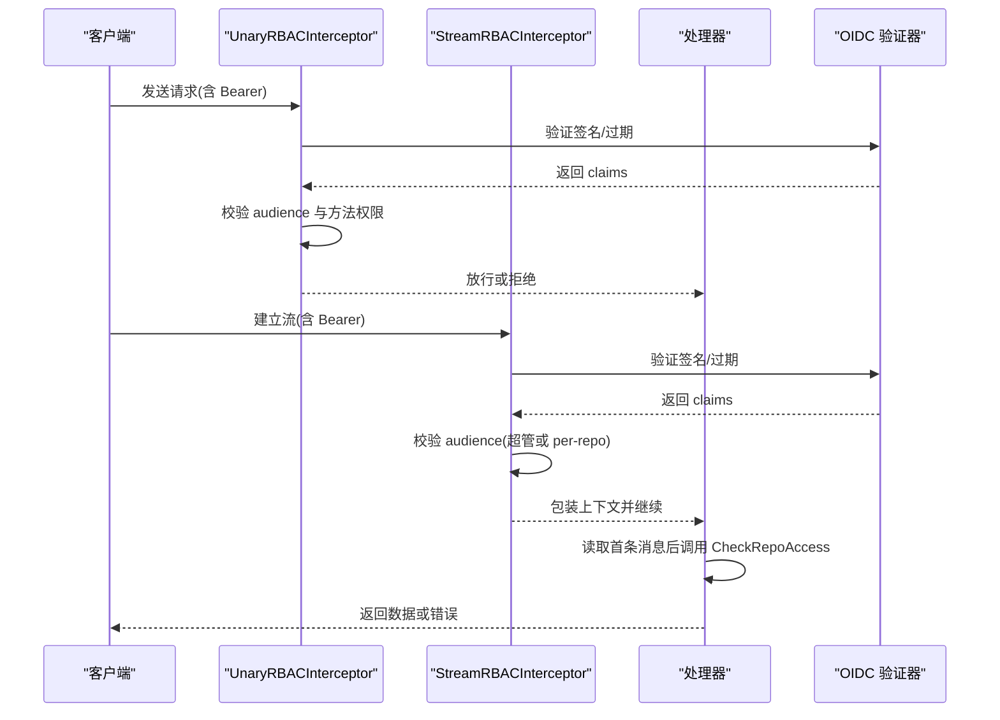
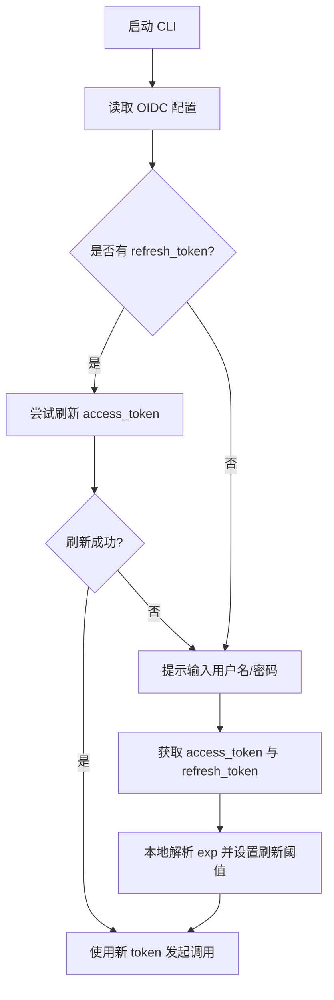
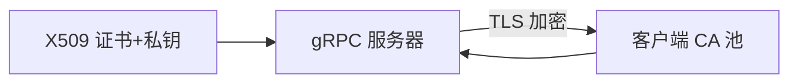
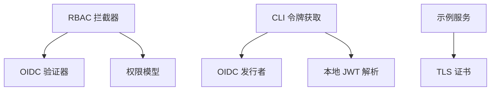

# 安全最佳实践

<cite>
**本文引用的文件**
- [sstauth/auth.go](file://sstauth/auth.go)
- [sstauth/accessmode.go](file://sstauth/accessmode.go)
- [sstauth/ACCESS_RIGHTS.md](file://sstauth/ACCESS_RIGHTS.md)
- [sstauth/authoids.go](file://sstauth/authoids.go)
- [cli/cmd/utils/gettoken.go](file://cli/cmd/utils/gettoken.go)
- [sst_test/testutil/testauth.go](file://sst_test/testutil/testauth.go)
- [examples/helloworldsuperreporemote/main.go](file://examples/helloworldsuperreporemote/main.go)
</cite>

## 目录
1. [简介](#简介)
2. [项目结构](#项目结构)
3. [核心组件](#核心组件)
4. [架构总览](#架构总览)
5. [详细组件分析](#详细组件分析)
6. [依赖关系分析](#依赖关系分析)
7. [性能与安全考量](#性能与安全考量)
8. [故障排除与事件响应](#故障排除与事件响应)
9. [结论](#结论)
10. [附录：配置检查清单](#附录配置检查清单)

## 简介
本指南面向部署和运维 SST（Semantic STEP Technology）仓库服务的工程师，聚焦认证、授权、令牌管理、密钥与证书、访问控制最小化原则、常见威胁防护、审计与合规、以及安全事件响应与排障。内容基于代码库中的认证与授权实现、CLI 令牌获取流程、gRPC 拦截器、以及示例服务启动方式，提供可操作的安全配置建议与检查清单。

## 项目结构
围绕安全的核心模块与文件分布如下：
- sstauth：认证提供者接口、用户信息上下文、访问级别模型、OIDC 验证与 RBAC 拦截器、方法级权限表映射、流式请求的后续鉴权辅助函数。
- cli/cmd/utils/gettoken.go：CLI 端通过 OIDC 密码模式或刷新令牌获取访问令牌，并支持本地 JWT 过期校验与重试。
- examples/helloworldsuperreporemote/main.go：演示如何加载 TLS 证书并构建 SuperRepository 服务器。
- sst_test/testutil/testauth.go：测试环境下的自签名证书生成、gRPC 传输层安全配置、OAuth 凭据注入等。

图表来源
- [sstauth/authoids.go:375-510](file://sstauth/authoids.go#L375-L510)
- [cli/cmd/utils/gettoken.go:85-142](file://cli/cmd/utils/gettoken.go#L85-L142)
- [examples/helloworldsuperreporemote/main.go:58-79](file://examples/helloworldsuperreporemote/main.go#L58-L79)

章节来源
- [sstauth/ACCESS_RIGHTS.md:52-128](file://sstauth/ACCESS_RIGHTS.md#L52-L128)
- [sstauth/authoids.go:25-33](file://sstauth/authoids.go#L25-L33)
- [cli/cmd/utils/gettoken.go:65-83](file://cli/cmd/utils/gettoken.go#L65-L83)

## 核心组件
- 认证提供者接口与用户上下文
  - AuthProvider 接口用于封装认证逻辑与用户信息提取；通过 ContextWithSstUserInfo/SstUserInfoFromContext 在请求上下文中传递当前用户邮箱。
- 访问级别与权限模型
  - AccessMode 定义了从 None 到 SuperAdmin 的有序权限等级；AccessModeFromRoles 根据 OIDC 角色推导有效权限；HasAccess 进行权限比较。
- OIDC 验证与 RBAC 拦截器
  - UnaryRBACInterceptor 与 StreamRBACInterceptor 负责从 gRPC metadata 提取 Bearer Token，验证签名与过期，解析 claims，校验 audience，并执行方法级 RBAC。
- 方法级权限表
  - ACCESS_RIGHTS.md 中列出各 gRPC 方法的最小所需权限，确保“最小权限”原则落地。
- CLI 令牌获取与刷新
  - gettoken.go 通过环境变量读取 OIDC 配置，使用密码模式或刷新令牌获取 access_token，并在本地解析 JWT 过期时间以提前刷新。

章节来源
- [sstauth/auth.go:9-36](file://sstauth/auth.go#L9-L36)
- [sstauth/accessmode.go:7-129](file://sstauth/accessmode.go#L7-L129)
- [sstauth/authoids.go:375-510](file://sstauth/authoids.go#L375-L510)
- [sstauth/ACCESS_RIGHTS.md:240-313](file://sstauth/ACCESS_RIGHTS.md#L240-L313)
- [cli/cmd/utils/gettoken.go:85-142](file://cli/cmd/utils/gettoken.go#L85-L142)

## 架构总览
SST 采用 OIDC + gRPC 拦截器的认证授权架构：
- 客户端通过 CLI 或应用获取 OIDC 访问令牌，并将其作为 Bearer Token 附加到每个 gRPC 调用。
- 服务端拦截器统一验证令牌签名与有效期，解析 claims，校验 audience（单仓库或 per-repo），并根据方法级权限表执行 RBAC。
- 对于流式 RPC，由于目标仓库名在首条消息中才出现，拦截器先做基础鉴权，随后由处理器调用 CheckRepoAccess 完成精确的 per-repo 权限校验。

图表来源
- [sstauth/authoids.go:375-510](file://sstauth/authoids.go#L375-L510)
- [sstauth/ACCESS_RIGHTS.md:52-128](file://sstauth/ACCESS_RIGHTS.md#L52-L128)

## 详细组件分析

### 认证提供者与用户上下文
- 作用：抽象认证源，将用户邮箱等信息注入请求上下文，供后续处理逻辑使用（如提交记录）。
- 关键点：
  - ContextWithSstUserInfo/SstUserInfoFromContext 用于在链路中传递用户标识。
  - AuthProvider 接口允许替换不同认证后端。

图表来源
- [sstauth/auth.go:9-36](file://sstauth/auth.go#L9-L36)

章节来源
- [sstauth/auth.go:9-36](file://sstauth/auth.go#L9-L36)

### 访问级别与权限模型
- 访问级别：None < ReadOnly < ReadWrite < Admin < SuperAdmin。
- 角色映射：AccessModeFromRoles 根据 OIDC roles 字符串推导最高权限。
- 权限比较：HasAccess(userMode, requiredMode) 保证只授予必要权限。

图表来源
- [sstauth/accessmode.go:100-129](file://sstauth/accessmode.go#L100-L129)
- [sstauth/ACCESS_RIGHTS.md:240-313](file://sstauth/ACCESS_RIGHTS.md#L240-L313)

章节来源
- [sstauth/accessmode.go:7-129](file://sstauth/accessmode.go#L7-L129)
- [sstauth/ACCESS_RIGHTS.md:240-313](file://sstauth/ACCESS_RIGHTS.md#L240-L313)

### OIDC 验证与 RBAC 拦截器
- 令牌提取：从 gRPC metadata 的 authorization 字段提取 Bearer Token。
- 令牌验证：使用 OIDC Provider 验证签名与过期；支持缓存以减少重复验证开销。
- Audience 校验：
  - 单仓库模式：aud 必须等于配置的 ClientID。
  - Per-repo 模式：aud 为 superClientID 或 superClientID#repoName。
- 方法级 RBAC：根据方法名查找所需最低权限，结合用户有效权限决定是否放行。
- 流式请求：拦截器仅做基础鉴权，处理器在读取首条消息后调用 CheckRepoAccess 完成精确 per-repo 校验。

图表来源
- [sstauth/authoids.go:290-312](file://sstauth/authoids.go#L290-L312)
- [sstauth/authoids.go:375-510](file://sstauth/authoids.go#L375-L510)
- [sstauth/authoids.go:338-373](file://sstauth/authoids.go#L338-L373)

章节来源
- [sstauth/authoids.go:25-33](file://sstauth/authoids.go#L25-L33)
- [sstauth/authoids.go:290-312](file://sstauth/authoids.go#L290-L312)
- [sstauth/authoids.go:375-510](file://sstauth/authoids.go#L375-L510)
- [sstauth/authoids.go:338-373](file://sstauth/authoids.go#L338-L373)

### CLI 令牌管理与刷新
- 配置来源：通过环境变量 SST_OIDC_REALM_URL、SST_OIDC_CLIENT_ID、SST_OIDC_CLIENT_SECRET 读取 OIDC 配置。
- 令牌获取：
  - 首次登录：使用密码模式获取 access_token 与 refresh_token。
  - 刷新机制：当 access_token 接近过期时，优先使用 refresh_token 刷新；否则重新提示输入用户名密码。
- 本地校验：解析 JWT payload 中的 exp 字段，提前刷新以避免调用失败。
- 安全建议：
  - 不要在日志中输出敏感信息（如 token、secret）。
  - 使用安全的配置文件或密钥管理服务存储 client_secret。
  - 限制环境变量可见范围，避免泄露。

图表来源
- [cli/cmd/utils/gettoken.go:65-83](file://cli/cmd/utils/gettoken.go#L65-L83)
- [cli/cmd/utils/gettoken.go:85-142](file://cli/cmd/utils/gettoken.go#L85-L142)
- [cli/cmd/utils/gettoken.go:156-192](file://cli/cmd/utils/gettoken.go#L156-L192)
- [cli/cmd/utils/gettoken.go:217-249](file://cli/cmd/utils/gettoken.go#L217-L249)

章节来源
- [cli/cmd/utils/gettoken.go:65-83](file://cli/cmd/utils/gettoken.go#L65-L83)
- [cli/cmd/utils/gettoken.go:85-142](file://cli/cmd/utils/gettoken.go#L85-L142)
- [cli/cmd/utils/gettoken.go:156-192](file://cli/cmd/utils/gettoken.go#L156-L192)
- [cli/cmd/utils/gettoken.go:217-249](file://cli/cmd/utils/gettoken.go#L217-L249)

### 密钥管理与证书配置
- 服务端 TLS：
  - 通过 RepositoryServerConfig.ServerCert 加载 X509 证书与私钥，启用传输加密。
  - 示例展示了如何在 SuperRepository 启动时加载证书。
- 测试证书：
  - 测试工具自动生成 CA 与服务端证书，并提供 gRPC 传输凭据选项，便于本地安全联调。
- 安全建议：
  - 生产环境使用受信任 CA 签发的证书，定期轮换。
  - 私钥应存储在安全的密钥管理系统中，禁止硬编码。
  - 客户端需配置可信 CA 池，防止中间人攻击。

图表来源
- [examples/helloworldsuperreporemote/main.go:58-79](file://examples/helloworldsuperreporemote/main.go#L58-L79)
- [sst_test/testutil/testauth.go:49-127](file://sst_test/testutil/testauth.go#L49-L127)

章节来源
- [examples/helloworldsuperreporemote/main.go:58-79](file://examples/helloworldsuperreporemote/main.go#L58-L79)
- [sst_test/testutil/testauth.go:49-127](file://sst_test/testutil/testauth.go#L49-L127)

## 依赖关系分析
- 组件耦合：
  - RBAC 拦截器依赖 OIDC 验证器与权限模型；权限模型依赖 OIDC claims 的角色映射。
  - CLI 令牌获取依赖环境变量与 OIDC 发行者；本地 JWT 解析用于刷新策略。
  - 示例服务依赖证书加载与配置项。
- 外部依赖：
  - go-oidc 用于 OIDC 发现与验证。
  - gRPC middleware 用于认证与元数据处理。
  - OAuth2 客户端用于刷新令牌与客户端凭证模式。

图表来源
- [sstauth/authoids.go:206-233](file://sstauth/authoids.go#L206-L233)
- [cli/cmd/utils/gettoken.go:217-249](file://cli/cmd/utils/gettoken.go#L217-L249)
- [examples/helloworldsuperreporemote/main.go:58-79](file://examples/helloworldsuperreporemote/main.go#L58-L79)

章节来源
- [sstauth/authoids.go:206-233](file://sstauth/authoids.go#L206-L233)
- [cli/cmd/utils/gettoken.go:217-249](file://cli/cmd/utils/gettoken.go#L217-L249)
- [examples/helloworldsuperreporemote/main.go:58-79](file://examples/helloworldsuperreporemote/main.go#L58-L79)

## 性能与安全考量
- 令牌验证缓存：
  - 使用 LRU 缓存存储已验证的 IDToken，减少重复网络请求与签名验证开销。
  - 缓存过期时间略小于令牌实际过期时间，确保安全边界。
- 流式请求优化：
  - 拦截器只做基础鉴权，避免阻塞流建立；精确 per-repo 校验在处理器中进行，兼顾性能与安全性。
- 安全加固：
  - 严格校验 audience，防止跨仓库越权。
  - 方法级 RBAC 确保最小权限。
  - 传输层强制 TLS，防止窃听与篡改。
  - 避免在日志中记录敏感信息。

章节来源
- [sstauth/authoids.go:25-33](file://sstauth/authoids.go#L25-L33)
- [sstauth/authoids.go:255-288](file://sstauth/authoids.go#L255-L288)
- [sstauth/authoids.go:445-510](file://sstauth/authoids.go#L445-L510)

## 故障排除与事件响应
- 常见问题与定位
  - Unauthenticated：缺少或无效的 Bearer Token；检查客户端是否正确附加 token，服务端是否配置正确的 Issuer。
  - PermissionDenied：audience 不匹配或权限不足；确认 per-repo 模式下 aud 是否为 superClientID#repoName，且角色映射正确。
  - Bad claims：无法解析 claims；检查 OIDC 发行者是否包含 resource_access.<clientID>.roles。
- 排查步骤
  - 检查环境变量与配置文件中的 OIDC 参数。
  - 查看拦截器返回的错误码与消息。
  - 验证 Keycloak 客户端角色映射与 audience 配置。
  - 使用测试工具生成自签名证书与 token，复现问题。
- 事件响应
  - 立即禁用可疑账户或撤销相关角色。
  - 审查审计日志，定位异常访问路径。
  - 轮换受影响的服务端证书与客户端密钥。
  - 更新访问策略，收紧权限。

章节来源
- [sstauth/authoids.go:290-312](file://sstauth/authoids.go#L290-L312)
- [sstauth/authoids.go:375-510](file://sstauth/authoids.go#L375-L510)
- [sstauth/ACCESS_RIGHTS.md:52-128](file://sstauth/ACCESS_RIGHTS.md#L52-L128)

## 结论
SST 的认证授权体系基于 OIDC 与 gRPC 拦截器，提供了严格的 audience 校验与方法级 RBAC，配合 per-repo 隔离与流式请求的后续鉴权，实现了细粒度、可扩展的安全模型。通过合理的令牌管理、密钥与证书配置、以及最小权限原则，可有效降低安全风险。建议在生产环境中严格执行本指南的配置检查清单，并持续监控与审计。

## 附录：配置检查清单
- 认证配置
  - 配置正确的 Issuer 与 ClientID。
  - 启用 OIDC 验证，跳过默认 audience 检查，由拦截器手动校验。
  - 为每个仓库创建独立的 per-repo 客户端 ID（superClientID#repoName）。
- 令牌管理
  - 使用环境变量或安全存储保存 client_secret。
  - 实现 access_token 与 refresh_token 的自动刷新。
  - 本地解析 JWT exp，提前刷新以避免调用失败。
- 访问控制
  - 为每个 gRPC 方法设置最小所需权限。
  - 使用 HasAccess 进行权限比较，确保最小权限原则。
  - 对流式请求，在处理器中调用 CheckRepoAccess 完成精确 per-repo 校验。
- 密钥与证书
  - 加载有效的 X509 证书与私钥，启用 TLS。
  - 客户端配置可信 CA 池，防止中间人攻击。
  - 定期轮换证书与密钥。
- 审计与合规
  - 记录认证与授权决策（成功/失败、用户、方法、仓库）。
  - 避免记录敏感信息（token、secret）。
  - 定期审查角色映射与权限分配。
- 安全事件响应
  - 制定快速响应流程（撤销权限、轮换密钥、审查日志）。
  - 建立告警机制，检测异常访问模式。
  - 演练事件响应流程，确保团队熟悉处置步骤。

章节来源
- [sstauth/ACCESS_RIGHTS.md:173-238](file://sstauth/ACCESS_RIGHTS.md#L173-L238)
- [sstauth/authoids.go:375-510](file://sstauth/authoids.go#L375-L510)
- [cli/cmd/utils/gettoken.go:65-83](file://cli/cmd/utils/gettoken.go#L65-L83)
- [examples/helloworldsuperreporemote/main.go:58-79](file://examples/helloworldsuperreporemote/main.go#L58-L79)