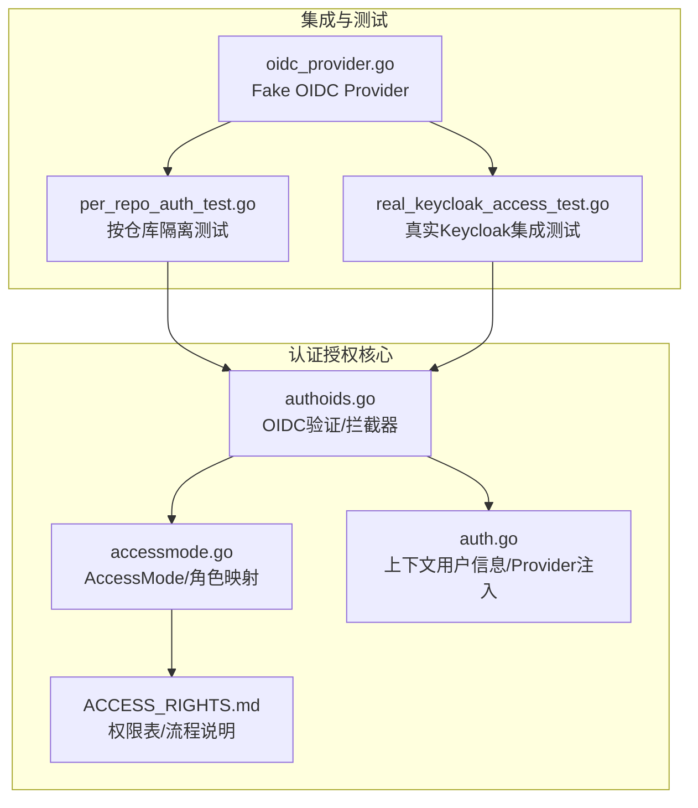
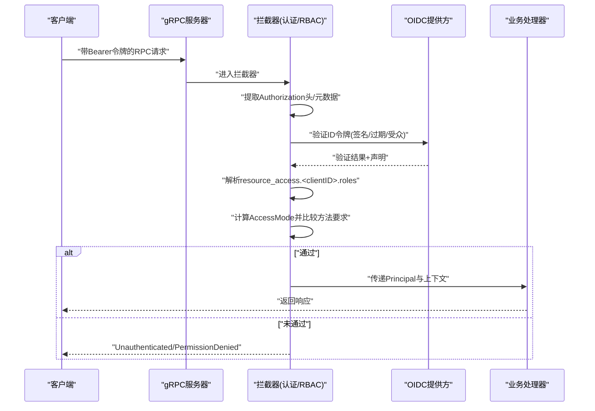
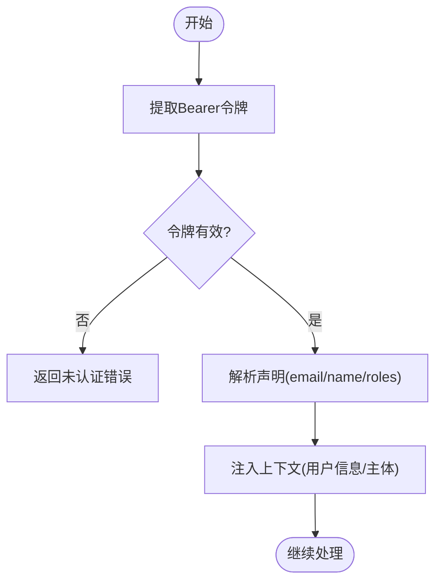
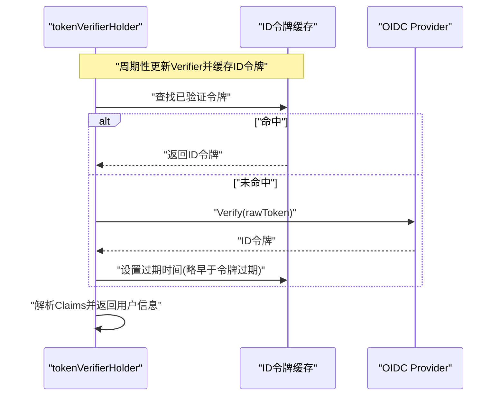
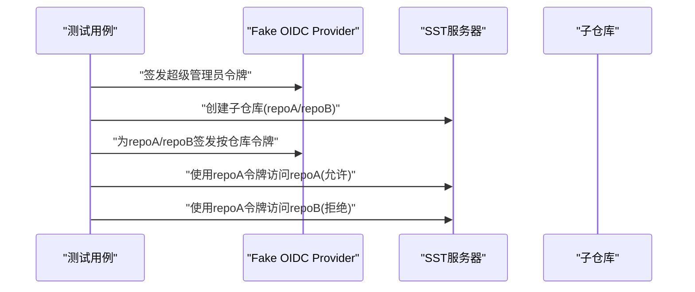
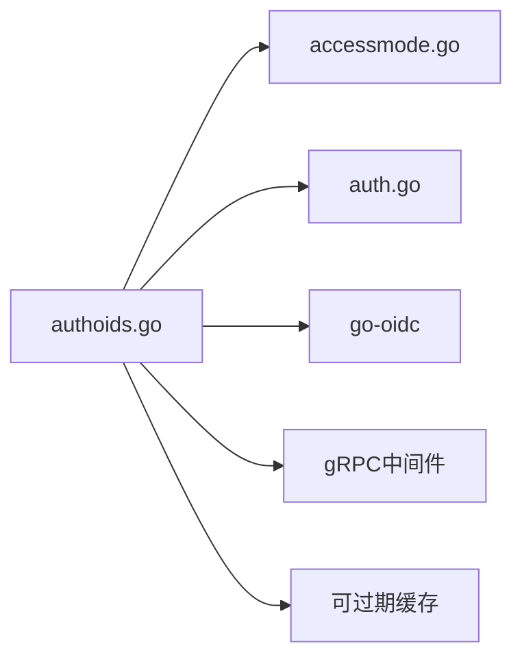

# 认证授权

<cite>
**本文引用的文件**
- [auth.go](file://sstauth/auth.go)
- [accessmode.go](file://sstauth/accessmode.go)
- [authoids.go](file://sstauth/authoids.go)
- [ACCESS_RIGHTS.md](file://sstauth/ACCESS_RIGHTS.md)
- [doc.go](file://sstauth/doc.go)
- [per_repo_auth_test.go](file://sst_test/per_repo_auth_test.go)
- [real_keycloak_access_test.go](file://sst_test/real_keycloak_access_test.go)
- [oidc_provider.go](file://sst_test/testutil/oidc_provider.go)
</cite>

## 目录
1. [简介](#简介)
2. [项目结构](#项目结构)
3. [核心组件](#核心组件)
4. [架构总览](#架构总览)
5. [详细组件分析](#详细组件分析)
6. [依赖关系分析](#依赖关系分析)
7. [性能考虑](#性能考虑)
8. [故障排查指南](#故障排查指南)
9. [结论](#结论)
10. [附录](#附录)

## 简介
本文件面向SST认证与授权系统，系统性说明基于OAuth2/OIDC的认证流程、细粒度访问控制模型（AccessMode）、按仓库隔离的权限策略、OIDC令牌验证与缓存机制、方法级RBAC拦截器、以及审计与合规建议。文档同时提供实际集成示例与最佳实践，帮助读者在单仓库服务器与超级仓库（SuperRepository）两种模式下正确配置和使用认证授权能力。

## 项目结构
SST的认证授权能力集中在 sstauth 包中，并通过gRPC拦截器与HTTP中间件接入服务层；测试用例展示了端到端集成方式。



**图示来源**
- [authoids.go:58-140](file://sstauth/authoids.go#L58-L140)
- [accessmode.go:7-129](file://sstauth/accessmode.go#L7-L129)
- [auth.go:9-53](file://sstauth/auth.go#L9-L53)
- [ACCESS_RIGHTS.md:52-128](file://sstauth/ACCESS_RIGHTS.md#L52-L128)
- [per_repo_auth_test.go:23-190](file://sst_test/per_repo_auth_test.go#L23-L190)
- [real_keycloak_access_test.go:33-131](file://sst_test/real_keycloak_access_test.go#L33-L131)
- [oidc_provider.go:26-129](file://sst_test/testutil/oidc_provider.go#L26-L129)

**章节来源**
- [doc.go:1-6](file://sstauth/doc.go#L1-L6)
- [ACCESS_RIGHTS.md:1-128](file://sstauth/ACCESS_RIGHTS.md#L1-L128)

## 核心组件
- 认证提供者接口与上下文注入：定义统一的AuthProvider接口，支持将认证信息注入到请求上下文中，便于后续处理逻辑获取当前用户身份。
- 访问模式与角色映射：以有序整数表示的AccessMode，结合从OIDC令牌中提取的角色列表，推导最终访问级别。
- OIDC令牌验证与缓存：通过go-oidc库进行签名校验、过期检查，并缓存已验证的ID令牌以提升性能。
- gRPC/HTTP拦截器：对Unary和Stream RPC分别实现鉴权与RBAC检查，支持单仓库与按仓库隔离两种模式。
- 权限表与方法级控制：为各gRPC方法定义最小所需AccessMode，拦截器据此拒绝越权调用。

**章节来源**
- [auth.go:9-53](file://sstauth/auth.go#L9-L53)
- [accessmode.go:7-129](file://sstauth/accessmode.go#L7-L129)
- [authoids.go:58-140](file://sstauth/authoids.go#L58-L140)
- [authoids.go:206-288](file://sstauth/authoids.go#L206-L288)
- [authoids.go:375-510](file://sstauth/authoids.go#L375-L510)
- [ACCESS_RIGHTS.md:240-360](file://sstauth/ACCESS_RIGHTS.md#L240-L360)

## 架构总览
下图展示客户端携带OIDC令牌发起gRPC调用时，服务端拦截器的认证与授权流程，包括令牌提取、验证、受众校验、角色解析与方法级权限检查。



**图示来源**
- [authoids.go:58-140](file://sstauth/authoids.go#L58-L140)
- [authoids.go:206-288](file://sstauth/authoids.go#L206-L288)
- [authoids.go:375-510](file://sstauth/authoids.go#L375-L510)

## 详细组件分析

### OAuth2/OIDC认证流程
- 客户端获取OIDC访问令牌或ID令牌，并在每次gRPC调用中通过metadata或HTTP Authorization头携带。
- 服务端拦截器从请求中提取令牌，使用配置的Issuer创建OIDC Provider并构造Verifier（跳过默认ClientID检查，由拦截器自行校验受众）。
- 验证通过后，解析声明（如email/name），并将身份信息注入上下文，供后续处理使用。



**图示来源**
- [authoids.go:58-140](file://sstauth/authoids.go#L58-L140)
- [authoids.go:206-288](file://sstauth/authoids.go#L206-L288)
- [auth.go:25-53](file://sstauth/auth.go#L25-L53)

**章节来源**
- [authoids.go:58-140](file://sstauth/authoids.go#L58-L140)
- [authoids.go:206-288](file://sstauth/authoids.go#L206-L288)
- [auth.go:25-53](file://sstauth/auth.go#L25-L53)

### 细粒度访问控制模型与权限定义
- AccessMode为有序整数，值越大权限越宽泛：None < ReadOnly < ReadWrite < Admin < SuperAdmin。
- 从OIDC令牌中的resource_access.<clientID>.roles读取角色列表，通过AccessModeFromRoles推导最高AccessMode。
- 方法级RBAC：为每个gRPC方法定义最低所需AccessMode，拦截器比较用户模式与要求模式决定是否放行。

```mermaid
classDiagram
class AccessMode {
+String() string
+MarshalText() []byte
+UnmarshalText(text) error
}
class KCClaims {
+Email string
+Name string
+ResourceAccess map[string]struct{ Roles []string }
}
class RBAC {
+AccessModeForClientID(claims, clientID) AccessMode
+HasAccess(userMode, requiredMode) bool
}
RBAC --> AccessMode : "比较/推导"
RBAC --> KCClaims : "解析角色"
```

**图示来源**
- [accessmode.go:7-129](file://sstauth/accessmode.go#L7-L129)
- [authoids.go:235-253](file://sstauth/authoids.go#L235-L253)
- [authoids.go:327-336](file://sstauth/authoids.go#L327-L336)

**章节来源**
- [accessmode.go:7-129](file://sstauth/accessmode.go#L7-L129)
- [ACCESS_RIGHTS.md:13-49](file://sstauth/ACCESS_RIGHTS.md#L13-L49)
- [ACCESS_RIGHTS.md:240-360](file://sstauth/ACCESS_RIGHTS.md#L240-L360)

### 访问模式（AccessMode）的配置与使用
- 配置来源：Keycloak客户端角色映射至resource_access.<clientID>.roles。
- 使用方式：拦截器根据请求目标（单仓库或按仓库）确定clientID，解析角色并计算AccessMode，再与方法要求比较。
- 兼容模式：PerRepoAuth=false时，所有方法均使用服务器ClientID；PerRepoAuth=true时，除管理方法外，其他方法使用<superClientID>#<repoName>作为受众。

**章节来源**
- [ACCESS_RIGHTS.md:130-171](file://sstauth/ACCESS_RIGHTS.md#L130-L171)
- [ACCESS_RIGHTS.md:173-238](file://sstauth/ACCESS_RIGHTS.md#L173-L238)
- [authoids.go:375-510](file://sstauth/authoids.go#L375-L510)

### OIDC令牌的处理与验证机制
- 令牌验证：使用go-oidc的Verifier对ID令牌进行签名与过期校验；为提升性能，采用可过期缓存存储已验证的ID令牌。
- 受众校验：拦截器手动校验aud是否包含期望的clientID（单仓库或按仓库），确保令牌仅用于目标服务。
- 声明解析：提取email/name用于提交信息与审计；解析resource_access获取角色。



**图示来源**
- [authoids.go:151-198](file://sstauth/authoids.go#L151-L198)
- [authoids.go:206-288](file://sstauth/authoids.go#L206-L288)

**章节来源**
- [authoids.go:151-198](file://sstauth/authoids.go#L151-L198)
- [authoids.go:206-288](file://sstauth/authoids.go#L206-L288)

### 权限检查的实现方法与性能优化
- 实现方法：
  - UnaryRPC：拦截器在调用处理器前完成受众与角色检查。
  - StreamRPC：先做初步认证与受众范围检查，具体按仓库的受众与角色在处理器读取首条消息后通过CheckRepoAccess执行。
- 性能优化：
  - ID令牌缓存：避免重复网络校验，减少延迟。
  - 周期性刷新Verifier：降低发现文档拉取开销。
  - 最小化角色解析：仅在必要时解析resource_access。

**章节来源**
- [authoids.go:375-510](file://sstauth/authoids.go#L375-L510)
- [authoids.go:255-288](file://sstauth/authoids.go#L255-L288)

### 实际认证集成示例
- 单元测试演示了按仓库隔离的完整流程：使用超级管理员令牌创建子仓库，为每个子仓库颁发独立受众的令牌，并验证读/写/搜索权限隔离。
- 真实Keycloak集成测试展示了从环境配置、获取令牌、连接服务器到执行读写操作的端到端路径。



**图示来源**
- [per_repo_auth_test.go:23-190](file://sst_test/per_repo_auth_test.go#L23-L190)
- [oidc_provider.go:26-129](file://sst_test/testutil/oidc_provider.go#L26-L129)

**章节来源**
- [per_repo_auth_test.go:23-190](file://sst_test/per_repo_auth_test.go#L23-L190)
- [real_keycloak_access_test.go:33-131](file://sst_test/real_keycloak_access_test.go#L33-L131)
- [oidc_provider.go:167-236](file://sst_test/testutil/oidc_provider.go#L167-L236)

### 审计日志与合规性要求
- 审计要点：
  - 记录每次调用的用户标识（email/name）与操作类型（读/写/管理）。
  - 记录受众与角色信息，便于追踪权限来源。
  - 记录失败原因（未认证/权限不足），辅助安全事件分析。
- 合规建议：
  - 严格限制令牌受众，确保仅目标服务可消费。
  - 定期轮换密钥与证书，启用最小权限原则。
  - 对敏感操作（删除仓库、配额变更）实施强审计与审批流。

[本节为通用指导，不直接分析具体文件]

## 依赖关系分析
- 外部依赖：
  - go-oidc：OIDC发现与ID令牌验证。
  - gRPC中间件：用于提取Authorization元数据与统一错误码。
  - 可过期缓存：缓存已验证的ID令牌，减少网络开销。
- 内部依赖：
  - sstauth包内模块相互协作：authoids负责验证与拦截，accessmode负责权限推导，auth提供上下文注入。



**图示来源**
- [authoids.go:5-23](file://sstauth/authoids.go#L5-L23)
- [authoids.go:151-198](file://sstauth/authoids.go#L151-L198)
- [accessmode.go:7-129](file://sstauth/accessmode.go#L7-L129)
- [auth.go:9-53](file://sstauth/auth.go#L9-L53)

**章节来源**
- [authoids.go:5-23](file://sstauth/authoids.go#L5-L23)
- [authoids.go:151-198](file://sstauth/authoids.go#L151-L198)

## 性能考虑
- 令牌缓存：合理设置缓存大小与过期时间，避免频繁网络校验。
- 拦截器开销：尽量在拦截器早期拒绝无效请求，减少后续处理成本。
- 并发安全：使用原子值与互斥更新维护Verifier实例，避免竞争条件。
- 流式RPC：在首条消息后进行精确权限检查，平衡认证时机与性能。

[本节为通用指导，不直接分析具体文件]

## 故障排查指南
- 常见错误：
  - 未认证：缺少Authorization头或令牌格式不正确。
  - 权限不足：令牌受众不匹配或角色不足以访问目标方法。
  - 受众错误：按仓库模式下使用了错误的clientID。
- 排查步骤：
  - 检查Issuer与ClientID配置是否正确。
  - 确认令牌aud包含期望的clientID。
  - 查看resource_access.<clientID>.roles是否包含所需角色。
  - 对于流式RPC，确认处理器在读取首条消息后调用CheckRepoAccess。

**章节来源**
- [authoids.go:58-140](file://sstauth/authoids.go#L58-L140)
- [authoids.go:375-510](file://sstauth/authoids.go#L375-L510)
- [ACCESS_RIGHTS.md:52-128](file://sstauth/ACCESS_RIGHTS.md#L52-L128)

## 结论
SST的认证授权体系以OIDC为核心，结合细粒度的AccessMode与方法级RBAC，支持单仓库与按仓库隔离两种模式。通过拦截器与缓存机制，系统在安全性与性能之间取得良好平衡。遵循本文的最佳实践与安全建议，可有效保障SST服务的安全性与合规性。

[本节为总结性内容，不直接分析具体文件]

## 附录
- 配置建议：
  - 单仓库服务器：PerRepoAuth=false，令牌aud为服务器ClientID。
  - 超级仓库服务器：PerRepoAuth=true，管理方法使用超级ClientID，其他方法使用<superClientID>#<repoName>。
- 角色命名约定：
  - 使用read-only/read-write/admin/super-admin等关键词，便于角色解析。
- 参考文档：
  - 权限表与方法要求详见ACCESS_RIGHTS.md。

**章节来源**
- [ACCESS_RIGHTS.md:130-238](file://sstauth/ACCESS_RIGHTS.md#L130-L238)
- [ACCESS_RIGHTS.md:240-360](file://sstauth/ACCESS_RIGHTS.md#L240-L360)