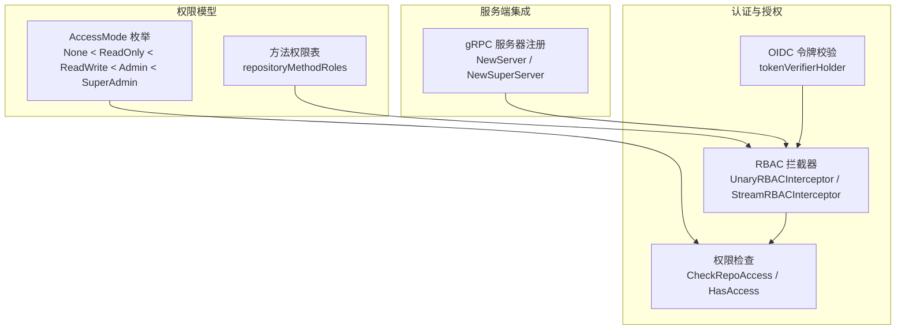
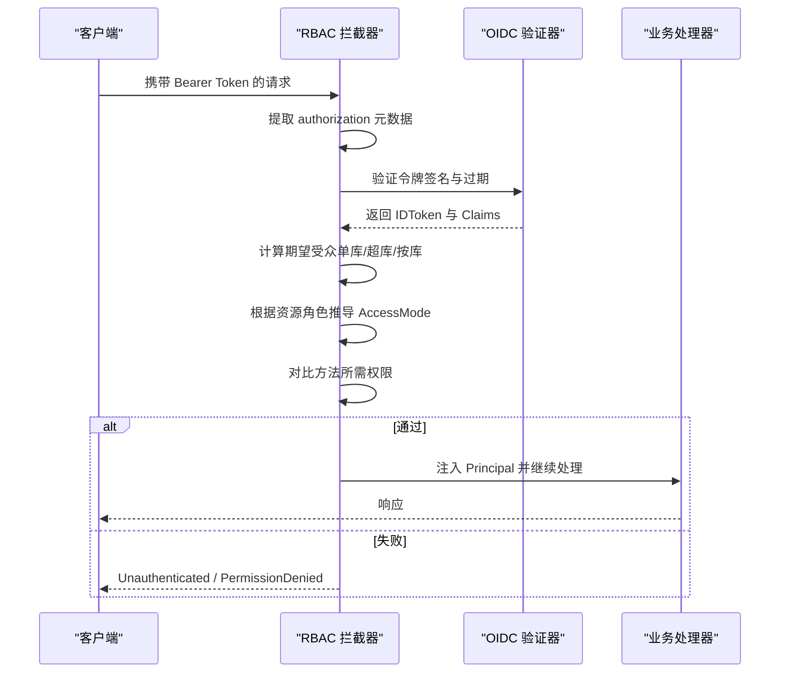
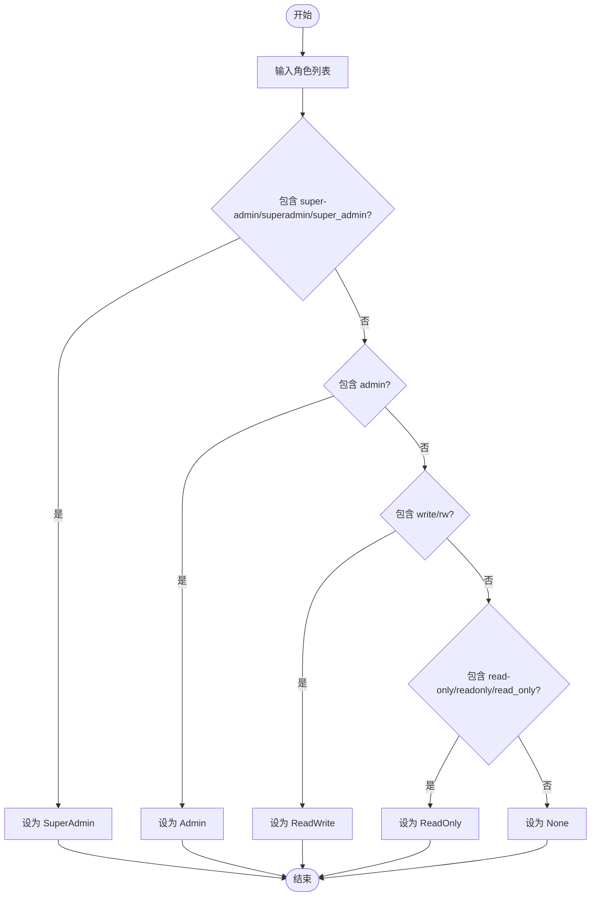
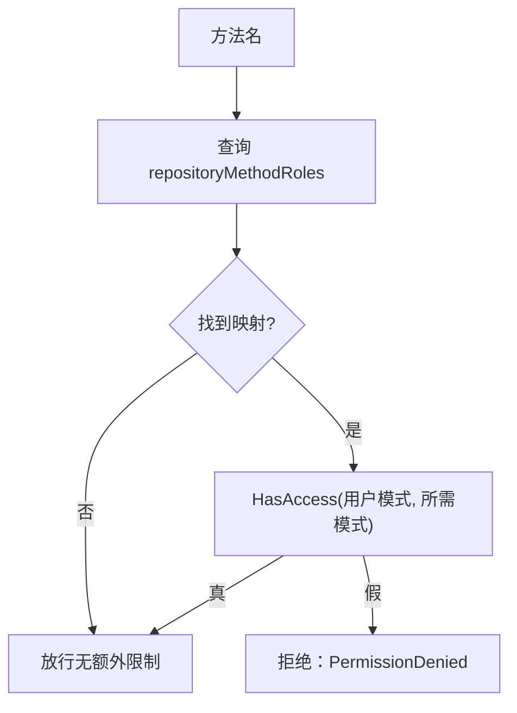
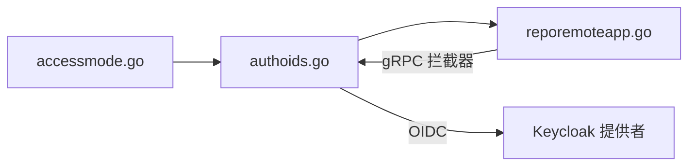

# 访问控制

<cite>
**本文引用的文件**
- [accessmode.go](file://sstauth/accessmode.go)
- [ACCESS_RIGHTS.md](file://sstauth/ACCESS_RIGHTS.md)
- [authoids.go](file://sstauth/authoids.go)
- [reporemoteapp.go](file://sst/reporemoteapp.go)
- [accessmode_test.go](file://sstauth/accessmode_test.go)
- [authoids_test.go](file://sstauth/authoids_test.go)
</cite>

## 目录
1. [简介](#简介)
2. [项目结构](#项目结构)
3. [核心组件](#核心组件)
4. [架构总览](#架构总览)
5. [详细组件分析](#详细组件分析)
6. [依赖关系分析](#依赖关系分析)
7. [性能考量](#性能考量)
8. [故障排查指南](#故障排查指南)
9. [结论](#结论)
10. [附录](#附录)

## 简介
本文件系统性地梳理 SST 的细粒度访问控制能力，覆盖 AccessMode 枚举与权限级别、基于角色的访问控制（RBAC）模型、gRPC 方法级权限表、认证与授权流程、权限检查实现与性能优化、权限继承与组合模式、配置最佳实践，以及测试用例与审计日志建议。文档面向不同技术背景的读者，提供从概念到代码级的完整说明。

## 项目结构
访问控制相关代码主要位于 sstauth 包，并在 sst 层通过 gRPC 拦截器与方法权限表进行集成：
- sstauth/accessmode.go：定义 AccessMode 枚举、解析与比较逻辑
- sstauth/authoids.go：OIDC 令牌校验、RBAC 拦截器、权限检查辅助函数
- sstauth/ACCESS_RIGHTS.md：权限模型、方法权限表、Keycloak 配置与使用指南
- sst/reporemoteapp.go：维护 gRPC 方法与最小权限映射（repositoryMethodRoles）
- 测试文件：验证权限推导、方法权限检查等关键行为



图表来源
- [authoids.go:152-198](file://sstauth/authoids.go#L152-L198)
- [authoids.go:375-423](file://sstauth/authoids.go#L375-L423)
- [authoids.go:445-510](file://sstauth/authoids.go#L445-L510)
- [accessmode.go:11-36](file://sstauth/accessmode.go#L11-L36)
- [reporemoteapp.go:41-97](file://sst/reporemoteapp.go#L41-L97)

章节来源
- [accessmode.go:11-36](file://sstauth/accessmode.go#L11-L36)
- [authoids.go:375-423](file://sstauth/authoids.go#L375-L423)
- [authoids.go:445-510](file://sstauth/authoids.go#L445-L510)
- [reporemoteapp.go:41-97](file://sst/reporemoteapp.go#L41-L97)

## 核心组件
- AccessMode 枚举：定义权限层级，支持字符串序列化/反序列化与解析，提供最高权限推导与比较
- OIDC 令牌校验与缓存：周期性更新验证器，LRU 缓存已验证令牌，减少外部调用开销
- RBAC 拦截器：对 unary 和 streaming RPC 分别进行鉴权与权限检查
- 方法权限表：将 gRPC 方法名映射到最小所需 AccessMode
- 权限检查辅助：按客户端 ID 推导有效权限并比较

章节来源
- [accessmode.go:11-129](file://sstauth/accessmode.go#L11-L129)
- [authoids.go:206-288](file://sstauth/authoids.go#L206-L288)
- [authoids.go:375-423](file://sstauth/authoids.go#L375-L423)
- [authoids.go:445-510](file://sstauth/authoids.go#L445-L510)
- [reporemoteapp.go:41-97](file://sst/reporemoteapp.go#L41-L97)

## 架构总览
下图展示一次远程仓库调用的认证与授权流程，包括令牌提取、OIDC 校验、受众与角色检查、方法级权限比对，以及流式请求的特殊处理。



图表来源
- [authoids.go:290-312](file://sstauth/authoids.go#L290-L312)
- [authoids.go:375-423](file://sstauth/authoids.go#L375-L423)
- [authoids.go:445-510](file://sstauth/authoids.go#L445-L510)

## 详细组件分析

### AccessMode 与权限级别
- 层级顺序：None < ReadOnly < ReadWrite < Admin < SuperAdmin
- 语义说明：
  - None：无访问
  - ReadOnly：读取数据集、提交、引用、Bleve 搜索等
  - ReadWrite：读 + 写数据集、提交、分支更新、同步等
  - Admin：读写 + 管理操作（如分支管理、用户角色映射、仓库维护）
  - SuperAdmin：超级仓库级操作（创建/删除仓库、跨仓库配额管理等）
- 工具函数：
  - ParseAccessMode：字符串到枚举的解析，兼容多种命名风格
  - AccessModeFromRoles：从角色列表推导最高权限
  - HasAccess：比较用户权限是否满足要求



图表来源
- [accessmode.go:100-123](file://sstauth/accessmode.go#L100-L123)

章节来源
- [accessmode.go:11-129](file://sstauth/accessmode.go#L11-L129)
- [ACCESS_RIGHTS.md:13-29](file://sstauth/ACCESS_RIGHTS.md#L13-L29)

### RBAC 拦截器与权限检查
- UnaryRBACInterceptor：
  - 从 gRPC 元数据提取 Bearer Token
  - 使用 OIDC 验证器校验令牌
  - 根据 perRepoAuth 与请求中的 RepoName 计算期望受众
  - 从 Claims 中读取角色并推导 AccessMode
  - 对照 repositoryMethodRoles 进行方法级权限检查
  - 通过后将 Principal 注入上下文并调用处理器
- StreamRBACInterceptor：
  - 先做基础鉴权与受众范围检查（允许超库或任意按库受众）
  - 若 token 仅针对按库受众，则方法级权限在处理器内通过 CheckRepoAccess 完成
  - 将 Principal 注入流上下文后交给处理器

```mermaid
classDiagram
class Principal {
+string Email
+string Name
+KCClaims Claims
+[]string Audience
}
class KCClaims {
+string Email
+string Name
+map~string,struct{roles[]} ResourceAccess
}
class tokenVerifierHolder {
-atomic.Value value
-time.Ticker updateTicker
}
class tokenVerifier {
-error err
-IDTokenVerifier verifier
-Cache tokenCache
}
Principal --> KCClaims : "持有"
tokenVerifierHolder --> tokenVerifier : "周期更新"
```

图表来源
- [authoids.go:235-243](file://sstauth/authoids.go#L235-L243)
- [authoids.go:425-443](file://sstauth/authoids.go#L425-L443)
- [authoids.go:200-204](file://sstauth/authoids.go#L200-L204)

章节来源
- [authoids.go:375-423](file://sstauth/authoids.go#L375-L423)
- [authoids.go:445-510](file://sstauth/authoids.go#L445-L510)
- [authoids.go:290-312](file://sstauth/authoids.go#L290-L312)

### 方法级权限表（repositoryMethodRoles）
- 将每个 gRPC 方法映射到最小所需 AccessMode
- 典型分组：
  - RepoManagerService：全部需要 SuperAdmin
  - DatasetService（读）：ReadOnly
  - DatasetService（写）：ReadWrite
  - RefService：ReadOnly
  - CommitService：读为 ReadOnly，创建提交为 ReadWrite
  - IndexService/Search：ReadOnly



图表来源
- [reporemoteapp.go:41-97](file://sst/reporemoteapp.go#L41-L97)
- [accessmode.go:125-129](file://sstauth/accessmode.go#L125-L129)

章节来源
- [reporemoteapp.go:41-97](file://sst/reporemoteapp.go#L41-L97)
- [ACCESS_RIGHTS.md:240-313](file://sstauth/ACCESS_RIGHTS.md#L240-L313)

### 基于角色的访问控制（RBAC）模型
- 角色来源：OIDC ID Token 的 resource_access.<clientID>.roles
- 两种授权模型：
  - 单仓库服务器（PerRepoAuth = false）：令牌受众必须等于服务器 ClientID
  - 超级仓库服务器（PerRepoAuth = true）：管理方法使用超库受众；其他方法使用按库受众 <superClientID>#<repoName>
- 流式请求的特殊性：目标仓库名在首条消息中到达，因此精确的受众与角色检查在处理器内通过 CheckRepoAccess 完成

章节来源
- [ACCESS_RIGHTS.md:130-171](file://sstauth/ACCESS_RIGHTS.md#L130-L171)
- [authoids.go:338-373](file://sstauth/authoids.go#L338-L373)

### 权限继承与组合
- 继承：AccessMode 为有序整数，更高值包含更低值的权限，例如 SuperAdmin >= Admin >= ReadWrite >= ReadOnly
- 组合：AccessModeFromRoles 从多个角色中推导最高权限，支持“read-only”、“write/rw”、“admin”、“super-admin”等关键词组合

章节来源
- [accessmode.go:11-36](file://sstauth/accessmode.go#L11-L36)
- [accessmode.go:100-123](file://sstauth/accessmode.go#L100-L123)

### 权限检查的代码示例与测试用例
- 示例路径（不直接粘贴代码，仅提供路径）：
  - 方法权限映射定义：[reporemoteapp.go:41-97](file://sst/reporemoteapp.go#L41-L97)
  - 单库/超库受众推导与检查：[authoids.go:375-423](file://sstauth/authoids.go#L375-L423)
  - 流式请求后续检查：[authoids.go:445-510](file://sstauth/authoids.go#L445-L510)
  - 按库受众与角色检查：[authoids.go:338-373](file://sstauth/authoids.go#L338-L373)
- 测试用例：
  - 权限推导与比较：[accessmode_test.go:7-53](file://sstauth/accessmode_test.go#L7-L53)
  - 按库权限检查与错误场景：[authoids_test.go:60-181](file://sstauth/authoids_test.go#L60-L181)

章节来源
- [accessmode_test.go:7-53](file://sstauth/accessmode_test.go#L7-L53)
- [authoids_test.go:60-181](file://sstauth/authoids_test.go#L60-L181)

### 权限审计与日志记录机制
- 当前实现未内置统一的权限审计日志模块
- 建议在拦截器中记录以下信息以支持审计：
  - 时间戳、客户端 IP、方法名、仓库名、用户邮箱/名称、受众、角色、结果（允许/拒绝）、拒绝原因
- 可结合现有 Principal 与错误码输出结构化日志，便于后续接入集中式日志系统

[本节为通用建议，不直接分析具体文件]

## 依赖关系分析
- sstauth 包内部依赖：
  - accessmode.go 被 authoids.go 引用用于权限推导与比较
  - authoids.go 提供 OIDC 校验、RBAC 拦截器与权限检查
- sst 层依赖：
  - reporemoteapp.go 定义 repositoryMethodRoles 并注入到拦截器中
- 外部依赖：
  - OIDC 提供者（Keycloak）用于令牌签发与验证
  - gRPC 中间件用于提取与传递认证信息



图表来源
- [accessmode.go:11-129](file://sstauth/accessmode.go#L11-L129)
- [authoids.go:206-288](file://sstauth/authoids.go#L206-L288)
- [reporemoteapp.go:41-97](file://sst/reporemoteapp.go#L41-L97)

章节来源
- [accessmode.go:11-129](file://sstauth/accessmode.go#L11-L129)
- [authoids.go:206-288](file://sstauth/authoids.go#L206-L288)
- [reporemoteapp.go:41-97](file://sst/reporemoteapp.go#L41-L97)

## 性能考量
- 令牌验证器周期性更新：避免频繁初始化 OIDC Provider，降低网络与解析开销
- 令牌缓存：使用 LRU 缓存已验证的 IDToken，减少重复验证
- 方法级权限检查：基于 map 查找与整数比较，复杂度 O(1)，开销极低
- 流式请求延迟检查：仅在首条消息后执行精确受众与角色检查，减少不必要的早期拒绝

章节来源
- [authoids.go:25-33](file://sstauth/authoids.go#L25-L33)
- [authoids.go:152-198](file://sstauth/authoids.go#L152-L198)
- [authoids.go:268-288](file://sstauth/authoids.go#L268-L288)
- [authoids.go:445-510](file://sstauth/authoids.go#L445-L510)

## 故障排查指南
- 常见错误与定位：
  - Unauthenticated：缺少或无效令牌、格式错误、过期
  - PermissionDenied：受众不匹配、角色不足、方法权限不够
- 排查步骤：
  - 确认令牌 audience 与服务器配置的 ClientID 或按库受众一致
  - 检查 Keycloak 客户端角色映射是否正确填充 resource_access.<clientID>.roles
  - 核对 repositoryMethodRoles 中对应方法的最低权限要求
  - 对于流式请求，确保处理器在读取首条消息后调用 CheckRepoAccess
- 参考测试用例：
  - 缺失主体时的错误：[authoids_test.go:170-181](file://sstauth/authoids_test.go#L170-L181)
  - 受众与角色不匹配的错误：[authoids_test.go:88-167](file://sstauth/authoids_test.go#L88-L167)

章节来源
- [authoids_test.go:88-181](file://sstauth/authoids_test.go#L88-L181)

## 结论
SST 的访问控制系统以 AccessMode 为核心，结合 OIDC 令牌与 RBAC 拦截器，实现了细粒度的方法级权限控制。通过有序权限层级与角色推导，既保证了安全性又兼顾了易用性。配合 Keycloak 的角色映射与受众策略，可在单仓库与超级仓库两种模式下灵活部署。建议在生产环境中补充统一的权限审计日志，以便追踪与合规。

## 附录

### 权限配置的最佳实践
- 最小权限原则：为每个客户端分配刚好足够的角色
- 明确受众：单仓库服务器使用固定 ClientID；超级仓库服务器为每个仓库创建按库受众
- 定期审查：清理不再使用的角色与客户端映射
- 服务账户：启用服务账户角色并使用客户端凭证获取令牌
- 多仓库访问：为客户端添加多个受众协议映射，并启用“添加到访问令牌”

章节来源
- [ACCESS_RIGHTS.md:173-238](file://sstauth/ACCESS_RIGHTS.md#L173-L238)

### 权限继承与组合的使用模式
- 继承：利用 AccessMode 的有序特性，高阶权限自然包含低阶权限
- 组合：通过多个角色叠加，由 AccessModeFromRoles 推导最高权限，简化配置

章节来源
- [accessmode.go:11-36](file://sstauth/accessmode.go#L11-L36)
- [accessmode.go:100-123](file://sstauth/accessmode.go#L100-L123)