# LCI词汇表

<cite>
**本文引用的文件**
- [vocabularies/lci/vocabulary.go](file://vocabularies/lci/vocabulary.go)
- [vocabularies/lci/doc.go](file://vocabularies/lci/doc.go)
- [sst/testdata/lci-test1.ttl](file://sst/testdata/lci-test1.ttl)
- [sst/testdata/lci-test2.ttl](file://sst/testdata/lci-test2.ttl)
- [examples/helloworldreadsst/helloworldreadsst.go](file://examples/helloworldreadsst/helloworldreadsst.go)
- [sst_test/ephemeralStageBasic_test.go](file://sst_test/ephemeralStageBasic_test.go)
- [sst_test/syncfrom_test.go](file://sst_test/syncfrom_test.go)
</cite>

## 目录
1. [简介](#简介)
2. [项目结构](#项目结构)
3. [核心组件](#核心组件)
4. [架构总览](#架构总览)
5. [详细组件分析](#详细组件分析)
6. [依赖关系分析](#依赖关系分析)
7. [性能考虑](#性能考虑)
8. [故障排查指南](#故障排查指南)
9. [结论](#结论)
10. [附录](#附录)

## 简介
本文件面向生命周期评估（LCA）与环境数据分析场景，系统性阐述SST中的LCI（Life Cycle Inventory，生命周期清单）词汇表。内容涵盖：
- LCI在生命周期评估与环境数据建模中的作用与价值
- SST中预编译的LCI术语与数据结构
- 核心概念：数据集、流程（过程）、影响类别等
- 在环境建模中的应用示例
- 标准化与互操作性要求
- 与其他领域词汇表的集成方法
- 查询与分析模式
- 版本管理与更新策略

## 项目结构
SST将LCI作为独立词汇包提供，并通过RDF/OWL语义模型组织术语与关系。关键位置如下：
- vocabularies/lci：LCI词汇定义（由编译器生成），包含类、属性、个体及继承关系
- sst/testdata：包含基于ISO/TS 15926-12的简化版LCI测试TTL文件，用于验证与演示
- examples：展示如何读取SST文件并遍历三元组，便于理解LCI实例的使用方式
- sst_test：包含使用LCI类型进行图构建、导入与同步的测试用例

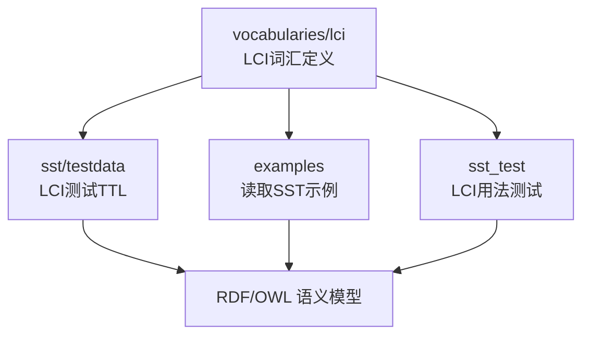

图表来源
- [vocabularies/lci/vocabulary.go:1-23](file://vocabularies/lci/vocabulary.go#L1-L23)
- [sst/testdata/lci-test1.ttl:10-26](file://sst/testdata/lci-test1.ttl#L10-L26)
- [examples/helloworldreadsst/helloworldreadsst.go:30-68](file://examples/helloworldreadsst/helloworldreadsst.go#L30-L68)

章节来源
- [vocabularies/lci/doc.go:1-5](file://vocabularies/lci/doc.go#L1-L5)
- [vocabularies/lci/vocabulary.go:1-23](file://vocabularies/lci/vocabulary.go#L1-L23)
- [sst/testdata/lci-test1.ttl:1-26](file://sst/testdata/lci-test1.ttl#L1-L26)
- [sst/testdata/lci-test2.ttl:1-27](file://sst/testdata/lci-test2.ttl#L1-L27)

## 核心组件
- LCIVocabulary：LCI词汇的基础IRI命名空间，所有LCI术语均在此命名空间下
- 抽象对象与具体个体：如AbstractObject、Thing、Individual等，构成本体顶层分类
- 物质与化学实体：如Matter、SolidBody、ChemicalSubstance、ChemicalCompound、BiologicalMatter等
- 信息对象与格式：如InformationObject、ComputerFile、ComputerFileFormat等
- 数量与时空：如Quantity、ClassOfPhysicalQuantity、PointInTime、PeriodInTime、RegionInSpace等
- 状态与枚举：如Status、ClassOfEnumeratedIndividuals等
- 类层次：Class、ClassOf* 系列，描述“类的类”以支持高阶建模

这些组件通过继承与组合形成完整的LCI本体，支撑生命周期清单建模所需的实体、属性与约束。

章节来源
- [vocabularies/lci/vocabulary.go:25-1200](file://vocabularies/lci/vocabulary.go#L25-L1200)

## 架构总览
LCI词汇在SST中以预编译Go代码形式存在，同时配套RDF/OWL源定义（测试TTL）。应用层通过SST API创建、查询和管理包含LCI类型的三元组数据。下图展示了从词汇到数据再到应用的交互路径。

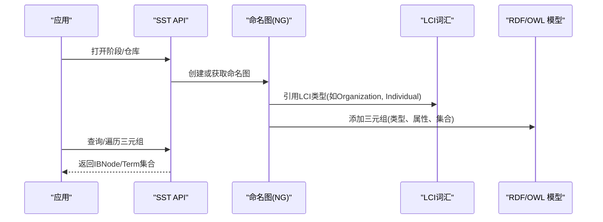

图表来源
- [sst_test/ephemeralStageBasic_test.go:60-91](file://sst_test/ephemeralStageBasic_test.go#L60-L91)
- [examples/helloworldreadsst/helloworldreadsst.go:30-68](file://examples/helloworldreadsst/helloworldreadsst.go#L30-L68)

章节来源
- [sst_test/ephemeralStageBasic_test.go:60-91](file://sst_test/ephemeralStageBasic_test.go#L60-L91)
- [examples/helloworldreadsst/helloworldreadsst.go:30-68](file://examples/helloworldreadsst/helloworldreadsst.go#L30-L68)

## 详细组件分析

### LCI词汇包与命名空间
- 基础IRI：LCIVocabulary.BaseIRI定义了LCI术语的统一命名空间
- 顶层分类：Thing、AbstractObject、Individual等构成本体根节点
- 派生类：大量ClassOf*表示对特定个体的分类能力，支持高阶建模

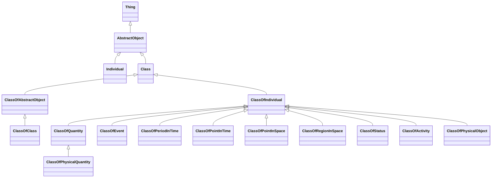

图表来源
- [vocabularies/lci/vocabulary.go:25-1200](file://vocabularies/lci/vocabulary.go#L25-L1200)

章节来源
- [vocabularies/lci/vocabulary.go:25-1200](file://vocabularies/lci/vocabulary.go#L25-L1200)

### 物质与化学实体建模
LCI提供丰富的物质类型，覆盖生物材料、化学元素、化合物、混合物、溶液、复合材料等，适用于生命周期清单中对输入输出物质的精确刻画。

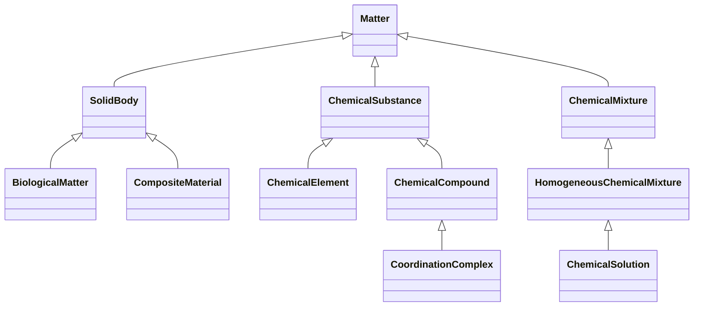

图表来源
- [vocabularies/lci/vocabulary.go:186-432](file://vocabularies/lci/vocabulary.go#L186-L432)
- [vocabularies/lci/vocabulary.go:1018-1194](file://vocabularies/lci/vocabulary.go#L1018-L1194)

章节来源
- [vocabularies/lci/vocabulary.go:186-432](file://vocabularies/lci/vocabulary.go#L186-L432)
- [vocabularies/lci/vocabulary.go:1018-1194](file://vocabularies/lci/vocabulary.go#L1018-L1194)

### 信息对象与文件格式
LCI支持计算机文件及其内容与格式的建模，便于在生命周期清单中关联文档、报告与数据文件。

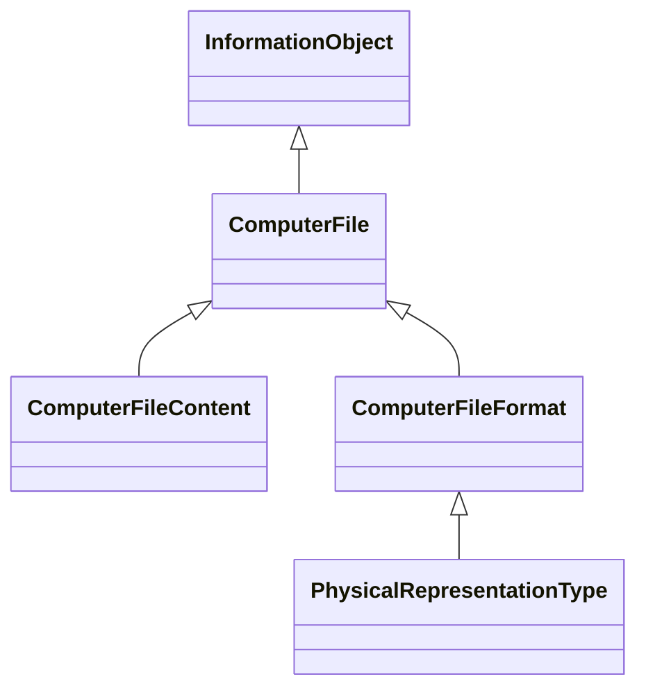

图表来源
- [vocabularies/lci/vocabulary.go:1054-1157](file://vocabularies/lci/vocabulary.go#L1054-L1157)

章节来源
- [vocabularies/lci/vocabulary.go:1054-1157](file://vocabularies/lci/vocabulary.go#L1054-L1157)

### 数量与时空维度
LCI提供数量、物理量、时空点与区域等概念，为生命周期清单中的量化与定位提供基础。

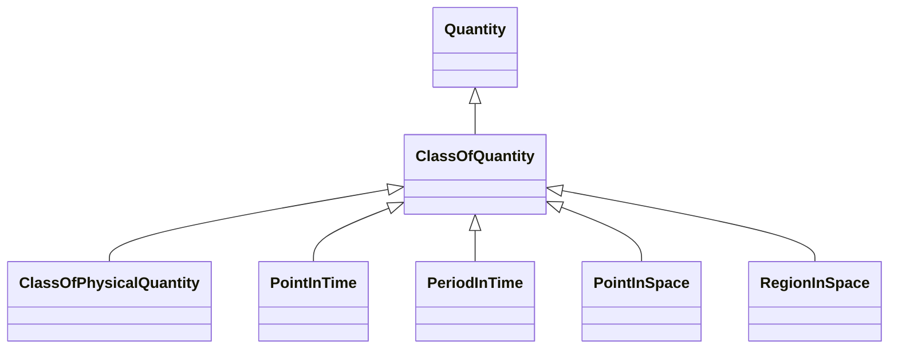

图表来源
- [vocabularies/lci/vocabulary.go:810-980](file://vocabularies/lci/vocabulary.go#L810-L980)

章节来源
- [vocabularies/lci/vocabulary.go:810-980](file://vocabularies/lci/vocabulary.go#L810-L980)

### 活动与事件
LCI包含Activity与Event相关类，可用于表达生命周期过程中的活动与事件，支持时间维度的建模。

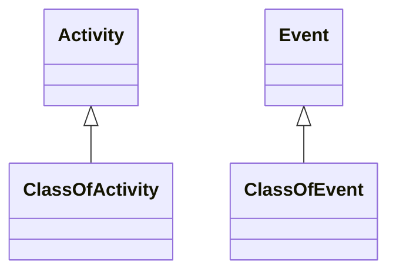

图表来源
- [vocabularies/lci/vocabulary.go:56-87](file://vocabularies/lci/vocabulary.go#L56-L87)
- [vocabularies/lci/vocabulary.go:674-706](file://vocabularies/lci/vocabulary.go#L674-L706)

章节来源
- [vocabularies/lci/vocabulary.go:56-87](file://vocabularies/lci/vocabulary.go#L56-L87)
- [vocabularies/lci/vocabulary.go:674-706](file://vocabularies/lci/vocabulary.go#L674-L706)

### 状态与枚举
LCI提供Status与ClassOfEnumeratedIndividuals，用于表达状态与枚举值，便于在清单中标记物料、过程或数据的状态。

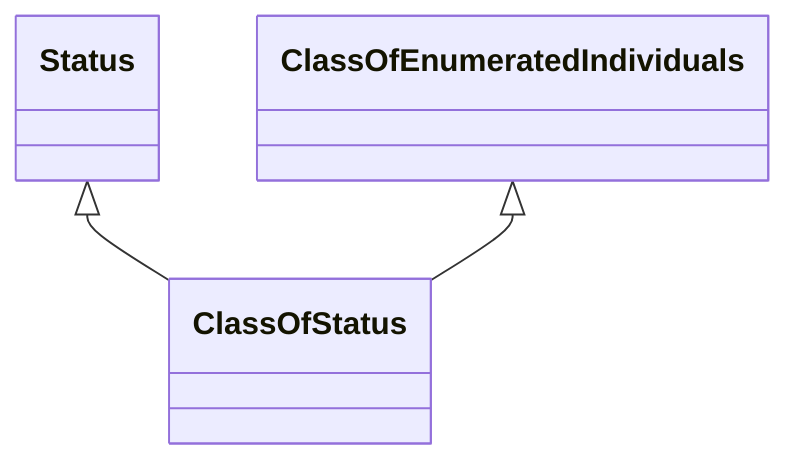

图表来源
- [vocabularies/lci/vocabulary.go:982-1016](file://vocabularies/lci/vocabulary.go#L982-L1016)

章节来源
- [vocabularies/lci/vocabulary.go:982-1016](file://vocabularies/lci/vocabulary.go#L982-L1016)

### 应用示例：在SST中使用LCI类型
以下示例展示了如何在SST中创建命名图、引用LCI类型并添加三元组，随后读取并遍历结果。

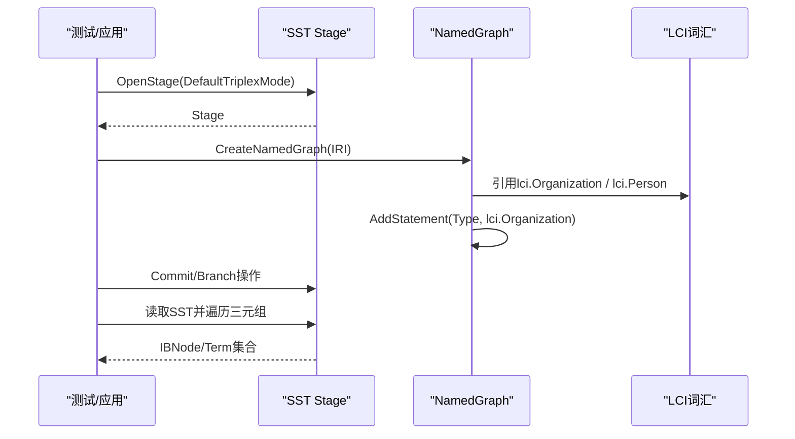

图表来源
- [sst_test/ephemeralStageBasic_test.go:60-91](file://sst_test/ephemeralStageBasic_test.go#L60-L91)
- [examples/helloworldreadsst/helloworldreadsst.go:30-68](file://examples/helloworldreadsst/helloworldreadsst.go#L30-L68)

章节来源
- [sst_test/ephemeralStageBasic_test.go:60-91](file://sst_test/ephemeralStageBasic_test.go#L60-L91)
- [examples/helloworldreadsst/helloworldreadsst.go:30-68](file://examples/helloworldreadsst/helloworldreadsst.go#L30-L68)

### 数据流与处理逻辑：LCI测试TTL
测试TTL文件展示了LCI的简化版本与命名空间约定，以及Ontology版本信息。这有助于理解LCI在SST中的存储与加载方式。

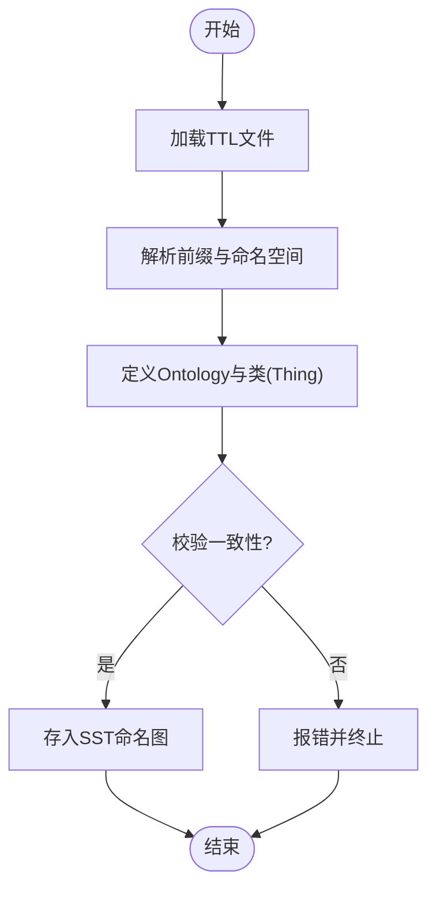

图表来源
- [sst/testdata/lci-test1.ttl:10-26](file://sst/testdata/lci-test1.ttl#L10-L26)
- [sst/testdata/lci-test2.ttl:10-27](file://sst/testdata/lci-test2.ttl#L10-L27)

章节来源
- [sst/testdata/lci-test1.ttl:1-26](file://sst/testdata/lci-test1.ttl#L1-L26)
- [sst/testdata/lci-test2.ttl:1-27](file://sst/testdata/lci-test2.ttl#L1-L27)

## 依赖关系分析
LCI词汇依赖于RDF/RDFS/OWL/XSD等标准词汇，并在SST框架内以预编译Go结构暴露。测试与示例展示了LCI与SST API的耦合方式。

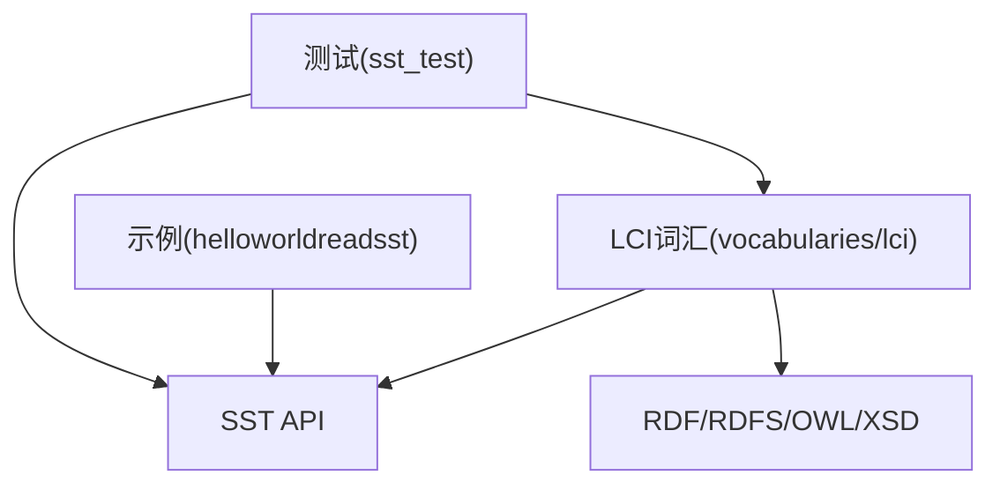

图表来源
- [vocabularies/lci/vocabulary.go:7-14](file://vocabularies/lci/vocabulary.go#L7-L14)
- [examples/helloworldreadsst/helloworldreadsst.go:21-38](file://examples/helloworldreadsst/helloworldreadsst.go#L21-L38)
- [sst_test/ephemeralStageBasic_test.go:60-91](file://sst_test/ephemeralStageBasic_test.go#L60-L91)

章节来源
- [vocabularies/lci/vocabulary.go:7-14](file://vocabularies/lci/vocabulary.go#L7-L14)
- [examples/helloworldreadsst/helloworldreadsst.go:21-38](file://examples/helloworldreadsst/helloworldreadsst.go#L21-L38)
- [sst_test/ephemeralStageBasic_test.go:60-91](file://sst_test/ephemeralStageBasic_test.go#L60-L91)

## 性能考虑
- 预编译词汇：LCI词汇以Go结构预编译，减少运行时解析开销，提升查询与建模效率
- 命名图粒度：按命名图组织LCI三元组，有利于局部更新与增量同步
- 集合与空白节点：合理使用TermCollection与BlankNode可减少重复三元组，提高存储与传输效率
- 索引与搜索：结合Bleve等索引机制可加速LCI术语与实例的检索（参考仓库其他模块）

[本节提供一般性指导，不直接分析具体文件]

## 故障排查指南
- 命名空间不一致：确保TTL与代码中LCI命名空间一致，避免术语无法识别
- 类型不匹配：在创建节点时确认使用的LCI类型与预期一致（如Organization、Individual）
- 导入与同步：在多数据集场景中，注意AddImport与SyncFrom的正确使用，避免数据缺失或冲突
- 版本信息：检查Ontology的versionInfo，确保与期望版本一致

章节来源
- [sst/testdata/lci-test1.ttl:10-26](file://sst/testdata/lci-test1.ttl#L10-L26)
- [sst/testdata/lci-test2.ttl:10-27](file://sst/testdata/lci-test2.ttl#L10-L27)
- [sst_test/syncfrom_test.go:1483-1790](file://sst_test/syncfrom_test.go#L1483-L1790)

## 结论
SST中的LCI词汇表提供了完整且可扩展的生命周期清单建模能力，覆盖物质、活动、数量、时空、状态等关键概念。通过预编译Go结构与RDF/OWL语义模型，SST实现了高效的数据存储、查询与同步。结合示例与测试，用户可以在环境建模中灵活使用LCI术语，满足标准化与互操作性需求。

[本节总结性内容，不直接分析具体文件]

## 附录

### LCI在生命周期评估与环境数据分析中的作用
- 支持对输入输出物质、能量与排放的精确建模
- 为影响评估提供结构化数据基础
- 促进跨领域数据共享与复用

[本节为概念性内容，不直接分析具体文件]

### 标准化与互操作性要求
- 遵循RDF/OWL标准，确保语义一致性
- 使用统一命名空间与版本控制
- 支持与外部词汇表（如单位、地区、货币等）集成

[本节为概念性内容，不直接分析具体文件]

### 与其他领域词汇表的集成方法
- 通过RDF命名空间前缀引入外部词汇
- 在LCI实例中引用外部术语（如单位、地点）
- 利用SST的命名图与导入机制实现模块化集成

[本节为概念性内容，不直接分析具体文件]

### 查询与分析模式
- 基于SST API遍历三元组，筛选LCI类型与属性
- 使用集合与空白节点表达复杂关系
- 结合索引进行快速检索与聚合分析

[本节为概念性内容，不直接分析具体文件]

### 版本管理与更新策略
- 在TTL中声明Ontology版本信息
- 通过分支与提交管理LCI词汇变更
- 在同步过程中记录受影响的数据集与作者信息

章节来源
- [sst/testdata/lci-test1.ttl:20-22](file://sst/testdata/lci-test1.ttl#L20-L22)
- [sst/testdata/lci-test2.ttl:20-22](file://sst/testdata/lci-test2.ttl#L20-L22)
- [sst_test/syncfrom_test.go:1495-1519](file://sst_test/syncfrom_test.go#L1495-L1519)