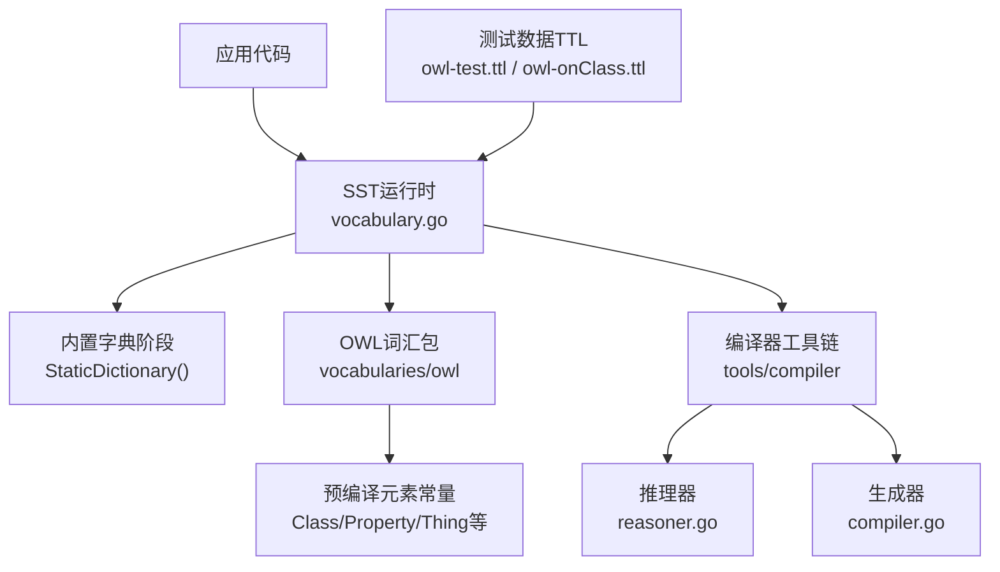
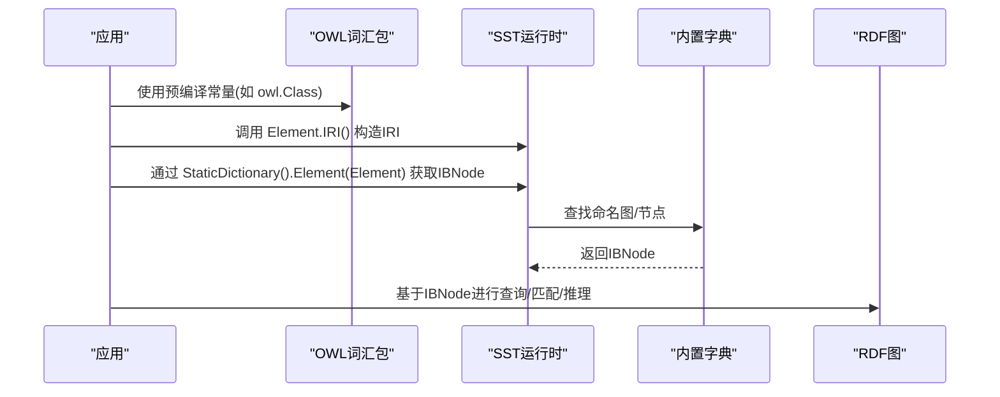
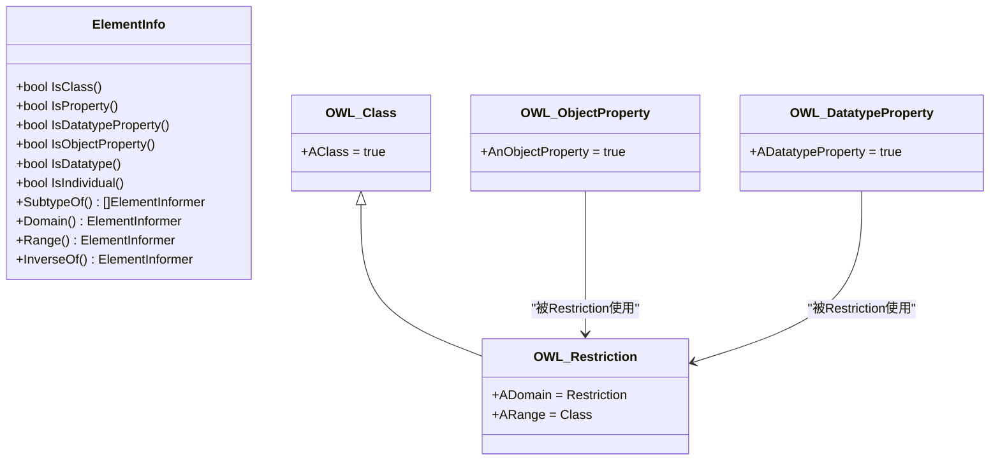
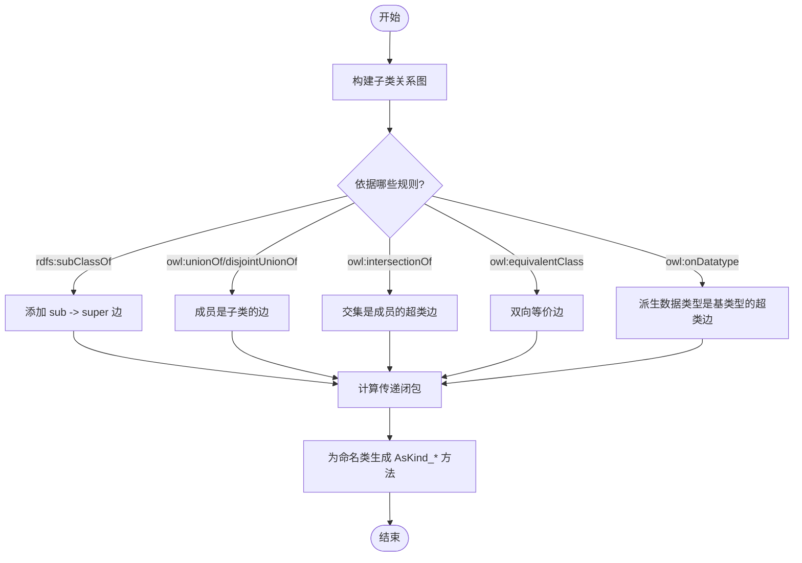
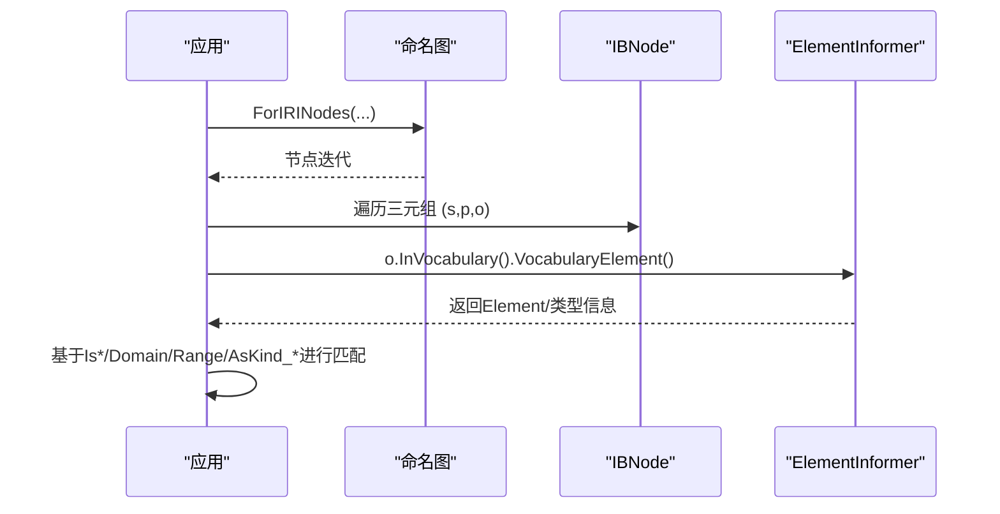
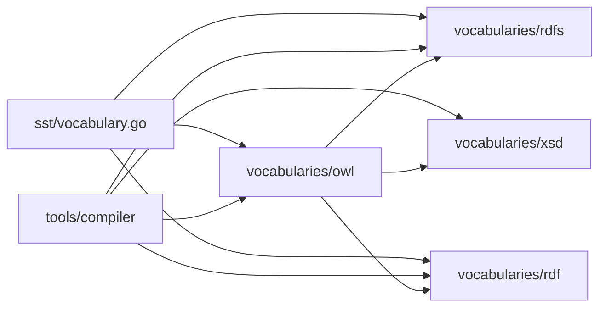

# OWL词汇表

<cite>
**本文引用的文件**
- [vocabularies/owl/vocabulary.go](file://vocabularies/owl/vocabulary.go)
- [vocabularies/owl/doc.go](file://vocabularies/owl/doc.go)
- [sst/vocabulary.go](file://sst/vocabulary.go)
- [tools/compiler/reasoner.go](file://tools/compiler/reasoner.go)
- [tools/compiler/compiler.go](file://tools/compiler/compiler.go)
- [sst/testdata/owl-test.ttl](file://sst/testdata/owl-test.ttl)
- [sst/testdata/owl-onClass.ttl](file://sst/testdata/owl-onClass.ttl)
- [examples/helloworldreadsst/helloworldreadsst.go](file://examples/helloworldreadsst/helloworldreadsst.go)
</cite>

## 目录
1. [简介](#简介)
2. [项目结构](#项目结构)
3. [核心组件](#核心组件)
4. [架构总览](#架构总览)
5. [详细组件分析](#详细组件分析)
6. [依赖关系分析](#依赖关系分析)
7. [性能考量](#性能考量)
8. [故障排查指南](#故障排查指南)
9. [结论](#结论)
10. [附录](#附录)

## 简介
本文件系统化说明SST中的OWL词汇表：解释OWL在语义网中的重要性，梳理SST中预编译的OWL术语定义与常量，阐述OWL类、属性、关系的核心概念与用法，给出实际项目中的应用示例，说明推理规则与约束验证的使用方式，对比OWL与RDF/RDFS的关系与区别，展示查询与匹配模式，并指导如何扩展与自定义词汇表。

## 项目结构
SST将W3C标准OWL 2的词汇以“预编译Go包”的形式提供，便于在编译期进行类型检查与早绑定访问；同时通过内置字典（Dictionary）机制在运行时可查得对应IRI节点，支持查询、匹配与推理。

图表来源
- [sst/vocabulary.go:15-120](file://sst/vocabulary.go#L15-L120)
- [vocabularies/owl/vocabulary.go:17-800](file://vocabularies/owl/vocabulary.go#L17-L800)
- [tools/compiler/reasoner.go:1-258](file://tools/compiler/reasoner.go#L1-L258)
- [tools/compiler/compiler.go:1-200](file://tools/compiler/compiler.go#L1-L200)
- [sst/testdata/owl-test.ttl:1-11](file://sst/testdata/owl-test.ttl#L1-L11)
- [sst/testdata/owl-onClass.ttl:1-15](file://sst/testdata/owl-onClass.ttl#L1-L15)

章节来源
- [vocabularies/owl/doc.go:1-5](file://vocabularies/owl/doc.go#L1-L5)
- [sst/vocabulary.go:15-120](file://sst/vocabulary.go#L15-L120)

## 核心组件
- OWL词汇包（vocabularies/owl）：由编译器从OWL/TTL源生成，包含OWL标准类、属性、关系的Go类型与全局常量，如 Class、ObjectProperty、DatatypeProperty、Thing、Nothing、Restriction、InverseOf、EquivalentClass 等。每个元素都实现 ElementInformer 接口，暴露 IsClass/IsProperty/Domain/Range/SubtypeOf 等方法。
- SST词汇系统（sst/vocabulary.go）：提供 Vocabulary、Element、ElementInfo、ElementInformer、Dictionary 等基础抽象，以及 StaticDictionary() 访问内置字典、NamespaceToPrefix() 命名空间到前缀映射、Element.IRI() 构造IRI等能力。
- 编译器与推理器（tools/compiler）：读取TTL/OWL源，构建子类关系图并进行传递闭包计算，为每个命名类生成 AsKind_* 方法，用于编译期类型判定与早绑定。
- 测试数据（testdata）：提供最小化的OWL/RDFS片段，用于验证导入、类声明与属性定义。

章节来源
- [vocabularies/owl/vocabulary.go:17-800](file://vocabularies/owl/vocabulary.go#L17-L800)
- [sst/vocabulary.go:125-308](file://sst/vocabulary.go#L125-L308)
- [tools/compiler/reasoner.go:1-258](file://tools/compiler/reasoner.go#L1-L258)
- [tools/compiler/compiler.go:46-157](file://tools/compiler/compiler.go#L46-L157)
- [sst/testdata/owl-test.ttl:1-11](file://sst/testdata/owl-test.ttl#L1-L11)
- [sst/testdata/owl-onClass.ttl:1-15](file://sst/testdata/owl-onClass.ttl#L1-L15)

## 架构总览
SST将OWL词汇分为“编译期类型”和“运行期字典”两层：
- 编译期：通过 tools/compiler 将OWL/TTL转换为Go代码，生成强类型常量与方法，使 IDE 能进行自动补全与编译期检查。
- 运行期：通过 sst/vocabulary.go 的 Dictionary 接口，可在运行时根据 Element 获取对应的 IBNode，从而参与RDF图的遍历、查询与匹配。

图表来源
- [vocabularies/owl/vocabulary.go:17-800](file://vocabularies/owl/vocabulary.go#L17-L800)
- [sst/vocabulary.go:44-85](file://sst/vocabulary.go#L44-L85)
- [tools/compiler/compiler.go:46-157](file://tools/compiler/compiler.go#L46-L157)

## 详细组件分析

### OWL类、属性、关系的核心概念与用法
- 类（Class、Thing、Nothing、Restriction）：表示概念集合与限制。例如 Restriction 是受限类的基类，配合 allValuesFrom、hasValue、cardinality 等属性表达约束。
- 对象属性（ObjectProperty、SymmetricProperty、TransitiveProperty、FunctionalProperty、InverseFunctionalProperty、AsymmetricProperty、IrreflexiveProperty、ReflexiveProperty）：描述实体间关系及其性质。
- 数据属性（DatatypeProperty、BottomDataProperty）：描述实体的字面量属性。
- 注解属性（AnnotationProperty、AnnotatedSource/Target/Property）：用于标注元信息。
- 公理与断言（Axiom、Annotation、NegativePropertyAssertion、AllDifferent、AllDisjointClasses/Properties）：表达等价性、不相交性、不同个体等约束。
- 组合与构造（IntersectionOf、UnionOf、DisjointUnionOf、ComplementOf、EquivalentClass/Property、inverseOf、onDatatype）：用于复杂类与属性的构造。

这些概念在 vocabularies/owl/vocabulary.go 中以预编译类型与常量形式提供，并通过 ElementInfo 字段标记其类别与关系（如 ADomain/ARange/ASubtypeOf）。

章节来源
- [vocabularies/owl/vocabulary.go:230-800](file://vocabularies/owl/vocabulary.go#L230-L800)
- [vocabularies/owl/vocabulary.go:801-1600](file://vocabularies/owl/vocabulary.go#L801-L1600)

#### 类与属性关系图（部分）

图表来源
- [sst/vocabulary.go:125-308](file://sst/vocabulary.go#L125-L308)
- [vocabularies/owl/vocabulary.go:682-800](file://vocabularies/owl/vocabulary.go#L682-L800)

### 预编译的OWL术语定义与常量
- 每个OWL元素在 vocabularies/owl/vocabulary.go 中都有对应的类型与全局变量（如 AllDifferent、AllDisjointClasses、Annotation、Class、DataRange、DatatypeProperty、DeprecatedClass、FunctionalProperty、InverseFunctionalProperty、NamedIndividual、Nothing、ObjectProperty、Ontology、ReflexiveProperty、Restriction、SymmetricProperty、Thing、TransitiveProperty、allValuesFrom、differentFrom、equivalentClass、intersectionOf、inverseOf、maxCardinality 等）。
- 这些常量实现了 ElementInformer，提供 Is* 判断与 Domain/Range/SubtypeOf 等查询方法，便于在编译期与运行期统一处理。

章节来源
- [vocabularies/owl/vocabulary.go:24-800](file://vocabularies/owl/vocabulary.go#L24-L800)
- [vocabularies/owl/vocabulary.go:801-1600](file://vocabularies/owl/vocabulary.go#L801-L1600)

### 推理规则与约束验证
- 推理器（tools/compiler/reasoner.go）在编译期构建子类关系图，依据 rdfs:subClassOf、owl:unionOf、owl:disjointUnionOf、owl:intersectionOf、owl:equivalentClass、owl:onDatatype 推导所有可达的超类关系，并计算传递闭包。
- 对每个命名类，编译器生成 AsKind_* 方法，使得在应用代码中可以以类型安全的方式判断实例是否属于某类或其超类。
- 约束验证可通过SHACL或领域规则结合SST的查询能力完成；推理结果可用于提前发现不一致或冗余。

图表来源
- [tools/compiler/reasoner.go:87-241](file://tools/compiler/reasoner.go#L87-L241)

章节来源
- [tools/compiler/reasoner.go:1-258](file://tools/compiler/reasoner.go#L1-L258)
- [tools/compiler/compiler.go:46-157](file://tools/compiler/compiler.go#L46-L157)

### OWL与RDF/RDFS的关系与区别
- RDF是最基础的三元组模型，RDFS在其之上提供基本的分类与属性域/范围定义（如 rdfs:Class、rdfs:domain/range、rdfs:subClassOf/subPropertyOf）。
- OWL在RDFS基础上增加了更丰富的表达能力：属性特性（对称、传递、函数性等）、类构造（交集、并集、补集、限制）、公理（等价、不相交、不同个体）等，支持更强的推理能力。
- 在SST中，RDF/ROWL词汇同样以预编译包形式提供，并在运行时通过静态字典统一访问。

章节来源
- [tools/compiler/compiler.go:46-157](file://tools/compiler/compiler.go#L46-L157)
- [sst/testdata/owl-test.ttl:1-11](file://sst/testdata/owl-test.ttl#L1-L11)
- [sst/testdata/owl-onClass.ttl:1-15](file://sst/testdata/owl-onClass.ttl#L1-L15)

### 查询与匹配模式
- 使用 StaticDictionary().Element(Element) 获取IBNode后，可遍历图结构进行查询与匹配。
- 典型模式：
  - 按类型过滤：利用 ElementInformer.IsClass/IsProperty 等判断。
  - 按属性匹配：通过 p.IRI() 与已知属性IRI比较，或使用 ElementInformer.Domain/Range 限定上下文。
  - 按关系路径匹配：利用 inverseOf、subPropertyOf 等关系进行路径扩展。
  - 按类层次匹配：借助推理生成的 AsKind_* 方法进行类型判定。

图表来源
- [examples/helloworldreadsst/helloworldreadsst.go:30-68](file://examples/helloworldreadsst/helloworldreadsst.go#L30-L68)
- [sst/vocabulary.go:44-85](file://sst/vocabulary.go#L44-L85)

章节来源
- [examples/helloworldreadsst/helloworldreadsst.go:30-68](file://examples/helloworldreadsst/helloworldreadsst.go#L30-L68)
- [sst/vocabulary.go:125-308](file://sst/vocabulary.go#L125-L308)

### 实际应用示例
- 读取SST文件并输出三元组内容，展示如何遍历命名图与节点，识别IRI与字面量。
- 在示例中可以看到如何使用SST API进行基本的数据读取与展示，这为OWL词汇的查询与匹配提供了基础。

章节来源
- [examples/helloworldreadsst/helloworldreadsst.go:30-68](file://examples/helloworldreadsst/helloworldreadsst.go#L30-L68)

### 扩展与自定义方法
- 新增词汇：在独立模块（如 sst-ontologies）维护TTL/OWL源，更新依赖后重新运行编译器生成Go代码。
- 注册字典：通过 RegisterDictionary 将新的词汇元素映射到运行时字典，以便 StaticDictionary 可查。
- 自定义推理：如需扩展推理规则，可在 reasoner.go 中添加新的边构建逻辑，并调整传递闭包计算。
- 命名空间映射：通过 namespaceToPrefixMap 管理命名空间与前缀的对应关系，便于序列化与调试。

章节来源
- [tools/compiler/compiler.go:17-24](file://tools/compiler/compiler.go#L17-L24)
- [tools/compiler/compiler.go:137-157](file://tools/compiler/compiler.go#L137-L157)
- [sst/vocabulary.go:94-120](file://sst/vocabulary.go#L94-L120)

## 依赖关系分析
- OWL词汇包依赖RDF/RDFS/XSD词汇，用于定义属性域/范围与数据类型。
- 编译器依赖多个词汇包以解析TTL/OWL源，并生成Go代码。
- 运行时通过静态字典将编译期元素与运行期节点关联，形成统一的查询与推理基础。

图表来源
- [vocabularies/owl/vocabulary.go:7-13](file://vocabularies/owl/vocabulary.go#L7-L13)
- [tools/compiler/compiler.go:46-157](file://tools/compiler/compiler.go#L46-L157)
- [sst/vocabulary.go:125-308](file://sst/vocabulary.go#L125-L308)

章节来源
- [vocabularies/owl/vocabulary.go:7-13](file://vocabularies/owl/vocabulary.go#L7-L13)
- [tools/compiler/compiler.go:46-157](file://tools/compiler/compiler.go#L46-L157)
- [sst/vocabulary.go:125-308](file://sst/vocabulary.go#L125-L308)

## 性能考量
- 编译期推理：通过一次性构建子类关系图并计算传递闭包，避免运行期重复推理开销。
- 早绑定访问：预编译常量与方法减少运行时反射与字符串解析成本。
- 字典缓存：静态字典在首次加载后复用，提升查询效率。
- 建议：
  - 控制词汇规模，避免过深的继承层次导致推理开销增大。
  - 合理使用属性特性（如传递性）以减少不必要的推理路径。
  - 批量查询时优先使用索引与过滤条件，减少图遍历次数。

[本节为通用指导，不直接分析具体文件]

## 故障排查指南
- 元素未找到：当调用 ElementInformer 或 StaticDictionary().Element 失败时，检查词汇是否正确注册与导入。
- 命名空间映射缺失：若 NamespaceToPrefix 返回未找到，确认已正确设置 namespaceToPrefixMap。
- 推理结果异常：检查TTL/OWL源中的 rdfs:subClassOf、owl:equivalentClass 等语句是否正确，必要时在 reasoner.go 中增加调试日志。
- 查询匹配错误：确认使用的属性IRI与领域/范围一致，必要时通过 Domain/Range 进行校验。

章节来源
- [sst/vocabulary.go:87-120](file://sst/vocabulary.go#L87-L120)
- [tools/compiler/reasoner.go:87-241](file://tools/compiler/reasoner.go#L87-L241)

## 结论
SST通过预编译OWL词汇与运行时字典的结合，既保证了编译期的类型安全与IDE支持，又提供了灵活的运行时查询与推理能力。理解OWL类、属性、关系的核心概念与用法，掌握推理规则与约束验证，能够有效提升语义数据的建模质量与应用效率。通过扩展与自定义方法，SST能够适应不断演进的领域需求。

[本节为总结性内容，不直接分析具体文件]

## 附录
- 最小化OWL/RDFS片段参考：
  - [owl-test.ttl:1-11](file://sst/testdata/owl-test.ttl#L1-L11)：展示导入与类声明。
  - [owl-onClass.ttl:1-15](file://sst/testdata/owl-onClass.ttl#L1-L15)：展示 onClass 属性定义。
- 示例应用：
  - [helloworldreadsst.go:30-68](file://examples/helloworldreadsst/helloworldreadsst.go#L30-L68)：读取SST文件并输出三元组。

章节来源
- [sst/testdata/owl-test.ttl:1-11](file://sst/testdata/owl-test.ttl#L1-L11)
- [sst/testdata/owl-onClass.ttl:1-15](file://sst/testdata/owl-onClass.ttl#L1-L15)
- [examples/helloworldreadsst/helloworldreadsst.go:30-68](file://examples/helloworldreadsst/helloworldreadsst.go#L30-L68)