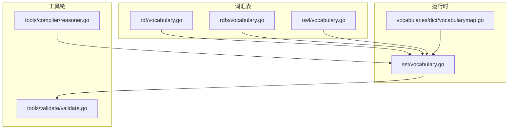
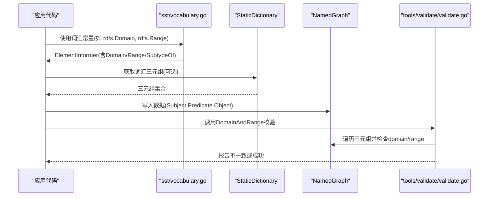
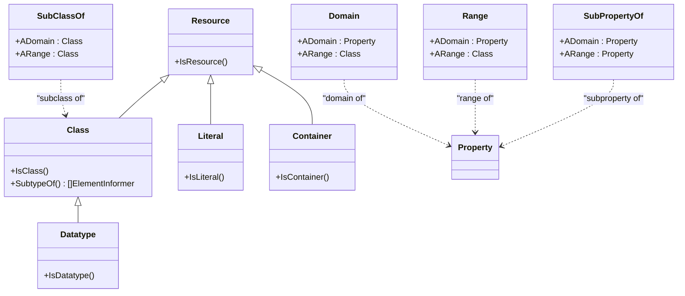
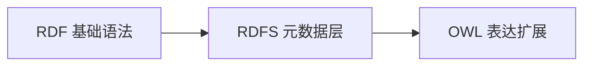
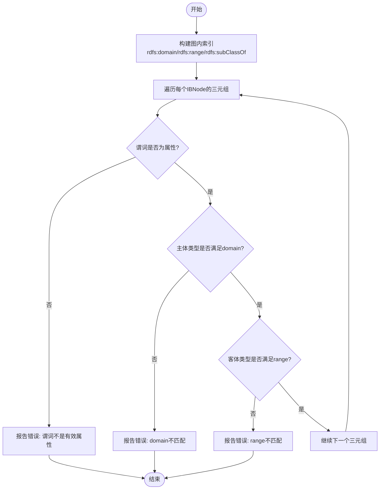
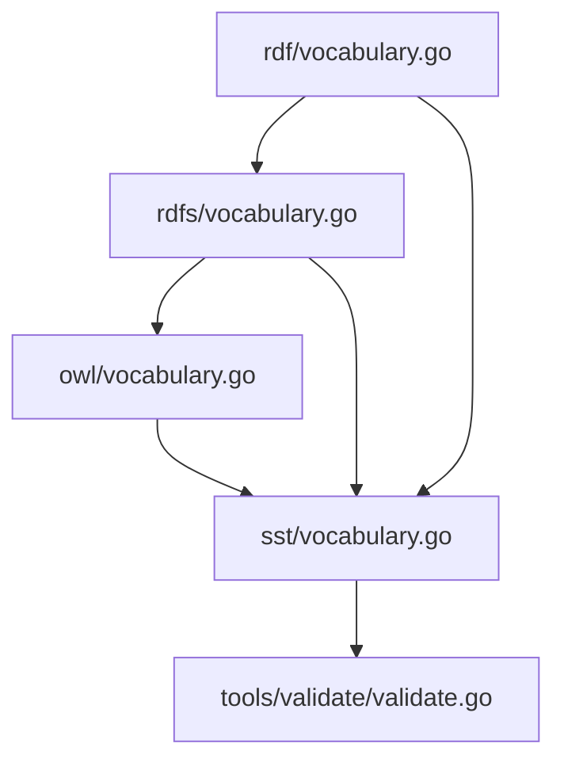

# RDFS词汇表

<cite>
**本文引用的文件**
- [sst/vocabulary.go](file://sst/vocabulary.go)
- [vocabularies/rdfs/vocabulary.go](file://vocabularies/rdfs/vocabulary.go)
- [vocabularies/rdf/vocabulary.go](file://vocabularies/rdf/vocabulary.go)
- [vocabularies/owl/vocabulary.go](file://vocabularies/owl/vocabulary.go)
- [tools/compiler/reasoner.go](file://tools/compiler/reasoner.go)
- [tools/validate/validate.go](file://tools/validate/validate.go)
- [vocabularies/dict/vocabularymap.go](file://vocabularies/dict/vocabularymap.go)
</cite>

## 目录
1. [简介](#简介)
2. [项目结构](#项目结构)
3. [核心组件](#核心组件)
4. [架构总览](#架构总览)
5. [详细组件分析](#详细组件分析)
6. [依赖关系分析](#依赖关系分析)
7. [性能考量](#性能考量)
8. [故障排查指南](#故障排查指南)
9. [结论](#结论)
10. [附录](#附录)

## 简介
本文件系统性阐述SST中对RDFS（RDF Schema）的预编译词汇表实现，说明其在语义网分层架构中的作用、类层次结构与属性域/范围的概念、推理与约束机制、与基础RDF的关系与扩展、数据建模应用示例、查询与验证模式，以及版本兼容性与迁移策略。SST通过编译器将RDFS/RDF/OWL等标准术语编译为Go包中的类型化常量与方法，并在运行时提供早绑定（编译期）与晚绑定（运行期）双重能力，以支持高效的数据建模、查询与校验。

## 项目结构
- 词汇表定义位于 vocabularies 下：
  - rdf：基础RDF语法命名空间（如 Property、List、Seq、Alt、PlainLiteral、HTML、JSON、XMLLiteral、langString 等）。
  - rdfs：RDF Schema（如 Class、Resource、Datatype、Literal、Container、label、comment、domain、range、subClassOf、subPropertyOf、seeAlso、isDefinedBy、member 等）。
  - owl：OWL扩展（如 Class、ObjectProperty、DatatypeProperty、Thing、Nothing、Restriction、TransitiveProperty、SymmetricProperty、ReflexiveProperty、InverseFunctionalProperty、AsymmetricProperty、IrreflexiveProperty、UnionOf、IntersectionOf、EquivalentClass、onDatatype 等）。
- 运行时词汇表注册与访问在 sst/vocabulary.go 中实现，提供 Vocabulary、Element、ElementInformer、静态字典等能力。
- 编译器推理工具 tools/compiler/reasoner.go 负责构建子类包含图并计算传递闭包，用于生成 AsKind_* 方法。
- 校验器 tools/validate/validate.go 基于RDFS domain/range/subClassOf 进行数据一致性检查。
- 全局词汇映射 vocabularies/dict/vocabularymap.go 汇总所有已编译词汇，供系统初始化时注册。

图表来源
- [vocabularies/rdf/vocabulary.go:14-653](file://vocabularies/rdf/vocabulary.go#L14-L653)
- [vocabularies/rdfs/vocabulary.go:15-467](file://vocabularies/rdfs/vocabulary.go#L15-L467)
- [vocabularies/owl/vocabulary.go:17-800](file://vocabularies/owl/vocabulary.go#L17-L800)
- [sst/vocabulary.go:15-120](file://sst/vocabulary.go#L15-L120)
- [tools/compiler/reasoner.go:1-258](file://tools/compiler/reasoner.go#L1-L258)
- [tools/validate/validate.go:566-759](file://tools/validate/validate.go#L566-L759)
- [vocabularies/dict/vocabularymap.go:27-425](file://vocabularies/dict/vocabularymap.go#L27-L425)

章节来源
- [vocabularies/rdf/vocabulary.go:14-653](file://vocabularies/rdf/vocabulary.go#L14-L653)
- [vocabularies/rdfs/vocabulary.go:15-467](file://vocabularies/rdfs/vocabulary.go#L15-L467)
- [vocabularies/owl/vocabulary.go:17-800](file://vocabularies/owl/vocabulary.go#L17-L800)
- [sst/vocabulary.go:15-120](file://sst/vocabulary.go#L15-L120)
- [tools/compiler/reasoner.go:1-258](file://tools/compiler/reasoner.go#L1-L258)
- [tools/validate/validate.go:566-759](file://tools/validate/validate.go#L566-L759)
- [vocabularies/dict/vocabularymap.go:27-425](file://vocabularies/dict/vocabularymap.go#L27-L425)

## 核心组件
- 词汇表基元
  - Vocabulary：表示一个外部本体（如RDF、RDFS、OWL），持有BaseIRI。
  - Element：表示词汇中的一个IRI节点（由本体编译器生成），可转换为IRI字符串。
  - ElementInformer：对Element的增强信息接口，提供IsClass/IsProperty/Domain/Range/SubtypeOf等方法。
- 静态字典
  - StaticDictionary()：返回只读字典Stage，可从嵌入的SST文件中读取词汇三元组。
  - RegisterDictionary：注册词汇映射、命名空间前缀映射，并初始化静态字典。
- 命名空间到前缀映射
  - NamespaceToPrefix：根据IRI获取前缀，便于序列化输出。

章节来源
- [sst/vocabulary.go:15-120](file://sst/vocabulary.go#L15-L120)
- [sst/vocabulary.go:125-212](file://sst/vocabulary.go#L125-L212)
- [sst/vocabulary.go:214-308](file://sst/vocabulary.go#L214-L308)
- [vocabularies/dict/vocabularymap.go:27-425](file://vocabularies/dict/vocabularymap.go#L27-L425)

## 架构总览
SST将RDF/RDFS/OWL等标准术语编译为Go代码，形成强类型的词汇表包；运行时通过静态字典与词汇映射，提供早绑定（编译期类型检查）与晚绑定（运行期三元组解析）两种路径。编译器reasoner在编译期构建子类包含图，计算传递闭包，生成AsKind_*方法，从而支持类型匹配与继承推断。校验器在运行期依据RDFS domain/range/subClassOf 进行数据一致性检查。

图表来源
- [sst/vocabulary.go:125-308](file://sst/vocabulary.go#L125-L308)
- [tools/validate/validate.go:566-759](file://tools/validate/validate.go#L566-L759)

## 详细组件分析

### RDFS类层次结构与属性域范围
- 类层次
  - rdfs.Resource 是最顶层类。
  - rdfs.Class 是 Resource 的子类。
  - rdfs.Datatype 是 Class 的子类。
  - rdfs.Literal、rdfs.Container 等也是 Resource 的子类。
- 属性
  - rdfs.domain：定义属性的域（主体类型），其值类型为 rdfs.Class。
  - rdfs.range：定义属性的范围（客体类型），其值类型为 rdfs.Class。
  - rdfs.subClassOf：定义类的子类型关系。
  - rdfs.subPropertyOf：定义属性的子属性关系。
  - rdfs.label/comment/seeAlso/isDefinedBy/member：描述性属性。

图表来源
- [vocabularies/rdfs/vocabulary.go:22-194](file://vocabularies/rdfs/vocabulary.go#L22-L194)
- [vocabularies/rdfs/vocabulary.go:226-466](file://vocabularies/rdfs/vocabulary.go#L226-L466)

章节来源
- [vocabularies/rdfs/vocabulary.go:22-194](file://vocabularies/rdfs/vocabulary.go#L22-L194)
- [vocabularies/rdfs/vocabulary.go:226-466](file://vocabularies/rdfs/vocabulary.go#L226-L466)

### 与基础RDF的关系和扩展
- RDF定义了基本语法元素（Property、List、Seq、Alt、PlainLiteral、HTML、JSON、XMLLiteral、langString、first/rest/object/predicate/subject/value/type 等）。
- RDFS在RDF之上增加类与属性的元数据（domain/range/subClassOf/subPropertyOf/label/comment/seeAlso/isDefinedBy/member）。
- OWL进一步扩展了更丰富的表达能力（ObjectProperty/DatatypeProperty、Restriction、Transitive/Symmetric/Reflexive/Irreflexive/InverseFunctionalProperty、UnionOf/IntersectionOf/EquivalentClass/onDatatype 等）。

图表来源
- [vocabularies/rdf/vocabulary.go:14-653](file://vocabularies/rdf/vocabulary.go#L14-L653)
- [vocabularies/rdfs/vocabulary.go:15-467](file://vocabularies/rdfs/vocabulary.go#L15-L467)
- [vocabularies/owl/vocabulary.go:17-800](file://vocabularies/owl/vocabulary.go#L17-L800)

章节来源
- [vocabularies/rdf/vocabulary.go:14-653](file://vocabularies/rdf/vocabulary.go#L14-L653)
- [vocabularies/rdfs/vocabulary.go:15-467](file://vocabularies/rdfs/vocabulary.go#L15-L467)
- [vocabularies/owl/vocabulary.go:17-800](file://vocabularies/owl/vocabulary.go#L17-L800)

### RDFS推理能力与约束机制
- 编译期推理
  - reasoner 构建子类包含图，处理 rdfs:subClassOf、owl:unionOf、owl:disjointUnionOf、owl:intersectionOf、owl:equivalentClass、owl:onDatatype，计算传递闭包，生成 AsKind_* 方法，使子类实例可通过父类方法进行类型匹配。
- 运行期校验
  - validate.DomainAndRange 遍历三元组，检查每个谓词是否为有效属性，并根据 rdfs:domain/rdfs:range 校验主体类型与客体类型是否符合预期；对于 TermCollection（列表）场景，会按集合成员类型进行范围校验。

图表来源
- [tools/validate/validate.go:566-759](file://tools/validate/validate.go#L566-L759)

章节来源
- [tools/compiler/reasoner.go:1-258](file://tools/compiler/reasoner.go#L1-L258)
- [tools/validate/validate.go:566-759](file://tools/validate/validate.go#L566-L759)

### 数据建模中的应用示例
- 使用 rdfs:domain 与 rdfs:range 定义属性的语义约束，例如某属性仅适用于特定类作为主体，且客体必须属于指定类。
- 使用 rdfs:subClassOf 建立类层次，便于查询与推理时利用继承关系。
- 使用 rdfs:label/comment 提供人类可读的描述信息。
- 使用 rdfs:member 表达容器成员关系。
- 结合OWL的Restriction与属性特性（如TransitiveProperty、SymmetricProperty）进行更复杂的建模与推理。

章节来源
- [vocabularies/rdfs/vocabulary.go:196-466](file://vocabularies/rdfs/vocabulary.go#L196-L466)
- [vocabularies/owl/vocabulary.go:17-800](file://vocabularies/owl/vocabulary.go#L17-L800)

### 查询与验证模式
- 查询模式
  - 通过 ElementInformer 的 Domain/Range/SubtypeOf 等方法，获取属性的语义约束与类的继承关系，辅助SPARQL或其他查询构造。
  - 使用 StaticDictionary 获取词汇三元组，进行晚绑定查询。
- 验证模式
  - 调用 validate.DomainAndRange 对数据进行domain/range一致性检查。
  - 对于TermCollection（列表）场景，校验集合成员类型是否符合范围要求。

章节来源
- [sst/vocabulary.go:125-308](file://sst/vocabulary.go#L125-L308)
- [tools/validate/validate.go:566-759](file://tools/validate/validate.go#L566-L759)

### 版本兼容性与迁移策略
- 兼容性
  - 词汇表通过编译器生成，保持与W3C标准命名空间一致（RDF/RDFS/OWL/XSD），确保跨系统互操作。
  - 运行时通过命名空间到前缀映射，保证序列化时的前缀一致性。
- 迁移策略
  - 新增或更新词汇时，重新运行编译器生成新的词汇表包，并在 vocabularies/dict/vocabularymap.go 中注册新元素。
  - 若引入新的RDFS/OWL约束，需同步更新校验逻辑（tools/validate）与推理逻辑（tools/compiler/reasoner）。
  - 对历史数据的迁移，建议先进行一致性校验，再逐步替换或扩展词汇定义。

章节来源
- [vocabularies/dict/vocabularymap.go:27-425](file://vocabularies/dict/vocabularymap.go#L27-L425)
- [tools/compiler/reasoner.go:1-258](file://tools/compiler/reasoner.go#L1-L258)
- [tools/validate/validate.go:566-759](file://tools/validate/validate.go#L566-L759)

## 依赖关系分析
- 词汇表之间的依赖
  - rdfs 依赖 rdf（如 domain/range 的值类型为 Class，而 Class 来自 rdfs；但某些属性域引用 rdf.Property）。
  - owl 依赖 rdfs 与 rdf（如 ObjectProperty/DatatypeProperty 继承自 rdf.Property，Class 继承自 rdfs.Class）。
- 运行时依赖
  - sst/vocabulary.go 提供统一的词汇访问接口，被各词汇包与校验器使用。
  - 校验器依赖词汇表的 ElementInformer 提供的 Domain/Range/SubtypeOf 信息。

图表来源
- [vocabularies/rdf/vocabulary.go:14-653](file://vocabularies/rdf/vocabulary.go#L14-L653)
- [vocabularies/rdfs/vocabulary.go:15-467](file://vocabularies/rdfs/vocabulary.go#L15-L467)
- [vocabularies/owl/vocabulary.go:17-800](file://vocabularies/owl/vocabulary.go#L17-L800)
- [sst/vocabulary.go:125-308](file://sst/vocabulary.go#L125-L308)
- [tools/validate/validate.go:566-759](file://tools/validate/validate.go#L566-L759)

章节来源
- [vocabularies/rdf/vocabulary.go:14-653](file://vocabularies/rdf/vocabulary.go#L14-L653)
- [vocabularies/rdfs/vocabulary.go:15-467](file://vocabularies/rdfs/vocabulary.go#L15-L467)
- [vocabularies/owl/vocabulary.go:17-800](file://vocabularies/owl/vocabulary.go#L17-L800)
- [sst/vocabulary.go:125-308](file://sst/vocabulary.go#L125-L308)
- [tools/validate/validate.go:566-759](file://tools/validate/validate.go#L566-L759)

## 性能考量
- 编译期推理
  - 子类包含图的传递闭包计算采用Floyd-Warshall风格算法，时间复杂度约为 O(n^3)，适合中等规模的本体。
  - 生成的 AsKind_* 方法在运行时无需额外推理，提升类型匹配效率。
- 运行期校验
  - DomainAndRange 遍历三元组并进行类型检查，复杂度与三元组数量线性相关；对于大型数据集，建议分批处理或并行化。
- 内存占用
  - 静态字典与词汇映射在进程启动时加载，需注意内存占用；合理划分词汇包可减少初始开销。

[本节为通用性能讨论，不直接分析具体文件]

## 故障排查指南
- 常见错误
  - 谓词不是有效属性：检查是否在词汇表中注册，或三元组中是否正确声明 rdf:type 指向属性类。
  - domain不匹配：检查主体的 rdf:type 是否与 rdfs:domain 定义的类一致，或利用 subClassOf 继承关系。
  - range不匹配：检查客体的 rdf:type 是否与 rdfs:range 定义的类一致，或是否为 TermCollection 且成员类型符合范围。
- 调试建议
  - 使用 StaticDictionary 获取词汇三元组，确认 domain/range/subClassOf 的定义。
  - 使用 validate.DomainAndRange 的输出定位问题三元组。
  - 检查命名空间前缀映射是否正确，避免序列化错误。

章节来源
- [tools/validate/validate.go:566-759](file://tools/validate/validate.go#L566-L759)
- [sst/vocabulary.go:115-120](file://sst/vocabulary.go#L115-L120)

## 结论
SST通过预编译的RDFS/RDF/OWL词汇表，提供了强大的语义建模、推理与校验能力。类层次结构与属性域/范围为数据建模提供了清晰的约束；编译期推理与运行期校验相结合，确保了数据的一致性与可查询性。通过合理的版本管理与迁移策略，可在演进过程中保持系统的兼容性与稳定性。

[本节为总结性内容，不直接分析具体文件]

## 附录
- 关键API路径参考
  - 词汇表访问：[sst/vocabulary.go:125-308](file://sst/vocabulary.go#L125-L308)
  - RDFS定义：[vocabularies/rdfs/vocabulary.go:15-467](file://vocabularies/rdfs/vocabulary.go#L15-L467)
  - RDF定义：[vocabularies/rdf/vocabulary.go:14-653](file://vocabularies/rdf/vocabulary.go#L14-L653)
  - OWL定义：[vocabularies/owl/vocabulary.go:17-800](file://vocabularies/owl/vocabulary.go#L17-L800)
  - 推理器：[tools/compiler/reasoner.go:1-258](file://tools/compiler/reasoner.go#L1-L258)
  - 校验器：[tools/validate/validate.go:566-759](file://tools/validate/validate.go#L566-L759)
  - 词汇映射：[vocabularies/dict/vocabularymap.go:27-425](file://vocabularies/dict/vocabularymap.go#L27-L425)

[本节为附录，不直接分析具体文件]