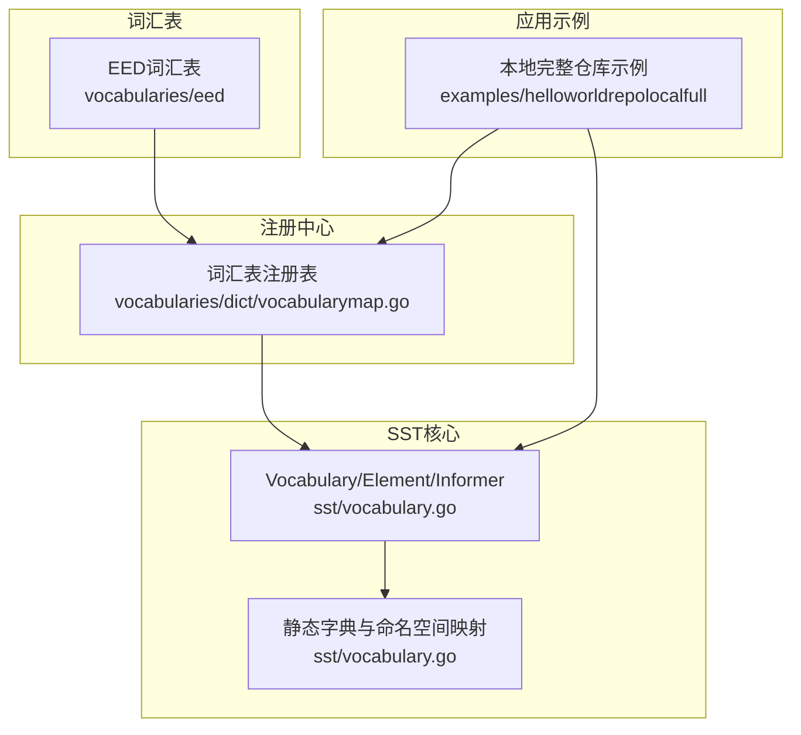
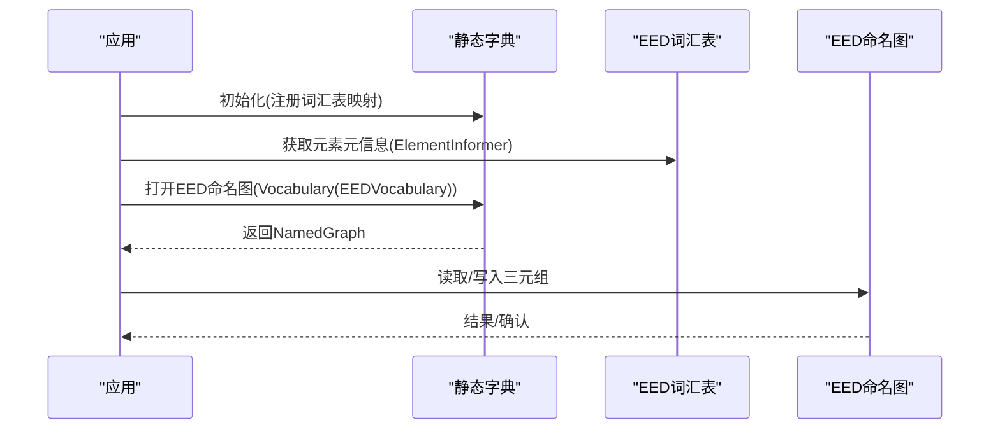
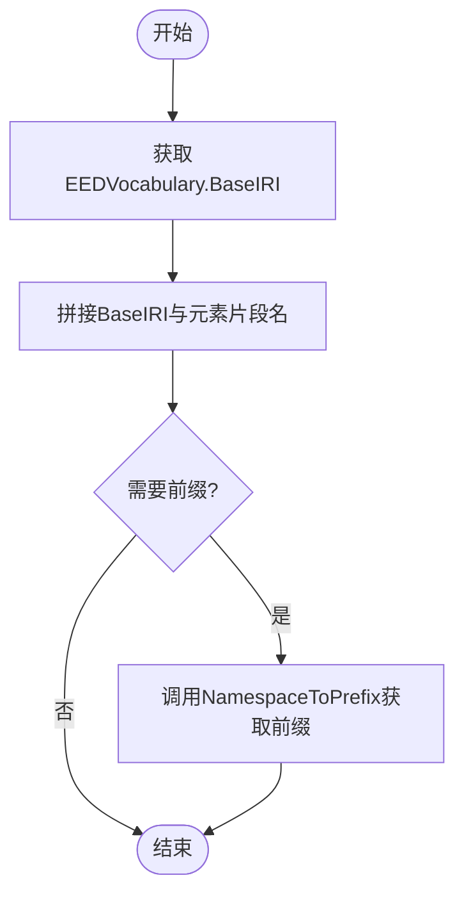
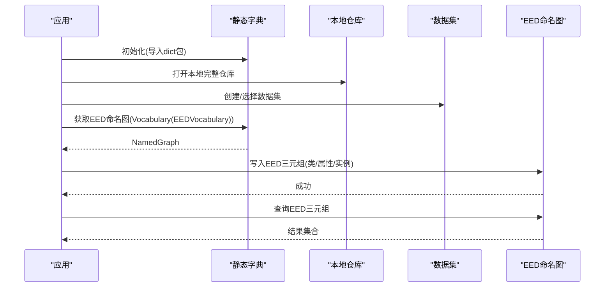
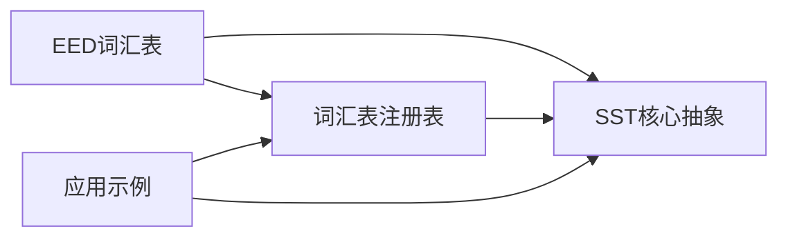

# EED词汇表

<cite>
**本文引用的文件**
- [vocabularies/eed/vocabulary.go](file://vocabularies/eed/vocabulary.go)
- [vocabularies/eed/doc.go](file://vocabularies/eed/doc.go)
- [sst/vocabulary.go](file://sst/vocabulary.go)
- [vocabularies/dict/vocabularymap.go](file://vocabularies/dict/vocabularymap.go)
- [examples/helloworldrepolocalfull/repolocalfull.go](file://examples/helloworldrepolocalfull/repolocalfull.go)
</cite>

## 目录
1. [简介](#简介)
2. [项目结构](#项目结构)
3. [核心组件](#核心组件)
4. [架构总览](#架构总览)
5. [详细组件分析](#详细组件分析)
6. [依赖关系分析](#依赖关系分析)
7. [性能考虑](#性能考虑)
8. [故障排查指南](#故障排查指南)
9. [结论](#结论)
10. [附录](#附录)

## 简介
EED（Energy Efficiency Data）词汇表是SST Core中用于能源效率数据建模的领域词汇表。它提供了一套面向电子工程与系统集成的本体概念，包括功能定义、端口、封装、模板、映射关系等，便于在SST存储中以RDF三元组形式持久化、查询和推理。该词汇表通过编译期生成的Go类型与常量暴露，结合SST的命名空间与字典机制，实现强类型的IRI访问与跨词汇表的集成使用。

## 项目结构
- EED词汇表位于 vocabularies/eed 包，包含：
  - vocabulary.go：由编译器生成，定义EEDVocabulary及其所有类、属性、个体及继承/范围/域等信息。
  - doc.go：包级说明，指出EED词汇表来源于EDIF 3.0.0并支持原理图相关建模。
- SST框架层位于 sst 包，提供：
  - Vocabulary、Element、ElementInformer等核心抽象，以及静态字典、命名空间到前缀的映射、IRI构造等能力。
- 全局词汇表注册位于 vocabularies/dict/vocabularymap.go，将各词汇表（含EED）集中注册，并嵌入对应的.sst资源。
- 示例位于 examples/helloworldrepolocalfull，演示如何在本地完整仓库中使用SST API进行读写。

**图示来源**
- [vocabularies/eed/vocabulary.go:1-20](file://vocabularies/eed/vocabulary.go#L1-L20)
- [sst/vocabulary.go:15-107](file://sst/vocabulary.go#L15-L107)
- [vocabularies/dict/vocabularymap.go:27-67](file://vocabularies/dict/vocabularymap.go#L27-L67)
- [examples/helloworldrepolocalfull/repolocalfull.go](file://examples/helloworldrepolocalfull/repolocalfull.go)

**章节来源**
- [vocabularies/eed/doc.go:1-5](file://vocabularies/eed/doc.go#L1-L5)
- [vocabularies/eed/vocabulary.go:1-20](file://vocabularies/eed/vocabulary.go#L1-L20)
- [sst/vocabulary.go:15-107](file://sst/vocabulary.go#L15-L107)
- [vocabularies/dict/vocabularymap.go:27-67](file://vocabularies/dict/vocabularymap.go#L27-L67)
- [examples/helloworldrepolocalfull/repolocalfull.go](file://examples/helloworldrepolocalfull/repolocalfull.go)

## 核心组件
- EED词汇表对象与BaseIRI
  - EEDVocabulary定义了EED词汇表的唯一基础IRI，所有EED元素IRI均基于此构建。
- 元素与类型信息
  - 每个EED概念（如类、属性、个体）以ElementInfo描述其类型特征（是否为类/属性/数据类型/个体）、继承关系（ASubtypeOf）、属性的域与范围（ADomain/ARange）等。
- 命名空间与前缀
  - 通过SST的NamespaceToPrefix可将IRI解析为前缀，便于TTL/Trig等序列化输出时更可读。
- 静态字典
  - 通过RegisterDictionary将词汇表元素注册到全局映射，并提供只读的NamedGraph访问，用于查询本体的元数据。

**章节来源**
- [vocabularies/eed/vocabulary.go:12-19](file://vocabularies/eed/vocabulary.go#L12-L19)
- [vocabularies/eed/vocabulary.go:45-53](file://vocabularies/eed/vocabulary.go#L45-L53)
- [vocabularies/eed/vocabulary.go:1072-1079](file://vocabularies/eed/vocabulary.go#L1072-L1079)
- [vocabularies/eed/vocabulary.go:1105-1112](file://vocabularies/eed/vocabulary.go#L1105-L1112)
- [sst/vocabulary.go:15-107](file://sst/vocabulary.go#L15-L107)
- [sst/vocabulary.go:115-123](file://sst/vocabulary.go#L115-L123)
- [sst/vocabulary.go:162-212](file://sst/vocabulary.go#L162-L212)

## 架构总览
EED词汇表在SST中的使用流程如下：
- 编译期：编译器从EED本体生成Go代码，定义EEDVocabulary与各元素的ElementInfo。
- 启动期：应用引入vocabularies/dict包，触发词汇表注册与内置.sst资源的嵌入加载。
- 运行期：通过SST的Vocabulary.ElementInformer获取元素元信息；通过StaticDictionary().Vocabulary(EEDVocabulary)获取EED命名图，进行三元组的读写与查询。

**图示来源**
- [vocabularies/dict/vocabularymap.go:27-67](file://vocabularies/dict/vocabularymap.go#L27-L67)
- [sst/vocabulary.go:44-58](file://sst/vocabulary.go#L44-L58)
- [sst/vocabulary.go:82-107](file://sst/vocabulary.go#L82-L107)

## 详细组件分析

### EED核心概念与关系
- 功能网络与节点
  - FunctionalNetworkDefinition：功能网络的定义，作为FunctionalDefinitionElement的子类。
  - FunctionalNode：功能节点的抽象基类，FunctionalInternallNode与FunctionalTerminalNode为其具体化。
  - FunctionalDefinition / FunctionalDefinitionElement / FunctionalDefinitionTerminal：功能定义的层次结构，表达功能层面的组成与终端。
- 端口与连接
  - MasterPort及其子类InputMasterPort、OutputMasterPort、BidirectionalMasterPort：表示主端口的方向性与双向性。
  - ConnectedTerminal：连接终端的属性，目标范围为FunctionalOccurrenceTerminal。
- 封装与模板
  - Package / Template：封装与模板的概念，Package是Template的特化。
  - PackageFeature / PackageTerminal / PackageTerminalTemplate：封装的特征与终端定义。
  - TemplateFeature / TemplateContactFeature / TemplateTerminal：模板的特征与接触特性。
- 标识与映射
  - IpcID / JedecID：封装的标识属性，域为Package。
  - MapPartTerminalToFunctionalTerminal / MapPartTerminalToTemplateTerminal / MapPartToFunctional / MapPartToTemplate：物理/模板与功能之间的映射属性。

```mermaid
classDiagram
class FunctionalDefinitionElement
class FunctionalNetworkDefinition
class FunctionalNode
class FunctionalInternallNode
class FunctionalTerminalNode
class FunctionalDefinition
class FunctionalDefinitionTerminal
class MasterPort
class InputMasterPort
class OutputMasterPort
class BidirectionalMasterPort
class Package
class Template
class PackageFeature
class PackageTerminal
class PackageTerminalTemplate
class TemplateFeature
class TemplateContactFeature
class TemplateTerminal
class ConnectedTerminal
class IpcID
class JedecID
class MapPartTerminalToFunctionalTerminal
class MapPartTerminalToTemplateTerminal
class MapPartToFunctional
class MapPartToTemplate
FunctionalNetworkDefinition --|> FunctionalDefinitionElement
FunctionalInternallNode --|> FunctionalNode
FunctionalTerminalNode --|> FunctionalNode
FunctionalTerminalNode --|> FunctionalDefinitionTerminal
InputMasterPort --|> MasterPort
OutputMasterPort --|> MasterPort
BidirectionalMasterPort --|> MasterPort
Package --|> Template
PackageTerminal --|> PackageFeature
TemplateTerminal --|> TemplateContactFeature
TemplateTerminal --|> TemplateFeature
IpcID : 域=Package
JedecID : 域=Package
MapPartTerminalToFunctionalTerminal : 范围=FunctionalDefinitionTerminal
MapPartTerminalToTemplateTerminal : 范围=TemplateTerminal
MapPartToFunctional : 范围=FunctionalDefinition
MapPartToTemplate : 范围=Template
```

**图示来源**
- [vocabularies/eed/vocabulary.go:184-192](file://vocabularies/eed/vocabulary.go#L184-L192)
- [vocabularies/eed/vocabulary.go:220-228](file://vocabularies/eed/vocabulary.go#L220-L228)
- [vocabularies/eed/vocabulary.go:256-263](file://vocabularies/eed/vocabulary.go#L256-L263)
- [vocabularies/eed/vocabulary.go:359-367](file://vocabularies/eed/vocabulary.go#L359-L367)
- [vocabularies/eed/vocabulary.go:393-401](file://vocabularies/eed/vocabulary.go#L393-L401)
- [vocabularies/eed/vocabulary.go:616-624](file://vocabularies/eed/vocabulary.go#L616-L624)
- [vocabularies/eed/vocabulary.go:45-53](file://vocabularies/eed/vocabulary.go#L45-L53)
- [vocabularies/eed/vocabulary.go:651-659](file://vocabularies/eed/vocabulary.go#L651-L659)
- [vocabularies/eed/vocabulary.go:919-926](file://vocabularies/eed/vocabulary.go#L919-L926)
- [vocabularies/eed/vocabulary.go:731-739](file://vocabularies/eed/vocabulary.go#L731-L739)
- [vocabularies/eed/vocabulary.go:765-772](file://vocabularies/eed/vocabulary.go#L765-L772)
- [vocabularies/eed/vocabulary.go:999-1006](file://vocabularies/eed/vocabulary.go#L999-L1006)
- [vocabularies/eed/vocabulary.go:1040-1048](file://vocabularies/eed/vocabulary.go#L1040-L1048)
- [vocabularies/eed/vocabulary.go:1072-1079](file://vocabularies/eed/vocabulary.go#L1072-L1079)
- [vocabularies/eed/vocabulary.go:1105-1112](file://vocabularies/eed/vocabulary.go#L1105-L1112)
- [vocabularies/eed/vocabulary.go:1138-1145](file://vocabularies/eed/vocabulary.go#L1138-L1145)
- [vocabularies/eed/vocabulary.go:1167-1174](file://vocabularies/eed/vocabulary.go#L1167-L1174)
- [vocabularies/eed/vocabulary.go:1196-1203](file://vocabularies/eed/vocabulary.go#L1196-L1203)
- [vocabularies/eed/vocabulary.go:1225-1232](file://vocabularies/eed/vocabulary.go#L1225-L1232)
- [vocabularies/eed/vocabulary.go:1254-1261](file://vocabularies/eed/vocabulary.go#L1254-L1261)

**章节来源**
- [vocabularies/eed/vocabulary.go:184-192](file://vocabularies/eed/vocabulary.go#L184-L192)
- [vocabularies/eed/vocabulary.go:220-228](file://vocabularies/eed/vocabulary.go#L220-L228)
- [vocabularies/eed/vocabulary.go:256-263](file://vocabularies/eed/vocabulary.go#L256-L263)
- [vocabularies/eed/vocabulary.go:359-367](file://vocabularies/eed/vocabulary.go#L359-L367)
- [vocabularies/eed/vocabulary.go:393-401](file://vocabularies/eed/vocabulary.go#L393-L401)
- [vocabularies/eed/vocabulary.go:45-53](file://vocabularies/eed/vocabulary.go#L45-L53)
- [vocabularies/eed/vocabulary.go:616-624](file://vocabularies/eed/vocabulary.go#L616-L624)
- [vocabularies/eed/vocabulary.go:651-659](file://vocabularies/eed/vocabulary.go#L651-L659)
- [vocabularies/eed/vocabulary.go:731-739](file://vocabularies/eed/vocabulary.go#L731-L739)
- [vocabularies/eed/vocabulary.go:765-772](file://vocabularies/eed/vocabulary.go#L765-L772)
- [vocabularies/eed/vocabulary.go:919-926](file://vocabularies/eed/vocabulary.go#L919-L926)
- [vocabularies/eed/vocabulary.go:999-1006](file://vocabularies/eed/vocabulary.go#L999-L1006)
- [vocabularies/eed/vocabulary.go:1040-1048](file://vocabularies/eed/vocabulary.go#L1040-L1048)
- [vocabularies/eed/vocabulary.go:1072-1079](file://vocabularies/eed/vocabulary.go#L1072-L1079)
- [vocabularies/eed/vocabulary.go:1105-1112](file://vocabularies/eed/vocabulary.go#L1105-L1112)
- [vocabularies/eed/vocabulary.go:1138-1145](file://vocabularies/eed/vocabulary.go#L1138-L1145)
- [vocabularies/eed/vocabulary.go:1167-1174](file://vocabularies/eed/vocabulary.go#L1167-L1174)
- [vocabularies/eed/vocabulary.go:1196-1203](file://vocabularies/eed/vocabulary.go#L1196-L1203)
- [vocabularies/eed/vocabulary.go:1225-1232](file://vocabularies/eed/vocabulary.go#L1225-L1232)
- [vocabularies/eed/vocabulary.go:1254-1261](file://vocabularies/eed/vocabulary.go#L1254-L1261)

### BaseIRI配置与命名空间管理
- BaseIRI
  - EEDVocabulary.BaseIRI为EED命名空间的根，所有EED元素的IRI均由“BaseIRI + # + 名称”构成。
- 命名空间到前缀
  - 通过SST的NamespaceToPrefix可将IRI转换为前缀，便于TTL/Trig输出时的可读性。
- 元素IRI构造
  - Element.IRI()方法自动拼接BaseIRI与Fragment，确保IRI一致性。

**图示来源**
- [vocabularies/eed/vocabulary.go:12-19](file://vocabularies/eed/vocabulary.go#L12-L19)
- [sst/vocabulary.go:115-123](file://sst/vocabulary.go#L115-L123)
- [sst/vocabulary.go:356-363](file://sst/vocabulary.go#L356-L363)

**章节来源**
- [vocabularies/eed/vocabulary.go:12-19](file://vocabularies/eed/vocabulary.go#L12-L19)
- [sst/vocabulary.go:115-123](file://sst/vocabulary.go#L115-L123)
- [sst/vocabulary.go:356-363](file://sst/vocabulary.go#L356-L363)

### 在SST存储中使用EED词汇表
- 注册与初始化
  - 引入vocabularies/dict包以注册所有词汇表（含EED），并嵌入.sst资源。
- 获取EED命名图
  - 通过StaticDictionary().Vocabulary(EEDVocabulary)获取EED命名图，用于读写EED相关的三元组。
- 读写示例
  - 参考helloworldrepolocalfull示例，展示如何打开本地完整仓库、创建数据集、写入/读取三元组。

**图示来源**
- [vocabularies/dict/vocabularymap.go:27-67](file://vocabularies/dict/vocabularymap.go#L27-L67)
- [sst/vocabulary.go:44-58](file://sst/vocabulary.go#L44-L58)
- [examples/helloworldrepolocalfull/repolocalfull.go](file://examples/helloworldrepolocalfull/repolocalfull.go)

**章节来源**
- [vocabularies/dict/vocabularymap.go:27-67](file://vocabularies/dict/vocabularymap.go#L27-L67)
- [sst/vocabulary.go:44-58](file://sst/vocabulary.go#L44-L58)
- [examples/helloworldrepolocalfull/repolocalfull.go](file://examples/helloworldrepolocalfull/repolocalfull.go)

### 版本控制与扩展机制
- 版本控制
  - EED词汇表以编译产物形式存在于vocabularies/eed/vocabulary.go，并通过vocabularies/dict下的.eed.sst嵌入到运行时。版本演进需更新生成代码与嵌入资源。
- 扩展机制
  - 新增EED概念时，需在EED本体中定义，并通过编译器重新生成vocabulary.go；同时在vocabularymap.go中注册新元素。
  - 若需扩展命名空间或前缀映射，可在SST的命名空间映射中进行配置。

**章节来源**
- [vocabularies/eed/vocabulary.go:1-20](file://vocabularies/eed/vocabulary.go#L1-L20)
- [vocabularies/dict/vocabularymap.go:27-67](file://vocabularies/dict/vocabularymap.go#L27-L67)
- [sst/vocabulary.go:94-107](file://sst/vocabulary.go#L94-L107)

### 与其他领域词汇表的集成
- 集成方式
  - 通过vocabularies/dict统一注册多个词汇表（如lci、owl、rdfs、xsd等），EED可与这些词汇表在同一命名图中混合使用。
- 典型用法
  - 使用EED的类与属性描述封装与功能，同时引用OWL/RDFS进行约束与分类，使用XSD定义字面量类型。

**章节来源**
- [vocabularies/dict/vocabularymap.go:27-67](file://vocabularies/dict/vocabularymap.go#L27-L67)

## 依赖关系分析
- EED词汇表依赖SST核心抽象（Vocabulary、Element、ElementInformer）。
- 全局注册依赖vocabularies/dict，后者嵌入.sst资源并维护词汇表映射。
- 应用示例依赖SST仓库API与词汇表注册。

**图示来源**
- [vocabularies/eed/vocabulary.go:1-20](file://vocabularies/eed/vocabulary.go#L1-L20)
- [sst/vocabulary.go:15-107](file://sst/vocabulary.go#L15-L107)
- [vocabularies/dict/vocabularymap.go:27-67](file://vocabularies/dict/vocabularymap.go#L27-L67)
- [examples/helloworldrepolocalfull/repolocalfull.go](file://examples/helloworldrepolocalfull/repolocalfull.go)

**章节来源**
- [vocabularies/eed/vocabulary.go:1-20](file://vocabularies/eed/vocabulary.go#L1-L20)
- [sst/vocabulary.go:15-107](file://sst/vocabulary.go#L15-L107)
- [vocabularies/dict/vocabularymap.go:27-67](file://vocabularies/dict/vocabularymap.go#L27-L67)
- [examples/helloworldrepolocalfull/repolocalfull.go](file://examples/helloworldrepolocalfull/repolocalfull.go)

## 性能考虑
- 编译期生成减少运行时开销：EED词汇表通过编译器生成Go类型，避免反射与字符串匹配的高成本。
- 静态字典只读访问：静态字典提供高效元信息查询，适合频繁读取本体结构。
- 命名图粒度：按命名空间组织数据，有助于局部查询与增量更新。

[本节为通用指导，不直接分析具体文件]

## 故障排查指南
- 未注册字典导致前缀解析失败
  - 现象：调用NamespaceToPrefix时日志警告“命名空间到前缀映射未设置”。
  - 处理：确保引入vocabularies/dict包以完成注册。
- 元素未找到
  - 现象：Vocabulary.ElementInformer(name)返回错误“元素告知者未找到”。
  - 处理：检查名称拼写与是否已注册；必要时重新生成vocabulary.go并更新vocabularymap.go。
- 命名图不可用
  - 现象：StaticDictionary().Vocabulary(EEDVocabulary)返回空或错误。
  - 处理：确认.eed.sst已嵌入且路径正确；检查SST版本兼容性。

**章节来源**
- [sst/vocabulary.go:115-123](file://sst/vocabulary.go#L115-L123)
- [sst/vocabulary.go:214-223](file://sst/vocabulary.go#L214-L223)
- [vocabularies/dict/vocabularymap.go:27-67](file://vocabularies/dict/vocabularymap.go#L27-L67)

## 结论
EED词汇表为能源效率数据提供了结构化、可推理的语义模型，借助SST的强类型与命名空间管理能力，能够在复杂系统中实现一致的IRI访问、高效的三元组存储与查询。通过统一的注册机制，EED可与OWL/RDFS/XSD等其他词汇表无缝集成，满足多领域协同建模需求。建议在生产环境中严格管理版本与扩展流程，确保本体演进的可追溯性与稳定性。

[本节为总结性内容，不直接分析具体文件]

## 附录
- 常用EED概念速查
  - 功能网络与节点：FunctionalNetworkDefinition、FunctionalNode、FunctionalInternallNode、FunctionalTerminalNode
  - 端口：MasterPort、InputMasterPort、OutputMasterPort、BidirectionalMasterPort
  - 封装与模板：Package、Template、PackageFeature、PackageTerminal、TemplateFeature、TemplateContactFeature、TemplateTerminal
  - 标识与映射：IpcID、JedecID、MapPartTerminalToFunctionalTerminal、MapPartTerminalToTemplateTerminal、MapPartToFunctional、MapPartToTemplate
- 参考示例
  - 本地完整仓库示例展示了如何打开仓库、创建数据集、读写三元组，可作为EED使用的起点。

[本节为补充信息，不直接分析具体文件]