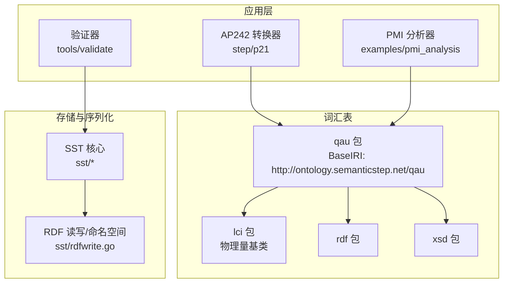
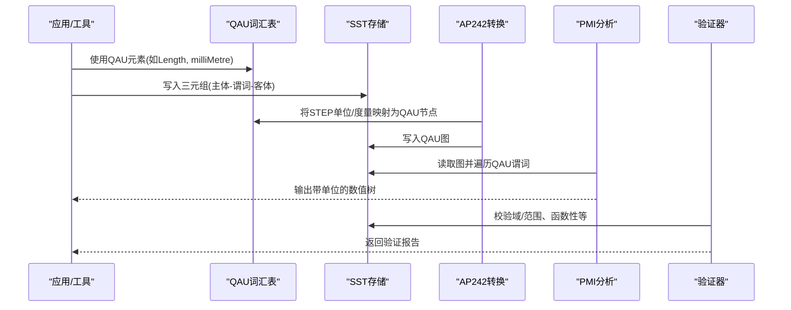
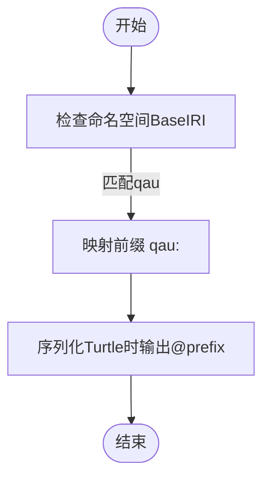
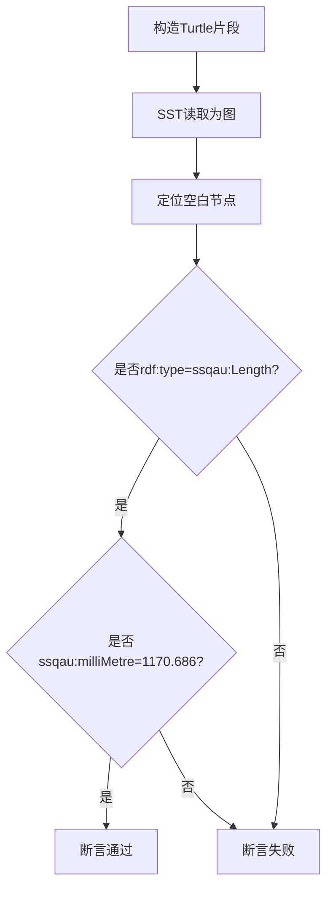
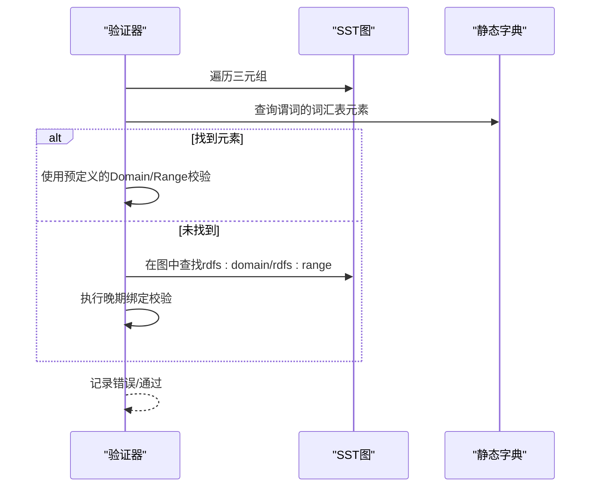
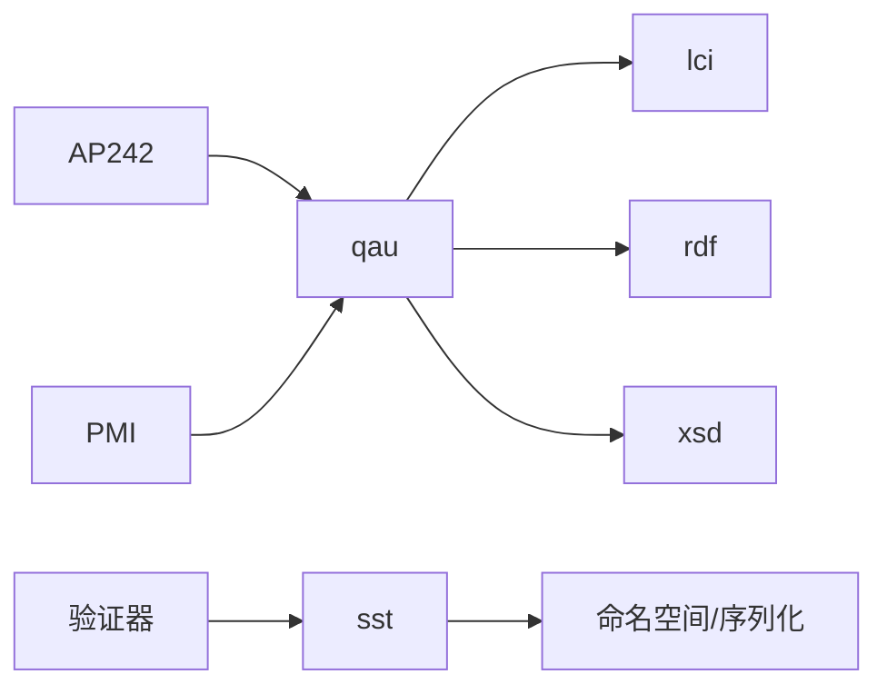

# QAU词汇表

<cite>
**本文引用的文件**
- [vocabularies/qau/doc.go](file://vocabularies/qau/doc.go)
- [vocabularies/qau/vocabulary.go](file://vocabularies/qau/vocabulary.go)
- [examples/pmi_analysis/pmi_analysis.go](file://examples/pmi_analysis/pmi_analysis.go)
- [step/p21/p21.go](file://step/p21/p21.go)
- [tools/validate/validate.go](file://tools/validate/validate.go)
- [sst/rdfwrite.go](file://sst/rdfwrite.go)
- [sst/types.go](file://sst/types.go)
- [sst_test/ibnode_test.go](file://sst_test/ibnode_test.go)
- [tools/compiler/compiler.go](file://tools/compiler/compiler.go)
</cite>

## 目录
1. [简介](#简介)
2. [项目结构](#项目结构)
3. [核心组件](#核心组件)
4. [架构总览](#架构总览)
5. [详细组件分析](#详细组件分析)
6. [依赖关系分析](#依赖关系分析)
7. [性能考虑](#性能考虑)
8. [故障排查指南](#故障排查指南)
9. [结论](#结论)
10. [附录](#附录)

## 简介
本文件面向质量保证（QA）与质量控制（QC）场景，系统性说明QAU（Quantity And Units，量与单位）词汇表在SST（Semantic STEP Technology）中的使用方式。内容涵盖：
- QAU质量属性、测试方法与标准定义的使用要点
- BaseIRI配置与命名空间管理
- 在SST存储中表达和查询质量数据（如长度、面积、体积等）
- 版本管理与扩展机制
- 与验证系统的集成方法
- 在STEP AP242转换、PMI分析与可视化中的应用示例

## 项目结构
QAU词汇表位于 vocabularies/qau 包，由编译器生成，提供类型安全的元素访问与命名空间前缀映射；在SST中通过命名空间注册与RDF/Turtle序列化输出进行统一管理。

图表来源
- [vocabularies/qau/vocabulary.go:17-17](file://vocabularies/qau/vocabulary.go#L17-L17)
- [step/p21/p21.go:187-211](file://step/p21/p21.go#L187-L211)
- [examples/pmi_analysis/pmi_analysis.go:297-301](file://examples/pmi_analysis/pmi_analysis.go#L297-L301)
- [tools/validate/validate.go:63-114](file://tools/validate/validate.go#L63-L114)
- [sst/rdfwrite.go:494-506](file://sst/rdfwrite.go#L494-L506)

章节来源
- [vocabularies/qau/doc.go:1-5](file://vocabularies/qau/doc.go#L1-L5)
- [vocabularies/qau/vocabulary.go:17-17](file://vocabularies/qau/vocabulary.go#L17-L17)

## 核心组件
- QAU词汇表定义与BaseIRI
  - BaseIRI为 http://ontology.semanticstep.net/qau，所有QAU元素均在此命名空间下。
  - 通过静态变量 QAUVocabulary 暴露给上层使用。
- 生成的元素集合
  - 包含大量物理量类（如 Length、Area、Volume、Acceleration 等）和单位属性（如 milliMetre）。
  - 每个元素具备类型信息、继承关系与主类标记，便于验证与推理。
- 命名空间与前缀
  - 编译期将 qau 的 BaseIRI 映射到短前缀 qau:，并在Turtle输出时自动声明 @prefix。
- 与LCI/RDF/XSD的协作
  - QAU类通常继承自 lci:PhysicalQuantity，值类型基于 xsd 字面量，语义由 rdf/rdfs 描述。

章节来源
- [vocabularies/qau/vocabulary.go:17-17](file://vocabularies/qau/vocabulary.go#L17-L17)
- [vocabularies/qau/vocabulary.go:24-800](file://vocabularies/qau/vocabulary.go#L24-L800)
- [tools/compiler/compiler.go:96-149](file://tools/compiler/compiler.go#L96-L149)
- [sst/rdfwrite.go:494-506](file://sst/rdfwrite.go#L494-L506)

## 架构总览
QAU在SST中的数据流与处理链路如下：
- 写入阶段：业务代码通过QAU元素创建节点与三元组，SST负责持久化与命名空间管理。
- 读取阶段：解析器识别命名空间并还原为类型安全的元素对象。
- 转换阶段：AP242转换器将STEP单位/度量映射为QAU节点。
- 分析阶段：PMI分析器按QAU谓词提取数值并渲染树形报告。
- 验证阶段：验证器依据词汇表的域/范围、函数性等约束检查数据一致性。

图表来源
- [step/p21/p21.go:187-211](file://step/p21/p21.go#L187-L211)
- [examples/pmi_analysis/pmi_analysis.go:297-350](file://examples/pmi_analysis/pmi_analysis.go#L297-L350)
- [tools/validate/validate.go:63-114](file://tools/validate/validate.go#L63-L114)
- [sst/rdfwrite.go:494-506](file://sst/rdfwrite.go#L494-L506)

## 详细组件分析

### QAU词汇表与BaseIRI配置
- BaseIRI固定为 http://ontology.semanticstep.net/qau，确保跨系统一致标识。
- 编译器维护 qau 前缀映射，并在Turtle导出时自动添加 @prefix qau: ...。
- 静态字典注册QAU包，使运行时可通过 InVocabulary() 获取元素信息。

图表来源
- [vocabularies/qau/vocabulary.go:17-17](file://vocabularies/qau/vocabulary.go#L17-L17)
- [tools/compiler/compiler.go:96-149](file://tools/compiler/compiler.go#L96-L149)
- [sst/rdfwrite.go:494-506](file://sst/rdfwrite.go#L494-L506)

章节来源
- [vocabularies/qau/vocabulary.go:17-17](file://vocabularies/qau/vocabulary.go#L17-L17)
- [tools/compiler/compiler.go:96-149](file://tools/compiler/compiler.go#L96-L149)
- [sst/rdfwrite.go:494-506](file://sst/rdfwrite.go#L494-L506)

### 质量属性与标准定义
- 质量属性以QAU类表示（如 Length、Area、Volume），并通过单位属性（如 milliMetre）表达具体数值。
- 这些类继承自 lci:PhysicalQuantity，满足ISO 80000系列标准的量体系。
- 在SST中，这些类作为“主类”参与验证，确保数据模型的一致性。

章节来源
- [vocabularies/qau/vocabulary.go:24-800](file://vocabularies/qau/vocabulary.go#L24-L800)
- [step/p21/p21.go:187-211](file://step/p21/p21.go#L187-L211)

### 测试方法与标准实现
- 单元测试覆盖QAU节点的读写、空白节点与单位属性的解析。
- 典型用例：创建空白节点类型为 ssqau:Length，并设置 ssqau:milliMetre 值，随后断言类型与数值正确性。

图表来源
- [sst_test/ibnode_test.go:770-839](file://sst_test/ibnode_test.go#L770-L839)

章节来源
- [sst_test/ibnode_test.go:770-839](file://sst_test/ibnode_test.go#L770-L839)

### 在SST存储中使用QAU进行质量数据存储
- 通过QAU元素创建节点与三元组，SST自动处理命名空间与ID分配。
- 支持空白节点表示量值，结合单位谓词形成结构化质量数据。
- 可与其他领域模型（如 rep:lengthValue）组合，表达产品尺寸等质量属性。

章节来源
- [sst_test/ibnode_test.go:770-839](file://sst_test/ibnode_test.go#L770-L839)
- [sst/rdfwrite.go:494-506](file://sst/rdfwrite.go#L494-L506)

### 版本管理与扩展机制
- QAU词汇表由编译器生成，更新时需重新生成以确保元素与元数据同步。
- 编译器维护词汇表映射与前缀表，新增或修改需更新映射并重新编译。
- 运行时通过静态字典加载，保证多模块共享一致的词汇表视图。

章节来源
- [tools/compiler/compiler.go:96-149](file://tools/compiler/compiler.go#L96-L149)
- [vocabularies/qau/vocabulary.go:1-13](file://vocabularies/qau/vocabulary.go#L1-L13)

### 与验证系统的集成
- 验证器对域/范围、函数性等进行校验，利用词汇表提供的类型信息进行早期绑定。
- 对于QAU谓词，若其定义在已编译词汇表中，则直接采用其Domain/Range进行校验。
- 当谓词不在词汇表中时，验证器会在图中进行晚期绑定查找。

图表来源
- [tools/validate/validate.go:63-114](file://tools/validate/validate.go#L63-L114)
- [tools/validate/validate.go:566-800](file://tools/validate/validate.go#L566-L800)

章节来源
- [tools/validate/validate.go:63-114](file://tools/validate/validate.go#L63-L114)
- [tools/validate/validate.go:566-800](file://tools/validate/validate.go#L566-L800)

### 在STEP AP242转换中的应用
- 转换器将STEP的单位/度量映射为QAU类（如 length_measure -> qau:Length）。
- 通过标签匹配在QAU词汇表中查找对应节点，完成单位归一化。
- 转换后的图可直接用于后续的质量数据分析与验证。

章节来源
- [step/p21/p21.go:187-211](file://step/p21/p21.go#L187-L211)
- [step/p21/p21.go:846-886](file://step/p21/p21.go#L846-L886)

### 在PMI分析中的应用
- PMI分析器识别QAU谓词，提取数值并以树形结构展示。
- 通过判断谓词所属词汇表（BaseIRI）来区分QAU与其他词汇。
- 支持对QAU值的排序与格式化，提升可读性。

章节来源
- [examples/pmi_analysis/pmi_analysis.go:297-350](file://examples/pmi_analysis/pmi_analysis.go#L297-L350)
- [examples/pmi_analysis/pmi_analysis.go:467-486](file://examples/pmi_analysis/pmi_analysis.go#L467-L486)

## 依赖关系分析
- QAU依赖LCI（物理量基类）、RDF/RDFS（语义描述）、XSD（数据类型）。
- 应用层（AP242、PMI、验证器）通过SST接口访问QAU元素。
- 编译器维护词汇表映射与前缀，影响序列化与解析行为。

图表来源
- [vocabularies/qau/vocabulary.go:7-13](file://vocabularies/qau/vocabulary.go#L7-L13)
- [tools/compiler/compiler.go:96-149](file://tools/compiler/compiler.go#L96-L149)
- [sst/rdfwrite.go:494-506](file://sst/rdfwrite.go#L494-L506)

章节来源
- [vocabularies/qau/vocabulary.go:7-13](file://vocabularies/qau/vocabulary.go#L7-L13)
- [tools/compiler/compiler.go:96-149](file://tools/compiler/compiler.go#L96-L149)

## 性能考虑
- 使用编译期生成的QAU元素可减少运行时解析开销。
- 验证器的早期绑定（词汇表内谓词）比晚期绑定（图中查找）更高效。
- 合理组织命名空间与前缀，减少序列化时的重复声明。

## 故障排查指南
- 若InVocabulary()返回nil，检查静态字典是否正确加载QAU包。
- 若Turtle输出缺少@prefix qau:，确认命名空间注册与序列化流程。
- 若验证失败，核对QAU谓词的Domain/Range是否与数据类型匹配。

章节来源
- [sst/types.go:218-234](file://sst/types.go#L218-L234)
- [tools/validate/validate.go:63-114](file://tools/validate/validate.go#L63-L114)
- [sst/rdfwrite.go:494-506](file://sst/rdfwrite.go#L494-L506)

## 结论
QAU词汇表为SST提供了标准化的量与单位建模能力，广泛应用于STEP转换、PMI分析与数据验证。通过明确的BaseIRI、命名空间管理与编译器支持，QAU确保了跨系统的一致性与可扩展性。建议在产品质量管理中优先采用QAU表达质量属性，并结合验证器保障数据质量。

## 附录
- 常用QAU类与单位：参考 vocabularies/qau/vocabulary.go 中的类定义与单位属性。
- 示例数据：参见 sst_test/ibnode_test.go 中的Turtle片段与断言逻辑。
- 转换器映射：参见 step/p21/p21.go 中对STEP单位到QAU类的映射表。