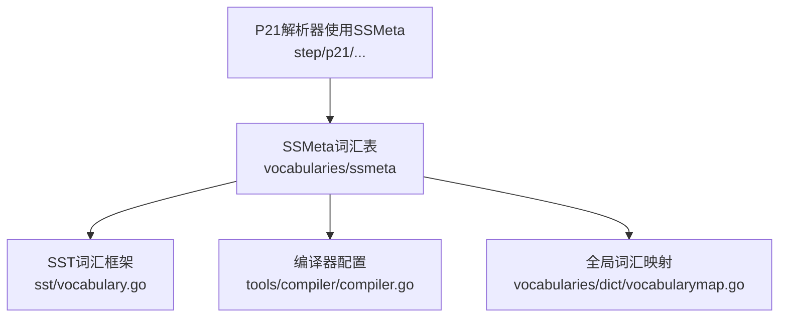
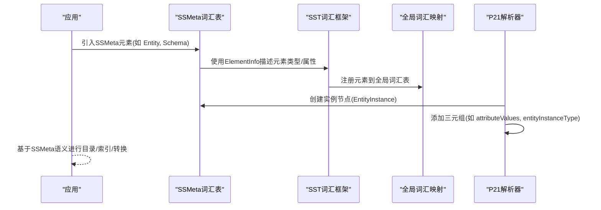
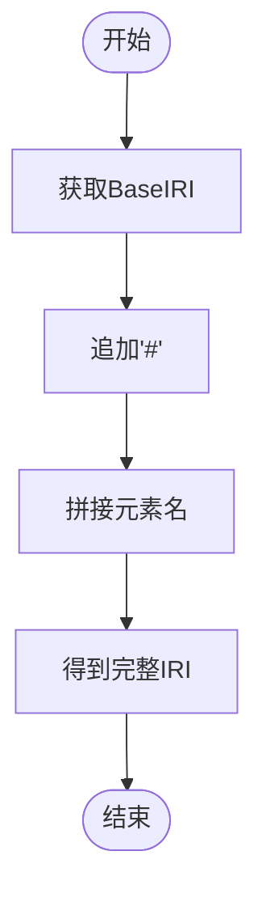
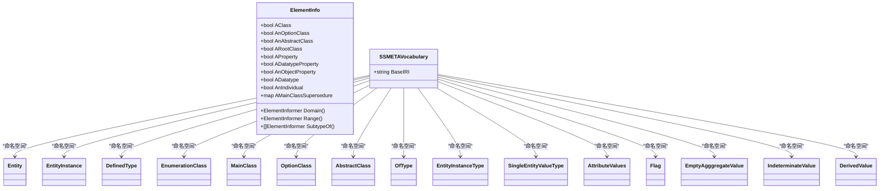
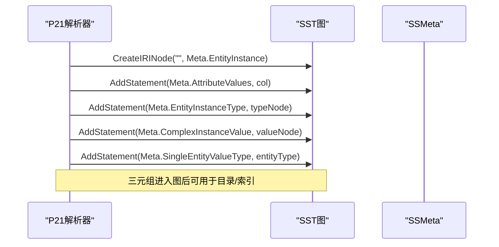
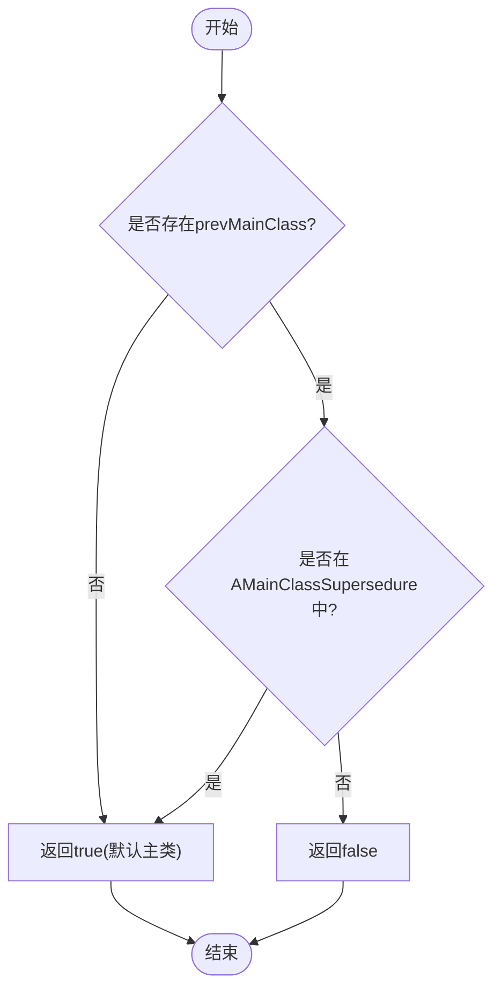
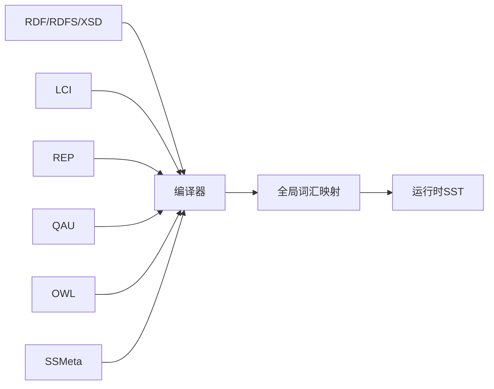
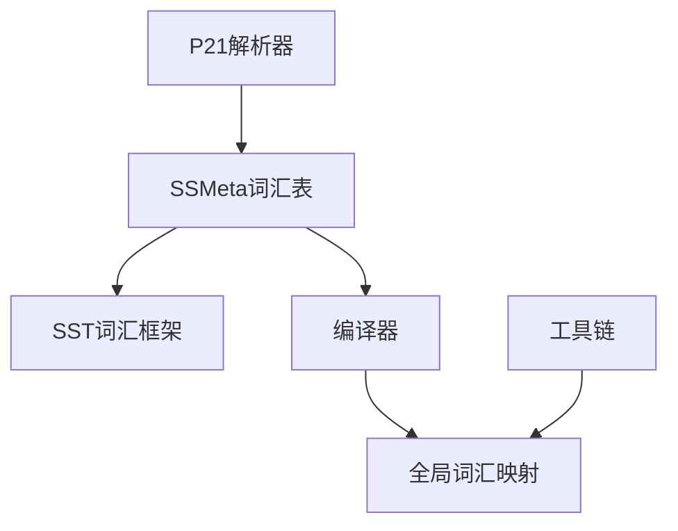

# SSMeta词汇表

<cite>
**本文引用的文件**
- [vocabulary.go](file://vocabularies/ssmeta/vocabulary.go)
- [doc.go](file://vocabularies/ssmeta/doc.go)
- [vocabulary.go](file://sst/vocabulary.go)
- [ibnode.go](file://sst/ibnode.go)
- [compiler.go](file://tools/compiler/compiler.go)
- [vocabularymap.go](file://vocabularies/dict/vocabularymap.go)
- [iso10303p21y2016parser.go](file://step/p21/iso10303p21y2016parser.go)
</cite>

## 目录
1. [简介](#简介)
2. [项目结构](#项目结构)
3. [核心组件](#核心组件)
4. [架构总览](#架构总览)
5. [详细组件分析](#详细组件分析)
6. [依赖关系分析](#依赖关系分析)
7. [性能考虑](#性能考虑)
8. [故障排查指南](#故障排查指南)
9. [结论](#结论)
10. [附录](#附录)

## 简介
SSMeta（SST Metadata）词汇表是SST系统用于描述和驱动元数据语义的核心本体。它定义了实体、类型、属性、枚举、映射与指令等概念，并通过BaseIRI统一命名空间，使SST在数据目录、索引、转换与验证等场景中具备一致的语义基础。本文件面向希望理解并正确使用SSMeta词汇表的开发者与集成方，提供从概念到实践的系统性说明。

## 项目结构
SSMeta词汇表位于 vocabularies/ssmeta 包中，由编译器生成，包含：
- 词汇表定义与BaseIRI
- 类、属性、数据类型、个体等元素声明
- 与RDF/OWL/RDFS的对应关系
- 与SST内部词汇系统的集成点

图表来源
- [vocabulary.go:14-16](file://vocabularies/ssmeta/vocabulary.go#L14-L16)
- [vocabulary.go:180-212](file://sst/vocabulary.go#L180-L212)
- [compiler.go:77-142](file://tools/compiler/compiler.go#L77-L142)
- [vocabularymap.go:3812](file://vocabularies/dict/vocabularymap.go#L3812)

章节来源
- [vocabulary.go:14-16](file://vocabularies/ssmeta/vocabulary.go#L14-L16)
- [vocabulary.go:180-212](file://sst/vocabulary.go#L180-L212)
- [compiler.go:77-142](file://tools/compiler/compiler.go#L77-L142)
- [vocabularymap.go:3812](file://vocabularies/dict/vocabularymap.go#L3812)

## 核心组件
- BaseIRI与命名空间
  - SSMETAVocabulary.BaseIRI 为 http://ontology.semanticstep.net/ssmeta，所有SSMeta元素的IRI均基于此前缀拼接“#”加元素名。
- 元素类型
  - 类：Entity、Schema、MainClass、OptionClass、AbstractClass、DefinedType、EnumerationClass 等
  - 属性：ofType、entityInstanceType、singleEntityValueType、attributeValues、formProperties 等
  - 数据类型：Flag（布尔）、goAlias（字符串）等
  - 个体：EmptyAgggregateValue、IndeterminateValue、DerivedValue、StepImMapAttributeSpecial 等
- 元数据能力
  - 主类替换：AMainClassSupersedure 支持版本演进时的主类覆盖
  - 域与值域：ADomain/ARange 约束属性的作用范围与取值类型
  - 继承关系：ASubtypeOf 表达类层次
  - 集合成员：ACollectionMemberType 表示列表成员类型
- 与SST集成
  - ElementInfo 扩展字段标记是否为选项类、抽象类、根类等
  - IsMainClass 方法用于判断当前主类是否被替代

章节来源
- [vocabulary.go:14-16](file://vocabularies/ssmeta/vocabulary.go#L14-L16)
- [vocabulary.go:186-212](file://sst/vocabulary.go#L186-L212)
- [vocabulary.go:268-278](file://sst/vocabulary.go#L268-L278)

## 架构总览
SSMeta词汇表通过编译器生成Go类型与常量，注册到全局词汇映射；运行时SST通过ElementInformer查询元素信息，结合BaseIRI构造IRI，并在数据目录、索引、转换流程中使用这些语义进行建模与处理。

图表来源
- [vocabulary.go:14-16](file://vocabularies/ssmeta/vocabulary.go#L14-L16)
- [vocabulary.go:180-212](file://sst/vocabulary.go#L180-L212)
- [vocabularymap.go:3812](file://vocabularies/dict/vocabularymap.go#L3812)
- [iso10303p21y2016parser.go:946-974](file://step/p21/iso10303p21y2016parser.go#L946-L974)

## 详细组件分析

### BaseIRI与命名空间管理
- BaseIRI固定为 http://ontology.semanticstep.net/ssmeta
- 元素IRI由 BaseIRI + "#" + 元素名构成
- 编译器将 ssmeta 前缀映射到该BaseIRI，便于在TTL/OWL中简写

图表来源
- [vocabulary.go:14-16](file://vocabularies/ssmeta/vocabulary.go#L14-L16)
- [compiler.go:115-142](file://tools/compiler/compiler.go#L115-L142)

章节来源
- [vocabulary.go:14-16](file://vocabularies/ssmeta/vocabulary.go#L14-L16)
- [compiler.go:115-142](file://tools/compiler/compiler.go#L115-L142)

### 元数据属性与类型体系
- 类层次
  - AbstractClass、MainClass、OptionClass、SelectClass 等用于控制模型行为
  - Entity、EntityInstance、DefinedType、EnumerationClass 等用于数据建模
- 属性约束
  - ofType：关联实例与其类型
  - entityInstanceType：指定实例的类型
  - singleEntityValueType：指定单值实体的类型
  - attributeValues：聚合属性值列表
- 数据类型与个体
  - Flag：布尔标志
  - EmptyAgggregateValue、IndeterminateValue、DerivedValue：特殊值个体

图表来源
- [vocabulary.go:186-212](file://sst/vocabulary.go#L186-L212)
- [vocabulary.go:14-16](file://vocabularies/ssmeta/vocabulary.go#L14-L16)
- [vocabulary.go:186-212](file://vocabularies/ssmeta/vocabulary.go#L186-L212)

章节来源
- [vocabulary.go:186-212](file://vocabularies/ssmeta/vocabulary.go#L186-L212)
- [vocabulary.go:186-212](file://sst/vocabulary.go#L186-L212)

### 数据目录与索引中的应用示例
- P21解析器在构建实体实例时，使用SSMeta属性建立语义关系：
  - 设置 attributeValues 以记录属性值集合
  - 设置 entityInstanceType 以指明实例类型
  - 设置 complexInstanceValue 与 singleEntityValueType 以区分复杂/简单值
- 这些三元组进入SST图后，可用于目录检索、索引构建与跨系统互操作。

图表来源
- [iso10303p21y2016parser.go:946-974](file://step/p21/iso10303p21y2016parser.go#L946-L974)

章节来源
- [iso10303p21y2016parser.go:946-974](file://step/p21/iso10303p21y2016parser.go#L946-L974)

### 主类替换与版本控制
- AMainClassSupersedure 用于声明主类的替代关系，支持版本演进中的向后兼容
- IsMainClass(prevMainClass) 可判断当前元素是否替代了之前的主类
- 在SST内部逻辑中，主类识别通过 rdf:type ssmeta:MainClass 指示

图表来源
- [vocabulary.go:268-278](file://sst/vocabulary.go#L268-L278)
- [ibnode.go:706](file://sst/ibnode.go#L706)

章节来源
- [vocabulary.go:268-278](file://sst/vocabulary.go#L268-L278)
- [ibnode.go:706](file://sst/ibnode.go#L706)

### 与其他系统元数据的集成
- 编译器将 ssmeta 与其他词汇（rdf、rdfs、xsd、lci、rep、qau、owl）组合，形成统一的命名空间映射
- 全局词汇映射将 SSMETAVocabulary.BaseIRI 与包级PKG关联，便于按命名空间查找元素
- 在STEP/P21转换中，SSMeta作为中间语义层，桥接领域模型与SST存储

图表来源
- [compiler.go:128-142](file://tools/compiler/compiler.go#L128-L142)
- [vocabularymap.go:3812](file://vocabularies/dict/vocabularymap.go#L3812)

章节来源
- [compiler.go:128-142](file://tools/compiler/compiler.go#L128-L142)
- [vocabularymap.go:3812](file://vocabularies/dict/vocabularymap.go#L3812)

## 依赖关系分析
- SSMeta词汇表依赖SST词汇框架提供的ElementInfo与Vocabulary机制
- 编译器负责将本体转换为Go代码，并注册到全局词汇映射
- 解析器与工具链通过SSMeta元素进行语义建模与数据转换

图表来源
- [vocabulary.go:180-212](file://sst/vocabulary.go#L180-L212)
- [compiler.go:77-142](file://tools/compiler/compiler.go#L77-L142)
- [vocabularymap.go:3812](file://vocabularies/dict/vocabularymap.go#L3812)
- [iso10303p21y2016parser.go:946-974](file://step/p21/iso10303p21y2016parser.go#L946-L974)

章节来源
- [vocabulary.go:180-212](file://sst/vocabulary.go#L180-L212)
- [compiler.go:77-142](file://tools/compiler/compiler.go#L77-L142)
- [vocabularymap.go:3812](file://vocabularies/dict/vocabularymap.go#L3812)
- [iso10303p21y2016parser.go:946-974](file://step/p21/iso10303p21y2016parser.go#L946-L974)

## 性能考虑
- 词汇查询通过ElementInformer在内存映射中进行，时间复杂度近似O(1)
- 主类替换检查基于map查找，亦为O(1)
- 建议在大规模图谱构建时复用已创建的IRI节点，避免重复分配
- 合理使用attributeValues与集合类型，减少冗余三元组数量

[本节为通用指导，不直接分析具体文件]

## 故障排查指南
- 无法找到元素
  - 确认元素已注册到全局词汇映射
  - 检查BaseIRI与前缀映射是否正确
- 主类识别异常
  - 检查AMainClassSupersedure是否设置正确
  - 确认IsMainClass调用时传入的prevMainClass是否符合预期
- 解析器生成的三元组不符合预期
  - 核对attributeValues、entityInstanceType、complexInstanceValue等属性的使用位置
  - 确保类型节点与值节点已正确创建并加入图

章节来源
- [vocabularymap.go:3812](file://vocabularies/dict/vocabularymap.go#L3812)
- [vocabulary.go:268-278](file://sst/vocabulary.go#L268-L278)
- [iso10303p21y2016parser.go:946-974](file://step/p21/iso10303p21y2016parser.go#L946-L974)

## 结论
SSMeta词汇表为SST提供了稳定、可扩展的元数据语义基础。通过BaseIRI与命名空间管理、丰富的类/属性/数据类型定义、以及主类替换机制，SSMeta支持数据目录、索引、转换与验证等多场景需求。结合编译器与全局词汇映射，SSMeta能够无缝集成到其他系统元数据中，实现跨领域的语义互通。

[本节为总结性内容，不直接分析具体文件]

## 附录
- 常用SSMeta元素速查
  - 实体与实例：Entity、EntityInstance
  - 类型与枚举：DefinedType、EnumerationClass、EnumerationValue
  - 主类控制：MainClass、OptionClass、AbstractClass、SelectClass
  - 属性与值：ofType、entityInstanceType、singleEntityValueType、attributeValues
  - 特殊值：EmptyAgggregateValue、IndeterminateValue、DerivedValue
  - 数据类型：Flag、goAlias
- 集成要点
  - 使用BaseIRI构造IRI
  - 通过ElementInformer查询元素信息
  - 在主类演进时使用AMainClassSupersedure声明替代关系
  - 在解析与转换流程中利用SSMeta属性建立语义关系

[本节为补充信息，不直接分析具体文件]