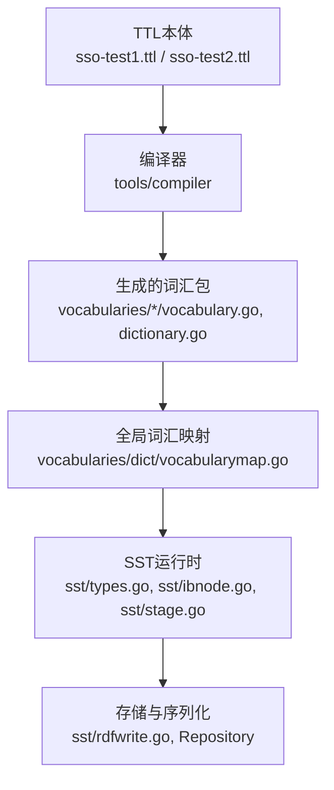
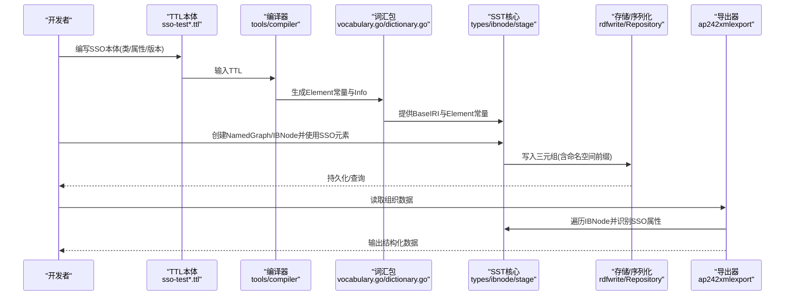
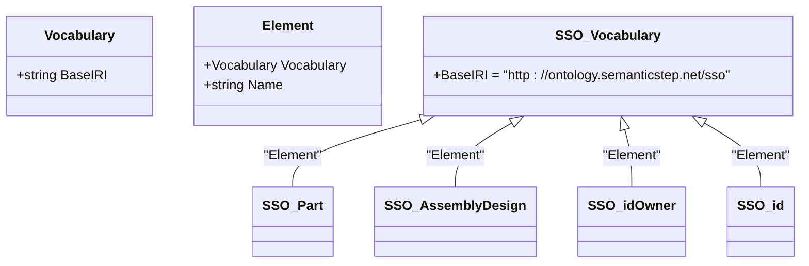
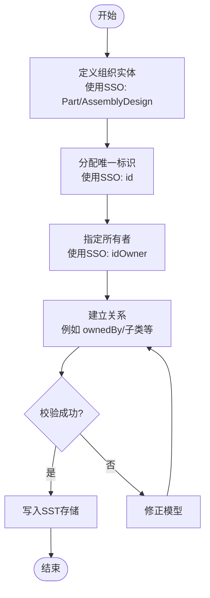
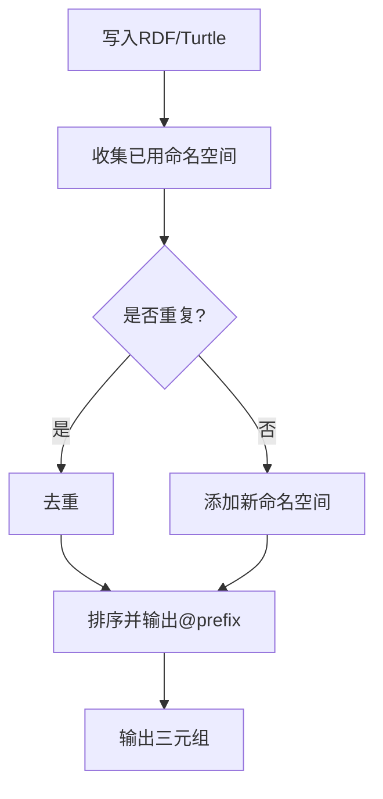
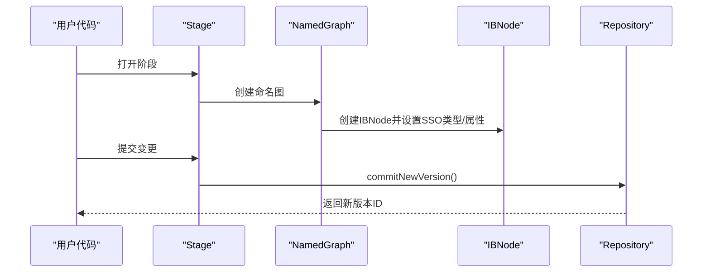
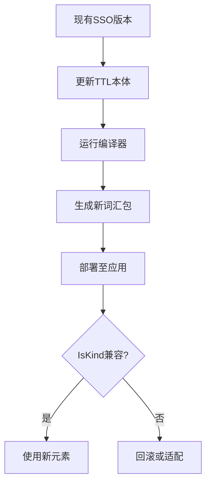
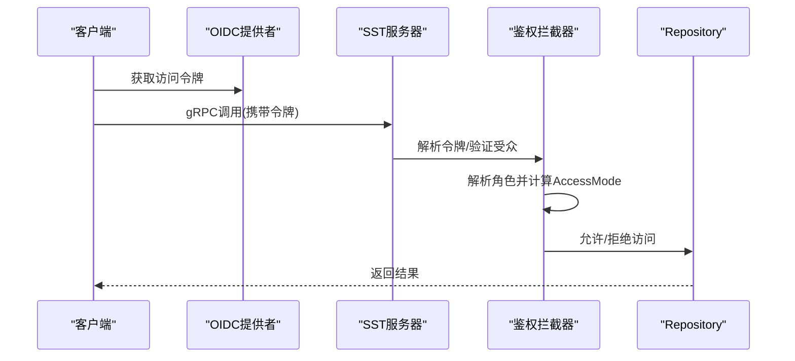
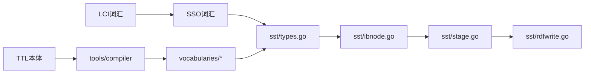

# SSO词汇表

<cite>
**本文引用的文件**
- [vocabularies/sso/doc.go](file://vocabularies/sso/doc.go)
- [sst/types.go](file://sst/types.go)
- [sst/ibnode.go](file://sst/ibnode.go)
- [sst/stage.go](file://sst/stage.go)
- [sst/rdfwrite.go](file://sst/rdfwrite.go)
- [tools/compiler/README.md](file://tools/compiler/README.md)
- [sst/testdata/sso-test1.ttl](file://sst/testdata/sso-test1.ttl)
- [sst/testdata/sso-test2.ttl](file://sst/testdata/sso-test2.ttl)
- [step/ap242xmlexport/ap242xmlexport.go](file://step/ap242xmlexport/ap242xmlexport.go)
- [sstauth/ACCESS_RIGHTS.md](file://sstauth/ACCESS_RIGHTS.md)
</cite>

## 目录
1. [简介](#简介)
2. [项目结构](#项目结构)
3. [核心组件](#核心组件)
4. [架构总览](#架构总览)
5. [详细组件分析](#详细组件分析)
6. [依赖关系分析](#依赖关系分析)
7. [性能考虑](#性能考虑)
8. [故障排查指南](#故障排查指南)
9. [结论](#结论)
10. [附录](#附录)

## 简介
本文件面向希望在SST（Semantic STEP Technology）中使用SSO（Semantic STEP Organization）词汇表进行组织语义建模的工程师与架构师。内容涵盖：
- SSO在STEP组织语义建模中的作用与用途
- SSO词汇表的组织实体、角色与关系定义
- 在企业组织架构建模中的应用示例
- BaseIRI配置与命名空间管理
- 在SST存储中基于SSO的组织数据存储方式
- 版本管理与扩展机制
- 与认证授权系统的集成方法

## 项目结构
SSO词汇表在本仓库中以“本体TTL + 编译产物 + 运行时类型”的形式存在：
- 本体定义位于测试数据中的TTL文件，描述SSO的类、属性与版本信息
- 运行时类型通过编译器生成或内联声明，提供强类型的Element常量与检查能力
- SST核心提供IBNode、NamedGraph、Repository等API用于读写RDF三元组，并支持命名空间前缀输出
- 工具链提供从TTL到Go词汇包的编译流程，以及全局词汇映射注册

图表来源
- [tools/compiler/README.md:51-72](file://tools/compiler/README.md#L51-L72)
- [sst/rdfwrite.go:487-535](file://sst/rdfwrite.go#L487-L535)
- [sst/types.go:218-234](file://sst/types.go#L218-L234)

章节来源
- [tools/compiler/README.md:51-72](file://tools/compiler/README.md#L51-L72)
- [sst/rdfwrite.go:487-535](file://sst/rdfwrite.go#L487-L535)

## 核心组件
- SSO词汇元素与BaseIRI
  - 在运行时类型中定义了SSO词汇的BaseIRI及若干Element常量，如Part、AssemblyDesign、idOwner、id等
  - BaseIRI为 http://ontology.semanticstep.net/sso
- IBNode与词汇元素匹配
  - IBNode支持Is/IsKind等方法，结合词汇元素的BaseIRI与Fragment进行精确匹配
  - InVocabulary可返回当前节点所属词汇元素，便于类型化访问
- 命名空间与前缀管理
  - 写入Turtle时自动收集并输出@prefix，确保不同词汇的命名空间隔离与可读性
- 编译器与推理
  - 编译器读取TTL本体，生成完整词汇包与轻量字典，并构建全局包含图以支持跨词汇的kind检查
- 组织建模与导出
  - 在AP242 XML导出中，使用SSO的ID属性对组织等实体进行标识与序列化

章节来源
- [sst/types.go:218-234](file://sst/types.go#L218-L234)
- [sst/ibnode.go:2373-2428](file://sst/ibnode.go#L2373-L2428)
- [sst/rdfwrite.go:487-535](file://sst/rdfwrite.go#L487-L535)
- [tools/compiler/README.md:87-127](file://tools/compiler/README.md#L87-L127)
- [step/ap242xmlexport/ap242xmlexport.go:881-897](file://step/ap242xmlexport/ap242xmlexport.go#L881-L897)

## 架构总览
下图展示了从TTL本体到SST存储与导出的整体流程，包括命名空间管理、词汇元素匹配与组织数据建模。

图表来源
- [sst/testdata/sso-test1.ttl:1-16](file://sst/testdata/sso-test1.ttl#L1-L16)
- [sst/testdata/sso-test2.ttl:1-18](file://sst/testdata/sso-test2.ttl#L1-L18)
- [tools/compiler/README.md:51-72](file://tools/compiler/README.md#L51-L72)
- [sst/rdfwrite.go:487-535](file://sst/rdfwrite.go#L487-L535)
- [step/ap242xmlexport/ap242xmlexport.go:881-897](file://step/ap242xmlexport/ap242xmlexport.go#L881-L897)

## 详细组件分析

### SSO词汇表定义与BaseIRI
- BaseIRI
  - 运行时类型为SSO词汇定义了BaseIRI：http://ontology.semanticstep.net/sso
- 词汇元素
  - 定义了Part、AssemblyDesign、idOwner、id等Element常量，用于企业组织与装配设计的语义建模
- 本体TTL
  - sso-test1.ttl与sso-test2.ttl描述了SSO Ontology、导入LCI、版本信息与类层次关系

图表来源
- [sst/types.go:218-234](file://sst/types.go#L218-L234)
- [sst/testdata/sso-test1.ttl:1-16](file://sst/testdata/sso-test1.ttl#L1-L16)
- [sst/testdata/sso-test2.ttl:1-18](file://sst/testdata/sso-test2.ttl#L1-L18)

章节来源
- [sst/types.go:218-234](file://sst/types.go#L218-L234)
- [sst/testdata/sso-test1.ttl:1-16](file://sst/testdata/sso-test1.ttl#L1-L16)
- [sst/testdata/sso-test2.ttl:1-18](file://sst/testdata/sso-test2.ttl#L1-L18)

### 组织实体、角色与关系建模
- 组织实体
  - 使用SSO的Part、AssemblyDesign等类表达组织单元与装配设计实体
- 角色与关系
  - 通过SSO的idOwner与id属性建立所有权与标识关系；在AP242导出中，这些属性被用于组织实体的序列化
- 类层次
  - AssemblyDesign作为ArrangedIndividual的子类，体现装配设计与个体排列的关系

图表来源
- [step/ap242xmlexport/ap242xmlexport.go:881-897](file://step/ap242xmlexport/ap242xmlexport.go#L881-L897)
- [sst/testdata/sso-test2.ttl:13-17](file://sst/testdata/sso-test2.ttl#L13-L17)

章节来源
- [step/ap242xmlexport/ap242xmlexport.go:881-897](file://step/ap242xmlexport/ap242xmlexport.go#L881-L897)
- [sst/testdata/sso-test2.ttl:13-17](file://sst/testdata/sso-test2.ttl#L13-L17)

### 命名空间管理与BaseIRI配置
- 命名空间前缀
  - 写入Turtle时自动收集并输出@prefix，确保不同词汇的命名空间隔离
- BaseIRI作用
  - 词汇元素通过BaseIRI与Fragment共同定位，IBNode的Is/isVocabularyElement依赖BaseIRI与Fragment匹配
- 最佳实践
  - 为每个词汇维护独立的BaseIRI；在SST中通过Element常量引用，避免硬编码字符串

图表来源
- [sst/rdfwrite.go:487-535](file://sst/rdfwrite.go#L487-L535)

章节来源
- [sst/rdfwrite.go:487-535](file://sst/rdfwrite.go#L487-L535)

### 在SST存储中使用SSO词汇表进行组织数据存储
- 创建与引用
  - 通过Stage/NamedGraph创建IBNode，并使用SSO的Element常量设置类型与属性
- 查询与验证
  - 使用IBNode.Is/IsKind进行类型与kind检查；InVocabulary获取词汇元素信息
- 提交与持久化
  - 将修改后的Stage提交为新版本，实现数据集的版本历史

图表来源
- [sst/stage.go:1389-1439](file://sst/stage.go#L1389-L1439)
- [sst/ibnode.go:2373-2428](file://sst/ibnode.go#L2373-L2428)

章节来源
- [sst/stage.go:1389-1439](file://sst/stage.go#L1389-L1439)
- [sst/ibnode.go:2373-2428](file://sst/ibnode.go#L2373-L2428)

### 版本管理与扩展机制
- 本体版本
  - TTL中通过owl:versionInfo标注SSO版本，便于追踪演进
- 编译器扩展
  - 新增词汇元素时，更新TTL并运行编译器，生成新的Element常量与Info
- 运行时兼容
  - 通过IsKind与全局包含图，确保跨词汇的类层次与kind检查正确工作

图表来源
- [tools/compiler/README.md:87-127](file://tools/compiler/README.md#L87-L127)
- [sst/testdata/sso-test1.ttl:8-11](file://sst/testdata/sso-test1.ttl#L8-L11)

章节来源
- [tools/compiler/README.md:87-127](file://tools/compiler/README.md#L87-L127)
- [sst/testdata/sso-test1.ttl:8-11](file://sst/testdata/sso-test1.ttl#L8-L11)

### 与认证授权系统的集成方法
- 认证流程
  - 客户端通过OIDC获取令牌，附加到gRPC上下文，服务端拦截器验证签名、过期与受众
- 授权模型
  - 基于角色的访问控制（RBAC），根据资源客户端的角色推导AccessMode，并与方法所需权限比较
- 与SSO的结合点
  - 在组织数据建模中，可通过SSO的idOwner关联资源所有者；在远程访问时，结合Keycloak角色决定对组织数据的读写权限

图表来源
- [sstauth/ACCESS_RIGHTS.md:52-101](file://sstauth/ACCESS_RIGHTS.md#L52-L101)

章节来源
- [sstauth/ACCESS_RIGHTS.md:52-101](file://sstauth/ACCESS_RIGHTS.md#L52-L101)

## 依赖关系分析
- 词汇依赖
  - SSO导入LCI，形成类层次与关系约束
- 运行时依赖
  - IBNode依赖词汇元素的BaseIRI与Fragment进行匹配
  - 编译器依赖TTL本体生成Go词汇包，并提供全局词汇映射
- 存储与序列化依赖
  - 写入Turtle时依赖命名空间集合与前缀输出逻辑

图表来源
- [sst/testdata/sso-test1.ttl:1-16](file://sst/testdata/sso-test1.ttl#L1-L16)
- [sst/types.go:218-234](file://sst/types.go#L218-L234)
- [sst/ibnode.go:2373-2428](file://sst/ibnode.go#L2373-L2428)
- [sst/stage.go:1389-1439](file://sst/stage.go#L1389-L1439)
- [sst/rdfwrite.go:487-535](file://sst/rdfwrite.go#L487-L535)
- [tools/compiler/README.md:51-72](file://tools/compiler/README.md#L51-L72)

章节来源
- [sst/testdata/sso-test1.ttl:1-16](file://sst/testdata/sso-test1.ttl#L1-L16)
- [sst/types.go:218-234](file://sst/types.go#L218-L234)
- [sst/ibnode.go:2373-2428](file://sst/ibnode.go#L2373-L2428)
- [sst/stage.go:1389-1439](file://sst/stage.go#L1389-L1439)
- [sst/rdfwrite.go:487-535](file://sst/rdfwrite.go#L487-L535)
- [tools/compiler/README.md:51-72](file://tools/compiler/README.md#L51-L72)

## 性能考虑
- 词汇匹配效率
  - IBNode的isVocabularyElement基于BaseIRI与Fragment的字符串比较，时间复杂度近似O(1)，适合高频类型检查
- 命名空间输出
  - 写入Turtle时对命名空间集合进行排序与去重，避免重复前缀，提升可读性与体积控制
- 编译器开销
  - 全量词汇包含图构建在编译期完成，不影响运行时性能；建议增量更新词汇后重新编译

[本节为通用指导，不直接分析具体文件]

## 故障排查指南
- 词汇元素未找到
  - 现象：调用InVocabulary().VocabularyElement()时抛出异常
  - 原因：节点不属于任何已知词汇或BaseIRI不匹配
  - 处理：确认命名图BaseIRI与Element.BaseIRI一致；检查词汇映射是否加载
- 命名空间冲突
  - 现象：Turtle输出中出现重复或错误的前缀
  - 原因：多处使用了相同BaseIRI但不同前缀
  - 处理：统一前缀策略；利用rdfwrite的自动前缀管理
- 版本不兼容
  - 现象：IsKind检查失败
  - 原因：词汇包未更新或未重新编译
  - 处理：更新TTL并运行编译器；确保部署最新词汇包

章节来源
- [sst/ibnode.go:2373-2428](file://sst/ibnode.go#L2373-L2428)
- [sst/rdfwrite.go:487-535](file://sst/rdfwrite.go#L487-L535)
- [tools/compiler/README.md:87-127](file://tools/compiler/README.md#L87-L127)

## 结论
SSO词汇表为SST提供了标准化的组织语义建模能力，通过BaseIRI与Element常量实现强类型访问，借助编译器与运行时机制保证可扩展性与兼容性。结合SST的存储与序列化能力，可在企业级场景中高效建模与管理组织数据；同时，与认证授权系统集成，可实现细粒度的访问控制。建议在项目中遵循命名空间规范、版本管理与编译器流程，以确保长期可维护性。

[本节为总结性内容，不直接分析具体文件]

## 附录
- 快速上手
  - 在TTL中定义SSO类与属性，运行编译器生成词汇包
  - 在SST中使用Element常量创建IBNode并设置属性
  - 提交Stage并查询/导出组织数据
- 参考路径
  - 本体定义：[sst/testdata/sso-test1.ttl](file://sst/testdata/sso-test1.ttl), [sst/testdata/sso-test2.ttl](file://sst/testdata/sso-test2.ttl)
  - 运行时类型：[sst/types.go](file://sst/types.go)
  - 词汇匹配：[sst/ibnode.go](file://sst/ibnode.go)
  - 命名空间输出：[sst/rdfwrite.go](file://sst/rdfwrite.go)
  - 编译器说明：[tools/compiler/README.md](file://tools/compiler/README.md)
  - 组织导出：[step/ap242xmlexport/ap242xmlexport.go](file://step/ap242xmlexport/ap242xmlexport.go)
  - 认证授权：[sstauth/ACCESS_RIGHTS.md](file://sstauth/ACCESS_RIGHTS.md)